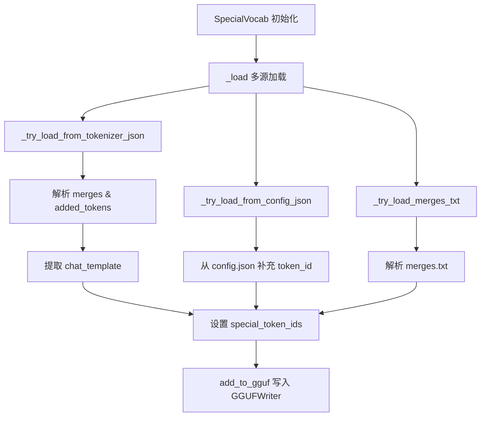
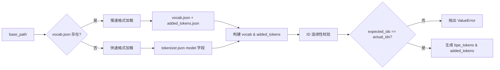
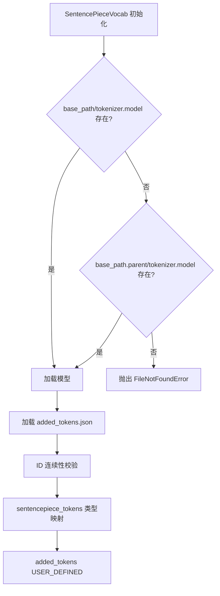
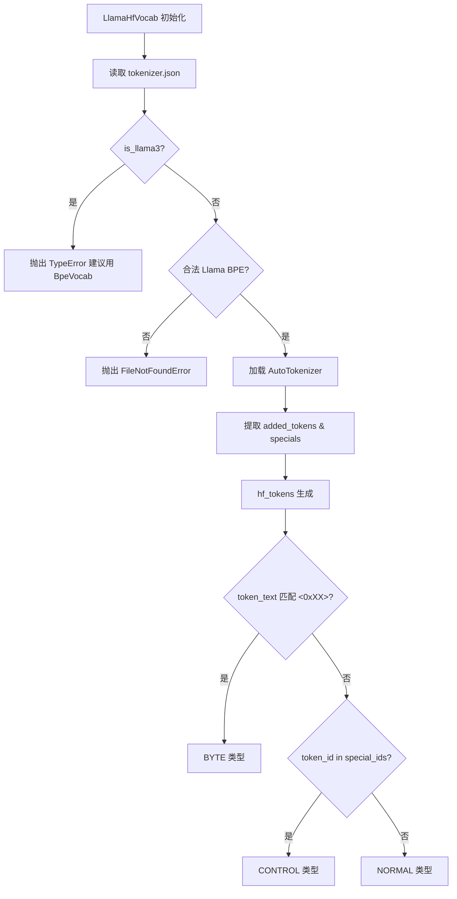
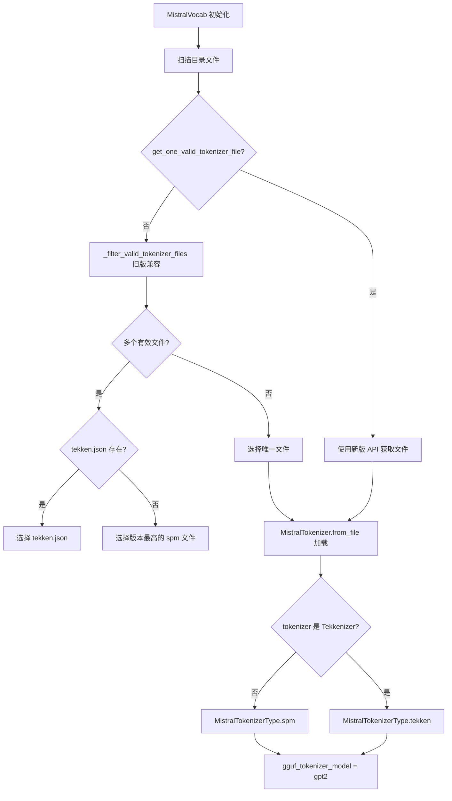
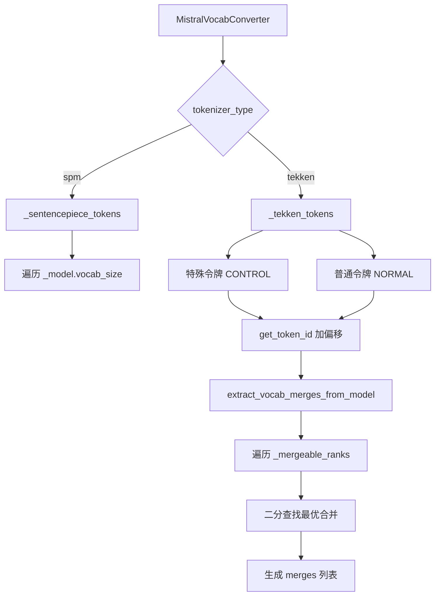

# 第63章 62 词表转换器家族 —— 多语言海关通关系统

## 学习目标

- 理解 SpecialVocab 如何统一管理和校验 BOS/EOS/UNK 等特殊令牌及其 ID
- 掌握 BPE 分词器（慢速/快速格式）的加载逻辑与 ID 连续性校验机制
- 理解 SentencePiece 模型的双路径查找策略与原生类型映射原理
- 掌握 LlamaHfVocab 如何利用 Transformers 库实现 HF 生态的词表适配
- 深入 MistralVocab 对 SPM 与 Tekken 双引擎分词器的动态路由机制
- 理解 MistralVocab 内部 SPM/Tekken 令牌生成方法（_sentencepiece_tokens/_tekken_tokens）的具体实现
- 理解 Tekken 模型中 BPE 合并规则的逆向提取算法与字节级 Unicode 编码转换
- 掌握 GGUF 词表写入的接口协议（add_to_gguf）与令牌类型标记体系

## 63.1 生活类比

想象一个繁忙的多语言海关通关系统，每天有成千上万的旅客从世界各地入境，而系统必须准确识别每个人的身份证件、判断其通行权限，同时把敏感信息妥善封装——这就是词表转换器每天在做的事。SpecialVocab 就是这个海关的证件核验科，专门处理 BOS、EOS、UNK 这些“外交护照”级别的特殊令牌：它检查每一个特殊令牌的 ID 是否在合法范围内（就像检查签证有效期），拒绝负数 ID 和超出词汇表大小的越界访问，然后决定是否将其放行写入 GGUF 元数据。BpeVocab 则像欧美护照通道，既能识别标准蓝本护照（vocab.json 分离存储的慢速格式），也能识别电子护照（tokenizer.json 内嵌的快速格式），但它最较真的是护照号码的连续性——新增令牌的 ID 必须紧接基础词表之后连续排列，一旦发现断裂立刻抛出 ValueError，就像安检人员发现护照号码不连续时果断拦下。SentencePieceVocab 是亚太证件通道，需要专用的识别设备（sentencepiece 库）才能工作，但它有一项特殊本领：能精确区分证件类型——IsUnknown 映射为 UNKNOWN、IsControl 映射为 CONTROL、IsUnused 映射为 UNUSED、IsByte 映射为 BYTE，同时保留原始评分（Score），就像海关官员能一眼看出你是外交人员、普通旅客还是需要特殊处理的货物。LlamaHfVocab 像一位万能翻译官，借助外交部的认证系统（AutoTokenizer）来处理各种 HuggingFace 生态的词表，连 `<0x00>` 这种特殊加密字符（BYTE 类型）都能识别，还能在新旧外交规则之间灵活兼容。MistralVocab 则是双引擎检查闸机：根据旅客持有的证件类型（SPM 或 Tekken 芯片）自动切换识别模式，内部集成 `_sentencepiece_tokens` 和 `_tekken_tokens` 两套处理流水线，而且特殊通道的号码需要加上偏移量才能得到完整的通行证号。至于 `bytes_to_unicode`，它就像一个字符熔炉，把空格和控制字符这些“易燃易爆品”熔炼成高位 Unicode（256+ 区间），装入特殊容器，防止在通关系统中引发解析混乱。

## 63.2 源码地图

```text
gguf-py/gguf/vocab.py
├── __main__                         # 模块初始化与全局导入检查
├── bytes_to_unicode()               # 字节到Unicode映射表生成 (553-574)
├── class BaseVocab (协议)
│   └── (协议定义)                    # tokenizer_model 与 name 类变量规范
├── class Vocab (协议)
│   ├── __init__()                   # 协议初始化声明 (272)
│   └── all_tokens()                 # 协议方法：统一迭代接口 (273)
├── class NoVocab
│   └── __repr__()                   # 无词表模型占位符表示 (277-278)
├── class SpecialVocab (35-264)
│   ├── __init__()                # 初始化特殊令牌容器与类型配置 (35-55)
│   ├── __repr__()                # 调试信息展示 (57-60)
│   ├── add_to_gguf()             # 写入GGUF：合并规则、特殊令牌、聊天模板 (62-84)
│   ├── _load()                   # 多源加载协调入口 (86-89)
│   │   ├── _try_load_from_tokenizer_json()  # 解析tokenizer.json (129-252)
│   │   ├── _try_load_merges_txt()           # 解析merges.txt (91-115)
│   │   └── _try_load_from_config_json()     # 解析config.json (254-264)
│   └── _set_special_token()      # 特殊令牌ID有效性校验 (117-127)
├── class BpeVocab (283-342)
│   ├── __init__()                # 双格式(vocab.json/tokenizer.json)加载 (283-324)
│   ├── bpe_tokens()              # 生成基础BPE令牌迭代器 (326-329)
│   ├── added_tokens()            # 生成新增令牌迭代器(类型CONTROL) (331-334)
│   ├── all_tokens()              # 组合输出所有令牌 (336-339)
│   └── __repr__()                # 统计信息展示 (341-342)
├── class SentencePieceVocab (348-415)
│   ├── __init__()                # sentencepiece库加载与路径查找 (348-381)
│   ├── sentencepiece_tokens()    # SPM原生令牌生成与类型映射 (383-402)
│   ├── added_tokens()            # 新增令牌(USER_DEFINED) (404-407)
│   ├── all_tokens()              # 组合输出 (409-412)
│   └── __repr__()                # 统计信息 (414-415)
├── class LlamaHfVocab (420-536)
│   ├── __init__()                # HF AutoTokenizer集成与Llama3检测 (420-488)
│   ├── hf_tokens()               # HF基础令牌生成与字节令牌识别 (490-503)
│   ├── get_token_type()          # 令牌类型判定（BYTE正则匹配） (505-510)
│   ├── get_token_score()         # 令牌分数占位符 (512-515)
│   ├── added_tokens()            # 新增/特殊令牌处理 (517-525)
│   ├── has_newline_token()       # 换行符检查 (527-528)
│   ├── all_tokens()              # 组合输出 (530-533)
│   └── __repr__()                # 统计信息展示 (535-536)
├── class MistralTokenizerType (枚举)
│   └── spm | tekken              # Mistral分词器类型标识
├── class MistralVocab (568-657)
│   ├── __init__()                # Mistral分词器加载与类型识别 (568-623)
│   ├── tokenizer_name            # 属性：分词器名称 (625-627)
│   ├── gguf_tokenizer_model      # 属性：GGUF模型类型映射 (629-631)
│   ├── _sentencepiece_tokens()   # SPM令牌生成（含Mistral适配） (633-650)
│   └── _tekken_tokens()          # Tekken令牌生成(初始化部分) (652-657)
└── class MistralVocabConverter (633-900)
    ├── _sentencepiece_tokens()   # SPM令牌生成（含Mistral适配） (633-650, 758-764)
    ├── _tekken_tokens()          # Tekken令牌生成(含特殊令牌偏移) (765-786)
    ├── get_token_id()            # ID查询(自动处理Tekken偏移) (787-799)
    ├── bos_id/eos_id/pad_id/unk_id   # 特殊令牌ID属性 (800-813)
    ├── bos_token/eos_token/pad_token/unk_token  # 特殊令牌字符串 (814-825)
    ├── all_tokens()              # 统一输出入口 (826-837)
    ├── token_bytes_to_string()   # 字节到Unicode字符串转换 (838-842)
    └── extract_vocab_merges_from_model()  # BPE合并规则逆向提取 (843-900)
```

## 63.3 SpecialVocab：特殊令牌的“户籍管理员”

SpecialVocab 是整个词表系统的“户籍管理员”，它不负责生成普通令牌，而是专门处理模型中的“身份象征”令牌（BOS/EOS/UNK/SEP/PAD 等），以及聊天模板和 BPE 合并规则。它的核心价值在于：把散落在 tokenizer.json、config.json、merges.txt 等多个配置文件中的特殊信息收集起来，统一校验 ID 的合法性，最后通过 `add_to_gguf` 接口把它们注册到 GGUFWriter 中。这种“多源加载 + 统一校验 + 类型自动路由”的设计，让上层转换逻辑无需关心特殊令牌的来源差异。



### 63.3.1 `SpecialVocab.__init__()`：初始化特殊令牌容器与类型配置

源码路径：`gguf-py/gguf/vocab.py` - `SpecialVocab`（35-55 行）

```python
def __init__(  # 初始化方法签名，接收路径、是否加载merges、特殊令牌类型列表、词表大小
    self, path: str | os.PathLike[str], load_merges: bool = False,
    special_token_types: Iterable[str] | None = None,
    n_vocab: int | None = None,
):
    self.special_token_ids = {}      # 存储各类型特殊令牌的ID（如 bos→0）
    self.add_special_token = {}      # 存储是否需要额外添加该类型令牌
    self.n_vocab = n_vocab           # 词汇表大小，用于ID范围校验
    self.load_merges = load_merges   # 是否需要加载BPE合并规则
    self.merges = []                 # BPE合并规则列表
    self.chat_template = None        # 聊天模板字符串
    if special_token_types is not None:
        self.special_token_types = special_token_types
    else:
        # 默认关注的特殊令牌类型集合
        self.special_token_types = ('bos', 'eos', 'unk', 'sep', 'pad', 'cls', 'mask')
    self._load(Path(path))           # 启动多源加载流程
```

这段代码定义了 SpecialVocab 的初始化流程：它先为特殊令牌 ID、添加标志、合并规则和聊天模板等属性设置空的默认值，再根据传入的 `special_token_types` 参数决定关注哪些特殊令牌类型（默认覆盖 bos/eos/unk/sep/pad/cls/mask 七种），最后调用 `_load` 方法启动多源加载。`n_vocab` 参数的预留体现了防御性编程——后续 `_set_special_token` 会用它来校验 ID 是否越界。

### 63.3.2 `SpecialVocab.__repr__()`：调试信息展示

源码路径：`gguf-py/gguf/vocab.py` - `SpecialVocab`（57-60 行）

```python
def __repr__(self) -> str:  # 返回实例的调试字符串表示
    return '<SpecialVocab with {} merges, special tokens {}, add special tokens {}>'.format(
        len(self.merges), self.special_token_ids or "unset", self.add_special_token or "unset",
    )
```

这段代码为 SpecialVocab 提供了一个简洁的调试字符串表示，展示合并规则数量、特殊令牌 ID 映射和添加标志三个关键状态。在交互式调试或日志输出中，开发者可以一眼判断 SpecialVocab 是否成功加载了预期的特殊令牌信息。

### 63.3.3 `SpecialVocab.add_to_gguf()`：写入 GGUF 的类型自动路由

源码路径：`gguf-py/gguf/vocab.py` - `SpecialVocab`（62-84 行）

```python
def add_to_gguf(self, gw: GGUFWriter, quiet: bool = False) -> None:  # 写入GGUFWriter的主入口
    if self.merges:  # 如果有BPE合并规则
        if not quiet:
            logger.info(f'Adding {len(self.merges)} merge(s).')
        gw.add_token_merges(self.merges)              # 写入BPE合并规则
    elif self.load_merges:  # 请求加载但未找到合并规则
        logger.warning('Adding merges requested but no merges found, output may be non-functional.')
    for typ, tokid in self.special_token_ids.items():  # 遍历特殊令牌ID字典
        # 动态查找GGUFWriter上对应类型的方法（如 add_bos_token_id）
        id_handler: Callable[[int], None] | None = getattr(gw, f'add_{typ}_token_id', None)
        if id_handler is None:
            logger.warning(f'No handler for special token type {typ} with id {tokid} - skipping')
            continue
        if not quiet:
            logger.info(f'Setting special token type {typ} to {tokid}')
        id_handler(tokid)  # 调用对应的setter方法写入ID
    for typ, value in self.add_special_token.items():  # 遍历特殊令牌添加标志
        # 动态查找 add_add_{typ}_token 方法（如 add_add_bos_token）
        add_handler: Callable[[bool], None] | None = getattr(gw, f'add_add_{typ}_token', None)
        if add_handler is None:
            logger.warning(f'No handler for add_{typ}_token with value {value} - skipping')
            continue
        if not quiet:
            logger.info(f'Setting add_{typ}_token to {value}')
        add_handler(value)  # 写入添加标志
    if self.chat_template is not None:  # 如果有聊天模板
        if not quiet:
            logger.info(f'Setting chat_template to {self.chat_template}')
        gw.add_chat_template(self.chat_template)       # 写入聊天模板
```

这段代码实现了 SpecialVocab 到 GGUFWriter 的“类型自动路由”写入：先处理 BPE 合并规则，再遍历 `special_token_ids` 字典，用 `getattr(gw, f'add_{typ}_token_id')` 动态调用 GGUFWriter 上的对应方法（如 `add_bos_token_id`、`add_eos_token_id`），最后写入聊天模板。这种设计避免了为每种特殊令牌类型硬编码写入逻辑，使得新增令牌类型时只需在 `special_token_types` 中添加字符串即可自动适配。

### 63.3.4 `SpecialVocab._load()`：多源加载协调入口

源码路径：`gguf-py/gguf/vocab.py` - `SpecialVocab`（86-89 行）

```python
def _load(self, path: Path) -> None:  # 多源加载的协调入口
    self._try_load_from_tokenizer_json(path)   # 优先从tokenizer.json加载
    self._try_load_from_config_json(path)      # 从config.json补充缺失的token id
    if self.load_merges and not self.merges:
        self._try_load_merges_txt(path)         # 备选：从merges.txt加载BPE规则
```

这段代码是多源加载的协调入口，采用“优先级递减 + 条件触发”的策略：先尝试从信息最全的 tokenizer.json 加载合并规则和特殊令牌，再用 config.json 补充可能缺失的 token ID，最后仅在确实需要合并规则且尚未加载成功时，才回退到 merges.txt。这种设计形成了冗余容错机制，即使某个配置文件缺失或格式不完整，也能从其他来源补全信息。

### 63.3.5 `SpecialVocab._try_load_merges_txt()`：解析 merges.txt 的版本兼容

源码路径：`gguf-py/gguf/vocab.py` - `SpecialVocab`（91-115 行）

```python
def _try_load_merges_txt(self, path: Path) -> bool:  # 尝试从merges.txt加载合并规则
    merges_file = path / 'merges.txt'  # 定位merges.txt文件
    if not merges_file.is_file():  # 文件不存在则返回False
        return False
    with open(merges_file, 'r', encoding = 'utf-8') as fp:  # 打开文件
        first_line = next(fp, '').strip()  # 读取第一行
        if not first_line.startswith('#'):  # 首行不是版本注释
            fp.seek(0)          # 回到文件开头
            line_num = 0
        else:  # 首行是版本注释（以#开头）
            line_num = 1        # 跳过版本注释行
        merges = []  # 存储合并规则
        for line in fp:  # 逐行解析
            line_num += 1
            line = line.strip()
            if not line:  # 跳过空行
                continue
            parts = line.split(None, 3)  # 按空白分割
            if len(parts) != 2:  # 必须恰好有两个token
                logger.warning(f'{merges_file.name}: Line {line_num}: Entry malformed, ignoring')
                continue
            merges.append(f'{parts[0]} {parts[1]}')  # 组合为"token1 token2"格式
    self.merges = merges  # 保存合并规则列表
    return True  # 加载成功
```

这段代码解析经典的 merges.txt 文件，处理了文件首行可能是版本注释（以 `#` 开头）的边界情况，并对每一行做格式校验（必须恰好有两个 token），遇到格式错误的行时记录警告但不中断加载。这种“宽容解析”策略确保即使 merges.txt 中存在少量格式不规范的行，转换流程仍能继续执行。

### 63.3.6 `SpecialVocab._set_special_token()`：特殊令牌 ID 的防御性校验

源码路径：`gguf-py/gguf/vocab.py` - `SpecialVocab`（117-127 行）

```python
def _set_special_token(self, typ: str, tid: Any) -> None:  # 设置并校验特殊令牌ID
    if not isinstance(tid, int):  # 非整数类型直接忽略
        return
    if tid < 0:  # 负数ID直接抛出异常
        raise ValueError(f'invalid value for special token type {typ}: {tid}')
    if self.n_vocab is None or tid < self.n_vocab:  # ID在合法范围内
        if typ in self.special_token_ids:  # 已设置则不重复覆盖
            return
        self.special_token_ids[typ] = tid  # 写入ID
        return
    logger.warning(f'Special token type {typ}, id {tid} out of range, must be under {self.n_vocab} - skipping')  # 越界则警告并跳过
```

这段代码实现了特殊令牌 ID 的防御性校验：首先拒绝非整数类型的输入（静默忽略），然后对负数 ID 直接抛出 ValueError（这是明确的错误，不能容忍），最后在 `n_vocab` 存在时检查 ID 是否越界——若未越界且未被设置过则写入，若已设置则不重复覆盖，若越界则记录警告后跳过。这种分层处理（忽略/报错/警告跳过）体现了对不同错误严重性的精准判断。

### 63.3.7 `SpecialVocab._try_load_from_tokenizer_json()`：解析 tokenizer.json 的完整流程

源码路径：`gguf-py/gguf/vocab.py` - `SpecialVocab`（129-252 行）

```python
def _try_load_from_tokenizer_json(self, path: Path) -> bool:  # 从tokenizer.json加载
    tokenizer = None
    tokenizer_file = path / 'tokenizer.json'
    if tokenizer_file.is_file():  # 文件存在则读取
        with open(tokenizer_file, encoding = 'utf-8') as f:
            tokenizer = json.load(f)
        if self.load_merges:  # 需要加载合并规则
            merges = tokenizer.get('model', {}).get('merges')
            if isinstance(merges, list) and merges:  # merges是非空列表
                if isinstance(merges[0], str):  # 旧格式：字符串列表
                    self.merges = merges
                elif isinstance(merges[0], list) and len(merges[0]) == 2 and isinstance(merges[0][0], str):  # 新格式：嵌套列表
                    # New format since transformers 4.45 to support spaces in merges
                    if any(' ' in s for pair in merges for s in pair):  # 检测空格
                        logger.warning(f'Spaces in merges detected, encoding as {chr(ord(" ") + 256)!r}')
                    self.merges = [
                        ' '.join([  # 将空格编码为高位Unicode
                            ''.join(
                                chr(ord(c) + 256) if c == ' ' else c
                                for c in part
                            )
                            for part in pair
                        ])
                        for pair in merges
                    ]
                else:
                    raise ValueError("Unknown tokenizer merges format")
            added_tokens = tokenizer.get('added_tokens', {})  # 获取added_tokens
    else:
        added_tokens = {}
    tokenizer_config = None
    tokenizer_config_file = path / 'tokenizer_config.json'
    if tokenizer_config_file.is_file():  # 读取tokenizer_config.json
        with open(tokenizer_config_file, encoding = 'utf-8') as f:
            tokenizer_config = json.load(f)
    if tokenizer:  # 有tokenizer时解析特殊令牌
        special_bos = (tokenizer_config or {}).get('bos_token')
        special_cls = (tokenizer_config or {}).get('cls_token')
        special_eos = (tokenizer_config or {}).get('eos_token')
        special_sep = (tokenizer_config or {}).get('sep_token')
        if not special_bos and special_cls and tokenizer_config:  # cls可兼容bos
            tokenizer_config['bos_token'] = special_bos = special_cls
        if not special_eos and special_sep and tokenizer_config:  # sep可兼容eos
            tokenizer_config['eos_token'] = special_eos = special_sep
        if post_processor := tokenizer.get('post_processor'):  # 解析后处理器
            for processor in post_processor.get('processors', [post_processor]):
                if processor.get('type') == 'RobertaProcessing':  # Roberta风格
                    self.add_special_token['bos'] = True
                    self.add_special_token['eos'] = True
                    self.add_special_token['sep'] = True
                    if not special_cls and tokenizer_config:
                        special_cls = processor.get('cls', [special_bos])[0]
                        tokenizer_config['cls_token'] = special_cls
                    if not special_sep and tokenizer_config:
                        special_sep = processor.get('sep', [special_eos])[0]
                        tokenizer_config['sep_token'] = special_sep
                    continue
                # Crude parsing of TemplateProcessing to determine if BOS/SEP/EOS should be added
                if processor.get('type') == 'TemplateProcessing':  # 模板处理
                    tmpl_single = processor.get('single', [])
                    tmpl_pair = processor.get('pair', [])
                    special_first = None
                    special_last = None
                    if len(tmpl_single) > 1:  # 单序列模板
                        if special_first := tmpl_single[0].get('SpecialToken', {}).get('id'):
                            if not tokenizer_config:
                                special_bos = special_first
                            self.add_special_token['bos'] = True if special_first in (special_bos, special_cls) else False
                            if special_first not in (special_bos, special_cls):
                                logger.warning(f'Unknown leading special token {special_first!r} in TemplateProcessing<single>')
                        if special_last := tmpl_single[-1].get('SpecialToken', {}).get('id'):
                            if not tokenizer_config:
                                special_eos = special_last
                            elif special_last != special_eos:
                                if 'eot' not in self.special_token_types:  # 动态扩展类型
                                    self.special_token_types = tuple(self.special_token_types) + ('eot', )
                                    tokenizer_config['eot_token'] = special_eos
                                elif 'eom' not in self.special_token_types:
                                    self.special_token_types = tuple(self.special_token_types) + ('eom', )
                                    tokenizer_config['eom_token'] = special_eos
                                else:
                                    logger.warning(f'Overriding EOS token {special_eos!r} with {special_last!r} without EOT/EOM fallback!')
                                tokenizer_config['eos_token'] = special_eos = special_last
                            self.add_special_token['eos'] = True if special_last == special_eos else False
                            if special_last != special_eos:
                                logger.warning(f'Unknown trailing special token {special_last!r} in TemplateProcessing<single>')
                    if tmpl_pair:  # 双序列模板
                        seq_start = 1 if special_first and tmpl_pair[0].get('SpecialToken', {}).get('id') == special_first else 0
                        seq_stop = -1 if special_last and tmpl_pair[-1].get('SpecialToken', {}).get('id') == special_last else None
                        if (special_first and seq_start == 0) or (special_last and seq_stop is None):
                            logger.warning('TemplateProcessing<single> leading/trailing special tokens do not match TemplateProcessing<pair>')
                        if tmpl_pair := tmpl_pair[slice(seq_start, seq_stop)]:
                            tmpl_a = tmpl_pair[0].get('Sequence', {}).get('id')
                            tmpl_b = tmpl_pair[-1].get('Sequence', {}).get('id')
                            if tmpl_a != 'A' or tmpl_b != 'B':
                                logger.warning(f'Unknown sequence {tmpl_a}...{tmpl_b} in TemplateProcessing<pair>')
                            # A [sep] [eos] B
                            if tmpl_a == 'A' and tmpl_b == 'B' and (tmpl_pair := tmpl_pair[1:-1]):
                                add_sep = False
                                if special_entry := tmpl_pair[0].get('SpecialToken', {}).get('id'):
                                    if special_entry in (special_sep, special_eos) and not special_last:
                                        add_sep = True
                                    if special_entry not in (special_sep, special_eos):
                                        logger.warning(f'Unknown separator token {special_entry!r} in TemplateProcessing<pair>')
                                else:
                                    logger.warning(f'Unknown middle sequence {tmpl_pair[0]!r} in TemplateProcessing<pair>')
                                if len(tmpl_pair) == 2:
                                    if special_entry := tmpl_pair[1].get('SpecialToken', {}).get('id'):
                                        if special_entry in (special_sep, special_eos):
                                            add_sep = True
                                        if special_entry not in (special_sep, special_eos):
                                            logger.warning(f'Unknown second separator token {special_entry!r} in TemplateProcessing<pair>')
                                    else:
                                        logger.warning(f'Unknown second middle sequence {tmpl_pair[1]!r} in TemplateProcessing<pair>')
                                self.add_special_token['sep'] = add_sep
                                if add_sep and not special_sep and tokenizer_config:
                                    tokenizer_config['sep_token'] = special_eos
                        continue
    if not tokenizer_config:  # 无配置则结束
        return True
    chat_template_alt = None
    chat_template_json = path / 'chat_template.json'
    chat_template_jinja = path / 'chat_template.jinja'
    if chat_template_jinja.is_file():  # 优先加载jinja模板
        with open(chat_template_jinja, encoding = 'utf-8') as f:
            chat_template_alt = f.read()
        if additional_templates := list((path / 'additional_chat_templates').glob('*.jinja')):  # 额外模板
            chat_template_alt = [{'name': 'default', 'template': chat_template_alt}]
            for template_path in additional_templates:
                with open(template_path, encoding = 'utf-8') as fp:
                    chat_template_alt.append({'name': template_path.stem, 'template': fp.read()})
    elif chat_template_json.is_file():  # 次选json模板
        with open(chat_template_json, encoding = 'utf-8') as f:
            chat_template_alt = json.load(f).get('chat_template')
    chat_template = tokenizer_config.get('chat_template', chat_template_alt)  # 最终模板
    if chat_template is None or isinstance(chat_template, (str, list)):
        self.chat_template = chat_template
    else:
        logger.warning(f'Bad type for chat_template field in {tokenizer_config_file!r} - ignoring')
    for typ in self.special_token_types:  # 遍历特殊令牌类型
        add_entry = tokenizer_config.get(f'add_{typ}_token')  # 读取添加标志
        if isinstance(add_entry, bool):
            self.add_special_token[typ] = add_entry
        entry = tokenizer_config.get(f'{typ}_token')  # 读取令牌内容
        if isinstance(entry, str):
            tc_content = entry
        elif isinstance(entry, dict):
            entry_content = entry.get('content')
            if not isinstance(entry_content, str):
                continue
            tc_content = entry_content
        else:
            continue
        # We only need the first match here.
        maybe_token_id = next(  # 在added_tokens中反查ID
            (atok.get('id') for atok in added_tokens if atok.get('content') == tc_content),
            None,
        )
        self._set_special_token(typ, maybe_token_id)  # 校验并设置
    return True
```

这段代码是 SpecialVocab 最复杂的核心方法，负责从 tokenizer.json 和 tokenizer_config.json 中提取合并规则、特殊令牌和聊天模板。它处理了 transformers 4.45+ 新版 merges 格式（列表嵌套结构）并用 `chr(ord(' ') + 256)` 编码空格以兼容旧格式；通过解析 post_processor 中的 RobertaProcessing 和 TemplateProcessing 来推断 BOS/EOS/SEP 的添加行为；按优先级加载 chat_template.jinja、chat_template.json 和 tokenizer_config.json 中的聊天模板定义；最后从 added_tokens 中反查特殊令牌的 ID 并调用 `_set_special_token` 做防御性校验。

### 63.3.8 `SpecialVocab._try_load_from_config_json()`：从 config.json 补充 token ID

源码路径：`gguf-py/gguf/vocab.py` - `SpecialVocab`（254-264 行）

```python
def _try_load_from_config_json(self, path: Path) -> bool:  # 从config.json补充token ID
    config_file = path / 'config.json'
    if not config_file.is_file():  # 文件不存在
        return False
    with open(config_file, encoding = 'utf-8') as f:  # 读取配置
        config = json.load(f)
    for typ in self.special_token_types:  # 遍历特殊令牌类型
        token_id = config.get(f'{typ}_token_id')  # 从根层获取
        # If not found at root, check in text_config (for multimodal models like Kimi-VL)
        if token_id is None and 'text_config' in config:  # 多模态模型下沉到text_config
            token_id = config['text_config'].get(f'{typ}_token_id')
        self._set_special_token(typ, token_id)  # 统一校验设置
    return True
```

这段代码从 config.json 中读取特殊令牌的 ID，作为 tokenizer.json 解析失败或缺失时的补充来源。它特别考虑了多模态模型（如 Kimi-VL）的配置结构——当根层找不到 `bos_token_id` 等字段时，会下沉到 `text_config` 子字典中查找，然后交由 `_set_special_token` 做统一的防御性校验。这种“根层优先 + text_config 兜底”的策略保证了多模态模型的特殊令牌也能被正确识别。

## 63.4 BpeVocab：GPT-2 词表的“格式解析专家”

BpeVocab 专门处理 GPT-2 风格的 BPE 分词器，它的核心能力是“双格式兼容”：既能解析慢速格式（vocab.json + added_tokens.json 分离存储），也能解析快速格式（tokenizer.json 内嵌 model 字段）。它最严格的约束是 ID 连续性守卫——要求新增令牌的 ID 必须紧接基础词表之后连续排列，否则直接抛出 ValueError。这种设计确保了词汇表的紧凑性，防止因 ID 碎片化导致的内存浪费或运行时错误。在我们的海关类比中，BpeVocab 就是欧美护照通道，既能识别标准蓝本护照，也能识别电子护照，但护照号码必须连续。



### 63.4.1 `BpeVocab.__init__()`：双格式加载与 ID 连续性校验

源码路径：`gguf-py/gguf/vocab.py` - `BpeVocab`（283-324 行）

```python
def __init__(self, base_path: Path):  # 初始化方法
    added_tokens: dict[str, int] = {}  # 存储新增令牌的映射

    if (fname_tokenizer := base_path / 'vocab.json').exists():  # 慢速格式：vocab.json存在
        # "slow" tokenizer
        with open(fname_tokenizer, encoding="utf-8") as f:  # 读取基础词表
            self.vocab = json.load(f)

        try:  # 尝试读取新增令牌
            # FIXME: Verify that added tokens here _cannot_ overlap with the main vocab.
            with open(base_path / 'added_tokens.json', encoding="utf-8") as f:
                added_tokens = json.load(f)
        except FileNotFoundError:  # 无新增令牌文件则忽略
            pass
    else:  # 快速格式：vocab.json不存在，尝试tokenizer.json
        # "fast" tokenizer
        fname_tokenizer = base_path / 'tokenizer.json'

        # if this fails, FileNotFoundError propagates to caller
        with open(fname_tokenizer, encoding="utf-8") as f:  # 读取tokenizer.json
            tokenizer_json = json.load(f)

        tokenizer_model: dict[str, Any] = tokenizer_json['model']  # 获取model字段
        if (  # 必须满足三个条件才是合法的GPT-2 BPE
            tokenizer_model['type'] != 'BPE' or tokenizer_model.get('byte_fallback', False)
            or tokenizer_json['decoder']['type'] != 'ByteLevel',
        ):
            raise FileNotFoundError('Cannot find GPT-2 BPE tokenizer')

        self.vocab = tokenizer_model["vocab"]  # 从model获取词表

        if (added := tokenizer_json.get('added_tokens')) is not None:  # 处理新增令牌
            # Added tokens here can be duplicates of the main vocabulary.
            added_tokens = {item['content']: item['id']  # 过滤掉与基础词表重复的
                            for item in added
                            if item['content'] not in self.vocab}

    vocab_size   = len(self.vocab)  # 基础词表大小
    expected_ids = list(range(vocab_size, vocab_size + len(added_tokens)))  # 期望的连续ID
    actual_ids   = sorted(added_tokens.values())  # 实际新增令牌的ID
    if expected_ids != actual_ids:  # ID不连续则抛出异常
        expected_end_id = vocab_size + len(actual_ids) - 1
        raise ValueError(f"Expected the {len(actual_ids)} added token ID(s) to be sequential in the range "
                         f"{vocab_size} - {expected_end_id}; got {actual_ids}")

    items = sorted(added_tokens.items(), key=lambda text_idx: text_idx[1])  # 按ID排序
    self.added_tokens_dict    = added_tokens  # 新增令牌字典
    self.added_tokens_list    = [text for (text, idx) in items]  # 新增令牌列表（按ID顺序）
    self.vocab_size_base      = vocab_size  # 基础词表大小
    self.vocab_size           = self.vocab_size_base + len(self.added_tokens_list)  # 总词表大小
    self.fname_tokenizer      = fname_tokenizer  # 记录源文件路径
```

这段代码实现了 BpeVocab 的双格式加载与 ID 连续性校验：慢速格式从 vocab.json 读取基础词表、从 added_tokens.json 读取新增令牌；快速格式从 tokenizer.json 的 model 字段读取 vocab，并从 added_tokens 列表中过滤掉与基础词表重复的项。关键的连续性校验通过比较 `expected_ids`（从 vocab_size 开始的连续整数）和 `actual_ids`（新增令牌的实际 ID 排序列表）来实现，一旦发现不匹配立即抛出 ValueError，防止词汇表碎片化。

### 63.4.2 `BpeVocab.bpe_tokens()`：基础 BPE 令牌生成器

源码路径：`gguf-py/gguf/vocab.py` - `BpeVocab`（326-329 行）

```python
def bpe_tokens(self) -> Iterable[tuple[bytes, float, gguf.TokenType]]:  # 生成基础BPE令牌迭代器
    reverse_vocab = {id: encoded_tok for encoded_tok, id in self.vocab.items()}  # 构建反向词表 ID->token

    for i, _ in enumerate(self.vocab):  # 按ID顺序遍历
        yield reverse_vocab[i], 0.0, gguf.TokenType.NORMAL  # 产出(token_bytes, score=0.0, type=NORMAL)
```

这段代码生成基础 BPE 词表中所有令牌的迭代器，统一返回 `(bytes, float, TokenType)` 三元组。它通过构建反向词表（ID→token）来按 ID 顺序遍历，每个基础令牌的分数固定为 0.0，类型标记为 NORMAL，供 GGUFWriter 消费。

### 63.4.3 `BpeVocab.added_tokens()`：新增令牌的 CONTROL 标记

源码路径：`gguf-py/gguf/vocab.py` - `BpeVocab`（331-334 行）

```python
def added_tokens(self) -> Iterable[tuple[bytes, float, gguf.TokenType]]:  # 生成新增令牌迭代器
    for text in self.added_tokens_list:  # 遍历按ID排序的新增令牌
        score = -1000.0  # 统一赋予极低分数
        yield text.encode("utf-8"), score, gguf.TokenType.CONTROL  # 产出(token_bytes, score, type=CONTROL)
```

这段代码生成新增令牌的迭代器，所有新增令牌统一标记为 CONTROL 类型并赋予极低分数（-1000.0），作为“外来户”的标识。这种设计让下游处理可以轻松区分基础词表中的原生令牌和后来添加的特殊令牌。

### 63.4.4 `BpeVocab.all_tokens()`：组合输出所有令牌

源码路径：`gguf-py/gguf/vocab.py` - `BpeVocab`（336-339 行）

```python
def all_tokens(self) -> Iterable[tuple[bytes, float, gguf.TokenType]]:  # Vocab协议要求的统一接口
    yield from self.bpe_tokens()  # 先产出基础BPE令牌（NORMAL类型）
    yield from self.added_tokens()  # 再产出新增令牌（CONTROL类型）
```

这段代码实现了 Vocab 协议要求的 `all_tokens` 接口，先产出基础 BPE 令牌（NORMAL 类型），再产出新增令牌（CONTROL 类型），为 GGUFWriter 提供统一的迭代消费入口。

### 63.4.5 `BpeVocab.__repr__()`：统计信息展示

源码路径：`gguf-py/gguf/vocab.py` - `BpeVocab`（341-342 行）

```python
def __repr__(self) -> str:  # 调试字符串表示
    return f"<BpeVocab with {self.vocab_size_base} base tokens and {len(self.added_tokens_list)} added tokens>"
```

这段代码为 BpeVocab 提供了简洁的统计信息展示，清晰区分基础令牌数和新增令牌数，便于在转换日志中快速验证词表加载结果。

## 63.5 SentencePieceVocab：SPM 模型的“类型侦探”

SentencePieceVocab 专门处理 SentencePiece 风格的分词器，它的核心能力是“类型侦探”——利用 sentencepiece 库的原生 API 精确判断每个令牌的类型（UNKNOWN/CONTROL/UNUSED/BYTE），而不是像 BpeVocab 那样做简单标记。它还支持双路径查找策略：优先在传入路径下找 tokenizer.model，找不到则回溯到父目录，适应模型文件与配置文件分离的组织结构。在我们的类比中，SentencePieceVocab 就是亚太证件通道，需要专用的识别设备，但能精确区分证件类型。



### 63.5.1 `SentencePieceVocab.__init__()`：sentencepiece 库加载与双路径查找

源码路径：`gguf-py/gguf/vocab.py` - `SentencePieceVocab`（348-381 行）

```python
def __init__(self, base_path: Path):  # 初始化方法
    if SentencePieceProcessor is None:  # 显式检查依赖是否安装
        raise RuntimeError("sentencepiece is not installed")

    added_tokens: dict[str, int] = {}  # 存储新增令牌
    if (fname_tokenizer := base_path / 'tokenizer.model').exists():  # 优先在base_path下查找
        # normal location
        try:
            with open(base_path / 'added_tokens.json', encoding="utf-8") as f:  # 读取新增令牌
                added_tokens = json.load(f)
        except FileNotFoundError:
            pass
    elif not (fname_tokenizer := base_path.parent / 'tokenizer.model').exists():  # 回溯到父目录
        # not found in alternate location either
        raise FileNotFoundError('Cannot find tokenizer.model')  # 均失败则抛出异常

    self.sentencepiece_tokenizer = SentencePieceProcessor()  # 创建SP处理器
    self.sentencepiece_tokenizer.LoadFromFile(str(fname_tokenizer))  # 加载模型文件
    vocab_size = self.sentencepiece_tokenizer.vocab_size()  # 获取基础词表大小

    new_tokens       = {id: piece for piece, id in added_tokens.items() if id >= vocab_size}  # 过滤新增令牌
    expected_new_ids = list(range(vocab_size, vocab_size + len(new_tokens)))  # 期望的连续ID
    actual_new_ids   = sorted(new_tokens.keys())  # 实际ID

    if expected_new_ids != actual_new_ids:  # ID连续性校验
        raise ValueError(f"Expected new token IDs {expected_new_ids} to be sequential; got {actual_new_ids}")

    # Token pieces that were added to the base vocabulary.
    self.added_tokens_dict  = added_tokens  # 完整新增令牌字典
    self.added_tokens_list  = [new_tokens[id] for id in actual_new_ids]  # 按ID顺序的新增令牌列表
    self.vocab_size_base    = vocab_size  # 基础词表大小
    self.vocab_size         = self.vocab_size_base + len(self.added_tokens_list)  # 总词表大小
    self.fname_tokenizer    = fname_tokenizer  # 记录源文件路径
```

这段代码实现了 SentencePieceVocab 的初始化：首先显式检查 sentencepiece 库是否安装（未安装时直接抛出 RuntimeError，避免运行时静默失败），然后采用双路径查找策略——优先在 base_path 下找 tokenizer.model，找不到则回溯到父目录，均失败时抛出 FileNotFoundError。加载模型后，同样对新增令牌做 ID 连续性校验，确保新增令牌从 vocab_size 开始连续排列。

### 63.5.2 `SentencePieceVocab.sentencepiece_tokens()`：SPM 原生类型映射

源码路径：`gguf-py/gguf/vocab.py` - `SentencePieceVocab`（383-402 行）

```python
def sentencepiece_tokens(self) -> Iterable[tuple[bytes, float, gguf.TokenType]]:  # 生成SPM令牌迭代器
    tokenizer = self.sentencepiece_tokenizer  # 获取SP处理器
    for i in range(tokenizer.vocab_size()):  # 遍历所有令牌ID
        piece = tokenizer.IdToPiece(i)  # 获取令牌字符串
        text         = piece.encode("utf-8")  # 转为bytes
        score: float = tokenizer.GetScore(i)  # 获取原始分数（负对数似然）

        toktype = gguf.TokenType.NORMAL  # 默认NORMAL
        if tokenizer.IsUnknown(i):  # 原生API判断UNKNOWN
            toktype = gguf.TokenType.UNKNOWN
        if tokenizer.IsControl(i):  # 原生API判断CONTROL
            toktype = gguf.TokenType.CONTROL

        # NOTE: I think added_tokens are user defined.
        # ref: https://github.com/google/sentencepiece/blob/master/src/sentencepiece_model.proto
        # if tokenizer.is_user_defined(i): toktype = gguf.TokenType.USER_DEFINED

        if tokenizer.IsUnused(i):  # 原生API判断UNUSED
            toktype = gguf.TokenType.UNUSED
        if tokenizer.IsByte(i):  # 原生API判断BYTE
            toktype = gguf.TokenType.BYTE

        yield text, score, toktype  # 产出(token_bytes, score, type)
```

这段代码是 SentencePieceVocab 的核心——利用 sentencepiece 库的原生 API 精确判断每个令牌的类型：IsUnknown→UNKNOWN、IsControl→CONTROL、IsUnused→UNUSED、IsByte→BYTE，默认为 NORMAL。它直接透传 SPM 原生的 GetScore 得分（通常是负对数似然），保持与原训练概率的一致性。这种“类型侦探”式的设计让 GGUF 文件能完整保留 SPM 模型的语义信息。

### 63.5.3 `SentencePieceVocab.added_tokens()`：新增令牌的 USER_DEFINED 标记

源码路径：`gguf-py/gguf/vocab.py` - `SentencePieceVocab`（404-407 行）

```python
def added_tokens(self) -> Iterable[tuple[bytes, float, gguf.TokenType]]:  # 生成新增令牌迭代器
    for text in self.added_tokens_list:  # 遍历按ID顺序的新增令牌
        score = -1000.0  # 占位符分数
        yield text.encode("utf-8"), score, gguf.TokenType.USER_DEFINED  # 标记为USER_DEFINED
```

这段代码生成新增令牌的迭代器，与 BpeVocab 将新增令牌标记为 CONTROL 不同，SentencePieceVocab 将其标记为 USER_DEFINED，分数同样设为 -1000.0 作为占位符。这种类型区分让下游处理能更精确地识别“用户自定义”的令牌。

### 63.5.4 `SentencePieceVocab.all_tokens()` 与 `__repr__()`

源码路径：`gguf-py/gguf/vocab.py` - `SentencePieceVocab`（409-415 行）

```python
def all_tokens(self) -> Iterable[tuple[bytes, float, gguf.TokenType]]:  # 统一迭代接口
    yield from self.sentencepiece_tokens()  # 产出基础SPM令牌
    yield from self.added_tokens()  # 产出新增令牌

def __repr__(self) -> str:  # 调试字符串表示
    return f"<SentencePieceVocab with {self.vocab_size_base} base tokens and {len(self.added_tokens_list)} added tokens>"
```

这段代码实现了 Vocab 协议的 `all_tokens` 接口，组合基础 SPM 令牌和新增令牌，并通过 `__repr__` 提供统计信息展示，与 BpeVocab 保持一致的接口风格。

## 63.6 LlamaHfVocab：HF 生态的“统一适配器”

LlamaHfVocab 是 HuggingFace 生态的“万能翻译官”，它借助 transformers 库的 AutoTokenizer 来统一处理各种 HF 风格的词表。它的独特之处在于：能识别 `<0x00>` 到 `<0xFF>` 这种字节级令牌（BYTE 类型），并通过正则表达式精确匹配；同时它能通过检查 `ignore_merges`、`byte_fallback` 等字段来精确识别 Llama 3 特征，若检测到 Llama 3 配置则主动拒绝并建议改用 BpeVocab，避免错误的转换路径。在我们的类比中，LlamaHfVocab 就像一位万能翻译官，借助外交部的认证系统来处理各种 HuggingFace 生态的词表。



### 63.6.1 `LlamaHfVocab.__init__()`：HF AutoTokenizer 集成与 Llama3 检测

源码路径：`gguf-py/gguf/vocab.py` - `LlamaHfVocab`（420-488 行）

```python
def __init__(self, base_path: Path):  # 初始化方法
    fname_tokenizer = base_path / 'tokenizer.json'
    # if this fails, FileNotFoundError propagates to caller
    with open(fname_tokenizer, encoding='utf-8') as f:  # 读取tokenizer.json
        tokenizer_json = json.load(f)

    # pre-check so we know if we need transformers
    tokenizer_model: dict[str, Any] = tokenizer_json['model']  # 获取model配置
    is_llama3 = (  # 精确识别Llama 3特征
        tokenizer_model['type'] == 'BPE' and tokenizer_model.get('ignore_merges', False)
        and not tokenizer_model.get('byte_fallback', True),
    )
    if is_llama3:  # 检测到Llama 3则主动拒绝
        raise TypeError('Llama 3 must be converted with BpeVocab')

    if not is_llama3 and (  # 必须满足三个条件才是合法的Llama BPE
        tokenizer_model['type'] != 'BPE' or not tokenizer_model.get('byte_fallback', False)
        or tokenizer_json['decoder']['type'] != 'Sequence',
    ):
        raise FileNotFoundError('Cannot find Llama BPE tokenizer')

    try:  # 依赖transformers库
        from transformers import AutoTokenizer
    except ImportError as e:
        raise ImportError(
            "To use LlamaHfVocab, please install the `transformers` package. "
            "You can install it with `pip install transformers`."
        ) from e

    # Allow the tokenizer to default to slow or fast versions.
    # Explicitly set tokenizer to use local paths.
    self.tokenizer = AutoTokenizer.from_pretrained(  # 加载HF分词器
        base_path,
        cache_dir=base_path,
        local_files_only=True,
    )
    assert self.tokenizer.is_fast  # 假设使用tokenizer.json（fast模式）

    # Initialize lists and dictionaries for added tokens
    self.added_tokens_list = []  # 新增令牌列表
    self.added_tokens_dict = dict()  # 新增令牌字典
    self.added_tokens_ids  = set()  # 新增令牌ID集合

    # Process added tokens
    for tok, tokidx in sorted(  # 遍历HF分词器的新增词表
        self.tokenizer.get_added_vocab().items(), key=lambda x: x[1]
    ):
        # Only consider added tokens that are not in the base vocabulary
        if tokidx >= self.tokenizer.vocab_size:  # ID大于等于基础词表大小
            self.added_tokens_list.append(tok)
            self.added_tokens_dict[tok] = tokidx
            self.added_tokens_ids.add(tokidx)

    # Store special tokens and their IDs
    self.specials = {  # 特殊令牌字符串->ID映射
        tok: self.tokenizer.get_vocab()[tok]
        for tok in self.tokenizer.all_special_tokens
    }
    self.special_ids = set(self.tokenizer.all_special_ids)  # 特殊令牌ID集合

    # Set vocabulary sizes
    self.vocab_size_base = self.tokenizer.vocab_size  # 基础词表大小
    self.vocab_size      = self.vocab_size_base + len(self.added_tokens_list)  # 总词表大小

    self.fname_tokenizer = fname_tokenizer  # 记录源文件路径
```

这段代码实现了 LlamaHfVocab 的初始化，包含精妙的架构前置识别：通过检查 `ignore_merges=False`、`byte_fallback=True`、decoder.type=='Sequence' 三个条件来精确识别 Llama 系列特有的 BPE 配置，若检测到 Llama 3 特征（ignore_merges=True）则主动抛出 TypeError 并建议改用 BpeVocab。然后强制依赖 AutoTokenizer（local_files_only=True），利用 HF 成熟的词汇表管理能力，通过 `get_vocab()` 和 `get_added_vocab()` 获取完整映射，并维护 `specials` 字典和 `special_ids` 集合来区分特殊令牌与普通新增令牌。

### 63.6.2 `LlamaHfVocab.hf_tokens()`：HF 基础令牌生成与字节令牌识别

源码路径：`gguf-py/gguf/vocab.py` - `LlamaHfVocab`（490-503 行）

```python
def hf_tokens(self) -> Iterable[tuple[bytes, float, gguf.TokenType]]:  # 生成HF基础令牌迭代器
    reverse_vocab = {  # 构建反向词表 ID->token字符串
        id: encoded_tok for encoded_tok, id in self.tokenizer.get_vocab().items()
    }

    for token_id in range(self.vocab_size_base):  # 遍历基础词表ID范围
        # Skip processing added tokens here
        if token_id in self.added_tokens_ids:  # 跳过已归入added_tokens的ID
            continue

        # Convert token text to bytes
        token_text = reverse_vocab[token_id].encode("utf-8")  # token字符串转bytes

        # Yield token text, score, and type
        yield token_text, self.get_token_score(token_id), self.get_token_type(  # 产出三元组
            token_id, token_text, self.special_ids  # 复用已存储的special_ids
        )
```

这段代码生成 HF 分词器基础词表中所有令牌的迭代器，跳过已归入 added_tokens 的 ID，对每个令牌调用 `get_token_score` 获取分数和 `get_token_type` 判定类型。它复用了初始化时存储的 `special_ids` 集合，避免重复计算。

### 63.6.3 `LlamaHfVocab.get_token_type()`：字节令牌的正则匹配

源码路径：`gguf-py/gguf/vocab.py` - `LlamaHfVocab`（505-510 行）

```python
def get_token_type(self, token_id: int, token_text: bytes, special_ids: set[int]) -> gguf.TokenType:  # 判定令牌类型
    # Special case for byte tokens
    if re.fullmatch(br"<0x[0-9A-Fa-f]{2}>", token_text):  # 正则匹配<0xXX>格式
        return gguf.TokenType.BYTE  # 字节令牌标记为BYTE

    # Determine token type based on whether it's a special token
    return gguf.TokenType.CONTROL if token_id in special_ids else gguf.TokenType.NORMAL  # 特殊令牌CONTROL，否则NORMAL
```

这段代码是 LlamaHfVocab 的“类型侦探”核心：使用正则表达式 `br"<0x[0-9A-Fa-f]{2}>"` 精确匹配字节级令牌（`<0x00>` 到 `<0xFF>`），将其标记为 BYTE 类型——这是 Llama 系列处理 UTF-8 编码的关键。对于其他令牌，若 ID 在 special_ids 集合中则标记为 CONTROL，否则为 NORMAL。

### 63.6.4 `LlamaHfVocab.get_token_score()`：占位符分数策略

源码路径：`gguf-py/gguf/vocab.py` - `LlamaHfVocab`（512-515 行）

```python
def get_token_score(self, token_id: int) -> float:  # 获取令牌分数
    # Placeholder for actual logic to determine the token's score
    # This needs to be implemented based on specific requirements
    return -1000.0  # Default score  # 统一返回占位符分数
```

这段代码返回统一的占位符分数 -1000.0。由于 HF tokenizer 本身不提供 token 分数（不像 SPM 有负对数似然得分），这个占位符策略让后续的 GGUF 生成器或量化流程可以在需要时自行处理分数字段。

### 63.6.5 `LlamaHfVocab.added_tokens()`：新增/特殊令牌处理

源码路径：`gguf-py/gguf/vocab.py` - `LlamaHfVocab`（517-525 行）

```python
def added_tokens(self) -> Iterable[tuple[bytes, float, gguf.TokenType]]:  # 生成新增令牌迭代器
    for text in self.added_tokens_list:  # 遍历新增令牌列表
        if text in self.specials:  # 若是特殊令牌
            toktype = self.get_token_type(self.specials[text], b'', self.special_ids)  # 查询真实类型
            score = self.get_token_score(self.specials[text])  # 获取对应分数
        else:  # 普通新增令牌
            toktype = gguf.TokenType.USER_DEFINED  # 标记为USER_DEFINED
            score = -1000.0  # 占位符分数

        yield text.encode("utf-8"), score, toktype  # 产出三元组
```

这段代码生成新增令牌的迭代器，区分特殊令牌和普通新增令牌：若令牌在 `specials` 字典中，则通过 `get_token_type` 查询其真实类型（可能是 CONTROL）；若不在，则标记为 USER_DEFINED 并使用占位符分数。这种差异化处理保证了特殊令牌的类型信息不被丢失。

### 63.6.6 `LlamaHfVocab.has_newline_token()`：换行符检查

源码路径：`gguf-py/gguf/vocab.py` - `LlamaHfVocab`（527-528 行）

```python
def has_newline_token(self):  # 检查是否包含换行符令牌
    return "<0x0A>" in self.tokenizer.vocab or "\n" in self.tokenizer.vocab  # 支持字节级和普通表示
```

这段代码检查分词器中是否包含换行符令牌，同时支持字节级表示（`<0x0A>`）和普通字符表示（`\n`）。这在处理代码生成等场景时至关重要，因为换行符的 token 化方式直接影响生成代码的格式正确性。

### 63.6.7 `LlamaHfVocab.all_tokens()` 与 `__repr__()`

源码路径：`gguf-py/gguf/vocab.py` - `LlamaHfVocab`（530-536 行）

```python
def all_tokens(self) -> Iterable[tuple[bytes, float, gguf.TokenType]]:  # 统一迭代接口
    yield from self.hf_tokens()  # 产出HF基础令牌
    yield from self.added_tokens()  # 产出新增令牌

def __repr__(self) -> str:  # 调试字符串表示
    return f"<LlamaHfVocab with {self.vocab_size_base} base tokens and {len(self.added_tokens_list)} added tokens>"
```

这段代码实现了 Vocab 协议的完整接口，组合 HF 基础令牌和新增令牌，并通过 `__repr__` 提供统计信息展示，与其他词表类保持一致的接口风格。

## 63.7 MistralVocab：双引擎分词器的“入口与路由”

MistralVocab 是 Mistral 系列模型分词器的统一入口，它的核心能力是“双引擎路由”——根据加载的 tokenizer 实例类型（Tekkenizer vs SentencePieceTokenizer）自动切换到对应的处理流水线。它通过扫描目录下所有文件、优先选择 tekken.json、其次选择版本号最高的 spm 模型文件来完成智能文件发现，并将 SPM 类型映射到 GGUF 的 “llama” 模型类型、Tekken 类型映射到 “gpt2”，确保 GGUF 文件中的元数据与 llama.cpp 推理引擎的预期匹配。在我们的类比中，MistralVocab 就是双引擎检查闸机，根据旅客持有的证件类型自动切换识别模式。



### 63.7.1 `__main__`：模块初始化与全局导入检查

源码路径：`gguf-py/gguf/vocab.py` - `__main__`（1-34 行）

```python
# 模块级别的条件化依赖加载
try:
    from mistral_common.tokens.tokenizer import (  # 尝试导入mistral_common组件
        MistralTokenizer, Tekkenizer, SentencePieceTokenizer,
    )
    _filter_valid_tokenizer_files = None  # 新版API标志
    get_one_valid_tokenizer_file = None  # 新版API标志
    _mistral_common_installed = True  # 安装标志置True
except ImportError:
    # mistral_common 未安装时设置标志位，类的初始化时才真正抛出错误
    _mistral_common_installed = False
```

这段代码在模块级别尝试导入 mistral_common 库，若失败则设置 `_mistral_common_installed = False` 标志位，直到 MistralVocab 初始化时才抛出友好的 ImportError，提供清晰的安装提示。这种“延迟报错”的设计避免了在模块导入阶段就因可选依赖缺失而中断整个转换流程。

### 63.7.2 `BaseVocab`/`Vocab`：词表类的标准接口

源码路径：`gguf-py/gguf/vocab.py` - `BaseVocab` 与 `Vocab`（270-273 行）

```python
class BaseVocab:  # 基础协议类：定义类变量规范
    tokenizer_model: str  # GGUF中的分词器模型标识（如llama/gpt2）
    name: str  # 分词器名称标识

class Vocab(BaseVocab):  # 完整协议类：定义实例方法规范
    def __init__(self, base_path: Path): ...  # 必须接受基础路径参数
    def all_tokens(self) -> Iterable[tuple[bytes, float, gguf.TokenType]]: ...  # 必须实现统一迭代接口
```

这两段代码定义了所有词表类必须实现的协议接口：`BaseVocab` 声明了类变量 `tokenizer_model` 和 `name`，用于在 GGUF 元数据中标识分词器模型类型；`Vocab` 则进一步要求实现 `__init__` 接受基础路径参数，以及 `all_tokens` 返回统一的 `(bytes, float, TokenType)` 迭代器。这是整个词表系统的“契约”，BpeVocab、SentencePieceVocab、LlamaHfVocab、MistralVocabConverter 等具体类都遵循这一协议，使得 GGUFWriter 可以无差异地消费任何词表类的输出。

### 63.7.3 `NoVocab.__repr__()`：无词表模型的占位符

源码路径：`gguf-py/gguf/vocab.py` - `NoVocab`（277-278 行）

```python
def __repr__(self) -> str:  # 占位符的调试表示
    return "<NoVocab for a model without integrated vocabulary>"
```

这段代码为无词表模型提供了一个极简的占位符表示，用于标记那些没有集成词汇表的模型（如某些纯权重文件），避免在转换流程中因缺少词表而中断。它同样遵循 BaseVocab/Vocab 协议，但 `all_tokens` 方法不产生任何令牌，从而保证接口一致性。

### 63.7.4 `MistralTokenizerType`：Mistral 分词器类型标识

源码路径：`gguf-py/gguf/vocab.py` - `MistralTokenizerType`（约 560 行）

```python
class MistralTokenizerType(Enum):  # 枚举类：标识Mistral分词器类型
    spm = "spm"  # SentencePiece类型
    tekken = "tekken"  # Tekken类型
```

这个枚举类为 Mistral 分词器的两种类型提供了明确的标识：`spm` 对应 SentencePiece 引擎，`tekken` 对应 Tekken 引擎。在 MistralVocab 和 MistralVocabConverter 中，所有条件分支都基于这个枚举进行路由，确保类型安全且语义清晰。

### 63.7.5 `bytes_to_unicode()`：字节级 Unicode 熔炉

源码路径：`gguf-py/gguf/vocab.py` - `bytes_to_unicode`（553-574 行）

```python
def bytes_to_unicode() -> dict[int, str]:  # 生成字节到Unicode字符的映射表
    """
    Returns list of utf-8 byte and a mapping to unicode strings. We specifically avoids mapping to whitespace/control
    characters the bpe code barfs on.

    The reversible bpe codes work on unicode strings. This means you need a large # of unicode characters in your vocab
    if you want to avoid UNKs. When you're at something like a 10B token dataset you end up needing around 5K for
    decent coverage. This is a significant percentage of your normal, say, 32K bpe vocab. To avoid that, we want lookup
    tables between utf-8 bytes and unicode strings.
    """
    bs = (  # 可直接映射的字节范围：可见ASCII + 扩展拉丁字符
        list(range(ord("!"), ord("~") + 1))  # 0x21-0x7E (! 到 ~)
        + list(range(ord("¡"), ord("¬") + 1))  # 0xA1-0xAC (¡ 到 ¬)
        + list(range(ord("®"), ord("ÿ") + 1))  # 0xAE-0xFF (® 到 ÿ)
    )
    cs = bs[:]  # 初始映射目标字符码点
    n = 0
    for b in range(2**8):  # 遍历所有256个字节
        if b not in bs:  # 不在可直接映射范围内的字节（空格、控制字符等）
            bs.append(b)  # 添加到源字节列表
            cs.append(2**8 + n)  # 映射到高位Unicode区间（256+）
            n += 1
    cs_str = [chr(n) for n in cs]  # 码点转字符
    return dict(zip(bs, cs_str))  # 返回字节->字符的映射字典
```

这段代码生成 256 个字节到 Unicode 字符的映射表，避开空白字符和控制字符（如空格、换行、制表符等），使用高位 Unicode（256+ 区间）表示这些敏感字符。这种设计解决了 BPE 处理空格时的歧义问题——就像把易燃易爆品装入特殊容器，防止在通关系统中引发解析混乱。它在 MistralVocabConverter 的 `_tekken_tokens` 和 `extract_vocab_merges_from_model` 中被广泛使用，是 Tekken 模型字节级编码转换的基础。

### 63.7.6 `MistralVocab.__init__()`：分词器加载与类型识别

源码路径：`gguf-py/gguf/vocab.py` - `MistralVocab`（568-623 行）

```python
def __init__(self, base_path: Path):  # 初始化方法
    if not _mistral_common_installed:  # 检查依赖是否安装
        raise ImportError(
            "To use MistralVocab, please install the `mistral-common` package. "
            "You can install it with `pip install mistral-common`."
        )
    assert _filter_valid_tokenizer_files is not None, "mistral_common is not installed"
    assert MistralTokenizer is not None, "mistral_common is not installed"
    assert Tekkenizer is not None, "mistral_common is not installed"

    logger.info(f"Loading Mistral tokenizer from {base_path}")  # 日志输出

    # Find the tokenizer files
    all_files = [f.as_posix() for f in base_path.glob("**/*") if f.is_file()]  # 递归扫描所有文件

    if get_one_valid_tokenizer_file is not None:  # 新版API可用
        tokenizer_file_path = get_one_valid_tokenizer_file(all_files)  # 直接获取有效文件
    else:  # 旧版兼容策略
        valid_tokenizer_files = _filter_valid_tokenizer_files(all_files)  # 过滤有效文件

        if len(valid_tokenizer_files) == 0:  # 无有效文件
            raise ValueError(f"No tokenizer file found in the directory: {base_path}")
        # If there are multiple tokenizer files, we use tekken.json if it exists, otherwise the versioned one.
        if len(valid_tokenizer_files) > 1:  # 多个有效文件
            if "tekken.json" in valid_tokenizer_files:  # 优先选择tekken.json
                tokenizer_file = "tekken.json"
            else:  # 否则选择版本号最高的（按字典序最后一个）
                tokenizer_file = sorted(valid_tokenizer_files)[-1]
            logger.warning(
                f"Multiple tokenizer files found in {base_path}. Using {tokenizer_file}"
            )
        else:  # 仅一个有效文件
            tokenizer_file = valid_tokenizer_files[0]

        tokenizer_file_path = base_path / tokenizer_file  # 组装完整路径

    self.tokenizer: Any = MistralTokenizer.from_file(  # 使用mistral_common加载分词器
        tokenizer_file_path
    ).instruct_tokenizer.tokenizer
    self.tokenizer_type = (  # 根据实例类型判定引擎类型
        MistralTokenizerType.tekken
        if isinstance(self.tokenizer, Tekkenizer)
        else MistralTokenizerType.spm
    )
    self.vocab_size = self.tokenizer.n_words  # 获取词表大小
    self.fname_tokenizer = tokenizer_file_path  # 记录源文件路径
    self._name = (  # 生成唯一名称标识
        "mistral-" + self.tokenizer_type.value + "-" + self.tokenizer.version
    )
```

这段代码实现了 MistralVocab 的初始化与智能文件发现：先检查 mistral_common 是否安装，然后扫描目录下所有文件，优先使用新版 API `get_one_valid_tokenizer_file`，否则回退到 `_filter_valid_tokenizer_files` 旧版兼容策略。当存在多个分词器文件时，优先选择 tekken.json，其次选择版本号最高的 spm 模型文件。加载后根据 tokenizer 实例的类型（Tekkenizer vs SentencePieceTokenizer）动态设置 `MistralTokenizerType`，并生成唯一的分词器名称标识。

### 63.7.7 `MistralVocab.tokenizer_name()` 与 `MistralVocab.gguf_tokenizer_model()`：属性映射

源码路径：`gguf-py/gguf/vocab.py` - `MistralVocab`（625-631 行）

```python
@property
def tokenizer_name(self) -> str:  # 获取分词器名称
    return self._name

@property
def gguf_tokenizer_model(self) -> str:  # 映射到GGUF模型类型
    return "llama" if self.tokenizer_type == MistralTokenizerType.spm else "gpt2"
```

这两个属性方法提供了分词器的标识映射：`tokenizer_name` 返回组合名称（“mistral-” + 类型 + 版本号），用于日志和调试；`gguf_tokenizer_model` 将 SPM 类型映射到 GGUF 的 “llama” 模型类型、Tekken 类型映射到 “gpt2”，确保 GGUF 文件中的元数据与 llama.cpp 推理引擎的预期匹配。这种映射关系避免了下游引擎需要理解 Mistral 私有格式的复杂性。

### 63.7.8 `MistralVocab._sentencepiece_tokens()`：Mistral SPM 令牌生成

源码路径：`gguf-py/gguf/vocab.py` - `MistralVocab`（633-650 行）

```python
def _sentencepiece_tokens(self) -> Iterable[tuple[bytes, float, gguf.TokenType]]:  # SPM模式令牌生成
    assert SentencePieceTokenizer is not None, "mistral_common is not installed"
    assert isinstance(self.tokenizer, SentencePieceTokenizer), (  # 类型断言
        f"Expected SentencePieceTokenizer, got {type(self.tokenizer)}"
    )

    for i in range(self.tokenizer._model.vocab_size()):  # 遍历内部SPM模型词表
        piece = self.tokenizer._model.IdToPiece(i)  # 获取令牌字符串
        text = piece.encode("utf-8")  # 转为bytes
        score: float = self.tokenizer._model.GetScore(i)  # 获取原始分数

        toktype = gguf.TokenType.NORMAL  # 默认NORMAL
        if self.tokenizer._model.IsUnknown(i):  # 原生API判断UNKNOWN
            toktype = gguf.TokenType.UNKNOWN
        if self.tokenizer._model.IsControl(i):  # 原生API判断CONTROL
            toktype = gguf.TokenType.CONTROL

        if self.tokenizer._model.IsUnused(i):  # 原生API判断UNUSED
            toktype = gguf.TokenType.UNUSED
        if self.tokenizer._model.IsByte(i):  # 原生API判断BYTE
            toktype = gguf.TokenType.BYTE

        yield text, score, toktype  # 产出三元组
```

这段代码直接访问 Mistral 内部封装的 SentencePiece 模型（`self.tokenizer._model`），遍历词汇表并利用原生的 IsUnknown/IsControl/IsUnused/IsByte 方法进行类型映射，保留原始分数。这种深度集成确保了 Mistral SPM 分词器的语义信息能完整迁移到 GGUF 格式，与 SentencePieceVocab 的逻辑一脉相承。

### 63.7.9 `MistralVocab._tekken_tokens()`：Tekken 令牌生成初始化部分

源码路径：`gguf-py/gguf/vocab.py` - `MistralVocab`（652-657 行）

```python
def _tekken_tokens(self) -> Iterable[tuple[bytes, float, gguf.TokenType]]:  # Tekken模式令牌生成（初始化）
    assert Tekkenizer is not None, "mistral_common is not installed"
    assert isinstance(self.tokenizer, Tekkenizer), (  # 类型断言
        f"Expected Tekkenizer, got {type(self.tokenizer)}"
    )

    byte_encoder = bytes_to_unicode  # 获取字节编码器（函数引用）
```

这段代码是 Tekken 令牌生成方法的初始化部分，设置了类型断言和字节编码器引用。完整的令牌生成逻辑（含特殊令牌偏移处理）在 MistralVocabConverter 中实现，体现了 MistralVocab 作为“入口与路由”的定位——负责分词器的加载与类型识别，具体的令牌生成则委托给转换引擎。

## 63.8 MistralVocabConverter：Tekken 核心的“转换引擎”

MistralVocabConverter 是 Mistral 分词器的完整转换引擎，它内部集成了两套处理流水线：`_sentencepiece_tokens` 用于 SPM 模式，`_tekken_tokens` 用于 Tekken 模式。它的独特贡献在于：处理 Tekken 模型的 ID 空间偏移（特殊令牌占据前 N 个 ID）、提供 BPE 合并规则的逆向提取算法（从 `_mergeable_ranks` 反推最优二分合并路径），以及字节级 Unicode 编码转换。这些能力使得 Mistral 的 Tekken 分词器（一种融合 BPE 和 SPM 的混合方案）能被完整迁移到 GGUF 格式。



### 63.8.1 `MistralVocabConverter._sentencepiece_tokens()`：SPM 令牌生成（含 Mistral 适配）

源码路径：`gguf-py/gguf/vocab.py` - `MistralVocabConverter`（758-764 行）

```python
    toktype = gguf.TokenType.UNUSED  # 标记为UNUSED
    if self.tokenizer._model.IsByte(i):  # 原生API判断BYTE
        toktype = gguf.TokenType.BYTE

    yield text, score, toktype  # 产出三元组
```

这段代码是 MistralVocabConverter 中 SPM 令牌生成的收尾部分，与 MistralVocab 中的 `_sentencepiece_tokens` 逻辑一致，直接访问内部 SPM 模型进行类型映射。它负责将遍历过程中判定为 UNUSED 或 BYTE 的令牌正确标记类型并输出，确保 SPM 模型的语义完整性。

### 63.8.2 `MistralVocabConverter._tekken_tokens()`：Tekken 令牌生成（含特殊令牌偏移）

源码路径：`gguf-py/gguf/vocab.py` - `MistralVocabConverter`（765-786 行）

```python
assert Tekkenizer is not None, "mistral_common is not installed"
assert isinstance(self.tokenizer, Tekkenizer), (  # 类型断言
    f"Expected Tekkenizer, got {type(self.tokenizer)}"
)

byte_encoder = bytes_to_unicode()  # 获取字节编码映射表
for token_id in range(self.tokenizer.num_special_tokens):  # 遍历特殊令牌ID范围
    yield (  # 产出特殊令牌
        self.tokenizer.id_to_piece(token_id).encode("utf-8"),  # ID转字符串再转bytes
        0,  # 分数固定为0
        gguf.TokenType.CONTROL,  # 类型标记为CONTROL
    )
for token in self.tokenizer._tekken_token2id_nospecial:  # 遍历普通令牌（字节序列）
    yield (  # 产出普通令牌
        self.token_bytes_to_string(token, byte_encoder).encode("utf-8"),  # 字节序列转Unicode字符串再转bytes
        0,  # 分数固定为0
        gguf.TokenType.NORMAL,  # 类型标记为NORMAL
    )
```

这段代码实现了 Tekken 模式的完整令牌生成：先遍历特殊令牌（ID 从 0 到 `num_special_tokens-1`），标记为 CONTROL 类型；再遍历 `_tekken_token2id_nospecial` 中的普通令牌，通过 `token_bytes_to_string` 将字节串转换为 Unicode 字符串后标记为 NORMAL。这种“先特殊后普通”的生成顺序，配合 `num_special_tokens` 偏移量，对外表现为连续的 ID 空间。

### 63.8.3 `MistralVocabConverter.get_token_id()`：ID 查询的自动偏移处理

源码路径：`gguf-py/gguf/vocab.py` - `MistralVocabConverter`（787-799 行）

```python
assert SentencePieceTokenizer is not None and Tekkenizer is not None, "mistral_common is not installed"
if self.tokenizer_type == MistralTokenizerType.spm:  # SPM模式
    assert isinstance(self.tokenizer, SentencePieceTokenizer)
    return self.tokenizer._vocab.index(token)  # 直接查询内部词表索引
elif self.tokenizer_type == MistralTokenizerType.tekken:  # Tekken模式
    assert isinstance(self.tokenizer, Tekkenizer)
    return (  # 返回索引加上特殊令牌偏移
        self.tokenizer._vocab.index(token) + self.tokenizer.num_special_tokens
    )
else:
    raise ValueError(f"Unknown tokenizer type: {self.tokenizer_type}")  # 未知类型报错
```

这段代码实现了令牌字符串到 ID 的查询，并自动处理 Tekken 模式的 ID 偏移：SPM 模式直接返回 `_vocab.index(token)`，Tekken 模式则在索引基础上加上 `num_special_tokens` 偏移量。这种设计对外屏蔽了 Tekken 内部 ID 空间的特殊结构，使外部调用者可以像使用普通词表一样查询令牌 ID。

### 63.8.4 `MistralVocabConverter.bos_id()` 等：特殊令牌 ID 属性族

源码路径：`gguf-py/gguf/vocab.py` - `MistralVocabConverter`（800-813 行）

```python
def bos_id(self):  # BOS令牌ID
    return self.tokenizer.bos_id

def eos_id(self):  # EOS令牌ID
    return self.tokenizer.eos_id

def pad_id(self):  # PAD令牌ID
    if self.tokenizer.pad_id == -1:  # 未设置pad_id时回退到EOS
        return self.eos_id
    return self.tokenizer.pad_id

def unk_id(self):  # UNK令牌ID
    return self.tokenizer.unk_id
```

这四个属性方法提供了对特殊令牌 ID 的快捷访问，其中 `pad_id` 包含了防御性处理：当 Mistral 分词器未设置 pad_id（返回 -1）时，自动回退到 eos_id，避免在填充场景中使用无效的 -1 值。这种设计保证了即使模型配置不完整，转换后的 GGUF 文件仍然可以被推理引擎正确加载。

### 63.8.5 `MistralVocabConverter.bos_token()` 等：特殊令牌字符串属性族

源码路径：`gguf-py/gguf/vocab.py` - `MistralVocabConverter`（814-825 行）

```python
def bos_token(self):  # BOS令牌字符串
    return self.tokenizer.id_to_piece(self.tokenizer.bos_id)

def eos_token(self):  # EOS令牌字符串
    return self.tokenizer.id_to_piece(self.tokenizer.eos_id)

def pad_token(self):  # PAD令牌字符串
    return self.tokenizer.id_to_piece(self.tokenizer.pad_id)

def unk_token(self):  # UNK令牌字符串
    return self.tokenizer.id_to_piece(self.tokenizer.unk_id)
```

这四个属性方法与 ID 属性族对应，通过 `id_to_piece` 将特殊令牌的 ID 反查为字符串表示，为聊天模板和对话格式化提供必要的特殊令牌字面量。它们与 `bos_id` 等属性一起，构成了 Mistral 特殊令牌的完整双向映射能力。

### 63.8.6 `MistralVocabConverter.all_tokens()`：统一输出入口

源码路径：`gguf-py/gguf/vocab.py` - `MistralVocabConverter`（826-837 行）

```python
if self.tokenizer_type == MistralTokenizerType.spm:  # SPM模式
    yield from self._sentencepiece_tokens()

elif self.tokenizer_type == MistralTokenizerType.tekken:  # Tekken模式
    yield from self._tekken_tokens()

else:  # 未知类型
    raise ValueError(f"Unknown tokenizer type: {self.tokenizer_type}")
```

这段代码实现了 Vocab 协议的 `all_tokens` 接口，根据分词器类型路由到对应的令牌生成器，向 GGUFWriter 提供一致的 `(bytes, float, TokenType)` 迭代器。这种路由设计让上层逻辑无需关心底层是 SPM 还是 Tekken，实现了真正的双引擎透明切换。

### 63.8.7 `MistralVocabConverter.token_bytes_to_string()`：字节到 Unicode 字符串转换

源码路径：`gguf-py/gguf/vocab.py` - `MistralVocabConverter`（838-842 行）

```python
return "".join([byte_encoder[ord(char)] for char in b.decode("latin-1")])  # 字节序列转Unicode字符串
```

这段代码利用 `bytes_to_unicode` 生成的映射表，将原始字节串先用 latin-1 解码为字符，再逐字符查表转换为高位 Unicode 字符串。这种转换确保了 BPE 处理中空格等敏感字符不会引发解析歧义，是 Tekken 模型字节级编码转换的核心工具。

### 63.8.8 `MistralVocabConverter.extract_vocab_merges_from_model()`：BPE 合并规则逆向提取

源码路径：`gguf-py/gguf/vocab.py` - `MistralVocabConverter`（843-900 行）

```python
assert Tekkenizer is not None and isinstance(self.tokenizer, Tekkenizer), (  # 类型断言
    f"Expected Tekkenizer, got {type(self.tokenizer)}"
)
mergeable_ranks = self.tokenizer._model._mergeable_ranks  # 获取合并秩映射：字节串->秩
token_bytes_map = {  # 构建反向映射：秩->字节串
    rank: token_bytes for token_bytes, rank in mergeable_ranks.items()
}
merge_pairs = []  # 存储合并对

for i in range(256, self.vocab_size - self.tokenizer.num_special_tokens):  # 遍历所有合并令牌秩（跳过256个基础字节）
    merged_token = token_bytes_map[i]  # 获取当前秩对应的合并字节串
    local = []  # 存储当前令牌的所有有效分割
    for j in range(1, len(merged_token)):  # 遍历所有可能的二分点
        left = merged_token[:j]  # 左半部分
        right = merged_token[j:]  # 右半部分
        if (  # 只有左右部分和合并后都在mergeable_ranks中才是有效分割
            left in mergeable_ranks
            and right in mergeable_ranks
            and (left + right) in mergeable_ranks
        ):
            local.append((left, right, i))  # 记录(左,右,合并后秩)
    if not local:  # 无有效分割则报错
        raise ValueError(
            f"Could not find valid merge for token at rank {i}: {merged_token.decode('latin-1')}"
        )
    local = sorted(  # 按左右部分秩的和从小到大排序（优先合并秩较小的）
        local,
        key=lambda x: (mergeable_ranks[x[0]], mergeable_ranks[x[1]]),
        reverse=False,
    )
    merge_pairs.extend(local)  # 添加到总合并列表
merge_pairs = sorted(merge_pairs, key=lambda val: val[2], reverse=False)  # 按合并后秩全局排序

byte_encoder = bytes_to_unicode()  # 获取字节编码映射表

decoded_merge_pairs = [  # 将字节串转为Unicode字符串
    [
        self.token_bytes_to_string(val[0], byte_encoder),
        self.token_bytes_to_string(val[1], byte_encoder),
    ]
    for val in merge_pairs
]

merges = [  # 格式化为merges.txt兼容格式（空格编码为高位Unicode）
    " ".join([
        "".join(chr(ord(c) + 256) if c == " " else c for c in part)
        for part in pair
    ])
    for pair in decoded_merge_pairs
]

return merges  # 返回合并规则列表
```

这段代码是 Tekken 模型 BPE 合并规则的逆向工程核心：从 `_mergeable_ranks`（字节串→秩映射）出发，遍历所有可能的二分点找到每个合并令牌的最优分割（基于左右两部分秩的和最小化），按秩排序后重建 BPE 训练时的合并优先级。最后通过 `token_bytes_to_string` 和空格编码转换，输出与 merges.txt 兼容的字符串格式。这种逆向提取算法使得 Tekken 这种融合 BPE 和 SPM 的混合分词器能被完整迁移到 GGUF 格式。

## 63.9 设计中的取舍

为什么不用单一的词表类来处理所有分词器格式？因为不同分词器的词汇表结构差异巨大——BPE 依赖合并规则、SPM 依赖原生类型标记、HF 依赖 AutoTokenizer 的特殊令牌集合、Mistral 甚至有自己独特的 ID 偏移和混合引擎。如果强行统一为一个类，代码会变成一个巨大的“瑞士军刀”函数，难以维护和测试。SpecialVocab 的独立封装让特殊令牌的加载逻辑可以集中管理、统一校验，最后通过 `add_to_gguf` 的动态方法调用实现类型自动路由，既保证了灵活性又控制了复杂度。

BpeVocab 为什么强制要求新增令牌 ID 连续，而不是允许任意 ID？因为 GGUF 格式要求词表在内存中紧凑排列，ID 不连续会导致内存碎片化，增加运行时的内存开销和查找复杂度。更重要的是，llama.cpp 的推理引擎在加载词表时假设 ID 空间是连续的——如果新增令牌的 ID 突然跳跃，会导致词表索引越界或张量形状不匹配等难以调试的运行时错误。BpeVocab 在转换阶段就抛出 ValueError，相当于把“内存错误”提前到编译期暴露，避免了部署后的灾难性故障。

LlamaHfVocab 为什么主动拒绝 Llama 3 并建议改用 BpeVocab？因为 Llama 3 的分词器配置中 `ignore_merges=True`，意味着它不使用 BPE 合并规则，而是依赖 Unigram 分词算法——这与 BpeVocab 的设计前提（基于 BPE 合并）根本冲突。如果强行用 BpeVocab 处理 Llama 3，生成的 GGUF 文件会缺少必要的合并规则，导致 llama.cpp 加载后分词结果与原始模型不一致。LlamaHfVocab 的主动拒绝是一种“fail-fast”策略，在转换初期就暴露配置不匹配，避免用户在错误的转换路径上浪费时间。

MistralVocabConverter 为什么要在 Tekken 模式下做 ID 偏移处理？因为 Tekken 分词器的内部 ID 空间分为两部分：前 `num_special_tokens` 个 ID 预留给特殊令牌（BOS/EOS/UNK 等），普通令牌从 `num_special_tokens` 开始编号。但 GGUF 格式要求词表的 ID 空间是连续的，特殊令牌和普通令牌应该统一排序。`get_token_id` 方法在查询时自动加上 `num_special_tokens` 偏移量，对外表现为连续的 ID 空间，屏蔽了 Tekken 内部的特殊结构。这种“内部偏移 + 对外透明”的设计，让 GGUFWriter 和下游引擎无需感知 Tekken 的 ID 布局差异。

## 63.10 动手练习

- 阅读 `SpecialVocab._set_special_token()` 方法（117-127行）和 `SpecialVocab.__repr__()`（57-60行），回答以下问题：
  1. 当遇到以下情况时，代码分别会采取什么行为？（抛出异常/警告/忽略）
     - 特殊令牌 ID 为负数
     - 特殊令牌 ID 大于等于 n_vocab
     - 重复设置同一类型的特殊令牌
  2. 为什么需要 `n_vocab` 参数？如果设置为 None 会发生什么？
  3. `__repr__` 中如何展示 merges、special_token_ids 和 add_special_token 的状态？这种设计对调试有什么帮助？
  4. 思考这种防御性设计在实际模型转换中能避免哪些潜在错误

- 对比阅读 `BpeVocab.__init__()` 中处理慢速格式（vocab.json）和快速格式（tokenizer.json）的代码逻辑（283-324行），以及 `BpeVocab.__repr__()`（341-342行），回答：
  1. 两种格式分别如何获取 added_tokens？
  2. 在快速格式中，哪三个条件必须同时满足才被认为是合法的 GPT-2 BPE 分词器？
  3. 为什么快速格式要求 `decoder['type'] == 'ByteLevel'`？这与字节回退（byte_fallback）有什么关系？
  4. `__repr__` 展示的 vocab_size_base 和 added_tokens_list 长度有什么关系？
  5. 假设你有一个自定义分词器文件，尝试构造一个会导致 `ValueError` 的 ID 不连续场景

- 深入分析 `MistralVocabConverter.extract_vocab_merges_from_model()` 方法（843-900行）的算法逻辑：
  1. 解释如何通过遍历 `_mergeable_ranks` 找到每个合并令牌的最优分割点（二分策略）？
  2. 注意到代码中 `local = sorted(local, key=..., reverse=False)` 的排序逻辑，这是基于什么优先级来确定合并顺序的？
  3. `bytes_to_unicode()` 函数（553-574行）中，为什么将空格等特殊字符映射到 `chr(ord(c) + 256)`？这种设计解决了 BPE 处理中的什么痛点？
  4. 尝试手工推演：给定两个字节序列 b'he' 和 b'llo' 可以合并为 b'hello'，如果它们各自的秩分别为 100 和 200，合并后秩为 300，在 Tekken 提取过程中会如何被处理？
  5. 对比 `MistralVocabConverter._tekken_tokens()`（765-786行）中特殊令牌与普通令牌的生成顺序，解释为什么需要 `num_special_tokens` 偏移量

- 本章定义了四种词表类（BpeVocab、SentencePieceVocab、LlamaHfVocab、MistralVocabConverter），它们都遵循统一的 Vocab 协议（272-273行）。基于源码回答：
  1. 这些类是如何通过 `all_tokens()` 方法向 GGUFWriter 提供统一迭代接口的？返回值的共同结构是什么？
  2. 对比四种实现对“新增令牌”（added_tokens）的处理差异：
     - BpeVocab 将其标记为什么类型？
     - SentencePieceVocab 标记为什么类型？（参考 `SentencePieceVocab.added_tokens` 和 `__repr__`）
     - LlamaHfVocab 的 `get_token_score` 返回什么值？为什么？
     - MistralVocabConverter 在 Tekken 模式下如何处理特殊令牌的 ID 偏移？
  3. 如果你需要为一个新的分词器格式实现适配器，应该参考哪个类的设计？为什么？（考虑 `NoVocab` 的极简设计）
  4. 观察 `LlamaHfVocab` 的 `has_newline_token()` 方法（527-528行），思考为什么需要单独检查换行符 `<0x0A>` 而不是普通字符 `\n`？

## 63.11 本章小结

这一章中我们深入了解了词表转换器家族的设计与实现。首先，SpecialVocab 作为“户籍管理员”，统一管理 BOS/EOS/UNK 等特殊令牌的 ID 校验、多源配置加载与 GGUF 写入路由，通过防御性编程拒绝越界访问并实现类型自动路由。其次，BpeVocab 展现了双格式兼容能力，严格校验新增令牌 ID 连续性，防止词汇表碎片化。接着，SentencePieceVocab 作为 SPM 模型的类型侦探，通过原生 API 精确映射 UNKNOWN/CONTROL/UNUSED/BYTE 类型并保留原始分数。然后，LlamaHfVocab 作为 HF 生态的统一适配器，集成 AutoTokenizer 并通过正则识别字节令牌，同时主动拒绝 Llama 3 以避免错误的转换路径。最后，MistralVocab 和 MistralVocabConverter 构成了双引擎分词器的入口与路由，处理 SPM/Tekken 动态切换、ID 空间偏移以及 BPE 合并规则的逆向提取。此外，`bytes_to_unicode` 作为字符熔炉，将敏感字节映射到高位 Unicode 以避免解析歧义。这些设计共同保证了从各种异构分词器到 GGUF 格式的无损迁移。

本章核心概念对照表如下：

| 概念 | 解释 |
|------|------|
| SpecialVocab | 特殊令牌户籍管理员，负责 BOS/EOS/UNK 等 ID 校验、多源配置加载与 GGUF 写入路由 |
| BpeVocab | GPT-2 词表解析专家，双格式兼容（vocab.json/tokenizer.json），严格校验新增令牌 ID 连续性 |
| SentencePieceVocab | SPM 模型类型侦探，双路径查找策略，原生映射 UNKNOWN/CONTROL/UNUSED/BYTE 类型 |
| LlamaHfVocab | HF 生态统一适配器，集成 AutoTokenizer，通过正则识别字节令牌（BYTE），拒绝 Llama3 格式 |
| MistralVocab | Mistral 分词器入口，负责文件发现与类型识别（SPM/Tekken），内部集成双引擎令牌生成方法 |
| MistralVocab._sentencepiece_tokens | Mistral SPM 模式令牌生成器，遍历原生 SPM 模型精确映射 UNKNOWN/CONTROL/UNUSED/BYTE 类型 |
| MistralVocab._tekken_tokens | Mistral Tekken 模式令牌生成器，处理特殊令牌偏移与字节级 BPE 令牌转换 |
| MistralVocabConverter | 双引擎转换器，处理 SPM/Tekken 令牌生成、特殊令牌属性及 BPE 合并规则逆向 |
| BaseVocab/Vocab | 协议基类，定义词表类的标准接口（tokenizer_model、name、all_tokens） |
| NoVocab | 无词表占位符，用于标记无集成词汇表的模型 |
| extract_vocab_merges_from_model | BPE 合并规则逆向工程，从 _mergeable_ranks 反推最优二分合并路径 |
| bytes_to_unicode | 字节级 Unicode 熔炉，将敏感字节映射到 256+ 高位编码避免解析歧义 |
| TokenType 映射体系 | GGUF 令牌类型标准：NORMAL（普通）、CONTROL（控制）、BYTE（字节）、USER_DEFINED（自定义） |
| ID 连续性守卫 | 强制要求新增令牌 ID 必须紧接基础词表连续排列，防止词汇表碎片化 |

下一章中，我们将学习 gguf-py 的元数据自动提取系统，了解 Metadata 数据类如何从 Hugging Face 模型仓库自动推断并生成规范的 GGUF 元数据，包括模型卡解析、启发式推断和写入流程。

