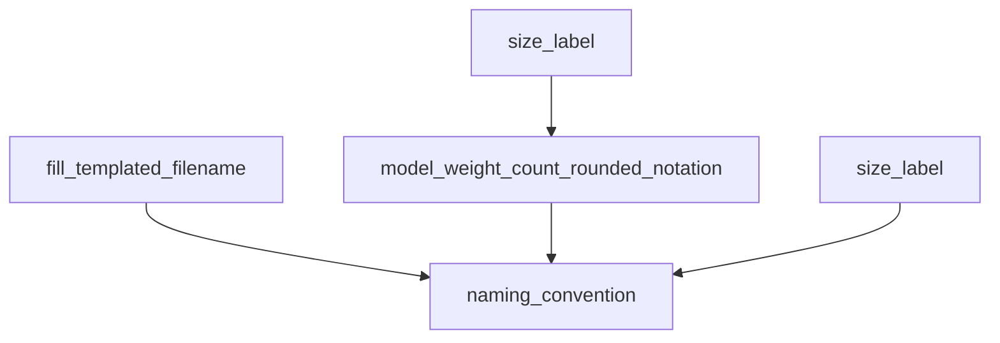
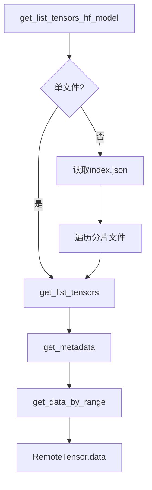
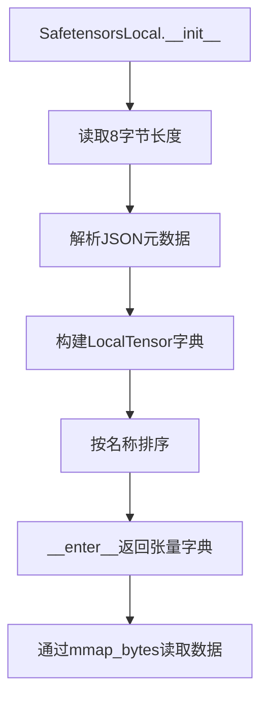

# 第64章 65 命令行工具集 —— GGUF 文件的"运维百宝箱"

## 学习目标

- 掌握GGUF模型文件命名规范与模板填充机制
- 理解模型参数量的人类友好格式化与MoE特殊命名规则
- 深入理解Safetensors文件的二进制结构（8字节头+JSON元数据+数据段）
- 掌握HTTP Range请求实现远程大文件按需读取的技术
- 学会使用内存映射（mmap）高效处理本地大型safetensors文件
- 理解远程与本地张量读取的统一抽象与差异化实现

## 64.1 生活类比

在 GGUF 工具集的智能快递分拣中心里，命名规范工具就像快递面单打印机，自动填充面单模板，将庞大的参数量转换为易读的重量单位，为特殊包裹标记，生成品牌、规格、版本、包装类型齐全的完整面单。远程 safetensors 读取则像跨境电商的按需采购，通过 HTTP Range 请求只下载需要的零件，先查看商品目录，提前确认库存，使用 HF Token 海关通行证。本地 safetensors 读取如同自家仓库的货架管理，利用内存映射按需取货，只在需要时才把货物从货架搬到工作台，通过透明玻璃墙看得见货物却不过度占用过道空间。

## 64.2 源码地图

```
gguf-py/gguf/utility.py
├── 命名与格式化工具函数
│   ├── fill_templated_filename(filename, output_type)
│   │   # 填充文件名模板，支持{ftype}/{outtype}/{FTYPE}/{OUTTYPE}占位符
│   ├── model_weight_count_rounded_notation(model_params_count, min_digits=2)
│   │   # 参数量格式化：7B/13B/1.3B，支持K/M/B/T自动缩放
│   ├── size_label(total_params, shared_params, expert_params, expert_count)
│   │   # MoE模型命名：expert_count>0时返回'{shared}x{expert}x{size}'
│   └── naming_convention(model_name, base_name, finetune_string, version_string, size_label, output_type, model_type)
│       # 组装完整GGUF名称：{base}-{size}-{finetune}-{version}-{type}-{kind}

├── 远程safetensors读取（HTTP Range）
│   ├── class RemoteTensor (dataclass)
│   │   ├── dtype, shape, offset_start, size, url
│   │   └── data() -> bytearray  # 实时下载张量数据
│   └── class SafetensorRemote
│       ├── BASE_DOMAIN = 'https://huggingface.co'
│       ├── get_list_tensors_hf_model(model_id) -> dict[str, RemoteTensor]
│       │   # 自动识别单文件/多分片，解析index.json的weight_map
│       ├── get_list_tensors(url) -> dict[str, RemoteTensor]
│       │   # 解析单个远程文件，按名称排序返回
│       ├── get_metadata(url) -> tuple[dict, int]
│       │   # 请求前5MB，解析8字节长度+JSON元数据
│       ├── get_data_by_range(url, start, size=-1) -> bytes
│       │   # HTTP Range请求，支持任意范围下载
│       ├── check_file_exist(url) -> bool
│       │   # HEAD请求验证文件存在性
│       └── _get_request_headers() -> dict[str, str]
│           # 附加HF_TOKEN认证与User-Agent

└── 本地safetensors读取（内存映射）
    ├── class LocalTensorRange (dataclass)
    │   └── filename, offset, size  # 文件物理位置
    ├── class LocalTensor (dataclass)
    │   ├── dtype, shape, data_range
    │   └── mmap_bytes() -> np.ndarray  # numpy内存映射读取
    └── class SafetensorsLocal
        ├── __init__(filename)
        │   # 解析元数据，构建LocalTensor字典
        ├── __enter__() -> dict[str, LocalTensor]
        └── __exit__()  # 简单的上下文管理
```

## 64.3 文件命名与格式化 —— GGUF的"标准快递员"

在 GGUF 生态中，模型文件的命名就像快递包裹的面单，需要统一、易读、包含关键信息。`utility.py` 中的命名与格式化工具函数集充当了标准快递员的角色，确保每一个生成的 GGUF 文件都能被准确识别和分类。无论是单参数模型还是混合专家模型，这些函数都能自动提取关键信息，生成符合规范的文件名。

### 64.3.1 fill_templated_filename()：文件名模板填充

源码路径：`gguf-py/gguf/utility.py` - `fill_templated_filename()`（9-15行）

```python
def fill_templated_filename(filename: str, output_type: str | None) -> str:
    # 填充文件名模板中的类型占位符，例如 'model.{ftype}.gguf'
    # 如果 output_type 为 None，则使用空字符串代替
    ftype_lowercase: str = output_type.lower() if output_type is not None else ""
    ftype_uppercase: str = output_type.upper() if output_type is not None else ""
    # 使用 format 方法替换模板中的占位符，支持 ftype/outtype/FTYPE/OUTTYPE 四种写法
    return filename.format(ftype_lowercase,
                           outtype=ftype_lowercase, ftype=ftype_lowercase,
                           OUTTYPE=ftype_uppercase, FTYPE=ftype_uppercase)
```

这段代码定义了 fill_templated_filename 函数，它接收用户提供的文件名模板和输出类型，自动将模板中的 {ftype}、{outtype} 等占位符替换为实际的量化类型大小写形式，从而生成最终的 GGUF 文件名。

### 64.3.2 model_weight_count_rounded_notation()：参数量格式化

源码路径：`gguf-py/gguf/utility.py` - `model_weight_count_rounded_notation()`（18-35行）

```python
def model_weight_count_rounded_notation(model_params_count: int, min_digits: int = 2) -> str:
    # 根据参数数量级自动选择 K/M/B/T 后缀
    if model_params_count > 1e12 :
        # 万亿级参数
        scaled_model_params = model_params_count * 1e-12
        scale_suffix = "T"
    elif model_params_count > 1e9 :
        # 十亿级参数
        scaled_model_params = model_params_count * 1e-9
        scale_suffix = "B"
    elif model_params_count > 1e6 :
        # 百万级参数
        scaled_model_params = model_params_count * 1e-6
        scale_suffix = "M"
    else:
        # 千级参数
        scaled_model_params = model_params_count * 1e-3
        scale_suffix = "K"
    # 计算需要保留的小数位数，确保整数部分位数足够
    fix = max(min_digits - len(str(round(scaled_model_params)).lstrip('0')), 0)
    return f"{scaled_model_params:.{fix}f}{scale_suffix}"
```

这段代码实现了 model_weight_count_rounded_notation 函数，它将庞大的模型参数数量转换为人类友好的字符串表示，自动选择合适的量级后缀，并通过 min_digits 参数控制显示的一致性。

### 64.3.3 size_label()：MoE模型命名

源码路径：`gguf-py/gguf/utility.py` - `size_label()`（38-45行）

```python
def size_label(total_params: int, shared_params: int, expert_params: int, expert_count: int) -> str:
    # 如果模型包含专家（MoE），生成特殊标签
    if expert_count > 0:
        pretty_size = model_weight_count_rounded_notation(abs(shared_params) + abs(expert_params), min_digits=2)
        size_class = f"{expert_count}x{pretty_size}"
    else:
        # 普通模型直接使用总参数量
        size_class = model_weight_count_rounded_notation(abs(total_params), min_digits=2)
    return size_class
```

这段代码定义了 size_label 函数，专门用于生成混合专家（MoE）模型的尺寸标签，当专家数量大于 0 时，它会组合共享参数和专家参数，并以“专家数x尺寸”的格式输出，例如“8x7B”。

### 64.3.4 naming_convention()：GGUF命名规范

源码路径：`gguf-py/gguf/utility.py` - `naming_convention()`（48-66行）

```python
def naming_convention(model_name: str | None, base_name: str | None, finetune_string: str | None, version_string: str | None, size_label: str | None, output_type: str | None, model_type: Literal['vocab', 'LoRA'] | None = None) -> str:
    # 参考 GGUF 命名规范：https://github.com/ggml-org/ggml/blob/master/docs/gguf.md#gguf-naming-convention
    # 确定基础名称，优先使用 base_name，否则使用 model_name，默认为 ggml-model
    if base_name is not None:
        name = base_name.strip().replace(' ', '-').replace('/', '-')
    elif model_name is not None:
        name = model_name.strip().replace(' ', '-').replace('/', '-')
    else:
        name = "ggml-model"
    # 组装各部分，空格和斜杠替换为连字符
    parameters = f"-{size_label}" if size_label is not None else ""
    finetune = f"-{finetune_string.strip().replace(' ', '-')}" if finetune_string is not None else ""
    version = f"-{version_string.strip().replace(' ', '-')}" if version_string is not None else ""
    encoding = f"-{output_type.strip().replace(' ', '-').upper()}" if output_type is not None else ""
    kind = f"-{model_type.strip().replace(' ', '-')}" if model_type is not None else ""
    return f"{name}{parameters}{finetune}{version}{encoding}{kind}"
```

这段代码实现了 naming_convention 函数，它根据基础名称、尺寸标签、微调信息、版本号、输出类型和模型类型，组装成符合 GGUF 规范的完整文件名，同时自动清理特殊字符，确保生成的名称在文件系统中安全可用。

### 64.3.5 模块依赖图：命名工具链的协作



从模块依赖图可以看出，`naming_convention` 是整个命名流程的组装核心，它接收 `fill_templated_filename` 处理后的模板、`size_label` 生成的尺寸标签以及其他元数据信息，最终拼接成完整的 GGUF 文件名。

## 64.4 远程Safetensors读取 —— 从HuggingFace"按需取件"

远程 safetensors 读取是 GGUF 转换流程中的关键环节，它允许工具在不下载整个模型文件的情况下，直接从 Hugging Face 仓库按需获取张量数据。`SafetensorRemote` 类通过 HTTP Range 请求实现了真正的懒加载，极大地节省了带宽和时间。

### 64.4.1 RemoteTensor：远程张量的"身份证"

源码路径：`gguf-py/gguf/utility.py` - `RemoteTensor`（数据类，约第60-73行）

```python
@dataclass
class RemoteTensor:
    dtype: str
    shape: tuple
    offset_start: int
    size: int
    url: str

    def data(self) -> bytearray:
        # TODO: handle request errors (maybe with limited retries?)
        # NOTE: using a bytearray, otherwise PyTorch complains the buffer is not writeable
        data = bytearray(SafetensorRemote.get_data_by_range(url=self.url, start=self.offset_start, size=self.size))
        return data
```

这段代码定义了 RemoteTensor 数据类，它封装了远程张量的元数据，并提供 data() 方法，通过调用 SafetensorRemote.get_data_by_range 实时下载张量的原始字节数据。

### 64.4.2 get_list_tensors_hf_model()：自动识别单文件与多分片

源码路径：`gguf-py/gguf/utility.py` - `SafetensorRemote.get_list_tensors_hf_model()`（95-129行）

```python
@classmethod
def get_list_tensors_hf_model(cls, model_id: str) -> dict[str, RemoteTensor]:
    # 情况1：模型只有一个单文件 model.safetensors
    is_single_file = cls.check_file_exist(f"{cls.BASE_DOMAIN}/{model_id}/resolve/main/model.safetensors")
    if is_single_file:
        url = f"{cls.BASE_DOMAIN}/{model_id}/resolve/main/model.safetensors"
        return cls.get_list_tensors(url)

    # 情况2：模型有多个分片文件
    index_url = f"{cls.BASE_DOMAIN}/{model_id}/resolve/main/model.safetensors.index.json"
    is_multiple_files = cls.check_file_exist(index_url)
    if is_multiple_files:
        # 读取索引文件
        index_data = cls.get_data_by_range(index_url, 0)
        index_str = index_data.decode('utf-8')
        index_json = json.loads(index_str)
        assert index_json.get("weight_map") is not None, "weight_map not found in index file"
        weight_map = index_json["weight_map"]
        # 获取所有文件列表并排序，确保加载顺序一致
        all_files = list(set(weight_map.values()))
        all_files.sort()
        # 遍历每个分片文件，收集所有张量
        tensors: dict[str, RemoteTensor] = {}
        for file in all_files:
            url = f"{cls.BASE_DOMAIN}/{model_id}/resolve/main/{file}"
            for key, val in cls.get_list_tensors(url).items():
                tensors[key] = val
        return tensors

    # 如果都没有找到，抛出错误
    raise ValueError(
        f"No safetensor file has been found for model {model_id}.",
        "If the repo has safetensor files, make sure the model is public or you have a ",
        "valid Hugging Face token set in the environment variable HF_TOKEN.",
    )
```

这段代码定义了 get_list_tensors_hf_model 方法，它能够自动识别 Hugging Face 模型仓库是单文件还是多分片结构，并返回所有张量的元数据字典，屏蔽了底层文件组织的差异。

### 64.4.3 get_list_tensors()：单文件张量解析

源码路径：`gguf-py/gguf/utility.py` - `SafetensorRemote.get_list_tensors()`（132-151行）

```python
@classmethod
def get_list_tensors(cls, url: str) -> dict[str, RemoteTensor]:
    # 获取元数据和数据起始偏移
    metadata, data_start_offset = cls.get_metadata(url)
    res: dict[str, RemoteTensor] = {}

    for name, meta in metadata.items():
        if name == "__metadata__":
            continue
        if not isinstance(meta, dict):
            raise ValueError(f"Invalid metadata for tensor '{name}': {meta}")
        try:
            dtype = meta["dtype"]
            shape = meta["shape"]
            offset_start_relative, offset_end_relative = meta["data_offsets"]
            size = offset_end_relative - offset_start_relative
            offset_start = data_start_offset + offset_start_relative
            res[name] = RemoteTensor(dtype=dtype, shape=tuple(shape), offset_start=offset_start, size=size, url=url)
        except KeyError as e:
            raise ValueError(f"Missing key in metadata for tensor '{name}': {e}, meta = {meta}")

    # 按张量名称排序，与 HuggingFace safetensors 行为一致
    res = dict(sorted(res.items(), key=lambda t: t[0]))
    return res
```

这段代码实现了 get_list_tensors 方法，它从单个远程 safetensors 文件中解析所有张量的元数据，计算每个张量的绝对偏移量，并按名称排序后返回。

### 64.4.4 get_metadata()：远程元数据头解析

源码路径：`gguf-py/gguf/utility.py` - `SafetensorRemote.get_metadata()`（154-175行）

```python
@classmethod
def get_metadata(cls, url: str) -> tuple[dict, int]:
    # 只请求前 5MB 数据，通常足够包含元数据
    read_size = 5 * 1024 * 1024
    raw_data = cls.get_data_by_range(url, 0, read_size)

    # 解析文件头，前 8 字节为元数据长度（小端 u64）
    if len(raw_data) < 8:
        raise ValueError("Not enough data to read metadata size")
    metadata_length = int.from_bytes(raw_data[:8], byteorder='little')

    # 计算数据起始偏移
    data_start_offset = 8 + metadata_length

    # 检查是否读取到完整元数据
    if len(raw_data) < 8 + metadata_length:
        raise ValueError(f"Could not read complete metadata. Need {8 + metadata_length} bytes, got {len(raw_data)}")

    # 提取并解析 JSON 元数据
    metadata_bytes = raw_data[8:8 + metadata_length]
    metadata_str = metadata_bytes.decode('utf-8')
    try:
        metadata = json.loads(metadata_str)
        return metadata, data_start_offset
    except json.JSONDecodeError as e:
        raise ValueError(f"Failed to parse safetensor metadata as JSON: {e}")
```

这段代码定义了 get_metadata 方法，它通过 HTTP Range 请求获取远程文件的前 5MB 数据，解析 safetensors 格式的文件头，提取 JSON 元数据和数据起始偏移量，为后续张量定位提供基础。

### 64.4.5 get_data_by_range()：HTTP Range 按需下载

源码路径：`gguf-py/gguf/utility.py` - `SafetensorRemote.get_data_by_range()`（178-190行）

```python
@classmethod
def get_data_by_range(cls, url: str, start: int, size: int = -1) -> bytes:
    import requests
    from urllib.parse import urlparse

    # 验证 URL 格式
    parsed_url = urlparse(url)
    if not parsed_url.scheme or not parsed_url.netloc:
        raise ValueError(f"Invalid URL: {url}")

    headers = cls._get_request_headers()
    if size > -1:
        headers["Range"] = f"bytes={start}-{start + size}"
    response = requests.get(url, allow_redirects=True, headers=headers)
    response.raise_for_status()

    # 返回原始字节数据
    return response.content[slice(size if size > -1 else None)]
```

这段代码实现了 get_data_by_range 方法，它通过 HTTP Range 请求从远程文件获取指定字节范围的原始数据，支持任意范围的按需下载，是远程懒加载的核心。

### 64.4.6 check_file_exist() 与 _get_request_headers()：存在性验证与认证

源码路径：`gguf-py/gguf/utility.py` - `SafetensorRemote.check_file_exist()`（193-205行）、`_get_request_headers()`（208-211行）

```python
@classmethod
def check_file_exist(cls, url: str) -> bool:
    import requests
    from urllib.parse import urlparse

    parsed_url = urlparse(url)
    if not parsed_url.scheme or not parsed_url.netloc:
        raise ValueError(f"Invalid URL: {url}")

    try:
        headers = cls._get_request_headers()
        headers["Range"] = "bytes=0-0"
        response = requests.head(url, allow_redirects=True, headers=headers)
        # 成功（2xx）或重定向（3xx）视为存在
        return 200 <= response.status_code < 400
    except requests.RequestException:
        return False

@classmethod
def _get_request_headers(cls) -> dict[str, str]:
    headers = {"User-Agent": "convert_hf_to_gguf"}
    if os.environ.get("HF_TOKEN"):
        headers["Authorization"] = f"Bearer {os.environ['HF_TOKEN']}"
    return headers
```

check_file_exist 方法通过发送 HEAD 请求快速验证远程文件是否存在，避免在不存在的文件上浪费下载流量。_get_request_headers 方法构造通用的 HTTP 请求头，自动附加 Hugging Face 认证令牌（如果环境变量 HF_TOKEN 存在），确保能够访问私有模型仓库。

### 64.4.7 模块依赖图：远程读取流程



从模块依赖图可以看出，远程读取的入口是 `get_list_tensors_hf_model`，它根据仓库结构选择单文件或多分片路径，最终都收敛到 `get_list_tensors` 和 `get_metadata`，而 `get_data_by_range` 是所有实际数据下载的底层原语。

## 64.5 本地Safetensors读取 —— 内存映射的"轻量管家"

与远程读取相对应，本地 safetensors 读取专注于从文件系统高效访问模型权重。`SafetensorsLocal` 类利用 numpy 内存映射技术，避免将整个大文件加载到内存中，从而在有限的内存资源下流畅处理数十 GB 的模型文件。

### 64.5.1 LocalTensorRange 与 LocalTensor：本地张量的"货架坐标"

源码路径：`gguf-py/gguf/utility.py` - `LocalTensorRange`、`LocalTensor`（数据类，约第210-224行）

```python
@dataclass
class LocalTensorRange:
    filename: Path
    offset: int
    size: int

@dataclass
class LocalTensor:
    dtype: str
    shape: tuple
    data_range: LocalTensorRange

    def mmap_bytes(self) -> np.ndarray:
        # 使用 numpy 内存映射，模式 'c' 表示复制时写入，避免修改原文件
        return np.memmap(self.data_range.filename, mode='c', offset=self.data_range.offset, shape=self.data_range.size)
```

这段代码定义了 LocalTensorRange 和 LocalTensor 数据类，它们封装了本地张量的物理位置和元数据，并提供 mmap_bytes 方法，利用 numpy 内存映射按需读取张量数据，避免一次性加载大文件。

### 64.5.2 SafetensorsLocal：本地读取的"仓库管理员"

源码路径：`gguf-py/gguf/utility.py` - `SafetensorsLocal.__init__()`（228-255行）

```python
def __init__(self, filename: Path):
    # 读取本地 safetensors 文件
    with open(filename, "rb") as f:
        # 前 8 字节为元数据长度（小端 u64）
        metadata_length = int.from_bytes(f.read(8), byteorder='little')
        file_size = os.stat(filename).st_size
        if file_size < 8 + metadata_length:
            raise ValueError(f"Could not read complete metadata. Need {8 + metadata_length} bytes, got {file_size}")

        # 读取 JSON 元数据
        metadata_str = f.read(metadata_length).decode('utf-8')
        try:
            metadata = json.loads(metadata_str)
        except json.JSONDecodeError as e:
            raise ValueError(f"Failed to parse safetensor metadata as JSON: {e}")

        # 记录数据起始偏移
        data_start_offset = f.tell()

        # 构建张量字典，跳过 __metadata__ 特殊字段
        tensors: dict[str, LocalTensor] = {}
        for name, meta in metadata.items():
            if name == "__metadata__":
                continue

            tensors[name] = LocalTensor(
                dtype=meta["dtype"],
                shape=tuple(meta["shape"]),
                data_range=LocalTensorRange(
                    filename,
                    data_start_offset + meta["data_offsets"][0],
                    meta["data_offsets"][1] - meta["data_offsets"][0],
                ),
            )

        # 按张量名称排序，与默认 safetensors 行为一致
        self.tensors = dict(sorted(tensors.items(), key=lambda t: t[0]))
```

这段代码定义了 SafetensorsLocal 类的初始化方法，它解析本地 safetensors 文件的二进制结构，提取元数据并构建张量字典，每个张量都记录了其在文件中的精确位置和大小。

### 64.5.3 上下文管理器：with 语句的安全保证

源码路径：`gguf-py/gguf/utility.py` - `SafetensorsLocal.__enter__()`（257-259行）、`__exit__()`（261-262行）

```python
def __enter__(self, *args, **kwargs):
    del args, kwargs  # unused
    return self.tensors

def __exit__(self, *args, **kwargs):
    del args, kwargs  # unused
```

这段代码实现了上下文管理器协议，使得 SafetensorsLocal 可以与 with 语句配合使用，直接返回张量字典，无需特殊清理操作。

### 64.5.4 模块依赖图：本地读取流程



从模块依赖图可以看出，本地读取的流程是线性的：先解析文件头，再解析元数据，接着构建张量字典，最后通过上下文管理器向外提供统一的访问接口，而实际的数据读取则通过 mmap_bytes 延迟触发。

## 64.6 设计中的取舍

- **为什么使用 HTTP Range 而不是直接下载整个 safetensors 文件？**  
  HTTP Range 请求允许只下载文件的一部分，这对于大型模型文件尤其重要，因为元数据通常只占文件的前几 MB。如果直接下载整个文件，会浪费大量的带宽和时间。通过只请求前 5MB，可以快速解析元数据，然后按需下载特定的张量数据，实现真正的懒加载。

- **为什么使用 dataclass 来定义 RemoteTensor 和 LocalTensor？**  
  dataclass 自动生成了 `__init__`、`__repr__` 等方法，减少了样板代码，同时提供了清晰的类型注解，使得数据结构的意图一目了然。此外，dataclass 的不可变性（默认）有助于确保张量元数据在创建后不会被意外修改。

- **为什么本地读取使用 numpy 内存映射而不是直接读取？**  
  内存映射允许按需加载文件内容，只有在实际访问时才会将对应的文件页读入内存，这对于处理远超物理内存的大文件至关重要。此外，内存映射避免了显式读取和释放的复杂性，提高了代码的简洁性。

- **远程和本地读取的统一抽象有什么好处？**  
  尽管远程和本地读取的实现细节不同，但它们都返回张量元数据和数据访问接口，上层代码可以使用统一的方式处理，无需关心数据来源，提高了代码的可移植性和可维护性。

## 64.7 动手练习

- 分析safetensors文件结构：
  编写Python代码解析一个本地safetensors文件：
  1. 读取文件前8字节，解析元数据长度（小端u64）
  2. 读取元数据JSON，打印所有张量名称及其shape
  3. 计算第一个张量的数据起始偏移量（data_start_offset + data_offsets[0]）
  4. 使用numpy.memmap读取该张量的前10个元素
  思考问题：
  - 为什么safetensors使用8字节固定长度存储元数据大小？
  - data_offsets[1] - data_offsets[0]与np.prod(shape) * dtype_size的关系是什么？

- 实现远程张量 lazy loading：
  基于SafetensorRemote实现一个自定义的LazyRemoteTensor类：
  1. 添加__getitem__方法，支持切片访问（如tensor[0:10, :]）
  2. 切片时只下载所需的字节范围，而非整个张量
  3. 实现简单的LRU缓存，避免重复下载相同数据
  4. 添加进度条显示，在下载大张量时展示进度
  思考问题：
  - 如果网络中断，如何实现断点续传？
  - 对于形状为[10000, 10000]的F32张量，下载第5000行需要多少字节？

- 批量重命名GGUF文件：
  编写脚本批量处理GGUF文件命名：
  1. 给定一个包含GGUF文件的目录，解析每个文件的元数据
  2. 提取参数量、量化类型、finetune信息
  3. 使用naming_convention()生成标准化文件名
  4. 处理冲突（如两个文件生成相同名称时添加序号）
  5. 支持dry-run模式，预览重命名结果而不实际执行
  思考问题：
  - 如果元数据中缺少finetune信息，如何从文件名推断？
  - 对于MoE模型，如何验证size_label与实际的expert_count一致？

- 对比远程与本地读取性能：
  设计实验对比SafetensorRemote与SafetensorsLocal的性能：
  1. 选择一个100MB左右的safetensors文件
  2. 记录远程读取元数据的时间（第一次vs第二次，观察缓存效果）
  3. 记录本地读取元数据的时间
  4. 对比读取单个张量的延迟（远程HTTP Range vs 本地mmap）
  5. 分析网络带宽对远程读取的影响
  思考问题：
  - 在什么场景下远程读取比本地读取更有优势？
  - 如何设计混合策略，对小文件用远程、大文件先下载后本地？

## 64.8 本章小结

这一章中，我们深入探讨了 GGUF 工具集中的命名与格式化工具以及远程、本地 safetensors 读取机制。首先，我们学习了 `fill_templated_filename`、`model_weight_count_rounded_notation`、`size_label` 和 `naming_convention` 四个核心函数，它们共同构成了 GGUF 文件命名的自动化流水线；接着，我们剖析了 `SafetensorRemote` 如何利用 HTTP Range 请求从 Hugging Face 按需下载张量数据，以及 `SafetensorsLocal` 如何通过内存映射高效访问本地大文件；最后，我们通过设计取舍问题，理解了这些技术方案背后的工程权衡。

本章我们一起学习了以下概念：

| 概念 | 解释 |
|------|------|
| fill_templated_filename | 文件名模板填充，支持{ftype}等占位符自动替换 |
| model_weight_count_rounded_notation | 参数量智能缩写，自动选择K/M/B/T单位 |
| size_label | MoE模型命名，格式为'{专家数}x{尺寸}'如8x7B |
| naming_convention | GGUF标准命名，组装base-size-finetune-version-type |
| SafetensorRemote | 远程safetensors读取器，基于HTTP Range按需下载 |
| RemoteTensor | 远程张量元数据封装，data()方法实时下载 |
| get_data_by_range | HTTP Range请求实现，支持任意字节范围读取 |
| HF_TOKEN | HuggingFace认证令牌，用于访问私有模型仓库 |
| SafetensorsLocal | 本地safetensors读取器，使用内存映射优化 |
| mmap_bytes | numpy内存映射，避免大文件全量加载到内存 |
| data_offsets | safetensors中记录张量数据位置的相对偏移量 |
| __metadata__ | safetensors中的特殊字段，存储额外元数据（非张量） |

下一章中，我们将学习测试体系与质量保证 —— 代码的"质检实验室"，了解 gguf-py 项目的单元测试与一致性验证机制。
