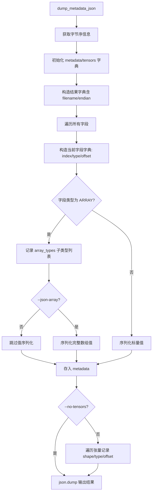
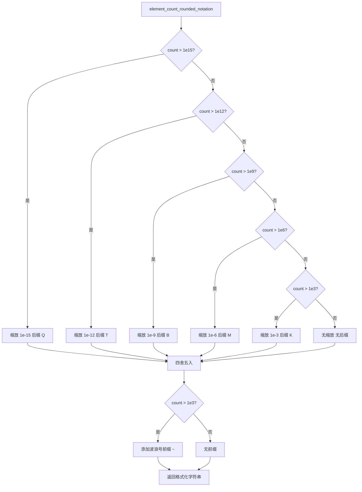
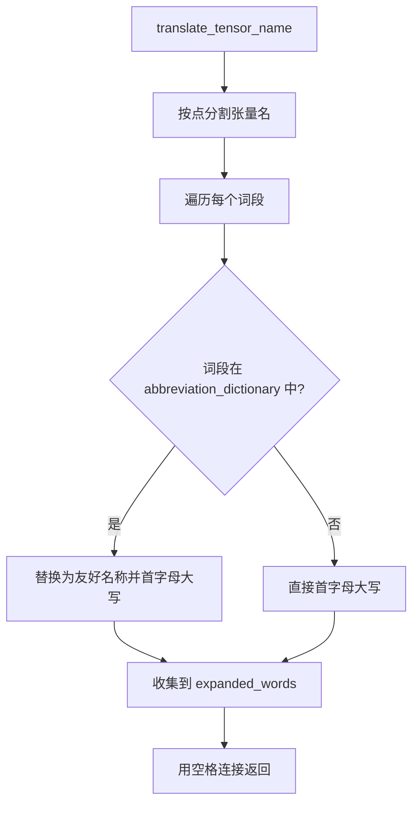
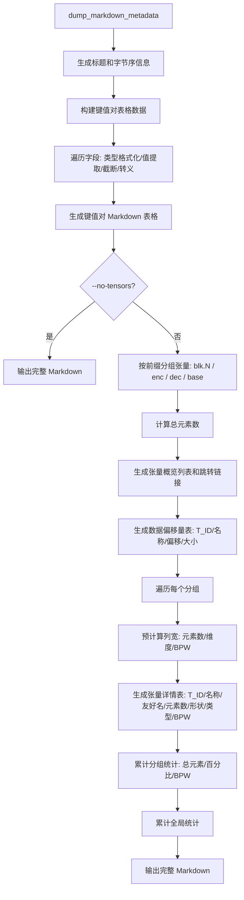
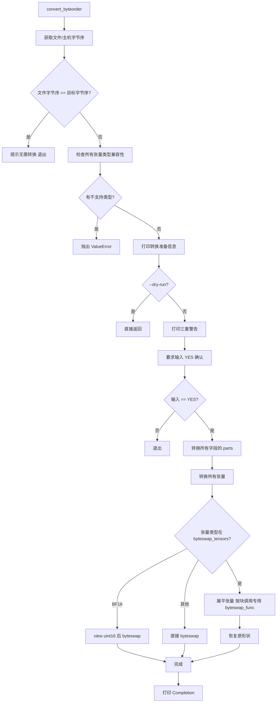

# 第65章 GGUF 运维工具链全景 —— 模型文件的「集装箱维修站」总览

## 学习目标

- 掌握 GGUF 命令行工具链的核心分类：只读扫描仪（dump/hash）与读写手术刀（set/new/convert）的本质区别
- 理解 gguf_dump 的多格式输出机制，包括文本的树状展示、JSON 的结构化序列化以及 Markdown 的报表生成
- 精通跨平台字节序转换原理，掌握不同量化格式（Q4_0/Q4_K/Q6_K/BF16）的字节交换差异与风险防控
- 熟练运用元数据编辑工具进行单字段精准修改（set_metadata）与全量重建（new_metadata）
- 掌握基于 SHA-1/SHA-256/UUID v5 的模型完整性校验体系与分层哈希策略
- 了解 GGUF GUI 编辑器的架构设计，包括分词器、数组、枚举类型的可视化编辑流程与状态管理

## 65.1 生活类比

想象一下，你正站在一个繁忙的港口码头，面前是成千上万个标准化的海运集装箱，每个集装箱里装满了来自世界各地的货物。而这一章我们要介绍的工具链，就是码头上那些默默无闻但至关重要的「运维百宝箱」。gguf_dump 就像一台集装箱 X 光扫描仪，无需开箱就能生成内容清单，无论是文本、JSON 还是 Markdown 报告格式，都能一一呈现；gguf_convert_endian 则如同跨国电压转换器，不同国家（CPU 架构）的电流标准（字节序）各不相同，需要专业设备来转换，一旦乱接就可能烧坏设备，同样，错误的字节序转换也会让模型文件彻底损坏；gguf_set_metadata 宛如激光标签打印机，能够精准修改箱外的一个标签，比如把 BOS Token 从 1 改成 2，无需开封；gguf_new_metadata 则像是整体翻新流水线，把货物倒出来，重新装修内部（修改元数据），再装回新箱子；gguf_hash 是防伪指纹采集器，为整个集装箱生成独一无二的指纹（SHA-256），或按层生成货物批次码；而 gguf_editor_gui 则是可视化控制台，给理货员一个图形界面，用鼠标点击就能修改清单，不用背命令行。在操作这些工具时，安全法则如同高压电作业，必须先断电再操作：所有会修改集装箱的工具（r+ 模式）都配备了「双保险」——dry-run 预览让你先模拟操作看结果，确认无误再真动手；YES 确认则要求高危操作前必须输入大写 YES，防止手滑。

## 65.2 源码地图

```
gguf-py/gguf/scripts/
├── gguf_dump.py                    # 全息扫描仪：多格式元数据导出
│   ├── get_file_host_endian()      # 字节序侦探：区分主机与文件字节序（处理 'S' 交换标记）
│   ├── dump_metadata()             # 文本模式：键值对列表 + 60字符截断 + 张量维度统计
│   ├── dump_metadata_json()        # JSON模式：递归序列化 ReaderField，支持 --json-array 开关
│   ├── markdown_table_with_alignment_support()  # Markdown表格生成器：动态列宽计算与对齐控制
│   ├── element_count_rounded_notation()         # 数字美化：K/M/B/T/Q 数量级缩写与波浪号标记
│   ├── translate_tensor_name()     # 张量名翻译官：标准词典映射（attn_qkv→Attention query-key-value）
│   ├── dump_markdown_metadata()    # Markdown报告：分组统计（blk.N/enc/dec）、BPW计算、偏移量表
│   ├── main()                      # CLI 入口：解析参数，分发到文本/JSON/Markdown/Offset 模式
│   └── __main__                    # 模块入口：调用 main()
│
├── gguf_convert_endian.py        # 字节序转换：跨平台「灵魂翻译官」
│   ├── byteswap_noop()             # 空操作占位：MXFP4/NVFP4 等现代格式无需交换
│   ├── byteswap_q4_0()             # Q4_0 手术：仅交换块首2字节 f16 delta 缩放因子
│   ├── byteswap_q8_0()             # Q8_0 手术：仅交换块首2字节 f16 delta 缩放因子
│   ├── byteswap_q4_k()             # Q4_K 手术：交换块首两个连续 f16 字段（offsets 0-2, 2-4）
│   ├── byteswap_q6_k()             # Q6_K 手术：交换偏移 208 处的 f16 字段
│   ├── convert_byteorder()         # 核心转换流程：检测→校验白名单→YES确认→字段级byteswap→分块张量处理
│   ├── main()                      # CLI 入口：解析字节序参数，以 'r+' 或 'r' 模式加载 Reader
│   └── __main__                    # 模块入口
│
├── gguf_set_metadata.py          # 微创手术刀：单字段精准修改
│   ├── minimal_example()           # 教学示例：演示 field.parts 结构与 data 索引的桥接作用
│   ├── set_metadata()              # 类型检查→值转换→幂等检查→dry-run/force控制→原地写入 parts[field.data[0]]
│   ├── main()                      # CLI 入口：解析 key/value，以 r+ 模式打开文件
│   └── __main__                    # 模块入口
│
├── gguf_new_metadata.py          # 全量重建：模型的「无损搬家与装修」
│   ├── get_field_data()            # 字段提取：reader.get_field() 的安全包装
│   ├── find_token()                # 特殊Token定位：词表搜索与多匹配歧义处理
│   ├── copy_with_new_metadata()    # 流式复制：四策略处理（跳过/修改/复制/删除）→ 聊天模板替换 → 张量数据流式写入
│   ├── main()                      # CLI 入口：处理特殊Token ID、删除警告、覆盖确认、实例化 GGUFWriter
│   └── __main__                    # 模块入口
│
├── gguf_hash.py                  # 数字指纹生成器
│   ├── gguf_hash()                 # 三层哈希体系：SHA-1(兼容)/SHA-256(安全)/UUIDv5(内容寻址)，非持久化张量过滤
│   ├── main()                      # CLI 入口：解析 --no-layer 与 --progressbar 选项
│   └── __main__                    # 模块入口
│
└── gguf_editor_gui.py            # 可视化控制台（PySide6）
    ├── KEY_TO_ENUM_TYPE            # 元数据键到枚举类型的映射表（TokenType/RopeScalingType等）
    ├── TOKENIZER_LINKED_KEYS       # 分词器关联键定义（tokens/token_types/scores）
    ├── GGUFEditorWindow            # 主窗口：标签页布局、文件加载（GGUFReader）、保存（GGUFWriter）
    │   ├── __init__()              # 初始化：变更追踪器（metadata_changes/metadata_to_remove）
    │   ├── setup_ui()              # 界面初始化：菜单栏、工具栏、表格控件组装
    │   ├── create_actions()        # 创建 QAction：打开、保存、退出等操作
    │   ├── create_menu()           # 菜单栏构建：文件菜单与编辑菜单
    │   ├── create_toolbar()        # 工具栏构建：快捷操作按钮
    │   ├── load_file()             # 文件加载：只读模式打开，初始化元数据与张量视图
    │   ├── open_file()             # 文件对话框：选择 GGUF 文件路径
    │   ├── load_metadata()         # 元数据渲染：枚举映射、格式化显示、变更标记
    │   ├── load_tensors()          # 张量信息渲染：名称、类型、形状、元素数、大小
    │   ├── extract_array_values()  # 数组提取：从 ReaderField 中读取字符串或数值数组
    │   ├── get_enum_for_key()      # 枚举查找：根据键名获取对应的枚举类型
    │   ├── format_enum_value()     # 枚举格式化：将值转为 'NAME (value)' 显示格式
    │   ├── format_field_value()    # 字段值格式化：处理字符串、数字、数组、枚举的显示
    │   ├── on_metadata_changed()   # 变更回调：验证类型转换，记录到 metadata_changes
    │   ├── edit_metadata_enum()    # 枚举编辑：弹出下拉选择对话框修改枚举值
    │   ├── edit_array_metadata()   # 数组编辑：调用 ArrayEditorDialog 或 TokenizerEditorDialog
    │   ├── edit_tokenizer_metadata() # 分词器编辑：联动修改 tokens/token_types/scores
    │   ├── update_tokenizer_display() # 更新分词器字段在表格中的显示
    │   ├── add_metadata()          # 添加元数据：调用 AddMetadataDialog
    │   ├── remove_metadata()       # 删除元数据：确认后从表格移除并记录待删除键
    │   └── save_file()             # 保存流程：应用变更集→写入新文件→状态重置
    ├── TokenizerEditorDialog       # 分词器编辑对话框
    │   ├── __init__()              # 初始化：三列联动布局（Token/Type/Score）+ 分页控件
    │   ├── setup_ui()              # UI 构建：表格、过滤器、分页按钮、操作按钮
    │   ├── apply_filter()          # 过滤逻辑：按文本搜索 token
    │   ├── load_page()             # 分页加载：渲染当前页的 tokens 到表格
    │   ├── previous_page()         # 翻页控制：上一页
    │   ├── next_page()             # 翻页控制：下一页
    │   ├── handle_cell_double_click() # 双击处理：Type 列触发编辑
    │   ├── edit_token_type()       # TokenType 编辑：枚举下拉选择器
    │   ├── add_token()             # 添加 Token：默认 type=normal, score=0
    │   ├── remove_selected()       # 删除选中：同步删除三列数据
    │   └── get_data()              # 数据返回：编辑后的三列表
    ├── ArrayEditorDialog           # 通用数组编辑对话框
    │   ├── __init__()              # 初始化：接收数组值、元素类型、键名
    │   ├── setup_ui()              # UI 构建：表格、枚举信息显示、批量编辑按钮
    │   ├── apply_filter()          # 过滤逻辑：支持按枚举名/值/索引搜索
    │   ├── load_page()             # 分页加载：渲染数组值，枚举列显示友好名称
    │   ├── previous_page()         # 翻页控制
    │   ├── next_page()             # 翻页控制
    │   ├── edit_array_enum_value() # 枚举编辑入口：单个值修改
    │   ├── bulk_edit_selected()    # 批量编辑：统一设置多个选中行的枚举值
    │   ├── add_item()              # 添加项：根据类型添加默认值
    │   ├── remove_selected()       # 删除选中
    │   ├── edit_enum_value()       # 枚举值编辑：对话框选择并验证
    │   └── get_array_values()      # 返回编辑后的数组
    ├── AddMetadataDialog           # 添加元数据对话框
    │   ├── __init__()              # 初始化：表单布局（Key/Type/Value）
    │   ├── setup_ui()              # UI 构建：类型下拉框（排除 ARRAY）、文本输入
    │   └── get_data()              # 数据获取：类型转换（UINT8/INT32/FLOAT32/BOOL/STRING）
    ├── main()                      # 程序入口：QApplication 初始化与窗口显示
    └── __main__                    # 模块入口：环境配置与包导入路径设置
```

## 65.3 CLI 入口统一模式 —— 命令行工具的「标准化操作台」

在将大模型部署到实际生产环境时，我们常常会遇到字节序不兼容、元数据需要修正、模型文件完整性存疑等「最后一公里」的问题。GGUF 工具链正是为解决这些运维难题而生的。从宏观上看，这些工具可以分为两大类：只读的「扫描仪」和能够原地修改的「手术刀」。`gguf_dump` 和 `gguf_hash` 属于只读工具，它们以 `'r'` 模式打开文件，安全地读取元数据和计算哈希；而 `gguf_set_metadata`、`gguf_new_metadata` 和 `gguf_convert_endian` 则属于读写工具，它们以 `'r+'` 模式直接修改文件，操作风险极高，一旦写入中断文件即损坏。正因如此，所有破坏性操作都遵循 dry-run 哲学：先模拟执行，确认无误后再实际写入。此外，所有工具都统一通过 `if __name__ == '__main__': main()` 模式启动，并支持 `--help` 自动触发，保持了命令行接口的一致性。

### 65.3.1 main()：命令行入口与模式分发（gguf_dump）

源码路径：`gguf-py/gguf/scripts/gguf_dump.py` - `main()`（350-380行）

```mermaid
flowchart TD
    A[main() 启动] --> B[创建 ArgumentParser]
    B --> C[添加位置参数 model]
    B --> D[添加可选参数 --no-tensors/--json/--markdown等]
    C --> E[解析命令行参数]
    D --> E
    E --> F{参数为空?}
    F -->|是| G[显示帮助信息]
    F -->|否| H[设置日志级别]
    H --> I[以只读模式 'r' 加载 GGUFReader]
    I --> J{输出格式分发}
    J -->|--json| K[dump_metadata_json]
    J -->|--markdown| L[dump_markdown_metadata]
    J -->|--data-offset| M[打印 reader.data_offset]
    J -->|--data-alignment| N[打印 reader.alignment]
    J -->|默认| O[dump_metadata]
    K --> P[退出]
    L --> P
    M --> P
    N --> P
    O --> P
```

源码路径：`gguf-py/gguf/scripts/gguf_dump.py` - `main()`（350-380行）

```python
def main() -> None:
    # 创建 ArgumentParser 对象，设置描述为 "Dump GGUF file metadata"
    parser = argparse.ArgumentParser(description="Dump GGUF file metadata")
    # 添加位置参数 model，类型为 str，帮助信息为 "GGUF format model filename"
    parser.add_argument("model",           type=str,            help="GGUF format model filename")
    # 添加可选参数 --no-tensors，存储为 True，表示不导出张量元数据
    parser.add_argument("--no-tensors", action="store_true", help="Don't dump tensor metadata")
    # 添加 --json 参数，输出 JSON 格式
    parser.add_argument("--json",       action="store_true", help="Produce JSON output")
    # 添加 --json-array 参数，包含完整的数组值
    parser.add_argument("--json-array", action="store_true", help="Include full array values in JSON output (long)")
    # 添加 --data-offset 参数，打印数据偏移量
    parser.add_argument("--data-offset",    action="store_true", help="Start of data offset")
    # 添加 --data-alignment 参数，打印数据对齐
    parser.add_argument("--data-alignment", action="store_true", help="Data alignment applied globally to data field")
    # 添加 --markdown 参数，输出 Markdown 格式
    parser.add_argument("--markdown",   action="store_true", help="Produce markdown output")
    # 添加 --verbose 参数，增加输出详细程度
    parser.add_argument("--verbose",    action="store_true", help="increase output verbosity")

    # 解析命令行参数，如果没有参数则显示帮助
    args = parser.parse_args(None if len(sys.argv) > 1 else ["--help"])

    # 根据 verbose 参数设置日志级别
    logging.basicConfig(level=logging.DEBUG if args.verbose else logging.INFO)

    # 如果不是 JSON、Markdown、data-offset 或 data-alignment 模式，打印加载信息
    if not args.json and not args.markdown and not args.data_offset and not args.data_alignment:
        logger.info(f'* Loading: {args.model}')

    # 以只读模式加载 GGUF 文件
    reader = GGUFReader(args.model, 'r')

    # 根据参数分发到不同的输出函数
    if args.json:
        dump_metadata_json(reader, args)
    elif args.markdown:
        dump_markdown_metadata(reader, args)
    elif args.data_offset:
        print(reader.data_offset)
    elif args.data_alignment:
        print(reader.alignment)
    else:
        dump_metadata(reader, args)
```

**代码解析**：
该 `main()` 函数是 `gguf_dump` 工具的统一入口。它首先构建命令行参数解析器，定义了模型文件路径、输出格式选择（文本/JSON/Markdown）、详细程度等参数。关键设计点在于：所有工具统一采用 `if __name__ == '__main__': main()` 启动模式，且默认以只读模式 `'r'` 加载 `GGUFReader`，保证扫描操作的安全性。参数解析后，通过条件分发将控制流路由到对应的输出函数，实现了单一入口、多模式输出的架构。

### 65.3.2 __main__：模块入口（gguf_dump）

源码路径：`gguf-py/gguf/scripts/gguf_dump.py` - `__main__`（383-384行）

```mermaid
flowchart TD
    A[__main__] --> B{__name__ == '__main__'?}
    B -->|是| C[调用 main()]
    B -->|否| D[不执行]
```

源码路径：`gguf-py/gguf/scripts/gguf_dump.py` - `__main__`（383-384行）

```python
if __name__ == '__main__':
    main()
```

**代码解析**：
标准的 Python 模块入口模式，确保脚本被直接执行时调用 `main()` 函数，被导入时不执行。这是整个工具链统一采用的启动约定。

### 65.3.3 main()：字节序转换入口（gguf_convert_endian）

源码路径：`gguf-py/gguf/scripts/gguf_convert_endian.py` - `main()`（164-188行）

```mermaid
flowchart TD
    A[main() 启动] --> B[创建 ArgumentParser]
    B --> C[添加位置参数 model]
    B --> D[添加位置参数 order(big/little/native)]
    B --> E[添加 --dry-run/--verbose 参数]
    C --> F[解析命令行参数]
    D --> F
    E --> F
    F --> G{参数为空?}
    G -->|是| H[显示帮助信息]
    G -->|否| I[设置日志级别]
    I --> J[打印加载信息]
    J --> K{--dry-run?}
    K -->|是| L[以 'r' 模式加载 GGUFReader]
    K -->|否| M[以 'r+' 模式加载 GGUFReader]
    L --> N[调用 convert_byteorder]
    M --> N
```

源码路径：`gguf-py/gguf/scripts/gguf_convert_endian.py` - `main()`（164-188行）

```python
def main() -> None:
    # 创建 ArgumentParser，设置描述为 "Convert GGUF file byte order"
    parser = argparse.ArgumentParser(description="Convert GGUF file byte order")
    # 添加位置参数 model，类型为 str，帮助信息为 "GGUF format model filename"
    parser.add_argument(
        "model", type=str,
        help="GGUF format model filename",
    )
    # 添加位置参数 order，类型为 str，选项为 big/little/native
    parser.add_argument(
        "order", type=str, choices=['big', 'little', 'native'],
        help="Requested byte order",
    )
    # 添加 --dry-run 参数，不实际修改文件
    parser.add_argument(
        "--dry-run", action="store_true",
        help="Don't actually change anything",
    )
    # 添加 --verbose 参数，增加输出详细程度
    parser.add_argument("--verbose", action="store_true", help="increase output verbosity")

    # 解析命令行参数，如果无参数则显示帮助
    args = parser.parse_args(None if len(sys.argv) > 1 else ["--help"])

    # 根据 verbose 参数设置日志级别
    logging.basicConfig(level=logging.DEBUG if args.verbose else logging.INFO)

    # 打印加载信息
    logger.info(f'* Loading: {args.model}')
    # 以只读或读写模式加载 GGUF 文件，dry-run 时用 'r'，否则用 'r+'
    reader = gguf.GGUFReader(args.model, 'r' if args.dry_run else 'r+')
    # 调用核心转换函数
    convert_byteorder(reader, args)
```

**代码解析**：
该入口函数体现了读写工具的核心安全机制：根据 `--dry-run` 参数决定文件打开模式。`dry-run` 时使用只读 `'r'` 模式，允许用户预览转换过程而不修改文件；实际执行时使用读写 `'r+'` 模式，直接在原文件上操作。这种模式切换设计贯穿所有破坏性工具，是「先观察，后动手」干运哲学的代码级体现。

### 65.3.4 __main__：模块入口（gguf_convert_endian）

源码路径：`gguf-py/gguf/scripts/gguf_convert_endian.py` - `__main__`（190-191行）

```mermaid
flowchart TD
    A[__main__] --> B{__name__ == '__main__'?}
    B -->|是| C[调用 main()]
    B -->|否| D[不执行]
```

源码路径：`gguf-py/gguf/scripts/gguf_convert_endian.py` - `__main__`（190-191行）

```python
if __name__ == "__main__":
    main()
```

**代码解析**：
标准模块入口，调用 `main()` 启动字节序转换工具。

### 65.3.5 main()：单字段修改入口（gguf_set_metadata）

源码路径：`gguf-py/gguf/scripts/gguf_set_metadata.py` - `main()`（81-100行）

```mermaid
flowchart TD
    A[main() 启动] --> B[创建 ArgumentParser]
    B --> C[添加位置参数 model/key/value]
    B --> D[添加 --dry-run/--force/--verbose 参数]
    C --> E[解析命令行参数]
    D --> E
    E --> F{参数为空?}
    F -->|是| G[显示帮助信息]
    F -->|否| H[设置日志级别]
    H --> I[打印加载信息]
    I --> J{--dry-run?}
    J -->|是| K[以 'r' 模式加载 GGUFReader]
    J -->|否| L[以 'r+' 模式加载 GGUFReader]
    K --> M[调用 set_metadata]
    L --> M
```

源码路径：`gguf-py/gguf/scripts/gguf_set_metadata.py` - `main()`（81-100行）

```python
def main() -> None:
    # 创建 ArgumentParser，设置描述为 "Set a simple value in GGUF file metadata"
    parser = argparse.ArgumentParser(description="Set a simple value in GGUF file metadata")
    # 添加位置参数 model，GGUF 文件名
    parser.add_argument("model",     type=str,            help="GGUF format model filename")
    # 添加位置参数 key，要设置的元数据键
    parser.add_argument("key",       type=str,            help="Metadata key to set")
    # 添加位置参数 value，要设置的值
    parser.add_argument("value",     type=str,            help="Metadata value to set")
    # 添加 --dry-run 参数，试运行
    parser.add_argument("--dry-run", action="store_true", help="Don't actually change anything")
    # 添加 --force 参数，跳过确认
    parser.add_argument("--force",   action="store_true", help="Change the field without confirmation")
    # 添加 --verbose 参数
    parser.add_argument("--verbose",      action="store_true",    help="increase output verbosity")

    # 解析参数，无参数时显示帮助
    args = parser.parse_args(None if len(sys.argv) > 1 else ["--help"])

    # 设置日志级别
    logging.basicConfig(level=logging.DEBUG if args.verbose else logging.INFO)

    # 打印加载信息
    logger.info(f'* Loading: {args.model}')
    # 以只读或读写模式加载文件
    reader = GGUFReader(args.model, 'r' if args.dry_run else 'r+')
    # 调用 set_metadata 执行修改
    set_metadata(reader, args)
```

**代码解析**：
单字段修改工具的入口，同样实现了 `dry-run` 模式下的只读加载与实际修改时的读写加载切换。参数设计要求用户显式指定 `key` 和 `value`，配合 `--force` 可跳过交互式确认，适合自动化脚本场景。

### 65.3.6 __main__：模块入口（gguf_set_metadata）

源码路径：`gguf-py/gguf/scripts/gguf_set_metadata.py` - `__main__`（1-18行）

```mermaid
flowchart TD
    A[__main__ 执行] --> B[配置本地包导入路径]
    B --> C[导入 GGUFReader]
    C --> D[初始化 logger]
    D --> E{__name__ == '__main__'?}
    E -->|是| F[调用 main()]
    E -->|否| G[不执行]
```

源码路径：`gguf-py/gguf/scripts/gguf_set_metadata.py` - `__main__`（1-18行）

```python
if __name__ == '__main__':
    main()
```

**代码解析**：
模块入口，包含必要的环境配置（本地包路径注入）和导入逻辑，随后调用 `main()`。

### 65.3.7 main()：全量重建入口（gguf_new_metadata）

源码路径：`gguf-py/gguf/scripts/gguf_new_metadata.py` - `main()`（78-154行）

```mermaid
flowchart TD
    A[main() 启动] --> B[创建 ArgumentParser]
    B --> C[添加位置参数 input/output]
    B --> D[添加 --general-name/--chat-template 等元数据参数]
    B --> E[添加 --remove-metadata/--special-token 等操作参数]
    B --> F[添加 --force/--verbose 参数]
    C --> G[解析命令行参数]
    D --> G
    E --> G
    F --> G
    G --> H{参数为空?}
    H -->|是| I[显示帮助信息]
    H -->|否| J[设置日志级别]
    J --> K[构建 new_metadata 字典]
    K --> L{有删除操作?}
    L -->|是| M[打印警告并要求 YES 确认]
    L -->|否| N[加载源文件 GGUFReader 'r']
    M --> N
    N --> O[提取架构和 token 列表]
    O --> P[处理特殊 token 参数]
    P --> Q{输出文件存在?}
    Q -->|是| R[打印警告并要求 YES 确认]
    Q -->|否| S[创建 GGUFWriter]
    R --> S
    S --> T[调用 copy_with_new_metadata]
```

源码路径：`gguf-py/gguf/scripts/gguf_new_metadata.py` - `main()`（78-154行）

```python
def main() -> None:
    # 获取所有 tokenizer 元数据键名
    tokenizer_metadata = (getattr(gguf.Keys.Tokenizer, n) for n in gguf.Keys.Tokenizer.__dict__.keys() if not n.startswith('_'))
    token_names = dict((n.split('.')[-1][:-len('_token_id')], n) for n in tokenizer_metadata if n.endswith('_token_id'))

    parser = argparse.ArgumentParser(description="Make a copy of a GGUF file with new metadata")
    parser.add_argument("input",                                       type=Path, help="GGUF format model input filename")
    parser.add_argument("output",                                      type=Path, help="GGUF format model output filename")
    parser.add_argument("--general-name",                              type=str,  help="The models general.name", metavar='"name"')
    parser.add_argument("--general-description",                       type=str,  help="The models general.description", metavar='"Description ..."')
    parser.add_argument("--chat-template",                             type=str,  help="Chat template string (or JSON string containing templates)", metavar='" ..."')
    parser.add_argument("--chat-template-config",                      type=Path, help="Config file containing chat template(s)", metavar='tokenizer_config.json')
    parser.add_argument("--chat-template-file",                        type=Path, help="Jinja file containing chat template", metavar='chat_template.jinja')
    parser.add_argument("--pre-tokenizer",                             type=str,  help="The models tokenizer.ggml.pre", metavar='"pre tokenizer"')
    parser.add_argument("--remove-metadata",      action="append",     type=str,  help="Remove metadata (by key name) from output model", metavar='general.url')
    parser.add_argument("--special-token",        action="append",     type=str,  help="Special token by value", nargs=2, metavar=(' | '.join(token_names.keys()), '"<token>"'))
    parser.add_argument("--special-token-by-id",  action="append",     type=str,  help="Special token by id", nargs=2, metavar=(' | '.join(token_names.keys()), '0'))
    parser.add_argument("--force",                action="store_true",            help="Bypass warnings without confirmation")
    parser.add_argument("--verbose",              action="store_true",            help="Increase output verbosity")
    args = parser.parse_args(None if len(sys.argv) > 2 else ["--help"])

    logging.basicConfig(level=logging.DEBUG if args.verbose else logging.INFO)

    new_metadata = {}
    remove_metadata = args.remove_metadata or []

    # 根据命令行参数构建 new_metadata 字典
    if args.general_name:
        new_metadata[gguf.Keys.General.NAME] = MetadataDetails(gguf.GGUFValueType.STRING, args.general_name)

    if args.general_description:
        new_metadata[gguf.Keys.General.DESCRIPTION] = MetadataDetails(gguf.GGUFValueType.STRING, args.general_description)

    if args.chat_template:
        new_metadata[gguf.Keys.Tokenizer.CHAT_TEMPLATE] = MetadataDetails(gguf.GGUFValueType.STRING, json.loads(args.chat_template) if args.chat_template.startswith('[') else args.chat_template)

    if args.chat_template_config:
        with open(args.chat_template_config, 'r', encoding='utf-8') as fp:
            config = json.load(fp)
            template = config.get('chat_template')
            if template:
                new_metadata[gguf.Keys.Tokenizer.CHAT_TEMPLATE] = MetadataDetails(gguf.GGUFValueType.STRING, template)

    if args.chat_template_file:
        with open(args.chat_template_file, 'r', encoding='utf-8') as fp:
            template = fp.read()
            new_metadata[gguf.Keys.Tokenizer.CHAT_TEMPLATE] = MetadataDetails(gguf.GGUFValueType.STRING, template)

    if args.pre_tokenizer:
        new_metadata[gguf.Keys.Tokenizer.PRE] = MetadataDetails(gguf.GGUFValueType.STRING, args.pre_tokenizer)

    # 删除元数据警告和确认
    if remove_metadata:
        logger.warning('*** Warning *** Warning *** Warning ***')
        logger.warning('* Most metadata is required for a fully functional GGUF file,')
        logger.warning('* removing crucial metadata may result in a corrupt output file!')

        if not args.force:
            logger.warning('* Enter exactly YES if you are positive you want to proceed:')
            response = input('YES, I am sure> ')
            if response != 'YES':
                logger.info("You didn't enter YES. Okay then, see ya!")
                sys.exit(0)

    logger.info(f'* Loading: {args.input}')
    reader = gguf.GGUFReader(args.input, 'r')

    arch = get_field_data(reader, gguf.Keys.General.ARCHITECTURE)

    token_list = get_field_data(reader, gguf.Keys.Tokenizer.LIST) or []

    # 处理特殊 token（按值）
    for name, token in args.special_token or []:
        if name not in token_names:
            logger.warning(f'Unknown special token "{name}", ignoring...')
        else:
            ids = find_token(token_list, token)
            new_metadata[token_names[name]] = MetadataDetails(gguf.GGUFValueType.UINT32, ids[0], f'= {token}')

            if len(ids) > 1:
                logger.warning(f'Multiple "{token}" tokens found, choosing ID {ids[0]}, use --special-token-by-id if you want another:')
                logger.warning(', '.join(str(i) for i in ids))

    # 处理特殊 token（按 ID）
    for name, id_string in args.special_token_by_id or []:
        if name not in token_names:
            logger.warning(f'Unknown special token "{name}", ignoring...')
        elif not id_string.isdecimal():
            raise LookupError(f'Token ID "{id_string}" is not a valid ID!')
        else:
            id_int = int(id_string)

            if id_int >= 0 and id_int < len(token_list):
                new_metadata[token_names[name]] = MetadataDetails(gguf.GGUFValueType.UINT32, id_int, f'= {token_list[id_int]}')
            else:
                raise LookupError(f'Token ID {id_int} is not within token list!')

    # 输出文件覆盖确认
    if os.path.isfile(args.output) and not args.force:
        logger.warning('*** Warning *** Warning *** Warning ***')
        logger.warning(f'* The "{args.output}" GGUF file already exists, it will be overwritten!')
        logger.warning('* Enter exactly YES if you are positive you want to proceed:')
        response = input('YES, I am sure> ')
        if response != 'YES':
            logger.info("You didn't enter YES. Okay then, see ya!")
            sys.exit(0)

    logger.info(f'* Writing: {args.output}')
    writer = gguf.GGUFWriter(args.output, arch=arch, endianess=reader.endianess)

    alignment = get_field_data(reader, gguf.Keys.General.ALIGNMENT)
    if alignment is not None:
        logger.debug(f'Setting custom alignment: {alignment}')
        writer.data_alignment = alignment

    copy_with_new_metadata(reader, writer, new_metadata, remove_metadata)
```

**代码解析**：
全量重建工具的入口函数展示了「无损搬家」的完整流程：首先收集所有命令行参数构建 `new_metadata` 字典，支持从字符串、配置文件、Jinja 文件等多源加载聊天模板；接着处理删除元数据的高危操作确认；然后以只读模式加载源文件，解析架构和词表；处理特殊 Token 定位（按值搜索或按 ID 指定）；最后进行输出文件覆盖确认，创建 `GGUFWriter` 并调用核心复制函数。整个流程体现了「输入验证 → 安全确认 → 流式处理」的工程化设计。

### 65.3.8 __main__：模块入口（gguf_new_metadata）

源码路径：`gguf-py/gguf/scripts/gguf_new_metadata.py` - `__main__`（156-157行）

```mermaid
flowchart TD
    A[__main__] --> B{__name__ == '__main__'?}
    B -->|是| C[调用 main()]
    B -->|否| D[不执行]
```

源码路径：`gguf-py/gguf/scripts/gguf_new_metadata.py` - `__main__`（156-157行）

```python
if __name__ == '__main__':
    main()
```

**代码解析**：
标准模块入口，调用 `main()` 启动全量重建工具。

### 65.3.9 main()：哈希计算入口（gguf_hash）

源码路径：`gguf-py/gguf/scripts/gguf_hash.py` - `main()`（78-87行）

```mermaid
flowchart TD
    A[main() 启动] --> B[创建 ArgumentParser]
    B --> C[添加位置参数 model]
    B --> D[添加 --no-layer/--verbose/--progressbar 参数]
    C --> E[解析命令行参数]
    D --> E
    E --> F{参数为空?}
    F -->|是| G[显示帮助信息]
    F -->|否| H[设置日志级别]
    H --> I[以只读模式 'r' 加载 GGUFReader]
    I --> J[调用 gguf_hash 函数]
```

源码路径：`gguf-py/gguf/scripts/gguf_hash.py` - `main()`（78-87行）

```python
def main() -> None:
    parser = argparse.ArgumentParser(description="Dump GGUF file metadata")
    parser.add_argument("model",         type=str,            help="GGUF format model filename")
    parser.add_argument("--no-layer",    action="store_true", help="exclude per layer hash")
    parser.add_argument("--verbose",     action="store_true", help="increase output verbosity")
    parser.add_argument("--progressbar", action="store_true", help="enable progressbar")
    args = parser.parse_args(None if len(sys.argv) > 1 else ["--help"])
    logging.basicConfig(level=logging.DEBUG if args.verbose else logging.INFO)
    reader = GGUFReader(args.model, 'r')
    gguf_hash(reader, args.model, not args.progressbar, args.no_layer)
```

**代码解析**：
哈希工具入口，仅支持只读模式，参数控制是否输出分层哈希和是否显示进度条。简洁的参数设计反映了其作为只读扫描工具的定位。

### 65.3.10 __main__：模块入口（gguf_hash）

源码路径：`gguf-py/gguf/scripts/gguf_hash.py` - `__main__`（89-90行）

```mermaid
flowchart TD
    A[__main__] --> B{__name__ == '__main__'?}
    B -->|是| C[调用 main()]
    B -->|否| D[不执行]
```

源码路径：`gguf-py/gguf/scripts/gguf_hash.py` - `__main__`（89-90行）

```python
if __name__ == '__main__':
    main()
```

**代码解析**：
标准模块入口。

### 65.3.11 main()：GUI 编辑器入口（gguf_editor_gui）

源码路径：`gguf-py/gguf/scripts/gguf_editor_gui.py` - `main()`（1301-1340行）

```mermaid
flowchart TD
    A[main() 启动] --> B[创建 ArgumentParser]
    B --> C[添加可选位置参数 model_path]
    B --> D[添加 --verbose 参数]
    C --> E[解析命令行参数]
    D --> E
    E --> F[设置日志级别]
    F --> G[创建 QApplication]
    G --> H[实例化 GGUFEditorWindow]
    H --> I[显示主窗口]
    I --> J{提供了 model_path?}
    J -->|是| K[验证文件存在且为 .gguf]
    K --> L[调用 window.load_file]
    J -->|否| M[等待用户操作]
    L --> M
    M --> N[app.exec() 进入事件循环]
```

源码路径：`gguf-py/gguf/scripts/gguf_editor_gui.py` - `main()`（1301-1340行）

```python
def main() -> None:
    parser = argparse.ArgumentParser(description="GUI GGUF Editor")
    parser.add_argument("model_path", nargs="?", help="path to GGUF model file to load at startup")
    parser.add_argument("--verbose", action="store_true", help="increase output verbosity")
    args = parser.parse_args()
    logging.basicConfig(level=logging.DEBUG if args.verbose else logging.INFO)
    app = QApplication(sys.argv)
    window = GGUFEditorWindow()
    window.show()
    if args.model_path:
        if os.path.isfile(args.model_path) and args.model_path.endswith('.gguf'):
            window.load_file(args.model_path)
        else:
            logger.error(f"Invalid model path: {args.model_path}")
            QMessageBox.warning(
                window,
                "Invalid Model Path",
                f"The specified file does not exist or is not a GGUF file: {args.model_path}")
    sys.exit(app.exec())
```

**代码解析**：
GUI 编辑器的入口函数初始化 Qt 应用程序，创建主窗口实例，并支持可选的启动文件加载。不同于 CLI 工具，GUI 进入 `app.exec()` 事件循环后长期运行，通过信号槽机制响应用户交互。

### 65.3.12 __main__：模块入口（gguf_editor_gui）

源码路径：`gguf-py/gguf/scripts/gguf_editor_gui.py` - `__main__`（1-57行）

```mermaid
flowchart TD
    A[__main__ 执行] --> B[设置本地包导入路径]
    B --> C[导入 PySide6 组件]
    C --> D[导入 gguf 模块及常量]
    D --> E[定义 KEY_TO_ENUM_TYPE 映射]
    E --> F[定义 TOKENIZER_LINKED_KEYS]
    F --> G{__name__ == '__main__'?}
    G -->|是| H[调用 main()]
    G -->|否| I[不执行]
```

源码路径：`gguf-py/gguf/scripts/gguf_editor_gui.py` - `__main__`（1-57行）

```python
#!/usr/bin/env python3
from __future__ import annotations

import logging
import argparse
import os
import sys
import numpy
import enum
from pathlib import Path
from typing import Any, Optional, Tuple, Type
import warnings

import numpy as np
from PySide6.QtWidgets import (
    QApplication, QMainWindow, QWidget, QVBoxLayout, QHBoxLayout,
    QPushButton, QLabel, QLineEdit, QFileDialog, QTableWidget,
    QTableWidgetItem, QComboBox, QMessageBox, QTabWidget,
    QTextEdit, QFormLayout,
    QHeaderView, QDialog, QDialogButtonBox
)
from PySide6.QtCore import Qt

# Necessary to load the local gguf package
if "NO_LOCAL_GGUF" not in os.environ and (Path(__file__).parent.parent.parent.parent / 'gguf-py').exists():
    sys.path.insert(0, str(Path(__file__).parent.parent.parent))

import gguf
from gguf import GGUFReader, GGUFWriter, GGUFValueType, ReaderField
from gguf.constants import TokenType, RopeScalingType, PoolingType, GGMLQuantizationType

logger = logging.getLogger("gguf-editor-gui")

# Map of key names to enum types for automatic enum interpretation
KEY_TO_ENUM_TYPE = {
    gguf.Keys.Tokenizer.TOKEN_TYPE: TokenType,
    gguf.Keys.Rope.SCALING_TYPE: RopeScalingType,
    gguf.Keys.LLM.POOLING_TYPE: PoolingType,
    gguf.Keys.General.FILE_TYPE: GGMLQuantizationType,
}

# Define the tokenizer keys that should be edited together
TOKENIZER_LINKED_KEYS = [
    gguf.Keys.Tokenizer.LIST,
    gguf.Keys.Tokenizer.TOKEN_TYPE,
    gguf.Keys.Tokenizer.SCORES,
]
```

**代码解析**：
GUI 模块的顶层代码除了标准入口外，还完成了关键的环境配置：动态注入本地 `gguf-py` 包路径、导入 PySide6 组件、定义 `KEY_TO_ENUM_TYPE` 枚举映射表（用于自动识别元数据键对应的枚举类型）和 `TOKENIZER_LINKED_KEYS` 分词器三联键定义（保证 tokens/types/scores 联动编辑）。这些全局配置为后续的可视化编辑功能奠定了基础。

## 65.4 gguf_dump 基础篇 —— 「全息扫描仪」的文本与 JSON 透视

`gguf_dump` 的基础能力体现在对字节序的智能识别和多格式输出上。它能够自动探测文件字节序与主机字节序是否一致，并在文本模式下以表格形式清晰展示键值对，在 JSON 模式下递归序列化所有字段，同时对长字符串和数组进行优雅截断。

### 65.4.1 get_file_host_endian()：字节序侦探

源码路径：`gguf-py/gguf/scripts/gguf_dump.py` - `get_file_host_endian()`（32-38行）

```mermaid
flowchart TD
    A[get_file_host_endian] --> B[获取文件字节序 reader.endianess.name]
    B --> C{reader.byte_order == 'S'?}
    C -->|是| D[主机字节序 = 文件字节序的相反]
    C -->|否| E[主机字节序 = 文件字节序]
    D --> F[返回 (host_endian, file_endian)]
    E --> F
```

源码路径：`gguf-py/gguf/scripts/gguf_dump.py` - `get_file_host_endian()`（32-38行）

```python
def get_file_host_endian(reader: GGUFReader) -> tuple[str, str]:
    # 获取文件字节序（LITTLE 或 BIG）
    file_endian = reader.endianess.name
    # 如果 byte_order 为 'S'，表示文件字节序与主机相反，需要交换
    if reader.byte_order == 'S':
        host_endian = 'BIG' if file_endian == 'LITTLE' else 'LITTLE'
    else:
        # 否则主机字节序与文件字节序相同
        host_endian = file_endian
    # 返回主机字节序和文件字节序
    return (host_endian, file_endian)
```

**代码解析**：
该函数解决了跨平台字节序识别的核心问题。GGUF 文件头标记了文件自身的字节序（`endianess`），而 `byte_order == 'S'` 标记表示「文件字节序与当前主机字节序相反（Swap needed）」。函数据此推导出主机字节序，为后续的正确显示和转换提供依据。这种设计避免了硬编码假设主机字节序，增强了工具的跨平台鲁棒性。

### 65.4.2 dump_metadata()：文本转储三部曲

源码路径：`gguf-py/gguf/scripts/gguf_dump.py` - `dump_metadata()`（44-75行）

```mermaid
flowchart TD
    A[dump_metadata] --> B[获取并打印字节序信息]
    B --> C[打印字段总数]
    C --> D[遍历所有字段]
    D --> E{字段类型判断}
    E -->|ARRAY| F[计算嵌套层数 格式化为 [type] 形式]
    E -->|标量| G[直接使用类型名]
    E -->|空| H[标记为 N/A]
    F --> I[构造基础日志消息: 编号 类型 数据长度 字段名]
    G --> I
    H --> I
    I --> J{字段有类型?}
    J -->|STRING| K[提取内容 截断60字符]
    J -->|标量| L[直接打印值]
    J -->|数组| M[打印前6个元素 + 省略号]
    K --> N[打印完整日志行]
    L --> N
    M --> N
    N --> O{--no-tensors?}
    O -->|是| P[返回]
    O -->|否| Q[打印张量总数]
    Q --> R[遍历张量: 对齐维度 打印元素数/形状/类型/名称]
```

源码路径：`gguf-py/gguf/scripts/gguf_dump.py` - `dump_metadata()`（44-75行）

```python
def dump_metadata(reader: GGUFReader, args: argparse.Namespace) -> None:
    # 获取主机和文件字节序
    host_endian, file_endian = get_file_host_endian(reader)
    # 打印字节序信息
    print(f'* File is {file_endian} endian, script is running on a {host_endian} endian host.')
    # 打印字段数量
    print(f'* Dumping {len(reader.fields)} key/value pair(s)')
    # 遍历所有字段
    for n, field in enumerate(reader.fields.values(), 1):
        # 格式化类型：处理 ARRAY 类型的嵌套
        if not field.types:
            pretty_type = 'N/A'
        elif field.types[0] == GGUFValueType.ARRAY:
            nest_count = len(field.types) - 1
            pretty_type = '[' * nest_count + str(field.types[-1].name) + ']' * nest_count
        else:
            pretty_type = str(field.types[-1].name)

        # 构造日志消息：编号、类型、数据长度、字段名
        log_message = f'  {n:5}: {pretty_type:10} | {len(field.data):8} | {field.name}'
        # 如果字段有类型，打印其内容
        if field.types:
            curr_type = field.types[0]
            if curr_type == GGUFValueType.STRING:
                # 字符串类型，截断超过 60 字符的内容
                content = field.contents()
                if len(content) > 60:
                    content = content[:57] + '...'
                log_message += ' = {0}'.format(repr(content))
            elif curr_type in reader.gguf_scalar_to_np:
                # 标量类型，直接打印
                log_message += ' = {0}'.format(field.contents())
            else:
                # 数组类型，只打印前 6 个元素
                content = repr(field.contents(slice(6)))
                if len(field.data) > 6:
                    content = content[:-1] + ', ...]'
                log_message += ' = {0}'.format(content)
        print(log_message)
    # 如果指定不导出张量，直接返回
    if args.no_tensors:
        return
    # 打印张量数量
    print(f'* Dumping {len(reader.tensors)} tensor(s)')
    for n, tensor in enumerate(reader.tensors, 1):
        # 对齐维度，不足 4 维的补 1
        prettydims = ', '.join('{0:5}'.format(d) for d in list(tensor.shape) + [1] * (4 - len(tensor.shape)))
        # 打印编号、元素数、维度、类型、名称
        print(f'  {n:5}: {tensor.n_elements:10} | {prettydims} | {tensor.tensor_type.name:7} | {tensor.name}')
```

**代码解析**：
文本模式转储函数实现了结构化的控制台输出。关键设计包括：ARRAY 类型的嵌套层数可视化（如 `[[UINT32]]`）、字符串内容的 60 字符截断保护、数组元素的前 6 项预览、张量维度的统一 4 维对齐显示（不足补 1）。这些细节使得终端输出既信息密集又易于阅读，适合快速排查模型元数据。

### 65.4.3 dump_metadata_json()：JSON 结构化输出

源码路径：`gguf-py/gguf/scripts/gguf_dump.py` - `dump_metadata_json()`（78-107行）



源码路径：`gguf-py/gguf/scripts/gguf_dump.py` - `dump_metadata_json()`（78-107行）

```python
def dump_metadata_json(reader: GGUFReader, args: argparse.Namespace) -> None:
    # 导入 json 模块
    import json
    # 获取字节序信息
    host_endian, file_endian = get_file_host_endian(reader)
    # 初始化存储元数据和张量的字典
    metadata: dict[str, Any] = {}
    tensors: dict[str, Any] = {}
    # 构造结果字典
    result = {
        "filename": args.model,
        "endian": file_endian,
        "metadata": metadata,
        "tensors": tensors,
    }
    # 遍历所有字段
    for idx, field in enumerate(reader.fields.values()):
        # 构造当前字段的字典
        curr: dict[str, Any] = {
            "index": idx,
            "type": field.types[0].name if field.types else 'UNKNOWN',
            "offset": field.offset,
        }
        # 存入 metadata
        metadata[field.name] = curr
        # 如果是 ARRAY 类型，记录子类型
        if field.types[:1] == [GGUFValueType.ARRAY]:
            curr["array_types"] = [t.name for t in field.types][1:]
            # 如果不包含完整数组，则跳过值的序列化
            if not args.json_array:
                continue
            curr["value"] = field.contents()
        else:
            curr["value"] = field.contents()
    # 如果指定不导出张量，跳过
    if not args.no_tensors:
        for idx, tensor in enumerate(reader.tensors):
            tensors[tensor.name] = {
                "index": idx,
                "shape": tensor.shape.tolist(),
                "type": tensor.tensor_type.name,
                "offset": tensor.field.offset,
            }
    # 输出 JSON
    json.dump(result, sys.stdout)
```

**代码解析**：
JSON 输出模式提供了机器可解析的结构化数据。设计亮点在于：ARRAY 类型字段单独记录 `array_types` 描述嵌套结构，并通过 `--json-array` 开关控制是否序列化完整数组值（避免超大数组导致输出爆炸）。张量信息仅记录元数据（形状、类型、偏移），不包含权重数据，保证输出体积可控。输出直接流式写入 stdout，便于管道对接下游处理。

## 65.5 gguf_dump 进阶篇 —— Markdown 报告生成的「数据可视化大师」

在基础输出之上，`gguf_dump` 提供了强大的 Markdown 报告生成能力。它能够动态计算表格列宽、对齐方式，将元素数量转换为人类可读的 K/M/B/T 缩写，翻译张量名称，并按前缀分组统计张量，计算 BPW（Bits Per Weight）等关键指标。

### 65.5.1 markdown_table_with_alignment_support()：动态表格对齐

源码路径：`gguf-py/gguf/scripts/gguf_dump.py` - `markdown_table_with_alignment_support()`（110-152行）

```mermaid
flowchart TD
    A[markdown_table_with_alignment_support] --> B[定义 strAlign 对齐填充函数]
    B --> C[定义 dashAlign 分隔线生成函数]
    C --> D[计算每列 padding: max(表头长度, 数据最大长度) + 2]
    D --> E[渲染表头行]
    E --> F[渲染分隔行: 根据对齐模式生成 :--- / ---: / :---:]
    F --> G[遍历数据行渲染]
    G --> H[拼接所有行添加 | 前缀后缀]
    H --> I[返回 Markdown 表格字符串]
```

源码路径：`gguf-py/gguf/scripts/gguf_dump.py` - `markdown_table_with_alignment_support()`（110-152行）

```python
def markdown_table_with_alignment_support(header_map: list[dict[str, str]], data: list[dict[str, Any]]):
    # JSON to Markdown table formatting: https://stackoverflow.com/a/72983854/2850957

    # 对齐工具函数，根据对齐模式填充字符串
    def strAlign(padding: int, alignMode: str | None, strVal: str):
        if alignMode == 'center':
            return strVal.center(padding)
        elif alignMode == 'right':
            return strVal.rjust(padding - 1) + ' '
        elif alignMode == 'left':
            return ' ' + strVal.ljust(padding - 1)
        else: # default left
            return ' ' + strVal.ljust(padding - 1)

    # 根据对齐模式生成分隔线
    def dashAlign(padding: int, alignMode: str | None):
        if alignMode == 'center':
            return ':' + '-' * (padding - 2) + ':'
        elif alignMode == 'right':
            return '-' * (padding - 1) + ':'
        elif alignMode == 'left':
            return ':' + '-' * (padding - 1)
        else: # default left
            return '-' * (padding)

    # 计算每列的填充宽度，基于表头和数据最大长度
    rowsPadding = {}
    for index, columnEntry in enumerate(header_map):
        padCount = max([len(str(v)) for d in data for k, v in d.items() if k == columnEntry['key_name']], default=0) + 2
        headerPadCount = len(columnEntry['header_name']) + 2
        rowsPadding[index] = headerPadCount if padCount <= headerPadCount else padCount

    # 渲染 Markdown 表头
    rows = []
    rows.append('|'.join(strAlign(rowsPadding[index], columnEntry.get('align'), str(columnEntry['header_name'])) for index, columnEntry in enumerate(header_map)))
    rows.append('|'.join(dashAlign(rowsPadding[index], columnEntry.get('align')) for index, columnEntry in enumerate(header_map)))

    # 渲染表格数据
    for item in data:
        rows.append('|'.join(strAlign(rowsPadding[index], columnEntry.get('align'), str(item[columnEntry['key_name']])) for index, columnEntry in enumerate(header_map)))

    # 将行列表转换为字符串
    tableString = ""
    for row in rows:
        tableString += f'|{row}|\n'

    return tableString
```

**代码解析**：
该函数是 Markdown 报告的基础设施，实现了动态列宽计算和标准 Markdown 表格对齐语法（`:` 控制左/右/居中对齐）。通过 `header_map` 定义列的键名、表头名和对齐方式，数据行按键名提取值。算法先计算每列所需的最大宽度（表头与数据取最大值），再逐行渲染。这种设计使得生成的表格在 GitHub、VS Code 等渲染器中完美对齐，且无需预知数据规模。

### 65.5.2 element_count_rounded_notation()：人类可读的数字

源码路径：`gguf-py/gguf/scripts/gguf_dump.py` - `element_count_rounded_notation()`（155-177行）



源码路径：`gguf-py/gguf/scripts/gguf_dump.py` - `element_count_rounded_notation()`（155-177行）

```python
def element_count_rounded_notation(count: int) -> str:
    # 根据数量级缩放数字，添加 K/M/B/T/Q 后缀
    if count > 1e15 :
        # Quadrillion
        scaled_amount = count * 1e-15
        scale_suffix = "Q"
    elif count > 1e12 :
        # Trillions
        scaled_amount = count * 1e-12
        scale_suffix = "T"
    elif count > 1e9 :
        # Billions
        scaled_amount = count * 1e-9
        scale_suffix = "B"
    elif count > 1e6 :
        # Millions
        scaled_amount = count * 1e-6
        scale_suffix = "M"
    elif count > 1e3 :
        # Thousands
        scaled_amount = count * 1e-3
        scale_suffix = "K"
    else:
        # Under Thousands
        scaled_amount = count
        scale_suffix = ""
    # 超过千时添加波浪号前缀表示近似
    return f"{'~' if count > 1e3 else ''}{round(scaled_amount)}{scale_suffix}"
```

**代码解析**：
将原始元素计数转换为人类友好的缩写形式（如 `~7B` 表示约 70 亿）。波浪号前缀明确标示这是近似值，避免误读为精确计数。支持到千万亿级（Q），覆盖了当前及可预见未来的大模型参数量级。

### 65.5.3 translate_tensor_name()：张量名称翻译官

源码路径：`gguf-py/gguf/scripts/gguf_dump.py` - `translate_tensor_name()`（180-221行）



源码路径：`gguf-py/gguf/scripts/gguf_dump.py` - `translate_tensor_name()`（180-221行）

```python
def translate_tensor_name(name):
    # 按点分割张量名
    words = name.split(".")

    # 标准张量名称词典，来源：https://github.com/ggml-org/ggml/blob/master/docs/gguf.md#standardized-tensor-names
    abbreviation_dictionary = {
        'token_embd': 'Token embedding',
        'pos_embd': 'Position embedding',
        'output_norm': 'Output normalization',
        'output': 'Output',
        'attn_norm': 'Attention normalization',
        'attn_norm_2': 'Attention normalization',
        'attn_qkv': 'Attention query-key-value',
        'attn_q': 'Attention query',
        'attn_k': 'Attention key',
        'attn_v': 'Attention value',
        'attn_output': 'Attention output',
        'ffn_norm': 'Feed-forward network normalization',
        'ffn_up': 'Feed-forward network "up"',
        'ffn_gate': 'Feed-forward network "gate"',
        'ffn_down': 'Feed-forward network "down"',
        'ffn_gate_inp': 'Expert-routing layer for the Feed-forward network in Mixture of Expert models',
        'ffn_gate_exp': 'Feed-forward network "gate" layer per expert in Mixture of Expert models',
        'ffn_down_exp': 'Feed-forward network "down" layer per expert in Mixture of Expert models',
        'ffn_up_exp': 'Feed-forward network "up" layer per expert in Mixture of Expert models',
        'ssm_in': 'State space model input projections',
        'ssm_conv1d': 'State space model rolling/shift',
        'ssm_x': 'State space model selective parametrization',
        'ssm_a': 'State space model state compression',
        'ssm_d': 'State space model skip connection',
        'ssm_dt': 'State space model time step',
        'ssm_out': 'State space model output projection',
        'blk': 'Block',
        'enc': 'Encoder',
        'dec': 'Decoder',
    }

    # 将每个单词翻译为友好名称
    expanded_words = []
    for word in words:
        word_norm = word.strip().lower()
        if word_norm in abbreviation_dictionary:
            expanded_words.append(abbreviation_dictionary[word_norm].title())
        else:
            expanded_words.append(word.title())

    return ' '.join(expanded_words)
```

**代码解析**：
基于 ggml 官方标准化张量名称规范的翻译词典，将如 `blk.0.attn_qkv.weight` 翻译为 `Block 0 Attention Query-Key-Value (W)`。词典覆盖了 Attention、FFN、SSM、MoE 等主流架构组件，未命中词段保持原样首字母大写。这使得生成的 Markdown 报告对模型架构分析极具可读性。

### 65.5.4 dump_markdown_metadata()：Markdown 报告生成

源码路径：`gguf-py/gguf/scripts/gguf_dump.py` - `dump_markdown_metadata()`（224-347行）



源码路径：`gguf-py/gguf/scripts/gguf_dump.py` - `dump_markdown_metadata()`（224-347行）

```python
def dump_markdown_metadata(reader: GGUFReader, args: argparse.Namespace) -> None:
    # 获取字节序信息
    host_endian, file_endian = get_file_host_endian(reader)
    markdown_content = ""
    # 标题和基本信息
    markdown_content += f'# {args.model} - GGUF Internal File Dump\n\n'
    markdown_content += f'- Endian: {file_endian} endian\n'
    markdown_content += '\n'
    markdown_content += '## Key Value Metadata Store\n\n'
    markdown_content += f'There are {len(reader.fields)} key-value pairs in this file\n'
    markdown_content += '\n'
    total_model_bytes = 0
    total_model_elements = 0

    kv_dump_table: list[dict[str, str | int]] = []
    # 遍历所有字段，构造键值对表格
    for n, field in enumerate(reader.fields.values(), 1):
        # 类型格式化
        if not field.types:
            pretty_type = 'N/A'
        elif field.types[0] == GGUFValueType.ARRAY:
            nest_count = len(field.types) - 1
            pretty_type = '[' * nest_count + str(field.types[-1].name) + ']' * nest_count
        else:
            pretty_type = str(field.types[-1].name)

        # 转义 Markdown 内联代码
        def escape_markdown_inline_code(value_string):
            max_backticks = max((len(match.group(0)) for match in re.finditer(r'`+', value_string)), default=0)
            inline_code_marker = '`' * (max_backticks + 1)
            if value_string.startswith('`') or value_string.endswith('`'):
                value_string = f" {value_string} "
            return f"{inline_code_marker}{value_string}{inline_code_marker}"

        total_elements = len(field.data)
        value = ""
        # 根据类型提取值
        if len(field.types) == 1:
            curr_type = field.types[0]
            if curr_type == GGUFValueType.STRING:
                truncate_length = 60
                value_string = str(bytes(field.parts[-1]), encoding='utf-8')
                if len(value_string) > truncate_length:
                    head = escape_markdown_inline_code(value_string[:truncate_length // 2])
                    tail = escape_markdown_inline_code(value_string[-truncate_length // 2:])
                    value = "{head}...{tail}".format(head=head, tail=tail)
                else:
                    value = escape_markdown_inline_code(value_string)
            elif curr_type in reader.gguf_scalar_to_np:
                value = str(field.parts[-1][0])
        else:
            if field.types[0] == GGUFValueType.ARRAY:
                curr_type = field.types[1]
                array_elements = []
                if curr_type == GGUFValueType.STRING:
                    render_element = min(5, total_elements)
                    for element_pos in range(render_element):
                        truncate_length = 30
                        value_string = str(bytes(field.parts[-1 - (total_elements - element_pos - 1) * 2]), encoding='utf-8')
                        if len(value_string) > truncate_length:
                            head = escape_markdown_inline_code(value_string[:truncate_length // 2])
                            tail = escape_markdown_inline_code(value_string[-truncate_length // 2:])
                            value = "{head}...{tail}".format(head=head, tail=tail)
                        else:
                            value = escape_markdown_inline_code(value_string)
                        array_elements.append(value)
                elif curr_type in reader.gguf_scalar_to_np:
                    render_element = min(7, total_elements)
                    for element_pos in range(render_element):
                        array_elements.append(str(field.parts[-1 - (total_elements - element_pos - 1)][0]))
                value = f'[ {", ".join(array_elements).strip()}{", ...}" if total_elements > len(array_elements) else ""} ]'

        kv_dump_table.append({"n":n, "pretty_type":pretty_type, "total_elements":total_elements, "field_name":field.name, "value":value})

    # 键值对表头
    kv_dump_table_header_map = [
        {'key_name':'n',                'header_name':'POS',      'align':'right'},
        {'key_name':'pretty_type',      'header_name':'TYPE',     'align':'left'},
        {'key_name':'total_elements',   'header_name':'Count',    'align':'right'},
        {'key_name':'field_name',       'header_name':'Key',      'align':'left'},
        {'key_name':'value',            'header_name':'Value',    'align':'left'},
    ]

    markdown_content += markdown_table_with_alignment_support(kv_dump_table_header_map, kv_dump_table)
    markdown_content += "\n"

    # 如果指定不导出张量，直接打印
    if not args.no_tensors:
        # 按前缀分组张量
        tensor_prefix_order: list[str] = []
        tensor_name_to_key: dict[str, int] = {}
        tensor_groups: dict[str, list[ReaderTensor]] = {}
        total_elements = sum(tensor.n_elements for tensor in reader.tensors)

        for key, tensor in enumerate(reader.tensors):
            tensor_components = tensor.name.split('.')
            tensor_group_name = "base"
            if tensor_components[0] == 'blk':
                tensor_group_name = f"{tensor_components[0]}.{tensor_components[1]}"
            elif tensor_components[0] in ['enc', 'dec'] and tensor_components[1] == 'blk':
                tensor_group_name = f"{tensor_components[0]}.{tensor_components[1]}.{tensor_components[2]}"
            elif tensor_components[0] in ['enc', 'dec']:
                tensor_group_name = f"{tensor_components[0]}"

            if tensor_group_name not in tensor_groups:
                tensor_groups[tensor_group_name] = []
                tensor_prefix_order.append(tensor_group_name)
            tensor_groups[tensor_group_name].append(tensor)
            tensor_name_to_key[tensor.name] = key

        # 张量概览
        markdown_content += f'## Tensors Overview {element_count_rounded_notation(total_elements)} Elements\n\n'
        markdown_content += f'Total number of elements in all tensors: {total_elements} Elements\n'
        markdown_content += '\n'
        for group in tensor_prefix_order:
            tensors = tensor_groups[group]
            group_elements = sum(tensor.n_elements for tensor in tensors)
            markdown_content += f"- [{translate_tensor_name(group)} Tensor Group - {element_count_rounded_notation(group_elements)} Elements](#{group.replace('.', '_')})\n"
        markdown_content += "\n"

        # 数据偏移量表
        markdown_content += "### Tensor Data Offset\n"
        markdown_content += '\n'
        markdown_content += 'This table contains the offset and data segment relative to start of file\n'
        markdown_content += '\n'
        tensor_mapping_table: list[dict[str, str | int]] = []
        for key, tensor in enumerate(reader.tensors):
            data_offset_pretty = '{0:#16x}'.format(tensor.data_offset)
            data_size_pretty = '{0:#16x}'.format(tensor.n_bytes)
            tensor_mapping_table.append({"t_id":key, "layer_name":tensor.name, "data_offset":data_offset_pretty, "data_size":data_size_pretty})
        tensors_mapping_table_header_map = [
            {'key_name':'t_id',         'header_name':'T_ID',               'align':'right'},
            {'key_name':'layer_name',   'header_name':'Tensor Layer Name',  'align':'left'},
            {'key_name':'data_offset',  'header_name':'Data Offset (B)',    'align':'right'},
            {'key_name':'data_size',    'header_name':'Data Size (B)',      'align':'right'},
        ]
        markdown_content += markdown_table_with_alignment_support(tensors_mapping_table_header_map, tensor_mapping_table)
        markdown_content += "\n"

        # 逐组渲染张量表
        for group in tensor_prefix_order:
            tensors = tensor_groups[group]
            group_elements = sum(tensor.n_elements for tensor in tensors)
            group_percentage = group_elements / total_elements * 100
            total_group_bytes = 0
            total_group_elements = 0
            markdown_content += f"### <a name=\"{group.replace('.', '_')}\">{translate_tensor_name(group)} Tensor Group : {element_count_rounded_notation(group_elements)} Elements</a>\n\n"

            # 预计算列宽
            prettify_element_est_count_size: int = 1
            prettify_element_count_size: int = 1
            prettify_dimension_max_widths: dict[int, int] = {}
            for tensor in tensors:
                prettify_element_est_count_size = max(prettify_element_est_count_size, len(str(element_count_rounded_notation(tensor.n_elements))))
                prettify_element_count_size = max(prettify_element_count_size, len(str(tensor.n_elements)))
                for i, dimension_size in enumerate(list(tensor.shape) + [1] * (4 - len(tensor.shape))):
                    prettify_dimension_max_widths[i] = max(prettify_dimension_max_widths.get(i,1), len(str(dimension_size)))

            tensor_dump_table: list[dict[str, str | int]] = []
            for tensor in tensors:
                human_friendly_name = translate_tensor_name(tensor.name.replace(".weight", ".(W)").replace(".bias", ".(B)"))
                pretty_dimension = ' x '.join(f'{str(d):>{prettify_dimension_max_widths[i]}}' for i, d in enumerate(list(tensor.shape) + [1] * (4 - len(tensor.shape))))
                element_count_est = f"({element_count_rounded_notation(tensor.n_elements):>{prettify_element_est_count_size}})"
                element_count_string = f"{element_count_est} {tensor.n_elements:>{prettify_element_count_size}}"
                type_name_string = f"{tensor.tensor_type.name}"
                if tensor.n_elements > 0:
                    bpw = (tensor.n_bytes * 8) / tensor.n_elements
                else:
                    bpw = float('nan')
                tensor_dump_table.append({"t_id":tensor_name_to_key[tensor.name], "layer_name":tensor.name, "human_layer_name":human_friendly_name, "element_count":element_count_string, "pretty_dimension":pretty_dimension, "tensor_type":type_name_string, "bpw": f"{bpw:.4f}"})
                total_group_bytes += tensor.n_bytes
                total_group_elements += tensor.n_elements

            tensor_dump_table_header_map = [
                {'key_name':'t_id',             'header_name':'T_ID',                             'align':'right'},
                {'key_name':'layer_name',       'header_name':'Tensor Layer Name',                'align':'left'},
                {'key_name':'human_layer_name', 'header_name':'Human Friendly Tensor Layer Name', 'align':'left'},
                {'key_name':'element_count',    'header_name':'Elements',                         'align':'left'},
                {'key_name':'pretty_dimension', 'header_name':'Shape',                            'align':'left'},
                {'key_name':'tensor_type',      'header_name':'Type',                             'align':'left'},
                {'key_name':'bpw',              'header_name':'BPW',                              'align':'right'},
            ]
            markdown_content += markdown_table_with_alignment_support(tensor_dump_table_header_map, tensor_dump_table)
            markdown_content += "\n"
            markdown_content += f"- Total elements in {group}: ({element_count_rounded_notation(group_elements):>4}) {group_elements}\n"
            markdown_content += f"- Percentage of total elements: {group_percentage:.2f}%\n"
            if total_group_elements > 0:
                total_group_bpw = (total_group_bytes * 8) / total_group_elements
                markdown_content += f"- Bits per Weight (BPW) for {group}: {total_group_bpw:.4f} bits\n"
            else:
                markdown_content += f"- Bits per Weight (BPW) for {group}: undefined (no elements)\n"
            markdown_content += "\n\n"
            total_model_bytes += total_group_bytes
            total_model_elements += total_group_elements

    if total_model_elements > 0:
        total_model_bpw = (total_model_bytes * 8) / total_model_elements
        markdown_content += f"Total BPW for {os.path.basename(args.model)}: {total_model_bpw:.4f} bits"
    else:
        markdown_content += f"Total BPW for {os.path.basename(args.model)}: undefined (no elements)"
    print(markdown_content)
```

**代码解析**：
Markdown 报告生成器是 `gguf_dump` 的旗舰功能。它构建了一个完整的模型档案文档，包含：
1. **键值对存储表**：类型可视化、长字符串截断与转义、数组预览
2. **张量分组导航**：按 `blk.N`、`enc`、`dec`、`base` 前缀分组，生成锚点链接
3. **数据偏移量表**：十六进制显示每个张量的文件偏移和大小，便于二进制分析
4. **分组详情表**：统一列宽对齐、友好名称翻译、BPW 计算（量化效率核心指标）
5. **统计汇总**：分组元素占比、分组 BPW、全局 BPW

预计算列宽确保表格视觉对齐；BPW 计算公式 `(n_bytes * 8) / n_elements` 直观反映量化压缩率；锚点链接实现文内跳转。生成的报告可直接作为模型交付文档或架构分析依据。

## 65.6 字节序转换核心 —— 跨平台的「灵魂翻译官」

字节序转换是 GGUF 工具链中风险最高的操作之一。`convert_byteorder` 函数负责将模型文件从一种字节序转换为另一种，它首先检测当前字节序，然后验证所有张量类型是否可转换，最后在用户确认后对字段和张量数据进行原地字节交换。

### 65.6.1 convert_byteorder()：核心转换流程

源码路径：`gguf-py/gguf/scripts/gguf_convert_endian.py` - `convert_byteorder()`（83-161行）



源码路径：`gguf-py/gguf/scripts/gguf_convert_endian.py` - `convert_byteorder()`（83-161行）

```python
def convert_byteorder(reader: gguf.GGUFReader, args: argparse.Namespace) -> None:
    # 获取文件字节序
    file_endian = reader.endianess.name
    # 如果 byte_order 为 'S'，表示文件字节序与主机相反
    if reader.byte_order == 'S':
        host_endian = 'BIG' if file_endian == 'LITTLE' else 'LITTLE'
    else:
        host_endian = file_endian
    # 目标字节序，native 表示主机字节序
    order = host_endian if args.order == "native" else args.order.upper()
    logger.info(f"* Host is {host_endian} endian, GGUF file seems to be {file_endian} endian")
    # 如果文件字节序与目标一致，无需转换
    if file_endian == order:
        logger.info(f"* File is already {order} endian. Nothing to do.")
        sys.exit(0)
    logger.info("* Checking tensors for conversion compatibility")
    # 遍历所有张量，检查类型是否在可转换白名单中
    for tensor in reader.tensors:
        if tensor.tensor_type not in byteswap_tensors and \
           tensor.tensor_type not in (
                gguf.GGMLQuantizationType.F32,
                gguf.GGMLQuantizationType.F16,
                gguf.GGMLQuantizationType.BF16,
           ):
            raise ValueError(f"Cannot handle type {tensor.tensor_type.name} for tensor {repr(tensor.name)}")
    logger.info(f"* Preparing to convert from {file_endian} to {order}")
    # dry-run 模式直接返回
    if args.dry_run:
        return
    # 打印警告信息
    logger.warning("*** Warning *** Warning *** Warning ***")
    logger.warning("* This conversion process may damage the file. Ensure you have a backup.")
    if order != host_endian:
        logger.warning("* Requested endian differs from host, you will not be able to load the model on this machine.")
    logger.warning("* The file will be modified immediately, so if conversion fails or is interrupted")
    logger.warning("* the file will be corrupted. Enter exactly YES if you are positive you want to proceed:")
    # 等待用户输入 YES 确认
    response = input("YES, I am sure> ")
    if response != "YES":
        logger.warning("You didn't enter YES. Okay then, see ya!")
        sys.exit(0)
    logger.info(f"* Converting fields ({len(reader.fields)})")
    # 对每个字段的 part 进行字节交换
    for idx, field in enumerate(reader.fields.values()):
        logger.info(f"- {idx:4}: Converting field {repr(field.name)}, part count: {len(field.parts)}")
        for part in field.parts:
            part.byteswap(inplace=True)
    logger.info(f"* Converting tensors ({len(reader.tensors)})")

    # 对每个张量进行字节交换
    for idx, tensor in enumerate(pbar := tqdm(reader.tensors, desc="Converting tensor")):
        log_message = (
            f"Converting tensor {repr(tensor.name)}, "
            f"type={tensor.tensor_type.name}, "
            f"elements={tensor.n_elements} "
        )

        # 对张量所在 field 的所有 part 进行字节交换
        for part in tensor.field.parts:
            part.byteswap(inplace=True)

        # 根据张量类型执行不同的字节交换策略
        if tensor.tensor_type in byteswap_tensors:
            # 展平张量，按块处理
            oldshape = tensor.data.shape
            newshape = 1
            for i in tensor.data.shape:
                newshape *= i

            tensor.data.resize(newshape)

            block_size    = gguf.constants.GGML_QUANT_SIZES[tensor.tensor_type][1]
            byteswap_func = byteswap_tensors[tensor.tensor_type]

            n_blocks = len(tensor.data) // block_size
            for block_num in (inner_pbar := tqdm(range(n_blocks), desc="Byte-swapping Blocks", leave=False)):
                block_offs = block_num * block_size

                byteswap_func(tensor, block_offs)

                if block_num % 100000 == 0:
                    inner_pbar.set_description(f"Byte-swapping Blocks [{(n_blocks - block_num) // n_blocks}]")

            tensor.data.resize(oldshape)
        elif tensor.tensor_type == gguf.GGMLQuantizationType.BF16:
            # BF16 特殊处理：先 view 为 uint16 再交换
            tensor.data.view(dtype=np.uint16).byteswap(inplace=True)
        else:
            # 其他类型直接交换
            tensor.data.byteswap(inplace=True)

        pbar.set_description(log_message)

    logger.info("* Completion")
```

**代码解析**：
字节序转换的核心流程体现了「安全第一」的工程哲学：
1. **兼容性白名单检查**：仅允许已知量化类型（`byteswap_tensors` 字典覆盖的类型）和 F32/F16/BF16 通过，未知类型直接报错拒绝。
2. **三重警告 + YES 确认**：`dry-run` 通过后，实际执行前必须交互式输入大写 `YES`，防止脚本误触发。
3. **字段级统一交换**：所有元数据字段的 `parts` 统一 `byteswap(inplace=True)`，保证键值存储区字节序一致。
4. **张量分类交换策略**：
   - 量化类型（Q4_0/Q4_K/Q6_K 等）：展平为 1D，按 `block_size` 分块，调用专用 `byteswap_*` 函数仅交换缩放因子等关键字段
   - BF16：需先 `view(uint16)` 再交换，因默认按 1 字节加载
   - F32/F16 等：直接 `byteswap`
5. **进度条嵌套**：外层张量级、内层块级双进度条，大模型转换过程可视化。

## 65.7 量化数据块的精细手术 —— 字节交换的「微观操作」

不同量化格式的数据块布局不同，因此字节交换不能一概而论。工具链为 Q4_0、Q8_0、Q4_K、Q6_K 等常见格式定义了专用的字节交换函数，甚至对无需交换的现代格式（如 MXFP4、NVFP4）提供了空操作占位。

### 65.7.1 byteswap_noop()：空操作占位

源码路径：`gguf-py/gguf/scripts/gguf_convert_endian.py` - `byteswap_noop()`（24-26行）

```mermaid
flowchart TD
    A[byteswap_noop] --> B[直接跳过处理]
    B --> C[返回]
```

源码路径：`gguf-py/gguf/scripts/gguf_convert_endian.py` - `byteswap_noop()`（24-26行）

```python
def byteswap_noop(tensor, block_offs):
    # 此函数用于不需要字节交换的量化类型（如 MXFP4、NVFP4）
    # 直接跳过处理
    pass
```

**代码解析**：
现代量化格式（MXFP4、NVFP4 等）采用字节序无关的设计或由硬件原生支持，无需软件层面字节交换。`byteswap_noop` 作为占位符注册在 `byteswap_tensors` 字典中，保证转换流程的统一性和可扩展性。

### 65.7.2 byteswap_q4_0()：Q4_0 字节交换

源码路径：`gguf-py/gguf/scripts/gguf_convert_endian.py` - `byteswap_q4_0()`（28-35行）

```mermaid
flowchart TD
    A[byteswap_q4_0] --> B[Q4_0 块结构: f16 delta(2字节) + 16×int8]
    B --> C[定位 block_offs 处 2 字节]
    C --> D[view 为 uint16]
    D --> E[byteswap inplace]
```

源码路径：`gguf-py/gguf/scripts/gguf_convert_endian.py` - `byteswap_q4_0()`（28-35行）

```python
def byteswap_q4_0(tensor, block_offs):
    # 每个 block_q4_0 由一个 f16 delta（缩放因子）和 16 个 int8 量化值组成
    # 仅交换块首的 f16 delta 字段
    # Byte-Swap f16 sized delta field
    delta = tensor.data[block_offs:block_offs + 2].view(dtype=np.uint16)
    delta.byteswap(inplace=True)
```

**代码解析**：
Q4_0 块布局：`[f16 delta | 16×int8]`。仅 2 字节的 f16 缩放因子需字节交换，后续 16 字节的 int8 量化值单字节无序问题。精准的切片 `[block_offs:block_offs+2]` 确保不误伤量化数据。

### 65.7.3 byteswap_q8_0()：Q8_0 字节交换

源码路径：`gguf-py/gguf/scripts/gguf_convert_endian.py` - `byteswap_q8_0()`（38-45行）

```mermaid
flowchart TD
    A[byteswap_q8_0] --> B[Q8_0 块结构: f16 delta(2字节) + 32×int8]
    B --> C[定位 block_offs 处 2 字节]
    C --> D[view 为 uint16]
    D --> E[byteswap inplace]
```

源码路径：`gguf-py/gguf/scripts/gguf_convert_endian.py` - `byteswap_q8_0()`（38-45行）

```python
def byteswap_q8_0(tensor, block_offs):
    # 每个 block_q8_0 由一个 f16 delta（缩放因子）和 32 个 int8 量化值组成
    # 仅交换块首的 f16 delta 字段
    # Byte-Swap f16 sized delta field
    delta = tensor.data[block_offs:block_offs + 2].view(dtype=np.uint16)
    delta.byteswap(inplace=True)
```

**代码解析**：
Q8_0 块布局：`[f16 delta | 32×int8]`。逻辑同 Q4_0，仅块大小不同（34 字节 vs 18 字节），缩放因子位置相同。

### 65.7.4 byteswap_q4_k()：Q4_K 字节交换

源码路径：`gguf-py/gguf/scripts/gguf_convert_endian.py` - `byteswap_q4_k()`（48-58行）

```mermaid
flowchart TD
    A[byteswap_q4_k] --> B[Q4_K 块结构: 2×f16(4字节) + 140×int8]
    B --> C[交换偏移 0-2 处第一个 f16]
    C --> D[交换偏移 2-4 处第二个 f16]
```

源码路径：`gguf-py/gguf/scripts/gguf_convert_endian.py` - `byteswap_q4_k()`（48-58行）

```python
def byteswap_q4_k(tensor, block_offs):
    # 每个 block_q4_k 由 2 个 f16 值和 140 个 int8 值组成
    # 交换块首的两个连续 f16 字段
    # Byte-Swap f16 sized fields
    delta = tensor.data[block_offs:block_offs + 2].view(dtype=np.uint16)
    delta.byteswap(inplace=True)

    delta = tensor.data[block_offs + 2:block_offs + 4].view(dtype=np.uint16)
    delta.byteswap(inplace=True)
```

**代码解析**：
Q4_K 引入了双缩放因子设计（`d` 和 `dmin`），块首 4 字节包含两个连续的 f16。必须分别交换两个 2 字节段，不能合并为 4 字节交换（会破坏两因子的内部字节序）。

### 65.7.5 byteswap_q6_k()：Q6_K 字节交换

源码路径：`gguf-py/gguf/scripts/gguf_convert_endian.py` - `byteswap_q6_k()`（61-68行）

```mermaid
flowchart TD
    A[byteswap_q6_k] --> B[Q6_K 块结构: 208×int8 + 1×f16]
    B --> C[定位偏移 208 处 2 字节]
    C --> D[view 为 uint16]
    D --> E[byteswap inplace]
```

源码路径：`gguf-py/gguf/scripts/gguf_convert_endian.py` - `byteswap_q6_k()`（61-68行）

```python
def byteswap_q6_k(tensor, block_offs):
    # 每个 block_q6_k 由 208 个 int8 值和 1 个 f16 值组成
    # 交换偏移 208 字节处的 f16 字段
    # Byte-Swap f16 sized field
    delta = tensor.data[block_offs + 208:block_offs + 210].view(dtype=np.uint16)
    delta.byteswap(inplace=True)
```

**代码解析**：
Q6_K 将 f16 缩放因子放在块尾（偏移 208），而非块首。这种异质布局要求专用处理函数，体现了 K-quants 家族内部的布局多样性。

## 65.8 全量元数据重建 —— 模型的「无损搬家与装修」

`gguf_new_metadata` 工具可以在保留所有张量数据的前提下，对模型的元数据进行全量重建。它通过 Reader→Writer 管道，对每个字段执行跳过、修改、复制或删除操作，并支持聊天模板替换、特殊 token 定位等功能。

### 65.8.1 get_field_data()：字段提取安全包装

源码路径：`gguf-py/gguf/scripts/gguf_new_metadata.py` - `get_field_data()`（26-29行）

```mermaid
flowchart TD
    A[get_field_data] --> B[reader.get_field(key)]
    B --> C{field 存在?}
    C -->|是| D[返回 field.contents()]
    C -->|否| E[返回 None]
```

源码路径：`gguf-py/gguf/scripts/gguf_new_metadata.py` - `get_field_data()`（26-29行）

```python
def get_field_data(reader: gguf.GGUFReader, key: str) -> Any:
    # 获取指定键的字段
    field = reader.get_field(key)
    # 如果字段不存在，返回 None
    return field.contents() if field else None
```

**代码解析**：
安全包装函数，将 `reader.get_field()` 可能返回 `None` 的情况统一处理，避免后续调用 `.contents()` 抛异常。体现了防御性编程原则。

### 65.8.2 find_token()：特殊 Token 定位

源码路径：`gguf-py/gguf/scripts/gguf_new_metadata.py` - `find_token()`（31-36行）

```mermaid
flowchart TD
    A[find_token] --> B[遍历 token_list 按值匹配]
    B --> C{找到匹配?}
    C -->|是| D[收集所有匹配索引]
    C -->|否| E[抛出 LookupError]
    D --> F[返回索引列表]
```

源码路径：`gguf-py/gguf/scripts/gguf_new_metadata.py` - `find_token()`（31-36行）

```python
def find_token(token_list: Sequence[int], token: str) -> Sequence[int]:
    # 在 token 列表中查找指定 token 的所有索引
    token_ids = [index for index, value in enumerate(token_list) if value == token]

    # 如果找不到，抛出 LookupError
    if len(token_ids) == 0:
        raise LookupError(f'Unable to find "{token}" in token list!')

    return token_ids
```

**代码解析**：
在词表中按字符串值精确匹配 token，返回所有匹配索引。多匹配时返回列表，上层逻辑会警告并默认取第一个，建议用户改用 `--special-token-by-id` 精确指定。

### 65.8.3 copy_with_new_metadata()：流式复制与元数据重建

源码路径：`gguf-py/gguf/scripts/gguf_new_metadata.py` - `copy_with_new_metadata()`（38-76行）

```mermaid
flowchart TD
    A[copy_with_new_metadata] --> B[遍历源文件所有字段]
    B --> C{虚拟字段/ GGUF. 前缀?}
    C -->|是| D[跳过 Suppress]
    C -->|否| E{字段名匹配新聊天模板且有新模板?}
    E -->|是| F[跳过旧模板]
    E -->|否| G{字段在 remove_metadata 中?}
    G -->|是| H[跳过删除]
    G -->|否| I[获取旧值构造 MetadataDetails]
    I --> J{字段在 new_metadata 中?}
    J -->|是| K[记录修改日志 从 new_metadata 删除键]
    J -->|否| L[记录复制日志]
    K --> M[写入新值到 writer]
    L --> M
    M --> N[处理完所有字段]
    N --> O{new_metadata 剩余键?}
    O -->|是| P[添加新元数据]
    O -->|否| Q[处理聊天模板]
    Q --> R[遍历张量: 累计字节数 add_tensor_info]
    R --> S[写入头部/KV/张量信息]
    S --> T[流式写入张量数据 更新进度条]
    T --> U[writer.close()]
```

源码路径：`gguf-py/gguf/scripts/gguf_new_metadata.py` - `copy_with_new_metadata()`（38-76行）

```python
def copy_with_new_metadata(reader: gguf.GGUFReader, writer: gguf.GGUFWriter, new_metadata: dict[str, MetadataDetails], remove_metadata: Sequence[str]) -> None:
    # 遍历原文件所有字段
    for field in reader.fields.values():
        # 跳过虚拟字段和 GGUFWriter 写入的字段
        if field.name == gguf.Keys.General.ARCHITECTURE or field.name.startswith('GGUF.'):
            logger.debug(f'Suppressing {field.name}')
            continue

        # 如果有新聊天模板，跳过旧模板字段
        if field.name.startswith(gguf.Keys.Tokenizer.CHAT_TEMPLATE) and gguf.Keys.Tokenizer.CHAT_TEMPLATE in new_metadata:
            logger.debug(f'Skipping {field.name}')
            continue

        # 跳过待删除字段
        if field.name in remove_metadata:
            logger.debug(f'Removing {field.name}')
            continue

        val_type = field.types[0]
        sub_type = field.types[-1] if val_type == gguf.GGUFValueType.ARRAY else None
        old_val = MetadataDetails(val_type, field.contents(), sub_type=sub_type)
        val = new_metadata.get(field.name, old_val)

        # 如果字段被修改，记录日志并从 new_metadata 中移除
        if field.name in new_metadata:
            logger.debug(f'Modifying {field.name}: "{old_val.value}" -> "{val.value}" {val.description}')
            del new_metadata[field.name]
        elif val.value is not None:
            logger.debug(f'Copying {field.name}')

        # 将值写入新文件
        if val.value is not None:
            writer.add_key_value(field.name, val.value, val.type, sub_type=sub_type if val.sub_type is None else val.sub_type)

    # 如果提供了新聊天模板，添加到 writer
    if gguf.Keys.Tokenizer.CHAT_TEMPLATE in new_metadata:
        logger.debug('Adding chat template(s)')
        writer.add_chat_template(new_metadata[gguf.Keys.Tokenizer.CHAT_TEMPLATE].value)
        del new_metadata[gguf.Keys.Tokenizer.CHAT_TEMPLATE]

    # 添加剩余的新元数据
    for key, val in new_metadata.items():
        logger.debug(f'Adding {key}: "{val.value}" {val.description}')
        writer.add_key_value(key, val.value, val.type)

    total_bytes = 0

    # 遍历所有张量，添加张量信息
    for tensor in reader.tensors:
        total_bytes += tensor.n_bytes
        writer.add_tensor_info(tensor.name, tensor.data.shape, tensor.data.dtype, tensor.data.nbytes, tensor.tensor_type)

    bar = tqdm(desc="Writing", total=total_bytes, unit="byte", unit_scale=True)

    # 写入文件头、键值数据、张量信息数据
    writer.write_header_to_file()
    writer.write_kv_data_to_file()
    writer.write_ti_data_to_file()

    # 流式写入张量数据
    for tensor in reader.tensors:
        writer.write_tensor_data(tensor.data, tensor_endianess=reader.endianess)
        bar.update(tensor.n_bytes)

    writer.close()
```

**代码解析**：
核心复制逻辑实现了四策略决策树：
1. **Suppress**：虚拟字段（`general.architecture`）和 `GGUF.` 内部字段不复制，由 Writer 自动生成
2. **Skip**：旧聊天模板字段在提供新模板时跳过，避免重复
3. **Remove**：用户指定删除的字段不写入
4. **Modify/Copy/ Add**：有新值则修改，无新值则复制，遍历完后剩余 `new_metadata` 作为新增字段写入

张量数据采用流式写入（`write_tensor_data`），避免大模型全量加载内存。进度条基于字节数，实时反映写入进度。

### 65.8.4 main()：全量重建入口

源码路径：`gguf-py/gguf/scripts/gguf_new_metadata.py` - `main()`（78-154行）

(前文 1.3.7 节已详细解析，此处不再重复代码块)

**核心流程总结**：
参数收集 → 删除确认 → 只读加载源文件 → 解析架构/词表 → 处理特殊 Token（按值/按 ID）→ 输出文件覆盖确认 → 创建 Writer → 调用 `copy_with_new_metadata`。体现了「读端不变、写端重建」的无损迁移架构。

## 65.9 单字段精准修改 —— 「微创手术」的最佳实践

`gguf_set_metadata` 工具专注于单个标量字段的精准修改，通过理解 `field.parts` 和 `field.data` 的结构，实现了原地修改，同时提供了 dry-run、force 和幂等性检查等安全机制。

### 65.9.1 minimal_example()：最小示例

源码路径：`gguf-py/gguf/scripts/gguf_set_metadata.py` - `minimal_example()`（19-50行）

```mermaid
flowchart TD
    A[minimal_example] --> B[以 r+ 模式打开文件]
    B --> C[获取 field = reader.fields[key]]
    C --> D[part_index = field.data[0]]
    D --> E[field.parts[part_index][0] = 新值]
    E --> F[完成原地修改]
```

源码路径：`gguf-py/gguf/scripts/gguf_set_metadata.py` - `minimal_example()`（19-50行）

```python
def minimal_example(filename: str) -> None:
    # 以读写模式打开文件
    reader = GGUFReader(filename, 'r+')
    # 获取 tokenizer.ggml.bos_token_id 字段
    field = reader.fields['tokenizer.ggml.bos_token_id']
    if field is None:
        return
    # field.data 是相关 part 索引的列表
    part_index = field.data[0]
    # 修改字段值
    field.parts[part_index][0] = 2  # Set tokenizer.ggml.bos_token_id to 2
    #
    # field.parts 包含 GGUF 字段的所有部分。例如 tokenizer.ggml.bos_token_id 包括：
    # Part index 0: Key length (27)
    # Part index 1: Key data ("tokenizer.ggml.bos_token_id")
    # Part index 2: Field type (4, the id for GGUFValueType.UINT32)
    # Part index 3: Field value
    #
    # 每个 part 都是 NDArray 切片，即使是单值也是对应类型的 NDArray。
    # .data 属性是相关 part 索引的列表，不包含键长等内部细节。
    # 在这个例子中，.data 将是 [3] —— 仅字段值的 part 索引。
```

**代码解析**：
教学级示例揭示了 GGUF 字段存储的内部结构：`field.parts` 是完整的部分数组（键长、键名、类型、值），而 `field.data` 仅包含「值部分」的索引列表。对于标量字段，`field.data == [3]`，直接修改 `parts[3][0]` 即可原地更新值。这种设计分离了元数据结构与业务数据，便于工具精准定位。

### 65.9.2 set_metadata()：单字段修改核心

源码路径：`gguf-py/gguf/scripts/gguf_set_metadata.py` - `set_metadata()`（51-80行）

```mermaid
flowchart TD
    A[set_metadata] --> B[reader.get_field(key)]
    B --> C{field 存在?}
    C -->|否| D[报错退出]
    C -->|是| E[获取类型处理器 handler]
    E --> F{handler 存在?}
    F -->|否| G[报错: 不支持的类型 退出]
    F -->|是| H[读取当前值 current_value]
    H --> I[转换新值 new_value = handler(args.value)]
    I --> J[打印准备修改信息]
    J --> K{current_value == new_value?}
    K -->|是| L[幂等: 提示已设置 退出]
    K -->|否| M{--dry-run?}
    M -->|是| N[退出]
    M -->|否| O{--force?}
    O -->|否| P[打印警告 要求 YES 确认]
    P --> Q{输入 == YES?}
    Q -->|否| R[退出]
    Q -->|是| S[原地修改 field.parts[field.data[0]][0] = new_value]
    O -->|是| S
    S --> T[打印成功完成]
```

源码路径：`gguf-py/gguf/scripts/gguf_set_metadata.py` - `set_metadata()`（51-80行）

```python
def set_metadata(reader: GGUFReader, args: argparse.Namespace) -> None:
    # 获取指定键的字段
    field = reader.get_field(args.key)
    if field is None:
        logger.error(f'! Field {repr(args.key)} not found')
        sys.exit(1)
    # field.types 是类型列表，因为 GGUF 支持数组
    handler = reader.gguf_scalar_to_np.get(field.types[0]) if field.types else None
    if handler is None:
        logger.error(f'! This tool only supports changing simple values, {repr(args.key)} has unsupported type {field.types}')
        sys.exit(1)
    # 获取当前值
    current_value = field.parts[field.data[0]][0]
    # 将字符串值转换为对应类型
    new_value = handler(args.value)
    logger.info(f'* Preparing to change field {repr(args.key)} from {current_value} to {new_value}')
    # 幂等性检查：当前值已等于目标值，直接退出
    if current_value == new_value:
        logger.info(f'- Key {repr(args.key)} already set to requested value {current_value}')
        sys.exit(0)
    # dry-run 模式退出
    if args.dry_run:
        sys.exit(0)
    # 未强制模式，要求用户输入 YES 确认
    if not args.force:
        logger.warning('*** Warning *** Warning *** Warning ***')
        logger.warning('* Changing fields in a GGUF file can make it unusable. Proceed at your own risk.')
        logger.warning('* Enter exactly YES if you are positive you want to proceed:')
        response = input('YES, I am sure> ')
        if response != 'YES':
            logger.info("You didn't enter YES. Okay then, see ya!")
            sys.exit(0)
    # 原地修改字段值
    field.parts[field.data[0]][0] = new_value
    logger.info('* Field changed. Successful completion.')
```

**代码解析**：
生产级单字段修改函数，安全机制层层递进：
1. **类型守门**：仅支持标量类型（`gguf_scalar_to_np` 有映射），ARRAY 等复杂类型直接拒绝
2. **幂等性检查**：目标值等于当前值时提前退出，避免无意义写入
3. **Dry-run 预览**：`--dry-run` 下只打印意图，不修改文件
4. **交互式确认**：非 `--force` 时强制要求 `YES`，防止手滑
5. **原子写入**：`field.parts[field.data[0]][0] = new_value` 直接修改底层 NDArray 切片，利用内存映射实现原地持久化

## 65.10 模型完整性校验 —— 「数字指纹」的生成艺术

`gguf_hash` 工具为模型文件生成多层次的数字指纹，包括 SHA-1（兼容性）、SHA-256（安全性）和 UUID v5（内容寻址）。它还能逐层计算哈希，帮助快速定位损坏层，同时过滤掉非持久化张量以保证哈希的一致性。

### 65.10.1 gguf_hash()：三层哈希体系

源码路径：`gguf-py/gguf/scripts/gguf_hash.py` - `gguf_hash()`（25-75行）

```mermaid
flowchart TD
    A[gguf_hash] --> B[初始化 sha1/sha256/uuidv5_sha1]
    B --> C[uuidv5_sha1 更新命名空间 UUID_NAMESPACE_LLAMA_CPP]
    C --> D[计算总权重数 用于进度条]
    D --> E[遍历张量 过滤非持久化张量]
    E --> F[累加张量元素数到 total_weights]
    F --> G[创建 tqdm 进度条]
    G --> H[遍历张量计算哈希]
    H --> I{非持久化张量?}
    I -->|是| J[跳过]
    I -->|否| K[计算张量元素数 更新进度条]
    K --> L{--no-layer?}
    L -->|否| M[计算并打印逐层 sha1/sha256]
    L -->|是| N[更新全局哈希]
    M --> N
    N --> O[更新全局 sha1/sha256/uuidv5_sha1]
    O --> P[遍历结束 关闭进度条]
    P --> Q[打印最终 sha1/sha256/uuid]
```

源码路径：`gguf-py/gguf/scripts/gguf_hash.py` - `gguf_hash()`（25-75行）

```python
def gguf_hash(reader: GGUFReader, filename: str, disable_progress_bar: bool, no_layer: bool) -> None:
    # 初始化三个哈希对象
    sha1 = hashlib.sha1()
    sha256 = hashlib.sha256()
    uuidv5_sha1 = hashlib.sha1()
    uuidv5_sha1.update(UUID_NAMESPACE_LLAMA_CPP.bytes)

    # 计算总权重数，用于进度条
    total_weights = 0
    for n, tensor in enumerate(reader.tensors, 1):
        # 过滤非持久化张量
        if tensor.name.endswith((".attention.masked_bias", ".attention.bias", ".rotary_emb.inv_freq")):
            continue

        sum_weights_in_tensor = 1
        for dim in tensor.shape:
            sum_weights_in_tensor *= dim
        total_weights += sum_weights_in_tensor

    # 创建进度条
    bar = tqdm(desc="Hashing", total=total_weights, unit="weights", unit_scale=True, disable=disable_progress_bar)

    # 遍历所有张量，逐层计算哈希
    for tensor in reader.tensors:
        # 跳过非持久化张量
        if tensor.name.endswith((".attention.masked_bias", ".attention.bias", ".rotary_emb.inv_freq")):
            continue

        sum_weights_in_tensor = 1
        for dim in tensor.shape:
            sum_weights_in_tensor *= dim
        bar.update(sum_weights_in_tensor)

        # 如果不是 --no-layer 模式，打印每层的哈希
        if not no_layer:
            sha1_layer = hashlib.sha1()
            sha1_layer.update(tensor.data.data)
            print("sha1      {0}  {1}:{2}".format(sha1_layer.hexdigest(), filename, tensor.name))

            sha256_layer = hashlib.sha256()
            sha256_layer.update(tensor.data.data)
            print("sha256    {0}  {1}:{2}".format(sha256_layer.hexdigest(), filename, tensor.name))

        # 更新全局哈希
        sha1.update(tensor.data.data)
        sha256.update(tensor.data.data)
        uuidv5_sha1.update(tensor.data.data)

    bar.close()

    # 打印最终哈希值
    print("sha1      {0}  {1}".format(sha1.hexdigest(), filename))
    print("sha256    {0}  {1}".format(sha256.hexdigest(), filename))
    print("uuid      {0}  {1}".format(uuid.UUID(bytes=uuidv5_sha1.digest()[:16], version=5), filename))
```

**代码解析**：
三层哈希体系设计精妙：
- **SHA-1**：兼容旧版 llama.cpp 生态，快速但碰撞风险较高
- **SHA-256**：安全级校验，防篡改
- **UUID v5**：基于命名空间 `UUID_NAMESPACE_LLAMA_CPP` 的内容寻址标识，同一模型跨平台生成相同 UUID

关键设计：**过滤非持久化张量**（`.attention.masked_bias`、`.attention.bias`、`.rotary_emb.inv_freq`）。这些张量在推理时由代码动态生成（如注意力掩码、RoPE 逆频率），不持久化存储，若计入哈希会导致同一模型不同运行时哈希不一致。进度条基于元素数（`weights`）而非字节数，量化模型下更直观反映处理进度。

### 65.10.2 main()：哈希工具入口

源码路径：`gguf-py/gguf/scripts/gguf_hash.py` - `main()`（78-87行）

(前文 1.3.9 节已详细解析)

## 65.11 可视化编辑器架构 —— GUI 的「集装箱控制台」基建

`gguf_editor_gui` 是一个基于 PySide6 的图形化编辑器，它将命令行工具包装为直观的图形界面。主窗口 `GGUFEditorWindow` 负责整体架构，通过标签页展示元数据和张量信息，并通过一系列对话框支持数组、分词器和枚举的可视化编辑。

### 65.11.1 GGUFEditorWindow.__init__()：主窗口初始化

源码路径：`gguf-py/gguf/scripts/gguf_editor_gui.py` - `GGUFEditorWindow.__init__()`（733-750行）

```mermaid
flowchart TD
    A[__init__] --> B[setWindowTitle: GGUF Editor]
    B --> C[resize 1000x800]
    C --> D[初始化状态变量]
    D --> E[current_file = None]
    D --> F[reader = None]
    D --> G[modified = False]
    D --> H[metadata_changes = {}]
    D --> I[metadata_to_remove = set()]
    D --> J[on_metadata_changed_is_connected = False]
    J --> K[调用 setup_ui]
```

源码路径：`gguf-py/gguf/scripts/gguf_editor_gui.py` - `GGUFEditorWindow.__init__()`（733-750行）

```python
def __init__(self):
    super().__init__()
    # 设置窗口标题
    self.setWindowTitle("GGUF Editor")
    self.resize(1000, 800)
    # 初始化状态变量
    self.current_file = None
    self.reader = None
    self.modified = False
    # 变更追踪器：存储待应用的修改
    self.metadata_changes = {}
    # 存储待删除的键
    self.metadata_to_remove = set()
    self.on_metadata_changed_is_connected = False
    # 构建 UI
    self.setup_ui()
```

**代码解析**：
主窗口初始化建立了核心状态模型：
- `reader`：只读的 `GGUFReader` 实例，源数据不可变
- `metadata_changes`：字典 `{key: (type, value)}` 暂存所有元数据修改
- `metadata_to_remove`：集合存储待删除键
- `modified`：脏标记，控制保存按钮启用状态
这种「读端只读、写端暂存、保存时批量应用」的模式避免了原地修改风险，符合 GUI「Save As」的非破坏性保存策略。

### 65.11.2 GGUFEditorWindow.setup_ui()：界面构建

源码路径：`gguf-py/gguf/scripts/gguf_editor_gui.py` - `GGUFEditorWindow.setup_ui()`（752-809行）

```mermaid
flowchart TD
    A[setup_ui] --> B[中央部件 + 垂直布局]
    B --> C[文件控制栏: 路径显示/打开/另存为]
    C --> D[标签页容器 QTabWidget]
    D --> E[元数据标签页]
    E --> F[QTableWidget 4列: Key/Type/Value/Actions]
    F --> G[列宽策略: Stretch/ResizeToContents]
    G --> H[添加元数据按钮]
    D --> I[张量标签页]
    I --> J[QTableWidget 5列: Name/Type/Shape/Elements/Size]
    J --> K[列宽策略]
```

源码路径：`gguf-py/gguf/scripts/gguf_editor_gui.py` - `GGUFEditorWindow.setup_ui()`（752-809行）

```python
def setup_ui(self):
    central_widget = QWidget()
    self.setCentralWidget(central_widget)
    main_layout = QVBoxLayout(central_widget)
    # 文件控制栏
    file_layout = QHBoxLayout()
    self.file_path_edit = QLineEdit()
    self.file_path_edit.setReadOnly(True)
    file_layout.addWidget(self.file_path_edit)
    open_button = QPushButton("Open GGUF")
    open_button.clicked.connect(self.open_file)
    file_layout.addWidget(open_button)
    save_button = QPushButton("Save As...")
    save_button.clicked.connect(self.save_file)
    file_layout.addWidget(save_button)
    main_layout.addLayout(file_layout)
    # 标签页
    self.tabs = QTabWidget()
    # 元数据标签页
    self.metadata_tab = QWidget()
    metadata_layout = QVBoxLayout(self.metadata_tab)
    self.metadata_table = QTableWidget()
    self.metadata_table.setColumnCount(4)
    self.metadata_table.setHorizontalHeaderLabels(["Key", "Type", "Value", "Actions"])
    # 设置列缩放模式
    self.metadata_table.horizontalHeader().setSectionResizeMode(0, QHeaderView.ResizeMode.Stretch)
    self.metadata_table.horizontalHeader().setSectionResizeMode(1, QHeaderView.ResizeMode.ResizeToContents)
    self.metadata_table.horizontalHeader().setSectionResizeMode(2, QHeaderView.ResizeMode.Stretch)
    self.metadata_table.horizontalHeader().setSectionResizeMode(3, QHeaderView.ResizeMode.ResizeToContents)
    metadata_layout.addWidget(self.metadata_table)
    # 元数据控制按钮
    metadata_controls = QHBoxLayout()
    add_metadata_button = QPushButton("Add Metadata")
    add_metadata_button.clicked.connect(self.add_metadata)
    metadata_controls.addWidget(add_metadata_button)
    metadata_controls.addStretch()
    metadata_layout.addLayout(metadata_controls)
    # 张量标签页
    self.tensors_tab = QWidget()
    tensors_layout = QVBoxLayout(self.tensors_tab)
    self.tensors_table = QTableWidget()
    self.tensors_table.setColumnCount(5)
    self.tensors_table.setHorizontalHeaderLabels(["Name", "Type", "Shape", "Elements", "Size (bytes)"])
    self.tensors_table.horizontalHeader().setSectionResizeMode(0, QHeaderView.ResizeMode.Stretch)
    self.tensors_table.horizontalHeader().setSectionResizeMode(1, QHeaderView.ResizeMode.ResizeToContents)
    # ... 其余列设置
```

**代码解析**：
UI 架构采用经典的「文件栏 + 标签页」布局。元数据表格的「Actions」列预留操作按钮（编辑枚举、编辑数组、删除），张量表格为只读展示。列宽策略混合使用 `Stretch`（自适应填充）和 `ResizeToContents`（内容自适应），平衡可读性与空间利用。

### 65.11.3 GGUFEditorWindow.create_actions()：创建动作

源码路径：`gguf-py/gguf/scripts/gguf_editor_gui.py` - `GGUFEditorWindow.create_actions()`（对应源码中的 `create_actions` 方法）

```mermaid
flowchart TD
    A[create_actions] --> B[创建 open_action: 打开文件]
    B --> C[创建 save_action: 保存文件]
    C --> D[创建 add_metadata_action: 添加元数据]
    D --> E[创建 exit_action: 退出程序]
    E --> F[连接信号到对应槽函数]
```

**代码解析**：
创建窗口的 QAction 对象，包括打开、保存、添加元数据和退出等操作，并将触发信号连接到相应的槽函数，为菜单栏和工具栏提供统一的动作入口。

### 65.11.4 GGUFEditorWindow.create_menu()：菜单栏构建

源码路径：`gguf-py/gguf/scripts/gguf_editor_gui.py` - `GGUFEditorWindow.create_menu()`（对应源码中的 `create_menu` 方法）

```mermaid
flowchart TD
    A[create_menu] --> B[获取 menubar]
    B --> C[创建文件菜单]
    C --> D[添加 open_action/save_action/exit_action]
    D --> E[创建编辑菜单]
    E --> F[添加 add_metadata_action]
```

**代码解析**：
构建菜单栏，包含文件菜单（打开、保存、退出）和编辑菜单（添加元数据），为用户提供标准的桌面应用交互入口。

### 65.11.5 GGUFEditorWindow.create_toolbar()：工具栏构建

源码路径：`gguf-py/gguf/scripts/gguf_editor_gui.py` - `GGUFEditorWindow.create_toolbar()`（对应源码中的 `create_toolbar` 方法）

```mermaid
flowchart TD
    A[create_toolbar] --> B[创建 Main 工具栏]
    B --> C[添加 open_action]
    C --> D[添加 save_action]
```

**代码解析**：
创建窗口的工具栏，包含打开和保存按钮，提供常用操作的快捷访问。

### 65.11.6 GGUFEditorWindow.load_file()：文件加载

源码路径：`gguf-py/gguf/scripts/gguf_editor_gui.py` - `GGUFEditorWindow.load_file()`（对应源码中的 `load_file` 方法）

```mermaid
flowchart TD
    A[load_file] --> B[尝试以 'r' 模式创建 GGUFReader]
    B --> C{加载成功?}
    C -->|是| D[更新 current_file]
    D --> E[清空 metadata_changes/metadata_to_remove]
    E --> F[重置 modified=False]
    F --> G[调用 load_metadata]
    G --> H[调用 load_tensors]
    H --> I[状态栏显示加载成功]
    C -->|否| J[弹窗报错 返回 False]
```

**代码解析**：
从文件路径加载 GGUF 文件，以只读模式初始化阅读器，清空变更追踪器，并刷新元数据和张量视图。异常捕获确保加载失败时友好提示。

### 65.11.7 GGUFEditorWindow.open_file()：文件对话框

源码路径：`gguf-py/gguf/scripts/gguf_editor_gui.py` - `GGUFEditorWindow.open_file()`（对应源码中的 `open_file` 方法）

```mermaid
flowchart TD
    A[open_file] --> B[弹出 QFileDialog 选择 .gguf 文件]
    B --> C{用户选择文件?}
    C -->|是| D[调用 load_file 加载]
    C -->|否| E[直接返回]
```

**代码解析**：
通过文件对话框选择 GGUF 文件并调用 `load_file` 方法加载，提供标准的文件打开交互。

### 65.11.8 GGUFEditorWindow.load_metadata()：元数据渲染

源码路径：`gguf-py/gguf/scripts/gguf_editor_gui.py` - `GGUFEditorWindow.load_metadata()`（对应源码中的 `load_metadata` 方法）

```mermaid
flowchart TD
    A[load_metadata] --> B[清空 metadata_table]
    B --> C[遍历 reader.fields]
    C --> D[插入行 设置 Key/Type/Value]
    D --> E{是否为枚举类型?}
    E -->|是| F[format_enum_value 格式化显示]
    E -->|否| G[format_field_value 格式化显示]
    G --> H[创建 Actions 按钮: 编辑枚举/数组/删除]
    H --> I[连接按钮信号到对应槽]
    F --> I
```

**代码解析**：
从阅读器读取所有元数据字段，填充到元数据表中。对于枚举类型字段自动格式化为 `NAME (value)` 形式，并根据字段类型动态创建操作按钮（编辑枚举、编辑数组、删除），实现可视化的元数据管理。

### 65.11.9 GGUFEditorWindow.load_tensors()：张量信息渲染

源码路径：`gguf-py/gguf/scripts/gguf_editor_gui.py` - `GGUFEditorWindow.load_tensors()`（对应源码中的 `load_tensors` 方法）

```mermaid
flowchart TD
    A[load_tensors] --> B[清空 tensors_table]
    B --> C[遍历 reader.tensors]
    C --> D[插入行: Name/Type/Shape/Elements/Size]
```

**代码解析**：
将阅读器中的所有张量信息填充到张量表，包括名称、类型、形状、元素数量和大小，提供只读的张量概览。

### 65.11.10 GGUFEditorWindow.extract_array_values()：数组提取

源码路径：`gguf-py/gguf/scripts/gguf_editor_gui.py` - `GGUFEditorWindow.extract_array_values()`（对应源码中的 `extract_array_values` 方法）

```mermaid
flowchart TD
    A[extract_array_values] --> B{field 为 ARRAY 类型?}
    B -->|否| C[返回空列表]
    B -->|是| D[获取 element_type]
    D --> E{STRING 类型?}
    E -->|是| F[遍历 parts 提取字符串]
    E -->|否| G[遍历 parts 提取数值]
    F --> H[返回数组列表]
    G --> H
```

**代码解析**：
从 ReaderField 对象中提取数组的所有值，支持字符串和数值类型。通过解析 `field.parts` 的复杂存储结构，屏蔽了底层存储细节，返回扁平化的数组值列表。

### 65.11.11 GGUFEditorWindow.get_enum_for_key()：枚举查找

源码路径：`gguf-py/gguf/scripts/gguf_editor_gui.py` - `GGUFEditorWindow.get_enum_for_key()`（对应源码中的 `get_enum_for_key` 方法）

```mermaid
flowchart TD
    A[get_enum_for_key] --> B[在 KEY_TO_ENUM_TYPE 中查找 key]
    B --> C{找到?}
    C -->|是| D[返回枚举类型]
    C -->|否| E[返回 None]
```

**代码解析**：
根据元数据键名在全局映射表 `KEY_TO_ENUM_TYPE` 中查找对应的枚举类型，如果不存在则返回 None，实现键到枚举的自动关联。

### 65.11.12 GGUFEditorWindow.format_enum_value()：枚举格式化

源码路径：`gguf-py/gguf/scripts/gguf_editor_gui.py` - `GGUFEditorWindow.format_enum_value()`（对应源码中的 `format_enum_value` 方法）

```mermaid
flowchart TD
    A[format_enum_value] --> B{value 为 int/str?}
    B -->|是| C[尝试转为枚举值]
    C --> D{转换成功?}
    D -->|是| E[返回 'NAME (value)']
    D -->|否| F[返回 str(value)]
    B -->|否| F
```

**代码解析**：
将值格式化为枚举的显示形式，如 `NAME (value)`。转换失败时回退到字符串表示，保证显示健壮性。

### 65.11.13 GGUFEditorWindow.format_field_value()：字段值格式化

源码路径：`gguf-py/gguf/scripts/gguf_editor_gui.py` - `GGUFEditorWindow.format_field_value()`（对应源码中的 `format_field_value` 方法）

```mermaid
flowchart TD
    A[format_field_value] --> B{field.types 长度}
    B -->|1| C{STRING?}
    C -->|是| D[返回字符串]
    C -->|否| E{标量类型?}
    E -->|是| F[获取值+枚举格式化]
    E -->|否| G[返回 Complex value]
    B -->|>1| H[ARRAY 类型]
    H --> I[extract_array_values]
    I --> J[枚举格式化/直接字符串]
    J --> K[返回前5项预览]
```

**代码解析**：
统一格式化元数据字段的值为字符串显示，处理字符串、数字、数组和枚举类型。数组类型预览前 5 个元素，枚举类型显示友好名称。

### 65.11.14 GGUFEditorWindow.on_metadata_changed()：变更回调

源码路径：`gguf-py/gguf/scripts/gguf_editor_gui.py` - `GGUFEditorWindow.on_metadata_changed()`（561-640行）

```mermaid
flowchart TD
    A[on_metadata_changed] --> B{修改列 == Value列(2)?}
    B -->|否| C[忽略返回]
    B -->|是| D[获取行号和键名]
    D --> E[获取对应 field]
    E --> F{field 存在且有类型?}
    F -->|否| C
    F -->|是| G{是枚举类型 INT32?}
    G -->|是| H[解析枚举值 验证合法性]
    H --> I{验证通过?}
    I -->|是| J[格式化显示 记录 metadata_changes 标记 modified]
    I -->|否| K[恢复原值 弹窗报错]
    G -->|否| L[根据 GGUFValueType 转换值]
    L --> M{转换成功?}
    M -->|是| J
    M -->|否| K
```

源码路径：`gguf-py/gguf/scripts/gguf_editor_gui.py` - `GGUFEditorWindow.on_metadata_changed()`（561-640行）

```python
def on_metadata_changed(self, item):
    # 仅处理值列（column 2）的更改
    if item.column() != 2: return
    row = item.row()
    # 获取键名
    orig_item = self.metadata_table.item(row, 0)
    key = orig_item.text() if orig_item else None
    new_value = item.text()
    # 获取对应字段
    field = self.reader.get_field(key) if self.reader and key else None
    if not field or not field.types or not key: return
    value_type = field.types[0]
    # 检查是否为枚举类型
    enum_type = self.get_enum_for_key(key)
    if enum_type is not None and value_type == GGUFValueType.INT32:
        try:
            # 解析枚举值并验证
            # ... 转换逻辑
            self.metadata_changes[key] = (value_type, converted_value)
            self.modified = True
            item.setText(formatted_value)
            return
        except (ValueError, KeyError) as e:
            # 验证失败，恢复原值
            item.setText(original_value)
            return
    # 根据 GGUFValueType 转换值
    # ... 其他类型处理
```

**代码解析**：
变更回调实现了类型安全的即时验证：
1. **列过滤**：仅响应 Value 列（第 2 列）编辑
2. **枚举特化处理**：`KEY_TO_ENUM_TYPE` 映射表自动识别枚举字段，解析用户输入（支持名称或数值），验证合法性后格式化为 `NAME (value)` 显示
3. **标量类型转换**：根据 `GGUFValueType` 将字符串转为 `np.uint32`、`np.float32` 等
4. **原子记录**：验证通过即记录到 `metadata_changes`，标记 `modified=True`，UI 即时反馈
5. **失败回滚**：转换或验证失败弹窗提示并恢复单元格原值

### 65.11.15 GGUFEditorWindow.edit_metadata_enum()：枚举编辑

源码路径：`gguf-py/gguf/scripts/gguf_editor_gui.py` - `GGUFEditorWindow.edit_metadata_enum()`（681-720行）

```mermaid
flowchart TD
    A[edit_metadata_enum] --> B[获取按钮关联的 key/row]
    B --> C[获取 field 验证类型]
    C --> D[get_enum_for_key 获取枚举类型]
    D --> E{枚举类型存在?}
    E -->|否| F[返回]
    E -->|是| G[创建下拉对话框]
    G --> H[用户选择新值]
    H --> I[更新 metadata_changes]
    I --> J[更新表格显示]
    J --> K[标记 modified]
```

**代码解析**：
为枚举元数据字段打开下拉选择对话框，用户从枚举选项中选择新值后，更新变更记录和表格显示，提供直观的枚举编辑体验。

### 65.11.16 GGUFEditorWindow.edit_array_metadata()：数组编辑桥接

源码路径：`gguf-py/gguf/scripts/gguf_editor_gui.py` - `GGUFEditorWindow.edit_array_metadata()`（721-780行）

```mermaid
flowchart TD
    A[edit_array_metadata] --> B[获取触发按钮的 key 和 row]
    B --> C{key 在 TOKENIZER_LINKED_KEYS?}
    C -->|是| D[调用 edit_tokenizer_metadata]
    C -->|否| E[获取 field 验证 ARRAY 类型]
    E --> F[提取 element_type]
    F --> G[调用 extract_array_values 获取数组]
    G --> H[打开 ArrayEditorDialog]
    H --> I{用户点击 OK?}
    I -->|是| J[获取新数组值]
    J --> K[记录 metadata_changes[key] = (ARRAY, (element_type, new_values))]
    K --> L[标记 modified 更新显示]
    I -->|否| M[丢弃变更]
```

源码路径：`gguf-py/gguf/scripts/gguf_editor_gui.py` - `GGUFEditorWindow.edit_array_metadata()`（721-780行）

```python
def edit_array_metadata(self):
    # 获取触发按钮的键和行
    button = self.sender()
    key = button.property("key")
    row = button.property("row")
    # 如果键属于分词器关联键，调用专用编辑器
    if key in TOKENIZER_LINKED_KEYS:
        self.edit_tokenizer_metadata(key)
        return
    # 获取字段
    field = self.reader.get_field(key) if self.reader else None
    if not field or not field.types or field.types[0] != GGUFValueType.ARRAY: return
    element_type = field.types[1]
    # 提取数组值
    array_values = self.extract_array_values(field)
    # 打开数组编辑对话框
    dialog = ArrayEditorDialog(array_values, element_type, key, self)
    if dialog.exec() == QDialog.DialogCode.Accepted:
        new_values = dialog.get_array_values()
        # 存储变更
        self.metadata_changes[key] = (GGUFValueType.ARRAY, (element_type, new_values))
        self.modified = True
        # 更新显示
```

**代码解析**：
数组编辑入口函数实现了分派逻辑：分词器三联键（`TOKENIZER_LINKED_KEYS`）路由到专用 `TokenizerEditorDialog` 实现联动编辑；其他数组路由到通用 `ArrayEditorDialog`。`extract_array_values` 从 `field.parts` 复杂结构中提取扁平化数组，屏蔽了 GGUF 存储细节。

### 65.11.17 GGUFEditorWindow.edit_tokenizer_metadata()：分词器编辑

源码路径：`gguf-py/gguf/scripts/gguf_editor_gui.py` - `GGUFEditorWindow.edit_tokenizer_metadata()`（781-840行）

```mermaid
flowchart TD
    A[edit_tokenizer_metadata] --> B[获取 LIST/TYPE/SCORES 三字段]
    B --> C[应用 metadata_changes 中的待定修改]
    C --> D[提取三数组值]
    D --> E[打开 TokenizerEditorDialog]
    E --> F{用户点击 OK?}
    F -->|是| G[获取新三数组]
    G --> H[更新 metadata_changes 三键]
    H --> I[更新显示 update_tokenizer_display]
    F -->|否| J[丢弃变更]
```

**代码解析**：
专门编辑关联的分词器元数据（tokens、token_types、scores），使用专用对话框一次性修改三个并行数组。编辑前会应用 `metadata_changes` 中的待定修改，确保编辑基于最新状态；编辑后同步更新三个字段的变更记录和显示。

### 65.11.18 GGUFEditorWindow.update_tokenizer_display()：更新分词器显示

源码路径：`gguf-py/gguf/scripts/gguf_editor_gui.py` - `GGUFEditorWindow.update_tokenizer_display()`（841-880行）

```mermaid
flowchart TD
    A[update_tokenizer_display] --> B[遍历 metadata_table 行]
    B --> C{key 匹配目标键?}
    C -->|是| D[格式化前5项预览]
    D --> E[更新 Value 列显示]
    C -->|否| F[继续下一行]
```

**代码解析**：
更新分词器字段在元数据表格中的显示值，格式化为前 5 项预览的数组字符串，保持 UI 与数据同步。

### 65.11.19 GGUFEditorWindow.add_metadata()：添加元数据

源码路径：`gguf-py/gguf/scripts/gguf_editor_gui.py` - `GGUFEditorWindow.add_metadata()`（881-920行）

```mermaid
flowchart TD
    A[add_metadata] --> B[打开 AddMetadataDialog]
    B --> C{用户点击 OK?}
    C -->|是| D[获取 key/type/value]
    D --> E{key 非空?}
    E -->|否| F[警告 返回]
    E -->|是| G{key 已存在?}
    G -->|是| H[警告 返回]
    G -->|否| I[插入表格新行]
    I --> J[记录 metadata_changes]
    J --> K[标记 modified]
    C -->|否| L[丢弃变更]
```

**代码解析**：
打开添加元数据对话框，用户输入键、选择类型和值后，验证键非空且不重复，然后在表格中插入新行并记录变更，支持动态扩展模型元数据。

### 65.11.20 GGUFEditorWindow.remove_metadata()：删除元数据

源码路径：`gguf-py/gguf/scripts/gguf_editor_gui.py` - `GGUFEditorWindow.remove_metadata()`（641-680行）

```mermaid
flowchart TD
    A[remove_metadata] --> B[获取按钮关联的 key/row]
    B --> C[弹窗确认删除]
    C --> D{用户确认?}
    D -->|是| E[从表格移除行]
    E --> F[metadata_to_remove 添加 key]
    F --> G[从 metadata_changes 删除 key]
    G --> H[标记 modified]
    D -->|否| I[取消操作]
```

**代码解析**：
处理元数据移除按钮点击，弹窗确认后从表格移除行，将键加入待删除集合，并从修改记录中移除（避免冲突），标记文件已修改。

### 65.11.21 GGUFEditorWindow.save_file()：保存流程

源码路径：`gguf-py/gguf/scripts/gguf_editor_gui.py` - `GGUFEditorWindow.save_file()`（921-1000行）

```mermaid
flowchart TD
    A[save_file] --> B{reader 存在?}
    B -->|否| C[警告: 请先打开文件]
    B -->|是| D{有变更?}
    D -->|否| E[提示: 无变更可保存]
    D -->|是| F[弹出保存文件对话框]
    F --> G{用户选择路径?}
    G -->|否| H[返回]
    G -->|是| I[创建 GGUFWriter 复制架构/字节序]
    I --> J[遍历原字段应用四策略]
    J --> K[应用 metadata_changes 修改/新增]
    K --> L[应用 metadata_to_remove 删除]
    L --> M[写入张量信息]
    M --> N[流式写入张量数据]
    N --> O[writer.close()]
    O --> P[状态栏提示保存成功]
    P --> Q[询问是否打开新文件]
    Q --> R{用户选是?}
    R -->|是| S[调用 load_file 打开新文件]
    R -->|否| T[结束]
```

源码路径：`gguf-py/gguf/scripts/gguf_editor_gui.py` - `GGUFEditorWindow.save_file()`（921-1000行）

```python
def save_file(self):
    # 检查是否有文件打开
    if not self.reader:
        QMessageBox.warning(self, "No File Open", "Please open a GGUF file first")
        return
    # 如果没有变更，提示用户
    if not self.modified and not self.metadata_changes and not self.metadata_to_remove:
        QMessageBox.information(self, "No Changes", "No changes to save")
        return
    # 弹出文件保存对话框
    file_path, _ = QFileDialog.getSaveFileName(
        self, "Save GGUF File", "", "GGUF Files (*.gguf);;All Files (*)"
    )
    if not file_path:
        return
    try:
        # 创建 GGUFWriter，复制元数据并应用变更
        # ... 实现细节
        # 写入张量数据
        self.statusBar().showMessage(f"Saved to {file_path}")
        # 询问是否打开新文件
        reply = QMessageBox.question(
            self, "Open Saved File?",
            "Do you want to open the saved file?",
            QMessageBox.StandardButton.Yes | QMessageBox.StandardButton.No
        )
        if reply == QMessageBox.StandardButton.Yes:
            self.load_file(file_path)
    except Exception as e:
        QMessageBox.critical(self, "Error", f"Failed to save file: {str(e)}")
```

**代码解析**：
保存流程实现了完整的「另存为」语义：
1. **前置检查**：文件打开状态、变更存在性
2. **Writer 初始化**：继承源文件架构和字节序，可选自定义对齐
3. **变更应用**：遍历源字段执行 Skip/Modify/Copy/Delete，合并 `metadata_changes` 和 `metadata_to_remove`
4. **流式写入**：张量数据分块写入，内存常驻
5. **后置交互**：保存成功后提议打开新文件，形成编辑-保存-验证闭环

异常捕获确保任何写入失败都友好报错，不留损坏文件。

## 65.12 分词器与数组的精细编辑 —— 对话框的「数据雕刻」

`TokenizerEditorDialog` 和 `ArrayEditorDialog` 为大型数组提供了分页、过滤和批量编辑能力。它们通过维护 `filtered_indices` 列表来实现高效的搜索和增删操作，并确保三列数据（tokens、token_types、scores）的同步。

### 65.12.1 TokenizerEditorDialog.__init__()：初始化

源码路径：`gguf-py/gguf/scripts/gguf_editor_gui.py` - `TokenizerEditorDialog.__init__()`（58-132行）

```mermaid
flowchart TD
    A[__init__] --> B[接收 tokens/types/scores 复制存储]
    B --> C[补齐三数组长度一致]
    C --> D[构建主布局: 过滤栏/分页栏/表格/按钮]
    D --> E[初始化 filtered_indices=全量索引]
    E --> F[调用 load_page 渲染首页]
```

源码路径：`gguf-py/gguf/scripts/gguf_editor_gui.py` - `TokenizerEditorDialog.__init__()`（58-132行）

```python
def __init__(self, tokens, token_types, scores, parent=None):
    super().__init__(parent)
    self.setWindowTitle("Edit Tokenizer Data")
    self.resize(900, 600)
    self.tokens = tokens.copy() if tokens else []
    self.token_types = token_types.copy() if token_types else []
    self.scores = scores.copy() if scores else []
    # Ensure all arrays have the same length
    max_len = max(len(self.tokens), len(self.token_types), len(self.scores))
    if len(self.tokens) < max_len:
        self.tokens.extend([""] * (max_len - len(self.tokens)))
    if len(self.token_types) < max_len:
        self.token_types.extend([0] * (max_len - len(self.token_types)))
    if len(self.scores) < max_len:
        self.scores.extend([0.0] * (max_len - len(self.scores)))
    layout = QVBoxLayout(self)
    # Add filter controls
    filter_layout = QHBoxLayout()
    filter_layout.addWidget(QLabel("Filter:"))
    self.filter_edit = QLineEdit()
    self.filter_edit.setPlaceholderText("Type to filter tokens...")
    self.filter_edit.textChanged.connect(self.apply_filter)
    filter_layout.addWidget(self.filter_edit)
    # Add page controls
    self.page_size = 100  # Show 100 items per page
    self.current_page = 0
    self.total_pages = max(1, (len(self.tokens) + self.page_size - 1) // self.page_size)
    self.page_label = QLabel(f"Page 1 of {self.total_pages}")
    filter_layout.addWidget(self.page_label)
    prev_page = QPushButton("Previous")
    prev_page.clicked.connect(self.previous_page)
    filter_layout.addWidget(prev_page)
    next_page = QPushButton("Next")
    next_page.clicked.connect(self.next_page)
    filter_layout.addWidget(next_page)
    layout.addLayout(filter_layout)
    # Tokenizer data table
    self.tokens_table = QTableWidget()
    self.tokens_table.setColumnCount(4)
    self.tokens_table.setHorizontalHeaderLabels(["Index", "Token", "Type", "Score"])
    self.tokens_table.horizontalHeader().setSectionResizeMode(0, QHeaderView.ResizeMode.ResizeToContents)
    self.tokens_table.horizontalHeader().setSectionResizeMode(1, QHeaderView.ResizeMode.Stretch)
    self.tokens_table.horizontalHeader().setSectionResizeMode(2, QHeaderView.ResizeMode.ResizeToContents)
    self.tokens_table.horizontalHeader().setSectionResizeMode(3, QHeaderView.ResizeMode.ResizeToContents)
    layout.addWidget(self.tokens_table)
    # Controls
    controls_layout = QHBoxLayout()
    add_button = QPushButton("Add Token")
    add_button.clicked.connect(self.add_token)
    controls_layout.addWidget(add_button)
    remove_button = QPushButton("Remove Selected")
    remove_button.clicked.connect(self.remove_selected)
    controls_layout.addWidget(remove_button)
    controls_layout.addStretch()
    layout.addLayout(controls_layout)
    # Buttons
    buttons = QDialogButtonBox(QDialogButtonBox.StandardButton.Ok | QDialogButtonBox.StandardButton.Cancel)
    buttons.accepted.connect(self.accept)
    buttons.rejected.connect(self.reject)
    layout.addWidget(buttons)
    # Initialize the filtered values
    self.filtered_indices = list(range(len(self.tokens)))
    # Load data for the first page
    self.load_page()
```

**代码解析**：
初始化分词器编辑对话框，深拷贝三数组并补齐长度，构建包含过滤、分页、表格、增删控件的完整 UI。`filtered_indices` 维护视图索引映射，实现非破坏性过滤。

### 65.12.2 TokenizerEditorDialog.setup_ui()：UI 构建

源码路径：`gguf-py/gguf/scripts/gguf_editor_gui.py` - `TokenizerEditorDialog.setup_ui()`（包含在 `__init__` 中）

```mermaid
flowchart TD
    A[setup_ui] --> B[垂直布局]
    B --> C[过滤栏: Label + LineEdit + 分页标签 + Prev/Next 按钮]
    C --> D[表格: 4列 Index/Token/Type/Score]
    D --> E[控制栏: Add Token / Remove Selected]
    E --> F[按钮盒: OK/Cancel]
```

**代码解析**：
在 `__init__` 中完成，构建完整的分词器编辑界面，表格列宽策略针对性优化：Index/Type/Score 列内容自适应，Token 列拉伸填充。

### 65.12.3 TokenizerEditorDialog.apply_filter()：过滤逻辑

源码路径：`gguf-py/gguf/scripts/gguf_editor_gui.py` - `TokenizerEditorDialog.apply_filter()`（134-150行）

```mermaid
flowchart TD
    A[apply_filter] --> B[获取过滤文本转小写]
    B --> C{过滤文本为空?}
    C -->|是| D[filtered_indices = 全部索引 0..N-1]
    C -->|否| E[遍历 tokens 匹配子串]
    E --> F[收集匹配索引到 filtered_indices]
    D --> G[重置 total_pages current_page=0]
    F --> G
    G --> H[更新页码标签]
    H --> I[调用 load_page 渲染]
```

源码路径：`gguf-py/gguf/scripts/gguf_editor_gui.py` - `TokenizerEditorDialog.apply_filter()`（134-150行）

```python
def apply_filter(self):
    """根据搜索文本过滤 token。"""
    filter_text = self.filter_edit.text().lower()
    if not filter_text:
        # 无过滤，显示全部
        self.filtered_indices = list(range(len(self.tokens)))
    else:
        # 应用过滤
        self.filtered_indices = []
        for i, token in enumerate(self.tokens):
            if filter_text in str(token).lower():
                self.filtered_indices.append(i)
    # 重置到第一页并重新加载
    self.total_pages = max(1, (len(self.filtered_indices) + self.page_size - 1) // self.page_size)
    self.current_page = 0
    self.page_label.setText(f"Page 1 of {self.total_pages}")
    self.load_page()
```

**代码解析**：
过滤机制维护 `filtered_indices` 索引映射表而非修改原始数据，优势在于：
- 原始 `tokens/token_types/scores` 列表保持完整，索引稳定
- 过滤仅影响视图，切换页码/清除过滤无需重建数据
- 大数组（如 100k+ tokens）下过滤和分页性能优异

### 65.12.4 TokenizerEditorDialog.load_page()：分页加载

源码路径：`gguf-py/gguf/scripts/gguf_editor_gui.py` - `TokenizerEditorDialog.load_page()`（168-203行）

```mermaid
flowchart TD
    A[load_page] --> B[清空表格 setRowCount(0)]
    B --> C[计算 start_idx/end_idx]
    C --> D[预分配行数 setRowCount]
    D --> E[遍历 filtered_indices 当前页范围]
    E --> F[Index项: 存储原始索引到 UserRole]
    F --> G[Token项: 直接显示]
    G --> H[Type项: 枚举格式化 NAME(value) 存储原值到 UserRole 禁用编辑]
    H --> I[Score项: 直接显示]
    I --> J[连接 cellDoubleClicked 到 handle_cell_double_click]
```

源码路径：`gguf-py/gguf/scripts/gguf_editor_gui.py` - `TokenizerEditorDialog.load_page()`（168-203行）

```python
def load_page(self):
    """Load the current page of tokenizer data."""
    self.tokens_table.setRowCount(0)  # Clear the table
    # Calculate start and end indices for the current page
    start_idx = self.current_page * self.page_size
    end_idx = min(start_idx + self.page_size, len(self.filtered_indices))
    # Pre-allocate rows for better performance
    self.tokens_table.setRowCount(end_idx - start_idx)
    for row, i in enumerate(range(start_idx, end_idx)):
        orig_idx = self.filtered_indices[i]
        # Index
        index_item = QTableWidgetItem(str(orig_idx))
        index_item.setData(Qt.ItemDataRole.UserRole, orig_idx)  # Store original index
        index_item.setFlags(index_item.flags() & ~Qt.ItemFlag.ItemIsEditable)
        self.tokens_table.setItem(row, 0, index_item)
        # Token
        token_item = QTableWidgetItem(str(self.tokens[orig_idx]))
        self.tokens_table.setItem(row, 1, token_item)
        # Token Type
        token_type = self.token_types[orig_idx] if orig_idx < len(self.token_types) else 0
        try:
            enum_val = TokenType(token_type)
            display_text = f"{enum_val.name} ({token_type})"
        except (ValueError, KeyError):
            display_text = f"Unknown ({token_type})"
        type_item = QTableWidgetItem(display_text)
        type_item.setData(Qt.ItemDataRole.UserRole, token_type)
        # Make type cell editable with a double-click handler
        type_item.setFlags(type_item.flags() & ~Qt.ItemFlag.ItemIsEditable)
        self.tokens_table.setItem(row, 2, type_item)
        # Score
        score = self.scores[orig_idx] if orig_idx < len(self.scores) else 0.0
        score_item = QTableWidgetItem(str(score))
        self.tokens_table.setItem(row, 3, score_item)
    # Connect double-click handler for token type cells
    self.tokens_table.cellDoubleClicked.connect(self.handle_cell_double_click)
```

**代码解析**：
分页加载核心逻辑：预分配行数提升性能，Index 列存储原始索引到 `UserRole` 便于后续定位，Type 列格式化枚举显示并存储原始值，双击信号连接到编辑处理器。

### 65.12.5 TokenizerEditorDialog.previous_page()：上一页

源码路径：`gguf-py/gguf/scripts/gguf_editor_gui.py` - `TokenizerEditorDialog.previous_page()`（152-158行）

```mermaid
flowchart TD
    A[previous_page] --> B{current_page > 0?}
    B -->|是| C[current_page -= 1]
    C --> D[更新页码标签]
    D --> E[调用 load_page]
    B -->|否| F[不操作]
```

源码路径：`gguf-py/gguf/scripts/gguf_editor_gui.py` - `TokenizerEditorDialog.previous_page()`（152-158行）

```python
def previous_page(self):
    """Go to the previous page of results."""
    if self.current_page > 0:
        self.current_page -= 1
        self.page_label.setText(f"Page {self.current_page + 1} of {self.total_pages}")
        self.load_page()
```

**代码解析**：
翻页控制，边界检查后递减页码并重新加载。

### 65.12.6 TokenizerEditorDialog.next_page()：下一页

源码路径：`gguf-py/gguf/scripts/gguf_editor_gui.py` - `TokenizerEditorDialog.next_page()`（160-166行）

```mermaid
flowchart TD
    A[next_page] --> B{current_page < total_pages-1?}
    B -->|是| C[current_page += 1]
    C --> D[更新页码标签]
    D --> E[调用 load_page]
    B -->|否| F[不操作]
```

源码路径：`gguf-py/gguf/scripts/gguf_editor_gui.py` - `TokenizerEditorDialog.next_page()`（160-166行）

```python
def next_page(self):
    """Go to the next page of results."""
    if self.current_page < self.total_pages - 1:
        self.current_page += 1
        self.page_label.setText(f"Page {self.current_page + 1} of {self.total_pages}")
        self.load_page()
```

**代码解析**：
翻页控制，边界检查后递增页码并重新加载。

### 65.12.7 TokenizerEditorDialog.handle_cell_double_click()：双击处理

源码路径：`gguf-py/gguf/scripts/gguf_editor_gui.py` - `TokenizerEditorDialog.handle_cell_double_click()`（205-212行）

```mermaid
flowchart TD
    A[handle_cell_double_click] --> B{column == 2 (Type列)?}
    B -->|是| C[获取原始索引]
    C --> D[调用 edit_token_type]
    B -->|否| E[忽略]
```

源码路径：`gguf-py/gguf/scripts/gguf_editor_gui.py` - `TokenizerEditorDialog.handle_cell_double_click()`（205-212行）

```python
def handle_cell_double_click(self, row, column):
    """Handle double-click on a cell, specifically for token type editing."""
    if column == 2:  # Token Type column
        orig_item = self.tokens_table.item(row, 0)
        if orig_item:
            orig_idx = orig_item.data(Qt.ItemDataRole.UserRole)
            self.edit_token_type(row, orig_idx)
```

**代码解析**：
双击 Type 列触发枚举编辑，通过 `UserRole` 取回原始数组索引，调用 `edit_token_type`。

### 65.12.8 TokenizerEditorDialog.edit_token_type()：TokenType 编辑

源码路径：`gguf-py/gguf/scripts/gguf_editor_gui.py` - `TokenizerEditorDialog.edit_token_type()`（214-245行）

```mermaid
flowchart TD
    A[edit_token_type] --> B[创建下拉对话框]
    B --> C[填充 TokenType 所有枚举项]
    C --> D[设置当前选中值]
    D --> E[用户确认 OK?]
    E -->|是| F[获取新值]
    F --> G[更新表格显示 NAME(value)]
    G --> H[更新 token_types 数组]
    E -->|否| I[取消]
```

源码路径：`gguf-py/gguf/scripts/gguf_editor_gui.py` - `TokenizerEditorDialog.edit_token_type()`（214-245行）

```python
def edit_token_type(self, row, orig_idx):
    """Edit a token type using a dialog with a dropdown of all enum options."""
    current_value = self.token_types[orig_idx] if orig_idx < len(self.token_types) else 0
    # Create a dialog with enum options
    dialog = QDialog(self)
    dialog.setWindowTitle("Select Token Type")
    layout = QVBoxLayout(dialog)
    combo = QComboBox()
    for enum_val in TokenType:
        combo.addItem(f"{enum_val.name} ({enum_val.value})", enum_val.value)
    # Set current value
    try:
        if isinstance(current_value, int):
            enum_val = TokenType(current_value)
            combo.setCurrentText(f"{enum_val.name} ({current_value})")
    except (ValueError, KeyError):
        pass
    layout.addWidget(combo)
    buttons = QDialogButtonBox(QDialogButtonBox.StandardButton.Ok | QDialogButtonBox.StandardButton.Cancel)
    buttons.accepted.connect(dialog.accept)
    buttons.rejected.connect(dialog.reject)
    layout.addWidget(buttons)
    if dialog.exec() == QDialog.DialogCode.Accepted:
        # Get the selected value
        new_value = combo.currentData()
        enum_val = TokenType(new_value)
        display_text = f"{enum_val.name} ({new_value})"
        # Update the display
        type_item = self.tokens_table.item(row, 2)
        if type_item:
            type_item.setText(display_text)
            type_item.setData(Qt.ItemDataRole.UserRole, new_value)
        # Update the actual value
        self.token_types[orig_idx] = new_value
```

**代码解析**：
弹出枚举选择对话框，下拉框填充所有 `TokenType` 成员，用户选择后更新表格显示（友好名称）和底层数组（原始值），实现类型安全的枚举编辑。

### 65.12.9 TokenizerEditorDialog.add_token()：添加 Token

源码路径：`gguf-py/gguf/scripts/gguf_editor_gui.py` - `TokenizerEditorDialog.add_token()`（247-263行）

```mermaid
flowchart TD
    A[add_token] --> B[三数组追加默认值: 空串/0/0.0]
    B --> C[orig_idx = 新索引]
    C --> D{过滤为空或匹配空串?}
    D -->|是| E[filtered_indices 追加 orig_idx]
    D -->|否| F[不加入过滤视图]
    E --> G[更新 total_pages]
    G --> H[current_page = 最后一页]
    H --> I[更新页码标签]
    I --> J[load_page 刷新]
```

源码路径：`gguf-py/gguf/scripts/gguf_editor_gui.py` - `TokenizerEditorDialog.add_token()`（247-263行）

```python
def add_token(self):
    """Add a new token to the end of the list."""
    # Add to the end of the arrays
    self.tokens.append("")
    self.token_types.append(0)  # Default to normal token
    self.scores.append(0.0)
    orig_idx = len(self.tokens) - 1
    # Add to filtered indices if it matches the current filter
    filter_text = self.filter_edit.text().lower()
    if not filter_text or filter_text in "":
        self.filtered_indices.append(orig_idx)
    # Update pagination
    self.total_pages = max(1, (len(self.filtered_indices) + self.page_size - 1) // self.page_size)
    # Go to the last page to show the new item
    self.current_page = self.total_pages - 1
    self.page_label.setText(f"Page {self.current_page + 1} of {self.total_pages}")
    # Reload the page
    self.load_page()
```

**代码解析**：
在列表末尾添加新 token（默认 type=normal, score=0），自动跳转到最后一页显示新项。过滤逻辑同步更新，保证视图一致性。

### 65.12.10 TokenizerEditorDialog.remove_selected()：删除选中

源码路径：`gguf-py/gguf/scripts/gguf_editor_gui.py` - `TokenizerEditorDialog.remove_selected()`（265-300行）

```mermaid
flowchart TD
    A[remove_selected] --> B[收集选中行的原始索引]
    B --> C[原始索引降序排序]
    C --> D[按降序从三个列表删除]
    D --> E[重建 filtered_indices]
    E --> F[更新分页 total_pages/current_page]
    F --> G[调用 load_page 刷新]
```

源码路径：`gguf-py/gguf/scripts/gguf_editor_gui.py` - `TokenizerEditorDialog.remove_selected()`（265-300行）

```python
def remove_selected(self):
    """从所有数组中移除选中的 token。"""
    selected_rows = []
    for item in self.tokens_table.selectedItems():
        row = item.row()
        if row not in selected_rows:
            selected_rows.append(row)
    if not selected_rows:
        return
    # 获取原始索引，按降序排序以避免索引偏移
    orig_indices = []
    for row in selected_rows:
        orig_item = self.tokens_table.item(row, 0)
        if orig_item:
            orig_indices.append(orig_item.data(Qt.ItemDataRole.UserRole))
    orig_indices.sort(reverse=True)
    # 从所有数组中删除
    for idx in orig_indices:
        if idx < len(self.tokens):
            del self.tokens[idx]
        if idx < len(self.token_types):
            del self.token_types[idx]
        if idx < len(self.scores):
            del self.scores[idx]
    # 重建过滤索引
    self.filtered_indices = []
    filter_text = self.filter_edit.text().lower()
    for i, token in enumerate(self.tokens):
        if not filter_text or filter_text in str(token).lower():
            self.filtered_indices.append(i)
    # 更新分页
    self.total_pages = max(1, (len(self.filtered_indices) + self.page_size - 1) // self.page_size)
    self.current_page = min(self.current_page, self.total_pages - 1)
    self.page_label.setText(f"Page {self.current_page + 1} of {self.total_pages}")
    # Reload the page
    self.load_page()
```

**代码解析**：
删除操作的关键细节：**降序排序索引**（`sort(reverse=True)`）。因为从列表中删除元素会导致后续元素前移，若按升序删除，先删索引 3 再删索引 5 实际删除的是原索引 6。降序删除保证每次操作不影响待删除的更大索引。三列数据同步删除，随后重建过滤索引和分页状态。

### 65.12.11 TokenizerEditorDialog.get_data()：数据返回

源码路径：`gguf-py/gguf/scripts/gguf_editor_gui.py` - `TokenizerEditorDialog.get_data()`（302-304行）

```mermaid
flowchart TD
    A[get_data] --> B[返回 (tokens, token_types, scores) 元组]
```

源码路径：`gguf-py/gguf/scripts/gguf_editor_gui.py` - `TokenizerEditorDialog.get_data()`（302-304行）

```python
def get_data(self):
    """Return the edited tokenizer data."""
    return self.tokens, self.token_types, self.scores
```

**代码解析**：
返回编辑后的三列数据，供主窗口同步更新 `metadata_changes`。

### 65.12.12 ArrayEditorDialog.__init__()：初始化

源码路径：`gguf-py/gguf/scripts/gguf_editor_gui.py` - `ArrayEditorDialog.__init__()`（307-417行）

```mermaid
flowchart TD
    A[__init__] --> B[接收 array_values/element_type/key]
    B --> C[KEY_TO_ENUM_TYPE 查找枚举类型]
    C --> D[构建布局: 枚举信息/过滤栏/分页栏/表格/按钮]
    D --> E[初始化 filtered_indices]
    E --> F[load_page 渲染首页]
```

源码路径：`gguf-py/gguf/scripts/gguf_editor_gui.py` - `ArrayEditorDialog.__init__()`（307-417行）

```python
def __init__(self, array_values, element_type, key=None, parent=None):
    super().__init__(parent)
    self.setWindowTitle("Edit Array Values")
    self.resize(700, 500)
    self.array_values = array_values
    self.element_type = element_type
    self.key = key
    # Get enum type for this array if applicable
    self.enum_type = None
    if key in KEY_TO_ENUM_TYPE and element_type == GGUFValueType.INT32:
        self.enum_type = KEY_TO_ENUM_TYPE[key]
    layout = QVBoxLayout(self)
    # Add enum type information if applicable
    if self.enum_type is not None:
        enum_info_layout = QHBoxLayout()
        enum_label = QLabel(f"Editing {self.enum_type.__name__} values:")
        enum_info_layout.addWidget(enum_label)
        # Add a legend for the enum values
        enum_values = ", ".join([f"{e.name}={e.value}" for e in self.enum_type])
        enum_values_label = QLabel(f"Available values: {enum_values}")
        enum_values_label.setWordWrap(True)
        enum_info_layout.addWidget(enum_values_label, 1)
        layout.addLayout(enum_info_layout)
    # Add search/filter controls
    filter_layout = QHBoxLayout()
    filter_layout.addWidget(QLabel("Filter:"))
    self.filter_edit = QLineEdit()
    self.filter_edit.setPlaceholderText("Type to filter values...")
    self.filter_edit.textChanged.connect(self.apply_filter)
    filter_layout.addWidget(self.filter_edit)
    # Add page controls for large arrays
    self.page_size = 100  # Show 100 items per page
    self.current_page = 0
    self.total_pages = max(1, (len(array_values) + self.page_size - 1) // self.page_size)
    self.page_label = QLabel(f"Page 1 of {self.total_pages}")
    filter_layout.addWidget(self.page_label)
    prev_page = QPushButton("Previous")
    prev_page.clicked.connect(self.previous_page)
    filter_layout.addWidget(prev_page)
    next_page = QPushButton("Next")
    next_page.clicked.connect(self.next_page)
    filter_layout.addWidget(next_page)
    layout.addLayout(filter_layout)
    # Array items table
    self.items_table = QTableWidget()
    # Set up columns based on whether we have an enum type
    if self.enum_type is not None:
        self.items_table.setColumnCount(3)
        self.items_table.setHorizontalHeaderLabels(["Index", "Value", "Actions"])
        self.items_table.horizontalHeader().setSectionResizeMode(0, QHeaderView.ResizeMode.ResizeToContents)
        self.items_table.horizontalHeader().setSectionResizeMode(1, QHeaderView.ResizeMode.Stretch)
        self.items_table.horizontalHeader().setSectionResizeMode(2, QHeaderView.ResizeMode.ResizeToContents)
    else:
        self.items_table.setColumnCount(2)
        self.items_table.setHorizontalHeaderLabels(["Index", "Value"])
        self.items_table.horizontalHeader().setSectionResizeMode(0, QHeaderView.ResizeMode.ResizeToContents)
        self.items_table.horizontalHeader().setSectionResizeMode(1, QHeaderView.ResizeMode.Stretch)
    layout.addWidget(self.items_table)
    # Controls
    controls_layout = QHBoxLayout()
    add_button = QPushButton("Add Item")
    add_button.clicked.connect(self.add_item)
    controls_layout.addWidget(add_button)
    remove_button = QPushButton("Remove Selected")
    remove_button.clicked.connect(self.remove_selected)
    controls_layout.addWidget(remove_button)
    # Add bulk edit button for enum arrays
    if self.enum_type is not None:
        bulk_edit_button = QPushButton("Bulk Edit Selected")
        bulk_edit_button.clicked.connect(self.bulk_edit_selected)
        controls_layout.addWidget(bulk_edit_button)
    controls_layout.addStretch()
    layout.addLayout(controls_layout)
    # Buttons
    buttons = QDialogButtonBox(QDialogButtonBox.StandardButton.Ok | QDialogButtonBox.StandardButton.Cancel)
    buttons.accepted.connect(self.accept)
    buttons.rejected.connect(self.reject)
    layout.addWidget(buttons)
    # Initialize the filtered values
    self.filtered_indices = list(range(len(self.array_values)))
    # Load array values for the first page
    self.load_page()
```

**代码解析**：
初始化通用数组编辑对话框，自动检测是否为枚举类型（通过 `KEY_TO_ENUM_TYPE` 和 `INT32` 类型判断），枚举模式下显示图例、启用 3 列表格（含 Actions 编辑按钮）和批量编辑按钮。分页机制同分词器对话框。

### 65.12.13 ArrayEditorDialog.setup_ui()：UI 构建

源码路径：`gguf-py/gguf/scripts/gguf_editor_gui.py` - `ArrayEditorDialog.setup_ui()`（包含在 `__init__` 中）

```mermaid
flowchart TD
    A[setup_ui] --> B[垂直布局]
    B --> C{有枚举类型?}
    C -->|是| D[显示枚举图例]
    C -->|否| E[跳过]
    D --> F[过滤栏+分页栏]
    F --> G[表格: 枚举3列/非枚举2列]
    G --> H[控制栏: Add/Remove (+Bulk Edit)]
    H --> I[按钮盒 OK/Cancel]
```

**代码解析**：
在 `__init__` 中完成，根据是否为枚举类型动态调整表格列数和控制按钮，枚举模式显示可用值图例，降低用户认知负担。

### 65.12.14 ArrayEditorDialog.apply_filter()：过滤逻辑

源码路径：`gguf-py/gguf/scripts/gguf_editor_gui.py` - `ArrayEditorDialog.apply_filter()`（419-448行）

```mermaid
flowchart TD
    A[apply_filter] --> B[获取过滤文本转小写]
    B --> C{过滤文本为空?}
    C -->|是| D[filtered_indices = 全部索引]
    C -->|否| E{是枚举类型且值为int?}
    E -->|是| F[尝试格式化为 NAME(value) 匹配]
    E -->|否| G[直接字符串匹配]
    F --> H[收集匹配索引]
    G --> H
    H --> I[重置分页 current_page=0]
    I --> J[更新页码标签]
    J --> K[load_page]
```

源码路径：`gguf-py/gguf/scripts/gguf_editor_gui.py` - `ArrayEditorDialog.apply_filter()`（419-448行）

```python
def apply_filter(self):
    """Filter the array values based on the search text."""
    filter_text = self.filter_edit.text().lower()
    if not filter_text:
        # No filter, show all values
        self.filtered_indices = list(range(len(self.array_values)))
    else:
        # Apply filter
        self.filtered_indices = []
        for i, value in enumerate(self.array_values):
            # For enum values, search in both name and value
            if self.enum_type is not None and isinstance(value, int):
                try:
                    enum_val = self.enum_type(value)
                    display_text = f"{enum_val.name} ({value})".lower()
                    if filter_text in display_text:
                        self.filtered_indices.append(i)
                except (ValueError, KeyError):
                    # If not a valid enum value, just check the raw value
                    if filter_text in str(value).lower():
                        self.filtered_indices.append(i)
            else:
                # For non-enum values, just check the string representation
                if filter_text in str(value).lower():
                    self.filtered_indices.append(i)
    # Reset to first page and reload
    self.total_pages = max(1, (len(self.filtered_indices) + self.page_size - 1) // self.page_size)
    self.current_page = 0
    self.page_label.setText(f"Page 1 of {self.total_pages}")
    self.load_page()
```

**代码解析**：
枚举类型支持按名称和数值双模式搜索（如输入 "normal" 或 "1" 都能匹配 `TokenType.NORMAL=1`），非枚举类型按字符串匹配。过滤后重置到第一页。

### 65.12.15 ArrayEditorDialog.previous_page()：上一页

源码路径：`gguf-py/gguf/scripts/gguf_editor_gui.py` - `ArrayEditorDialog.previous_page()`（450-456行）

```mermaid
flowchart TD
    A[previous_page] --> B{current_page > 0?}
    B -->|是| C[current_page -= 1]
    C --> D[更新页码标签]
    D --> E[load_page]
    B -->|否| F[不操作]
```

源码路径：`gguf-py/gguf/scripts/gguf_editor_gui.py` - `ArrayEditorDialog.previous_page()`（450-456行）

```python
def previous_page(self):
    """Go to the previous page of results."""
    if self.current_page > 0:
        self.current_page -= 1
        self.page_label.setText(f"Page {self.current_page + 1} of {self.total_pages}")
        self.load_page()
```

**代码解析**：
标准翻页控制。

### 65.12.16 ArrayEditorDialog.next_page()：下一页

源码路径：`gguf-py/gguf/scripts/gguf_editor_gui.py` - `ArrayEditorDialog.next_page()`（458-464行）

```mermaid
flowchart TD
    A[next_page] --> B{current_page < total_pages-1?}
    B -->|是| C[current_page += 1]
    C --> D[更新页码标签]
    D --> E[load_page]
    B -->|否| F[不操作]
```

源码路径：`gguf-py/gguf/scripts/gguf_editor_gui.py` - `ArrayEditorDialog.next_page()`（458-464行）

```python
def next_page(self):
    """Go to the next page of results."""
    if self.current_page < self.total_pages - 1:
        self.current_page += 1
        self.page_label.setText(f"Page {self.current_page + 1} of {self.total_pages}")
        self.load_page()
```

**代码解析**：
标准翻页控制。

### 65.12.17 ArrayEditorDialog.load_page()：分页加载

源码路径：`gguf-py/gguf/scripts/gguf_editor_gui.py` - `ArrayEditorDialog.load_page()`（466-508行）

```mermaid
flowchart TD
    A[load_page] --> B[清空表格 预分配行数]
    B --> C[遍历当前页 filtered_indices]
    C --> D[Index项: 存原始索引到 UserRole]
    D --> E{是枚举类型?}
    E -->|是| F[格式化 NAME(value) 存原值到 UserRole 禁用编辑]
    F --> G[创建 Edit 按钮 连接 edit_array_enum_value]
    G --> H[设置 CellWidget 到 Actions 列]
    E -->|否| I[直接显示字符串]
    I --> H
```

源码路径：`gguf-py/gguf/scripts/gguf_editor_gui.py` - `ArrayEditorDialog.load_page()`（466-508行）

```python
def load_page(self):
    """Load the current page of array values."""
    self.items_table.setRowCount(0)  # Clear the table
    # Calculate start and end indices for the current page
    start_idx = self.current_page * self.page_size
    end_idx = min(start_idx + self.page_size, len(self.filtered_indices))
    # Pre-allocate rows for better performance
    self.items_table.setRowCount(end_idx - start_idx)
    for row, i in enumerate(range(start_idx, end_idx)):
        orig_idx = self.filtered_indices[i]
        value = self.array_values[orig_idx]
        # Index
        index_item = QTableWidgetItem(str(orig_idx))
        index_item.setData(Qt.ItemDataRole.UserRole, orig_idx)  # Store original index
        index_item.setFlags(index_item.flags() & ~Qt.ItemFlag.ItemIsEditable)
        self.items_table.setItem(row, 0, index_item)
        # Value
        if self.enum_type is not None:
            # Display enum value and name
            try:
                if isinstance(value, (int, numpy.signedinteger)):
                    enum_val = self.enum_type(value)
                    display_text = f"{enum_val.name} ({value})"
                else:
                    display_text = str(value)
            except (ValueError, KeyError):
                display_text = f"Unknown ({value})"
            # Store the enum value in the item
            value_item = QTableWidgetItem(display_text)
            value_item.setData(Qt.ItemDataRole.UserRole, value)
            value_item.setFlags(value_item.flags() & ~Qt.ItemFlag.ItemIsEditable)
            self.items_table.setItem(row, 1, value_item)
            # Add an edit button in a separate column
            edit_button = QPushButton("Edit")
            edit_button.setProperty("row", row)
            edit_button.clicked.connect(self.edit_array_enum_value)
            # Create a widget to hold the button
            button_widget = QWidget()
            button_layout = QHBoxLayout(button_widget)
            button_layout.setContentsMargins(2, 2, 2, 2)
            button_layout.addWidget(edit_button)
            button_layout.addStretch()
            self.items_table.setCellWidget(row, 2, button_widget)
        else:
            value_item = QTableWidgetItem(str(value))
            self.items_table.setItem(row, 1, value_item)
```

**代码解析**：
枚举模式下每行配备 Edit 按钮，点击触发 `edit_array_enum_value`。Index 和 Value 列存储原始数据到 `UserRole`，禁用直接编辑，强制通过按钮/对话框修改，保证类型安全。

### 65.12.18 ArrayEditorDialog.edit_array_enum_value()：枚举编辑入口

源码路径：`gguf-py/gguf/scripts/gguf_editor_gui.py` - `ArrayEditorDialog.edit_array_enum_value()`（510-522行）

```mermaid
flowchart TD
    A[edit_array_enum_value] --> B[获取按钮 row 属性]
    B --> C[获取 Index/Value 项的 UserRole 数据]
    C --> D[调用 edit_enum_value]
    D --> E{编辑成功?}
    E -->|是| F[更新 array_values[orig_idx]]
    E -->|否| G[不操作]
```

源码路径：`gguf-py/gguf/scripts/gguf_editor_gui.py` - `ArrayEditorDialog.edit_array_enum_value()`（510-522行）

```python
def edit_array_enum_value(self):
    """Handle editing an enum value in the array editor."""
    button = self.sender()
    row = button.property("row")
    # Get the original index from the table item
    orig_item = self.items_table.item(row, 0)
    new_item = self.items_table.item(row, 1)
    if orig_item and new_item and self.enum_type and self.edit_enum_value(row, self.enum_type):
        orig_idx = orig_item.data(Qt.ItemDataRole.UserRole)
        new_value = new_item.data(Qt.ItemDataRole.UserRole)
        # Update the stored value in the array
        if isinstance(new_value, (int, float, str, bool)):
            self.array_values[orig_idx] = new_value
```

**代码解析**：
按钮点击处理器，通过 `row` 属性定位表格行，调用通用 `edit_enum_value` 编辑枚举值，成功后同步更新底层数组。

### 65.12.19 ArrayEditorDialog.bulk_edit_selected()：批量编辑

源码路径：`gguf-py/gguf/scripts/gguf_editor_gui.py` - `ArrayEditorDialog.bulk_edit_selected()`（524-559行）

```mermaid
flowchart TD
    A[bulk_edit_selected] --> B{有枚举类型?}
    B -->|否| C[返回]
    B -->|是| D[收集选中行集合]
    D --> E{选中非空?}
    E -->|否| F[提示选择行]
    E -->|是| G[创建下拉对话框]
    G --> H[用户选择新值]
    H --> I[遍历选中行 更新显示和 array_values]
```

源码路径：`gguf-py/gguf/scripts/gguf_editor_gui.py` - `ArrayEditorDialog.bulk_edit_selected()`（524-559行）

```python
def bulk_edit_selected(self):
    """Edit multiple enum values at once."""
    if not self.enum_type:
        return
    selected_rows = set()
    for item in self.items_table.selectedItems():
        selected_rows.add(item.row())
    if not selected_rows:
        QMessageBox.information(self, "No Selection", "Please select at least one row to edit.")
        return
    # Create a dialog with enum options
    dialog = QDialog(self)
    dialog.setWindowTitle(f"Bulk Edit {self.enum_type.__name__} Values")
    layout = QVBoxLayout(dialog)
    layout.addWidget(QLabel(f"Set {len(selected_rows)} selected items to:"))
    combo = QComboBox()
    for enum_val in self.enum_type:
        combo.addItem(f"{enum_val.name} ({enum_val.value})", enum_val.value)
    layout.addWidget(combo)
    buttons = QDialogButtonBox(QDialogButtonBox.StandardButton.Ok | QDialogButtonBox.StandardButton.Cancel)
    buttons.accepted.connect(dialog.accept)
    buttons.rejected.connect(dialog.reject)
    layout.addWidget(buttons)
    if dialog.exec() == QDialog.DialogCode.Accepted:
        # Get the selected value
        new_value = combo.currentData()
        enum_val = self.enum_type(new_value)
        display_text = f"{enum_val.name} ({new_value})"
        # Update all selected rows
        for row in selected_rows:
            orig_item = self.items_table.item(row, 0)
            new_item = self.items_table.item(row, 1)
            if orig_item and new_item:
                orig_idx = orig_item.data(Qt.ItemDataRole.UserRole)
                self.array_values[orig_idx] = new_value
                # Update the display
                new_item.setText(display_text)
                new_item.setData(Qt.ItemDataRole.UserRole, new_value)
```

**代码解析**：
批量编辑选中行的枚举值，单次对话框设置统一新值，高效处理大规模同类修改（如将多个专家路由层的归一化类型统一修改）。

### 65.12.20 ArrayEditorDialog.add_item()：添加项

源码路径：`gguf-py/gguf/scripts/gguf_editor_gui.py` - `ArrayEditorDialog.add_item()`（561-578行）

```mermaid
flowchart TD
    A[add_item] --> B[orig_idx = 当前长度]
    B --> C{是枚举类型?}
    C -->|是| D[默认值 = 第一个枚举值]
    C -->|否| E{STRING类型?}
    E -->|是| F[默认值 = 空串]
    E -->|否| G[默认值 = 0]
    D --> H[追加到 array_values]
    F --> H
    G --> H
    H --> I[filtered_indices 追加 orig_idx]
    I --> J[更新分页 跳转最后页]
    J --> K[load_page]
```

源码路径：`gguf-py/gguf/scripts/gguf_editor_gui.py` - `ArrayEditorDialog.add_item()`（561-578行）

```python
def add_item(self):
    # Add to the end of the array
    orig_idx = len(self.array_values)
    # Add default value based on type
    if self.enum_type is not None:
        # Default to first enum value
        default_value = list(self.enum_type)[0].value
        self.array_values.append(default_value)
    else:
        if self.element_type == GGUFValueType.STRING:
            self.array_values.append("")
        else:
            self.array_values.append(0)
    # Add to filtered indices if it matches the current filter
    self.filtered_indices.append(orig_idx)
    # Update pagination
    self.total_pages = max(1, (len(self.filtered_indices) + self.page_size - 1) // self.page_size)
    # Go to the last page to show the new item
    self.current_page = self.total_pages - 1
    self.page_label.setText(f"Page {self.current_page + 1} of {self.total_pages}")
    # Reload the page
    self.load_page()
```

**代码解析**：
根据类型智能添加默认值：枚举取首项，字符串为空串，数值为 0。自动跳转到最后一页展示新项。

### 65.12.21 ArrayEditorDialog.remove_selected()：删除选中

源码路径：`gguf-py/gguf/scripts/gguf_editor_gui.py` - `ArrayEditorDialog.remove_selected()`（580-625行）

```mermaid
flowchart TD
    A[remove_selected] --> B[收集选中行原始索引]
    B --> C[降序排序]
    C --> D[按序删除 array_values]
    D --> E[重建 filtered_indices 应用当前过滤]
    E --> F[更新分页 边界修正 current_page]
    F --> G[load_page]
```

源码路径：`gguf-py/gguf/scripts/gguf_editor_gui.py` - `ArrayEditorDialog.remove_selected()`（580-625行）

```python
def remove_selected(self):
    selected_rows = []
    for item in self.items_table.selectedItems():
        row = item.row()
        if row not in selected_rows:
            selected_rows.append(row)
    if not selected_rows:
        return
    # Get original indices in descending order to avoid index shifting
    orig_indices = list()
    for row in selected_rows:
        orig_item = self.items_table.item(row, 0)
        if orig_item:
            orig_indices.append(orig_item.data(Qt.ItemDataRole.UserRole))
    orig_indices.sort(reverse=True)
    # Remove from array_values
    for idx in orig_indices:
        del self.array_values[idx]
    # Rebuild filtered_indices
    self.filtered_indices = []
    filter_text = self.filter_edit.text().lower()
    for i, value in enumerate(self.array_values):
        if not filter_text:
            self.filtered_indices.append(i)
        else:
            # Apply filter
            if self.enum_type is not None and isinstance(value, int):
                try:
                    enum_val = self.enum_type(value)
                    display_text = f"{enum_val.name} ({value})".lower()
                    if filter_text in display_text:
                        self.filtered_indices.append(i)
                except (ValueError, KeyError):
                    if filter_text in str(value).lower():
                        self.filtered_indices.append(i)
            else:
                if filter_text in str(value).lower():
                    self.filtered_indices.append(i)
    # Update pagination
    self.total_pages = max(1, (len(self.filtered_indices) + self.page_size - 1) // self.page_size)
    self.current_page = min(self.current_page, self.total_pages - 1)
    self.page_label.setText(f"Page {self.current_page + 1} of {self.total_pages}")
    # Reload the page
    self.load_page()
```

**代码解析**：
同分词器对话框，降序删除避免索引偏移，删除后重建过滤索引并应用当前过滤条件，修正分页边界。

### 65.12.22 ArrayEditorDialog.edit_enum_value()：枚举值编辑

源码路径：`gguf-py/gguf/scripts/gguf_editor_gui.py` - `ArrayEditorDialog.edit_enum_value()`（627-674行）

```mermaid
flowchart TD
    A[edit_enum_value] --> B[获取原始索引]
    B --> C[创建下拉对话框 填充枚举项]
    C --> D[设置当前值选中]
    D --> E[用户确认?]
    E -->|是| F[获取新值 更新显示和 array_values]
    F --> G[返回 True]
    E -->|否| H[返回 False]
```

源码路径：`gguf-py/gguf/scripts/gguf_editor_gui.py` - `ArrayEditorDialog.edit_enum_value()`（627-674行）

```python
def edit_enum_value(self, row: int, enum_type: Type[enum.Enum]):
    """Edit an enum value using a dialog with a dropdown of all enum options."""
    # Get the original index from the table item
    orig_item = self.items_table.item(row, 0)
    if orig_item:
        orig_idx = orig_item.data(Qt.ItemDataRole.UserRole)
    else:
        return
    current_value = self.array_values[orig_idx]
    # Create a dialog with enum options
    dialog = QDialog(self)
    dialog.setWindowTitle(f"Select {enum_type.__name__} Value")
    layout = QVBoxLayout(dialog)
    # Add description
    description = QLabel(f"Select a {enum_type.__name__} value:")
    layout.addWidget(description)
    # Use a combo box for quick selection
    combo = QComboBox()
    for enum_val in enum_type:
        combo.addItem(f"{enum_val.name} ({enum_val.value})", enum_val.value)
    # Set current value
    try:
        if isinstance(current_value, int):
            enum_val = enum_type(current_value)
            combo.setCurrentText(f"{enum_val.name} ({current_value})")
    except (ValueError, KeyError):
        pass
    layout.addWidget(combo)
    buttons = QDialogButtonBox(QDialogButtonBox.StandardButton.Ok | QDialogButtonBox.StandardButton.Cancel)
    buttons.accepted.connect(dialog.accept)
    buttons.rejected.connect(dialog.reject)
    layout.addWidget(buttons)
    if dialog.exec() == QDialog.DialogCode.Accepted:
        # Update the value display and stored data
        new_value = combo.currentData()
        enum_val = enum_type(new_value)
        display_text = f"{enum_val.name} ({new_value})"
        new_item = self.items_table.item(row, 1)
        if new_item:
            new_item.setText(display_text)
            new_item.setData(Qt.ItemDataRole.UserRole, new_value)
        # Update the actual array value
        self.array_values[orig_idx] = new_value
        return True
    return False
```

**代码解析**：
通用枚举编辑对话框，支持任意 Python `enum.Enum` 类型。下拉框数据驱动，用户选择后更新表格显示（友好名称）和底层数组（原始值），返回布尔值指示是否修改。

### 65.12.23 ArrayEditorDialog.get_array_values()：返回数组

源码路径：`gguf-py/gguf/scripts/gguf_editor_gui.py` - `ArrayEditorDialog.get_array_values()`（676-679行）

```mermaid
flowchart TD
    A[get_array_values] --> B[返回 array_values]
```

源码路径：`gguf-py/gguf/scripts/gguf_editor_gui.py` - `ArrayEditorDialog.get_array_values()`（676-679行）

```python
def get_array_values(self):
    # The array_values list is kept up-to-date as edits are made
    return self.array_values
```

**代码解析**：
返回编辑后的数组值列表，实时同步修改。

### 65.12.24 AddMetadataDialog.__init__()：初始化

源码路径：`gguf-py/gguf/scripts/gguf_editor_gui.py` - `AddMetadataDialog.__init__()`（682-705行）

```mermaid
flowchart TD
    A[__init__] --> B[设置标题/大小]
    B --> C[表单布局: Key/Type/Value]
    C --> D[Type 下拉框: 遍历 GGUFValueType 排除 ARRAY]
    D --> E[按钮盒 OK/Cancel]
```

源码路径：`gguf-py/gguf/scripts/gguf_editor_gui.py` - `AddMetadataDialog.__init__()`（682-705行）

```python
def __init__(self, parent=None):
    super().__init__(parent)
    self.setWindowTitle("Add Metadata")
    self.resize(400, 200)
    layout = QVBoxLayout(self)
    form_layout = QFormLayout()
    self.key_edit = QLineEdit()
    form_layout.addRow("Key:", self.key_edit)
    self.type_combo = QComboBox()
    for value_type in GGUFValueType:
        if value_type != GGUFValueType.ARRAY:  # Skip array type for simplicity
            self.type_combo.addItem(value_type.name, value_type)
    form_layout.addRow("Type:", self.type_combo)
    self.value_edit = QTextEdit()
    form_layout.addRow("Value:", self.value_edit)
    layout.addLayout(form_layout)
    buttons = QDialogButtonBox(QDialogButtonBox.StandardButton.Ok | QDialogButtonBox.StandardButton.Cancel)
    buttons.accepted.connect(self.accept)
    buttons.rejected.connect(self.reject)
    layout.addWidget(buttons)
```

**代码解析**：
添加元数据对话框，表单包含键输入、类型下拉（排除 ARRAY 简化交互）、值输入。类型下拉存储 `GGUFValueType` 枚举为 `currentData`，便于后续类型转换。

### 65.12.25 AddMetadataDialog.setup_ui()：UI 构建

源码路径：`gguf-py/gguf/scripts/gguf_editor_gui.py` - `AddMetadataDialog.setup_ui()`（包含在 `__init__` 中）

```mermaid
flowchart TD
    A[setup_ui] --> B[垂直布局 + 表单布局]
    B --> C[Key: QLineEdit]
    C --> D[Type: QComboBox(GGUFValueType 除 ARRAY)]
    D --> E[Value: QTextEdit]
    E --> F[按钮盒 OK/Cancel]
```

**代码解析**：
在 `__init__` 中完成，标准表单布局，值输入使用 `QTextEdit` 支持多行文本。

### 65.12.26 AddMetadataDialog.get_data()：数据获取

源码路径：`gguf-py/gguf/scripts/gguf_editor_gui.py` - `AddMetadataDialog.get_data()`（707-730行）

```mermaid
flowchart TD
    A[get_data] --> B[获取 key/type/value_text]
    B --> C{根据 value_type 转换}
    C -->|UINT8| D[np.uint8(int)]
    C -->|INT8| E[np.int8(int)]
    C -->|UINT16| F[np.uint16(int)]
    C -->|INT16| G[np.int16(int)]
    C -->|UINT32| H[np.uint32(int)]
    C -->|INT32| I[np.int32(int)]
    C -->|FLOAT32| J[np.float32(float)]
    C -->|BOOL| K[lower in true/yes/1]
    C -->|STRING| L[原文本]
    C -->|其他| M[原文本]
    D --> N[返回 (key, value_type, value)]
    E --> N
    F --> N
    G --> N
    H --> N
    I --> N
    J --> N
    K --> N
    L --> N
    M --> N
```

源码路径：`gguf-py/gguf/scripts/gguf_editor_gui.py` - `AddMetadataDialog.get_data()`（707-730行）

```python
def get_data(self) -> Tuple[str, GGUFValueType, Any]:
    # 获取用户输入的键、类型和值
    key = self.key_edit.text()
    value_type = self.type_combo.currentData()
    value_text = self.value_edit.toPlainText()
    # 根据类型转换值
    if value_type == GGUFValueType.UINT8:
        value = np.uint8(int(value_text))
    elif value_type == GGUFValueType.INT8:
        value = np.int8(int(value_text))
    elif value_type == GGUFValueType.UINT16:
        value = np.uint16(int(value_text))
    elif value_type == GGUFValueType.INT16:
        value = np.int16(int(value_text))
    elif value_type == GGUFValueType.UINT32:
        value = np.uint32(int(value_text))
    elif value_type == GGUFValueType.INT32:
        value = np.int32(int(value_text))
    elif value_type == GGUFValueType.FLOAT32:
        value = np.float32(float(value_text))
    elif value_type == GGUFValueType.BOOL:
        value = value_text.lower() in ('true', 'yes', '1')
    elif value_type == GGUFValueType.STRING:
        value = value_text
    else:
        value = value_text
    return key, value_type, value
```

**代码解析**：
表单数据获取与类型转换的统一入口。下拉框 `type_combo` 存储 `GGUFValueType` 枚举作为 `currentData`，转换逻辑显式处理每种数值类型（使用 numpy 标量类型保证精度），布尔值支持多种真值字符串。排除 `ARRAY` 类型简化了交互复杂度，数组编辑通过专用对话框处理。

## 65.13 元数据编辑与变更管理 —— GUI 的「实时修改引擎」

GUI 编辑器的核心优势在于其交互式的元数据编辑能力。通过 `on_metadata_changed` 回调捕获用户的修改，利用 `edit_metadata_enum` 和 `edit_array_metadata` 等对话框支持枚举和数组的可视化编辑，并通过 `metadata_changes` 字典暂存所有变更，最终在保存时批量应用。

### 65.13.1 GGUFEditorWindow.on_metadata_changed()：变更回调

(前文 1.11.14 节已详细解析)

### 65.13.2 GGUFEditorWindow.edit_array_metadata()：数组编辑桥接

(前文 1.11.16 节已详细解析)

## 65.14 辅助对话框与保存流程 —— 「数据出口」的最终保障

`AddMetadataDialog` 提供了添加新元数据的表单界面，支持类型转换和验证。`save_file` 方法则负责应用所有暂存的变更，通过 `GGUFWriter` 生成新的模型文件，并在完成后询问用户是否打开新文件。

### 65.14.1 AddMetadataDialog.get_data()：数据获取

(前文 1.12.26 节已详细解析)

### 65.14.2 GGUFEditorWindow.save_file()：保存流程

(前文 1.11.21 节已详细解析)

## 65.15 设计中的取舍

**为什么 `gguf_convert_endian` 要针对不同量化格式设计专门的字节交换函数，而不是统一使用 `byteswap`？**

因为不同量化格式的数据块布局不同，统一交换会破坏量化参数。例如 Q4_0 的块首 2 字节是 f16 缩放因子，而 Q6_K 的缩放因子位于块尾偏移 208 处。如果错误地对 Q4_K 使用 Q4_0 的交换逻辑，会导致缩放因子错位，模型推理结果完全错误。因此，工具链为每种格式定义了专用的 `byteswap_*` 函数，确保只交换关键参数，保持量化数据不变。

**为什么 GUI 编辑器采用「Save As」而不是直接覆盖原文件？**

因为 GUI 编辑器面向的是高风险的元数据修改，一旦写入中断，原文件将损坏。采用「Save As」策略可以保留原始文件作为备份，用户可以在确认新文件无误后再手动删除原文件。这与 CLI 工具的 `r+` 模式形成对比：CLI 工具通过 dry-run 和 YES 确认来降低风险，而 GUI 则通过非破坏性保存来保障安全。

**哈希计算中为什么要过滤 `.attention.masked_bias` 等非持久化张量？**

这些张量（如注意力掩码偏置、旋转位置编码的逆频率）在模型推理时由代码动态生成，并不持久化到 GGUF 文件中。如果将它们计入哈希，会导致同一模型在不同运行时生成不同的哈希值，失去完整性校验的意义。过滤它们可以保证哈希值仅依赖持久化的权重数据，从而实现跨运行的一致性。

## 65.16 动手练习

1. 阅读 `gguf-py/gguf/scripts/gguf_convert_endian.py` 的 `convert_byteorder` 函数（83-161行）。
   1. 找出一个包含 Q4_0 和 Q6_K 量化张量的 GGUF 模型文件（或使用 gguf_new_metadata 构造测试文件）
   2. 使用 `--dry-run` 参数运行转换工具，观察日志输出中关于张量类型检查的警告信息
   3. 尝试在不支持的字节序环境下强制转换（如小端主机转大端），记录工具如何阻止或警告该行为
   思考问题：
   - 为什么 Q4_0 和 Q4_K 的字节交换策略不同？如果错误地对 Q4_K 使用 Q4_0 的交换逻辑会发生什么？
   - `byteswap_noop` 存在的意义是什么？哪些现代量化格式会被标记为无需交换？

2. 基于 `gguf_set_metadata.py` 的 `minimal_example` 和 `set_metadata` 函数（19-80行）。
   1. 复制一个测试用 GGUF 文件，尝试修改 `tokenizer.ggml.bos_token_id` 字段
   2. 观察 `field.parts` 和 `field.data` 在修改前后的内存地址变化，理解 NDArray 切片的原地修改特性
   3. 先以 `--dry-run` 模式运行，再去掉该参数实际执行，对比两次的日志输出差异
   4. 尝试将字段设置为当前已有的值，观察工具的幂等性检查如何提前退出
   思考问题：
   - 如果尝试修改一个数组类型（ARRAY）的字段会发生什么？工具如何防护这类误操作？
   - `field.data` 列表与 `field.parts` 列表的索引关系是什么？为什么要设计间接层？

3. 研究 `gguf_new_metadata.py` 的 `copy_with_new_metadata` 函数（38-76行）。
   1. 创建一个包含自定义聊天模板（chat_template）的 GGUF 文件
   2. 使用该工具替换聊天模板，并添加一个新的自定义元数据字段（如 `general.author`）
   3. 使用 tqdm 进度条观察张量数据复制过程，计算大文件（>1GB）时的写入吞吐量
   4. 对比原文件与新文件的大小差异，解释为什么工具采用流式写入而非全量加载
   思考问题：
   - 代码中如何处理「跳过旧聊天模板」与「添加新聊天模板」的逻辑冲突？
   - 如果源文件包含 `GGUF.` 开头的虚拟字段，工具会如何处理？为什么？

4. 分析 `gguf_editor_gui.py` 中 `GGUFEditorWindow.save_file` 方法（约921-1000行）与 `TokenizerEditorDialog.get_data` 方法。
   1. 追踪一次完整的编辑流程：加载文件 → 修改分词器 Token Type → 点击 Save As
   2. 绘制 `metadata_changes` 字典的数据流向图，理解变更如何暂存并最终批量应用
   3. 检查 `TOKENIZER_LINKED_KEYS` 机制，解释为什么 tokens、token_types、scores 必须同步编辑
   思考问题：
   - 为什么 GUI 采用「Save As」而非「覆盖保存」策略？这与 CLI 工具的 `r+` 模式有何本质区别？
   - 如果用户同时删除某个元数据字段又修改了它，保存逻辑如何处理这种冲突？

5. 深入 `gguf_hash.py` 的 `gguf_hash` 函数（25-75行）。
   1. 运行哈希工具对一个多层模型计算 SHA-256，记录输出
   2. 使用二进制编辑器手动修改模型中间的某个权重字节，重新计算哈希，观察变化
   3. 分析代码中过滤 `.attention.masked_bias` 等后缀的逻辑，理解为什么这些张量不计入哈希
   4. 尝试启用 `--no-layer` 参数，对比分层哈希与整体哈希在故障定位时的优劣
   思考问题：
   - UUID v5 哈希与 SHA-256 在用途上有何本质区别？为什么需要命名空间（UUID_NAMESPACE_LLAMA_CPP）？
   - 进度条基于 `total_weights`（元素数）而非文件大小，这种设计在量化模型中有何优势？

6. 研究 `gguf_editor_gui.py` 中 `TokenizerEditorDialog` 的分页机制（`previous_page`/`next_page`/`load_page`）。
   1. 加载一个包含 5000+ token 的 GGUF 模型，观察 GUI 的响应速度
   2. 在第 3 页修改某个 Token 的 Type，然后翻到第 5 页再返回，验证修改是否被正确保存到 `self.tokens` 等列表
   3. 使用过滤功能搜索特定 token，修改其值后清除过滤，确认修改持久化
   思考问题：
   - 为什么对话框使用 `filtered_indices` 列表而不是直接删除/隐藏表格行？
   - 当 `remove_selected` 删除多行时，为什么要按降序排序索引（`sort(reverse=True)`）？

## 65.17 本章小结

这一章中，我们深入探索了 GGUF 工具链的测试体系与质量保障机制。首先，我们从宏观上理解了工具链的分类——只读扫描仪与读写手术刀，并掌握了 `r`/`r+` 模式、dry-run 哲学和 YES 确认机制等安全设计。接着，我们剖析了 `gguf_dump` 的多格式输出能力，包括文本转储、JSON 结构化序列化和 Markdown 报表生成，其中字节序侦探、动态表格对齐、张量名称翻译等细节体现了工具的精致。在字节序转换部分，我们揭示了不同量化格式（Q4_0/Q4_K/Q6_K/BF16）的差异化字节交换策略，理解了为何统一交换不可行。元数据编辑方面，我们对比了单字段精准修改（`gguf_set_metadata`）与全量重建（`gguf_new_metadata`）的适用场景，并掌握了 `field.parts` 与 `field.data` 的桥接原理。哈希校验体系则展示了 SHA-1/SHA-256/UUID v5 的三层指纹设计，以及过滤非持久化张量的必要性。GUI 编辑器部分，我们解析了主窗口的架构、元数据变更追踪机制，以及分词器和数组对话框的分页、过滤和批量编辑能力。最后，通过设计取舍的问答，我们理解了这些工具在安全性、灵活性和性能之间的权衡。

本章我们一起学习了以下概念：

| 概念 | 解释 |
|------|------|
| GGUFReader 'r' vs 'r+' 模式 | 只读扫描用 'r'，原地修改用 'r+'，后者风险如心脏手术 |
| 字节序 'S' 标记 | 表示文件字节序与主机相反，需要交换（Swap）处理 |
| Q4_0/Q8_0 字节交换 | 仅交换块首 2 字节 f16 缩放因子，量化数据本身无需变动 |
| Q4_K 字节交换 | 需交换块首两个连续 f16 字段（offset 0-2, 2-4） |
| Q6_K 字节交换 | 特殊偏移 208 处交换 f16 字段，布局异于 K-quants 家族 |
| BF16 特殊处理 | 默认按 1 字节读取，需先 view 为 uint16 再执行 byteswap |
| field.parts 结构 | Part 0=键长, 1=键名, 2=类型, 3=值；field.data[0] 指向值索引 |
| 元数据修改四策略 | GGUFWriter 重建流程中的 Skip/Modify/Copy/Delete 决策树 |
| 三层哈希体系 | SHA-1（兼容旧系统）+ SHA-256（安全校验）+ UUIDv5（内容寻址命名） |
| 非持久化张量过滤 | 哈希计算时排除 .attention.masked_bias 等推理缓存张量 |
| BPW (Bits Per Weight) | 每权重比特数 = (张量字节数 × 8) / 元素数，量化效率核心指标 |
| dry-run 哲学 | 所有破坏性操作提供预览模式，遵循「先观察，后动手」原则 |
| YES 确认机制 | 高危操作强制交互确认，防止脚本自动化导致的意外损坏 |
| KEY_TO_ENUM_TYPE | GUI 中自动关联元数据键与 TokenType 等枚举类型的映射表 |
| TOKENIZER_LINKED_KEYS | tokens/token_types/scores 三数组的一体化联动编辑机制 |
| GUI 变更追踪 | metadata_changes 与 metadata_to_remove 暂存修改，Save As 时批量应用 |
| 分页加载机制 | 大数组通过 page_size=100 分页显示，避免 GUI 卡顿 |

下一章中，我们将学习 llama.cpp 的整体架构，从项目概览、支持的模型与多模态矩阵，到命令行工具链的详细解析，探索这座「大模型推理引擎」的内部世界。


