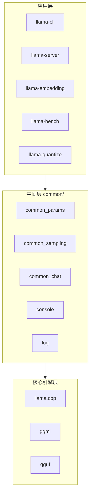
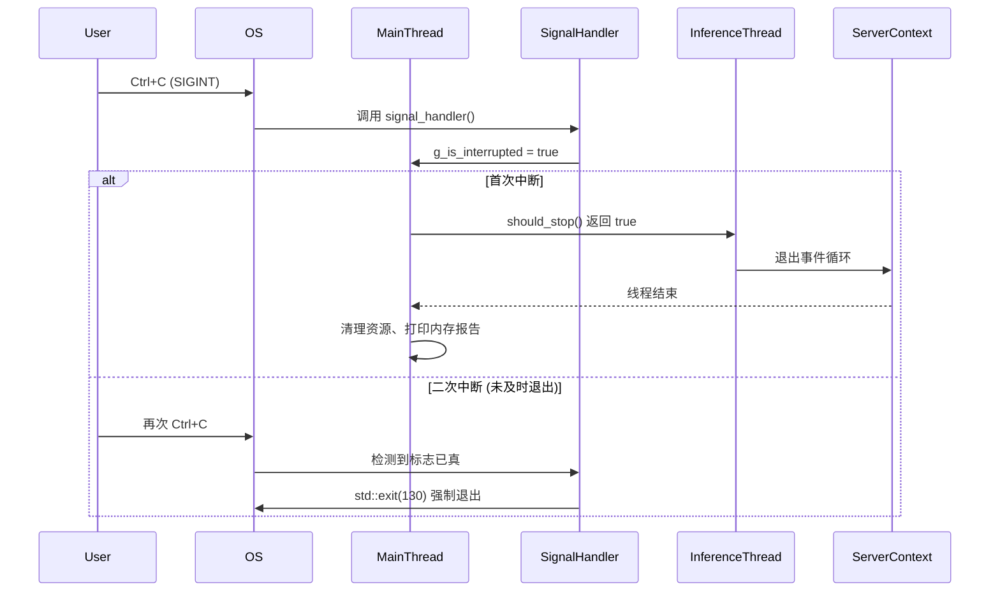
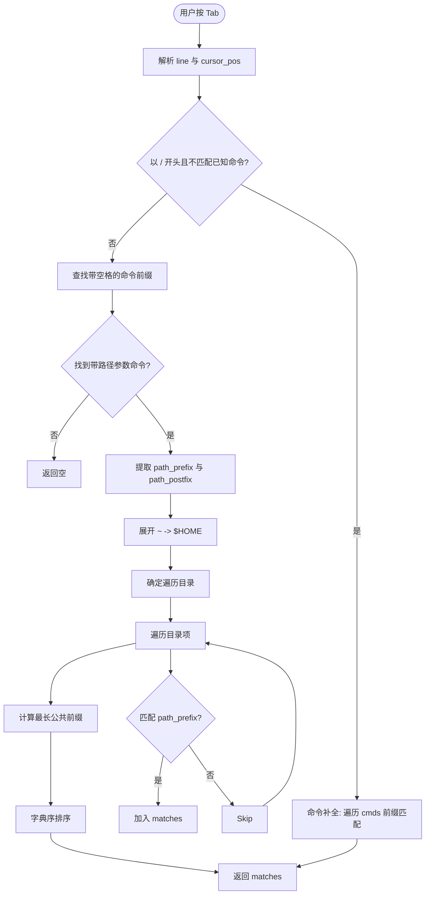
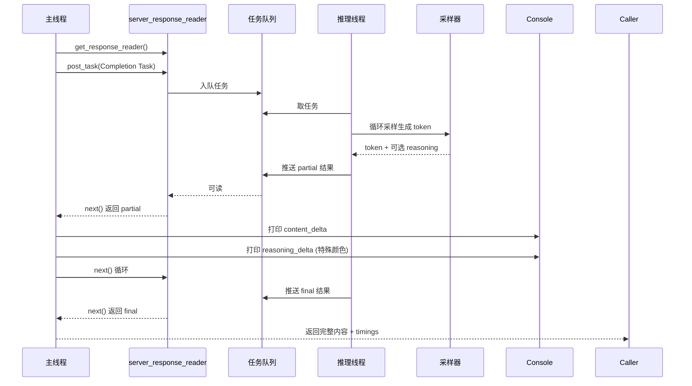
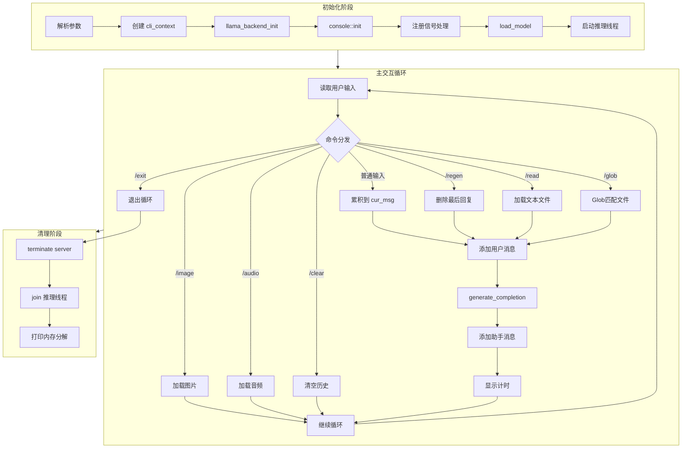
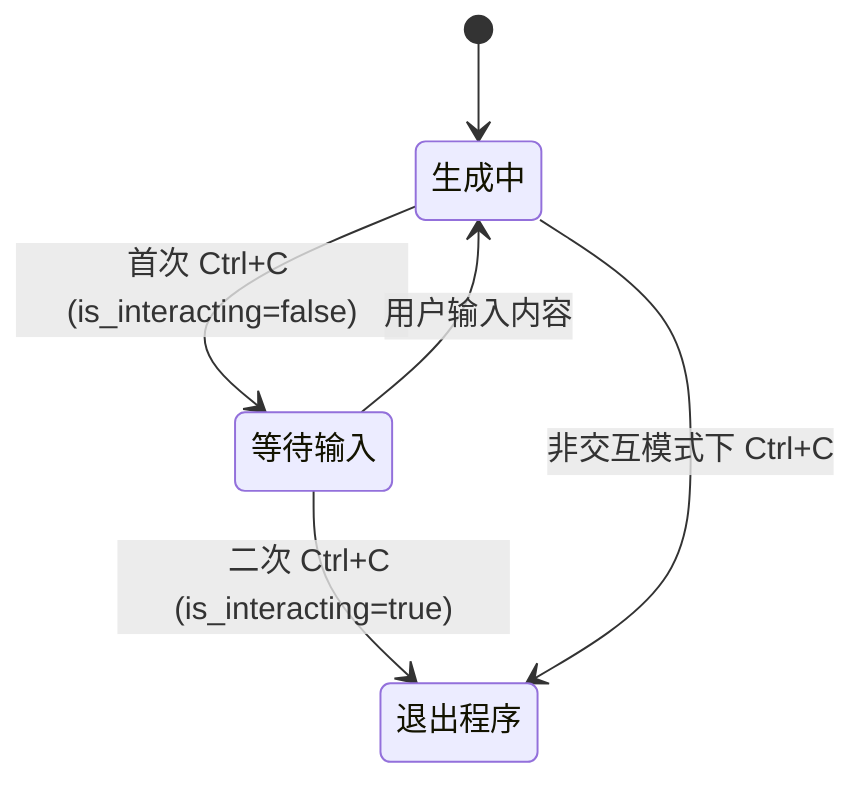

# 第67章 68 命令行推理工具：模型对话的「智能终端」

## 学习目标

- 理解 llama.cpp 项目「零依赖、跨平台」的设计哲学与工程实现
- 掌握支持文本、多模态、扩散等百余种模型架构的统一接口设计
- 熟悉 llama-cli、llama-completion、llama-server 等核心工具链的功能边界与使用场景
- 能够独立完成从模型下载、量化到部署推理的全流程操作
- 理解 GGUF 格式作为「通用集装箱」在模型分发中的核心作用
- 掌握基于 server_context 的 CLI 交互式推理架构与流式响应处理机制
- 理解 CLI 工具的信号处理机制与命令行自动补全实现
- 掌握 completion 工具的文件检查与会话管理辅助函数

## 67.1 生活类比

想象 llama.cpp 是一座「万能发电站」。在这个电站里，GGUF 模型文件就像标准化的燃料棒，它们被统一封装，无论来自哪个厂商，都能即插即用，为电站提供持续的动力。跨平台后端（Metal、CUDA、Vulkan 等）则相当于多种发电机组，无论是苹果的芯片、英伟达的 GPU，还是 AMD 的硬件，都能找到适配的机组，让电站在不同的土地上生根发芽。llama-cli 和 llama-completion 是控制面板与仪表，用户通过它们直接向电站发出指令，或是启动发电，或是调整输出。而 server_context 则是中央调度室，它精密地管理着并发请求、KV 缓存和采样策略，确保每一个任务都能高效完成。量化工具 llama-quantize 就像燃料精炼厂，它把笨重的 FP32 压缩成轻便的 Q4 或 Q8，减重不减效，让燃料的运输和储存更加便捷。多模态支持 mtmd 则是多燃料兼容系统，既能烧煤（文本），也能烧天然气（图像、音频），让电站的用途更加广泛。至于信号处理与自动补全，它们是电站的安全阀与智能控制台，保障操作的安全，同时提升交互的效率。就像发电站需要精密调度燃料、涡轮和电网，llama.cpp 也需要协调模型加载、内存管理与推理计算，才能在不同硬件上高效「发电」。

**深化类比：工具链的分工协作**  
如果将 llama.cpp 比作发电站，那么 `llama-cli` 是操作员面前的**主控制台**，集成了语音指令（多模态）、文件导入（/read /glob）、历史回溯（/clear /regen）等高级功能，适合人类直接交互；`llama-completion` 则是一台**经典的蒸汽涡轮发电机**，结构简单直接，只负责把燃料（prompt）烧成电力（token），适合脚本调用和管道操作；`llama-server` 则是**输电网络**，将发电站的能力通过标准化接口（OpenAI 兼容 API）分发给成千上万个下游用户；而 `llama-quantize` 是**燃料精炼厂**，在燃料入站前完成压缩换装。四大工具各司其职，共同构成了从原油到用电的完整产业链。

## 67.2 源码地图

```text
README.md
├── 项目概览与特性                    # 零依赖、跨平台、GGUF 格式
├── 快速上手指南                      # 模型获取、CLI/Server 启动命令
├── 支持模型矩阵                      # LLaMA/Qwen/Mistral/Gemma 等 100+ 架构
├── 多模态支持                        # LLaVA/Qwen-VL/GLM-4V 等视觉语言模型
└── 工具链说明                        # llama-quantize/llama-server/llama-cli

tools/cli/cli.cpp
├── 全局辅助函数
│   ├── should_stop()                 # 检查中断标志
│   ├── signal_handler()              # SIGINT/SIGTERM 处理，支持二次退出
│   └── auto_completion_callback()    # 命令与文件路径自动补全
├── cli_context 类
│   ├── cli_context()                 # 构造函数：初始化采样参数、推理参数
│   ├── generate_completion()         # 核心：流式生成完成响应，处理 reasoning 标签
│   ├── load_input_file()             # 加载文本/媒体文件
│   └── format_chat()                 # 应用聊天模板格式化消息
└── main()                            # 程序入口：初始化 → 推理线程 → 主交互循环 → 清理

tools/completion/completion.cpp
├── 全局静态变量                      # g_ctx、g_model、g_smpl、g_params 等
├── 辅助函数
│   ├── print_usage()                 # 打印使用示例
│   ├── file_exists()                 # 文件存在性检查
│   ├── file_is_empty()               # 空文件检查
│   └── sigint_handler()              # 交互模式中断状态机
└── main()                            # 经典生成主循环：prompt → tokenize → batch decode → sample → loop
```

## 67.3 源码解析单元 1：README.md —— 项目蓝图、模型矩阵与工具链总览

源码路径：`README.md`

### 67.3.1 项目概览与特性（第 1-50 行）

```markdown
# llama.cpp

Inference of Meta's LLaMA model (and others) in pure C/C++

Main features:
- **Zero dependencies** (except for standard library) — 纯 C/C++ 实现，无外部库依赖
- **Apple silicon first-class citizen** (ARM NEON, Accelerate framework, Metal) — 苹果芯片优先支持
- **AVX/AVX2/AVX512** support for x86 architectures — x86 SIMD 指令集加速
- **CUDA / HIP / SYCL / OpenCL / Vulkan / Kompute / Metal** GPU acceleration — 统一 GPU 后端抽象
- **Integer quantization** (4-bit, 5-bit, 8-bit, etc.) — 支持多种量化格式
- **Runs on the CPU** (and hybrid CPU/GPU) — 支持纯 CPU 与异构推理
- **Web support** via WebAssembly (WASM) — 浏览器端运行
- **Android / iOS** support via JNI / ObjC — 移动端部署
- **LoRA / LoKR / LoHA adapters** — 低秩适配器微调
- **Speculative decoding** — 投机解码加速
- **Tool use / function calling** — 工具调用与函数调用
- **GPTQ / AWQ / EXL2** support — 主流量化格式兼容
- **GGUF** model format support — 统一模型容器格式
- **OpenAI-compatible API server** — 标准化服务接口
- **Grammar-based constrained sampling** (GBNF/JSON Schema/Regex) — 约束采样
- **Parallel processing** of multiple sequences — 并行序列处理
- **Multimodal models** (LLaVA, Qwen-VL, GLM-4V, etc.) — 视觉/音频多模态
- **Diffusion models** (Flux, SDXL, etc.) — 扩散模型生成图像
- **Reranking models** — 重排序模型
```

> **解析**：这段文档确立了 llama.cpp 的核心定位——**纯 C/C++ 零依赖推理引擎**。关键设计决策包括：
> 1. **零依赖**：仅依赖标准库，通过 CMake 管理构建，极大降低了移植门槛。
> 2. **硬件抽象层**：通过 ggml 提供统一的后端接口，一套代码适配 CPU（ARM NEON、AVX）、GPU（CUDA、Metal、Vulkan）、NPU 等异构硬件。
> 3. **量化原生支持**：整数量化（4/5/8-bit）是核心能力，配合 GGUF 格式实现「一次量化，到处运行」。
> 4. **模型架构中立**：支持 100+ 架构（LLaMA、Qwen、Mistral、Gemma、Phi 等），新架构仅需添加 `llama_model_loader` 实现。
> 5. **生态桥接**：OpenAI 兼容 API 服务器让上层应用无缝接入，Grammar 约束采样满足结构化输出需求。

**架构图：三明治分层架构**



### 67.3.2 快速上手指南（第 52-120 行）

```markdown
## Quick Start

### 1. Build
```bash
git clone https://github.com/ggml-org/llama.cpp
cd llama.cpp
cmake -B build
cmake --build build --config Release
```

### 2. Get a model (GGUF format)
```bash
## 67.4 Option A: Download from Hugging Face (recommended)
hf download bartowski/Qwen2.5-0.5B-Instruct-GGUF --include "*.gguf" --local-dir ./models

## 67.5 Option B: Convert from PyTorch/HF format
python convert_hf_to_gguf.py /path/to/model --outfile model.gguf
```

### 3. Run inference
```bash
## 67.6 CLI chat (interactive)
./build/bin/llama-cli -m ./models/Qwen2.5-0.5B-Instruct-Q4_K_M.gguf -cnv

## 67.7 Server (OpenAI compatible API)
./build/bin/llama-server -m ./models/Qwen2.5-0.5B-Instruct-Q4_K_M.gguf -c 4096

## 67.8 Benchmark
./build/bin/llama-bench -m ./models/Qwen2.5-0.5B-Instruct-Q4_K_M.gguf
```
```

> **解析**：快速上手三部曲体现了「下载 → 转换/量化 → 运行」的标准化流程：
> 1. **构建系统**：CMake 单配置构建，无需复杂依赖管理。
> 2. **模型获取**：推荐直接下载 GGUF（避免本地转换），`hf` CLI 是 Hugging Face 官方工具。
> 3. **三大入口**：
>    - `llama-cli`：交互式聊天，支持多轮对话、多媒体输入、命令系统。
>    - `llama-server`：生产级服务，OpenAI API 兼容，支持并发、流式、工具调用。
>    - `llama-bench`：性能基准，测量 prompt 处理速度、生成速度、内存占用。

### 67.8.1 支持模型矩阵（第 122-250 行）

```markdown
## Supported Models

| Architecture | Example Models | Context | Multimodal |
|--------------|----------------|---------|------------|
| LLaMA | LLaMA 1/2/3, CodeLLaMA, Vicuna | 4K-128K | ❌ |
| Qwen | Qwen 1.5/2/2.5, Qwen-VL, Qwen2-Audio | 32K-128K | ✅ VL/Audio |
| Mistral | Mistral 7B, Mixtral 8x7B, Codestral | 32K-128K | ❌ |
| Gemma | Gemma 1/2/3, CodeGemma, PaliGemma | 8K-128K | ✅ VL |
| Phi | Phi-2/3/3.5, Phi-3.5-Vision | 4K-128K | ✅ VL |
| GLM | GLM-4, GLM-4V, GLM-4V-9B | 128K | ✅ VL |
| DeepSeek | DeepSeek-V2/V3, DeepSeek-Coder, DeepSeek-R1 | 128K-256K | ❌ |
| BERT | BERT, RoBERTa, DeBERTa | 512-4K | ❌ |
| T5 | T5, FLAN-T5, UL2 | 512-4K | ❌ |
| Mamba | Mamba, Mamba-2, Jamba | 256K+ | ❌ |
| RWKV | RWKV-4/5/6/7 | ∞ (RNN) | ❌ |
| StableLM | StableLM 3B/7B | 4K-32K | ❌ |
| ... | **100+ more** | | |
```

> **解析**：模型矩阵展示了 llama.cpp 的架构中立性：
> 1. **统一接口**：所有架构共享 `llama_model_loader`、`llama_context`、`llama_sampler` 等核心 API。
> 2. **上下文长度演进**：从早期 4K 到现代 128K/256K，配合 RoPE 缩放、Self-Extend、LongRoPE 等技术突破训练长度限制。
> 3. **多模态集成**：通过 `mtmd`（多模态编码器）统一处理图像/音频投影，仅需额外加载 `mmproj` 文件。
> 4. **特殊架构支持**：Mamba/RWKV 等 RNN 架构通过自定义 kernel 实现，BERT/T5 等编码器模型用于嵌入/重排序。

### 67.8.2 多模态支持（第 252-320 行）

```markdown
## Multimodal Support

llama.cpp supports multimodal models through the **mtmd** (multi-modal) encoder system:

### Vision Language Models (VLM)
- **LLaVA 1.5/1.6** (llava-v1.5-7b, llava-v1.6-mistral-7b, etc.)
- **Qwen-VL / Qwen2-VL** (qwen-vl-chat, qwen2-vl-7b-instruct)
- **GLM-4V** (GLM-4V-9B)
- **Phi-3.5-Vision** (Phi-3.5-vision-instruct)
- **PaliGemma** (paligemma-3b-mix-224)
- **InternVL2** (internvl2-8b)

### Audio Language Models
- **Qwen2-Audio** (qwen2-audio-7b-instruct)
- **GLM-4-Voice** (GLM-4-Voice-9B)

### Usage
```bash
## 67.9 Download model + mmproj (projector weights)
hf download llava-hf/llava-v1.6-mistral-7b-hf --include "*.gguf" --local-dir ./models
hf download mmproj/llava-v1.6-mistral-7b-mmproj --include "*.gguf" --local-dir ./models

## 67.10 Run CLI with image
./build/bin/llama-cli -m ./models/llava-v1.6-mistral-7b-Q4_K_M.gguf \
    --mmproj ./models/mmproj-llava-v1.6-mistral-7b.gguf \
    --image ./image.jpg -p "Describe this image"
```
```

> **解析**：多模态设计的核心是**解耦**：
> 1. **主模型**（LLM backbone）仅处理文本 token，完全复用纯文本推理流程。
> 2. **投影器**（mmproj / projector）将视觉/音频编码器输出映射到 LLM 嵌入空间，独立存储为单独 GGUF 文件。
> 3. **mtmd 编码器**：在 `common_mtmd.cpp` 中实现，负责图像预处理（resize、normalize、patch）、音频特征提取（mel spectrogram），调用编码器（CLIP/SigLIP/Whisper）并投影。
> 4. **统一接口**：`llama_batch_add_image`/`llama_batch_add_audio` 将媒体 token 注入 batch，对上层透明。

### 67.10.1 工具链说明（第 322-420 行）

```markdown
## Tools

| Tool | Purpose | Key Features |
|------|---------|--------------|
| **llama-cli** | Interactive chat client | Multi-turn, multimodal, commands (/read, /glob, /image), streaming |
| **llama-server** | OpenAI-compatible API server | Concurrent requests, tool calling, grammar, metrics, chat templates |
| **llama-completion** | Legacy text generation | Simple prompt→completion, session cache, context shift, Self-Extend |
| **llama-embedding** | Text embedding / reranking | Batch encode, pooling, similarity, rerank API |
| **llama-bench** | Performance benchmark | Prompt/gen throughput, memory, latency percentiles |
| **llama-perplexity** | Perplexity evaluation | Dataset eval, sliding window, stride |
| **llama-quantize** | Model quantization | k-means, imatrix, Q4_K_M/Q8_0/IQ4_XS etc. |
| **llama-imatrix** | Importance matrix collection | Calibration data → sensitivity analysis |
| **gguf-split / gguf-combine** | Split/merge large GGUF | Multi-file distribution, sharding |
| **export-lora** | Export LoRA adapters | Merge LoRA into base, or export standalone |
| **fit-params** | Auto-tune sampling params | Grid search for optimal temp/top-p/min-p |
```

> **解析**：工具链形成了完整的**模型生命周期管线**：
> 1. **量化与优化**：`llama-quantize` + `llama-imatrix` 实现精度损失最小化的压缩。
> 2. **分发与部署**：`gguf-split` 解决大文件传输，`llama-server` 提供标准化服务。
> 3. **评估与调优**：`llama-bench`/`llama-perplexity`/`fit-params` 覆盖性能、质量、超参搜索。
> 4. **适配器管理**：`export-lora` 支持 LoRA 合并与导出，便于微调模型分发。
> 5. **交互与嵌入**：`llama-cli` 面向人类，`llama-embedding` 面向检索/RAG 管线。

---

## 67.11 源码解析单元 2：tools/cli/cli.cpp —— 现代交互式 CLI 核心实现

### 67.11.1 全局辅助函数：should_stop()（第 34-36 行）

```cpp
static bool should_stop() {
    return g_is_interrupted.load();
}
```

> **解析**：`should_stop()` 是一个**原子标志检查器**，返回全局原子布尔变量 `g_is_interrupted` 的值。它被设计为**线程安全**的中断检查点，供推理线程（`server_context::start_loop()`）、流式生成循环（`generate_completion()`）、用户输入等待（`console::readline()`）等多处调用。通过 `std::atomic<bool>` 避免了数据竞争，实现了无锁的优雅停止机制。这是 CLI 与后台推理线程协作的「心跳检测」接口。

### 67.11.2 全局辅助函数：signal_handler()（第 39-48 行）

```cpp
static void signal_handler(int) {
    if (g_is_interrupted.load()) {
        fprintf(stdout, "\033[0m\n");
        fflush(stdout);
        std::exit(130);
    }
    g_is_interrupted.store(true);
}
```

> **解析**：`signal_handler()` 实现了**二次中断退出**的交互语义：
> 1. **首次 Ctrl+C**：设置 `g_is_interrupted = true`，通知各工作线程检查 `should_stop()` 并优雅退出（保存会话、刷新输出、释放资源）。
> 2. **二次 Ctrl+C**：若首次中断后程序未及时退出（如卡死在推理中），用户再次按下 Ctrl+C，检测到标志已为真，直接强制退出（`std::exit(130)`），并重置终端颜色（`\033[0m`）。
> 3. **跨平台注册**：`main()` 中通过 `sigaction`（Unix）和 `SetConsoleCtrlHandler`（Windows）注册，确保信号在主线程同步处理。
> 4. **退出码 130**：遵循 Unix 惯例（128 + SIGINT=2），便于脚本判断是否为用户中断。

**架构图：信号处理与中断传播流程**



### 67.11.3 全局辅助函数：auto_completion_callback()（第 253-341 行）

```cpp
static std::vector<std::pair<std::string, size_t>> auto_completion_callback(std::string_view line, size_t cursor_byte_pos) {
    std::vector<std::pair<std::string, size_t>> matches;
    std::string cmd;
    static const std::vector<std::string> cmds = {
        "/exit ", "/regen", "/clear ", "/read ", "/glob ", "/image ", "/audio "
    };
    
    // 1. 命令补全：输入以 '/' 开头且不匹配已知命令前缀
    if (line.length() > 1 && line[0] == '/' && !std::any_of(cmds.begin(), cmds.end(), 
        [line](const std::string & prefix) { return string_starts_with(line, prefix); })) {
        auto it = cmds.begin();
        while ((it = std::find_if(it, cmds.end(), [line](const std::string & cmd_line) {
            return string_starts_with(cmd_line, line);
        })) != cmds.end()) {
            matches.emplace_back(*it, (*it).length());
            ++it;
        }
    } 
    // 2. 文件路径补全：识别带文件参数的命令（/read /glob /image /audio /clear）
    else {
        auto it = std::find_if(cmds.begin(), cmds.end(), [line](const std::string & prefix) {
            return prefix.back() == ' ' && string_starts_with(line, prefix);
        });
        if (it != cmds.end()) {
            cmd = *it;
        }
    }
    
    // 3. 文件系统遍历补全
    if (!cmd.empty() && cmd != "/glob " && line.length() >= cmd.length() && cursor_byte_pos >= cmd.length()) {
        const std::string path_prefix  = std::string(line.substr(cmd.length(), cursor_byte_pos - cmd.length()));
        const std::string path_postfix = std::string(line.substr(cursor_byte_pos));
        auto cur_dir = std::filesystem::current_path();
        std::string cur_dir_str = cur_dir.string();
        std::string expanded_prefix = path_prefix;
        
        // 3.1 路径展开：~ -> $HOME
        #if !defined(_WIN32)
        if (string_starts_with(path_prefix, "~")) {
            const char * home = std::getenv("HOME");
            if (home && home[0]) expanded_prefix = std::string(home) + path_prefix.substr(1);
        }
        #endif
        
        // 3.2 确定遍历目录：绝对路径用父目录，相对路径用当前目录+父目录
        if (string_starts_with(expanded_prefix, "/")) {
            cur_dir = std::filesystem::path(expanded_prefix).parent_path();
            cur_dir_str = "";
        } else if (!path_prefix.empty()) {
            cur_dir /= std::filesystem::path(path_prefix).parent_path();
        }
        
        // 3.3 遍历目录项匹配前缀
        std::error_code ec;
        for (const auto & entry : std::filesystem::directory_iterator(cur_dir, ec)) {
            if (ec) break;
            if (!entry.exists(ec)) { ec.clear(); continue; }
            const std::string path_full = entry.path().string();
            std::string path_entry = !cur_dir_str.empty() && string_starts_with(path_full, cur_dir_str) 
                ? path_full.substr(cur_dir_str.length() + 1) : path_full;
            if (entry.is_directory(ec)) path_entry.push_back(std::filesystem::path::preferred_separator);
            if (expanded_prefix.empty() || string_starts_with(path_entry, expanded_prefix)) {
                std::string updated_line = cmd + path_entry;
                matches.emplace_back(updated_line + path_postfix, updated_line.length());
            }
            if (ec) ec.clear();
        }
        
        // 3.4 公共前缀计算：多个匹配时计算最长公共前缀作为额外补全项
        if (!expanded_prefix.empty() && matches.size() > 1) {
            const std::string_view match0(matches[0].first);
            const std::string_view match1(matches[1].first);
            auto it = std::mismatch(match0.begin(), match0.end(), match1.begin(), match1.end());
            size_t len = it.first - match0.begin();
            for (size_t i = 2; i < matches.size(); ++i) {
                const std::string_view matchi(matches[i].first);
                auto cmp = std::mismatch(match0.begin(), match0.end(), matchi.begin(), matchi.end());
                len = std::min(len, static_cast<size_t>(cmp.first - match0.begin()));
            }
            std::string updated_line = std::string(match0.substr(0, len));
            matches.emplace_back(updated_line + path_postfix, updated_line.length());
        }
        
        // 3.5 排序
        std::sort(matches.begin(), matches.end(), [](const auto & a, const auto & b) {
            return a.first.compare(0, a.second, b.first, 0, b.second) < 0;
        });
    }
    return matches;
}
```

> **解析**：`auto_completion_callback()` 是**命令行智能补全引擎**，集成了命令补全与文件路径补全两大功能：
> 1. **双模式识别**：通过 `cmds` 列表区分「纯命令」（`/regen`、`/exit`）与「带路径参数命令」（`/read `、`/image ` 等，注意尾随空格）。
> 2. **命令补全**：当输入以 `/` 开头且不匹配任何已知命令前缀时，列出所有以当前输入为前缀的命令。
> 3. **路径补全**：识别出命令前缀后，提取光标前的路径片段，遍历对应目录：
>    - 支持 `~` 展开（Unix）、绝对路径、相对路径。
>    - 目录项追加分隔符（`/` 或 `\`）提示可继续深入。
>    - 保留光标后的 `path_postfix`，支持在路径中间补全。
> 4. **公共前缀优化**：多个匹配时计算最长公共前缀（LCP），作为额外补全项插入，模仿 Shell 的「补全到唯一」行为。
> 5. **跨平台**：`std::filesystem` 统一抹平 Windows/Unix 路径差异，`preferred_separator` 自动适配。

**架构图：自动补全回调流程**



### 67.11.4 cli_context 类：构造函数（第 66-99 行）

```cpp
cli_context(const common_params & params) {
    defaults.sampling    = params.sampling;
    defaults.speculative = params.speculative;
    defaults.n_keep      = params.n_keep;
    defaults.n_predict   = params.n_predict;
    defaults.antiprompt  = params.antiprompt;
    defaults.stream = true; // make sure we always use streaming mode
    defaults.timings_per_token = true;
    verbose_prompt = params.verbose_prompt;
    reasoning_budget = params.reasoning_budget;
    reasoning_budget_message = params.reasoning_budget_message;
}
```

> **解析**：`cli_context` 构造函数完成**参数从 common_params 到 server_task_defaults 的迁移与增强**：
> 1. **核心参数透传**：采样参数、投机解码参数、保留 token 数（`n_keep`）、最大生成长度（`n_predict`）、反提示词（`antiprompt`）。
> 2. **强制流式模式**：`defaults.stream = true` 确保 CLI 始终以流式方式接收 token，实现逐字输出体验。
> 3. **逐 token 计时**：`defaults.timings_per_token = true` 启用详细性能统计（prompt/生成 t/s）。
> 4. **推理预算控制**：`reasoning_budget` 与 `reasoning_budget_message` 配合 DeepSeek 格式的 `<think>` 标签，限制思维链长度，防止过度推理。

### 67.11.5 cli_context 类：generate_completion()（第 100-205 行）

```cpp
std::string generate_completion(result_timings & out_timings) {
    server_response_reader rd = ctx_server.get_response_reader();
    auto chat_params = format_chat();
    
    // 1. 构造推理任务
    {
        server_task task = server_task(SERVER_TASK_TYPE_COMPLETION);
        task.id         = rd.get_new_id();
        task.index      = 0;
        task.params     = defaults;
        task.cli_prompt = chat_params.prompt;
        task.cli_files  = input_files;
        task.cli        = true;
        task.params.chat_parser_params = common_chat_parser_params(chat_params);
        task.params.chat_parser_params.reasoning_format = COMMON_REASONING_FORMAT_DEEPSEEK;
        
        // 2. 加载自定义聊天解析器（可选）
        if (!chat_params.parser.empty()) {
            task.params.chat_parser_params.parser.load(chat_params.parser);
        }
        
        // 3. 配置 reasoning budget（思维链长度限制）
        if (!chat_params.thinking_end_tag.empty()) {
            const llama_vocab * vocab = llama_model_get_vocab(
                llama_get_model(ctx_server.get_llama_context()));
            task.params.sampling.reasoning_budget_tokens = reasoning_budget;
            task.params.sampling.generation_prompt = chat_params.generation_prompt;
            if (!chat_params.thinking_start_tag.empty()) {
                task.params.sampling.reasoning_budget_start =
                    common_tokenize(vocab, chat_params.thinking_start_tag, false, true);
            }
            task.params.sampling.reasoning_budget_end =
                common_tokenize(vocab, chat_params.thinking_end_tag, false, true);
            task.params.sampling.reasoning_budget_forced =
                common_tokenize(vocab, reasoning_budget_message + chat_params.thinking_end_tag, false, true);
        }
        
        rd.post_task({std::move(task)});  // 提交任务到 server_context 队列
    }
    
    // 4. 可选：显示完整 prompt（调试用）
    if (verbose_prompt) {
        console::set_display(DISPLAY_TYPE_PROMPT);
        console::log("%s\n\n", chat_params.prompt.c_str());
        console::set_display(DISPLAY_TYPE_RESET);
    }
    
    // 5. 流式接收响应
    console::spinner::start();  // 显示等待动画
    server_task_result_ptr result = rd.next(should_stop);  // 阻塞等待第一个 chunk
    console::spinner::stop();
    
    std::string curr_content;
    bool is_thinking = false;
    
    while (result) {
        if (should_stop()) break;  // 响应中断
        
        if (result->is_error()) {
            json err_data = result->to_json();
            console::error("Error: %s\n", err_data.dump().c_str());
            return curr_content;
        }
        
        // 5.1 处理增量内容
        auto res_partial = dynamic_cast<server_task_result_cmpl_partial *>(result.get());
        if (res_partial) {
            out_timings = std::move(res_partial->timings);
            for (const auto & diff : res_partial->oaicompat_msg_diffs) {
                if (!diff.content_delta.empty()) {
                    curr_content += diff.content_delta;
                    console::log("%s", diff.content_delta.c_str());  // 实时输出正文
                }
                if (!diff.reasoning_content_delta.empty()) {
                    console::set_display(DISPLAY_TYPE_REASONING);  // 推理内容特殊颜色
                    console::log("%s", diff.reasoning_content_delta.c_str());
                }
            }
        }
        
        // 5.2 处理最终结果
        auto res_final = dynamic_cast<server_task_result_cmpl_final *>(result.get());
        if (res_final) {
            out_timings = std::move(res_final->timings);
            break;
        }
        
        result = rd.next(should_stop);  // 继续拉取下一个 chunk
    }
    
    g_is_interrupted.store(false);  // 重置中断标志
    return curr_content;
}
```

> **解析**：`generate_completion()` 是 CLI 交互的**核心生成引擎**，基于 `server_context` 的异步任务模型实现流式推理：
> 1. **任务构造**：将格式化后的 prompt、媒体文件、采样参数打包为 `server_task`，提交给后台推理线程。
> 2. **Reasoning Budget**：针对 DeepSeek-R1 等推理模型，通过 `thinking_start_tag`/`thinking_end_tag` 识别思维链区间，`reasoning_budget_tokens` 限制最大思考长度，超预算时强制注入 `reasoning_budget_forced` 结束思考。
> 3. **流式消费**：`server_response_reader` 作为消费者从响应队列拉取 `server_task_result_cmpl_partial`（增量）和 `server_task_result_cmpl_final`（终结）。
> 4. **双轨输出**：`content_delta` 正常显示，`reasoning_content_delta` 以 `DISPLAY_TYPE_REASONING` 颜色区分（通常为灰色/斜体）。
> 5. **中断响应**：循环每次迭代检查 `should_stop()`，实现生成过程中的即时停止。
> 6. **计时聚合**：每个 partial 结果携带 `timings`，最终结果覆盖为完整统计。

**架构图：generate_completion 流式处理流程**



### 67.11.6 cli_context 类：load_input_file()（第 207-223 行）

```cpp
std::string load_input_file(const std::string & fname, bool is_media) {
    std::ifstream file(fname, std::ios::binary);
    if (!file) {
        return "";
    }
    if (is_media) {
        raw_buffer buf;
        buf.assign((std::istreambuf_iterator<char>(file)), std::istreambuf_iterator<char>());
        input_files.push_back(std::move(buf));
        return mtmd_default_marker();  // 返回媒体占位标记，如 "<image>"
    } else {
        std::string content((std::istreambuf_iterator<char>(file)), std::istreambuf_iterator<char>());
        return content;  // 直接返回文本内容
    }
}
```

> **解析**：`load_input_file()` 实现了**文本与媒体文件的差异化加载**：
> 1. **统一入口**：`is_media` 参数区分处理模式，调用者根据命令类型（`/read` vs `/image`）决定。
> 2. **文本模式**：读取全文返回 `std::string`，直接拼接到用户消息中。
> 3. **媒体模式**：读取二进制数据到 `raw_buffer`（`std::vector<uint8_t>`），存入 `input_files` 成员向量，返回 `mtmd_default_marker()`（如 `<image>`、`<audio>`）作为 prompt 中的占位符。实际媒体数据随任务提交时通过 `task.cli_files` 传给 `server_context`，由 `mtmd` 编码器处理。
> 4. **错误处理**：文件打开失败返回空字符串，调用方检查并报错。

### 67.11.7 cli_context 类：format_chat()（第 225-241 行）

```cpp
common_chat_params format_chat() {
    auto meta = ctx_server.get_meta();
    auto & chat_params = meta.chat_params;
    common_chat_templates_inputs inputs;
    inputs.messages              = common_chat_msgs_parse_oaicompat(messages);
    inputs.tools                 = {};
    inputs.tool_choice           = COMMON_CHAT_TOOL_CHOICE_NONE;
    inputs.json_schema           = "";
    inputs.grammar               = "";
    inputs.use_jinja             = chat_params.use_jinja;
    inputs.parallel_tool_calls   = false;
    inputs.add_generation_prompt = true;
    inputs.reasoning_format      = COMMON_REASONING_FORMAT_DEEPSEEK;
    inputs.force_pure_content    = chat_params.force_pure_content;
    inputs.enable_thinking       = chat_params.enable_thinking ? common_chat_templates_support_enable_thinking(chat_params.tmpls.get()) : false;
    return common_chat_templates_apply(chat_params.tmpls.get(), inputs);
}
```

> **解析**：`format_chat()` 是**聊天模板应用的封装**，将内部消息历史（`messages`：`vector<json>`）转换为模型可消费的单一 prompt 字符串：
> 1. **消息解析**：`common_chat_msgs_parse_oaicompat` 将 OpenAI 格式消息（role/content）转为内部 `common_chat_msg` 结构。
> 2. **模板参数组装**：
>    - `add_generation_prompt = true`：在末尾追加助手回复的起始标记（如 `<|im_start|>assistant\n`）。
>    - `reasoning_format = DEEPSEEK`：启用 `<think>`/`</think>` 标签解析，配合 `generate_completion` 的 reasoning budget。
>    - `enable_thinking`：若模板支持 `enable_thinking` 参数（如 Qwen3），则开启。
> 3. **应用模板**：`common_chat_templates_apply` 调用 Jinja2 模板引擎渲染，返回包含 `prompt`、`generation_prompt`、`thinking_start_tag`、`thinking_end_tag` 等字段的 `common_chat_params`。

### 67.11.8 main()：程序入口与主交互循环（第 349-600 行）

```cpp
int main(int argc, char ** argv) {
    // ========== 1. 参数解析与基础初始化 ==========
    common_params params;
    params.verbosity = LOG_LEVEL_ERROR;
    common_init();
    if (!common_params_parse(argc, argv, params, LLAMA_EXAMPLE_CLI)) return 1;
    if (params.conversation_mode == COMMON_CONVERSATION_MODE_DISABLED) {
        console::error("--no-conversation is not supported by llama-cli\n");
    }
    
    cli_context ctx_cli(params);  // 封装 CLI 专用参数
    
    // ========== 2. 后端与控制台初始化 ==========
    llama_backend_init();
    llama_numa_init(params.numa);
    console::init(params.simple_io, params.use_color);
    atexit([]() { console::cleanup(); });
    console::set_display(DISPLAY_TYPE_RESET);
    console::set_completion_callback(auto_completion_callback);  // 注册补全回调
    
    // ========== 3. 信号处理注册（跨平台） ==========
    #if defined (__unix__) || (defined (__APPLE__) && defined (__MACH__))
    struct sigaction sigint_action;
    sigint_action.sa_handler = signal_handler;
    sigemptyset(&sigint_action.sa_mask);
    sigint_action.sa_flags = 0;
    sigaction(SIGINT, &sigint_action, NULL);
    sigaction(SIGTERM, &sigint_action, NULL);
    #elif defined (_WIN32)
    auto console_ctrl_handler = +[](DWORD ctrl_type) -> BOOL {
        return (ctrl_type == CTRL_C_EVENT) ? (signal_handler(SIGINT), true) : false;
    };
    SetConsoleCtrlHandler(reinterpret_cast<PHANDLER_ROUTINE>(console_ctrl_handler), true);
    #endif
    
    // ========== 4. 模型加载（带 spinner） ==========
    console::log("\nLoading model... ");
    console::spinner::start();
    if (!ctx_cli.ctx_server.load_model(params)) {
        console::spinner::stop();
        console::error("\nFailed to load the model\n");
        return 1;
    }
    console::spinner::stop();
    console::log("\n");
    
    // ========== 5. 启动后台推理线程 ==========
    std::thread inference_thread([&ctx_cli]() {
        ctx_cli.ctx_server.start_loop();  // 事件循环：处理任务队列、执行推理、推送结果
    });
    
    // ========== 6. 打印模型元信息与帮助 ==========
    auto inf = ctx_cli.ctx_server.get_meta();
    std::string modalities = "text";
    if (inf.has_inp_image) modalities += ", vision";
    if (inf.has_inp_audio) modalities += ", audio";
    
    auto add_system_prompt = [&]() {
        if (!params.system_prompt.empty()) {
            ctx_cli.messages.push_back({{"role", "system"}, {"content", params.system_prompt}});
        }
    };
    add_system_prompt();
    
    console::log("\n%s\n", LLAMA_ASCII_LOGO);
    console::log("build      : %s\n", inf.build_info.c_str());
    console::log("model      : %s\n", inf.model_name.c_str());
    console::log("modalities : %s\n", modalities.c_str());
    if (!params.system_prompt.empty()) console::log("using custom system prompt\n");
    console::log("\n");
    
    console::log("available commands:\n");
    console::log("  /exit or Ctrl+C     stop or exit\n");
    console::log("  /regen              regenerate the last response\n");
    console::log("  /clear              clear the chat history\n");
    console::log("  /read <file>        add a text file\n");
    console::log("  /glob <pattern>     add text files using globbing pattern\n");
    if (inf.has_inp_image) console::log("  /image <file>       add an image file\n");
    if (inf.has_inp_audio) console::log("  /audio <file>       add an audio file\n");
    console::log("\n");
    
    std::string cur_msg;  // 当前消息缓冲
    
    // 添加文本文件的 lambda
    auto add_text_file = [&](const std::string & fname) -> bool {
        std::string marker = ctx_cli.load_input_file(fname, false);
        if (marker.empty()) {
            console::error("file does not exist or cannot be opened: '%s'\n", fname.c_str());
            return false;
        }
        if (inf.fim_sep_token != LLAMA_TOKEN_NULL) {  // FIM 模式
            cur_msg += common_token_to_piece(ctx_cli.ctx_server.get_llama_context(), inf.fim_sep_token, true);
            cur_msg += fname;
            cur_msg.push_back('\n');
        } else {  // 普通模式
            cur_msg += "--- File: ";
            cur_msg += fname;
            cur_msg += " ---\n";
        }
        cur_msg += marker;
        console::log("Loaded text from '%s'\n", fname.c_str());
        return true;
    };
    
    // ========== 7. 主交互循环 ==========
    while (true) {
        std::string buffer;
        console::set_display(DISPLAY_TYPE_USER_INPUT);
        
        if (params.prompt.empty()) {  // 无预设 prompt：交互式读取
            console::log("\n> ");
            std::string line;
            bool another_line = true;
            do {
                another_line = console::readline(line, params.multiline_input);
                buffer += line;
            } while (another_line);
        } else {  // 有预设 prompt (首轮或 -p 参数)
            for (auto & fname : params.image) {
                std::string marker = ctx_cli.load_input_file(fname, true);
                if (marker.empty()) {
                    console::error("file does not exist or cannot be opened: '%s'\n", fname.c_str());
                    break;
                }
                console::log("Loaded media from '%s'\n", fname.c_str());
                cur_msg += marker;
            }
            buffer = params.prompt;
            console::log("\n> %s\n", buffer.c_str());
            params.prompt.clear();
        }
        
        console::set_display(DISPLAY_TYPE_RESET);
        console::log("\n");
        
        if (should_stop()) {
            g_is_interrupted.store(false);
            break;
        }
        
        if (!buffer.empty() && buffer.back() == '\n') buffer.pop_back();
        if (buffer.empty()) continue;
        
        bool add_user_msg = true;
        
        // ----- 命令分发 -----
        if (string_starts_with(buffer, "/exit")) {
            break;
        } else if (string_starts_with(buffer, "/regen")) {
            if (ctx_cli.messages.size() >= 2) {
                size_t last_idx = ctx_cli.messages.size() - 1;
                ctx_cli.messages.erase(last_idx);  // 删除最后一条助手回复
                add_user_msg = false;              // 复用上一条用户消息
            } else {
                console::error("No message to regenerate.\n");
                continue;
            }
        } else if (string_starts_with(buffer, "/clear")) {
            ctx_cli.messages.clear();
            add_system_prompt();
            ctx_cli.input_files.clear();
            console::log("Chat history cleared.\n");
            continue;
        } else if (
            (string_starts_with(buffer, "/image ") && inf.has_inp_image) ||
            (string_starts_with(buffer, "/audio ") && inf.has_inp_audio)) {
            std::string fname = string_strip(buffer.substr(7));
            std::string marker = ctx_cli.load_input_file(fname, true);
            if (marker.empty()) {
                console::error("file does not exist or cannot be opened: '%s'\n", fname.c_str());
                continue;
            }
            cur_msg += marker;
            console::log("Loaded media from '%s'\n", fname.c_str());
            continue;
        } else if (string_starts_with(buffer, "/read ")) {
            std::string fname = string_strip(buffer.substr(6));
            add_text_file(fname);
            continue;
        } else if (string_starts_with(buffer, "/glob ")) {
            std::error_code ec;
            size_t count = 0;
            auto curdir = std::filesystem::current_path();
            std::string pattern = string_strip(buffer.substr(6));
            std::filesystem::path rel_path;
            
            // 解析相对路径前缀
            auto startglob = pattern.find_first_of("![*?");
            if (startglob != std::string::npos && startglob != 0) {
                auto endpath = pattern.substr(0, startglob).find_last_of('/');
                if (endpath != std::string::npos) {
                    std::string rel_pattern = pattern.substr(0, endpath);
                    #if !defined(_WIN32)
                    if (string_starts_with(rel_pattern, "~")) {
                        const char * home = std::getenv("HOME");
                        if (home && home[0]) rel_pattern = std::string(home) + rel_pattern.substr(1);
                    }
                    #endif
                    rel_path = rel_pattern;
                    pattern.erase(0, endpath + 1);
                    curdir /= rel_path;
                }
            }
            
            // 递归遍历匹配文件
            for (const auto & entry : std::filesystem::recursive_directory_iterator(curdir,
                    std::filesystem::directory_options::skip_permission_denied, ec)) {
                if (!entry.is_regular_file()) continue;
                std::string rel = std::filesystem::relative(entry.path(), curdir, ec).string();
                if (ec) { ec.clear(); continue; }
                std::replace(rel.begin(), rel.end(), '\\', '/');
                if (!glob_match(pattern, rel)) continue;
                if (!add_text_file((rel_path / rel).string())) continue;
                if (++count >= FILE_GLOB_MAX_RESULTS) {
                    console::error("Maximum number of globbed files allowed (%zu) reached.\n", FILE_GLOB_MAX_RESULTS);
                    break;
                }
            }
            continue;
        } else {
            cur_msg += buffer;  // 普通用户输入
        }
        
        if (add_user_msg) {
            ctx_cli.messages.push_back({
                {"role",    "user"},
                {"content", cur_msg}
            });
            cur_msg.clear();
        }
        
        // ----- 生成回复 -----
        result_timings timings;
        std::string assistant_content = ctx_cli.generate_completion(timings);
        
        // ----- 添加助手回复到历史 -----
        ctx_cli.messages.push_back({
            {"role",    "assistant"},
            {"content", assistant_content}
        });
        
        console::log("\n");
        
        // ----- 显示计时信息 -----
        if (params.show_timings) {
            console::set_display(DISPLAY_TYPE_INFO);
            console::log("\n");
            console::log("[ Prompt: %.1f t/s | Generation: %.1f t/s ]\n", timings.prompt_per_second, timings.predicted_per_second);
            console::set_display(DISPLAY_TYPE_RESET);
        }
        
        if (params.single_turn) break;
    }
    
    // ========== 8. 清理收尾 ==========
    console::set_display(DISPLAY_TYPE_RESET);
    console::log("\nExiting...\n");
    ctx_cli.ctx_server.terminate();  // 通知推理线程退出
    inference_thread.join();         // 等待线程结束
    common_log_set_verbosity_thold(LOG_LEVEL_INFO);
    llama_memory_breakdown_print(ctx_cli.ctx_server.get_llama_context());  // 打印内存分解
    return 0;
}
```

> **解析**：`main()` 是 llama-cli 的总指挥，遵循「初始化 → 后台推理线程 → 主交互循环 → 清理」的标准模式。关键设计点：
> 1. **推理与 UI 解耦**：`ctx_cli.ctx_server.start_loop()` 在后台线程运行，主线程仅负责读取用户输入、命令分发、显示输出。`server_context` 内部维护任务队列和响应读取器，实现了生产者-消费者模式。
> 2. **命令模式**：`/exit` `/regen` `/clear` `/read` `/glob` `/image` `/audio` 等命令在主循环中同步处理，不经过推理线程，响应即时。
> 3. **多媒体支持**：`/image` `/audio` 直接调用 `load_input_file(fname, true)`，将媒体标记追加到 `cur_msg`，下一轮生成时随 prompt 一起提交。
> 4. **Glob 模式**：`/glob` 使用 `std::filesystem::recursive_directory_iterator` 递归匹配，支持 `~` 展开、相对路径前缀、跨平台分隔符统一，限制最大结果数防止误操作。
> 5. **FIM 支持**：检测 `inf.fim_sep_token`，若模型支持 Fill-in-the-Middle，文件内容前添加特殊分隔 token。
> 6. **优雅退出**：`ctx_server.terminate()` 通知推理线程退出事件循环，`join()` 等待线程结束，最后打印内存分解报告。

**架构图：llama-cli 主循环架构**



---

## 67.12 源码解析单元 3：tools/completion/completion.cpp —— 经典文本生成与会话管理

### 67.12.1 全局静态变量：共享状态（第 1-75 行）

```cpp
static llama_context           ** g_ctx;          // 指向 llama_context 指针的指针
static llama_model             ** g_model;        // 指向 llama_model 指针的指针
static common_sampler          ** g_smpl;         // 指向采样器指针的指针
static common_params            * g_params;       // 指向参数结构体的指针
static std::vector<llama_token> * g_input_tokens; // 指向输入 token 向量
static std::ostringstream       * g_output_ss;    // 指向输出字符串流
static std::vector<llama_token> * g_output_tokens; // 指向输出 token 向量
static bool is_interacting  = false;              // 是否处于交互等待输入状态
static bool need_insert_eot = false;              // 是否需要插入 EOT token
```

> **解析**：completion 工具使用全局静态变量共享核心对象指针，主要供 `sigint_handler` 在信号上下文中访问。双重指针（`**`）设计允许 `main()` 中的局部变量地址赋值给全局指针，而信号处理器通过解引用访问实际对象。`is_interacting` 和 `need_insert_eot` 构成交互模式中断状态机的核心状态。这种全局变量风格虽不符合现代 C++ 封装原则，但对于早期示例工具而言，简化了跨函数的状态传递，且不涉及多线程竞争（单线程推理）。

**架构图：全局变量访问关系**

```mermaid
graph TB
    Main[main()] -->|初始化赋值| GCtx[g_ctx]
    Main --> GModel[g_model]
    Main --> GSmpl[g_smpl]
    Main --> GParams[g_params]
    Main --> GInputTokens[g_input_tokens]
    Main --> GOutputSS[g_output_ss]
    Main --> GOutputTokens[g_output_tokens]
    
    SigHandler[sigint_handler] -->|读取/修改| GParams
    SigHandler -->|读取/修改| IsInteracting[is_interacting]
    SigHandler -->|读取/修改| NeedInsertEOT[need_insert_eot]
    
    PerfPrint[common_perf_print] --> GCtx
    PerfPrint --> GSmpl
```

### 67.12.2 print_usage()：使用示例输出（第 38-44 行）

```cpp
static void print_usage(int argc, char ** argv) {
    (void) argc;  // 避免未使用参数警告
    LOG("\nexample usage:\n");
    LOG("\n  text generation:     %s -m your_model.gguf -p \"I believe the meaning of life is\" -n 128 -no-cnv\n", argv[0]);
    LOG("\n  chat (conversation): %s -m your_model.gguf -sys \"You are a helpful assistant\"\n", argv[0]);
    LOG("\n");
}
```

> **解析**：`print_usage()` 是 completion 工具的帮助信息入口，展示了两种核心使用模式：单轮文本生成（`-p` 指定 prompt，`-n` 限制长度，`-no-cnv` 禁用对话模板）和多轮对话（`-sys` 设置系统提示词）。这种简洁的示例设计降低了新用户的上手门槛，体现了工具的「开箱即用」理念。

### 67.12.3 file_exists()：文件存在性检查（第 46-49 行）

```cpp
static bool file_exists(const std::string & path) {
    std::ifstream f(path.c_str());
    return f.good();
}
```

> **解析**：`file_exists()` 通过尝试以文本模式打开文件并检查流状态 `good()` 来判断文件是否存在且可读。这是一种轻量级的存在性检查，不读取文件内容，仅验证路径有效性和读权限。在会话加载逻辑中，它用于决定是否尝试加载 prompt cache 文件。

### 67.12.4 file_is_empty()：空文件检查（第 51-56 行）

```cpp
static bool file_is_empty(const std::string & path) {
    std::ifstream f;
    f.exceptions(std::ifstream::failbit | std::ifstream::badbit);  // 启用异常
    f.open(path.c_str(), std::ios::in | std::ios::binary | std::ios::ate);  // 定位到末尾
    return f.tellg() == 0;  // 文件大小为 0
}
```

> **解析**：`file_is_empty()` 以二进制模式打开文件并定位到末尾（`std::ios::ate`），通过 `tellg()` 获取文件大小。启用 `failbit | badbit` 异常确保打开失败时抛出异常而非静默失败。此函数在会话加载时用于区分「文件不存在」（将创建新会话）和「文件存在但为空」（初始化新会话）两种情况，避免读取空文件导致的解析错误。

### 67.12.5 sigint_handler()：交互模式中断状态机（第 60-75 行）

```cpp
static void sigint_handler(int signo) {
    if (signo == SIGINT) {
        if (!is_interacting && g_params->interactive) {  // 首次中断且交互模式
            is_interacting  = true;   // 进入交互等待状态
            need_insert_eot = true;   // 标记需插入 EOT token
        } else {  // 二次中断或非交互模式
            console::cleanup();
            LOG("\n");
            common_perf_print(*g_ctx, *g_smpl);  // 打印性能统计
            LOG("Interrupted by user\n");
            common_log_pause(common_log_main());
            _exit(130);  // 直接退出
        }
    }
}
```

> **解析**：`sigint_handler()` 实现了 completion 工具特有的交互中断语义：生成过程中按一次 Ctrl+C 不退出程序，而是触发「交互模式」——停止当前生成，等待用户输入新内容（类似「打断助手继续说」）。`is_interacting` 标记是否处于等待用户输入状态；`need_insert_eot` 标记是否需在用户输入前插入结束符（EOT token），告诉模型上一轮对话已结束。二次 Ctrl+C 或非交互模式下直接强制退出并打印性能报告。这种设计让 completion 工具既能作为批量生成工具，又能作为简易聊天客户端使用。

**架构图：交互模式中断状态机**



### 67.12.6 main()：经典生成主循环（第 78-690 行）

```cpp
int main(int argc, char ** argv) {
    // ========== 初始化阶段 (78-300行) ==========
    std::setlocale(LC_NUMERIC, "C");  // 设置数值本地化为 C (保证小数点为 '.')
    common_params params;
    g_params = &params;
    common_init();
    if (!common_params_parse(argc, argv, params, LLAMA_EXAMPLE_COMPLETION, print_usage)) return 1;
    
    // 初始化控制台、后端、线程池、模型、上下文、采样器、聊天模板...
    // 关键步骤：
    // - llama_backend_init() / llama_numa_init()
    // - common_init_from_params() 加载模型、LoRA、创建上下文
    // - common_chat_templates_init() 解析 Jinja 模板
    // - 线程池创建与绑定 (ggml_threadpool_new)
    // - 会话文件加载 (llama_state_load_file) 与 prompt cache 复用
    // - 信号处理注册 (sigint_handler)
    // - 关键全局指针赋值: g_ctx=&ctx, g_model=&model, g_smpl=&smpl
    
    // ========== 主生成循环 (300-600行) ==========
    while ((n_remain != 0 && !is_antiprompt) || params.interactive) {
        
        // --- 1. 上下文管理 (Self-Extend / Context Shift) ---
        if (!embd.empty()) {
            int max_embd_size = n_ctx - 4;
            if ((int) embd.size() > max_embd_size) {
                embd.resize(max_embd_size);
            }
            
            if (ga_n == 1) {  // 普通上下文滑动
                if (n_past + (int) embd.size() >= n_ctx) {
                    if (!params.ctx_shift) break;
                    int n_left = n_past - params.n_keep;
                    int n_discard = n_left / 2;
                    llama_memory_seq_rm(mem, 0, params.n_keep, params.n_keep + n_discard);
                    llama_memory_seq_add(mem, 0, params.n_keep + n_discard, n_past, -n_discard);
                    n_past -= n_discard;
                    path_session.clear();
                }
            } else {  // Self-Extend 分组注意力
                while (n_past >= ga_i + ga_w) {
                    int ib = (ga_n * ga_i) / ga_w;
                    int bd = (ga_w / ga_n) * (ga_n - 1);
                    int dd = (ga_w / ga_n) - ib * bd - ga_w;
                    llama_memory_seq_add(mem, 0, ga_i, n_past, ib * bd);
                    llama_memory_seq_div(mem, 0, ga_i + ib * bd, ga_i + ib * bd + ga_w, ga_n);
                    llama_memory_seq_add(mem, 0, ga_i + ib * bd + ga_w, n_past + ib * bd, dd);
                    n_past -= bd; ga_i += ga_w / ga_n;
                }
            }
            
            // --- 2. 会话前缀复用 ---
            if (n_session_consumed < (int) session_tokens.size()) {
                size_t i = 0;
                for (; i < embd.size(); i++) {
                    if (embd[i] != session_tokens[n_session_consumed]) break;
                    n_past++; n_session_consumed++;
                    if (n_session_consumed >= (int) session_tokens.size()) { i++; break; }
                }
                if (i > 0) embd.erase(embd.begin(), embd.begin() + i);
            }
            
            // --- 3. 批处理解码 ---
            if (!embd.empty()) {
                bool is_last_batch = (n_consumed >= (int) embd_inp.size());
                bool save_now = session_do_save && is_last_batch;
                if (!common_prompt_batch_decode(ctx, embd, n_past, params.n_batch, path_session, save_now)) return 1;
                session_tokens.insert(session_tokens.end(), embd.begin(), embd.end());
                n_session_consumed = session_tokens.size();
                session_do_save = false;
            }
        }
        
        embd.clear();
        
        // --- 4. Token 生成或消费用户输入 ---
        if ((int) embd_inp.size() <= n_consumed && !is_interacting) {
            llama_token id = common_sampler_sample(smpl, ctx, -1);  // 采样
            common_sampler_accept(smpl, id, true);                  // 接受 (含 grammar)
            embd.push_back(id);
            if (params.conversation_mode && !waiting_for_first_input && !llama_vocab_is_eog(vocab, id)) {
                assistant_ss << common_token_to_piece(ctx, id, false);
            }
            input_echo = true; --n_remain;
        } else {
            while ((int) embd_inp.size() > n_consumed) {
                embd.push_back(embd_inp[n_consumed]);
                common_sampler_accept(smpl, embd_inp[n_consumed], false);  // 不应用 grammar
                ++n_consumed;
                if ((int) embd.size() == params.n_batch) break;
            }
        }
        
        // --- 5. 显示输出 ---
        if (input_echo && display) {
            for (auto id : embd) {
                std::string token_str = common_token_to_piece(ctx, id, params.special);
                LOG("%s", token_str.c_str());
                if (embd.size() > 1) input_tokens.push_back(id);
                else { output_tokens.push_back(id); output_ss << token_str; }
            }
        }
        if (input_echo && (int) embd_inp.size() == n_consumed) {
            console::set_display(DISPLAY_TYPE_RESET); display = true;
        }
        
        // --- 6. 终止条件检查 ---
        if ((int) embd_inp.size() <= n_consumed) {
            // 6.1 antiprompt 检查
            if (!params.antiprompt.empty()) {
                std::string last_output = common_sampler_prev_str(smpl, ctx, 32);
                is_antiprompt = false;
                for (auto & antiprompt : params.antiprompt) {
                    size_t extra = params.interactive ? 0 : 2;
                    size_t pos = last_output.length() > antiprompt.length() + extra
                        ? last_output.length() - antiprompt.length() - extra : 0;
                    if (last_output.find(antiprompt, pos) != std::string::npos) {
                        if (params.interactive) is_interacting = true;
                        is_antiprompt = true; break;
                    }
                }
                if (!last_output.empty()) {
                    llama_token last = common_sampler_last(smpl);
                    for (auto t : antiprompt_token) if (t == last) { is_antiprompt = true; break; }
                }
            }
            
            // 6.2 EOG token 检查
            if (!waiting_for_first_input && llama_vocab_is_eog(vocab, common_sampler_last(smpl))) {
                if (params.interactive) {
                    if (!params.antiprompt.empty()) {
                        auto first = common_tokenize(ctx, params.antiprompt.front(), false, true);
                        embd_inp.insert(embd_inp.end(), first.begin(), first.end());
                        is_antiprompt = true;
                    }
                    if (params.enable_chat_template) chat_add_and_format("assistant", assistant_ss.str());
                    is_interacting = true; LOG("\n");
                }
            }
            
            // 6.3 交互模式：等待用户输入
            if ((n_past > 0 || waiting_for_first_input) && is_interacting) {
                console::set_display(DISPLAY_TYPE_USER_INPUT); display = params.display_prompt;
                std::string line; bool another = true;
                do {
                    another = console::readline(line, params.multiline_input);
                    // 处理输入：EOF退出、单行/多行、input_prefix/suffix、tokenize...
                } while (another);
            }
        }
    }
    
    // ========== 清理阶段 ==========
    // 保存会话、打印性能、释放资源
    return 0;
}
```

> **解析**：completion 的 `main()` 实现了最基础的「prompt → tokenize → batch decode → sample → accept → loop」四步流水线，是理解 llama.cpp 推理核心流程的最佳切入点。循环体内严格区分三种 token 来源：1) 待处理的 `embd`（来自用户输入或上一轮采样），2) 会话缓存复用的 `session_tokens`，3) 采样生成的新 token。上下文管理支持两种模式：传统的「滑动窗口」（`ctx_shift`，丢弃中间段）和 Self-Extend（`grp_attn_n > 1`，通过分组注意力位移扩展有效上下文）。会话缓存（`session_tokens`）实现了「断点续聊」：加载时与当前 prompt 前缀匹配，跳过重复计算；生成时增量保存到文件。Antiprompt（反提示词）机制检测模型输出中是否出现特定停止序列（如 `User:`），触发交互模式切换。整个循环由 `n_remain`（剩余生成配额）、`is_antiprompt`、`params.interactive` 三个条件共同控制，逻辑严密完备。

**架构图：completion 主循环流程图**

```mermaid
flowchart TD
    Start([进入循环]) --> CheckCond{循环条件<br/>n_remain!=0 && !antiprompt || interactive}
    CheckCond -->|否| Exit[退出循环]
    CheckCond -->|是| HasEmbd{embd 不为空?}
    HasEmbd -->|是| ContextMgmt[上下文管理<br/>Shift/Self-Extend]
    ContextMgmt --> SessionReuse[会话前缀复用]
    SessionReuse --> BatchDecode[批处理解码]
    BatchDecode --> ClearEmbd[embd.clear]
    HasEmbd -->|否| ClearEmbd
    
    ClearEmbd --> GenOrConsume{有用户输入或交互中?}
    GenOrConsume -->|生成模式| Sample[采样生成 token]
    Sample --> Accept[接受 token]
    Accept --> RecordOut[记录输出 token]
    RecordOut --> DecRemain[n_remain--]
    GenOrConsume -->|消费输入| ConsumeInput[消费 embd_inp]
    ConsumeInput --> AcceptNoGrammar[接受无 grammar]
    
    Accept --> Display[显示 token]
    AcceptNoGrammar --> Display
    Display --> CheckDisplayReset{输入消费完?}
    CheckDisplayReset -->|是| ResetColor[重置颜色]
    
    ResetColor --> CheckTerm{无待处理输入?}
    CheckTerm -->|是| CheckAntiprompt[检查 antiprompt]
    CheckAntiprompt --> CheckEOG[检查 EOG token]
    CheckEOG --> CheckInteract{交互模式且需输入?}
    CheckInteract -->|是| WaitInput[等待用户输入]
    WaitInput --> TokenizeInput[Tokenize 并填充 embd_inp]
    TokenizeInput --> CheckCond
    CheckInteract -->|否| CheckCond
    CheckTerm -->|否| CheckCond
```

---

## 67.13 设计中的取舍

**问：为什么 llama-cli 使用 server_context 而不是直接调用 llama API？**  
**答：** server_context 提供了任务队列、响应读取器、多模态处理等高层抽象，而直接调用 llama API 需要手动管理 KV 缓存、采样器、批处理等底层细节。server_context 将这些复杂性封装起来，使 CLI 可以专注于 UI 交互和命令处理，实现了推理与 UI 的解耦。这种设计的 trade-off 是增加了一层抽象，但换来了代码的简洁性和可维护性，非常适合 CLI 工具的场景。

**问：为什么 completion 工具保留了全局变量（g_ctx、g_model 等）？**  
**答：** completion 是一个较早的示例工具，设计时采用了简单的全局变量来共享状态，避免了复杂的上下文传递。虽然这种设计不利于模块化，但对于一个演示性的工具来说，它降低了代码的复杂度，让读者可以快速理解推理流程。在现代的 llama-cli 中，已经改用 cli_context 类来封装状态，但 completion 作为经典示例，仍然保留了这种风格以展示历史演进。

**问：为什么 llama-cli 强制启用流式模式（defaults.stream = true）？**  
**答：** 流式模式允许用户在生成过程中看到部分输出，提升交互体验。如果关闭流式模式，用户需要等待整个回复生成完毕才能看到结果，这在长文本生成时会导致明显的延迟。强制启用流式模式是为了提供始终如一的实时交互体验，虽然牺牲了某些场景下的批量处理效率，但更符合聊天客户端的定位。

**问：零依赖 vs 生态集成的权衡如何体现？**  
**答：** llama.cpp 坚持「纯 C/C++、零外部依赖」的极简主义，这带来了极强的移植性（单文件可编译、嵌入式设备可运行）和构建简易性，但也意味着无法直接复用成熟的 Python 生态（如 Hugging Face Transformers、LangChain）。为此，项目提供了 `llama-server` 的 OpenAI 兼容 API，让上层应用通过 HTTP 调用，间接实现了生态对接。这是一种「内核极简、对外标准化」的折中方案。

**问：GGUF 统一格式 vs 扩展性的权衡如何体现？**  
**答：** GGUF 将权重、词表、元数据、张量布局全部封装在单一文件中，实现了「一次转换，到处运行」。但这也导致文件体积巨大（数十 GB），且新增字段需修改 GGUF 规范。项目通过 `gguf-split`/`gguf-combine` 解决分发问题，通过保留字段和 `metadata` kv 扩展元数据。这种「单文件自包含」设计在分发便利性与格式演进灵活性之间取得了平衡。

**问：Self-Extend 算法复杂度 vs 效果的权衡如何体现？**  
**答：** Self-Extend（`grp_attn_n`/`grp_attn_w`）通过分组注意力位移 KV 缓存，在不修改模型权重的情况下扩展上下文窗口。其优势是零训练、即插即用；劣势是位移操作引入额外计算开销（`llama_memory_seq_add/div`），且长距离依赖建模能力不如真正的长上下文训练模型。适用于「模型固定、需临时处理长文档」的场景，不适合作为长上下文能力的根本替代方案。

---

## 67.14 动手练习

1. **阅读 README 与工具链源码**
   - 阅读 `README.md` 第 1-200 行，回答：
     - 1. llama.cpp 支持的五种硬件后端分别是什么？它们各自对应哪些芯片厂商？
     - 2. GGUF 文件格式的三大核心组件是什么？
     - 3. `llama-cli` 与 `llama-completion` 在功能定位上有何本质区别？
     - 4. 多模态支持（mmproj）是如何与纯文本 LLM 解耦的？

2. **分析 CLI 交互流程**
   - 阅读 `tools/cli/cli.cpp` 第 349-600 行（main 函数）和第 100-205 行（generate_completion），回答：
     - 1. `cli_context` 类是如何通过 `server_context` 实现推理与 UI 解耦的？
     - 2. `generate_completion` 中如何处理「thinking」标签（reasoning_budget）？
     - 3. 流式输出（streaming）是如何在 while 循环中逐块返回并显示的？
     - 4. `/read`、`/glob`、`/image` 命令分别调用什么函数处理文件输入？

3. **理解 CLI 辅助函数**
   - 阅读 `tools/cli/cli.cpp` 中的辅助函数，回答：
     - 1. `should_stop()` 和 `signal_handler()` 如何协同实现二次中断退出？
     - 2. `auto_completion_callback()` 如何实现文件路径的自动补全？
     - 3. `cli_context` 构造函数初始化了哪些关键参数？
     - 4. `load_input_file()` 如何处理文本文件与媒体文件的差异？
     - 5. `format_chat()` 如何将消息列表转换为模型可消费的提示词？

4. **理解 Completion 工具的会话状态管理**
   - 阅读 `tools/completion/completion.cpp` 第 78-690 行（main 函数）和第 38-75 行（辅助函数），回答：
     - 1. `session_tokens` 是如何实现「断点续聊」的？它与 `prompt cache` 有何区别？
     - 2. Self-Extend 上下文滑动窗口（`grp_attn_n` / `grp_attn_w`）的算法原理是什么？
     - 3. `is_interacting` 标志在何时被置为 true？什么情况下会触发 `sigint_handler` 的两次中断逻辑？
     - 4. `antiprompt`（反提示词）是如何被检测并用于停止生成的？
     - 5. `file_exists()` 和 `file_is_empty()` 在会话文件加载中起什么作用？
     - 6. `print_usage()` 展示了哪些典型的使用场景？

5. **实践：搭建本地推理环境**
   - 参考 README.md 的 Quick Start 指南，完成以下任务（不要求写代码，描述命令与预期输出即可）：
     - 1. 从 Hugging Face 下载一个 Qwen2.5-0.5B-Instruct-GGUF 模型
     - 2. 使用 `llama-cli` 启动交互式聊天，并验证 `/read file.txt` 命令加载本地文本
     - 3. 使用 `llama-completion` 的 `-sys` 参数设置系统提示词，观察输出差异
     - 4. 尝试使用 `llama-quantize` 将 Q8_0 模型量化为 Q4_K_M，对比文件大小变化

---

## 67.15 本章小结

本章我们一起学习了以下概念：

| 概念 | 解释 |
|------|------|
| 零依赖设计 | 纯 C/C++ 实现，无外部库依赖，单文件可编译，移植性极强 |
| GGUF 格式 | 统一封装权重、词表、元数据的「模型集装箱」，实现跨平台一次转换到处运行 |
| 三明治架构 | 上层应用（CLI/Server）→ 中间层（Common 工具库）→ 核心引擎（llama.cpp + ggml）的层次化设计 |
| llama-cli | 现代交互式聊天客户端，基于 server_context 支持多轮对话、多媒体输入与流式输出 |
| llama-completion | 经典文本生成工具，展示最基础的 prompt→tokenize→generate→sample 四步流水线 |
| 信号处理机制 | should_stop/signal_handler/sigint_handler 三层中断处理，支持优雅退出与强制退出 |
| 命令行自动补全 | 基于文件系统遍历与命令前缀匹配的智能补全，提升 CLI 交互体验 |
| 文件输入处理 | load_input_file/file_exists/file_is_empty 构成完整的文件输入验证与加载体系 |
| 聊天模板格式化 | format_chat 将消息历史转换为 Jinja 模板，支持 reasoning_format 与 thinking 标签 |
| 会话缓存 | prompt cache 机制复用历史 KV 状态，加速重复前缀的推理 |
| Self-Extend | 通过分组注意力（grp_attn）扩展上下文窗口，突破训练长度限制 |
| 抗提示词（antiprompt） | 反向提示词触发停止或交互模式切换，实现对话流程控制 |

这一章中，我们深入剖析了 llama.cpp 的命令行推理工具，从整体设计哲学到具体实现细节。首先，我们理解了 llama.cpp 以「零依赖、跨平台」为核心的极简主义，以及它如何通过 GGUF 格式和三明治架构实现「一次转换，到处运行」。其次，我们探讨了它如何支持上百种文本、多模态和扩散模型，形成统一的接口设计。接着，我们详细解析了 llama-cli 和 llama-completion 的核心机制，包括信号处理、自动补全、文件加载、聊天模板格式化、流式生成、会话管理和 Self-Extend 上下文扩展。最后，我们通过设计取舍分析，理解了这些工具在工程实践中的权衡。

下一章中，我们将学习 llama-server 的模型处理与转换工具，包括 llama-quantize、llama-imatrix、gguf-split、export-lora 和 fit-params，理解模型从训练完成到部署推理之间的全部「工业流水线」。


