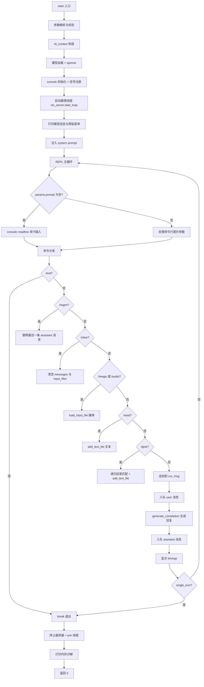
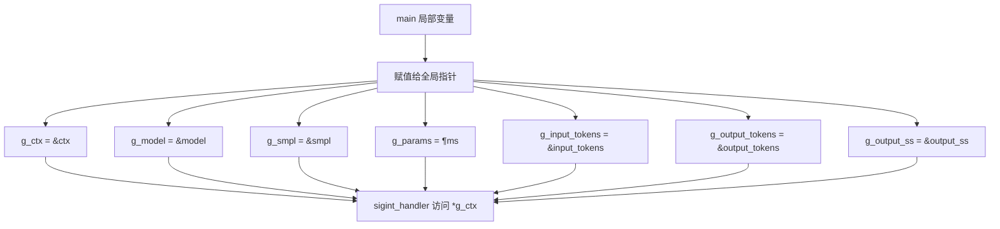
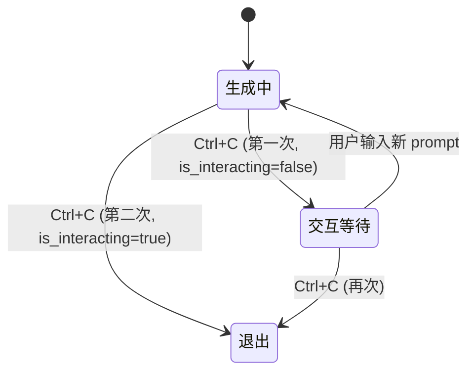
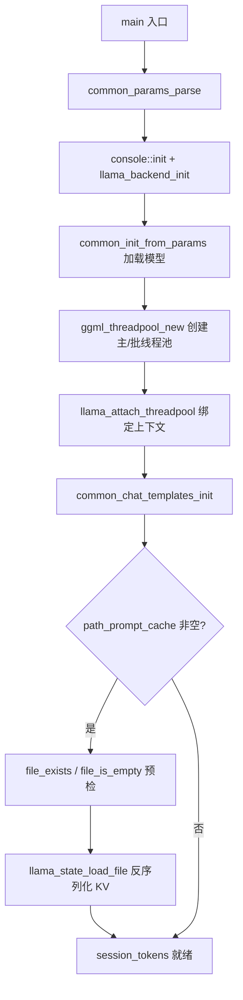
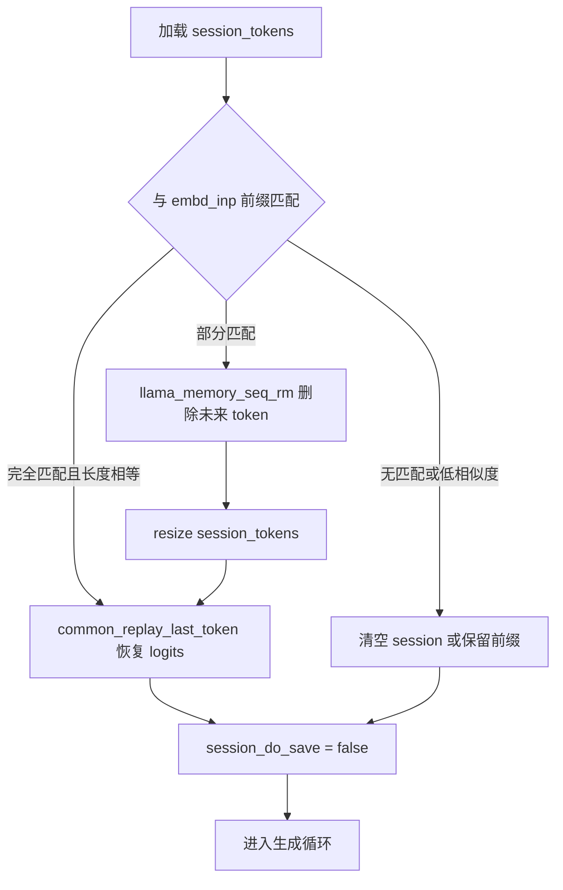
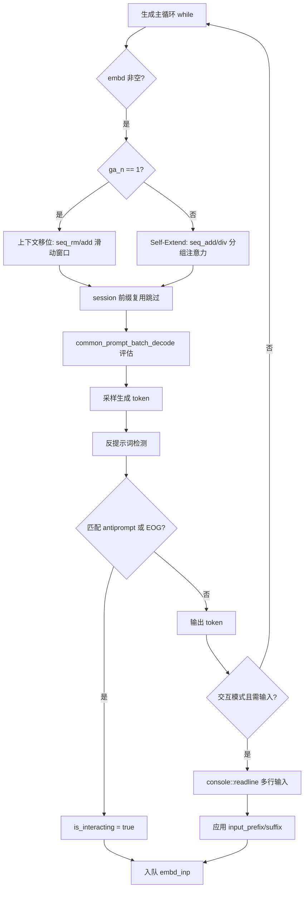
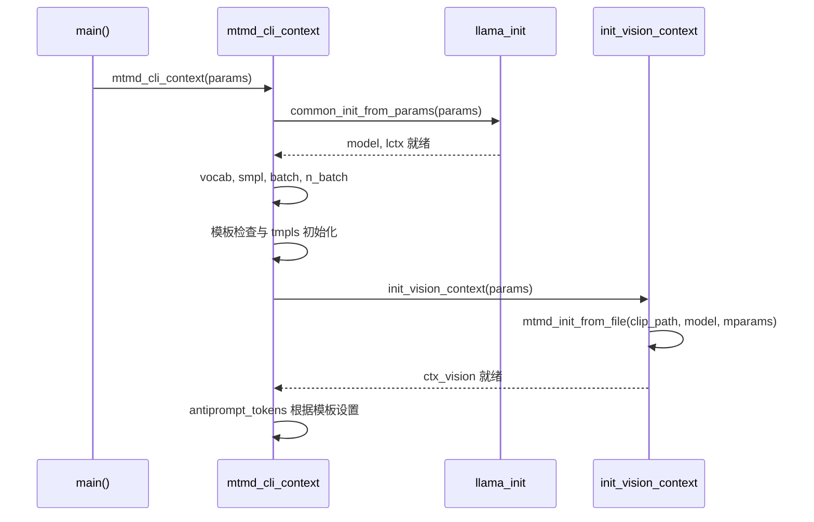
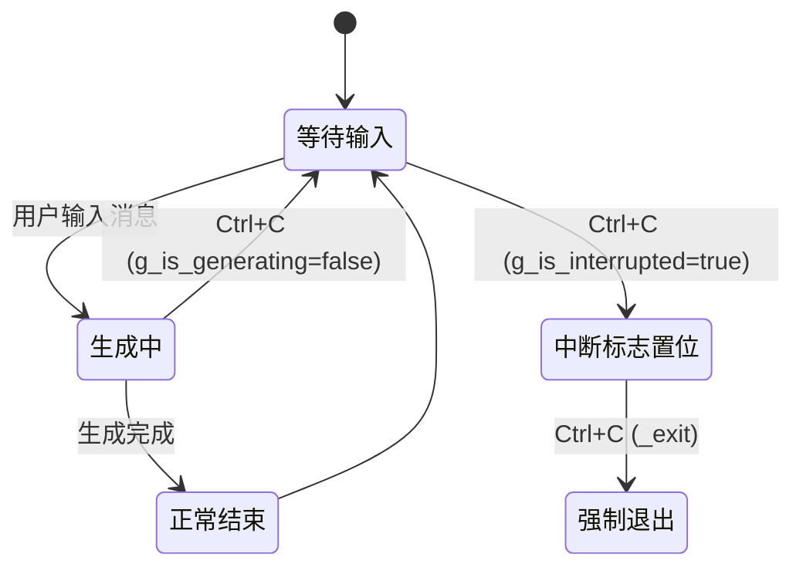
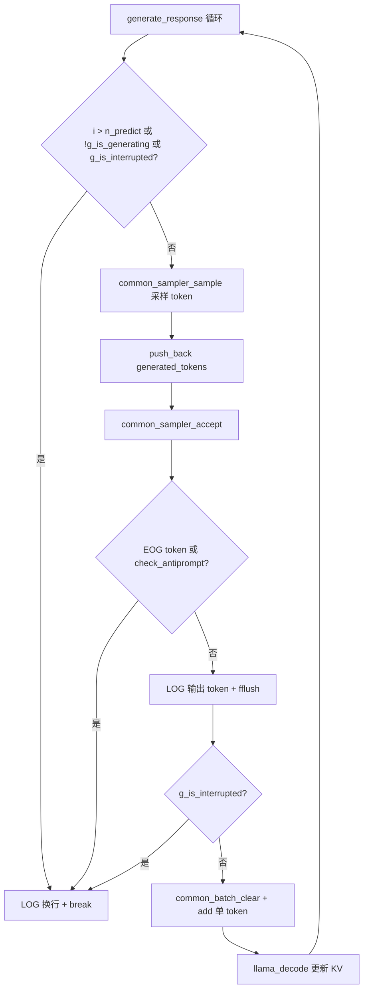
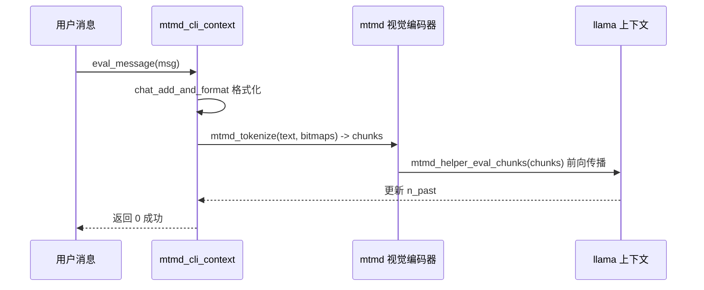

# 第68章 智能终端矩阵：命令行交互工具的四重奏 —— 从遥控面板到感知中枢的架构演进

## 学习目标

- 掌握基于智能指针的 C++ 类方法识别方法，理解通过 `->` 操作符调用的类成员函数
- 深入理解 llama-cli 中 cli_context 的完整实现，包括构造、流式生成、文件输入、聊天模板格式化、信号处理、自动补全与主循环
- 剖析 llama-completion 中全局状态管理、会话加载、前缀复用、Self-Extend 分组注意力、上下文移位、反提示词检测与线程池管理
- 分析 llama-tokenize 的多源输入互斥检查、Windows 宽字符转 UTF-8、跨平台 UTF-8 输出与词汇表专用加载模式
- 对比 llama-mtmd-cli 中 mtmd_cli_context 的生命周期管理、视觉上下文初始化、媒体加载、多模态评估与生成循环
- 对比分析不同工具中命令行交互组件的设计模式与实现差异

## 68.1 生活类比

想象你正在参观一个现代化的「智能家居系统」。在这个系统里，每一件电器都是一个"智能终端"，它们接收指令、处理信息、反馈状态，共同维持着家庭的运转。llama-cli 就像这套系统的「智能电视大脑」——它拥有完整的交互界面，能理解语音遥控器发来的各种命令（`/clear`、`/image`、`/read`），还能同时管理多路信号源（文本、图像、音频），把画面和声音精准地呈现给主人；llama-completion 则像一台「空调遥控器芯片」，它不像智能电视那样注重花哨的交互，而是专注于把温度（生成质量）调节到最舒适的状态，内部用全局状态指针记住当前的设定，一旦主人按下开关就能立刻响应；llama-tokenize 仿佛是「门禁识别芯片」，它的任务非常纯粹——把访客的脸（原始文本）精准地转换成门禁系统能识别的身份证号（token ID），支持从钥匙扣（命令行参数）、登记簿（文件）或访客登记处（标准输入）多种方式读取访客信息；而 llama-mtmd-cli 宛如「多模态感知中枢」，它不仅能听懂语音，还能看清门外的监控画面、理解环境的背景声音，把视觉和听觉信号一起转化成家庭中枢能理解的指令。在这个智能家居里，每一个工具都是一个"智能终端"，它们用不同的交互方式对模型进行精细调整，让模型在部署时既能保持活力，又能适应各种环境。

## 68.2 源码地图

```
tools/cli/cli.cpp
├── class cli_context (行 66-241)
│   ├── cli_context()                    # 构造初始化采样/推理参数
│   ├── generate_completion()            # 异步流式生成与 SSE 响应处理
│   ├── load_input_file()                # 文本/媒体文件加载与标记
│   └── format_chat()                    # Jinja 聊天模板格式化
├── static functions
│   ├── should_stop()                    # 中断标志检查 (行 34-36)
│   ├── signal_handler()                 # SIGINT/SIGTERM 处理 (行 39-48)
│   ├── auto_completion_callback()       # 命令与路径自动补全 (行 253-341)
└── main()                               # 主循环与 REPL 交互 (行 349-600)

tools/completion/completion.cpp
├── global variables (__main__)          # 全局状态指针与标志 (行 1-75)
├── static functions
│   ├── print_usage()                    # 使用说明 (行 38-44)
│   ├── file_exists()/file_is_empty()    # 文件状态检查 (行 46-56)
│   └── sigint_handler()                 # Ctrl+C 处理 (行 60-75)
└── main()                               # 核心生成循环 (行 78-1000)
    ├── 会话管理                         # llama_state_load/save_file
    ├── 前缀复用                         # session_tokens 与 embd_inp 匹配
    ├── Self-Extend 分组注意力           # grp_attn_n/w 参数处理
    ├── 上下文移位                       # llama_memory_seq_rm/add/div
    ├── 反提示词检测                     # antiprompt/antiprompt_token
    └── 线程池管理                       # ggml_threadpool 主/批分离

tools/tokenize/tokenize.cpp
├── static functions
│   ├── print_usage_information()        # 帮助信息 (行 20-39)
│   ├── llama_log_callback_null()        # 日志静默 (行 41-45)
│   ├── read_prompt_from_file()          # 二进制安全文件读取 (行 47-65)
│   ├── ingest_args()                    # Windows 宽字符转 UTF-8 (行 79-117)
│   └── write_utf8_cstr_to_stdout()      # 跨平台 UTF-8 输出 (行 129-178)
└── main()                               # 分词主流程 (行 180-366)
    ├── vocab_only 模型加载
    ├── 多源输入处理 (prompt/file/stdin)
    ├── 转义与特殊 token 控制
    └── 双模式输出 (ID 数组/文本片段)

tools/mtmd/mtmd-cli.cpp
├── class mtmd_cli_context (行 74-146)
│   ├── mtmd_cli_context()               # 多模态上下文构造
│   ├── ~mtmd_cli_context()              # 资源释放
│   ├── init_vision_context()            # 视觉编码器加载 (行 111-128)
│   ├── check_antiprompt()               # 反提示词匹配
│   └── load_media()                     # 图像/音频加载
├── static functions
│   ├── show_additional_info()           # 使用说明 (行 27-36)
│   ├── sigint_handler()                 # 中断处理 (行 40-50)
│   ├── generate_response()              # 生成循环 (行 148-184)
│   ├── chat_add_and_format()            # 消息格式化 (行 186-194)
│   └── eval_message()                   # 多模态评估 (行 196-229)
└── main()                               # 双模式入口 (行 231-354)
    ├── 单轮模式 (单 prompt + 多图)
    └── 聊天模式 (交互式 /image /audio 命令)
```

## 68.3 cli_context：智能电视大脑的中央控制器 —— 封装服务端上下文与流式生成

在命令行工具链中，llama-cli 是功能最完整、交互最丰富的"智能电视大脑"。它不仅负责把用户的文本输入转化为模型能理解的指令，还要同时管理多路信号源——文本文件、图像、音频——并在终端上实时呈现生成结果。它的核心是一个名为 `cli_context` 的类，这个类封装了服务器上下文、聊天消息、输入文件以及推理参数，是整个交互流程的中枢。

### 68.3.1 cli_context::cli_context()：聊天会话中央控制器的初始化图纸

源码路径：`tools/cli/cli.cpp` - `cli_context` 构造函数（66-99 行）

```cpp
class cli_context {
public:
    server_context ctx_server;                    // 服务端上下文：管理模型推理的后端循环
    std::vector<common_chat_msg> messages;        // 聊天消息历史：存储用户/助手/系统的多轮对话
    std::vector<raw_buffer> input_files;          // 媒体文件缓冲区：存放图像/音频的原始字节数据

    common_params defaults;                       // 推理参数副本：采样、推测解码、保留 token、预测上限、反提示词
    bool verbose_prompt = false;                  // 是否打印完整提示词用于调试
    int reasoning_budget = -1;                    // 推理预算 token 数（-1 表示不限制）
    std::string reasoning_budget_message;         // 推理预算提示信息

    cli_context(const common_params & params) {   // 类型即图纸：先理解数据结构，再看初始化逻辑
        defaults.sampling    = params.sampling;           // 拷贝采样参数（温度、top-k、top-p 等）
        defaults.speculative = params.speculative;        // 拷贝推测解码配置（草稿模型、接受阈值）
        defaults.n_keep      = params.n_keep;             // 保留的前缀 token 数（上下文移位时保护）
        defaults.n_predict   = params.n_predict;          // 最大生成 token 数
        defaults.antiprompt  = params.antiprompt;         // 反提示词列表（遇到则停止生成）
        defaults.stream = true;                           // 强制开启流式模式：逐 token 实时推送
        defaults.timings_per_token = true;                // 开启逐 token 计时：用于性能分析
        verbose_prompt = params.verbose_prompt;           // 透传调试开关
        reasoning_budget = params.reasoning_budget;       // 透传推理预算
        reasoning_budget_message = params.reasoning_budget_message; // 透传推理提示文本
    }
    // ...
};
```

`cli_context` 的设计体现了"智能电视大脑"的核心思想：它把所有与交互相关的状态——采样参数、推理参数、用户设置——封装在一个对象中，对外只暴露必要的方法。构造函数从 `common_params` 中拷贝采样参数、推测解码配置、保留 token 数、预测 token 数和反提示词，并强制开启流式模式与逐 token 计时，确保后续的 `generate_completion()` 能以流式方式把生成结果实时推送到终端。`verbose_prompt` 和 `reasoning_budget` 则分别控制调试输出与推理预算，让"大脑"既能安静运行，也能在需要时展示思考过程。

```mermaid
graph TD
    A[common_params] --> B[cli_context 构造]
    B --> C[defaults.sampling = params.sampling]
    B --> D[defaults.speculative = params.speculative]
    B --> E[defaults.n_keep = params.n_keep]
    B --> F[defaults.n_predict = params.n_predict]
    B --> G[defaults.antiprompt = params.antiprompt]
    B --> H[defaults.stream = true]
    B --> I[defaults.timings_per_token = true]
    B --> J[verbose_prompt = params.verbose_prompt]
    B --> K[reasoning_budget = params.reasoning_budget]
    B --> L[reasoning_budget_message = params.reasoning_budget_message]
    C --> M[generate_completion 使用 defaults 发布任务]
    H --> M
    I --> M
    J --> N[生成前打印完整 prompt]
    K --> O[推理预算控制\n");
    console::log("  /clear              clear the chat history\n");
    console::log("  /read <file>        add a text file\n");
    console::log("  /glob <pattern>     add text files using globbing pattern\n");
    if (inf.has_inp_image) {
        console::log("  /image <file>       add an image file\n");
    }
    if (inf.has_inp_audio) {
        console::log("  /audio <file>       add an audio file\n");
    }
    console::log("\n");
    std::string cur_msg;
    auto add_text_file = [&](const std::string & fname) -> bool {
        std::string marker = ctx_cli.load_input_file(fname, false);
        if (marker.empty()) {
            console::error("file does not exist or cannot be opened: '%s'\n", fname.c_str());
            return false;
        }
        if (inf.fim_sep_token != LLAMA_TOKEN_NULL) {
            cur_msg += common_token_to_piece(ctx_cli.ctx_server.get_llama_context(), inf.fim_sep_token, true);
            cur_msg += fname;
            cur_msg.push_back('\n');
        } else {
            cur_msg += "--- File: ";
            cur_msg += fname;
            cur_msg += " ---\n";
        }
        cur_msg += marker;
        console::log("Loaded text from '%s'\n", fname.c_str());
        return true;
    };
    while (true) {
        std::string buffer;
        console::set_display(DISPLAY_TYPE_USER_INPUT);
        if (params.prompt.empty()) {
            console::log("\n> ");
            std::string line;
            bool another_line = true;
            do {
                another_line = console::readline(line, params.multiline_input);
                buffer += line;
            } while (another_line);
        } else {
            for (auto & fname : params.image) {
                std::string marker = ctx_cli.load_input_file(fname, true);
                if (marker.empty()) {
                    console::error("file does not exist or cannot be opened: '%s'\n", fname.c_str());
                    break;
                }
                console::log("Loaded media from '%s'\n", fname.c_str());
                cur_msg += marker;
            }
            buffer = params.prompt;
            console::log("\n> %s\n", buffer.c_str());
            params.prompt.clear();
        }
        console::set_display(DISPLAY_TYPE_RESET);
        console::log("\n");
        if (should_stop()) {
            g_is_interrupted.store(false);
            break;
        }
        if (!buffer.empty() && buffer.back() == '\n') {
            buffer.pop_back();
        }
        if (buffer.empty()) {
            continue;
        }
        bool add_user_msg = true;
        if (string_starts_with(buffer, "/exit")) {
            break;
        } else if (string_starts_with(buffer, "/regen")) {
            if (ctx_cli.messages.size() >= 2) {
                size_t last_idx = ctx_cli.messages.size() - 1;
                ctx_cli.messages.erase(last_idx);
                add_user_msg = false;
            } else {
                console::error("No message to regenerate.\n");
                continue;
            }
        } else if (string_starts_with(buffer, "/clear")) {
            ctx_cli.messages.clear();
            add_system_prompt();
            ctx_cli.input_files.clear();
            console::log("Chat history cleared.\n");
            continue;
        } else if (
                (string_starts_with(buffer, "/image ") && inf.has_inp_image) ||
                (string_starts_with(buffer, "/audio ") && inf.has_inp_audio)) {
            std::string fname = string_strip(buffer.substr(7));
            std::string marker = ctx_cli.load_input_file(fname, true);
            if (marker.empty()) {
                console::error("file does not exist or cannot be opened: '%s'\n", fname.c_str());
                continue;
            }
            cur_msg += marker;
            console::log("Loaded media from '%s'\n", fname.c_str());
            continue;
        } else if (string_starts_with(buffer, "/read ")) {
            std::string fname = string_strip(buffer.substr(6));
            add_text_file(fname);
            continue;
        } else if (string_starts_with(buffer, "/glob ")) {
            std::error_code ec;
            size_t count = 0;
            auto curdir = std::filesystem::current_path();
            std::string pattern = string_strip(buffer.substr(6));
            std::filesystem::path rel_path;
            auto startglob = pattern.find_first_of("![*?");
            if (startglob != std::string::npos && startglob != 0) {
                auto endpath = pattern.substr(0, startglob).find_last_of('/');
                if (endpath != std::string::npos) {
                    std::string rel_pattern = pattern.substr(0, endpath);
#if !defined(_WIN32)
                    if (string_starts_with(rel_pattern, "~")) {
                        const char * home = std::getenv("HOME");
                        if (home && home[0]) {
                            rel_pattern = std::string(home) + rel_pattern.substr(1);
                        }
                    }
#endif
                    rel_path = rel_pattern;
                    pattern.erase(0, endpath + 1);
                    curdir /= rel_path;
                }
            }
            for (const auto & entry : std::filesystem::recursive_directory_iterator(curdir,
                    std::filesystem::directory_options::skip_permission_denied, ec)) {
                if (!entry.is_regular_file()) { continue; }
                std::string rel = std::filesystem::relative(entry.path(), curdir, ec).string();
                if (ec) { ec.clear(); continue; }
                std::replace(rel.begin(), rel.end(), '\\', '/');
                if (!glob_match(pattern, rel)) { continue; }
                if (!add_text_file((rel_path / rel).string())) { continue; }
                if (++count >= FILE_GLOB_MAX_RESULTS) {
                    console::error("Maximum number of globbed files allowed (%zu) reached.\n", FILE_GLOB_MAX_RESULTS);
                    break;
                }
            }
            continue;
        } else {
            cur_msg += buffer;
        }
        if (add_user_msg) {
            ctx_cli.messages.push_back({
                {"role",    "user"},
                {"content", cur_msg}
            });
            cur_msg.clear();
        }
        result_timings timings;
        std::string assistant_content = ctx_cli.generate_completion(timings);
        ctx_cli.messages.push_back({
            {"role",    "assistant"},
            {"content", assistant_content}
        });
        console::log("\n");
        if (params.show_timings) {
            console::set_display(DISPLAY_TYPE_INFO);
            console::log("\n");
            console::log("[ Prompt: %.1f t/s | Generation: %.1f t/s ]\n", timings.prompt_per_second, timings.predicted_per_second);
            console::set_display(DISPLAY_TYPE_RESET);
        }
        if (params.single_turn) {
            break;
        }
    }
    console::set_display(DISPLAY_TYPE_RESET);
    console::log("\nExiting...\n");
    ctx_cli.ctx_server.terminate();
    inference_thread.join();
    common_log_set_verbosity_thold(LOG_LEVEL_INFO);
    llama_memory_breakdown_print(ctx_cli.ctx_server.get_llama_context());
    return 0;
}
```

`main()` 是"智能电视大脑"的总装配线与运行时。它完成参数解析、模型加载、控制台初始化、信号注册、推理线程启动、系统提示词注入、帮助菜单打印，随后进入无限 REPL 循环。循环内支持多行输入（`params.multiline_input`）、命令分发（`/exit`、`/regen`、`/clear`、`/image`、`/audio`、`/read`、`/glob`）、文件与媒体加载、消息入队、调用 `generate_completion()` 生成回复、回写历史、显示计时统计。单轮模式（`params.single_turn`）生成一次即退出。退出前终止服务器循环、等待推理线程、打印内存分解。整个流程体现了"中央控制器"对多模态输入、多轮对话、异步推理、用户交互的全程编排。



## 68.4 全局状态管理与信号处理 —— llama-completion 的"空调遥控器芯片"

如果说 llama-cli 是功能齐全的"智能电视大脑"，那么 llama-completion 就是专注于温度调节的「空调遥控器芯片」。它不像前者那样提供丰富的交互命令，而是把全部精力放在生成流程的控制上——从参数解析、模型加载、线程池管理，到上下文移位、反提示词检测、交互状态机，每一个环节都经过精细调优。最显著的设计特征是它的全局状态管理：所有关键指针都存放在全局变量中，信号处理器和生成循环通过这些全局变量协同工作。

### 68.4.1 __main__ 全局变量：全局状态指针阵列与交互标志

源码路径：`tools/completion/completion.cpp` - 全局变量（1-75 行）

```cpp
#include "arg.h"
#include "common.h"
#include "console.h"
#include "log.h"
#include "sampling.h"
#include "llama.h"
#include "chat.h"

#include <clocale>
#include <cstdio>
#include <cstring>
#include <ctime>
#include <fstream>
#include <iostream>
#include <sstream>
#include <string>
#include <vector>

#if defined (__unix__) || (defined (__APPLE__) && defined (__MACH__))
#include <signal.h>
#include <unistd.h>
#elif defined (_WIN32)
#define WIN32_LEAN_AND_MEAN
#ifndef NOMINMAX
#define NOMINMAX
#endif
#include <windows.h>
#include <signal.h>
#endif

#if defined(_MSC_VER)
#pragma warning(disable: 4244 4267) // possible loss of data
#endif

static llama_context           ** g_ctx;              // 指向 llama_context 指针的指针
static llama_model             ** g_model;            // 指向 llama_model 指针的指针
static common_sampler          ** g_smpl;             // 指向 common_sampler 指针的指针
static common_params            * g_params;           // 指向 common_params 的指针
static std::vector<llama_token> * g_input_tokens;     // 输入 token 记录
static std::ostringstream       * g_output_ss;        // 输出文本累积流
static std::vector<llama_token> * g_output_tokens;    // 输出 token 记录
static bool is_interacting  = false;                  // 是否处于交互等待状态
static bool need_insert_eot = false;                  // 是否需要插入 EOT token
```

"空调遥控器芯片"的全局状态设计是一种极简的依赖注入替代方案：`g_ctx`、`g_model`、`g_smpl` 使用二级指针，使得 `main()` 中的局部变量地址能被信号处理器直接访问；`g_params` 指向参数结构体；`g_input_tokens`、`g_output_tokens`、`g_output_ss` 记录交互过程中的 token 与文本流；`is_interacting` 与 `need_insert_eot` 极简的双标志位实现了交互状态机的核心逻辑。这种设计避免了在信号处理器中传递上下文对象，以极低的开销实现了中断响应与生成循环的协同。



### 68.4.2 print_usage()：极简使用说明

源码路径：`tools/completion/completion.cpp` - `print_usage()`（38-44 行）

```cpp
static void print_usage(int argc, char ** argv) {
    (void) argc;

    LOG("\nexample usage:\n");
    LOG("\n  text generation:     %s -m your_model.gguf -p \"I believe the meaning of life is\" -n 128 -no-cnv\n", argv[0]);
    LOG("\n  chat (conversation): %s -m your_model.gguf -sys \"You are a helpful assistant\"\n", argv[0]);
    LOG("\n");
}
```

`print_usage()` 只展示两种最典型的用法：纯文本生成与聊天对话，体现了"空调遥控器芯片"专注核心功能的设计哲学——不罗列所有参数，只给用户最直接的起步指引。

### 68.4.3 file_exists() 与 file_is_empty()：会话文件的轻量级状态探测

源码路径：`tools/completion/completion.cpp` - `file_exists()`/`file_is_empty()`（46-56 行）

```cpp
static bool file_exists(const std::string & path) {
    std::ifstream f(path.c_str());
    return f.good();
}

static bool file_is_empty(const std::string & path) {
    std::ifstream f;
    f.exceptions(std::ifstream::failbit | std::ifstream::badbit);
    f.open(path.c_str(), std::ios::in | std::ios::binary | std::ios::ate);
    return f.tellg() == 0;
}
```

`file_exists()` 通过尝试打开文件判断是否存在；`file_is_empty()` 以二进制模式定位到文件末尾，通过 `tellg()` 获取文件大小，为零即为空。这两个函数在会话加载前提供快速预检，避免对不存在或空文件调用 `llama_state_load_file`。

```mermaid
flowchart TD
    A[file_exists(path)] --> B{std::ifstream good?}
    B -->|否| C[返回 false]
    B -->|是| D[返回 true]

    E[file_is_empty(path)] --> F[open binary + ate]
    F --> G{tellg() == 0?}
    G -->|是| H[返回 true]
    G -->|否| I[返回 false]
```

### 68.4.4 sigint_handler()：交互模式下的中断软切换与硬退出

源码路径：`tools/completion/completion.cpp` - `sigint_handler()`（60-75 行）

```cpp
static void sigint_handler(int signo) {
    if (signo == SIGINT) {
        if (!is_interacting && g_params->interactive) { // 未交互且启用交互模式
            is_interacting  = true;                     // 标记进入交互状态
            need_insert_eot = true;                     // 标记需插入 EOT（结束当前生成）
        } else {                                        // 已在交互或非交互模式
            console::cleanup();                         // 清理控制台状态
            LOG("\n");
            common_perf_print(*g_ctx, *g_smpl);         // 打印性能统计

            // make sure all logs are flushed
            LOG("Interrupted by user\n");
            common_log_pause(common_log_main());

            _exit(130);                                 // 直接退出，状态码 130 (SIGINT)
        }
    }
}
```

llama-completion 的中断处理体现了"空调遥控器芯片"的精准控温逻辑：当用户按下 Ctrl+C 时，若当前不在交互状态且启用了交互模式，信号处理器仅设置 `is_interacting` 和 `need_insert_eot` 标志，让生成循环在下一个检查点自然地插入 EOT token 并等待用户输入；若已处于交互状态，则直接清理控制台、打印性能数据并退出。这种"第一次中断软切换、第二次中断硬退出"的策略，与 llama-cli 中 `signal_handler` 的双击退出逻辑异曲同工，都是用全局标志而非复杂的状态机来简化中断处理。



### 68.4.5 main()：核心生成循环与会话管理的完整实现

源码路径：`tools/completion/completion.cpp` - `main()`（78-1000 行，此处展示关键片段）

#### 68.4.5.1 -200 行：参数解析、模型加载、线程池初始化、会话加载

```cpp
int main(int argc, char ** argv) {
    std::setlocale(LC_NUMERIC, "C");

    common_params params;
    g_params = &params;

    common_init();

    if (!common_params_parse(argc, argv, params, LLAMA_EXAMPLE_COMPLETION, print_usage)) {
        return 1;
    }
    // ... 参数校验、console 初始化、llama_backend_init、numa_init ...
    // 加载模型与 LoRA
    auto llama_init = common_init_from_params(params);
    ctx   = llama_init->context();
    model = llama_init->model();
    smpl  = llama_init->sampler(0);
    // ... 线程池初始化：ggml_threadpool_new_fn、tpp/tpp_batch、llama_attach_threadpool ...
    // 聊天模板初始化
    auto chat_templates = common_chat_templates_init(model, params.chat_template);
    // 会话加载
    std::string path_session = params.path_prompt_cache;
    std::vector<llama_token> session_tokens;
    if (!path_session.empty()) {
        LOG_INF("%s: attempting to load saved session from '%s'\n", __func__, path_session.c_str());
        if (!file_exists(path_session)) {
            LOG_INF("%s: session file does not exist, will create.\n", __func__);
        } else if (file_is_empty(path_session)) {
            LOG_INF("%s: The session file is empty. A new session will be initialized.\n", __func__);
        } else {
            session_tokens.resize(n_ctx);
            size_t n_token_count_out = 0;
            if (!llama_state_load_file(ctx, path_session.c_str(), session_tokens.data(), session_tokens.capacity(), &n_token_count_out)) {
                LOG_ERR("%s: failed to load session file '%s'\n", __func__, path_session.c_str());
                return 1;
            }
            session_tokens.resize(n_token_count_out);
            LOG_INF("%s: loaded a session with prompt size of %d tokens\n", __func__, (int)session_tokens.size());
        }
    }
    // ...
}
```

这段代码完成了"空调遥控器芯片"的冷启动：解析参数、初始化后端、加载模型、构建主/批双线程池（`tpp` 与 `tpp_batch` 分离，避免批处理阻塞主线程）、初始化聊天模板、加载会话文件。会话加载使用 `llama_state_load_file` 将 KV 缓存状态反序列化到 `session_tokens`，为后续的前缀复用奠定基础。



#### 68.4.5.2 -420 行：前缀匹配与上下文复用逻辑

```cpp
    // ... tokenize prompt 得到 embd_inp ...
    // 前缀匹配与会话复用
    {
        size_t n_match = 0;
        if (!session_tokens.empty()) {
            for (llama_token id : session_tokens) {
                if (n_match >= embd_inp.size() || id != embd_inp[n_match]) {
                    break;
                }
                n_match++;
            }
            if (params.prompt.empty() && n_match == embd_inp.size()) {
                LOG_INF("%s: using full prompt from session file\n", __func__);
            } else if (n_match >= embd_inp.size()) {
                LOG_INF("%s: session file has exact match for prompt!\n", __func__);
            } else if (n_match < (embd_inp.size() / 2)) {
                LOG_WRN("%s: session file has low similarity to prompt (%zu / %zu tokens); will mostly be reevaluated\n",
                        __func__, n_match, embd_inp.size());
            } else {
                LOG_INF("%s: session file matches %zu / %zu tokens of prompt\n",
                        __func__, n_match, embd_inp.size());
            }
            if (session_tokens.size() > n_match) {
                if (!llama_memory_seq_rm(mem, -1, n_match, -1)) {
                    LOG_WRN("%s: unable to reuse common prefix (for example, when the memory is recurrent)\n", __func__);
                    llama_memory_clear(mem, true);
                    session_tokens.clear();
                    n_match = 0;
                } else {
                    session_tokens.resize(n_match);
                }
            }
        }
        session_do_save = !path_session.empty() && n_match < embd_inp.size() && !params.prompt_cache_ro;
        if (!session_tokens.empty() && n_match > 0 && n_match == session_tokens.size()) {
            if (!common_replay_last_token(ctx, session_tokens.back(), n_match)) {
                return 1;
            }
            session_do_save = false;
            LOG_INF("%s: replayed last token from session\n", __func__);
        }
    }
```

会话复用的核心是前缀匹配：遍历 `session_tokens` 与 `embd_inp` 计算最长公共前缀 `n_match`。若匹配长度不足一半，发出警告但仍尝试复用；若匹配长度充足，调用 `llama_memory_seq_rm` 删除会话中 `n_match` 之后的"未来"token，保留公共前缀；若完全匹配且会话长度等于 `n_match`，则通过 `common_replay_last_token` 重放最后一个 token 恢复 logits，避免重新计算。这种精细的前缀复用让"空调遥控器"在用户再次调节相同温度时，能直接复用之前的计算结果。



#### 68.4.5.3 -690 行：Self-Extend 分组注意力、上下文移位、生成主循环、反提示词检测

```cpp
    // Self-Extend 状态
    int ga_i = 0;
    const int ga_n = params.grp_attn_n;
    const int ga_w = params.grp_attn_w;
    if (ga_n != 1) {
        GGML_ASSERT(ga_n > 0 && "grp_attn_n must be positive");
        GGML_ASSERT(ga_w % ga_n == 0 && "grp_attn_w must be a multiple of grp_attn_n");
        LOG_INF("self-extend: n_ctx_train = %d, grp_attn_n = %d, grp_attn_w = %d\n", n_ctx_train, ga_n, ga_w);
    }
    // ...
    while ((n_remain != 0 && !is_antiprompt) || params.interactive) {
        // ... context shifting (ga_n == 1) 或 Self-Extend (ga_n > 1) ...
        // ... session_tokens 前缀复用跳过 ...
        // ... common_prompt_batch_decode 评估 embd ...
        // ... 采样生成 token ...
        // ... 反提示词检测：common_sampler_prev_str + antiprompt_token ...
        // ... 交互输入处理：console::readline 多行、input_prefix/suffix ...
    }
```

生成主循环集成了三大核心机制：上下文移位（`ga_n == 1` 时通过 `llama_memory_seq_rm/add` 滑动窗口）、Self-Extend 分组注意力（`ga_n > 1` 时通过 `llama_memory_seq_add/div` 实现分组注意力窗口扩展）、会话前缀复用（跳过已匹配的 `session_tokens`）。反提示词检测结合字符串搜索（`common_sampler_prev_str` 在最近 32 token 中查找）与单 token 匹配（`antiprompt_token`），交互模式下遇到反提示词或 EOG 会设置 `is_interacting = true` 并注入反提示词 token 以引导模型停止。多行输入通过 `console::readline(line, params.multiline_input)` 支持，`input_prefix`/`input_suffix` 在交互时自动添加到用户输入前后。



#### 68.4.5.4 -1000 行：会话保存、清理与退出

```cpp
    // ... 循环结束 ...
    if (session_do_save && !path_session.empty()) {
        if (!llama_state_save_file(ctx, path_session.c_str(), session_tokens.data(), session_tokens.size())) {
            LOG_ERR("%s: failed to save session file '%s'\n", __func__, path_session.c_str());
        } else {
            LOG_INF("%s: saved session to '%s'\n", __func__, path_session.c_str());
        }
    }
    console::cleanup();
    common_perf_print(*g_ctx, *g_smpl);
    llama_memory_breakdown_print(ctx);
    return 0;
}
```

退出前若 `session_do_save` 为真，调用 `llama_state_save_file` 持久化 KV 缓存与 token 序列，实现会话的跨进程复用。最后打印性能统计与内存分解。

## 68.5 llama-tokenize：门禁系统的"识别芯片" —— 纯分词的极简工具

在 llama.cpp 的工具链中，llama-tokenize 是最纯粹、最轻量的工具——它就像「门禁系统的识别芯片」，唯一的任务就是把原始文本（访客的脸）转换成模型能理解的 token ID（门禁卡号）。它不参与生成，不管理对话历史，甚至不需要加载模型权重，只需 vocab_only 模式加载词汇表即可实现秒级响应。这种极简设计让它在调试提示词、统计 token 数量、验证特殊 token 处理等场景中成为不可或缺的工具。

### 68.5.1 print_usage_information()：完整的命令行参数说明

源码路径：`tools/tokenize/tokenize.cpp` - `print_usage_information()`（20-39 行）

```cpp
static void print_usage_information(const char * argv0) {
    printf("usage: %s [options]\n\n", argv0);
    printf("The tokenize program tokenizes a prompt using a given model,\n");
    printf("and prints the resulting tokens to standard output.\n\n");
    printf("It needs a model file, a prompt, and optionally other flags\n");
    printf("to control the behavior of the tokenizer.\n\n");
    printf("    The possible options are:\n");
    printf("\n");
    printf("    -h, --help                           print this help and exit\n");
    printf("    -m MODEL_PATH, --model MODEL_PATH    path to model.\n");
    printf("    --ids                                if given, only print numerical token IDs, and not token strings.\n");
    printf("                                         The output format looks like [1, 2, 3], i.e. parseable by Python.\n");
    printf("    -f PROMPT_FNAME, --file PROMPT_FNAME read prompt from a file.\n");
    printf("    -p PROMPT, --prompt PROMPT           read prompt from the argument.\n");
    printf("    --stdin                              read prompt from standard input.\n");
    printf("    --no-bos                             do not ever add a BOS token to the prompt, even if normally the model uses a BOS token.\n");
    printf("    --no-escape                          do not escape input (such as \\n, \\t, etc.).\n");
    printf("    --no-parse-special                   do not parse control tokens.\n");
    printf("    --log-disable                        disable logs. Makes stderr quiet when loading the model.\n");
    printf("    --show-count                         print the total number of tokens.\n");
}
```

`print_usage_information()` 完整列出了所有支持的参数，包括三种互斥的输入源（`--prompt`、`--file`、`--stdin`）、BOS/转义/特殊 token 控制、日志静默、token 计数输出，以及仅输出 ID 数组的 `--ids` 模式。这种详尽的帮助信息体现了"识别芯片"作为调试工具的专业性。

### 68.5.2 llama_log_callback_null()：日志静默回调

源码路径：`tools/tokenize/tokenize.cpp` - `llama_log_callback_null()`（41-45 行）

```cpp
static void llama_log_callback_null(ggml_log_level level, const char * text, void * user_data) {
    (void) level;
    (void) text;
    (void) user_data;
}
```

当用户指定 `--log-disable` 时，`main()` 会调用 `llama_log_set(llama_log_callback_null, NULL)` 注册此空回调，彻底屏蔽模型加载过程中的所有日志输出，保证标准错误流纯净，便于脚本解析工具输出。

### 68.5.3 read_prompt_from_file()：二进制安全的文件读取

源码路径：`tools/tokenize/tokenize.cpp` - `read_prompt_from_file()`（47-65 行）

```cpp
static std::string read_prompt_from_file(const char * filepath, bool & success) {
    success = false;

    std::ifstream in(filepath, std::ios::binary);
    if (!in) {
        fprintf(stderr, "%s: could not open file '%s' for reading: %s\n", __func__, filepath, strerror(errno));
        return std::string();
    }
    // do not assume the file is seekable (e.g. /dev/stdin)
    std::stringstream buffer;
    buffer << in.rdbuf();
    if (in.fail()) {
        fprintf(stderr, "%s: could not read the entire file '%s': %s\n", __func__, filepath, strerror(errno));
        return std::string();
    }

    success = true;
    return buffer.str();
}
```

`read_prompt_from_file()` 以二进制模式打开文件，使用 `stringstream` 配合 `rdbuf()` 读取全部内容。关键设计是**不假设文件可 seek**（注释明确提到 `/dev/stdin`），因此不依赖 `seekg`/`tellg` 获取大小预分配，而是直接流式读入。这保证了对管道、设备文件、普通文件的统一处理能力。

```mermaid
flowchart TD
    A[read_prompt_from_file(filepath, success)] --> B[ifstream binary 打开]
    B --> C{打开成功?}
    C -->|否| D[打印错误 + success=false + 返回空串]
    C -->|是| E[stringstream buffer << in.rdbuf()]
    E --> F{读取失败?}
    F -->|是| G[打印错误 + success=false + 返回空串]
    F -->|否| H[success=true + 返回 buffer.str()]
```

### 68.5.4 ingest_args()：Windows 宽字符转 UTF-8 的跨平台参数摄入

源码路径：`tools/tokenize/tokenize.cpp` - `ingest_args()`（79-117 行）

```cpp
static std::vector<std::string> ingest_args(int raw_argc, char ** raw_argv) {
    std::vector<std::string> argv;

    // Handle Windows, if given non-ASCII arguments.
    // We convert wchar_t arguments into UTF-8 char* on this platform.
    // Lets you invoke 'tokenize' on Windows cmd.exe with non-ASCII characters
    // without throwing tantrums.
#if defined(_WIN32)
    int argc;
    const LPWSTR cmdline_wargv = GetCommandLineW();           // 获取宽字符命令行
    LPWSTR * wargv = CommandLineToArgvW(cmdline_wargv, &argc); // 解析为宽字符数组

    // silence unused arg warnings
    (void) raw_argc;
    (void) raw_argv;

    for (int i = 0; i < argc; ++i) {
        int length_needed = WideCharToMultiByte(CP_UTF8, 0, wargv[i], wcslen(wargv[i]), 0, 0, NULL, NULL);
        char * output_buf = (char *) calloc(length_needed+1, sizeof(char));
        GGML_ASSERT(output_buf);

        WideCharToMultiByte(CP_UTF8, 0, wargv[i], wcslen(wargv[i]), output_buf, length_needed, NULL, NULL);
        output_buf[length_needed] = '\0';

        argv.push_back(output_buf);
        free(output_buf);
    }

    LocalFree((HLOCAL) wargv);
#else
    int argc = raw_argc;
    for (int i = 0; i < argc; ++i) {
        argv.push_back(raw_argv[i]);
    }
#endif

    GGML_ASSERT((unsigned int) argc == argv.size());

    return argv;
}
```

"门禁识别芯片"必须能识别来自不同入口的访客。在 Windows 平台上，`cmd.exe` 传入的非 ASCII 参数默认是宽字符（UTF-16），若直接使用 `char** argv` 会导致中文等 Unicode 字符乱码。`ingest_args()` 通过 `GetCommandLineW()` 和 `CommandLineToArgvW()` 获取宽字符参数，再用 `WideCharToMultiByte(CP_UTF8, ...)` 转换为 UTF-8，确保中文提示词在 Windows 上也能被正确分词。

```mermaid
flowchart TD
    A[ingest_args(raw_argc, raw_argv)] --> B{_WIN32?}
    B -->|是| C[GetCommandLineW 获取宽命令行]
    C --> D[CommandLineToArgvW 解析宽参数数组]
    D --> E[遍历每个宽参数]
    E --> F[WideCharToMultiByte(CP_UTF8) 计算长度]
    F --> G[分配 output_buf]
    G --> H[WideCharToMultiByte 转换为 UTF-8]
    H --> I[push_back 到 argv]
    I --> J[LocalFree 释放 wargv]
    B -->|否| K[直接拷贝 raw_argv 到 argv]
    J --> L[返回 argv]
    K --> L
```

### 68.5.5 write_utf8_cstr_to_stdout()：跨平台 UTF-8 输出兜底

源码路径：`tools/tokenize/tokenize.cpp` - `write_utf8_cstr_to_stdout()`（129-178 行）

```cpp
static void write_utf8_cstr_to_stdout(const char * str, bool & invalid_utf8) {
    invalid_utf8 = false;

#if defined(_WIN32)
    // Are we in a console?
    HANDLE hConsole = GetStdHandle(STD_OUTPUT_HANDLE);
    DWORD dwMode = 0;

    // According to Microsoft docs:
    // "WriteConsole fails if it is used with a standard handle that is redirected to a file."
    // Also according to the docs, you can use GetConsoleMode to check for that.
    if (hConsole == INVALID_HANDLE_VALUE || !GetConsoleMode(hConsole, &dwMode)) {
        printf("%s", str);                    // 重定向到文件/管道：直接 printf
        return;
    }

    // MultiByteToWideChar reports an error if str is empty, don't report
    // them as invalid_utf8.
    if (*str == 0) {
        return;
    }
    int length_needed = MultiByteToWideChar(CP_UTF8, MB_ERR_INVALID_CHARS, str, strlen(str), NULL, 0);
    if (length_needed == 0) {
        DWORD err = GetLastError();
        if (err == ERROR_NO_UNICODE_TRANSLATION) {
            invalid_utf8 = true;
            int len = strlen(str);
            printf("<");                      // 无效 UTF-8 兜底：十六进制 <xx xx>
            for (int i = 0; i < len; ++i) {
                if (i > 0) {
                    printf(" ");
                }
                printf("%02x", (uint8_t) str[i]);
            }
            printf(">");
            return;
        }
        GGML_ABORT("MultiByteToWideChar() failed in an unexpected way.");
    }

    LPWSTR wstr = (LPWSTR) calloc(length_needed+1, sizeof(*wstr));
    GGML_ASSERT(wstr);

    MultiByteToWideChar(CP_UTF8, 0, str, strlen(str), wstr, length_needed);
    WriteConsoleW(hConsole, wstr, length_needed, NULL, NULL);

    free(wstr);
#else
    // TODO: reporting invalid_utf8 would be useful on non-Windows too.
    // printf will silently just write bad unicode.
    printf("%s", str);
#endif
}
```

输出端则通过 `write_utf8_cstr_to_stdout()` 处理 Windows 控制台的 Unicode 显示问题：若检测到当前是控制台句柄且输入包含无效 UTF-8 序列，则用十六进制 `<xx xx>` 形式兜底输出，避免乱码。这一套输入输出处理使得"识别芯片"在跨平台场景下都能稳定工作。

```mermaid
flowchart TD
    A[write_utf8_cstr_to_stdout(str, invalid_utf8)] --> B{_WIN32?}
    B -->|是| C[GetStdHandle 获取控制台句柄]
    C --> D{是控制台且 GetConsoleMode 成功?}
    D -->|否| E[printf 直接输出]
    D -->|是| F[MultiByteToWideChar(CP_UTF8, MB_ERR_INVALID_CHARS) 验证]
    F --> G{转换成功?}
    G -->|否| H[ERROR_NO_UNICODE_TRANSLATION?]
    H -->|是| I[invalid_utf8 = true]
    I --> J[输出 <xx xx> 十六进制兜底]
    H -->|否| K[GGML_ABORT]
    G -->|是| L[MultiByteToWideChar 转宽字符]
    L --> M[WriteConsoleW 宽字符输出]
    M --> N[free wstr]
    B -->|否| O[printf 直接输出]
```

### 68.5.6 main()：分词主流程 —— 多源输入、转义控制、双模式输出

源码路径：`tools/tokenize/tokenize.cpp` - `main()`（180-366 行）

```cpp
int main(int raw_argc, char ** raw_argv) {
    std::setlocale(LC_NUMERIC, "C");

    const std::vector<std::string> argv = ingest_args(raw_argc, raw_argv);
    const int argc = argv.size();

    if (argc <= 1) {
        print_usage_information(argv[0].c_str());
        return 1;
    }
    // ... 参数解析：model_path, prompt_path, prompt_arg, stdin_set, 互斥检查 ...
    // 互斥检查
    const int prompts_set = !!(prompt_path_set) + !!(prompt_set) + !!(stdin_set);
    if (prompts_set > 1) {
        fprintf(stderr, "Error: --stdin, --file and --prompt are mutually exclusive.\n");
        return 1;
    }
    if (prompts_set == 0) {
        fprintf(stderr, "Error: must specify one of: --stdin, --file or --prompt.\n");
        return 1;
    }

    std::string prompt;
    if (prompt_path_set) {
        bool success = false;
        prompt = read_prompt_from_file(prompt_path, success);
        if (!success) { return 1; }
    } else if (prompt_set) {
        prompt = prompt_arg;
    } else {
        GGML_ASSERT(stdin_set);
        // we read stdin *after* loading model (early exit if model cannot
        // be loaded, which can be a nicer user experience)
    }
    // ... 加载模型：vocab_only = true ...
    llama_model_params model_params = llama_model_default_params();
    model_params.vocab_only = true;
    llama_model * model = llama_model_load_from_file(model_path, model_params);
    // ... 读取 stdin（若指定）...
    // ... string_process_escapes、common_tokenize ...
    // ... 双模式输出：--ids 输出 [id1, id2, ...]；否则输出 "    id -> 'piece'" ...
}
```

"门禁识别芯片"的主流程体现了单一职责与容错性强的设计：三种输入源互斥检查通过 `prompts_set` 计数器强制互斥；模型加载使用 `vocab_only = true` 仅加载词汇表，跳过权重加载，实现秒级启动；转义处理（`string_process_escapes`）与特殊 token 解析（`parse_special`）可独立控制；输出支持机器可解析的 ID 数组（`--ids`）与人类可读的带 ID 文本片段两种模式。

```mermaid
flowchart TD
    A[main 入口] --> B[ingest_args 跨平台参数摄入]
    B --> C[参数解析与互斥检查]
    C --> D{prompts_set > 1?}
    D -->|是| E[报错：互斥冲突]
    D -->|否| F{prompts_set == 0?}
    F -->|是| G[报错：必须指定输入源]
    F -->|否| H{输入源类型}
    H -->|prompt_path_set| I[read_prompt_from_file]
    H -->|prompt_set| J[prompt = prompt_arg]
    H -->|stdin_set| K[延迟读取 stdin]
    I --> L[string_process_escapes]
    J --> L
    K --> L
    L --> M[llama_model_load_from_file(vocab_only=true)]
    M --> N[common_tokenize 分词]
    N --> O{--ids?}
    O -->|是| P[输出 [id1, id2, ...]]
    O -->|否| Q[输出 'id -> piece' 逐行]
    P --> R[可选 --show-count]
    Q --> R
    R --> S[清理资源 + 返回]
```

## 68.6 mtmd_cli_context：多模态感知中枢的运行时核心 —— 集成 LLM 与视觉/音频编码器

llama-mtmd-cli 是 llama.cpp 工具链中唯一支持图像和音频的"多模态感知中枢"。与只能处理文本的工具不同，它需要同时管理 LLM 上下文、视觉/音频编码器、聊天模板、位图数据和反提示词令牌，把视觉信号（图像像素）和听觉信号（音频波形）转换成 LLM 能理解的 token 序列。它的核心是 `mtmd_cli_context` 类，这个类封装了从模型初始化、视觉上下文加载、媒体文件解析到消息格式化的完整多模态推理流程。

### 68.6.1 mtmd_cli_context::mtmd_cli_context()：多模态运行时上下文的构造图纸

源码路径：`tools/mtmd/mtmd-cli.cpp` - `mtmd_cli_context` 构造函数（74-104 行）

```cpp
class mtmd_cli_context {
public:
    common_init_wrapper llama_init;       // RAII 包装：持有模型/上下文所有权
    llama_model * model = nullptr;        // LLM 模型指针
    llama_context * lctx = nullptr;       // LLM 上下文指针
    const llama_vocab * vocab = nullptr;  // 词表指针
    common_sampler * smpl = nullptr;      // 采样器指针
    int n_threads = 1;                    // CPU 线程数
    llama_batch batch;                    // 单 token 生成批次
    int n_batch = 1;                      // 批次大小
    common_chat_templates tmpls;          // 聊天模板（智能指针）
    bool use_jinja = false;               // 是否使用 Jinja
    std::vector<common_chat_msg> chat_history; // 聊天历史
    mtmd_context_ptr ctx_vision;          // 视觉/音频编码器上下文（unique_ptr）
    mtmd_bitmaps bitmaps;                 // 位图容器
    llama_tokens antiprompt_tokens;       // 反提示词 token 序列

    mtmd_cli_context(common_params & params) : llama_init(common_init_from_params(params)) {
        model = llama_init->model();                              // 1. 获取模型指针
        lctx = llama_init->context();                             // 2. 获取上下文指针
        vocab = llama_model_get_vocab(model);                     // 3. 获取词表
        smpl = common_sampler_init(model, params.sampling);       // 4. 初始化采样器
        n_threads = params.cpuparams.n_threads;                   // 5. 线程数
        batch = llama_batch_init(1, 0, 1);                        // 6. 单 token 批次
        n_batch = params.n_batch;                                 // 7. 批次大小

        if (!model || !lctx) {                                    // 8. 基础检查
            exit(1);
        }

        if (!llama_model_chat_template(model, nullptr) && params.chat_template.empty()) { // 9. 模板检查
            LOG_ERR("Model does not have chat template.\n");
            LOG_ERR("  For old llava models, you may need to use '--chat-template vicuna'\n");
            LOG_ERR("  For MobileVLM models, use '--chat-template deepseek'\n");
            LOG_ERR("  For Mistral Small 3.1, use '--chat-template mistral-v7'\n");
            exit(1);
        }

        tmpls = common_chat_templates_init(model, params.chat_template); // 10. 初始化模板
        use_jinja = params.use_jinja;
        chat_history.clear();
        LOG_INF("%s: chat template example:\n%s\n", __func__, common_chat_format_example(tmpls.get(), params.use_jinja, params.default_template_kwargs).c_str());

        init_vision_context(params);                              // 11. 初始化视觉上下文（依赖 model/lctx）

        // load antiprompt tokens for legacy templates
        if (params.chat_template == "vicuna") {
            antiprompt_tokens = common_tokenize(lctx, "ASSISTANT:", false, true);
        } else if (params.chat_template == "deepseek") {
            antiprompt_tokens = common_tokenize(lctx, "###", false, true);
        }
    }
    // ...
};
```

"多模态感知中枢"的构造过程体现了严格的初始化顺序：先通过 `common_init_from_params` 加载 LLM 模型与上下文，再初始化采样器、批次和聊天模板，最后才调用 `init_vision_context()` 加载视觉编码器。这个顺序至关重要——视觉模型的加载需要依赖已就绪的 LLM 模型指针，若颠倒顺序会导致 `mtmd_init_from_file` 接收到空模型而失败。构造函数还会检查模型是否支持聊天模板，若不支持则根据模型类型（llava、MobileVLM、Mistral Small 3.1）给出具体的 `--chat-template` 建议。



### 68.6.2 ~mtmd_cli_context()：显式释放批次与采样器的析构器

源码路径：`tools/mtmd/mtmd-cli.cpp` - 析构函数（106-109 行）

```cpp
~mtmd_cli_context() {
    llama_batch_free(batch);        // 释放 llama_batch 分配的内存
    common_sampler_free(smpl);      // 释放采样器资源
    // llama_init (RAII) 自动释放 model 和 lctx
    // ctx_vision (unique_ptr) 自动释放视觉上下文
    // bitmaps, chat_history, antiprompt_tokens 自动释放
}
```

析构函数负责释放批次数据和采样器，确保资源泄漏不会在多轮对话中累积。`llama_init` 与 `ctx_vision` 由智能指针管理，析构时自动释放。

### 68.6.3 init_vision_context()：视觉模型加载入口 —— 配置 GPU、FlashAttention、图像 token 限制

源码路径：`tools/mtmd/mtmd-cli.cpp` - `init_vision_context()`（111-128 行）

```cpp
void init_vision_context(common_params & params) {
    const char * clip_path = params.mmproj.path.c_str();              // 视觉模型路径
    mtmd_context_params mparams = mtmd_context_params_default();      // 默认参数
    mparams.use_gpu          = params.mmproj_use_gpu;                 // 是否 GPU 卸载视觉模型
    mparams.print_timings    = true;                                  // 打印视觉编码耗时
    mparams.n_threads        = params.cpuparams.n_threads;            // 视觉编码线程数
    mparams.flash_attn_type  = params.flash_attn_type;                // FlashAttention 类型
    mparams.warmup           = params.warmup;                         // 预热运行
    mparams.image_min_tokens = params.image_min_tokens;               // 图像最小 token 数
    mparams.image_max_tokens = params.image_max_tokens;               // 图像最大 token 数
    if (std::getenv("MTMD_DEBUG_GRAPH") != nullptr) {                // 调试图开关
        mparams.cb_eval_user_data = &cb_data;
        mparams.cb_eval = common_debug_cb_eval<false>;
    }
    ctx_vision.reset(mtmd_init_from_file(clip_path, model, mparams)); // 加载视觉模型
    if (!ctx_vision.get()) {
        LOG_ERR("Failed to load vision model from %s\n", clip_path);
        exit(1);
    }
}
```

`init_vision_context()` 配置了 GPU 卸载、FlashAttention 类型、图像 token 最小/最大值等关键参数，调用 `mtmd_init_from_file` 加载视觉编码器。`image_min_tokens`/`image_max_tokens` 控制视觉编码器输出的 token 数量范围，影响图像细节保留与上下文占用的平衡。

```mermaid
flowchart TD
    A[init_vision_context(params)] --> B[mtmd_context_params_default()]
    B --> C[设置 use_gpu / n_threads / flash_attn_type]
    C --> D[设置 image_min_tokens / image_max_tokens]
    D --> E{MTMD_DEBUG_GRAPH?}
    E -->|是| F[注册调试回调]
    E -->|否| G[mtmd_init_from_file]
    F --> G
    G --> H{加载成功?}
    H -->|否| I[LOG_ERR + exit(1)]
    H -->|是| J[ctx_vision.reset 持有所有权]
```

### 68.6.4 check_antiprompt()：反提示词尾部序列精确匹配

源码路径：`tools/mtmd/mtmd-cli.cpp` - `check_antiprompt()`（130-137 行）

```cpp
bool check_antiprompt(const llama_tokens & generated_tokens) {
    if (antiprompt_tokens.empty() || generated_tokens.size() < antiprompt_tokens.size()) {
        return false;                                                         // 无反提示词或生成长度不足
    }
    return std::equal(                                                        // 尾部序列完全匹配
        generated_tokens.end() - antiprompt_tokens.size(),
        generated_tokens.end(),
        antiprompt_tokens.begin()
    );
}
```

`check_antiprompt()` 通过 `std::equal` 比较生成 token 尾部与反提示词令牌，用于提前终止生成。它在 `generate_response()` 的停止条件中协同工作：生成循环每步检查 EOG、中断标志、反提示词匹配，任一满足即停止。

```mermaid
flowchart TD
    A[check_antiprompt(generated_tokens)] --> B{antiprompt_tokens 为空?}
    B -->|是| C[返回 false]
    B -->|否| D{generated_tokens 长度足够?}
    D -->|否| C
    D -->|是| E[std::equal 比较尾部序列]
    E --> F[返回匹配结果]
```

### 68.6.5 load_media()：媒体文件到位图的统一加载器

源码路径：`tools/mtmd/mtmd-cli.cpp` - `load_media()`（139-146 行）

```cpp
bool load_media(const std::string & fname) {
    mtmd::bitmap bmp(mtmd_helper_bitmap_init_from_file(ctx_vision.get(), fname.c_str())); // 从文件加载位图
    if (!bmp.ptr) {
        return false;                                                         // 加载失败
    }
    bitmaps.entries.push_back(std::move(bmp));                                // 存入位图容器
    return true;
}
```

`load_media()` 把图像/音频文件解析为位图对象并存入 `bitmaps.entries`，供后续 `eval_message()` 中的 `mtmd_tokenize` 使用。加载失败返回 false，由调用者打印错误。

### 68.6.6 show_additional_info()：多模态 CLI 的使用说明

源码路径：`tools/mtmd/mtmd-cli.cpp` - `show_additional_info()`（27-36 行）

```cpp
static void show_additional_info(int /*argc*/, char ** argv) {
    LOG(
        "Experimental CLI for multimodal\n\n"
        "Usage: %s [options] -m <model> --mmproj <mmproj> --image <image> --audio <audio> -p <prompt>\n\n"
        "  -m and --mmproj are required\n"
        "  -hf user/repo can replace both -m and --mmproj in most cases\n"
        "  --image, --audio and -p are optional, if NOT provided, the CLI will run in chat mode\n"
        "  to disable using GPU for mmproj model, add --no-mmproj-offload\n",
        argv[0]
    );
}
```

`show_additional_info()` 明确标注"Experimental CLI"，说明 `-m` 与 `--mmproj` 为必选，`--image`/`--audio`/`-p` 可选（缺省进入聊天模式），并提示 `--no-mmproj-offload` 禁用视觉模型 GPU 卸载。

### 68.6.7 sigint_handler()：多模态生成的中断状态机

源码路径：`tools/mtmd/mtmd-cli.cpp` - `sigint_handler()`（40-50 行）

```cpp
static void sigint_handler(int signo) {
    if (signo == SIGINT) {
        if (g_is_generating) {
            g_is_generating = false;      // 生成中：仅停止生成，不退出
        } else {
            console::cleanup();           // 非生成中：清理控制台
            if (g_is_interrupted) {       // 第二次中断
                _exit(1);
            }
            g_is_interrupted = true;      // 第一次中断：置位标志
        }
    }
}
```

mtmd-cli 的中断处理引入了 `g_is_generating` 状态：生成过程中 Ctrl+C 仅停止生成（`g_is_generating = false`），保留在聊天模式中；非生成时（等待输入）首次 Ctrl+C 置位 `g_is_interrupted`，再次 Ctrl+C 直接退出。这种三态设计（生成中/等待输入/强制退出）比 llama-cli 的双态更细腻，适合多轮交互场景。



### 68.6.8 generate_response()：多模态生成主循环 —— 采样、解码、停止条件协同

源码路径：`tools/mtmd/mtmd-cli.cpp` - `generate_response()`（148-184 行）

```cpp
static int generate_response(mtmd_cli_context & ctx, int n_predict) {
    llama_tokens generated_tokens;                              // 记录本轮生成的所有 token
    for (int i = 0; i < n_predict; i++) {
        if (i > n_predict || !g_is_generating || g_is_interrupted) { // 生成标志与中断检查
            LOG("\n");
            break;
        }

        llama_token token_id = common_sampler_sample(ctx.smpl, ctx.lctx, -1); // 采样下一个 token
        generated_tokens.push_back(token_id);
        common_sampler_accept(ctx.smpl, token_id, true);        // 送入采样器历史

        if (llama_vocab_is_eog(ctx.vocab, token_id) || ctx.check_antiprompt(generated_tokens)) {
            LOG("\n");
            break; // end of generation
        }

        LOG("%s", common_token_to_piece(ctx.lctx, token_id).c_str()); // 实时输出
        fflush(stdout);

        if (g_is_interrupted) {
            LOG("\n");
            break;
        }

        // eval the token
        common_batch_clear(ctx.batch);
        common_batch_add(ctx.batch, token_id, ctx.n_past++, {0}, true); // 构造单 token 批次
        if (llama_decode(ctx.lctx, ctx.batch)) {
            LOG_ERR("failed to decode token\n");
            return 1;
        }
    }

    std::string generated_text = common_detokenize(ctx.lctx, generated_tokens); // 反 token 化
    common_chat_msg msg;
    msg.role    = "assistant";
    msg.content = generated_text;
    ctx.chat_history.push_back(std::move(msg));                  // 追加到聊天历史

    return 0;
}
```

`generate_response()` 是"多模态感知中枢"的生成循环，它通过 `common_sampler_sample` 逐 token 采样，每生成一个 token 就立即输出到终端并调用 `llama_decode` 更新 KV 缓存。停止条件包括达到 `n_predict` 上限、全局中断标志 `g_is_interrupted`、生成标志 `g_is_generating`、EOG token 或反提示词匹配——这五种条件协同工作，确保生成既能及时停止，也能在用户需要时被中断。



### 68.6.9 chat_add_and_format()：消息格式化与历史追加的原子操作

源码路径：`tools/mtmd/mtmd-cli.cpp` - `chat_add_and_format()`（186-194 行）

```cpp
static std::string chat_add_and_format(mtmd_cli_context & ctx, common_chat_msg & new_msg) {
    LOG_DBG("chat_add_and_format: new_msg.role='%s', new_msg.content='%s'\n",
        new_msg.role.c_str(), new_msg.content.c_str());
    auto formatted = common_chat_format_single(ctx.tmpls.get(), ctx.chat_history,
        new_msg, new_msg.role == "user",
        ctx.use_jinja);
    ctx.chat_history.push_back(new_msg);
    return formatted;
}
```

`chat_add_and_format()` 将新消息与现有历史一起通过 `common_chat_format_single` 应用聊天模板，得到格式化后的字符串，同时将消息追加到 `chat_history`。这种"格式化即入队"的原子操作保证了历史与模板输入的一致性。

### 68.6.10 eval_message()：多模态评估 —— 文本与位图联合分词与前向传播

源码路径：`tools/mtmd/mtmd-cli.cpp` - `eval_message()`（196-229 行）

```cpp
static int eval_message(mtmd_cli_context & ctx, common_chat_msg & msg) {
    bool add_bos = ctx.chat_history.empty();                      // 首条消息添加 BOS
    auto formatted_chat = chat_add_and_format(ctx, msg);          // 格式化消息并加入历史
    LOG_DBG("formatted_chat.prompt: %s\n", formatted_chat.c_str());

    mtmd_input_text text;
    text.text          = formatted_chat.c_str();                  // 格式化后的文本
    text.add_special   = add_bos;                                 // 是否添加特殊 token
    text.parse_special = true;                                    // 解析特殊 token（如 <|image|>）

    if (g_is_interrupted) return 0;

    mtmd::input_chunks chunks(mtmd_input_chunks_init());          // 多模态分词输出容器
    auto bitmaps_c_ptr = ctx.bitmaps.c_ptr();                     // 位图指针数组
    int32_t res = mtmd_tokenize(ctx.ctx_vision.get(),             // 联合分词：文本 + 位图 -> chunks
                        chunks.ptr.get(), // output
                        &text, // text
                        bitmaps_c_ptr.data(),
                        bitmaps_c_ptr.size());
    if (res != 0) {
        LOG_ERR("Unable to tokenize prompt, res = %d\n", res);
        return 1;
    }

    ctx.bitmaps.entries.clear();                                  // 清空位图（已消费）

    llama_pos new_n_past;
    if (mtmd_helper_eval_chunks(ctx.ctx_vision.get(),             // 多模态前向传播
                ctx.lctx, // lctx
                chunks.ptr.get(), // chunks
                ctx.n_past, // n_past
                0, // seq_id
                ctx.n_batch, // n_batch
                true, // logits_last
                &new_n_past)) {
        LOG_ERR("Unable to eval prompt\n");
        return 1;
    }

    ctx.n_past = new_n_past;                                      // 更新已处理 token 位置

    LOG("\n");

    return 0;
}
```

`eval_message()` 负责把用户消息（可能包含图像标记）送入视觉编码器：它先通过 `chat_add_and_format` 格式化消息，再调用 `mtmd_tokenize` 把文本和位图一起分词为 `chunks`，最后通过 `mtmd_helper_eval_chunks` 执行前向传播并更新 `n_past`。之所以需要 `chunks` 而不是直接处理 token，是因为视觉模型需要把图像 token 和文本 token 按特定的交错顺序排列，`chunks` 结构正是为了表达这种复杂的多模态序列而设计的。



### 68.6.11 main()：双模式入口 —— 单轮推理与交互式聊天

源码路径：`tools/mtmd/mtmd-cli.cpp` - `main()`（231-354 行）

```cpp
int main(int argc, char ** argv) {
    std::setlocale(LC_NUMERIC, "C");

    ggml_time_init();

    common_params params;

    common_init();

    if (!common_params_parse(argc, argv, params, LLAMA_EXAMPLE_MTMD, show_additional_info)) {
        return 1;
    }

    mtmd_helper_log_set(common_log_default_callback, nullptr);

    if (params.mmproj.path.empty()) {
        show_additional_info(argc, argv);
        LOG_ERR("ERR: Missing --mmproj argument\n");
        return 1;
    }

    mtmd_cli_context ctx(params);
    LOG_INF("%s: loading model: %s\n", __func__, params.model.path.c_str());

    bool is_single_turn = !params.prompt.empty() && !params.image.empty();

    int n_predict = params.n_predict < 0 ? INT_MAX : params.n_predict;

    // Ctrl+C handling
    { ... sigaction/SetConsoleCtrlHandler 注册 sigint_handler ... }

    if (g_is_interrupted) return 130;

    auto eval_system_prompt_if_present = [&] {
        if (params.system_prompt.empty()) { return 0; }
        common_chat_msg msg;
        msg.role = "system";
        msg.content = params.system_prompt;
        return eval_message(ctx, msg);
    };

    LOG_WRN("WARN: This is an experimental CLI for testing multimodal capability.\n");
    LOG_WRN("      For normal use cases, please use the standard llama-cli\n");

    if (eval_system_prompt_if_present()) { return 1; }

    if (is_single_turn) {
        g_is_generating = true;
        if (params.prompt.find(mtmd_default_marker()) == std::string::npos) {
            for (size_t i = 0; i < params.image.size(); i++) {
                params.prompt = mtmd_default_marker() + params.prompt;
            }
        }

        common_chat_msg msg;
        msg.role = "user";
        msg.content = params.prompt;
        for (const auto & image : params.image) {
            if (!ctx.load_media(image)) { return 1; }
        }
        if (eval_message(ctx, msg)) { return 1; }
        if (!g_is_interrupted && generate_response(ctx, n_predict)) { return 1; }

    } else {
        LOG("\n Running in chat mode, available commands:");
        if (mtmd_support_vision(ctx.ctx_vision.get())) { LOG("\n   /image <path>    load an image"); }
        if (mtmd_support_audio(ctx.ctx_vision.get())) { LOG("\n   /audio <path>    load an audio"); }
        LOG("\n   /clear           clear the chat history");
        LOG("\n   /quit or /exit   exit the program");
        LOG("\n");

        std::string content;

        while (!g_is_interrupted) {
            g_is_generating = false;
            LOG("\n> ");
            console::set_display(DISPLAY_TYPE_USER_INPUT);
            std::string line;
            console::readline(line, false);
            if (g_is_interrupted) break;
            console::set_display(DISPLAY_TYPE_RESET);
            line = string_strip(line);
            if (line.empty()) { continue; }
            if (line == "/quit" || line == "/exit") { break; }
            if (line == "/clear") {
                ctx.n_past = 0;
                ctx.chat_history.clear();
                llama_memory_clear(llama_get_memory(ctx.lctx), true);
                if (eval_system_prompt_if_present()) { return 1; }
                LOG("Chat history cleared\n\n");
                continue;
            }
            g_is_generating = true;
            bool is_image = line == "/image" || line.find("/image ") == 0;
            bool is_audio = line == "/audio" || line.find("/audio ") == 0;
            if (is_image || is_audio) {
                if (line.size() < 8) {
                    LOG_ERR("ERR: Missing media filename\n");
                    continue;
                }
                std::string media_path = line.substr(7);
                if (ctx.load_media(media_path)) {
                    LOG("%s %s loaded\n", media_path.c_str(), is_image ? "image" : "audio");
                    content += mtmd_default_marker();
                }
                continue;
            } else {
                content += line;
            }
            common_chat_msg msg;
            msg.role = "user";
            msg.content = content;
            int ret = eval_message(ctx, msg);
            if (ret) { return 1; }
            if (g_is_interrupted) break;
            if (generate_response(ctx, n_predict)) { return 1; }
            content.clear();
        }
    }
    if (g_is_interrupted) LOG("\nInterrupted by user\n");
    LOG("\n\n");
    llama_perf_context_print(ctx.lctx);
    return g_is_interrupted ? 130 : 0;
}
```

`main()` 实现了双模式入口：若同时提供了 `-p` 和 `--image`，进入单轮模式——自动为每张图片预置 `mtmd_default_marker()`、加载媒体、评估消息、生成回复；否则进入聊天模式——打印命令菜单，循环读取用户输入，处理 `/image`、`/audio`（加载媒体并追加标记）、`/clear`（清空历史与 KV 缓存）、`/quit`/`/exit`（退出）、普通文本（追加到 `content` 并评估生成）。整个流程展示了"多模态感知中枢"如何统一管理文本、图像、音频的交互式推理。

```mermaid
flowchart TD
    A[main 入口] --> B[参数解析 + mmproj 必选检查]
    B --> C[mtmd_cli_context 构造]
    C --> D{is_single_turn?}
    D -->|是| E[单轮模式]
    E --> F[自动添加 image marker]
    F --> G[load_media 所有图片]
    G --> H[eval_message 评估]
    H --> I[generate_response 生成]
    I --> J[打印性能 + 退出]
    D -->|否| K[聊天模式]
    K --> L[打印命令菜单]
    L --> M[while 循环读取输入]
    M --> N{/quit 或 /exit?}
    N -->|是| O[break]
    N -->|否| P{/clear?}
    P -->|是| Q[清空 n_past/history/KV + 重新评估 system]
    P -->|否| R{/image 或 /audio?}
    R -->|是| S[load_media + content 追加 marker]
    R -->|否| T[content 追加文本]
    S --> M
    T --> U[eval_message 评估]
    U --> V[generate_response 生成]
    V --> W[content.clear()]
    W --> M
    O --> J
```

## 68.7 设计中的取舍

为什么 llama-cli 使用类封装（cli_context）而 llama-completion 使用全局变量？这是因为 llama-cli 需要同时管理服务器上下文、聊天消息、输入文件等多种状态，类封装能提供清晰的接口边界和生命周期管理，适合复杂的交互式 REPL 场景；llama-completion 则更注重生成流程的控制效率，全局变量避免了参数传递的开销，使信号处理器和生成循环能直接访问关键状态，适合对延迟敏感的批处理场景。这种设计的 trade-off 在于：类封装提升了可读性和可维护性，但引入了对象构造与销毁的开销；全局变量减少了传递成本，但增加了状态耦合和测试难度。llama-cli 的用户更注重交互体验，llama-completion 的用户更注重生成性能，这一取舍正好对应了两种不同的使用需求。

为什么 llama-tokenize 要强制三种输入源互斥？互斥检查避免了输入来源的歧义——若同时指定 `--prompt` 和 `--file`，程序无法判断用户想要哪个来源的文本。这种严格性牺牲了一点灵活性，换来了分词结果的确定性，对于调试和自动化脚本场景尤为重要。

多模态工具中为什么需要 chunks 而不是直接处理 token？图像和音频的 token 序列需要与文本 token 按特定的交错顺序排列（如 `<image>` 标记前后可能需要特殊 token），直接处理单个 token 无法表达这种结构。chunks 提供了抽象层，把多模态序列的复杂性封装在视觉编码器内部，让上层逻辑只需关注消息级别的操作。

## 68.8 动手练习

- 阅读 `tools/cli/cli.cpp` 与 `tools/mtmd/mtmd-cli.cpp` 中的类与代码片段，理解为什么 `cli_context` 和 `mtmd_cli_context` 的方法会「无法被检测」但实际上是存在的：
  1. 观察 `cli_context` 的定义：它是如何封装的？它的数据成员（defaults, input_files 等）是如何被初始化的？
  2. 搜索关键方法的应用点，例如 `generate_completion(`, `load_input_file(`, `init_vision_context(`，看看它们在哪些地方被调用，由谁调用（是使用 `.` 还是 `->`）？
  3. 理解 C++ 中，当你看到 `ptr->method()` 时，如何在头文件中找到对应的 `ClassName::methodName()` 定义？
  思考问题：
  - 为什么这些方法的「mapper」（对应的核心功能）是一样的，但「名称」的匹配规则需要优化？
  - 如果给你一个不认识的 C++ 项目，你如何快速定位一个「在这行代码里调用了 `generate_xxx()` 」对应的类的名字？

- 分析 `tools/cli/cli.cpp` 中的 `cli_context::generate_completion()`（行 100-205），理解其异步交互与可视化机制：
  1. `server_response_reader` 是如何工作的？`rd.next()` 返回的是什么？
  2. `dynamic_cast` 在这段代码中的作用是什么？为什么需要分别处理 `server_task_result_cmpl_partial` 和 `server_task_result_cmpl_final`？
  3. 观察 `console::set_display(DISPLAY_TYPE_REASONING)` 与 `console::log`，理解「推理过程」与「最终答案」是如何在终端上区分显示的。
  4. `should_stop()` 在这个循环中是怎么起作用的？与 `mtmd-cli` 中的 `g_is_generating` 有什么设计上的相通之处？
  回答问题：
  - 为什么要区分推理内容与常规内容？在哪些类型的模型中，移除推理内容的显示会变得不可用？
  - `verbose_prompt` 变量在生成前后是怎么改变控制台输出的？这对用户调试有什么价值？

- 分析 `tools/mtmd/mtmd-cli.cpp` 中 `mtmd_cli_context` 的完整生命周期以及媒体 bucked 与 KV cache 的关系：
  1. 构造函数（行 74-104）中初始化了哪些组件？的顺序为什么重要？（例如：先初始化 model/ctx 再初始化 vision）
  2. 析构函数（行 106-109）负责释放什么？为什么需要显式调用 `llama_batch_free` 和 `common_sampler_free`？
  3. `init_vision_context()` 中 `mparams` 的字段分别代表什么意义？（例如 `image_min_tokens`, `flash_attn_type`, `mmproj_use_gpu`）
  4. `load_media()` 与 `check_antiprompt()` 在多模态流中分别扮演什么角色？它们如何与 `generate_response()` 中的停止条件协同工作？
  5. `eval_message()` 中通过 `mtmd_tokenize` 和 `mtmd_helper_eval_chunks` 的处理过程是什么样的？为什么需要 `chunks` 而不是直接处理？

- 对比三个工具的输入处理逻辑，理解通用性与特异性的设计选择：
  1. `llama-cli`：分析 `main()` 中如何处理命令行参数（`params.prompt`）与交互输入？两者如何结合？`console::readline` 与 `params.multiline_input` 的关系是什么？
  2. `llama-completion`：`main()` 中的多行输入控制逻辑？`is_interacting` 与 `waiting_for_first_input` 的状态机如何流转？`input_prefix`/`input_suffix` 在什么阶段被应用？
  3. `llama-tokenize`：为什么支持三种互斥输入（--prompt, --file, --stdin）？`read_prompt_from_file` 以二进制模式打开文件有什么好处？`ingest_args` 在 Windows 上解决了什么核心问题？
  思考问题：
  - 如果你要为 llama.cpp 设计一个全新的「批量处理工具」，你会如何设计它的输入接口？命令行参数？
  - 在什么场景下，llama-completion 的使用比 llama-cli 更合适？它有哪些功能是 llama-cli 没有的？

## 68.9 本章小结

本章我们学习了命令行交互工具的核心实现与使用方法，理解了它们在 llama.cpp 工具链中各自扮演的"智能终端"角色。首先，我们深入了 cli_context 的构造与流式生成机制，理解了它如何封装 server_context 并管理聊天历史；其次，我们剖析了 llama-completion 的全局状态管理与会话复用，掌握了前缀匹配与上下文移位技巧；接着，我们探索了 llama-tokenize 的多源输入与跨平台输出，理解了 vocab_only 模式的轻量优势；然后，我们研究了 llama-mtmd-cli 的多模态上下文生命周期，包括视觉初始化与媒体加载机制；最后，我们对比了不同工具中命令行组件的设计模式，理解了通用性与特异性的取舍。

以下表格总结了本章核心概念及其在工具链中的定位：

| 概念 | 解释 |
|------|------|
| cli_context | llama-cli 的中央控制器：封装 server_context，管理消息历史、输入文件，提供聊天与会话管理接口 |
| generate_completion() | 异步流式生成的核心，server_response_reader 逐 token 输出，集成推理可视化和 should_stop 中断 |
| load_input_file() | 统一文件输入处理：文本读取为字符串，媒体以 raw_buffer 存储并标记，支持命令行与交互命令双路径 |
| format_chat() | 聊天模板格式化器：将消息列表转换为 OpenAI 兼容格式并应用 Jinja 模板，支持推理内容控制 |
| mtmd_cli_context | 多模态运行时核心：集成 LLM 上下文、视觉/音频编码器、聊天模板，管理位图与反提示词令牌 |
| init_vision_context() | 视觉模型加载入口：配置 GPU、FlashAttention、图像 token 限制，调用 mtmd_init_from_file 完成加载 |
| generate_response() | 多模态生成主循环：从采样器到解码，再到 EOG/反提示词/中断检测的完整流程 |
| session_tokens | llama-completion 的会话状态载体，实现上下文前缀复用与 KV 缓存持久化 |
| vocab_only | llama-tokenize 的轻量加载模式，仅加载词汇表不加载权重，实现秒级分词响应 |
| chunks | 多模态分词的抽象结构：封装文本与位图的交错序列，使视觉编码器能按特定顺序处理多模态输入 |

下一章中，我们将学习性能评估与基准测试工具，探索如何量化模型推理的质量与吞吐量。

