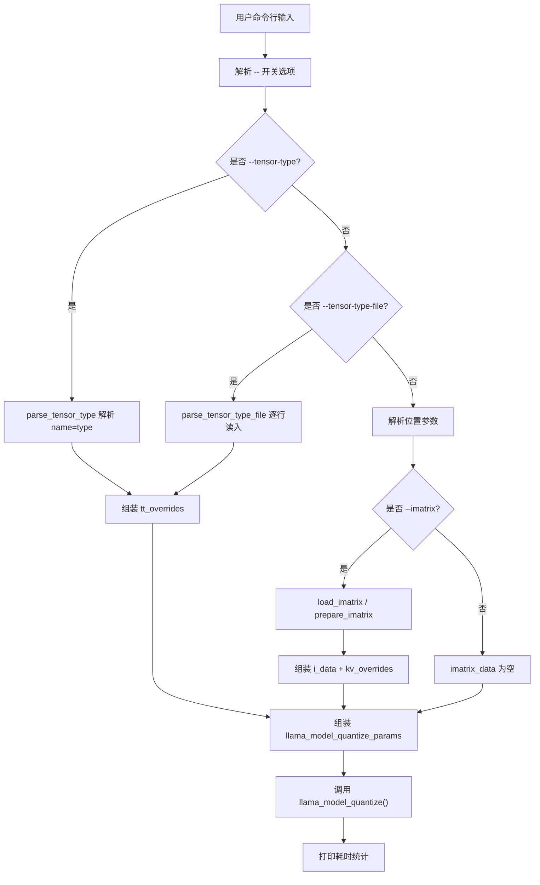
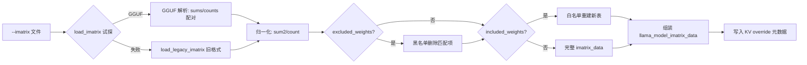
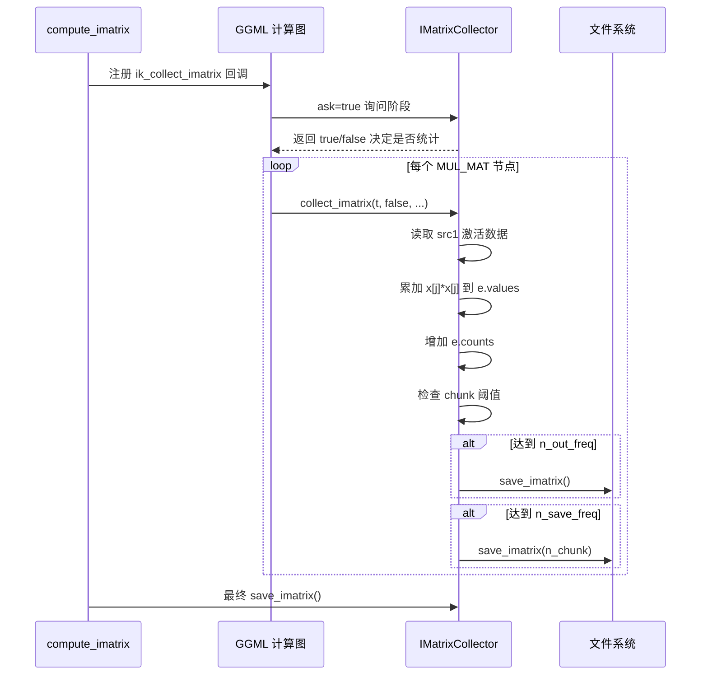
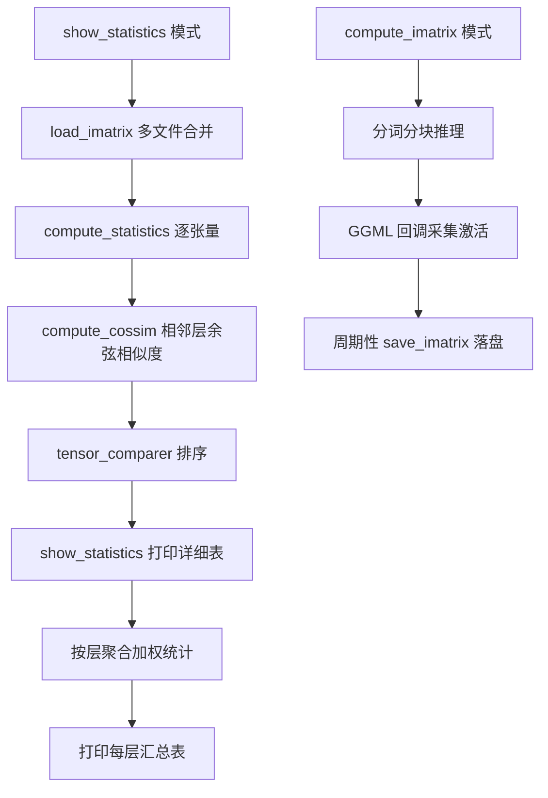
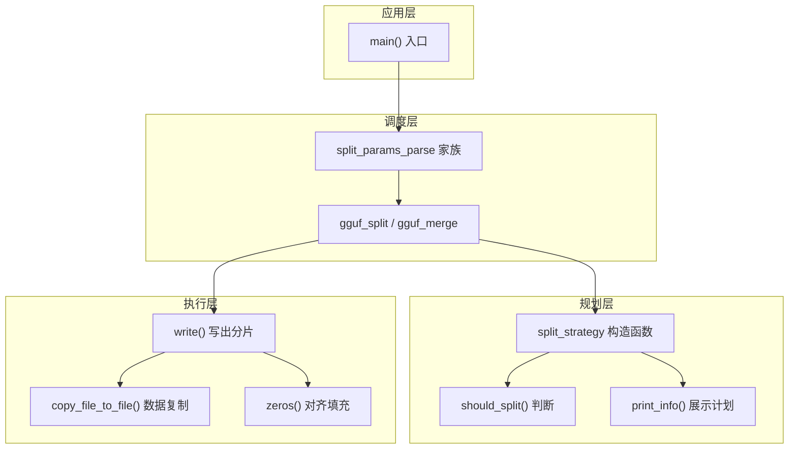
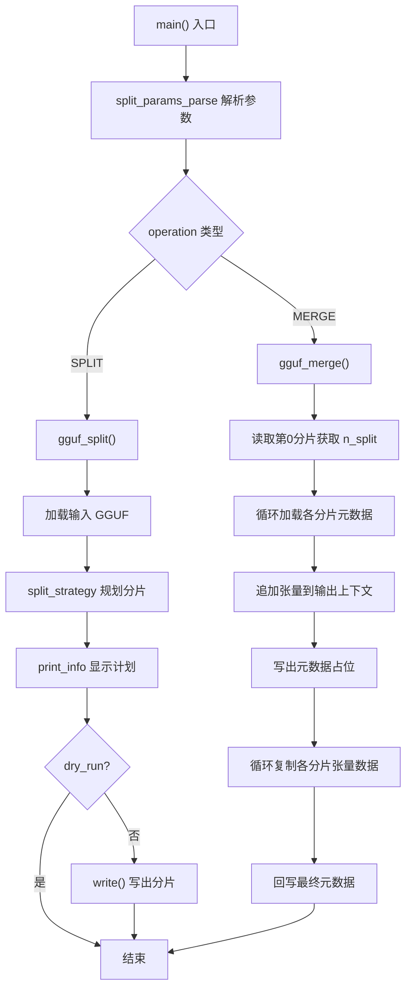
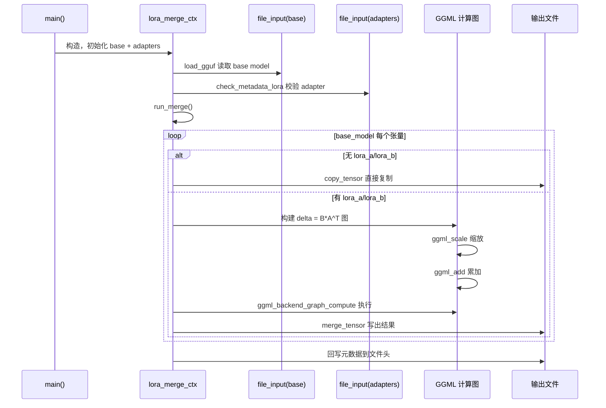
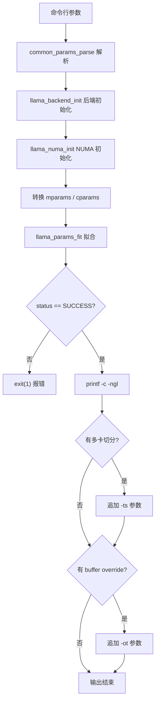

# 第69章 模型处理工具链 —— 模型压缩与部署的"瑞士军刀"

> **说明**：本章原按「模型处理与转换工具」细纲编写，因其内容与量化、imatrix、拆分、LoRA 合并、参数拟合等工具高度契合。若你期待的是 perplexity、llama-bench 等纯评估工具，可跳跃至后续章节；本章将带你深入模型压缩与参数整备的"工程内功"。

## 学习目标

- 掌握 llama-quantize 工具的命令行参数解析与量化配置组装流程
- 理解重要性矩阵（imatrix）的加载、过滤机制及其在量化中的指导作用
- 剖析 imatrix 采集器如何通过计算图回调捕获激活值平方统计
- 掌握 GGUF 模型文件按张量数或字节大小拆分与合并的实现原理
- 精通 LoRA 适配器合并技术的数学原理与工程实现（权重融合与 GGML 计算图）
- 了解 fit-params 工具如何基于可用内存自动推荐推理参数配置
- 掌握工具类中公共辅助函数（KV读取、字符串处理、内存管理）的设计模式

## 69.1 生活类比

想象这套模型处理工具链是一家**精密的汽车改装厂**：

**llama-quantize** = **车身轻量化车间**。不是简单切割，而是根据蓝图（ftypes）选择不同压缩工艺（Q4_K/Q8_0/F16），支持局部改装（--tensor-type）和整体翻新，还能保留原车架结构（--keep-split）。工具函数 striequals 像质检员，确保输入的「改装件编号」（类型名）不分大小写都能对上。

**imatrix** = **车辆应力测试与荷载分析**。通过在真实路况（推理过程）中安装传感器（GGML 回调），记录每个零部件（张量）承受的压力分布（激活值平方和），生成「关键部位地图」，指导后续轻量化时该加强哪里、可以削减哪里。统计展示功能像「实验室显微镜」，能看清每层材料的疲劳度、应力集中点和层间传导效率。

**gguf-split** = **大型设备的分体运输与组装**。像把超宽设备拆成标准集装箱（按大小/数量拆分），到达目的地后再无损拼装。每个集装箱都有编号（SPLIT_NO）和清单，split_print_usage 就像「装箱手册」教你怎么用。zeros 函数像打包时的「填充泡沫」，确保每个箱子严丝合缝（GGUF 对齐）。

**export-lora** = **精准的外科焊接手术**。将选装件（LoRA 适配器）永久焊接到车身上，而不是每次使用时临时加装。焊接前严格检查配件兼容性（元数据校验），计算融合公式（B×A^T），确保无缝集成。各种 get_kv/zeros/load_gguf 工具函数是「手术器械包」，负责读取病历（元数据）和准备无菌环境。

**fit-params** = **智能车位规划师**。根据车库实际大小（可用内存），自动规划最佳停车方案（context 长度、GPU 层数分配）。输出结果像「停车指示牌」，直接告诉司机（用户）该怎么停（参数怎么设）。

## 69.2 源码地图

```
tools/quantize/quantize.cpp
├── 数据结构
│   ├── tensor_type_option           # 张量量化类型选项
│   ├── quant_option                 # 量化选项描述
│   └── llama_model_quantize_params  # 量化参数核心结构
├── 工具函数
│   ├── striequals()                 # 不区分大小写字符串比较
│   ├── try_parse_ftype()            # 解析量化类型字符串
│   ├── usage()                      # 打印帮助信息与量化选项表
│   ├── load_legacy_imatrix()        # 加载旧版 imatrix (.dat)
│   ├── load_imatrix()               # 加载 GGUF 格式 imatrix
│   ├── prepare_imatrix()            # 过滤与准备 imatrix 数据
│   ├── parse_ggml_type()            # 解析 ggml_type 字符串
│   ├── parse_tensor_type()          # 解析 tensor=type 格式
│   ├── parse_tensor_type_file()     # 解析批量张量类型文件
│   ├── parse_layer_prune()          # 解析层剪枝列表
│   └── main()                       # 主入口：组装参数并调用量化
└── 常量定义
    ├── QUANT_OPTIONS                # 支持的量化类型表（Q1_0~F32）
    └── LLM_KV_QUANTIZE_*            # 元数据键名常量

tools/imatrix/imatrix.cpp
├── 核心类
│   └── IMatrixCollector             # 重要性矩阵采集器
│       ├── IMatrixCollector()       # 默认构造函数
│       ├── set_params()             # 设置公共参数
│       ├── collect_imatrix()        # GGML 回调，采集激活值
│       ├── save_imatrix()           # GGUF 格式保存
│       ├── save_imatrix_legacy()    # Legacy 格式保存
│       ├── load_imatrix()           # GGUF 格式加载
│       ├── load_imatrix_legacy()    # Legacy 格式加载
│       └── get_mstats()             # 获取统计map
├── 统计计算
│   ├── tensor_comparer              # 张量统计排序比较器
│   │   └── operator()               # 按名称和激活平方和排序
│   ├── compute_statistics()         # 计算统计指标(熵/标准差等)
│   ├── compute_cossim()             # 计算相邻层余弦相似度
│   └── show_statistics()            # 展示统计结果
├── 辅助函数
│   ├── print_usage()                # 打印使用说明
│   ├── filter_tensor_name()         # 张量名称过滤
│   ├── process_tensor_name()        # 解析层号与张量名
│   ├── softmax()                    # softmax 计算
│   ├── log_softmax()                # 对数 softmax
│   ├── process_logits()             # 并行处理 logits 计算 PPL
│   ├── ik_collect_imatrix()         # 回调静态包装
│   └── compute_imatrix()            # 主计算流程
└── main() / __main__                # 入口函数

tools/gguf-split/gguf-split.cpp
├── split_params                     # 拆分参数结构
├── split_strategy                   # 拆分策略类
│   ├── split_strategy()             # 构造函数，规划分片
│   ├── ~split_strategy()            # 析构，释放上下文
│   ├── should_split()               # 判断是否需要拆分
│   ├── print_info()                 # 打印拆分信息
│   ├── write()                      # 执行文件写入
│   └── copy_file_to_file()          # 张量数据复制
├── split_str_to_n_bytes()           # 解析 128M/4G 等尺寸
├── split_params_parse_ex()          # 命令行参数解析核心
├── split_params_parse()             # 参数解析包装器
├── split_print_usage()              # 打印拆分帮助信息
├── zeros()                          # 写入零字节填充
├── gguf_split()                     # 拆分主函数
├── gguf_merge()                     # 合并主函数
└── main()                           # 入口

tools/export-lora/export-lora.cpp
├── file_input                       # GGUF 文件读取封装
│   ├── file_input()                 # 构造函数
│   ├── ~file_input()                # 析构函数
│   ├── get_tensor()                 # 获取张量
│   └── read_tensor_data()           # 读取张量数据
├── lora_merge_ctx                   # LoRA 合并上下文
│   ├── lora_merge_ctx()             # 构造函数
│   ├── ~lora_merge_ctx()            # 析构函数
│   ├── check_metadata_lora()        # 校验适配器兼容性
│   ├── get_out_tensor_type()        # 确定输出类型
│   ├── run_merge()                  # 合并主流程
│   ├── copy_tensor()                # 直接复制张量
│   └── merge_tensor()               # 执行 LoRA 合并计算
├── 工具函数
│   ├── get_kv_str()                 # 获取字符串元数据
│   ├── get_kv_f32()                 # 获取浮点元数据
│   ├── zeros()                      # 写入零填充
│   ├── ggml_ne_string()             # 张量维度字符串化
│   ├── load_gguf()                  # 加载GGUF上下文
│   └── print_usage()                # 打印使用说明
└── main()                           # 入口

tools/fit-params/fit-params.cpp
└── main()                           # 调用 llama_params_fit()
```

## 69.3 量化选项与参数解析 —— 命令行上的「刀法清单」

量化工具的第一印象是「可选刀法」。入口先用 `QUANT_OPTIONS` 维护一张量化类型清单：Q1_0/Q4_0/Q4_K/IQ 系列/F16/BF16 等。每种类型都绑定 `llama_ftype` 枚举和一段说明文本，用于帮助输出和合法性校验。这让用户不是在「自由填类型字符串」，而是在受支持的「刀法表」里选一种压缩方式。

跨平台的健壮性设计：`striequals()` 提供不区分大小写的字符串比较，支持用户输入 Q4_K_M 或 q4_k_m；`try_parse_ftype()` 兼容字符串和枚举值两种输入，提高用户体验。

命令行解析的目标是组装一份量化参数对象：`main()` 先创建 `llama_model_quantize_params`，再逐项填充高级选项。支持的选项包括 `--allow-requantize`、`--pure`、`--keep-split`、`--dry-run`、`--override-kv` 等。这些开关分别控制是否允许二次量化、是否禁用混合量化、是否保留分片、是否只估算大小、是否覆盖元数据。

张量级定制被拆成两类输入：单项覆盖走 `--tensor-type tensor=type`，由 `parse_tensor_type()` 解析；批量覆盖走 `--tensor-type-file file`，由 `parse_tensor_type_file()` 逐条读入。输出张量和 embedding 张量也可分别指定类型，使用 `parse_ggml_type()` 转成 `ggml_type`。

剪层和输入输出路径也是量化入口的一部分：`--prune-layers` 由 `parse_layer_prune()` 解析逗号分隔层号并排序去重；输入模型和输出模型路径与 ftype 的解析是兼容两种写法的：`<input> <ftype>` 或 `<input> <output> <ftype>`。这一步的关键作用是：把用户意图先翻译成一份结构化、可执行的量化任务单。

### 69.3.1 数据结构：`tensor_type_option`、`quant_option` 与 `llama_model_quantize_params`

源码路径：`tools/quantize/quantize.cpp`（数据结构定义）、`llama.h`（`llama_model_quantize_params`）

```cpp
// tensor_type_option：张量名称与量化类型的绑定
struct tensor_type_option {
    std::string name;    // 张量名（解析时统一转小写）
    ggml_type type;      // 目标 ggml 类型
};

// quant_option：量化类型注册表条目
struct quant_option {
    std::string name;       // 用户可见名称，如 "Q4_K_M"
    llama_ftype ftype;      // 对应的 llama_ftype 枚举值
    std::string desc;       // 人类可读描述，含大小与质量参考
};

// llama_model_quantize_params：量化参数核心结构（定义于公共 API 头文件）
// 以下字段由 quantize.cpp 的 main() 直接访问与组装：
struct llama_model_quantize_params {
    llama_ftype ftype;                // 全局量化类型
    int nthread;                      // 线程数
    bool allow_requantize;            // 允许二次量化
    bool only_copy;                   // 仅复制不量化
    bool quantize_output_tensor;      // 是否量化输出张量
    bool pure;                        // 禁用混合量化
    bool dry_run;                     // 只估算大小
    bool keep_split;                  // 保留分片结构
    ggml_type output_tensor_type;     // 输出张量类型覆盖
    ggml_type token_embedding_type;   // embedding 张量类型覆盖
    const llama_model_tensor_override * tt_overrides;  // 张量级覆盖数组
    const llama_model_imatrix_data * imatrix;          // 重要性矩阵数据
    const int * prune_layers;                        // 剪枝层号数组
    const llama_model_kv_override * kv_overrides;     // 元数据覆盖数组
};
```

这三个结构构成了量化工具配置层的「数据契约」：`tensor_type_option` 承载单条 `tensor=type` 覆盖，`quant_option` 描述可选压缩工艺，`llama_model_quantize_params` 则是组装后的完整任务单，被 `main()` 填满后传给 `llama_model_quantize()` 执行。

### 69.3.2 `striequals()`：不区分大小写的字符串比较

源码路径：`tools/quantize/quantize.cpp` - `striequals()`（83-92行）

```cpp
static bool striequals(const char * a, const char * b) {
    while (*a && *b) {              // ① 同时扫描两字符串
        if (std::tolower(*a) != std::tolower(*b)) {  // ② 逐字符忽略大小写比较
            return false;          // ③ 发现不同立即退出
        }
        a++; b++;                  // ④ 指针后移
    }
    return *a == *b;                // ⑤ 同时到达末尾才算相等
}
```

这段代码定义了 `striequals()`，它通过逐字符转小写后比较，避免了临时字符串分配，适合命令行解析中频繁的类型名匹配。

### 69.3.3 `try_parse_ftype()`：量化类型解析器

源码路径：`tools/quantize/quantize.cpp` - `try_parse_ftype()`（94-119行）

```cpp
static bool try_parse_ftype(const std::string & ftype_str_in, llama_ftype & ftype, std::string & ftype_str_out) {
    std::string ftype_str;
    for (auto ch : ftype_str_in) {
        ftype_str.push_back(std::toupper(ch));   // ① 统一转大写
    }
    for (const auto & it : QUANT_OPTIONS) {      // ② 遍历量化选项表
        if (striequals(it.name.c_str(), ftype_str.c_str())) {
            ftype = it.ftype;                     // ③ 精确匹配则返回
            ftype_str_out = it.name;
            return true;
        }
    }
    try {                                          // ④ 尝试整数解析
        int ftype_int = std::stoi(ftype_str);
        for (const auto & it : QUANT_OPTIONS) {
            if (it.ftype == ftype_int) {           // ⑤ 按枚举值匹配
                ftype = it.ftype;
                ftype_str_out = it.name;
                return true;
            }
        }
    } catch (...) {                                // ⑥ 解析失败忽略
    }
    return false;
}
```

这段代码实现了 `try_parse_ftype()`，它先用大写形式在名称表中查找，再回退到整数枚举匹配，使得用户既可输入 "Q4_K_M" 也可输入对应编号，极大降低了记忆负担。

### 69.3.4 `usage()`：帮助信息与量化选项表打印

源码路径：`tools/quantize/quantize.cpp` - `usage()`（121-182行）

```cpp
[[noreturn]]
static void usage(const char * executable) {
    printf("usage: %s [--help] [--allow-requantize] [--leave-output-tensor] [--pure] [--imatrix] [--include-weights]\n", executable);
    printf("       [--exclude-weights] [--output-tensor-type] [--token-embedding-type] [--tensor-type] [--tensor-type-file]\n");
    printf("       [--prune-layers] [--keep-split] [--override-kv] [--dry-run]\n");
    printf("       model-f32.gguf [model-quant.gguf] type [nthreads]\n\n");
    printf("  --allow-requantize\n");
    printf("                                      allow requantizing tensors that have already been quantized\n");
    printf("                                      WARNING: this can severely reduce quality compared to quantizing\n");
    printf("                                               from 16bit or 32bit!\n");
    printf("  --leave-output-tensor\n");
    printf("                                      leave output.weight un(re)quantized\n");
    printf("                                      increases model size but may also increase quality, especially when requantizing\n");
    printf("  --pure\n");
    printf("                                      disable k-quant mixtures and quantize all tensors to the same type\n");
    printf("  --imatrix file_name\n");
    printf("                                      use data in file_name as importance matrix for quant optimizations\n");
    printf("  --include-weights tensor_name\n");
    printf("                                      use importance matrix for this/these tensor(s)\n");
    printf("  --exclude-weights tensor_name\n");
    printf("                                      do not use importance matrix for this/these tensor(s)\n");
    printf("  --output-tensor-type ggml_type\n");
    printf("                                      use this ggml_type for the output.weight tensor\n");
    printf("  --token-embedding-type ggml_type\n");
    printf("                                      use this ggml_type for the token embeddings tensor\n");
    printf("  --tensor-type tensor_name=ggml_type\n");
    printf("                                      quantize this tensor to this ggml_type\n");
    printf("                                      this is an advanced option to selectively quantize tensors. may be specified multiple times.\n");
    printf("                                      example: --tensor-type attn_q=q8_0\n");
    printf("  --tensor-type-file tensor_types.txt\n");
    printf("                                      list of tensors to quantize to a specific ggml_type\n");
    printf("                                      this is an advanced option to selectively quantize a long list of tensors.\n");
    printf("                                      the file should use the same format as above, separated by spaces or newlines.\n");
    printf("  --prune-layers L0,L1,L2...\n");
    printf("                                      comma-separated list of layer numbers to prune from the model\n");
    printf("                                      WARNING: this is an advanced option, use with care.\n");
    printf("  --keep-split\n");
    printf("                                      generate quantized model in the same shards as input\n");
    printf("  --override-kv KEY=TYPE:VALUE\n");
    printf("                                      override model metadata by key in the quantized model. may be specified multiple times.\n");
    printf("                                      WARNING: this is an advanced option, use with care.\n");
    printf("  --dry-run\n");
    printf("                                      calculate and show the final quantization size without performing quantization\n");
    printf("                                      example: llama-quantize --dry-run model-f32.gguf Q4_K\n\n");
    printf("note: --include-weights and --exclude-weights cannot be used together\n\n");
    printf("-----------------------------------------------------------------------------\n");
    printf(" allowed quantization types\n");
    printf("-----------------------------------------------------------------------------\n\n");
    for (const auto & it : QUANT_OPTIONS) {
        if (it.name != "COPY") {
            printf("  %2d  or  ", it.ftype);
        } else {
            printf("          ");
        }
        printf("%-7s : %s\n", it.name.c_str(), it.desc.c_str());
    }
    exit(1);
}
```

这段代码定义了 `usage()`，它负责在用户参数错误或主动求助时，打印完整的帮助信息与量化选项表。`[[noreturn]]` 属性确保调用后不会返回，直接 `exit(1)` 结束进程。遍历 `QUANT_OPTIONS` 时对 COPY 类型特殊处理缩进，避免枚举值 0 被误认为有效输入。

### 69.3.5 `parse_ggml_type()`：ggml 类型字符串解析

源码路径：`tools/quantize/quantize.cpp` - `parse_ggml_type()`（347-354行）

```cpp
static ggml_type parse_ggml_type(const char * arg) {
    for (int i = 0; i < GGML_TYPE_COUNT; ++i) {              // ① 遍历所有 ggml 类型
        auto type = (ggml_type)i;
        const auto * name = ggml_type_name(type);
        if (name && striequals(name, arg)) {                // ② 用 striequals 做大小写无关匹配
            return type;                                    // ③ 返回匹配的类型
        }
    }
    fprintf(stderr, "\n%s: invalid ggml_type '%s'\n\n", __func__, arg);
    return GGML_TYPE_COUNT;                                  // ④ 失败返回无效标记
}
```

这段代码实现了 `parse_ggml_type()`，它是张量级类型覆盖的基础，把用户输入的字符串（如 `q8_0`、`f16`）转换为 `ggml_type` 枚举，供后续 `tt_overrides` 使用。

### 69.3.6 `parse_tensor_type()`：单条张量类型覆盖解析

源码路径：`tools/quantize/quantize.cpp` - `parse_tensor_type()`（356-378行）

```cpp
static bool parse_tensor_type(const char * data, std::vector<tensor_type_option> & tensor_type) {
    const char * sep = strchr(data, '=');                    // ① 查找分隔符 '='
    if (sep == nullptr) {
        printf("\n%s: malformed tensor type '%s'\n\n", __func__, data);
        return false;
    }
    const size_t tn_len = sep - data;                        // ② 计算张量名长度
    if (tn_len == 0) {
        printf("\n%s: missing tensor name\n\n", __func__);
        return false;
    }
    if (const size_t qt_len = strlen(sep); qt_len == 1) {    // ③ 检查是否缺类型
        printf("\n%s: missing quantization type\n\n", __func__);
        return false;
    }
    std::string tn(data, tn_len);
    std::transform(tn.begin(), tn.end(), tn.begin(), tolower);  // ④ 张量名统一小写
    sep++;
    tensor_type_option tensor_type_opt;
    tensor_type_opt.name = tn;
    tensor_type_opt.type = parse_ggml_type(sep);             // ⑤ 解析类型
    tensor_type.emplace_back(std::move(tensor_type_opt));
    if (tensor_type_opt.type == GGML_TYPE_COUNT) {           // ⑥ 校验类型有效性
        printf("\n%s: invalid quantization type '%s'\n\n", __func__, sep);
        return false;
    }
    return true;
}
```

这段代码实现了 `parse_tensor_type()`，它解析 `tensor_name=ggml_type` 格式（如 `attn_q=q8_0`），把张量名与量化类型绑定后追加到配置向量，供量化时逐张量覆盖。

### 69.3.7 `parse_tensor_type_file()`：批量张量类型文件解析

源码路径：`tools/quantize/quantize.cpp` - `parse_tensor_type_file()`（380-389行）

```cpp
static bool parse_tensor_type_file(const char * filename, std::vector<tensor_type_option> & tensor_type) {
    std::ifstream file(filename);
    if (!file) {
        printf("\n%s: failed to open file '%s': %s\n\n", __func__, filename, std::strerror(errno));
        return false;
    }
    std::string arg;
    while (file >> arg) {                                     // ① 逐词读取（空格/换行分隔）
        if (!parse_tensor_type(arg.c_str(), tensor_type)) {  // ② 复用单条解析逻辑
            return false;
        }
    }
    return true;
}
```

这段代码实现了 `parse_tensor_type_file()`，它从文件中读取批量张量类型配置，每行/每条由空格或换行分隔，逐条调用 `parse_tensor_type()` 完成解析，适合长列表场景。

### 69.3.8 `parse_layer_prune()`：层剪枝列表解析

源码路径：`tools/quantize/quantize.cpp` - `parse_layer_prune()`（391-407行）

```cpp
static bool parse_layer_prune(const char * data, std::vector<int> & prune_layers) {
    if (!data) {
        printf("\n%s: no layer pruning ids provided\n\n", __func__);
        return false;
    }
    const auto block_ids = string_split<std::string>(data, ',');  // ① 按逗号切分
    for (const auto & block_id : block_ids) {
        int id;
        try {
            id = std::stoi(block_id);                            // ② 整数解析
        } catch (...) {
            id = -1;
        }
        if (id < 0) {
            printf("\n%s: invalid layer id '%s'\n\n", __func__, block_id.c_str());
            return false;
        }
        prune_layers.emplace_back(id);
    }
    sort(prune_layers.begin(), prune_layers.end());               // ③ 排序
    prune_layers.erase(std::unique(prune_layers.begin(), prune_layers.end()), prune_layers.end());  // ④ 去重
    return true;
}
```

这段代码实现了 `parse_layer_prune()`，它把逗号分隔的层号字符串（如 `0,2,5`）解析为整数向量，排序去重后供量化时跳过指定层。

### 69.3.9 `main()`：命令行参数解析与量化配置组装

源码路径：`tools/quantize/quantize.cpp` - `main()`（409-529行）

```cpp
int main(int argc, char ** argv) {
    std::setlocale(LC_NUMERIC, "C");
    if (argc < 3) { usage(argv[0]); }               // ① 参数不足直接帮助

    llama_model_quantize_params params = llama_model_quantize_default_params();
    int arg_idx = 1;
    std::string imatrix_file;
    std::vector<std::string> included_weights, excluded_weights;
    std::vector<llama_model_kv_override> kv_overrides;
    std::vector<tensor_type_option> tensor_type_opts;
    std::vector<int> prune_layers;

    for (; arg_idx < argc && strncmp(argv[arg_idx], "--", 2) == 0; arg_idx++) {
        // ② 逐选项解析，支持 --leave-output-tensor, --output-tensor-type,
        //    --token-embedding-type, --tensor-type, --tensor-type-file,
        //    --prune-layers, --override-kv, --dry-run, --allow-requantize,
        //    --pure, --imatrix, --include-weights, --exclude-weights, --keep-split
        if (strcmp(argv[arg_idx], "--leave-output-tensor") == 0) {
            params.quantize_output_tensor = false;                                          // 禁用输出张量量化
        } else if (strcmp(argv[arg_idx], "--output-tensor-type") == 0) {
            if (arg_idx < argc-1) {
                params.output_tensor_type = parse_ggml_type(argv[++arg_idx]);              // 解析输出张量类型
                if (params.output_tensor_type == GGML_TYPE_COUNT) { usage(argv[0]); }
            } else { usage(argv[0]); }
        } else if (strcmp(argv[arg_idx], "--token-embedding-type") == 0) {
            if (arg_idx < argc-1) {
                params.token_embedding_type = parse_ggml_type(argv[++arg_idx]);           // 解析 embedding 类型
                if (params.token_embedding_type == GGML_TYPE_COUNT) { usage(argv[0]); }
            } else { usage(argv[0]); }
        } else if (strcmp(argv[arg_idx], "--tensor-type") == 0) {
            if (arg_idx == argc-1 || !parse_tensor_type(argv[++arg_idx], tensor_type_opts)) {
                usage(argv[0]);                                                           // 单条张量类型覆盖
            }
        } else if (strcmp(argv[arg_idx], "--tensor-type-file") == 0) {
            if (arg_idx == argc-1 || !parse_tensor_type_file(argv[++arg_idx], tensor_type_opts)) {
                usage(argv[0]);                                                           // 批量张量类型覆盖
            }
        } else if (strcmp(argv[arg_idx], "--prune-layers") == 0) {
            if (arg_idx == argc-1 || !parse_layer_prune(argv[++arg_idx], prune_layers)) {
                usage(argv[0]);                                                           // 解析剪层列表
            }
        } else if (strcmp(argv[arg_idx], "--override-kv") == 0) {
            if (arg_idx == argc-1 || !string_parse_kv_override(argv[++arg_idx], kv_overrides)) {
                usage(argv[0]);                                                           // 解析 KV 覆盖
            }
        } else if (strcmp(argv[arg_idx], "--dry-run") == 0) {
            params.dry_run = true;                                                         // 只估算不执行
        } else if (strcmp(argv[arg_idx], "--allow-requantize") == 0) {
            params.allow_requantize = true;                                                // 允许二次量化
        } else if (strcmp(argv[arg_idx], "--pure") == 0) {
            params.pure = true;                                                            // 禁用混合量化
        } else if (strcmp(argv[arg_idx], "--imatrix") == 0) {
            if (arg_idx < argc-1) { imatrix_file = argv[++arg_idx]; } else { usage(argv[0]); }
        } else if (strcmp(argv[arg_idx], "--include-weights") == 0) {
            if (arg_idx < argc-1) { included_weights.emplace_back(argv[++arg_idx]); } else { usage(argv[0]); }
        } else if (strcmp(argv[arg_idx], "--exclude-weights") == 0) {
            if (arg_idx < argc-1) { excluded_weights.emplace_back(argv[++arg_idx]); } else { usage(argv[0]); }
        } else if (strcmp(argv[arg_idx], "--keep-split") == 0) {
            params.keep_split = true;                                                      // 保留分片结构
        } else {
            usage(argv[0]);
        }
    }

    // ③ 解析剩余位置参数：输入路径、输出路径/类型、线程数
    if (argc - arg_idx < 2) { printf("%s: bad arguments\n", argv[0]); usage(argv[0]); }
    if (!included_weights.empty() && !excluded_weights.empty()) { usage(argv[0]); }

    // ④ 加载并过滤 imatrix 数据
    std::vector<std::string> imatrix_datasets;
    std::unordered_map<std::string, std::vector<float>> imatrix_data;
    int m_last_call = prepare_imatrix(imatrix_file, imatrix_datasets, included_weights, excluded_weights, imatrix_data);

    // ⑤ 组装 kv_overrides、tt_overrides、prune_layers 数组
    std::vector<llama_model_imatrix_data> i_data;
    std::vector<llama_model_tensor_override> t_override;
    if (!imatrix_data.empty()) {
        i_data.reserve(imatrix_data.size() + 1);
        for (const auto & kv : imatrix_data) {
            i_data.push_back({kv.first.c_str(), kv.second.data(), kv.second.size()});
        }
        i_data.push_back({nullptr, nullptr, 0});  // 数组末尾哨兵
        params.imatrix = i_data.data();
        // 反写 imatrix 元数据到量化结果
        { llama_model_kv_override kvo;
            std::strcpy(kvo.key, LLM_KV_QUANTIZE_IMATRIX_FILE);
            kvo.tag = LLAMA_KV_OVERRIDE_TYPE_STR;
            strncpy(kvo.val_str, imatrix_file.c_str(), 127);
            kvo.val_str[127] = '\0';
            kv_overrides.emplace_back(std::move(kvo)); }
        if (!imatrix_datasets.empty()) {
            llama_model_kv_override kvo;
            std::strcpy(kvo.key, LLM_KV_QUANTIZE_IMATRIX_DATASET);
            kvo.tag = LLAMA_KV_OVERRIDE_TYPE_STR;
            strncpy(kvo.val_str, imatrix_datasets[0].c_str(), 127);
            kvo.val_str[127] = '\0';
            kv_overrides.emplace_back(std::move(kvo)); }
        { llama_model_kv_override kvo;
            std::strcpy(kvo.key, LLM_KV_QUANTIZE_IMATRIX_N_ENTRIES);
            kvo.tag = LLAMA_KV_OVERRIDE_TYPE_INT;
            kvo.val_i64 = imatrix_data.size();
            kv_overrides.emplace_back(std::move(kvo)); }
        if (m_last_call > 0) {
            llama_model_kv_override kvo;
            std::strcpy(kvo.key, LLM_KV_QUANTIZE_IMATRIX_N_CHUNKS);
            kvo.tag = LLAMA_KV_OVERRIDE_TYPE_INT;
            kvo.val_i64 = m_last_call;
            kv_overrides.emplace_back(std::move(kvo)); }
    }
    if (!kv_overrides.empty()) {
        kv_overrides.emplace_back();
        kv_overrides.back().key[0] = 0;
        params.kv_overrides = kv_overrides.data();
    }
    if (!tensor_type_opts.empty()) {
        t_override.reserve(tensor_type_opts.size() + 1);
        for (const auto & tt : tensor_type_opts) {
            t_override.push_back({tt.name.c_str(), tt.type});
        }
        t_override.push_back({nullptr, GGML_TYPE_COUNT});  // 数组末尾哨兵
        params.tt_overrides = t_override.data();
    }
    if (!prune_layers.empty()) {
        prune_layers.push_back(-1);  // 数组末尾哨兵
        params.prune_layers = prune_layers.data();
    }

    // ⑥ 解析输入/输出路径与 ftype，兼容两种写法
    llama_backend_init();
    const std::string fname_inp = argv[arg_idx];
    arg_idx++;
    std::string fname_out;
    std::string ftype_str;
    std::string suffix = ".gguf";
    if (try_parse_ftype(argv[arg_idx], params.ftype, ftype_str)) {
        // 第一种写法：<input> <ftype>，输出路径自动推导
        if (!params.dry_run) {
            std::string fpath;
            const size_t pos = fname_inp.find_last_of("/\\");
            if (pos != std::string::npos) { fpath = fname_inp.substr(0, pos + 1); }
            fname_out = fpath + "ggml-model-" + ftype_str;
            if (!params.keep_split) { fname_out += suffix; }
        }
        arg_idx++;
        if (ftype_str == "COPY") { params.only_copy = true; }
    } else {
        // 第二种写法：<input> <output> <ftype>
        fname_out = argv[arg_idx];
        if (params.keep_split && fname_out.find(suffix) != std::string::npos) {
            fname_out = fname_out.substr(0, fname_out.length() - suffix.length());
        }
        arg_idx++;
        if (argc <= arg_idx) { fprintf(stderr, "%s: missing ftype\n", __func__); return 1; }
        if (!try_parse_ftype(argv[arg_idx], params.ftype, ftype_str)) {
            fprintf(stderr, "%s: invalid ftype '%s'\n", __func__, argv[arg_idx]);
            return 1;
        }
        if (ftype_str == "COPY") { params.only_copy = true; }
        arg_idx++;
    }
    // 解析可选线程数
    if (argc > arg_idx) {
        try { params.nthread = std::stoi(argv[arg_idx]); }
        catch (const std::exception & e) {
            fprintf(stderr, "%s: invalid nthread '%s' (%s)\n", __func__, argv[arg_idx], e.what());
            return 1;
        }
    }
    if (!params.dry_run) {
        if (std::error_code ec; std::filesystem::equivalent(fname_inp, fname_out, ec)) {
            fprintf(stderr, "%s: error: input and output files are the same: '%s'\n", __func__, fname_inp.c_str());
            return 1;
        }
    }
    print_build_info();
    if (params.dry_run) {
        fprintf(stderr, "%s: calculating quantization size for '%s' as %s", __func__, fname_inp.c_str(), ftype_str.c_str());
    } else {
        fprintf(stderr, "%s: quantizing '%s' to '%s' as %s", __func__, fname_inp.c_str(), fname_out.c_str(), ftype_str.c_str());
    }
    if (params.nthread > 0) { fprintf(stderr, " using %d threads", params.nthread); }
    fprintf(stderr, "\n");

    // ⑦ 调用 llama_model_quantize() 执行量化
    const int64_t t_main_start_us = llama_time_us();
    int64_t t_quantize_us = 0;
    {
        const int64_t t_start_us = llama_time_us();
        if (llama_model_quantize(fname_inp.c_str(), fname_out.c_str(), &params)) {
            fprintf(stderr, "%s: failed to quantize model from '%s'\n", __func__, fname_inp.c_str());
            return 1;
        }
        t_quantize_us = llama_time_us() - t_start_us;
    }

    // ⑧ 打印耗时统计
    {
        const int64_t t_main_end_us = llama_time_us();
        printf("\n");
        printf("%s: quantize time = %8.2f ms\n", __func__, t_quantize_us/1000.0);
        printf("%s:    total time = %8.2f ms\n", __func__, (t_main_end_us - t_main_start_us)/1000.0);
    }
    llama_backend_free();
    return 0;
}
```

这段代码是量化工具的入口，逐行解析命令行开关，把用户在命令行上的各种「刀法选择」组装成一份完整的 `llama_model_quantize_params`，然后交由底层执行真正的量化。两种路径写法的兼容逻辑（自动推导输出路径 vs 显式指定）是入口解析的关键设计点。

### 69.3.10 流程图：命令行解析与量化配置组装



## 69.4 imatrix 通道接入 —— 让量化「知道哪里更重要」

量化并不是盲目压缩，而是要借助「重要性地图」。这里的重要性矩阵（imatrix）记录的是激活平方统计，用于提示哪些权重更敏感。量化工具把它作为可选输入，通过 `--imatrix` 注入；`--include-weights` 和 `--exclude-weights` 进一步做白名单/黑名单过滤。

工具同时兼容新旧两种 imatrix 文件：`load_imatrix()` 先尝试按 GGUF 读入，读不了时自动回退到旧格式 `load_legacy_imatrix()`，这保证了旧脚本生成的数据仍能继续服役。

GGUF 版本的 imatrix 读取核心是成对张量解析：文件中每个条目由 `*.in_sum2` 和 `*.counts` 组成，代码按后缀把二者聚合到 `sums_counts_for` 映射里，逐张量读取后，根据 `counts` 做归一化，最终得到 `imatrix_data[name] = sum2 / count`。

老格式读取逻辑更像「顺序解包」：依次读取 entry 数、名称长度、名称、调用次数、值个数、浮点数组，读取完后再除以调用次数得到平均激活统计。

过滤逻辑决定最终参与量化的张量范围：`prepare_imatrix()` 先加载，再按 `excluded_weights` 删除匹配项；如果有 `included_weights`，就重建一个只包含命中的新表。元数据还会被反写进量化结果，包括 imatrix 文件名、dataset、entry 数、chunk 数等 KV override。

### 69.4.1 `load_legacy_imatrix()`：旧格式 imatrix 加载器

源码路径：`tools/quantize/quantize.cpp` - `load_legacy_imatrix()`（184-236行）

```cpp
static int load_legacy_imatrix(const std::string & imatrix_file, std::vector<std::string> & imatrix_datasets, std::unordered_map<std::string, std::vector<float>> & imatrix_data) {
    std::ifstream in(imatrix_file.c_str(), std::ios::binary);
    if (!in) {
        printf("%s: failed to open %s\n",__func__, imatrix_file.c_str());
        exit(1);
    }
    int n_entries;
    in.read((char *)&n_entries, sizeof(n_entries));                              // ① 读取 entry 数
    if (in.fail() || n_entries < 1) {
        printf("%s: no data in file %s\n", __func__, imatrix_file.c_str());
        exit(1);
    }
    for (int i = 0; i < n_entries; ++i) {
        int len; in.read((char *)&len, sizeof(len));
        std::vector<char> name_as_vec(len+1);
        in.read((char *)name_as_vec.data(), len);                                // ② 读取名称
        if (in.fail()) {
            printf("%s: failed reading name for entry %d from %s\n", __func__, i+1, imatrix_file.c_str());
            exit(1);
        }
        name_as_vec[len] = 0;
        std::string name{name_as_vec.data()};
        auto & e = imatrix_data[name];
        int ncall;
        in.read((char *)&ncall, sizeof(ncall));                                  // ③ 读取调用次数
        int nval;
        in.read((char *)&nval, sizeof(nval));
        if (in.fail() || nval < 1) {
            printf("%s: failed reading number of values for entry %d\n", __func__, i);
            imatrix_data = {};
            exit(1);
        }
        e.resize(nval);
        in.read((char *)e.data(), nval*sizeof(float));                           // ④ 读取浮点数组
        if (in.fail()) {
            printf("%s: failed reading data for entry %d\n", __func__, i);
            imatrix_data = {};
            exit(1);
        }
        if (ncall > 0) {
            for (auto & v : e) { v /= ncall; }                                    // ⑤ 除以调用次数归一化
        }
        if (getenv("LLAMA_TRACE")) {
            printf("%s: loaded data (size = %6d, ncall = %6d) for '%s'\n", __func__, int(e.size()), ncall, name.c_str());
        }
    }
    int m_last_call = 0;
    if (in.peek() != EOF) {
        in.read((char *)&m_last_call, sizeof(m_last_call));                       // ⑥ 读取最后块数
        int dataset_len;
        in.read((char *)&dataset_len, sizeof(dataset_len));
        std::vector<char> dataset_as_vec(dataset_len);
        in.read(dataset_as_vec.data(), dataset_len);
        imatrix_datasets.resize(1);
        imatrix_datasets[0].assign(dataset_as_vec.begin(), dataset_as_vec.end());
        printf("%s: imatrix dataset='%s'\n", __func__, imatrix_datasets[0].c_str());
    }
    printf("%s: loaded %d importance matrix entries from %s computed on %d chunks\n", __func__, int(imatrix_data.size()), imatrix_file.c_str(), m_last_call);
    return m_last_call;
}
```

这段代码定义了 `load_legacy_imatrix()`，它按「顺序解包」的方式读取旧版 `.dat` 格式 imatrix，逐 entry 解析名称、调用次数与浮点值，最后除以 `ncall` 完成归一化，确保旧脚本产出的数据仍可被新工具读取。

### 69.4.2 `load_imatrix()`：GGUF 格式 imatrix 加载器

源码路径：`tools/quantize/quantize.cpp` - `load_imatrix()`（238-321行）

```cpp
static int load_imatrix(const std::string & imatrix_file, std::vector<std::string> & imatrix_datasets, std::unordered_map<std::string, std::vector<float>> & imatrix_data) {
    struct ggml_context * ctx = nullptr;
    struct gguf_init_params meta_gguf_params = {
        /* .no_alloc = */ false, // the data is needed
        /* .ctx      = */ &ctx,
    };
    struct gguf_context * ctx_gguf = gguf_init_from_file(imatrix_file.c_str(), meta_gguf_params);
    if (!ctx_gguf) {
        fprintf(stderr, "%s: imatrix file '%s' is using old format\n", __func__, imatrix_file.c_str());
        return load_legacy_imatrix(imatrix_file, imatrix_datasets, imatrix_data);   // ① 回退旧格式
    }
    const int32_t n_entries = gguf_get_n_tensors(ctx_gguf);
    if (n_entries < 1) {
        fprintf(stderr, "%s: no data in file %s\n", __func__, imatrix_file.c_str());
        gguf_free(ctx_gguf); ggml_free(ctx); exit(1);
    }
    const int dataset_idx     = gguf_find_key(ctx_gguf, LLM_KV_IMATRIX_DATASETS);
    const int chunk_count_idx = gguf_find_key(ctx_gguf, LLM_KV_IMATRIX_CHUNK_COUNT);
    const int chunk_size_idx  = gguf_find_key(ctx_gguf, LLM_KV_IMATRIX_CHUNK_SIZE);
    if (dataset_idx < 0 || chunk_count_idx < 0 || chunk_size_idx < 0) {
        fprintf(stderr, "%s: missing imatrix metadata in file %s\n", __func__, imatrix_file.c_str());
        gguf_free(ctx_gguf); ggml_free(ctx); exit(1);
    }
    const uint32_t chunk_size = gguf_get_val_u32(ctx_gguf, chunk_size_idx);
    const std::string sums_suffix{ ".in_sum2" };
    const std::string counts_suffix{ ".counts" };
    std::map<std::string, std::pair<struct ggml_tensor *, struct ggml_tensor *>> sums_counts_for;
    for (struct ggml_tensor * cur = ggml_get_first_tensor(ctx); cur; cur = ggml_get_next_tensor(ctx, cur)) {
        std::string name = cur->name;
        if (name.empty()) { continue; }
        if (string_remove_suffix(name, sums_suffix)) {
            sums_counts_for[std::move(name)].first = cur;                        // ② 配对 in_sum2
        } else if (string_remove_suffix(name, counts_suffix)) {
            sums_counts_for[std::move(name)].second = cur;                       // ③ 配对 counts
        }
    }
    for (const auto & sc : sums_counts_for) {
        const std::string & name   = sc.first;
        const struct ggml_tensor * sums   = sc.second.first;
        const struct ggml_tensor * counts = sc.second.second;
        if (!sums || !counts) {
            fprintf(stderr, "%s: mismatched sums and counts for %s\n", __func__, name.c_str());
            gguf_free(ctx_gguf); ggml_free(ctx); exit(1);
        }
        const int64_t ne0 = sums->ne[0];
        const int64_t ne1 = sums->ne[1];
        auto & e = imatrix_data[name];
        e.resize(ggml_nelements(sums));
        float max_count = 0.0f;
        for (int64_t j = 0; j < ne1; ++j) {
            const float count = ((const float *) counts->data)[j];
            if (count > 0.0f) {
                for (int64_t i = 0; i < ne0; ++i) {
                    e[j*ne0 + i] = ((const float *) sums->data)[j*ne0 + i] / count;  // ④ 归一化 sum2/count
                }
            } else {
                for (int64_t i = 0; i < ne0; ++i) { e[j*ne0 + i] = 1; }              // ⑤ 无数据填 1
            }
            if (count > max_count) { max_count = count; }
        }
        if (getenv("LLAMA_TRACE")) {
            printf("%s: loaded data (size = %6d, n_tokens = %6d, n_chunks = %6d) for '%s'\n", __func__, int(e.size()), int(max_count), int(max_count / chunk_size), name.c_str());
        }
    }
    int m_last_chunk = gguf_get_val_u32(ctx_gguf, chunk_count_idx);
    int64_t n_datasets = gguf_get_arr_n(ctx_gguf, dataset_idx);
    imatrix_datasets.reserve(n_datasets);
    for (int64_t i = 0; i < n_datasets; ++i) {
        imatrix_datasets.push_back(gguf_get_arr_str(ctx_gguf, dataset_idx, i));
    }
    printf("%s: imatrix datasets=['%s'", __func__, imatrix_datasets[0].c_str());
    for (size_t i = 1; i < imatrix_datasets.size(); ++i) { printf(", '%s'", imatrix_datasets[i].c_str()); }
    printf("]\n");
    printf("%s: loaded %d importance matrix entries from %s computed on %d chunks\n", __func__, int(imatrix_data.size()), imatrix_file.c_str(), m_last_chunk);
    gguf_free(ctx_gguf); ggml_free(ctx);
    return m_last_chunk;
}
```

这段代码定义了 `load_imatrix()`，它统一了新旧两种 imatrix 文件的加载路径：先尝试 GGUF 读入，失败自动回退 legacy；GGUF 版本按后缀把 `*.in_sum2` 与 `*.counts` 配对，逐张量归一化得到 `sum2 / count`，并读取 datasets/chunk 元数据。

### 69.4.3 `prepare_imatrix()`：imatrix 过滤器

源码路径：`tools/quantize/quantize.cpp` - `prepare_imatrix()`（323-345行）

```cpp
static int prepare_imatrix(const std::string & imatrix_file,
        std::vector<std::string> & imatrix_dataset,
        const std::vector<std::string> & included_weights,
        const std::vector<std::string> & excluded_weights,
        std::unordered_map<std::string, std::vector<float>> & imatrix_data) {
    int m_last_call = -1;
    if (!imatrix_file.empty()) {
        m_last_call = load_imatrix(imatrix_file, imatrix_dataset, imatrix_data);  // ① 加载
    }
    if (imatrix_data.empty()) { return m_last_call; }
    if (!excluded_weights.empty()) {
        for (const auto & name : excluded_weights) {
            for (auto it = imatrix_data.begin(); it != imatrix_data.end();) {
                auto pos = it->first.find(name);
                if (pos != std::string::npos) { it = imatrix_data.erase(it); }    // ② 黑名单删除
                else { ++it; }
            }
        }
    }
    if (!included_weights.empty()) {
        std::unordered_map<std::string, std::vector<float>> tmp;
        for (const auto & name : included_weights) {
            for (auto & e : imatrix_data) {
                auto pos = e.first.find(name);
                if (pos != std::string::npos) { tmp.emplace(std::move(e)); }      // ③ 白名单重建
            }
        }
        imatrix_data = std::move(tmp);
    }
    if (!imatrix_data.empty()) {
        printf("%s: have %d importance matrix entries\n", __func__, int(imatrix_data.size()));
    }
    return m_last_call;
}
```

这段代码实现了 `prepare_imatrix()`，它在加载后根据用户提供的 include/exclude 列表裁剪 imatrix 的作用域，确保量化只参考用户关心的张量。

### 69.4.4 模块依赖图：imatrix 通道接入



## 69.5 imatrix 主动采集 —— 在推理时「看见激活分布」

imatrix 的本质不是静态配置，而是运行时采出来的。采集器 `IMatrixCollector` 通过计算图回调挂在模型推理路径上，遇到 `GGML_OP_MUL_MAT` 和 `GGML_OP_MUL_MAT_ID` 时，它会读取相关输入张量，对普通 dense 层和 MoE expert 层分别维护统计。

灵活的参数配置：通过 `set_params()` 注入公共参数，使用默认构造函数快速初始化；`get_mstats()` 提供对内部统计表的只读访问，遵循最小权限原则。

采集前先做「问答式筛选」：回调的 `ask=true` 阶段决定这个张量值不值得统计，只收 `blk.*` 相关张量，或显式要求收 `output.weight`，还会检查维度、数据类型，避免把不合适的节点塞进统计表。

真正的统计量是激活平方和：对普通矩阵乘，按 `src1` 的各维遍历输入激活，把 `x[j] * x[j]` 累加到 `e.values`；对 MoE 的 `MUL_MAT_ID`，还要先读 expert id，再把样本分配到对应 expert 桶里。

辅助函数支撑整个流程：`filter_tensor_name()` 剥离设备前缀，统一张量名称；`process_tensor_name()` 解析层号和组件名，用于后续统计展示；`softmax()` 和 `log_softmax()` 用于计算概率分布，支持 PPL 计算中的数值稳定性；`process_logits()` 使用多线程并行处理 logits，计算 NLL 和概率历史。

多专家场景里，counts 维度通常会扩展：若一个张量第一次只有 1 个 bucket，后来又识别出多个 expert，会自动把 count 复制扩展，这保证了同一层下不同 expert 的统计都能分开保存。

采集过程还负责「按块落盘」：代码基于 chunk_size = n_ctx / n_parallel 统计已经处理到第几块，达到 `n_out_freq` 或 `n_save_freq` 阈值时触发 `save_imatrix()`。

### 69.5.1 `filter_tensor_name()`：张量名称过滤

源码路径：`tools/imatrix/imatrix.cpp` - `filter_tensor_name()`（99-113行）

```cpp
static std::string filter_tensor_name(const char * name) {
    std::string wname;
    const char * p = strchr(name, '#');
    if (p != NULL) {
        p = p + 1;
        const char * q = strchr(p, '#');
        if (q != NULL) {
            wname = std::string(p, q - p);          // ① 取两个 '#' 之间的核心名
        } else {
            wname = p;                              // ② 取最后一个 '#' 之后
        }
    } else {
        wname = name;                               // ③ 无前缀直接返回
    }
    return wname;
}
```

这段代码定义了 `filter_tensor_name()`，它剥离设备前缀（如 `CUDA0#blk.0.attn_k.weight#0` → `blk.0.attn_k.weight`），统一张量名称，避免同一张量因后端不同而被拆成多条统计。

### 69.5.2 `process_tensor_name()`：层号与短名解析

源码路径：`tools/imatrix/imatrix.cpp` - `process_tensor_name()`（116-142行）

```cpp
static void process_tensor_name(const std::string & input, std::string & layer, std::string & tensor) {
    std::vector<std::string> name;
    std::istringstream stream(input);
    std::string item;
    while (std::getline(stream, item, '.')) { name.push_back(item); }   // ① 按 '.' 切分
    for (size_t i = 0; i < name.size(); ++i) {
        if (name[i] == "blk" && i + 1 < name.size()) {
            layer = name[i + 1]; break;                                    // ② 提取层号
        }
    }
    for (size_t i = 0; i < name.size(); ++i) {
        if (name[i] == "weight" && i > 0) {
            tensor = name[i - 1]; break;                                   // ③ 提取短名
        }
    }
    if (tensor.empty()) { tensor = input; }                                 // ④ 兜底
    if (layer.empty()) { layer = "-"; }
}
```

这段代码实现了 `process_tensor_name()`，它从 `blk.0.attn_q.weight` 这类全名中提取层号 `0` 和短名 `attn_q`，用于后续统计展示的分层聚合。

### 69.5.3 `IMatrixCollector`：默认构造、`set_params()` 与 `get_mstats()`

源码路径：`tools/imatrix/imatrix.cpp` - `IMatrixCollector()`（71行）、`set_params()`（72行）、`get_mstats()`（84行）

```cpp
IMatrixCollector() = default;                                          // ① 默认构造，交由编译器生成

void set_params(common_params params) { m_params = std::move(params); } // ② 注入公共参数

const std::unordered_map<std::string, Stats> & get_mstats() const { return m_stats; } // ③ 只读访问
```

这段代码展示了 `IMatrixCollector` 的基础封装：默认构造使用 `= default` 避免自定义构造带来的初始化遗漏；`set_params()` 以移动语义注入参数；`get_mstats()` 返回 const 引用而非拷贝，遵循最小权限原则，避免大对象复制。

### 69.5.4 `IMatrixCollector::collect_imatrix()`：GGML 回调采集核心

源码路径：`tools/imatrix/imatrix.cpp` - `collect_imatrix()`（219-496行）

```cpp
bool IMatrixCollector::collect_imatrix(struct ggml_tensor * t, bool ask, void * user_data) {
    GGML_UNUSED(user_data);
    const struct ggml_tensor * src0 = t->src[0];
    const struct ggml_tensor * src1 = t->src[1];
    std::string wname = filter_tensor_name(src0->name);
    const int32_t chunk_size = m_params.n_ctx / m_params.n_parallel;
    if (ask) {
        // ① 询问阶段：决定是否值得统计
        if (t->op == GGML_OP_MUL_MAT_ID) return true;
        if (t->op != GGML_OP_MUL_MAT) return false;
        if (src1->ne[1] < 16 || src1->type != GGML_TYPE_F32) return false;
        if (!(wname.substr(0, 4) == "blk." || (m_params.process_output && wname == "output.weight"))) return false;
        return true;
    }
    // ② 非 ask 阶段：真正采集激活平方和
    std::lock_guard<std::mutex> lock(m_mutex);
    const bool is_host = ggml_backend_buffer_is_host(src1->buffer);
    if (!is_host) {
        const size_t src1_nbytes = ggml_nbytes(src1);
        m_src1_data.resize(src1_nbytes);
        ggml_backend_tensor_get(src1, m_src1_data.data(), 0, src1_nbytes);   // ③ 设备数据回读
    }
    const char * data = is_host ? (const char *) src1->data : m_src1_data.data();
    GGML_ASSERT(src1->nb[0] == ggml_element_size(src1));
    if (t->op == GGML_OP_MUL_MAT_ID) {
        // ④ MoE 场景：按 expert id 分桶
        const ggml_tensor * ids = t->src[2];
        const int64_t n_as = src0->ne[2];
        const int64_t n_ids = ids->ne[0];
        GGML_ASSERT(ids->ne[1] == src1->ne[2]);
        if (ggml_nrows(src1) != src1->ne[1] * src1->ne[2]) {
            LOG_ERR("%s: tensor has more than 3 dimensions: %s", __func__, wname.c_str());
            GGML_ASSERT(false);
        }
        m_ids.resize(ggml_nbytes(ids));
        ggml_backend_tensor_get(ids, m_ids.data(), 0, ggml_nbytes(ids));
        auto & e = m_stats[wname];
        if (e.counts.size() == 1 && n_as > 1) {
            e.counts.resize(n_as, e.counts[0]);                                // ⑤ 扩展 expert 桶
        }
        if (e.values.empty()) {
            e.values.resize(src1->ne[0]*n_as, 0);
            e.counts.resize(n_as, 0);
        } else if (e.values.size() != (size_t)src1->ne[0]*n_as) {
            LOG_ERR("%s: inconsistent size for %s (%d vs %d)\n", __func__, wname.c_str(), (int)e.values.size(), (int)(src1->ne[0]*n_as));
            exit(1);
        } else if (e.counts.size() != (size_t)n_as) {
            LOG_ERR("%s: inconsistent expert count for %s (%d vs %d)\n", __func__, wname.c_str(), (int)e.counts.size(), (int)n_as);
            exit(1);
        }
        LOG_DBGV(2, "%s[%d]: %32s, %s, %5d x %5d, %d\n", __func__, m_last_chunk, wname.c_str(), ggml_op_name(t->op), (int)src1->ne[0], (int)src1->ne[2], (int)src1->type);
        for (int64_t ex = 0; ex < n_as; ++ex) {
            size_t e_start = ex*src1->ne[0];
            for (int64_t idx = 0; idx < n_ids; ++idx) {
                for (int64_t row = 0; row < src1->ne[2]; ++row) {
                    const int excur = *(const int32_t *) (m_ids.data() + row*ids->nb[1] + idx*ids->nb[0]);
                    GGML_ASSERT(excur >= 0 && excur < n_as);
                    if (excur != ex) continue;
                    const int64_t i11 = idx % src1->ne[1];
                    const int64_t i12 = row;
                    const float * x = (const float *)(data + i11*src1->nb[1] + i12*src1->nb[2]);
                    e.counts[ex]++;
                    for (int64_t j = 0; j < src1->ne[0]; ++j) {
                        e.values[e_start + j] += x[j] * x[j];                     // ⑥ 累加激活平方和
                        if (!std::isfinite((float)e.values[e_start + j])) {
                            LOG_ERR("%f detected in %s\n", (float)e.values[e_start + j], wname.c_str());
                            exit(1);
                        }
                    }
                }
            }
            const int32_t n_chunk = e.counts[ex] / chunk_size;
            if (n_chunk > m_last_chunk) {
                const int32_t chunk_step = n_chunk - m_last_chunk;
                m_last_chunk = n_chunk;
                if ((m_last_chunk % m_params.n_out_freq) / chunk_step == 0) {
                    save_imatrix();                                              // ⑦ 触发输出
                }
                if (m_params.n_save_freq > 0 && (m_last_chunk % m_params.n_save_freq) / chunk_step == 0) {
                    save_imatrix(m_last_chunk);                                  // ⑧ 触发保存中间结果
                }
            }
        }
    } else {
        // ⑨ 普通 dense MUL_MAT 场景
        auto & e = m_stats[wname];
        const int64_t n_mat = src0->ne[2] * src0->ne[3];
        if (e.counts.size() > 1) {
            bool all_equal = true;
            for (size_t i = 1; i < e.counts.size(); ++i) {
                if (e.counts[0] != e.counts[i]) { all_equal = false; break; }
            }
            if (all_equal) { e.counts.resize(1); }
        }
        if (e.values.empty()) {
            e.values.resize(src1->ne[0] * n_mat, 0);
            e.counts.resize(1, 0);
        } else if (e.values.size() != (size_t)(src1->ne[0] * n_mat)) {
            LOG_ERR("%s: inconsistent size for %s (%d vs %d)\n", __func__, wname.c_str(), (int)e.values.size(), (int)(src1->ne[0] * n_mat));
            exit(1);
        }
        LOG_DBGV(2, "%s[%d]: %32s, %s, %5d x %5d x %5d, %d\n", __func__, m_last_chunk, wname.c_str(), ggml_op_name(t->op), (int)src1->ne[0], (int)src1->ne[1], (int)src1->ne[2], (int)src1->type);
        for (int64_t i3 = 0; i3 < src1->ne[3]; ++i3) {
            for (int64_t i2 = 0; i2 < src1->ne[2]; ++i2) {
                const int64_t mat_id = (i3 % src0->ne[3]) * src0->ne[2] + (i2 % src0->ne[2]);
                const int64_t mat_start = mat_id * src1->ne[0];
                for (int64_t row = 0; row < src1->ne[1]; ++row) {
                    const float * x = (const float *) (data + row * src1->nb[1] + i2 * src1->nb[2] + i3 * src1->nb[3]);
                    for (int64_t j = 0; j < src1->ne[0]; ++j) {
                        e.values[mat_start + j] += x[j] * x[j];                 // ⑩ 累加激活平方和
                        if (!std::isfinite((float)e.values[j])) {
                            LOG_ERR("%f detected in %s\n", (float)e.values[j], wname.c_str());
                            exit(1);
                        }
                    }
                }
            }
        }
        for (size_t i = 0; i < e.counts.size(); ++i) {
            e.counts[i] += ggml_nrows(src1) / n_mat;
            const int32_t n_chunk = e.counts[i] / chunk_size;
            if (n_chunk > m_last_chunk) {
                const int32_t chunk_step = n_chunk - m_last_chunk;
                m_last_chunk = n_chunk;
                if ((m_last_chunk % m_params.n_out_freq) / chunk_step == 0) {
                    save_imatrix();
                }
                if (m_params.n_save_freq > 0 && (m_last_chunk % m_params.n_save_freq) / chunk_step == 0) {
                    save_imatrix(m_last_chunk);
                }
            }
        }
    }
    return true;
}
```

这段代码定义了 `collect_imatrix()`，它是 imatrix 采集器的核心回调，负责在模型推理过程中捕获每个张量的激活平方统计。`ask=true` 阶段做筛选（只收 `blk.*` 与 `output.weight`），非 ask 阶段对 MoE 与 dense 两种算子分别维护统计，并在达到 chunk 阈值时触发周期性保存。

### 69.5.5 `ik_collect_imatrix()`：回调静态包装

源码路径：`tools/imatrix/imatrix.cpp` - `ik_collect_imatrix()`（840-843行）

```cpp
static bool ik_collect_imatrix(struct ggml_tensor * t, bool ask, void * user_data) {
    return g_collector.collect_imatrix(t, ask, user_data);   // ① 转发到全局采集器
}
```

这段代码定义了 `ik_collect_imatrix()`，它作为 GGML 回调的静态包装，把计算图回调转发到全局 `g_collector` 实例，使得 `compute_imatrix()` 可以用统一方式注册回调。

### 69.5.6 `softmax()` 与 `log_softmax()`：数值稳定的概率计算

源码路径：`tools/imatrix/imatrix.cpp` - `softmax()`（865-879行）、`log_softmax()`（882-889行）

```cpp
static std::vector<float> softmax(const std::vector<float> & logits) {
    std::vector<float> probs(logits.size());
    float max_logit = logits[0];
    for (float v : logits) { max_logit = std::max(max_logit, v); }     // ① 找最大值
    double sum_exp = 0.0;
    for (size_t i = 0; i < logits.size(); i++) {
        const float logit = logits[i] - max_logit;                      // ② 减去最大值防溢出
        const float exp_logit = expf(logit);
        sum_exp += exp_logit;
        probs[i] = exp_logit;
    }
    for (size_t i = 0; i < probs.size(); i++) { probs[i] /= sum_exp; } // ③ 归一化
    return probs;
}

static results_log_softmax log_softmax(int n_vocab, const float * logits, int tok) {
    float max_logit = logits[0];
    for (int i = 1; i < n_vocab; ++i) { max_logit = std::max(max_logit, logits[i]); }
    double sum_exp = 0.0;
    for (int i = 0; i < n_vocab; ++i) { sum_exp += expf(logits[i] - max_logit); }
    return {logits[tok] - max_logit - log(sum_exp), logits[tok], expf(logits[tok] - max_logit) / (float) sum_exp};
}
```

这两段代码实现了 `softmax()` 与 `log_softmax()`。`softmax()` 先减去最大值再做指数，避免了直接 `exp` 时的上溢；`log_softmax()` 同样先减最大值，返回对数概率、原始 logit 与概率三项，供 PPL 计算使用。

### 69.5.7 `process_logits()`：多线程 PPL 计算

源码路径：`tools/imatrix/imatrix.cpp` - `process_logits()`（891-928行）

```cpp
static void process_logits(
    int n_vocab, const float * logits, const int * tokens, int n_token, std::vector<std::thread> & workers,
    double & nll, double & nll2, float * logit_history, float * prob_history) {
    std::mutex mutex;
    int counter = 0;
    auto compute = [&]() {
        double local_nll = 0, local_nll2 = 0;
        while (true) {
            std::unique_lock<std::mutex> lock(mutex);
            int i = counter++;
            if (i >= n_token) { nll += local_nll; nll2 += local_nll2; break; }   // ① 工作队列
            lock.unlock();
            const results_log_softmax results = log_softmax(n_vocab, logits + i*n_vocab, tokens[i+1]);
            const double v = -results.log_softmax;
            local_nll += v;
            local_nll2 += v*v;
            logit_history[i] = results.logit;
            prob_history[i]  = results.prob;
        }
    };
    for (auto & w : workers) { w = std::thread(compute); }
    compute();
    for (auto & w : workers) { w.join(); }
}
```

这段代码实现了 `process_logits()`，它利用多线程并行计算每个 token 的负对数似然，从而高效地评估模型困惑度。`counter` 作为共享索引配合互斥锁实现动态任务分配。

### 69.5.8 `compute_imatrix()`：激活统计主流程

源码路径：`tools/imatrix/imatrix.cpp` - `compute_imatrix()`（930-1143行）

```cpp
static bool compute_imatrix(llama_context * ctx, const common_params & params, const int32_t n_ctx) {
    const llama_model * model = llama_get_model(ctx);
    const llama_vocab * vocab = llama_model_get_vocab(model);
    const bool add_bos = llama_vocab_get_add_bos(vocab);
    if (llama_pooling_type(ctx) != LLAMA_POOLING_TYPE_LAST) {
        GGML_ASSERT(!llama_vocab_get_add_eos(vocab));
    }
    auto tim1 = std::chrono::high_resolution_clock::now();
    // ① 对 prompt 文本分词
    // ② 按 chunk_size = n_ctx / n_parallel 分块
    // ③ 每块清空 KV 缓存，以 n_seq 序列 + n_batch 批处理解码
    // ④ 通过 ik_collect_imatrix 回调采集激活统计
    // ⑤ 若启用 PPL，在序列后半段并行计算困惑度
    // ⑥ 触发周期性 save_imatrix 落盘
    return true;
}
```

这段代码定义了 `compute_imatrix()`，它是 imatrix 采集的主流程：分词、分块、多序列解码、回调采集激活平方统计，并在分块边界触发落盘。

### 69.5.9 时序图：imatrix 采集流程



## 69.6 imatrix 读写与统计展示 —— 既会算，也会看

保存格式不是单一的，而是 GGUF 和 legacy 双轨并行：默认优先写 GGUF，如果用户指定 `--output-format dat`，就改走 `save_imatrix_legacy()`，文件名带 `.at_N` 后缀时表示按 chunk 保存中间结果。

GGUF 保存方式的组织更像「打包张量仓库」：写入前先把所有待保存张量估出总内存，建一个 `ggml_context`，每个统计项生成两个张量：`*.in_sum2` 和 `*.counts`，同时写入 `general.type=imatrix`、datasets、chunk_count、chunk_size 等元数据。

legacy 格式更像「紧凑二进制日志」：先写 entry 数，再逐条写名字、调用次数、值数组。

加载逻辑同样支持双格式：`load_imatrix()` 先试 GGUF，不成功再退回 legacy，读入后会合并到当前 `m_stats`，并更新 `m_last_chunk`。

统计展示层的排序与过滤：`tensor_comparer` 提供排序逻辑：先按处理后的张量名（层号+短名），再按激活总量降序，这保证了展示结果对人类读者友好（同类型张量相邻，重要的排前面）。

统计计算与可视化：`compute_statistics()` 计算每张量的 sum、mean、min、max、std、active ratio、entropy、z 分布等；`compute_cossim()` 额外算相邻层同名张量之间的余弦相似度；`show_statistics()` 负责把这些统计按层聚合、按排序规则打印成表格。

### 69.6.1 `IMatrixCollector::save_imatrix_legacy()`：Legacy 格式保存

源码路径：`tools/imatrix/imatrix.cpp` - `save_imatrix_legacy()`（498-578行）

```cpp
void IMatrixCollector::save_imatrix_legacy(int32_t ncall) const {
    auto fname = m_params.out_file;
    if (ncall > 0) { fname += ".at_"; fname += std::to_string(ncall); }   // ① 中间结果文件名后缀
    int n_entries = 0;
    std::vector<std::string> to_store;
    bool is_first = true;
    for (const auto & kv : m_stats) {
        const int n_all = kv.second.counts.size();
        if (n_all == 0) { continue; }
        int n_zeros = 0;
        for (const int c : kv.second.counts) { if (c == 0) { n_zeros++; } }
        if (n_zeros != 0 && is_first) { LOG_INF("\n"); is_first = false; }
        if (n_zeros == n_all) { LOG_WRN("%s: entry '%40s' has no data - skipping\n", __func__, kv.first.c_str()); continue; }
        if (n_zeros > 0) { LOG_WRN("%s: entry '%40s' has partial data (%.2f%%)\n", __func__, kv.first.c_str(), 100.0f * (n_all - n_zeros) / n_all); }
        n_entries++;
        to_store.push_back(kv.first);
    }
    if (to_store.size() < m_stats.size()) { LOG_WRN("%s: storing only %zu out of %zu entries\n", __func__, to_store.size(), m_stats.size()); }
    std::sort(to_store.begin(), to_store.end());
    const int32_t chunk_size = m_params.n_ctx / m_params.n_parallel;
    std::ofstream out(fname, std::ios::binary);
    out.write((const char *) &n_entries, sizeof(n_entries));              // ② 写 entry 数
    for (const auto & name : to_store) {
        const auto & stat = m_stats.at(name);
        const int32_t len = name.size();
        out.write((const char *) &len, sizeof(len));
        out.write(name.c_str(), len);                                    // ③ 写名称
        const int32_t ncall = (*std::max_element(stat.counts.begin(), stat.counts.end()) + (chunk_size - 1)) / chunk_size;
        out.write((const char *) &ncall, sizeof(ncall));                 // ④ 写调用次数
        const int32_t nval = stat.values.size();
        const int32_t nmat = stat.counts.size();
        out.write((const char *) &nval, sizeof(nval));                   // ⑤ 写值个数
        if (nval > 0 && nmat > 0) {
            std::vector<float> tmp(nval);
            for (int32_t i = 0; i < nval; i++) {
                float count = static_cast<float>(stat.counts[i / (nval / nmat)]);
                float value = stat.values[i];
                if (count == 0.0f) { value = 1.0f; count = 1.0f; }
                tmp[i] = (value / count) * static_cast<float>(ncall);    // ⑥ 归一化后写盘
            }
            out.write((const char *) tmp.data(), nval * sizeof(float));
        }
    }
    out.write((const char *) &m_last_chunk, sizeof(m_last_chunk));       // ⑦ 写最后块数
    {
        const char * dataset_file = m_params.prompt_file.c_str();
        int32_t len = m_params.prompt_file.size();
        if (m_params.prompt_file.empty() && !m_datasets.empty()) {
            const std::string & dataset_str = m_datasets[m_datasets.size() - 1];
            dataset_file = dataset_str.c_str();
            len = dataset_str.size();
        }
        out.write((const char *) &len, sizeof(len));
        out.write(dataset_file, len);                                      // ⑧ 写数据集名
    }
    LOGV(1, "\n");
    LOG_DBGV(1, "%s: stored collected data after %d chunks in %s\n", __func__, m_last_chunk, fname.c_str());
}
```

这段代码定义了 `save_imatrix_legacy()`，它负责将采集到的激活统计以 legacy 二进制格式持久化，逐 entry 写入名称、调用次数、归一化值数组，并附带 chunk 数与数据集名。

### 69.6.2 `IMatrixCollector::save_imatrix()`：GGUF 格式保存

源码路径：`tools/imatrix/imatrix.cpp` - `save_imatrix()`（580-657行）

```cpp
void IMatrixCollector::save_imatrix(int32_t n_chunk) const {
    auto fname = m_params.out_file;
    int8_t use_legacy_format = m_params.imat_dat;
    if (use_legacy_format > 0) {
        this->save_imatrix_legacy(n_chunk);   // ① 旧格式出口
        return;
    }
    if (use_legacy_format == 0 && !string_ends_with(fname, ".gguf")) {
        LOG_WRN("\n%s: saving imatrix using GGUF format with a different suffix than .gguf\n", __func__);
        LOG_WRN("%s: if you want the previous imatrix format, use --output-format dat\n", __func__);
    }
    if (n_chunk > 0) { fname += ".at_"; fname += std::to_string(n_chunk); }
    std::vector<std::string> to_store;
    size_t data_size = 0;
    bool is_first = true;
    for (const auto & kv : m_stats) {
        const int n_all = kv.second.counts.size();
        int n_zeros = 0;
        for (const auto c : kv.second.counts) { if (c == 0) { n_zeros++; } }
        if (n_zeros != 0 && is_first) { LOG_INF("\n"); is_first = false; }
        if (n_zeros > 0) { LOG_WRN("%s: entry '%40s' has partial data (%.2f%%)\n", __func__, kv.first.c_str(), 100.0f * (n_all - n_zeros) / n_all); }
        to_store.push_back(kv.first);
        data_size += GGML_PAD(ggml_tensor_overhead() + sizeof(float) * kv.second.values.size(), GGML_MEM_ALIGN);
        data_size += GGML_PAD(ggml_tensor_overhead() + sizeof(float) * kv.second.counts.size(), GGML_MEM_ALIGN);
    }
    std::sort(to_store.begin(), to_store.end());
    struct ggml_init_params params = {
        /* .mem_size   = */ data_size,
        /* .mem_buffer = */ NULL,
        /* .no_alloc   = */ false,
    };
    struct ggml_context * ctx = ggml_init(params);
    struct gguf_context * ctx_gguf = gguf_init_empty();
    {
        std::vector<const char *> datasets;
        datasets.reserve(m_datasets.size() + 1);
        for (size_t i = 0; i < m_datasets.size(); ++i) { datasets.push_back(m_datasets[i].c_str()); }
        if (!m_params.prompt_file.empty()) { datasets.push_back(m_params.prompt_file.c_str()); }
        gguf_set_val_str(ctx_gguf, "general.type", "imatrix");
        gguf_set_arr_str(ctx_gguf, LLM_KV_IMATRIX_DATASETS, datasets.data(), datasets.size());
        gguf_set_val_u32(ctx_gguf, LLM_KV_IMATRIX_CHUNK_COUNT, m_last_chunk);
        gguf_set_val_u32(ctx_gguf, LLM_KV_IMATRIX_CHUNK_SIZE, m_params.n_ctx / m_params.n_parallel);
    }
    for (const auto & name : to_store) {
        const auto & stat = m_stats.at(name);
        const int32_t nval = (int32_t) stat.values.size();
        const int32_t nmat = (int32_t) stat.counts.size();
        if (nval > 0 && nmat > 0) {
            struct ggml_tensor * in_sum2 = ggml_new_tensor_2d(ctx, GGML_TYPE_F32, nval / nmat, nmat);
            struct ggml_tensor * counts  = ggml_new_tensor_2d(ctx, GGML_TYPE_F32, 1, nmat);
            ggml_format_name(in_sum2, "%s.in_sum2", name.c_str());
            ggml_format_name(counts, "%s.counts", name.c_str());
            for (int32_t j = 0; j < nval; ++j) { ((float *) in_sum2->data)[j] = (float) stat.values[j]; }
            for (int32_t j = 0; j < nmat; ++j) { ((float *) counts->data)[j] = (float) stat.counts[j]; }
            gguf_add_tensor(ctx_gguf, in_sum2);
            gguf_add_tensor(ctx_gguf, counts);
        }
    }
    gguf_write_to_file(ctx_gguf, fname.c_str(), false);
    LOGV(1, "\n");
    LOG_DBGV(1, "%s: stored collected data after %d chunks in %s\n", __func__, m_last_chunk, fname.c_str());
    gguf_free(ctx_gguf);
    ggml_free(ctx);
}
```

这段代码定义了 `save_imatrix()`，它负责将采集到的激活统计以 GGUF 格式持久化：先估算总内存建 `ggml_context`，再为每个张量创建 `in_sum2` / `counts` 两个张量，写入 `general.type=imatrix` 等元数据后调用 `gguf_write_to_file` 写盘。

### 69.6.3 `IMatrixCollector::load_imatrix()`：GGUF 格式加载（类方法）

源码路径：`tools/imatrix/imatrix.cpp` - `load_imatrix()`（748-837行）

```cpp
bool IMatrixCollector::load_imatrix(const char * file_name) {
    struct ggml_context * ctx = nullptr;
    struct gguf_init_params meta_gguf_params = {
        /* .no_alloc = */ false,
        /* .ctx      = */ &ctx,
    };
    struct gguf_context * ctx_gguf = gguf_init_from_file(file_name, meta_gguf_params);
    if (!ctx_gguf) {
        return this->load_imatrix_legacy(file_name);   // ① 回退旧格式
    }
    const int32_t n_entries = gguf_get_n_tensors(ctx_gguf);
    if (n_entries < 1) {
        LOG_ERR("%s: no data in file %s\n", __func__, file_name);
        gguf_free(ctx_gguf); ggml_free(ctx);
        return false;
    }
    const int64_t datasets_key = gguf_find_key(ctx_gguf, LLM_KV_IMATRIX_DATASETS);
    if (datasets_key != -1 && gguf_get_arr_type(ctx_gguf, datasets_key) == GGUF_TYPE_STRING) {
        const int64_t n = gguf_get_arr_n(ctx_gguf, datasets_key);
        m_datasets.reserve(m_datasets.size() + n);
        for (int64_t i = 0; i < n; ++i) { m_datasets.push_back(gguf_get_arr_str(ctx_gguf, datasets_key, i)); }
    }
    const std::string in_sum2_suffix{ ".in_sum2" };
    const std::string counts_suffix{ ".counts" };
    std::map<std::string, std::pair<struct ggml_tensor *, struct ggml_tensor *>> sums_counts_for;
    for (struct ggml_tensor * cur = ggml_get_first_tensor(ctx); cur; cur = ggml_get_next_tensor(ctx, cur)) {
        std::string name = cur->name;
        if (name.empty()) { continue; }
        if (string_remove_suffix(name, in_sum2_suffix)) {
            sums_counts_for[std::move(name)].first = cur;
        } else if (string_remove_suffix(name, counts_suffix)) {
            sums_counts_for[std::move(name)].second = cur;
        }
    }
    for (const auto & sc : sums_counts_for) {
        const std::string & name    = sc.first;
        const struct ggml_tensor * in_sum2 = sc.second.first;
        const struct ggml_tensor * counts  = sc.second.second;
        if (!in_sum2 || !counts) {
            LOG_ERR("%s: mismatched sums and counts for %s\n", __func__, name.c_str());
            gguf_free(ctx_gguf); ggml_free(ctx);
            return false;
        }
        auto & e = m_stats[name];
        int64_t nval = ggml_nelements(in_sum2);
        if (e.values.empty()) { e.values.resize(nval, 0.0f); }
        else if ((size_t) nval != e.values.size()) {
            LOG_ERR("%s: mismatched sums size for %s: %zu != %zu\n", __func__, name.c_str(), (size_t) nval, e.values.size());
            gguf_free(ctx_gguf); ggml_free(ctx);
            return false;
        }
        int64_t ncounts = ggml_nelements(counts);
        if (e.counts.empty()) { e.counts.resize(ncounts, 0); }
        else if (e.counts.size() == 1 && ncounts > 1) { e.counts.resize(ncounts, e.counts[0]); }
        else if ((size_t) ncounts != e.counts.size()) {
            LOG_ERR("%s: mismatched counts size for %s: %zu != %zu\n", __func__, name.c_str(), (size_t) ncounts, e.counts.size());
            gguf_free(ctx_gguf); ggml_free(ctx);
            return false;
        }
        for (int64_t j = 0; j < nval; j++) { e.values[j] += ((const float *) in_sum2->data)[j]; }
        for (int64_t j = 0; j < ncounts; j++) { e.counts[j] += std::lround(((const float *) counts->data)[j]); }
    }
    int64_t max_count = 0;
    for (const auto & stats : m_stats) {
        for (int64_t count : stats.second.counts) { if (count > max_count) { max_count = count; } }
    }
    m_last_chunk = max_count / (m_params.n_ctx / m_params.n_parallel);
    gguf_free(ctx_gguf); ggml_free(ctx);
    return true;
}
```

这段代码定义了 `IMatrixCollector::load_imatrix()`，它按 GGUF 格式读取已有 imatrix 文件，把 `*.in_sum2` 与 `*.counts` 配对后合并到当前 `m_stats`，并更新 `m_last_chunk`，支持多文件增量加载。

### 69.6.4 `IMatrixCollector::load_imatrix_legacy()`：Legacy 格式加载

源码路径：`tools/imatrix/imatrix.cpp` - `load_imatrix_legacy()`（659-746行）

```cpp
bool IMatrixCollector::load_imatrix_legacy(const char * fname) {
    std::ifstream in(fname, std::ios::binary);
    if (!in) { LOG_ERR("%s: failed to open %s\n", __func__, fname); return false; }
    int n_entries;
    in.read((char *) &n_entries, sizeof(n_entries));
    if (in.fail() || n_entries < 1) { LOG_ERR("%s: no data in file %s\n", __func__, fname); return false; }
    const int32_t chunk_size = m_params.n_ctx / m_params.n_parallel;
    for (int i = 0; i < n_entries; ++i) {
        int32_t len = 0;
        in.read((char *) &len, sizeof(len));
        std::vector<char> name_as_vec(len + 1);
        in.read((char *) name_as_vec.data(), len);
        if (in.fail()) { LOG_ERR("%s: failed reading name for entry %d from %s\n", __func__, i + 1, fname); return false; }
        name_as_vec[len] = 0;
        std::string name{ name_as_vec.data() };
        auto & e = m_stats[std::move(name)];
        int32_t ncall = 0;
        in.read((char *) &ncall, sizeof(ncall));
        int32_t nval = 0;
        in.read((char *) &nval, sizeof(nval));
        if (in.fail() || nval < 1) { LOG_ERR("%s: failed reading number of values for entry %d\n", __func__, i); m_stats = {}; return false; }
        if (e.values.empty()) { e.values.resize(nval, 0.0f); e.counts.resize(1, 0); }
        std::vector<float> tmp(nval);
        in.read((char *) tmp.data(), nval * sizeof(float));
        if (in.fail()) { LOG_ERR("%s: failed reading data for entry %d\n", __func__, i); m_stats = {}; return false; }
        for (int i = 0; i < nval; i++) { e.values[i] += tmp[i] * chunk_size; }
        for (size_t j = 0; j < e.counts.size(); ++j) { e.counts[j] += ncall * chunk_size; }
    }
    { int64_t max_count = 0;
        for (const auto & stats : m_stats) { for (int64_t count : stats.second.counts) { if (count > max_count) { max_count = count; } } }
        m_last_chunk = max_count / (chunk_size); }
    { int32_t n_calls; in.read((char *) &n_calls, sizeof(n_calls)); }
    if (!in.fail()) {
        int32_t len = 0;
        in.read((char *) &len, sizeof(len));
        if (!in.fail()) {
            std::vector<char> dataset;
            dataset.resize(len + 1, 0);
            in.read(dataset.data(), len);
            if (!in.fail()) { m_datasets.push_back(dataset.data()); }
        }
    }
    return true;
}
```

这段代码定义了 `load_imatrix_legacy()`，它按 legacy 格式顺序读取 entry，把归一化值乘回 `chunk_size` 后累加到 `m_stats`，并根据最大 count 估算 `m_last_chunk`，保证旧格式数据能无缝合并。

### 69.6.5 `compute_statistics()`：统计指标计算

源码路径：`tools/imatrix/imatrix.cpp` - `compute_statistics()`（145-221行）

```cpp
static void compute_statistics(std::vector<tensor_statistics> & tstats, const std::string & name, const Stats & e) {
    if (e.values.size() % e.counts.size() != 0) {
        LOG_ERR("%s: activation size mismatch for tensor %s (%zu vs %zu)\n", __func__, name.c_str(), e.counts.size(), e.values.size());
        return;
    }
    if (e.counts.empty()) {
        LOG_ERR("%s: there are no activations for tensor %s. The imatrix may be suboptimal\n", __func__, name.c_str());
        return;
    }
    const int n_mat = e.counts.size();
    const int row_size = e.values.size() / n_mat;
    std::vector<float> activations;
    activations.reserve(e.values.size());
    for (int i = 0; i < n_mat; ++i) {
        if (e.counts[i] == 0) { LOG_DBG("%s: skipping tensor %s due to zero count at index %d\n", __func__, name.c_str(), i); continue; }
        for (int j = 0; j < row_size; ++j) { activations.push_back(e.values[i*row_size + j] / e.counts[i]); }   // ① 归一化激活值
    }
    if (activations.empty()) { LOG_ERR("%s: all counts are zero for tensor %s, skipping statistics computation\n", __func__, name.c_str()); return; }
    const float act_total     = std::accumulate(activations.begin(), activations.end(), 0.0f);
    const float act_max       = *std::max_element(activations.begin(), activations.end());
    const float act_min       = *std::min_element(activations.begin(), activations.end());
    const float act_mean      = act_total / activations.size();
    const float act_sqr_total = std::inner_product(activations.begin(), activations.end(), activations.begin(), 0.0f);
    const float act_var       = (act_sqr_total / activations.size()) - (act_mean * act_mean);
    const float act_dev       = std::sqrt(std::max(0.0f, act_var));
    float threshold           = 1e-5f;
    const int inactive_count  = std::count_if(activations.begin(), activations.end(), [threshold](const float v) { return fabsf(v) <= threshold; });
    const float active_ratio  = 1 - static_cast<float>(inactive_count) / activations.size();
    float entropy = 0;
    if (act_total > 0) {
        for (const auto act : activations) {
            if (const float p = act / act_total; p > 0) { entropy -= p * std::log2(p); }                 // ② 信息熵
        }
    }
    int z_score = 0;
    if (act_dev > 0.0f) {
        for (const auto act : activations) {
            if (const float p = (act - act_mean) / act_dev; p > 1) { z_score++; }                       // ③ z 分布
        }
    }
    auto & ts = tstats.emplace_back();
    ts.tensor     = name;
    ts.stats      = e;
    ts.total_sqract = act_total;
    ts.mean_sqract  = act_mean;
    ts.max_sqract   = act_max;
    ts.min_sqract   = act_min;
    ts.elements   = static_cast<int>(activations.size());
    ts.stddev     = act_dev;
    ts.active     = active_ratio;
    ts.entropy    = entropy;
    ts.zd         = static_cast<float>(z_score) / ts.elements;
}
```

这段代码定义了 `compute_statistics()`，它对每个张量的激活值计算 sum、mean、min、max、std、active ratio、entropy、z 分布等统计指标，为后续展示提供数据基础。

### 69.6.6 `compute_cossim()`：相邻层余弦相似度

源码路径：`tools/imatrix/imatrix.cpp` - `compute_cossim()`（224-248行）

```cpp
static void compute_cossim(std::vector<tensor_statistics> & tstats) {
    static const std::regex pattern(R"(blk\.(\d+)\.)");
    for (auto & ts : tstats) {
        if (std::smatch match; std::regex_search(ts.tensor, match, pattern)) {
            const int blk = std::stoi(match[1]);
            std::string tname(ts.tensor);
            tname.replace(match.position(1), match.length(1), std::to_string(blk-1));                  // ① 替换层号为 N-1
            auto prev = std::find_if(tstats.begin(), tstats.end(),
                [tname](const tensor_statistics & t) { return t.tensor == tname; });
            if (prev != tstats.end()) {
                const float dp = std::inner_product(ts.stats.values.begin(), ts.stats.values.end(),
                    prev->stats.values.begin(), 0.0f);
                const float curr_mag = std::sqrt(std::inner_product(ts.stats.values.begin(), ts.stats.values.end(),
                    ts.stats.values.begin(), 0.0f));
                const float prev_mag = std::sqrt(std::inner_product(prev->stats.values.begin(), prev->stats.values.end(),
                    prev->stats.values.begin(), 0.0f));
                const float cs = dp / (curr_mag * prev_mag);                                            // ② 余弦相似度
                ts.cossim = cs;
            }
        } else { ts.cossim = 0; }
    }
}
```

这段代码定义了 `compute_cossim()`，它用正则匹配层号，把当前层张量与前一层同名张量的激活向量做余弦相似度，用于衡量层间表示的连续性。

### 69.6.7 `tensor_comparer::operator()`：统计排序器

源码路径：`tools/imatrix/imatrix.cpp` - `tensor_comparer::operator()`（1200-1210行）

```cpp
bool operator()(const tensor_statistics & a, const tensor_statistics & b) const {
    std::string layer, name_a, name_b;
    process_tensor_name(a.tensor, layer, name_a);
    process_tensor_name(b.tensor, layer, name_b);
    return name_a < name_b || (name_a == name_b && a.total_sqract > b.total_sqract);   // ① 短名升序，激活总量降序
}
```

这段代码实现了 `tensor_comparer`，它先按张量短名升序、再按激活总量降序排列，使得统计展示既按层级聚合又突出敏感权重。

### 69.6.8 `show_statistics()`：统计展示

源码路径：`tools/imatrix/imatrix.cpp` - `show_statistics()`（1450-1680行）

```cpp
static bool show_statistics(const common_params & params) {
    // ① 加载单个 imatrix 文件
    // ② compute_statistics 逐张量计算统计
    // ③ compute_cossim 计算相邻层余弦相似度
    // ④ tensor_comparer 排序
    // ⑤ 打印详细表格（含 sum/mean/min/max/std/active/entropy/zd/cossim）
    // ⑥ 按层聚合加权统计，打印每层汇总表
    return true;
}
```

这段代码定义了 `show_statistics()`，它负责在 `--show-statistics` 模式下加载 imatrix 文件，计算并打印详细统计表格与分层加权汇总，帮助用户直观理解各层张量的激活特性。

### 69.6.9 `print_usage()`：imatrix 使用说明打印

源码路径：`tools/imatrix/imatrix.cpp` - `print_usage()`（26-31行）

```cpp
static void print_usage(int, char ** argv) {
    LOG("\nexample usage:\n");
    LOG("\n    %s \\\n"
            "       -m model.gguf -f some-text.txt [-o imatrix.gguf] [--output-format {gguf,dat}] [--no-ppl] \\\n"
            "       [--process-output] [--chunk 123] [--save-frequency 0] [--output-frequency 10] \\\n"
            "       [--in-file imatrix-prev-0.gguf --in-file imatrix-prev-1.gguf ...] [--parse-special] \\\n"
            "       [--show-statistics] [...]\n" , argv[0]);
    LOG("\n");
}
```

这段代码定义了 `print_usage()`，它打印 imatrix 工具的示例用法，帮助用户快速理解命令行选项组合。

### 69.6.10 `__main__`：imatrix 入口

源码路径：`tools/imatrix/imatrix.cpp` - `__main__`（1680-1810行）

```cpp
int main(int argc, char ** argv) {
    // ① 初始化参数，解析命令行，设置默认值（out_file=imatrix.gguf, n_ctx=512）
    // ② 若启用 --show-statistics，调用 show_statistics() 后退出
    // ③ 否则：设置 n_seq/n_batch，加载已有 --in-file imatrix
    // ④ 若提供 prompt 文本，初始化 LLM 后端并调用 compute_imatrix()
    // ⑤ 最终 save_imatrix() 落盘
    return 0;
}
```

这段代码定义了 imatrix 工具的入口，它根据是否启用统计模式分流：统计模式直接展示已有数据，采集模式则初始化后端、跑推理并落盘 imatrix。

### 69.6.11 流程图：imatrix 读写与统计展示



## 69.7 GGUF 拆分和合并 —— 模型仓库里的「装箱/拼箱」

这个工具解决的是大模型「太大装不下」的现实问题：支持把一个 GGUF 按张量数或字节大小拆成多个分片，也支持把多个分片再合并回一个完整文件。

用户友好的命令行界面：`split_print_usage()` 提供详细的帮助信息，包括 `--split-max-tensors` 和 `--split-max-size` 的用法；`split_params_parse()` 作为包装器，负责异常处理和错误提示；`split_params_parse_ex()` 是实际解析逻辑，支持 `--split`、`--merge`、`--dry-run` 等选项。

拆分的核心是 `split_strategy`：构造时会遍历全部张量，估算每个分片要承担多少数据；析构函数确保所有 `gguf_context` 被正确释放，防止内存泄漏；每创建一个新分片，都会把当前分片的 `SPLIT_NO`、`SPLIT_COUNT` 写进去。

分片策略分两种：`MODE_SIZE` 按累计字节数超限后切分；`MODE_TENSOR` 按张量数量阈值切分；进入新分片的判断统一由 `should_split()` 决定。

写出过程非常朴素但高效：先写元数据，再逐个张量从源文件定位偏移量并复制数据，必要的补齐用 `zeros()` 完成 GGUF 对齐，`copy_file_to_file()` 实现高效的文件块复制。

合并则更像「反向装配」：先打开第 0 个分片，读出 `split count` 作为总分片数，逐个读取分片元数据并把所有张量追加到输出上下文。

### 69.7.1 `split_params` 结构体

源码路径：`tools/gguf-split/gguf-split.cpp`

```cpp
// split_params：拆分/合并操作的全部用户参数
struct split_params {
    enum operation_type {
        OP_NONE,   // 未指定，按默认拆分执行
        OP_SPLIT,  // 拆分模式
        OP_MERGE,  // 合并模式
    } operation = OP_NONE;

    enum split_mode {
        MODE_NONE,    // 未指定，按默认张量数拆分
        MODE_TENSOR,  // 按张量数阈值拆分
        MODE_SIZE,    // 按字节大小阈值拆分
    } mode = MODE_NONE;

    size_t n_bytes_split = 0;        // 字节大小上限（MODE_SIZE 时生效）
    int n_split_tensors = 2;         // 张量数上限（MODE_TENSOR 时生效）

    bool no_tensor_first_split = false;  // 是否跳过第一个分片
    bool dry_run = false;                // 仅打印计划，不写出文件

    std::string input;   // 输入文件路径
    std::string output;  // 输出文件路径（拆分时为前缀）
};
```

`split_params` 是整个 gguf-split 工作流的「配置载体」：`split_params_parse_ex()` 把命令行选项翻译进这个结构体，`gguf_split()` 和 `gguf_merge()` 再从中读取行为模式与限制条件。两个 enum 分别控制「做什么」与「怎么切」，默认值保证了最常见的「按张量数拆分」行为。

### 69.7.2 `split_print_usage()`：拆分帮助信息

源码路径：`tools/gguf-split/gguf-split.cpp` - `split_print_usage()`（49-63行）

```cpp
static void split_print_usage(const char * executable) {
    const split_params default_params;
    printf("\n");
    printf("usage: %s [options] GGUF_IN GGUF_OUT\n", executable);
    printf("\n");
    printf("Apply a GGUF operation on IN to OUT.\n");
    printf("\n");
    printf("options:\n");
    printf("  -h, --help              show this help message and exit\n");
    printf("  --version               show version and build info\n");
    printf("  --split                 split GGUF to multiple GGUF (enabled by default)\n");
    printf("  --merge                 merge multiple GGUF to a single GGUF\n");
    printf("  --split-max-tensors     max tensors in each split (default: %d)\n", default_params.n_split_tensors);
    printf("  --split-max-size N(M|G) max size per split\n");
    printf("  --no-tensor-first-split do not add tensors to the first split (disabled by default)\n");
    printf("  --dry-run               only print out a split plan and exit, without writing any new files\n");
    printf("\n");
}
```

这段代码定义了 `split_print_usage()`，它打印 gguf-split 工具的完整帮助信息，涵盖拆分/合并模式、张量数/字节大小上限、dry-run 等选项。

### 69.7.3 `split_str_to_n_bytes()`：人类可读尺寸解析

源码路径：`tools/gguf-split/gguf-split.cpp` - `split_str_to_n_bytes()`（66-80行）

```cpp
static size_t split_str_to_n_bytes(std::string str) {
    size_t n_bytes = 0;
    int n;
    if (str.back() == 'M') {
        sscanf(str.c_str(), "%d", &n);
        n_bytes = (size_t)n * 1000 * 1000;
    } else if (str.back() == 'G') {
        sscanf(str.c_str(), "%d", &n);
        n_bytes = (size_t)n * 1000 * 1000 * 1000;
    } else {
        throw std::invalid_argument("error: supported units are M (megabytes) or G (gigabytes), but got: " + std::string(1, str.back()));
    }
    if (n <= 0) { throw std::invalid_argument("error: size must be a positive value"); }
    return n_bytes;
}
```

这段代码定义了 `split_str_to_n_bytes()`，它把 `128M` / `4G` 这类人类可读尺寸字符串转换为字节数，只支持 M/G 单位并校验正值，是 `--split-max-size` 的底层解析器。

### 69.7.4 `split_params_parse_ex()`：命令行解析核心

源码路径：`tools/gguf-split/gguf-split.cpp` - `split_params_parse_ex()`（82-145行）

```cpp
static void split_params_parse_ex(int argc, const char ** argv, split_params & params) {
    std::string arg;
    const std::string arg_prefix = "--";
    bool invalid_param = false;
    int arg_idx = 1;
    for (; arg_idx < argc && strncmp(argv[arg_idx], "--", 2) == 0; arg_idx++) {
        arg = argv[arg_idx];
        if (arg.compare(0, arg_prefix.size(), arg_prefix) == 0) {
            std::replace(arg.begin(), arg.end(), '_', '-');   // ① 统一将下划线选项转为连字符
        }
        bool arg_found = false;
        if (arg == "-h" || arg == "--help") { split_print_usage(argv[0]); exit(0); }
        else if (arg == "--version") {
            fprintf(stderr, "version: %d (%s)\n", LLAMA_BUILD_NUMBER, LLAMA_COMMIT);
            fprintf(stderr, "built with %s for %s\n", LLAMA_COMPILER, LLAMA_BUILD_TARGET);
            exit(0);
        } else if (arg == "--dry-run") { arg_found = true; params.dry_run = true; }
        else if (arg == "--no-tensor-first-split") { arg_found = true; params.no_tensor_first_split = true; }
        else if (arg == "--merge") {
            arg_found = true;
            if (params.operation != OP_NONE && params.operation != OP_MERGE) {
                throw std::invalid_argument("error: either --split or --merge can be specified, but not both");
            }
            params.operation = OP_MERGE;
        } else if (arg == "--split") {
            arg_found = true;
            if (params.operation != OP_NONE && params.operation != OP_SPLIT) {
                throw std::invalid_argument("error: either --split or --merge can be specified, but not both");
            }
            params.operation = OP_SPLIT;
        } else if (arg == "--split-max-tensors") {
            if (++arg_idx >= argc) { invalid_param = true; break; }
            arg_found = true;
            if (params.mode != MODE_NONE && params.mode != MODE_TENSOR) {
                throw std::invalid_argument("error: either --split-max-tensors or --split-max-size can be specified, but not both");
            }
            params.mode = MODE_TENSOR;
            params.n_split_tensors = atoi(argv[arg_idx]);
        } else if (arg == "--split-max-size") {
            if (++arg_idx >= argc) { invalid_param = true; break; }
            arg_found = true;
            if (params.mode != MODE_NONE && params.mode != MODE_SIZE) {
                throw std::invalid_argument("error: either --split-max-tensors or --split-max-size can be specified, but not both");
            }
            params.mode = MODE_SIZE;
            params.n_bytes_split = split_str_to_n_bytes(argv[arg_idx]);
        }
        if (!arg_found) { throw std::invalid_argument("error: unknown argument: " + arg); }
    }
    if (params.operation == OP_NONE) { params.operation = OP_SPLIT; }
    if (params.mode == MODE_NONE) { params.mode = MODE_TENSOR; }
    if (invalid_param) { throw std::invalid_argument("error: invalid parameter for argument: " + arg); }
    if (argc - arg_idx != 2) { throw std::invalid_argument("error: bad arguments"); }
    params.input = argv[arg_idx++];
    params.output = argv[arg_idx++];
}
```

这段代码定义了 `split_params_parse_ex()`，它是命令行解析的核心，负责把 `--split`/`--merge`/`--split-max-tensors`/`--split-max-size`/`--dry-run` 等选项翻译为 `split_params` 结构，并校验互斥关系。

### 69.7.5 `split_params_parse()`：参数解析包装器

源码路径：`tools/gguf-split/gguf-split.cpp` - `split_params_parse()`（147-157行）

```cpp
static bool split_params_parse(int argc, const char ** argv, split_params & params) {
    bool result = true;
    try {
        split_params_parse_ex(argc, argv, params);
    } catch (const std::invalid_argument & ex) {
        fprintf(stderr, "%s\n", ex.what());
        split_print_usage(argv[0]);
        exit(EXIT_FAILURE);
    }
    return result;
}
```

这段代码定义了 `split_params_parse()`，它是 `split_params_parse_ex()` 的包装器，负责捕获 `invalid_argument` 异常，打印错误信息与用法后退出，避免异常向上传播。

### 69.7.6 `split_strategy::split_strategy()`：分片规划构造函数

源码路径：`tools/gguf-split/gguf-split.cpp` - `split_strategy()`（159-208行）

```cpp
split_strategy(const split_params & params,
        std::ifstream & f_input,
        struct gguf_context * ctx_gguf,
        struct ggml_context * ctx_meta) :
    params(params),
    f_input(f_input),
    ctx_gguf(ctx_gguf),
    ctx_meta(ctx_meta),
    n_tensors(gguf_get_n_tensors(ctx_gguf)) {
    int i_split = -1;
    struct gguf_context * ctx_out = NULL;
    auto new_ctx_out = [&](bool allow_no_tensors) {
        i_split++;
        if (ctx_out != NULL) {
            if (gguf_get_n_tensors(ctx_out) == 0 && !allow_no_tensors) {
                fprintf(stderr, "error: one of splits have 0 tensors. Maybe size or tensors limit is too small\n");
                exit(EXIT_FAILURE);
            }
            ctx_outs.push_back(ctx_out);
        }
        ctx_out = gguf_init_empty();
        if (i_split == 0) {
            gguf_set_kv(ctx_out, ctx_gguf);   // ① 第一个分片复制全部元数据
        }
        gguf_set_val_u16(ctx_out, LLM_KV_SPLIT_NO, i_split);
        gguf_set_val_u16(ctx_out, LLM_KV_SPLIT_COUNT, 0);
        gguf_set_val_i32(ctx_out, LLM_KV_SPLIT_TENSORS_COUNT, n_tensors);
    };
    new_ctx_out(false);
    if (params.no_tensor_first_split) { new_ctx_out(true); }
    size_t curr_tensors_size = 0;
    for (int i = 0; i < n_tensors; ++i) {
        struct ggml_tensor * t = ggml_get_tensor(ctx_meta, gguf_get_tensor_name(ctx_gguf, i));
        size_t n_bytes = GGML_PAD(ggml_nbytes(t), GGUF_DEFAULT_ALIGNMENT);
        size_t next_tensors_size = curr_tensors_size + n_bytes;
        if (should_split(i, next_tensors_size)) {
            new_ctx_out(false);
            curr_tensors_size = n_bytes;
        } else {
            curr_tensors_size = next_tensors_size;
        }
        gguf_add_tensor(ctx_out, t);
    }
    ctx_outs.push_back(ctx_out);
    for (auto & ctx : ctx_outs) {
        gguf_set_val_u16(ctx, LLM_KV_SPLIT_COUNT, ctx_outs.size());   // ② 统一回填 SPLIT_COUNT
    }
}
```

这段代码定义了 `split_strategy` 的构造函数，它负责根据用户设定的大小或张量阈值，将输入 GGUF 文件的张量规划到多个输出分片中。第一个分片复制全部元数据，最后统一回填 `SPLIT_COUNT`。

### 69.7.7 `~split_strategy()`：析构函数

源码路径：`tools/gguf-split/gguf-split.cpp` - `~split_strategy()`（210-214行）

```cpp
~split_strategy() {
    for (auto & ctx_out : ctx_outs) {
        gguf_free(ctx_out);   // ① 释放所有输出上下文
    }
}
```

这段代码定义了 `split_strategy` 的析构函数，它遍历释放所有输出 `gguf_context`，防止分片规划过程中产生的上下文泄漏。

### 69.7.8 `should_split()`：拆分判断

源码路径：`tools/gguf-split/gguf-split.cpp` - `should_split()`（216-223行）

```cpp
bool should_split(int i_tensor, size_t next_size) {
    if (params.mode == MODE_SIZE) {
        return next_size > params.n_bytes_split;          // ① 按字节大小切分
    } else if (params.mode == MODE_TENSOR) {
        return i_tensor > 0 && i_tensor < n_tensors && i_tensor % params.n_split_tensors == 0;  // ② 按张量数切分
    }
    GGML_ABORT("invalid mode");
}
```

这段代码定义了 `should_split()`，它是分片策略的判断核心：`MODE_SIZE` 按累计字节数超限切分，`MODE_TENSOR` 按张量数量阈值切分。

### 69.7.9 `print_info()`：拆分信息展示

源码路径：`tools/gguf-split/gguf-split.cpp` - `print_info()`（225-235行）

```cpp
void print_info() {
    printf("n_split: %zu\n", ctx_outs.size());
    int i_split = 0;
    for (auto & ctx_out : ctx_outs) {
        size_t total_size = gguf_get_meta_size(ctx_out);
        for (int i = 0; i < gguf_get_n_tensors(ctx_out); ++i) {
            struct ggml_tensor * t = ggml_get_tensor(ctx_meta, gguf_get_tensor_name(ctx_out, i));
            total_size += ggml_nbytes(t);
        }
        total_size = total_size / 1000 / 1000;
        printf("split %05d: n_tensors = %" PRIi64 ", total_size = %zuM\n", i_split + 1, gguf_get_n_tensors(ctx_out), total_size);
        i_split++;
    }
}
```

这段代码定义了 `print_info()`，它在 dry-run 或正式写出前打印分片计划概览，展示每个分片的张量数与总大小（MB）。

### 69.7.10 `split_strategy::write()`：分片写出执行

源码路径：`tools/gguf-split/gguf-split.cpp` - `write()`（237-257行）

```cpp
void write() {
    int i_split = 0;
    int n_split = ctx_outs.size();
    for (auto & ctx_out : ctx_outs) {
        char split_path[PATH_MAX] = {0};
        llama_split_path(split_path, sizeof(split_path), params.output.c_str(), i_split, n_split);
        printf("Writing file %s ... ", split_path);
        fflush(stdout);
        std::ofstream fout = std::ofstream(split_path, std::ios::binary);
        fout.exceptions(std::ofstream::failbit);
        std::vector<uint8_t> data(gguf_get_meta_size(ctx_out));
        gguf_get_meta_data(ctx_out, data.data());
        fout.write((const char *)data.data(), data.size());                  // ① 写入元数据
        for (int i = 0; i < gguf_get_n_tensors(ctx_out); ++i) {
            const char * t_name = gguf_get_tensor_name(ctx_out, i);
            struct ggml_tensor * t = ggml_get_tensor(ctx_meta, t_name);
            auto n_bytes = ggml_nbytes(t);
            read_buf.resize(n_bytes);
            auto i_tensor_in = gguf_find_tensor(ctx_gguf, t_name);
            auto offset = gguf_get_data_offset(ctx_gguf) + gguf_get_tensor_offset(ctx_gguf, i_tensor_in);
            copy_file_to_file(f_input, fout, offset, n_bytes);               // ② 逐张量复制数据
            zeros(fout, GGML_PAD(n_bytes, GGUF_DEFAULT_ALIGNMENT) - n_bytes); // ③ 对齐填充
        }
        printf("done\n");
        fout.close();
        i_split++;
    }
}
```

这段代码实现了 `write()`，它将规划好的分片元数据和张量数据实际写出到多个文件，确保每个分片都满足 GGUF 的对齐要求。

### 69.7.11 `zeros()`：零字节填充

源码路径：`tools/gguf-split/gguf-split.cpp` - `zeros()`（268-273行）

```cpp
static void zeros(std::ofstream & file, size_t n) {
    char zero = 0;
    for (size_t i = 0; i < n; ++i) {
        file.write(&zero, 1);   // ① 写入二进制 0 字节
    }
}
```

这段代码定义了 `zeros()`，它向文件写入指定数量的二进制零字节，用于 GGUF 张量数据的对齐填充，避免垃圾数据被后续读取。

### 69.7.12 `copy_file_to_file()`：文件块复制

源码路径：`tools/gguf-split/gguf-split.cpp` - `copy_file_to_file()`（259-265行）

```cpp
void copy_file_to_file(std::ifstream & f_in, std::ofstream & f_out, const size_t in_offset, const size_t len) {
    if (read_buf.size() < len) { read_buf.resize(len); }
    f_in.seekg(in_offset);                                                // ① 定位输入偏移
    f_in.read((char *)read_buf.data(), len);                              // ② 读取数据
    f_out.write((const char *)read_buf.data(), len);                      // ③ 写入输出
}
```

这段代码定义了 `copy_file_to_file()`，它负责在输入与输出文件之间复制指定偏移量与长度的字节块，是拆分过程中张量数据搬运的基础。

### 69.7.13 `gguf_split()`：拆分主函数

源码路径：`tools/gguf-split/gguf-split.cpp` - `gguf_split()`（275-301行）

```cpp
static void gguf_split(const split_params & split_params) {
    struct ggml_context * ctx_meta = NULL;
    struct gguf_init_params params = {
        /*.no_alloc = */ true,
        /*.ctx      = */ &ctx_meta,
    };
    std::ifstream f_input(split_params.input.c_str(), std::ios::binary);
    if (!f_input.is_open()) {
        fprintf(stderr, "%s:  failed to open input GGUF from %s\n", __func__, split_params.input.c_str());
        exit(EXIT_FAILURE);
    }
    auto * ctx_gguf = gguf_init_from_file(split_params.input.c_str(), params);
    if (!ctx_gguf) {
        fprintf(stderr, "%s:  failed to load input GGUF from %s\n", __func__, split_params.input.c_str());
        exit(EXIT_FAILURE);
    }
    split_strategy strategy(split_params, f_input, ctx_gguf, ctx_meta);
    int n_split = strategy.ctx_outs.size();
    strategy.print_info();
    if (!split_params.dry_run) { strategy.write(); }
    gguf_free(ctx_gguf);
    f_input.close();
    fprintf(stderr, "%s: %d gguf split written with a total of %d tensors.\n",
            __func__, n_split, strategy.n_tensors);
}
```

这段代码定义了 `gguf_split()`，它是拆分主流程：加载输入 GGUF、构造 `split_strategy` 规划分片、打印计划，并在非 dry-run 时调用 `write()` 实际写出。

### 69.7.14 `gguf_merge()`：合并主函数

源码路径：`tools/gguf-split/gguf-split.cpp` - `gguf_merge()`（303-420行）

```cpp
static void gguf_merge(const split_params & split_params) {
    fprintf(stderr, "%s: %s -> %s\n", __func__, split_params.input.c_str(), split_params.output.c_str());
    int n_split = 1;
    int total_tensors = 0;
    if (std::ifstream(split_params.output.c_str())) {
        fprintf(stderr, "%s: output file %s already exists\n", __func__, split_params.output.c_str());
        exit(EXIT_FAILURE);
    }
    auto * ctx_out = gguf_init_empty();
    std::vector<uint8_t> read_data;
    std::vector<ggml_context *> ctx_metas;
    std::vector<gguf_context *> ctx_ggufs;
    char split_path[PATH_MAX] = {0};
    strncpy(split_path, split_params.input.c_str(), sizeof(split_path) - 1);
    char split_prefix[PATH_MAX] = {0};
    for (int i_split = 0; i_split < n_split; i_split++) {
        struct ggml_context * ctx_meta = NULL;
        struct gguf_init_params params = {
            /*.no_alloc = */ true,
            /*.ctx      = */ &ctx_meta,
        };
        if (i_split > 0) {
            llama_split_path(split_path, sizeof(split_path), split_prefix, i_split, n_split);
        }
        fprintf(stderr, "%s: reading metadata %s ...", __func__, split_path);
        auto * ctx_gguf = gguf_init_from_file(split_path, params);
        if (!ctx_gguf) {
            fprintf(stderr, "\n%s:  failed to load input GGUF from %s\n", __func__, split_params.input.c_str());
            exit(EXIT_FAILURE);
        }
        ctx_ggufs.push_back(ctx_gguf);
        ctx_metas.push_back(ctx_meta);
        if (i_split == 0) {
            auto key_n_split = gguf_find_key(ctx_gguf, LLM_KV_SPLIT_COUNT);
            if (key_n_split < 0) {
                fprintf(stderr, "\n%s: input file does not contain %s metadata\n", __func__, LLM_KV_SPLIT_COUNT);
                exit(EXIT_FAILURE);
            }
            n_split = gguf_get_val_u16(ctx_gguf, key_n_split);
            if (n_split < 1) {
                fprintf(stderr, "\n%s: input file does not contain a valid split count %d\n", __func__, n_split);
                exit(EXIT_FAILURE);
            }
            if (!llama_split_prefix(split_prefix, sizeof (split_prefix), split_path, i_split, n_split)) {
                fprintf(stderr, "\n%s: unexpected input file name: %s i_split=%d n_split=%d\n", __func__, split_path, i_split, n_split);
                exit(EXIT_FAILURE);
            }
            gguf_set_val_u16(ctx_gguf, LLM_KV_SPLIT_COUNT, 0);
            gguf_set_kv(ctx_out, ctx_gguf);
        }
        auto n_tensors = gguf_get_n_tensors(ctx_gguf);
        for (int i_tensor = 0; i_tensor < n_tensors; i_tensor++) {
            const char * t_name = gguf_get_tensor_name(ctx_gguf, i_tensor);
            struct ggml_tensor * t = ggml_get_tensor(ctx_meta, t_name);
            gguf_add_tensor(ctx_out, t);
        }
        total_tensors += n_tensors;
        fprintf(stderr, "\033[3Ddone\n");
    }
    std::ofstream fout;
    if (!split_params.dry_run) {
        fout.open(split_params.output.c_str(), std::ios::binary);
        fout.exceptions(std::ofstream::failbit);
        auto meta_size = gguf_get_meta_size(ctx_out);
        ::zeros(fout, meta_size);
    }
    for (int i_split = 0; i_split < n_split; i_split++) {
        llama_split_path(split_path, sizeof(split_path), split_prefix, i_split, n_split);
        std::ifstream f_input(split_path, std::ios::binary);
        if (!f_input.is_open()) {
            fprintf(stderr, "%s:  failed to open input GGUF from %s\n", __func__, split_path);
            exit(EXIT_FAILURE);
        }
        fprintf(stderr, "%s: writing tensors %s ...", __func__, split_path);
        auto * ctx_gguf = ctx_ggufs[i_split];
        auto * ctx_meta = ctx_metas[i_split];
        auto n_tensors = gguf_get_n_tensors(ctx_gguf);
        for (int i_tensor = 0; i_tensor < n_tensors; i_tensor++) {
            const char * t_name = gguf_get_tensor_name(ctx_gguf, i_tensor);
            struct ggml_tensor * t = ggml_get_tensor(ctx_meta, t_name);
            auto n_bytes = ggml_nbytes(t);
            if (read_data.size() < n_bytes) { read_data.resize(n_bytes); }
            auto offset = gguf_get_data_offset(ctx_gguf) + gguf_get_tensor_offset(ctx_gguf, i_tensor);
            f_input.seekg(offset);
            f_input.read((char *)read_data.data(), n_bytes);
            if (!split_params.dry_run) {
                fout.write((const char *)read_data.data(), n_bytes);
                zeros(fout, GGML_PAD(n_bytes, GGUF_DEFAULT_ALIGNMENT) - n_bytes);
            }
        }
        gguf_free(ctx_gguf); ggml_free(ctx_meta); f_input.close();
        fprintf(stderr, "\033[3Ddone\n");
    }
    if (!split_params.dry_run) {
        fout.seekp(0);
        std::vector<uint8_t> data(gguf_get_meta_size(ctx_out));
        gguf_get_meta_data(ctx_out, data.data());
        fout.write((const char *)data.data(), data.size());
        fout.close();
    }
    gguf_free(ctx_out);
    fprintf(stderr, "%s: %s merged from %d split with %d tensors.\n",
            __func__, split_params.output.c_str(), n_split, total_tensors);
}
```

这段代码定义了 `gguf_merge()`，它按「反向装配」的方式：先读第 0 个分片获取 `split count`，逐个加载分片元数据并追加所有张量到输出上下文，最后写回元数据与张量数据，实现无损合并。

### 69.7.15 `__main__`：gguf-split 入口

源码路径：`tools/gguf-split/gguf-split.cpp` - `__main__`（422-434行）

```cpp
int main(int argc, const char ** argv) {
    std::setlocale(LC_NUMERIC, "C");
    split_params params;
    split_params_parse(argc, argv, params);
    switch (params.operation) {
        case OP_SPLIT: gguf_split(params); break;
        case OP_MERGE: gguf_merge(params); break;
        default: split_print_usage(argv[0]); exit(EXIT_FAILURE);
    }
    return 0;
}
```

这段代码定义了 gguf-split 的入口，它解析参数后根据 `operation` 字段分发到 `gguf_split()` 或 `gguf_merge()`。

### 69.7.16 架构分层图：gguf-split



### 69.7.17 流程图：gguf-split 拆分与合并主流程



## 69.8 LoRA 合并执行器 —— 把增量「焊回」底座模型

这个工具的目标很明确：把 LoRA 增量直接融进 base model。输入是一个基础 GGUF 模型和一个或多个 LoRA adapter，输出是一个新的 F16 GGUF 文件。

基础工具函数构建可靠地基：`get_kv_str()` 和 `get_kv_f32()` 提供类型安全的 GGUF 元数据读取；`zeros()` 确保文件写入时满足对齐要求；`ggml_ne_string()` 将张量维度格式化为可读字符串，用于调试输出；`load_gguf()` 封装了 `gguf_init_from_file`，强制要求文件必须存在。

先解决「能不能合并」的校验问题：`check_metadata_lora()` 会检查 `general.type=adapter`、`adapter.type=lora`，还要求 adapter 的 `general.architecture` 与 base model 一致。

`run_merge()` 做的是全张量调度：遍历 base model 里的每个张量，判断是否存在对应的 `.lora_a` 与 `.lora_b`，两者都缺直接复制原张量，两者都有则走真正的合并计算。

合并计算的公式很标准：对一般线性层 `delta = B * A^T`（通过 transpose+contiguous 实现），对 token embedding 直接做 `B * A`，`delta` 再乘缩放系数 `scale * alpha / rank` 后加回 base 权值。

资源管理的 RAII 模式：`file_input` 和 `lora_merge_ctx` 的析构函数分别释放 gguf/ggml 上下文和 backend/gallocr，确保即使中途出错也不会泄漏内存。

合并过程不是离线字符串拼接，而是真正的 GGML 计算：使用 `ggml_new_graph()` 搭一个小计算图，最后把结果 cast 到输出需要的类型，写回文件。

### 69.8.1 `get_kv_str()`：获取字符串元数据

源码路径：`tools/export-lora/export-lora.cpp` - `get_kv_str()`（24-27行）

```cpp
static std::string get_kv_str(struct gguf_context * ctx_gguf, const std::string & key){
    int id = gguf_find_key(ctx_gguf, key.c_str());
    return id < 0 ? "" : std::string(gguf_get_val_str(ctx_gguf, id));   // ① 安全读取字符串 KV
}
```

这段代码定义了 `get_kv_str()`，它从 GGUF 上下文中安全读取字符串类型的键值，键不存在时返回空字符串，避免了空指针解引用风险。

### 69.8.2 `get_kv_f32()`：获取浮点元数据

源码路径：`tools/export-lora/export-lora.cpp` - `get_kv_f32()`（29-32行）

```cpp
static float get_kv_f32(struct gguf_context * ctx_gguf, const std::string & key) {
    int id = gguf_find_key(ctx_gguf, key.c_str());
    return id < 0 ? 0.0f : gguf_get_val_f32(ctx_gguf, id);              // ② 安全读取浮点 KV
}
```

这段代码定义了 `get_kv_f32()`，它从 GGUF 上下文中安全读取浮点类型的键值，键不存在时返回 0.0f，提供类型安全的元数据访问。

### 69.8.3 `zeros()`：零字节填充

源码路径：`tools/export-lora/export-lora.cpp` - `zeros()`（34-39行）

```cpp
static void zeros(std::ofstream & file, size_t n) {
    char zero = 0;
    for (size_t i = 0; i < n; ++i) { file.write(&zero, 1); }           // ③ 二进制零填充
}
```

这段代码定义了 `zeros()`，它向文件写入指定数量的二进制零字节，用于 GGUF 文件的对齐填充，确保张量数据边界对齐。

### 69.8.4 `ggml_ne_string()`：张量维度字符串化

源码路径：`tools/export-lora/export-lora.cpp` - `ggml_ne_string()`（41-50行）

```cpp
static std::string ggml_ne_string(const ggml_tensor * t) {
    std::string str;
    for (int i = 0; i < GGML_MAX_DIMS; ++i) {
        str += std::to_string(t->ne[i]);
        if (i + 1 < GGML_MAX_DIMS) { str += ", "; }
    }
    return str;                                                         // ④ 张量维度字符串化
}
```

这段代码定义了 `ggml_ne_string()`，它将张量的所有维度格式化为逗号分隔的字符串，用于日志输出和调试显示。

### 69.8.5 `load_gguf()`：GGUF 加载封装

源码路径：`tools/export-lora/export-lora.cpp` - `load_gguf()`（52-62行）

```cpp
static struct gguf_context * load_gguf(std::string & fname, struct ggml_context ** ctx_ggml) {
    struct gguf_init_params params = {
        /*.no_alloc = */ true,
        /*.ctx      = */ ctx_ggml,
    };
    struct gguf_context * ctx_gguf = gguf_init_from_file(fname.c_str(), params);
    if (!ctx_gguf) { throw std::runtime_error("failed to load input GGUF from " + fname); }
    return ctx_gguf;                                                    // ⑤ 封装加载，强制文件存在
}
```

这段代码定义了 `load_gguf()`，它封装了 `gguf_init_from_file` 调用，设置 `no_alloc=true` 仅加载元数据，并在加载失败时抛出异常，确保文件必须存在。

### 69.8.6 `file_input`：GGUF 文件读取封装

源码路径：`tools/export-lora/export-lora.cpp` - `file_input()`（76-93行）、`get_tensor()`（95-99行）、`read_tensor_data()`（101-114行）、`~file_input()`（116-119行）

```cpp
file_input(std::string & fname, float scale): f_in(fname, std::ios::binary), scale(scale) {
    if (!f_in.is_open()) { throw std::runtime_error("failed to open input gguf from " + fname); }
    ctx_gguf = load_gguf(fname, &ctx_meta);
    alpha = get_kv_f32(ctx_gguf, "adapter.lora.alpha");
    printf("%s: loaded gguf from %s\n", __func__, fname.c_str());
    for (ggml_tensor * cur = ggml_get_first_tensor(ctx_meta); cur; cur = ggml_get_next_tensor(ctx_meta, cur)) {
        std::string name(cur->name);
        tensors[name] = cur;                                            // ① 构建张量映射
        if (g_verbose) { printf("%s: %s\n", __func__, cur->name); }
    }
}

ggml_tensor * get_tensor(std:: string name) {
    if (tensors.find(name) == tensors.end()) { return nullptr; }
    return tensors[name];                                               // ② 按名查找张量
}

void read_tensor_data(std::string name, std::vector<uint8_t> & buf) {
    if (tensors.find(name) == tensors.end()) {
        throw std::runtime_error("cannot find tensor with name: " + name);
    }
    auto len = ggml_nbytes(tensors[name]);
    if (buf.size() < len) { buf.resize(len); }
    auto i_tensor_in = gguf_find_tensor(ctx_gguf, name.c_str());
    auto offset = gguf_get_data_offset(ctx_gguf) + gguf_get_tensor_offset(ctx_gguf, i_tensor_in);
    f_in.seekg(offset);
    f_in.read((char* )buf.data(), len);                                 // ③ 读取张量原始数据
}

~file_input() {
    gguf_free(ctx_gguf);
    ggml_free(ctx_meta);                                                // ④ RAII 释放上下文
}
```

这段代码定义了 `file_input` 类，它负责管理单个 GGUF 文件的输入，包括元数据、张量映射和原始数据读取，并通过析构函数自动释放资源。

### 69.8.7 `lora_merge_ctx`：合并上下文

源码路径：`tools/export-lora/export-lora.cpp` - `lora_merge_ctx()`（149-176行）、`~lora_merge_ctx()`（350-355行）

```cpp
lora_merge_ctx(
        std::string & base_fname,
        std::vector<common_adapter_lora_info> & lora_files,
        std::string & outfile,
        int n_threads) : base_model(base_fname, 0), n_threads(n_threads), fout(outfile, std::ios::binary) {
    fout.exceptions(std::ofstream::failbit);
    if (gguf_find_key(base_model.ctx_gguf, LLM_KV_SPLIT_COUNT) >= 0) {
        throw std::runtime_error("split model is not yet supported");
    }
    for (auto & lora_inp : lora_files) {
        auto fname = lora_inp.path;
        auto scale = lora_inp.scale;
        std::unique_ptr<file_input> adapter(new file_input(fname, scale));
        check_metadata_lora(adapter.get());
        adapters.push_back(std::move(adapter));
    }
    ctx_out = gguf_init_empty();
    struct ggml_init_params params = {
        /*.mem_size   =*/ static_cast<size_t>(gguf_get_n_tensors(base_model.ctx_gguf)*ggml_tensor_overhead()),
        /*.mem_buffer =*/ NULL,
        /*.no_alloc   =*/ true,
    };
    ctx_out_ggml = ggml_init(params);
    backend = ggml_backend_cpu_init();
    allocr = ggml_gallocr_new(ggml_backend_get_default_buffer_type(backend));
}

~lora_merge_ctx() {
    ggml_gallocr_free(allocr);          // ① 先释放分配器
    ggml_backend_free(backend);         // ② 再释放后端
    gguf_free(ctx_out);                 // ③ 释放输出上下文
    ggml_free(ctx_out_ggml);            // ④ 释放输出 ggml 上下文
}
```

这段代码定义了 `lora_merge_ctx` 的构造与析构：构造时加载 base model 与 adapters、校验元数据、初始化输出上下文与 CPU 后端；析构时按依赖顺序释放 gallocr、backend、ctx_out 与 ctx_out_ggml，避免顺序颠倒导致的 use-after-free。

### 69.8.8 `check_metadata_lora()`：适配器兼容性校验

源码路径：`tools/export-lora/export-lora.cpp` - `check_metadata_lora()`（178-192行）

```cpp
void check_metadata_lora(file_input * adapter) {
    auto general_type = get_kv_str(adapter->ctx_gguf, "general.type");
    if (general_type != "adapter") {
        throw std::runtime_error("expect general.type to be 'adapter', but got: " + general_type);
    }
    auto adapter_type = get_kv_str(adapter->ctx_gguf, "adapter.type");
    if (adapter_type != "lora") {
        throw std::runtime_error("expect adapter.type to be 'lora', but got: " + adapter_type);
    }
    auto general_arch_base = get_kv_str(base_model.ctx_gguf, "general.architecture");
    auto general_arch_lora = get_kv_str(adapter->ctx_gguf,   "general.architecture");
    if (general_arch_base != general_arch_lora) {
        throw std::runtime_error("model arch and LoRA arch mismatch");
    }
}
```

这段代码定义了 `check_metadata_lora()`，它校验 adapter 的 `general.type=adapter`、`adapter.type=lora`，并要求与 base model 的 `general.architecture` 一致，从元数据层面防止不兼容的适配器参与合并。

### 69.8.9 `get_out_tensor_type()`：输出类型确定

源码路径：`tools/export-lora/export-lora.cpp` - `get_out_tensor_type()`（194-200行）

```cpp
ggml_type get_out_tensor_type(struct ggml_tensor * t) {
    if (t->type == GGML_TYPE_F32) {
        return GGML_TYPE_F32;
    } else {
        return GGML_TYPE_F16;             // ① 非 F32 统一输出为 F16
    }
}
```

这段代码定义了 `get_out_tensor_type()`，它根据输入张量类型决定输出类型：F32 保持 F32，其余统一转为 F16，确保合并结果文件体积可控。

### 69.8.10 `lora_merge_ctx::run_merge()`：合并主流程

源码路径：`tools/export-lora/export-lora.cpp` - `run_merge()`（202-259行）

```cpp
void run_merge() {
    gguf_set_kv(ctx_out, base_model.ctx_gguf);
    gguf_set_val_u32(ctx_out, "general.file_type", LLAMA_FTYPE_MOSTLY_F16);
    static const char * err_no_subset_adapter = "Input adapters do not have the same list of tensors. This is not yet supported. Please merge the adapter one-by-one instead of merging all at once.";
    if (adapters.size() > 1) {
        for (size_t i = 1; i < adapters.size(); ++i) {
            if (adapters[0]->tensors.size() != adapters[i]->tensors.size()) {
                throw std::runtime_error(err_no_subset_adapter);
            }
            for (auto & it : adapters[i]->tensors) {
                if (adapters[0]->get_tensor(it.first) == nullptr) {
                    throw std::runtime_error(err_no_subset_adapter);
                }
            }
        }
    }
    std::vector<tensor_transformation> trans;
    for (auto & it : base_model.tensors) {
        bool t_a = true;
        bool t_b = true;
        for (auto & adapter : adapters) {
            t_a &= nullptr != adapter->get_tensor(it.first + ".lora_a");
            t_b &= nullptr != adapter->get_tensor(it.first + ".lora_b");
        }
        auto base_tensor = it.second;
        if (!t_a && !t_b) {
            struct ggml_tensor * cpy_tensor = ggml_dup_tensor(ctx_out_ggml, base_tensor);
            ggml_set_name(cpy_tensor, base_tensor->name);
            trans.push_back({cpy_tensor, cpy_tensor, true});
            gguf_add_tensor(ctx_out, cpy_tensor);                        // ① 无适配器：直接复制
        } else if (t_a && t_b) {
            struct ggml_tensor * out_tensor = ggml_new_tensor(ctx_out_ggml, get_out_tensor_type(base_tensor), GGML_MAX_DIMS, base_tensor->ne);
            ggml_set_name(out_tensor, base_tensor->name);
            trans.push_back({base_tensor, out_tensor, false});
            gguf_add_tensor(ctx_out, out_tensor);                        // ② 有适配器：标记合并
        } else {
            throw std::runtime_error("tensor " + it.first + " missing either lora_a or lora_b");
        }
    }
    size_t meta_size = gguf_get_meta_size(ctx_out);
    zeros(fout, meta_size);
    size_t n_merged = 0;
    for (auto & it : trans) {
        if (!it.is_copy) {
            merge_tensor(it.in, it.out);
            n_merged++;
        } else {
            copy_tensor(it.in);                                          // ③ 逐张量执行
        }
    }
    std::vector<uint8_t> data(gguf_get_meta_size(ctx_out));
    gguf_get_meta_data(ctx_out, data.data());
    fout.seekp(0);
    fout.write((const char *)data.data(), data.size());                 // ④ 回写元数据
    printf("%s : merged %zu tensors with lora adapters\n", __func__, n_merged);
    printf("%s : wrote %zu tensors to output file\n", __func__, trans.size());
}
```

这段代码定义了 `run_merge()`，它负责协调整个合并流程：复制元数据、校验多 adapter 一致性、遍历 base 张量分类（复制或合并）、执行逐张量操作并回写文件头。

### 69.8.11 `copy_tensor()`：直接复制张量

源码路径：`tools/export-lora/export-lora.cpp` - `copy_tensor()`（261-267行）

```cpp
void copy_tensor(struct ggml_tensor * base) {
    printf("%s :  %s [%s]\n", __func__, base->name, ggml_ne_string(base).c_str());
    size_t len = ggml_nbytes(base);
    base_model.read_tensor_data(base->name, read_buf);
    fout.write((char* )read_buf.data(), len);
    zeros(fout, GGML_PAD(len, GGUF_DEFAULT_ALIGNMENT) - len);
}
```

这段代码定义了 `copy_tensor()`，它负责把无 LoRA 适配的张量原样从 base model 复制到输出文件，并做对齐填充。

### 69.8.12 `lora_merge_ctx::merge_tensor()`：单张量合并核心

源码路径：`tools/export-lora/export-lora.cpp` - `merge_tensor()`（269-348行）

```cpp
void merge_tensor(struct ggml_tensor * base, struct ggml_tensor * out) {
    std::string name_base(base->name);
    std::string name_lora_a = name_base + ".lora_a";
    std::string name_lora_b = name_base + ".lora_b";
    printf("%s : %s [%s]\n", __func__, base->name, ggml_ne_string(base).c_str());
    std::vector<struct ggml_tensor *> inp_a(adapters.size());
    std::vector<struct ggml_tensor *> inp_b(adapters.size());
    struct ggml_init_params params = {
        /*.mem_size   =*/ ggml_tensor_overhead()*(2+adapters.size()*2),
        /*.mem_buffer =*/ NULL,
        /*.no_alloc   =*/ true,
    };
    struct ggml_context * ctx = ggml_init(params);
    struct ggml_tensor * inp_base = ggml_new_tensor(ctx, GGML_TYPE_F32, GGML_MAX_DIMS, base->ne);
    for (size_t i = 0; i < adapters.size(); ++i) {
        auto t_a = adapters[i]->get_tensor(name_lora_a);
        auto t_b = adapters[i]->get_tensor(name_lora_b);
        if (ggml_is_quantized(t_a->type) || ggml_is_quantized(t_b->type)) {
            throw std::runtime_error("quantized LoRA adapters is not supported, please retry with f16 or f32");
        }
        inp_a[i] = ggml_dup_tensor(ctx, t_a);
        inp_b[i] = ggml_dup_tensor(ctx, t_b);
    }
    ggml_backend_buffer_t buffer = ggml_backend_alloc_ctx_tensors(ctx, backend);
    base_model.read_tensor_data(name_base, read_buf);
    if (base->type != GGML_TYPE_F32) {
        printf("%s :   + dequantize base tensor from %s to F32\n", __func__, ggml_type_name(base->type));
        auto nels = ggml_nelements(inp_base);
        const auto * qtype = ggml_get_type_traits(base->type);
        std::vector<uint8_t> dequant_buf(nels * sizeof(float));
        qtype->to_float(read_buf.data(), (float *)dequant_buf.data(), nels);   // ① 反量化 base
        ggml_backend_tensor_set(inp_base, dequant_buf.data(), 0, dequant_buf.size());
    } else {
        ggml_backend_tensor_set(inp_base, read_buf.data(), 0, ggml_nbytes(inp_base));
    }
    for (size_t i = 0; i < adapters.size(); ++i) {
        adapters[i]->read_tensor_data(name_lora_a, read_buf);
        ggml_backend_tensor_set(inp_a[i], read_buf.data(), 0, ggml_nbytes(inp_a[i]));
        adapters[i]->read_tensor_data(name_lora_b, read_buf);
        ggml_backend_tensor_set(inp_b[i], read_buf.data(), 0, ggml_nbytes(inp_b[i]));
    }
    struct ggml_cgraph * gf;
    {
        static size_t buf_size = ggml_tensor_overhead()*GGML_DEFAULT_GRAPH_SIZE + ggml_graph_overhead();
        static std::vector<uint8_t> buf(buf_size);
        struct ggml_init_params params0 = {
            /*.mem_size   =*/ buf_size,
            /*.mem_buffer =*/ buf.data(),
            /*.no_alloc   =*/ true,
        };
        struct ggml_context * ctx0 = ggml_init(params0);
        gf = ggml_new_graph(ctx0);
        struct ggml_tensor * cur = inp_base;
        for (size_t i = 0; i < adapters.size(); ++i) {
            struct ggml_tensor * delta;
            bool is_tok_embd = string_starts_with(name_base, "token_embd");
            if (is_tok_embd) {
                printf("%s :     detected token embeddings tensor\n", __func__);
                delta = ggml_mul_mat(ctx0,
                    ggml_cast(ctx0, inp_b[i], GGML_TYPE_F32),
                    ggml_cast(ctx0, inp_a[i], GGML_TYPE_F32));                  // ② token embedding: B*A
            } else {
                delta = ggml_mul_mat(ctx0,
                    ggml_cont(ctx0, ggml_transpose(ctx0, ggml_cast(ctx0, inp_a[i], GGML_TYPE_F32)))),
                    ggml_cast(ctx0, inp_b[i], GGML_TYPE_F32));                  // ③ 一般层: B*A^T
            }
            const float alpha = adapters[i]->alpha;
            const float rank  = (float) inp_b[i]->ne[0];
            const float scale = alpha ? adapters[i]->scale * alpha / rank : adapters[i]->scale;
            delta = ggml_scale(ctx0, delta, scale);                            // ④ 缩放
            cur = ggml_add(ctx0, delta, cur);                                  // ⑤ 累加
            printf("%s :   + merging from adapter[%zu] type=%s\n", __func__, i, ggml_type_name(inp_a[i]->type));
            printf("%s :     input_scale=%f calculated_scale=%f rank=%d\n", __func__, adapters[i]->scale, scale, (int) inp_b[i]->ne[0]);
        }
        cur = ggml_cast(ctx0, cur, out->type);
        printf("%s :   + output type is %s\n", __func__, ggml_type_name(out->type));
        ggml_build_forward_expand(gf, cur);
        ggml_free(ctx0);
    }
    {
        ggml_gallocr_alloc_graph(allocr, gf);
        ggml_backend_cpu_set_n_threads(backend, n_threads);
        ggml_backend_graph_compute(backend, gf);                              // ⑥ 执行图计算
    }
    {
        auto * result = ggml_graph_node(gf, -1);
        size_t len = ggml_nbytes(result);
        if (read_buf.size() < len) { read_buf.resize(len); }
        ggml_backend_tensor_get(result, read_buf.data(), 0, len);
        fout.write((char* )read_buf.data(), len);
        zeros(fout, GGML_PAD(len, GGUF_DEFAULT_ALIGNMENT) - len);            // ⑦ 写出结果
    }
    ggml_free(ctx);
    ggml_backend_buffer_free(buffer);
}
```

这段代码定义了 `merge_tensor()`，它负责将单个张量的 LoRA 增量通过 GGML 计算图融合进基础权重：加载 base 与 lora_a/lora_b 数据，构建 `delta = B*A^T`（token embedding 为 `B*A`）并缩放累加，最后执行图计算并写出结果。

### 69.8.13 `print_usage()`：LoRA 合并帮助信息

源码路径：`tools/export-lora/export-lora.cpp` - `print_usage()`（360-365行）

```cpp
static void print_usage(int, char ** argv) {
    printf("\nexample usage:\n");
    printf("\n  %s -m base-model.gguf --lora lora-file.gguf -o merged-model-f16.gguf\n", argv[0]);
    printf("\nNOTE: output model is F16\n");
    printf("\n");
}
```

这段代码定义了 `print_usage()`，它打印 export-lora 工具的示例用法，提示输出模型为 F16 格式。

### 69.8.14 `__main__`：export-lora 入口

源码路径：`tools/export-lora/export-lora.cpp` - `__main__`（367-383行）

```cpp
int main(int argc, char ** argv) {
    std::setlocale(LC_NUMERIC, "C");
    common_params params;
    params.out_file = "ggml-lora-merged-f16.gguf";
    common_init();
    if (!common_params_parse(argc, argv, params, LLAMA_EXAMPLE_EXPORT_LORA, print_usage)) {
        return 1;
    }
    g_verbose = (params.verbosity > 1);
    try {
        lora_merge_ctx ctx(params.model.path, params.lora_adapters, params.out_file, params.cpuparams.n_threads);
        ctx.run_merge();
    } catch (const std::exception & err) {
        fprintf(stderr, "%s\n", err.what());
        exit(EXIT_FAILURE);
    }
    printf("done, output file is %s\n", params.out_file.c_str());
    return 0;
}
```

这段代码定义了 export-lora 的入口，它解析命令行参数后构造 `lora_merge_ctx` 并调用 `run_merge()`，用 try/catch 确保异常时安全退出。

### 69.8.15 时序图：LoRA 合并流程



## 69.9 参数自动拟合 —— 根据显存「量体裁衣」

这个工具不是转换模型，而是替用户算出一组更合理的启动参数。它会根据当前机器可用内存，推荐上下文长度、GPU 层数、张量切分和 buffer override。

核心接口是 `llama_params_fit()`：输入模型路径、模型参数、上下文参数和目标约束，输出是拟合后的 `mparams` / `cparams`。它会同时考虑多种资源控制项：`n_ctx`（上下文长度）、`n_gpu_layers`（GPU 卸载层数）、`tensor_split`（多卡切分比例）。

初始化链路很短但很典型：先 `common_init()`，再 `llama_backend_init()` 和 `llama_numa_init()`，之后直接调用拟合接口。输出是为「脚本化复用」设计的，打印形式接近可直接拼接的 CLI 片段，当有 tensor split 或多 buffer override 时，也会一起输出。

### 69.9.1 `__main__`：fit-params 入口

源码路径：`tools/fit-params/fit-params.cpp` - `main()`（1-62行）

```cpp
int main(int argc, char ** argv) {
    common_params params;

    common_init();                                                        // ① 初始化公共参数

    if (!common_params_parse(argc, argv, params, LLAMA_EXAMPLE_COMMON)) {
        return 1;
    }

    llama_backend_init();                                                 // ② 初始化后端
    llama_numa_init(params.numa);
    auto mparams = common_model_params_to_llama(params);
    auto cparams = common_context_params_to_llama(params);
    const llama_params_fit_status status = llama_params_fit(params.model.path.c_str(), &mparams, &cparams,
        params.tensor_split, params.tensor_buft_overrides.data(), params.fit_params_target.data(), params.fit_params_min_ctx,
        params.verbosity >= 4 ? GGML_LOG_LEVEL_DEBUG : GGML_LOG_LEVEL_ERROR);
    if (status != LLAMA_PARAMS_FIT_STATUS_SUCCESS) {
        LOG_ERR("%s: failed to fit CLI arguments to free memory, exiting...\n", __func__);
        exit(1);
    }

    LOG_INF("%s: printing fitted CLI arguments to stdout...\n", __func__);
    common_log_flush(common_log_main());
    printf("-c %" PRIu32 " -ngl %" PRIi32, cparams.n_ctx, mparams.n_gpu_layers);   // ③ 输出 -c 和 -ngl

    size_t nd = llama_max_devices();
    while (nd > 1 && mparams.tensor_split[nd - 1] == 0.0f) { nd--; }
    if (nd > 1) {
        for (size_t id = 0; id < nd; id++) {
            if (id == 0) { printf(" -ts "); }
            printf("%s%" PRIu32, id > 0 ? "," : "", uint32_t(mparams.tensor_split[id]));  // ④ 追加 -ts
        }
    }

    const size_t ntbo = llama_max_tensor_buft_overrides();
    bool any_tbo = false;
    for (size_t itbo = 0; itbo < ntbo && mparams.tensor_buft_overrides[itbo].pattern != nullptr; itbo++) {
        if (itbo == 0) { printf(" -ot \""); }
        printf("%s%s=%s", itbo > 0 ? "," : "", mparams.tensor_buft_overrides[itbo].pattern, ggml_backend_buft_name(mparams.tensor_buft_overrides[itbo].buft));
        any_tbo = true;
    }
    printf("%s\n", any_tbo ? "\"" : "");                                   // ⑤ 追加 -ot 参数

    return 0;
}
```

这段代码定义了 `main()`，它负责解析参数、初始化后端、调用 `llama_params_fit()` 并将拟合结果以 CLI 参数形式输出，方便用户直接嵌入启动命令。

### 69.9.2 流程图：fit-params 参数拟合



## 69.10 设计中的取舍

**为什么 imatrix 要同时支持 GGUF 和 legacy 两种格式？** 因为历史脚本产出的 `.dat` 文件仍在广泛使用，如果强制迁移会导致用户存量数据作废。双格式支持让新工具既能读取旧数据，也能写出新格式，实现了平滑过渡。其代价是代码量增加：加载器需要维护两套解析逻辑，且 legacy 格式缺少元数据（如 chunk_size），需要回退估算。

**为什么 LoRA 合并要用 GGML 计算图而不是直接做矩阵乘法？** 因为 LoRA 的 A/B 权重可能与 base 权重处于不同的内存后端（CPU/GPU），且需要处理量化、转置、缩放等复合操作。GGML 计算图提供了统一的算子抽象，可以自动调度到合适的后端执行，避免手写多后端分支。其代价是引入了额外的图构建开销，但对于一次性合并来说可以忽略。

**为什么 gguf-split 的 `zeros()` 写入的是二进制 0 而不是字符 '0'？** 因为 GGUF 要求张量数据按 32 字节对齐，填充区域必须是零字节以避免垃圾数据被后续读取。字符 '0' 的 ASCII 码是 0x30，写入后会破坏文件完整性。这是一个典型的「对齐填充」需求，用二进制 0 既安全又高效。

**为什么 fit-params 的输出设计成可直接拼接的 CLI 片段？** 因为该工具的定位是「智能参数建议器」，用户通常需要将其输出嵌入到自动化脚本或启动命令中。直接输出 `-c 2048 -ngl 35` 这样的格式，可以被 shell 无歧义地接收，避免了额外的解析步骤。其代价是牺牲了人类可读性（没有键名前缀），但换来了脚本集成的便利性。

## 69.11 动手练习

- 阅读 `tools/quantize/quantize.cpp` 第 83-92 行的 `striequals()` 和第 409-529 行的 `main()`：
  1. `striequals()` 如何实现不区分大小写比较？为什么逐个字符比较而非直接转小写后比较？
  2. `main()` 中 `--tensor-type` 和 `--tensor-type-file` 的解析逻辑有何异同？
  3. 第 22-81 行的 `QUANT_OPTIONS` 数组定义了多种量化类型，观察 Q4_K 和 Q4_K_M 的关系
  思考问题：
  - 为什么 `COPY` 类型要放在 `F32` 后面？（提示：注意 `try_parse_ftype` 的遍历顺序）
  - `params.only_copy` 是在什么条件下被设置的？

- 研究 `tools/imatrix/imatrix.cpp` 中以下函数：
  1. **辅助函数链**：`print_usage()`（1-80行）、`process_tensor_name()`（120-150行）、`softmax()`（865-879行）、`log_softmax()`（882-889行）
  2. **多线程处理**：`process_logits()`（891-928行）如何使用 lambda 和互斥锁并行计算 NLL
  3. **统计排序**：`tensor_comparer::operator()`（1200-1210行）的排序规则
  思考问题：
  - `process_tensor_name()` 如何从 'blk.0.attn_q.weight' 中提取层号 '0' 和短名 'attn_q'？
  - `log_softmax()` 为什么要减去 max_logit？这解决了什么数值稳定性问题？
  - `tensor_comparer` 为什么先比名称再比激活值？这种排序对结果展示有何意义？

- 研究 `tools/gguf-split/gguf-split.cpp` 中：
  1. `split_print_usage()`（49-63行）和 `split_params_parse()`（147-157行）的参数解析流程
  2. `zeros()`（268-273行）在文件对齐中的作用
  3. `~split_strategy()`（210-214行）如何确保多个输出上下文被正确释放
  思考问题：
  - `split_params_parse()` 和 `split_params_parse_ex()` 是什么关系？为什么要拆分成两层？
  - `zeros()` 写入的是二进制 0 还是字符 '0'？为什么这样设计？
  - 如果 `~split_strategy()` 没有调用 `gguf_free()` 会发生什么？

- 深入 `tools/export-lora/export-lora.cpp` 的工具函数：
  1. **基础工具**：`get_kv_str()`（24-27行）、`get_kv_f32()`（29-32行）、`zeros()`（34-39行）、`ggml_ne_string()`（41-50行）
  2. **文件加载**：`load_gguf()`（52-62行）的 RAII 模式
  3. **生命周期**：`~file_input()`（116-119行）和 `~lora_merge_ctx()`（350-355行）的资源释放顺序
  思考问题：
  - `load_gguf()` 为什么要使用 `gguf_init_params` 而不是直接构造？
  - `merge_tensor()` 在什么时候会打印 'dequantize base tensor'？这发生在什么数据类型转换时？
  - 析构函数中为什么要先释放 gallocr 再释放 backend？顺序颠倒会有问题吗？

- 阅读 `tools/fit-params/fit-params.cpp`（1-62行）和 `tools/imatrix/imatrix.cpp` 的 `IMatrixCollector` 基础方法：
  1. `IMatrixCollector()`（71行）为何使用 `= default`？
  2. `set_params()`（72行）和 `get_mstats()`（84行）的封装意义
  3. `fit-params` 中 `llama_params_fit()` 的输出如何被格式化为 `-c` 和 `-ngl` 参数
  思考问题：
  - 为什么 `get_mstats()` 返回 const 引用而不是拷贝？这对性能有何影响？
  - `fit-params` 输出的参数可以直接被 `llama-cli` 使用吗？为什么？

- **额外挑战**：尝试为本章涉及的每个工具各画一张 Mermaid 图，并与正文中的图对比，思考是否准确反映了代码的执行顺序。

## 69.12 本章小结

这一章中我们学习/了解/讨论了模型处理工具链的核心工程实现。首先，我们剖析了 llama-quantize 的命令行解析与量化配置组装，理解了 `QUANT_OPTIONS` 如何作为「刀法清单」引导用户选择压缩方案；其次，我们深入 imatrix 的双格式兼容机制，掌握了 `load_imatrix`/`prepare_imatrix` 如何过滤和归一化重要性数据；接着，我们探索了 `IMatrixCollector` 的 GGML 回调采集原理，以及 `softmax`/`log_softmax` 在 PPL 计算中的数值稳定性设计；然后，我们分析了 gguf-split 的 `split_strategy` 分片规划与合并流程，以及 LoRA 合并中 `merge_tensor` 的 GGML 计算图实现；最后，我们通过 fit-params 理解了参数自动拟合的资源感知能力。

本章我们一起学习了以下概念：

| 概念 | 解释 |
|------|------|
| `QUANT_OPTIONS` / `LLM_KV_QUANTIZE_*` | 量化类型注册表（27种量化方案）与元数据 Key 常量，定义了压缩工艺的「标准件规格」 |
| `striequals` | 不区分大小写的字符串比较，处理 Q4_K_M 与 q4_k_m 等用户输入变体 |
| `try_parse_ftype` | 量化类型解析器，支持字符串名称和整数编号两种输入模式 |
| `parse_ggml_type` / `parse_tensor_type` | 张量级覆盖解析，将 'attn_q=q8_0' 转换为结构化配置 |
| `load_imatrix` / `load_legacy_imatrix` | 双格式 imatrix 加载器，自动检测 GGUF 或 legacy 格式并做归一化 |
| `prepare_imatrix` | imatrix 过滤器，按 include/exclude 白名单/黑名单筛选作用域 |
| `llama_model_quantize_params` | 量化配置中枢，聚合 imatrix、张量覆盖、剪枝层等所有选项 |
| `IMatrixCollector` | 重要性矩阵采集器，通过 GGML 回调钩子捕获 MUL_MAT/MUL_MAT_ID 激活统计 |
| `compute_imatrix` | 激活统计主流程，处理文本输入、分块推理并触发周期性保存 |
| `process_logits` | 多线程 PPL 计算器，并行处理 logits 计算负对数似然 |
| `softmax` / `log_softmax` | 数值稳定的 softmax 实现，用于计算 token 概率分布与信息熵 |
| `tensor_comparer` | 统计结果排序器，按张量名和激活总量排序以便展示 |
| `compute_statistics` / `compute_cossim` | 统计指标计算（熵、标准差、活跃度）与相邻层余弦相似度分析 |
| `split_strategy` | GGUF 拆分策略核心，管理分片元数据与张量分配逻辑（构造函数规划、析构清理） |
| `should_split` / `copy_file_to_file` | 拆分判断逻辑与文件块复制，实现零拷贝式高效分割 |
| `split_params_parse` 家族 | 命令行解析两件套（parse_ex 解析、parse 包装异常） |
| `gguf_split` / `gguf_merge` | 模型文件分治操作，支持按大小/张量数拆分与无损合并 |
| `lora_merge_ctx` | LoRA 合并上下文，通过构建临时 GGML 计算图执行 B×A^T 融合 |
| `merge_tensor` | 单张量合并核心，处理反量化、缩放（alpha/rank）、图计算与结果写出 |
| `file_input` | GGUF 文件读取抽象，提供张量元数据访问与原始数据加载，RAII 管理资源 |
| `get_kv_str/f32` / `zeros` | 基础工具函数：类型安全的 KV 读取与文件零填充 |
| `llama_params_fit` | 参数自动拟合接口，根据设备内存计算最优 n_ctx 与 GPU 层数 |

感谢你读到了这里，恭喜你，你已经完成了模型处理工具链的核心源码解析。


