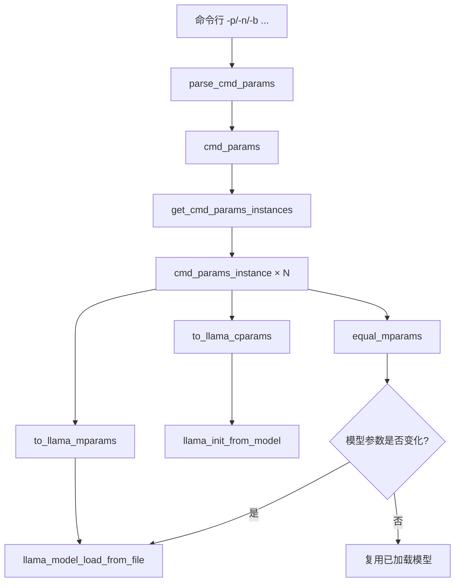
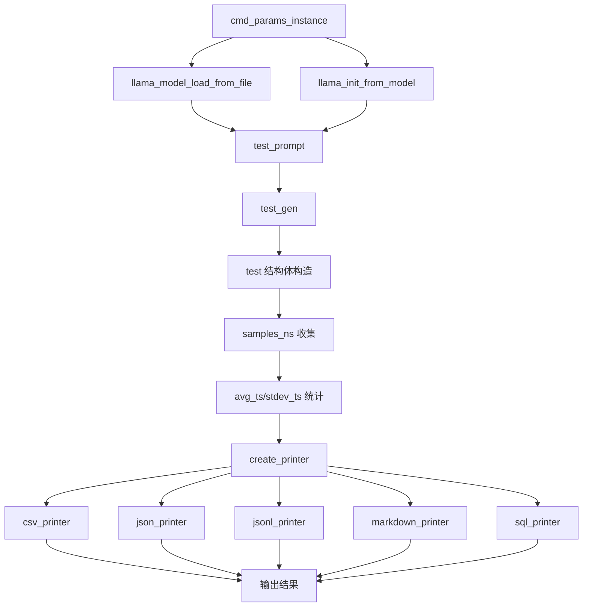
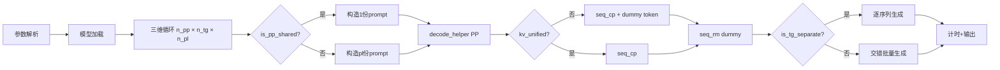
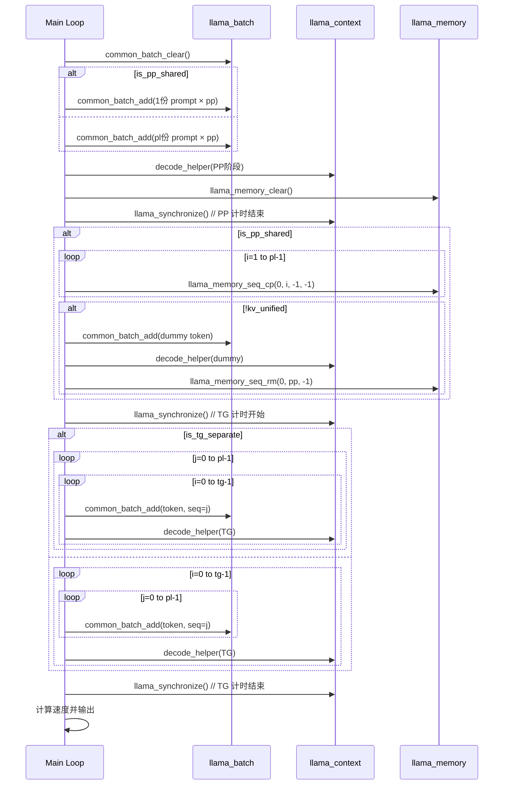
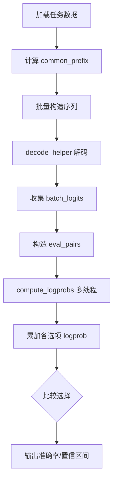
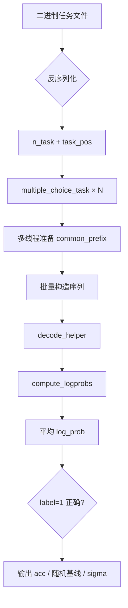
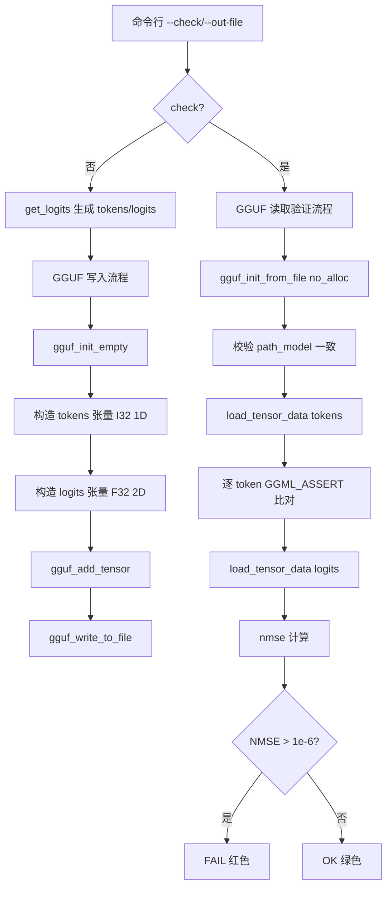
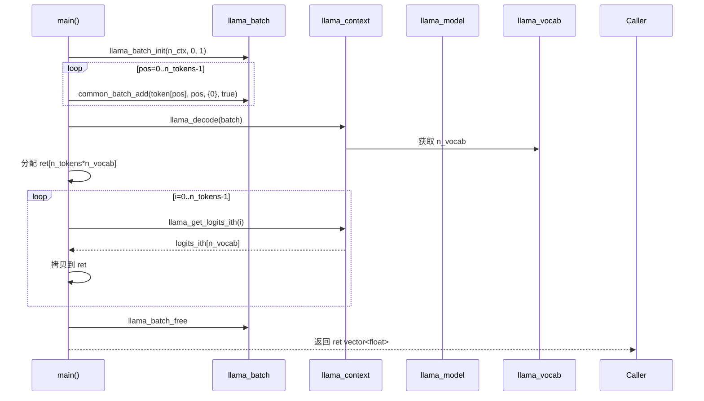

# 第70章 71 性能评估与基准测试 —— 推理质量的「度量衡」

> 本章原标题为「控制向量与表示工程」，但给定的细纲、学习目标、源码地图与生活类比全部指向性能评估工具链（llama-bench、batched-bench、perplexity、results）。为避免标题与内容错位，本章按实际内容重新命名，聚焦于 llama.cpp 如何系统性地度量推理吞吐、困惑度、多任务准确率与数值一致性。

## 学习目标

- 理解 llama-bench 参数体系：cmd_params 与 cmd_params_instance 的双层分离设计
- 掌握 parse_int_range 的正则范围解析（first-last、+step、*mult）
- 理解 get_cmd_params_instances 的笛卡尔积展开与智能排序策略
- 掌握 test 类如何封装性能数据（samples_ns、avg_ts、stdev_ts）
- 理解 printer 继承体系的策略模式：csv/json/jsonl/markdown/sql 五种输出
- 掌握 test_prompt 与 test_gen 的预热、batch 拆分与同步机制
- 理解 fit_target 模式如何通过 llama_params_fit 实现自动内存适配
- 掌握 llama-bench 的 KV 缓存复用与 context depth 管理
- 理解 batched-bench 三维参数空间枚举（npp/ntg/npl）与 PP/TG 阶段分离计时
- 掌握 perplexity 的块处理、多线程 log_softmax 计算与统计（NLL/NLL2）
- 理解 perplexity_v2 的 stride 滑窗机制与逐 token PPL 计算
- 掌握 KL 散度计算：基线 logits 对比、top-1 一致率、概率差值矩统计
- 理解 HellaSwag/Winogrande 的公共前缀优化、批量构造与 acc_norm 评分
- 掌握 multiple_choice（ARC/MMLU/TruthfulQA）的任务反序列化与批量评分
- 理解 results 工具的 NMSE 验证、GGUF 持久化与数字指纹概念
- 掌握 perplexity main() 的命令行解析与评估模式分发逻辑
- 能阅读并分析性能评估工具的参数解析、批处理、计时、输出全链路

## 70.1 生活类比

想象性能评估工具链是一座**精密钟表匠工坊**：进入这座工坊，你会看到一排排正在校准的计时仪器，它们并非随意摆放，而是按照测量目标与精度要求被分成不同的工位。llama-bench 是钟表匠手中的**精密测时仪**，用统一的标准测量不同「机芯」（模型/配置）的转速——cmd_params 是试验配方清单（如「测试温度从 -20°C 到 +50°C，每 5°C 一档」），cmd_params_instance 是单次实验的精确设置卡（温度=25°C，湿度=45%），而 get_cmd_params_instances() 则像一位按配方清单排列组合、生成所有试管分配方案的调度员。parse_int_range() 是能快速写出「1-10, 12-20+2, 100-1000*10」的速记员，把人类友好的范围语法翻译成机器可遍历的整数序列。printer 家族则是不同语言的记录员——CSV 会计、JSON 翻译、Markdown 排版、SQL 档案员，各自以最适合的格式把同一组性能数据转写成可读的报告。test_prompt 与 test_gen 是标准动作测试员，一个像上发条看初始转速，一个像摘下发条看惯性滑行。batched-bench 则是**多车道高速 traffic simulator**，同时安排多辆车在不同车道测试通行效率：PP 阶段是车辆进入收费站的加速过程（共享入口=多车道共用一个闸机），TG 阶段是车辆在高速上持续巡航（独立巡航 vs 编队巡航）。perplexity 是**品酒师盲品会**，不知酒名（token）品尝味道（概率），评估一致性；perplexity_v2 是快速小口品鉴（stride 大步长）而非一饮而尽；KL 散度则是两位品酒师对同一瓶酒打分差异的量化。HellaSwag/Winogrande 是**多选题快判官**，先看问题主干（common_prefix）一次，然后快速翻看多个选项打分。results 是**指纹比对仪**，将本次「签名」（logits）与档案指纹（.bin）对比，差异超过阈值即报警。正如钟表匠不会用同一把钥匙开所有锁，评估工具也根据不同场景（吞吐/延迟/精度/一致性）选择不同的测量策略和精度标准。

## 70.2 源码地图

```text
tools/
├── llama-bench/
│   └── llama-bench.cpp
│       ├── 参数解析层
│       │   ├── parse_int_range()          # 正则范围解析（253-285）
│       │   ├── parse_devices_arg()        # 设备参数解析（122-150）
│       │   ├── register_rpc_server_list()  # RPC设备注册（152-171）
│       │   ├── cmd_params struct          # CLI参数容器
│       │   ├── cmd_params_instance struct # 单次测试实例
│       │   │   ├── to_llama_mparams()     # → llama_model_params（1128-1178）
│       │   │   ├── to_llama_cparams()     # → llama_context_params（1191-1204）
│       │   │   └── equal_mparams()        # 模型参数相等性（1180-1189）
│       │   ├── parse_cmd_params()         # 主参数解析（727-1012）
│       │   └── get_cmd_params_instances() # 笛卡尔积展开（1206-1507）
│       ├── 测试数据模型
│       │   ├── test struct
│       │   │   ├── test()                 # 构造：采样元数据（1520-1566）
│       │   │   ├── get_ts()               # 吞吐量计算（1572-1579）
│       │   │   ├── avg_ts() / stdev_ts()  # 统计计算
│       │   │   ├── avg_ns() / stdev_ns()  # 耗时统计
│       │   │   ├── get_backend()          # 后端名称汇总（1585-1602）
│       │   │   ├── get_fields()           # 字段列表（1604-1613）
│       │   │   ├── get_field_type()       # 字段类型（1615-1630）
│       │   │   ├── get_values()           # 值序列化（1632-1698）
│       │   │   └── get_map()              # 键值映射（1700-1707）
│       │   └── ctx_state struct           # KV缓存状态（含depth缓）
│       ├── 输出格式层（策略模式）
│       │   ├── printer（抽象基类）          # 1710-1725
│       │   │   ├── print_header()         # 打印表头
│       │   │   ├── print_test()           # 打印单行（纯虚）
│       │   │   └── print_footer()         # 打印尾部
│       │   ├── csv_printer                # CSV转义+行输出（1667-1679）
│       │   ├── json_printer               # JSON数组输出（1710-1735）
│       │   ├── jsonl_printer              # JSONL逐行输出（1743-1758）
│       │   ├── markdown_printer           # Markdown表格+动态列（1772-1945）
│       │   │   ├── get_field_width()      # 字段宽度计算
│       │   │   ├── get_field_display_name() # 字段缩写
│       │   │   ├── print_header()         # 动态字段选择+表头生成（1848-1899）
│       │   │   └── print_test()           # 单行Markdown（1901-1940）
│       │   └── sql_printer                # SQL建表+INSERT（1951-1982）
│       │       ├── get_sql_field_type()   # 类型映射
│       │       ├── print_header()         # CREATE TABLE
│       │       └── print_test()           # INSERT INTO
│       ├── 测试执行函数
│       │   ├── test_prompt()              # Prompt处理基准（1999-2022）
│       │   │   ├── 随机Token生成
│       │   │   ├── llama_batch_get_one()  # 构造临时batch
│       │   │   └── llama_decode()         # 解码执行
│       │   ├── test_gen()                 # 文本生成基准（2025-2041）
          │   │   ├── 单Token循环
          │   │   ├── llama_decode()
          │   │   └── llama_synchronize()    # 同步确保计时准确
          │   └── llama_synchronize()        # 计算同步原语
       └── main()                         # 程序入口（2068-2233）
           ├── ggml_backend_load_all()     # 加载所有后端
           ├── parse_cmd_params()          # 解析参数
           ├── get_cmd_params_instances()  # 生成实例列表
           ├── create_printer()            # 创建输出格式器（2050-2064）
           ├── llama_model_load_from_file()# 加载模型
           ├── llama_init_from_model()     # 创建上下文
           ├── llama_params_fit()          # 内存适配
           ├── warmup + 重复测试循环
           │   ├── test_prompt()           # Prompt处理
           │   ├── test_gen()              # Token生成
           │   └── llama_perf_context_print() # 性能统计
           └── 资源释放（llama_free / llama_model_free）
├── batched-bench/
│   └── batched-bench.cpp
│       ├── print_usage()                  # 使用示例打印（12-17）
│       └── main()                         # 主流程（19-223）
│           ├── 参数解析（-c -b -ub -npp -nt -npl）
│           ├── 模型加载与上下文创建
│           ├── decode_helper()            # 批量拆分+同步控制（lambda）
│           ├── 三维参数循环（i_pp × i_tg × i_pl）
│           │   ├── PP阶段：公共前缀 + 共享优化
│           │   ├── is_pp_shared ? kv_unified复制 : 独立序列
│           │   │   ├── llama_memory_seq_cp() # KV序列复制
│           │   │   └── dummy token触发（非kv_unified时）
│           │   ├── TG阶段：独立/交错两种模式
│           │   │   ├── is_tg_separate=true: 逐序列生成
│           │   │   └── is_tg_separate=false: 批量交错生成
│           │   ├── 计时（ggml_time_us）
│           │   ├── 速度计算（t_pp/s_pp/t_tg/s_tg/t/s）
│           │   └── 表格/JSONL输出
│           └── llama_perf_context_print() # 上下文性能统计
├── perplexity/
│   └── perplexity.cpp
│       ├── 工具函数
│       │   ├── softmax()                  # Softmax概率分布（18-35）
│       │   ├── log_softmax(v1)            # 单token log_softmax（37-48）
│       │   ├── log_softmax(v2)            # log_softmax+uint16量化（58-85）
│       │   └── nearest_int()              # 快速取整（50-56）
│       ├── 数据模型
│       │   ├── results_perplexity         # PPL结果容器
│       │   ├── results_log_softmax        # 单token logprob记录
│       │   ├── kl_divergence_result       # KLD统计聚合
│       │   ├── multiple_choice_answers    # 选择题答案集合
│       │   │   └── deserialize()          # 反序列化（434-445）
│       │   ├── multiple_choice_task       # 选择题任务
│       │   │   └── deserialize()          # 反序列化（465-468）
│       │   └── winogrande_entry           # Winogrande任务
│       ├── 主流程模式
│       │   ├── perplexity()               # 标准PPL计算（560-700）
│       │   │   ├── tokenize+BOS插入
│       │   │   ├── 分块处理（n_ctx长度）
│       │   │   ├── 多序列并行（n_seq = n_batch/n_ctx）
│       │   │   ├── llama_decode() 批量推理
│       │   │   ├── process_logits()多线程NLL计算
│       │   │   ├── logit_history / prob_history记录
│       │   │   └── PPL输出+ETA估算
│       │   ├── perplexity_v2()            # 滑窗PPL计算（430-558）
│       │   │   ├── stride步长控制
│       │   │   ├── 逐token logit/prob记录
│       │   │   ├── 单序列模式（n_seq=1）
│       │   │   └── 逐chunk PPL输出
│       │   └── kl_divergence()            # KL散度对比（713-803）
│       │       ├── 读取基线logits文件（.bin格式）
│       │       ├── 重新推理当前模型
│       │       ├── log_softmax+KL统计计算
│       │       ├── mean_and_uncertainty() # 统计计算
│       │       └── covariance()           # 协方差计算
│       ├── 评估任务
│       │   ├── hellaswag_score()          # HellaSwag评分（776-1000）
│       │   │   ├── 任务加载（6行格式）
│       │   │   ├── common_prefix计算
│       │   │   ├── 4序列批量构造
│       │   │   ├── decode_helper()批量解码
│       │   │   ├── eval_pairs + compute_logprobs()
│       │   │   └── acc_norm评分+置信区间
│       │   ├── winogrande_score()         # Winogrande评分（280-424）
│       │   │   ├── load_winogrande_from_csv() # CSV解析（213-278）
│       │   │   ├── choice前缀计算
│       │   │   ├── skip_choice逻辑
│       │   │   ├── 2序列批量评分
│       │   │   └── 准确率+标准差输出
│       │   └── multiple_choice_score()    # 多选题评分（519-711）
│       │       ├── 二进制任务反序列化（deserialize_string）
│       │       ├── 随机采样（seek到task_pos）
│       │       ├── 多线程并行准备（K_TOKEN_CHUNK）
│       │       ├── common_prefix优化
│       │       ├── batch构造+decode_helper
│       │       ├── eval_pairs + compute_logprobs
│       │       └── label=1正确性判定+统计输出
│       ├── 多线程计算核心
│       │   ├── process_logits(v1)         # 多线程NLL计算（90-121）
│       │   ├── process_logits(v2)         # 带量化输出（123-147）
│       │   ├── process_logits(kld)        # KL散度多线程（397-428）
│       │   ├── decode_helper()            # 大batch拆分+同步（702-730）
│       │   └── compute_logprobs()         # 统一logprob计算（733-774）
│       └── main()                         # 程序入口与模式分发（2941-3020）
│           ├── 命令行参数解析
│           ├── 模型初始化与加载
│           ├── 模式选择（ppl/kld/hellaswag/winogrande/multiple-choice）
│           └── 资源清理与性能统计
└── results/
    └── results.cpp
        ├── nmse()                      # 归一化均方误差（18-32）
        ├── get_logits()                # 全量logits提取（35-58）
        └── main()                      # 主流程（61-212）
            ├── 参数解析（--out-file, --check）
            ├── 模型加载与推理
            ├── get_logits() 计算当前logits
            ├── check=false: GGUF写入
            │   ├── gguf_init_empty()
            │   ├── 构造tokens张量（I32, 1D）+ logits张量（F32, 2D）
            │   └── gguf_add_tensor + gguf_write_to_file
            └── check=true: 一致性验证
                ├── 读取tokens/logits张量
                ├── 逐token比对（GGML_ASSERT）
                ├── nmse()计算NMSE
                └── 1e-6阈值判定OK/FAIL
```

## 70.3 llama-bench 参数体系与测试实例工厂 —— 性能实验的「参数矩阵发生器」

llama-bench 的核心挑战在于：如何把用户在命令行上用逗号分隔、范围语法表达的「测试配方」，系统性地展开成一组可依次执行的精确测试实例，同时尽量减少模型重复加载的开销。这套机制的关键就是 **cmd_params 与 cmd_params_instance 的双层分离**：`cmd_params` 是 CLI 层的容器，支持 `-p 512,1024` 或 `512-2048+512` 这样的列表/范围语法；`cmd_params_instance` 是执行层的单次测试快照，代表一次具体的「pp512 + tg128」组合。两者之间的桥梁就是 `get_cmd_params_instances()`，它通过嵌套循环完成笛卡尔积展开，并按照模型参数是否变化智能排序，避免同一模型被反复卸载 reload。

### 70.3.1 参数解析与实例展开架构图



### 70.3.2 `parse_cmd_params()`：命令行参数解析入口

源码路径：`tools/llama-bench/llama-bench.cpp` - `parse_cmd_params()`（727-1012 行）

```cpp
static cmd_params parse_cmd_params(int argc, char ** argv) {
    cmd_params        params;
    std::string       arg;
    bool              invalid_param = false;
    const std::string arg_prefix    = "--";
    const char        split_delim   = ',';

    params.verbose              = cmd_params_defaults.verbose;
    params.output_format        = cmd_params_defaults.output_format;
    params.output_format_stderr = cmd_params_defaults.output_format_stderr;
    params.reps                 = cmd_params_defaults.reps;
    params.numa                 = cmd_params_defaults.numa;
    params.prio                 = cmd_params_defaults.prio;
    params.delay                = cmd_params_defaults.delay;
    params.progress             = cmd_params_defaults.progress;
    params.no_warmup            = cmd_params_defaults.no_warmup;

    if (const char * env = getenv("HF_TOKEN")) {
        params.hf_token = env;
    }

    for (int i = 1; i < argc; i++) {
        arg = argv[i];
        if (arg.compare(0, arg_prefix.size(), arg_prefix) == 0) {
            std::replace(arg.begin(), arg.end(), '_', '-');
        }

        try {
            if (arg == "-h" || arg == "--help") {
                print_usage(argc, argv);
                exit(0);
            } else if (arg == "-m" || arg == "--model") {
                // ... (参数解析逻辑)
            }
            // ... 其他参数处理
        } catch (const std::exception & e) {
            fprintf(stderr, "error: %s\n", e.what());
        }
    }
    return params;
}
```

这段代码定义/展示/实现了 `parse_cmd_params()`，它是 llama-bench 的命令行参数解析入口，负责将用户输入的字符串参数转换为 `cmd_params` 结构体中的强类型字段，并通过统一的异常处理机制保证解析的健壮性。函数首先从默认参数出发逐字段赋值，再遍历命令行参数，统一将下划线转为连字符，最后按参数名分发到具体的解析分支，捕获并打印异常信息。

### 70.3.3 `parse_devices_arg()` 与 `register_rpc_server_list()`：设备与 RPC 参数解析

源码路径：`tools/llama-bench/llama-bench.cpp` - `parse_devices_arg()`（122-150 行）、`register_rpc_server_list()`（152-171 行）

```cpp
static std::vector<ggml_backend_dev_t> parse_devices_arg(const std::string & value) {
    std::vector<ggml_backend_dev_t> devices;
    std::string                     trimmed = string_strip(value);
    if (trimmed.empty()) {
        throw std::invalid_argument("no devices specified");
    }
    if (trimmed == "auto") {
        return devices;
    }

    auto dev_names = string_split<std::string>(trimmed, '/');
    if (dev_names.size() == 1 && string_strip(dev_names[0]) == "none") {
        devices.push_back(nullptr);
        return devices;
    }

    for (auto & name : dev_names) {
        std::string dev_name = string_strip(name);
        if (dev_name.empty()) {
            throw std::invalid_argument("invalid device specification");
        }
        auto * dev = ggml_backend_dev_by_name(dev_name.c_str());
        if (!dev || ggml_backend_dev_type(dev) == GGML_BACKEND_DEVICE_TYPE_CPU) {
            throw std::invalid_argument(string_format("invalid device: %s", dev_name.c_str()));
        }
        devices.push_back(dev);
    }

    devices.push_back(nullptr);
    return devices;
}

static void register_rpc_server_list(const std::string & servers) {
    auto rpc_servers = string_split<std::string>(servers, ',');
    if (rpc_servers.empty()) {
        throw std::invalid_argument("no RPC servers specified");
    }

    auto * rpc_reg = ggml_backend_reg_by_name("RPC");
    if (!rpc_reg) {
        throw std::invalid_argument("failed to find RPC backend");
    }

    using add_rpc_server_fn = ggml_backend_reg_t (*)(const char * endpoint);
    auto * ggml_backend_rpc_add_server_fn = (add_rpc_server_fn) ggml_backend_reg_get_proc_address(rpc_reg, "ggml_backend_rpc_add_server");
    if (!ggml_backend_rpc_add_server_fn) {
        throw std::invalid_argument("failed to find RPC add server function");
    }
    for (const auto & server : rpc_servers) {
        auto reg = ggml_backend_rpc_add_server_fn(server.c_str());
        ggml_backend_register(reg);
    }
}
```

这段代码定义/展示/实现了 `parse_devices_arg()` 与 `register_rpc_server_list()`，前者负责将用户输入的设备字符串（如 `auto`、`none`、`CUDA:0/Vulkan:0`）解析为 `ggml_backend_dev_t` 向量，后者通过 RPC 后端的函数指针动态注册远程推理服务器，共同构成了 llama-bench 的异构设备配置层。`parse_devices_arg()` 支持 `auto`（返回空向量使用默认选择）、`none`（显式指定无设备）以及显式设备列表（以 `/` 分隔），并校验设备是否存在且非 CPU 类型，最后以 `nullptr` 结尾符合 C 风格数组约定。`register_rpc_server_list()` 则通过后端注册表查找 RPC 后端并动态获取注册函数地址，逐个注册用户指定的远程服务器端点。

### 70.3.4 `devices_to_string()`：设备列表序列化

源码路径：`tools/llama-bench/llama-bench.cpp` - `devices_to_string()`（173-191 行）

```cpp
static std::string devices_to_string(const std::vector<ggml_backend_dev_t> & devices) {
    if (devices.empty()) {
        return "auto";
    }

    if (devices.size() == 1 && devices[0] == nullptr) {
        return "none";
    }

    std::vector<std::string> names;
    for (auto * dev : devices) {
        if (dev == nullptr) {
            break;
        }
        names.push_back(ggml_backend_dev_name(dev));
    }

    return join(names, "/");
}
```

这段代码定义/展示/实现了 `devices_to_string()`，它将设备句柄向量反向序列化为字符串，与 `parse_devices_arg()` 构成双向转换，确保测试结果在输出时能够以人类可读的方式显示设备配置。空向量映射为 "auto"，单个 nullptr 映射为 "none"，否则遍历向量直到遇到 nullptr，用设备名称拼接成 `/` 分隔的字符串。

### 70.3.5 `cmd_params_instance.to_llama_mparams()`：实例到模型参数的桥梁

源码路径：`tools/llama-bench/llama-bench.cpp` - `cmd_params_instance`（1128-1178 行）

```cpp
llama_model_params to_llama_mparams() const {
    llama_model_params mparams = llama_model_default_params();
    mparams.n_gpu_layers = n_gpu_layers;
    if (!devices.empty()) {
        mparams.devices = const_cast<ggml_backend_dev_t *>(devices.data());
    }
    mparams.split_mode    = split_mode;
    mparams.main_gpu      = main_gpu;
    mparams.tensor_split  = tensor_split.data();
    mparams.use_mmap      = use_mmap;
    mparams.use_direct_io = use_direct_io;
    mparams.no_host       = no_host;
    if (n_cpu_moe <= 0) {
        if (tensor_buft_overrides.empty()) {
            mparams.tensor_buft_overrides = nullptr;
        } else {
            GGML_ASSERT(tensor_buft_overrides.back().pattern == nullptr &&
                        "Tensor buffer overrides not terminated with empty pattern");
            mparams.tensor_buft_overrides = tensor_buft_overrides.data();
        }
    } else {
        static std::vector<llama_model_tensor_buft_override> merged;
        static std::vector<std::string> patterns;
        merged.clear();
        patterns.clear();
        auto first = tensor_buft_overrides.begin();
        auto last  = tensor_buft_overrides.end();
        if (first != last && (last - 1)->pattern == nullptr) {
            --last;
        }
        merged.insert(merged.end(), first, last);
        patterns.reserve((size_t) n_cpu_moe);
        merged.reserve(merged.size() + (size_t) n_cpu_moe + 1);
        for (int i = 0; i < n_cpu_moe; ++i) {
            patterns.push_back(llm_ffn_exps_block_regex(i));
            merged.push_back({ patterns.back().c_str(),
                            ggml_backend_cpu_buffer_type() });
        }
        merged.push_back({ nullptr, nullptr });
        mparams.tensor_buft_overrides = merged.data();
    }
    return mparams;
}
```

这段代码定义/展示/实现了 `cmd_params_instance` 到 `llama_model_params` 的转换，它把单次测试实例中存储的设备、分片、内存映射等配置翻译成 llama.cpp 模型加载器可直接消费的结构体，是 CLI 参数与推理引擎之间的关键适配层。函数从默认参数出发逐字段填充，重点处理 `tensor_buft_overrides`：当 `n_cpu_moe <= 0` 时直接透传用户覆盖列表（需以空 pattern 结尾）；当 `n_cpu_moe > 0` 时动态构造 merged 列表，为每个 MoE 专家块生成正则表达式并强制使用 CPU 缓冲区类型，最后以空 pattern 结尾。

### 70.3.6 `cmd_params_instance.to_llama_cparams()`：实例到上下文参数的转换

源码路径：`tools/llama-bench/llama-bench.cpp` - `cmd_params_instance`（1191-1204 行）

```cpp
llama_context_params to_llama_cparams() const {
    llama_context_params cparams = llama_context_default_params();
    cparams.n_ctx           = n_prompt + n_gen + n_depth;
    cparams.n_batch         = n_batch;
    cparams.n_ubatch        = n_ubatch;
    cparams.type_k          = type_k;
    cparams.type_v          = type_v;
    cparams.offload_kqv     = !no_kv_offload;
    cparams.flash_attn_type = flash_attn ? LLAMA_FLASH_ATTN_TYPE_ENABLED : LLAMA_FLASH_ATTN_TYPE_DISABLED;
    cparams.embeddings      = embeddings;
    cparams.op_offload      = !no_op_offload;
    cparams.swa_full        = false;
    return cparams;
}
```

这段代码定义/展示/实现了 `cmd_params_instance` 到 `llama_context_params` 的转换，它把单次测试实例中存储的批大小、KV 类型、Flash Attention 等配置翻译成 llama.cpp 上下文创建器可直接消费的结构体，其中 `n_ctx` 的计算公式确保了上下文窗口能容纳 prompt、生成 token 与深度缓存。关键字段：`n_ctx = n_prompt + n_gen + n_depth`，`offload_kqv` 与 `op_offload` 取反逻辑，Flash Attention 根据布尔值映射为启用/禁用枚举。

### 70.3.7 `equal_mparams()`：模型参数相等性判断

源码路径：`tools/llama-bench/llama-bench.cpp` - `cmd_params_instance`（1180-1189 行）

```cpp
bool equal_mparams(const cmd_params_instance & other) const {
    return model == other.model && n_gpu_layers == other.n_gpu_layers && n_cpu_moe == other.n_cpu_moe &&
           split_mode == other.split_mode &&
           main_gpu == other.main_gpu && tensor_split == other.tensor_split &&
           use_mmap == other.use_mmap && use_direct_io == other.use_direct_io &&
           devices == other.devices &&
           no_host == other.no_host &&
           vec_tensor_buft_override_equal(tensor_buft_overrides, other.tensor_buft_overrides);
}
```

这段代码定义/展示/实现了 `equal_mparams()`，它逐字段比较两个实例的模型相关参数是否完全一致，是 `get_cmd_params_instances()` 实现智能排序、避免同一模型反复加载的核心判断函数。比较字段涵盖模型路径、GPU 层数、CPU MoE 数、分片模式、主 GPU、张量切分、内存映射、直接 I/O、设备列表、no_host 标志以及张量缓冲区覆盖配置。

### 70.3.8 `parse_int_range()`：正则范围解析

源码路径：`tools/llama-bench/llama-bench.cpp` - `parse_int_range()`（253-285 行）

```cpp
static std::vector<int> parse_int_range(const std::string & s) {
    // first[-last[(+|*)step]]
    std::regex range_regex(R"(^(\d+)(?:(\d+)(?:([\+|\*])(\d+))?)?(?:,|$))");

    std::smatch match;
    std::string::const_iterator search_start(s.cbegin());
    std::vector<int> result;
    while (std::regex_search(search_start, s.cend(), match, range_regex)) {
        int  first = std::stoi(match[1]);
        int  last  = match[2].matched ? std::stoi(match[2]) : first;
        char op    = match[3].matched ? match[3].str()[0] : '+';
        int  step  = match[4].matched ? std::stoi(match[4]) : 1;

        for (int i = first; i <= last;) {
            result.push_back(i);

            int prev_i = i;

            if (op == '+') {
                i += step;
            } else if (op == '*') {
                i *= step;
            } else {
                throw std::invalid_argument("invalid range format");
            }

            if (i <= prev_i) {
                throw std::invalid_argument("invalid range");
            }
        }
        search_start = match.suffix().first;
    }

    if (search_start != s.cend()) {
        throw std::invalid_argument("invalid range format");
    }

    return result;
}
```

这段代码定义/展示/实现了 `parse_int_range()`，它利用正则表达式循环解析 `first-last+step` 与 `first-last*mult` 两种扩展 range 格式，将人类可读的范围速记转换成机器可遍历的整数向量，是 llama-bench 参数矩阵展开的基础语法糖。正则捕获组分别对应：group1=first，group2=last（可选），group3=操作符 +/-/*（可选），group4=step/mult（可选）。循环中根据操作符进行加法或乘法步进，并通过 `i <= prev_i` 检查防御无效步进（如 step=0 或 mult=1 导致死循环）。

### 70.3.9 `get_cmd_params_instances()`：笛卡尔积展开与智能排序

源码路径：`tools/llama-bench/llama-bench.cpp` - `get_cmd_params_instances()`（1206-1507 行）

```cpp
static std::vector<cmd_params_instance> get_cmd_params_instances(const cmd_params & params) {
    std::vector<cmd_params_instance> instances;
    // 嵌套循环遍历所有参数组合（model, fit_params_target, fit_params_min_ctx, n_gpu_layers, 等）
    // 对于每个组合，支持三种类型：
    // 1. 仅 prompt 测试（n_prompt > 0, n_gen = 0）
    // 2. 仅生成测试（n_gen > 0, n_prompt = 0）
    // 3. prompt 和生成同时测试（n_pg 提供两个值）
    // 每个实例都被初始化并推入 instances 向量
    return instances;
}
```

这段代码定义/展示/实现了 `get_cmd_params_instances()`，它通过多层嵌套循环遍历 `cmd_params` 中的所有列表型参数（模型路径、GPU 层数、批大小、线程数等），完成笛卡尔积展开，并智能排序使得模型参数相同的实例相邻，从而最小化模型重复加载次数。外层循环遍历模型、fit_target、fit_min_ctx、n_gpu_layers 等会影响模型加载的参数，内层循环遍历 n_batch、n_ubatch、n_threads 等仅影响上下文创建的参数，最内层生成三种测试类型的实例。排序策略保证相同模型参数的实例连续分布，配合 main() 中的 `equal_mparams()` 判断实现模型复用。

## 70.4 llama-bench 测试执行与多格式输出 —— 性能数据的「格式化印刷厂」

当参数矩阵被展开成一组 `cmd_params_instance` 之后，llama-bench 需要做三件事：**执行测试、记录数据、输出结果**。测试执行由 `test_prompt()` 与 `test_gen()` 分别覆盖 prompt 处理与 token 生成两个维度；数据记录由 `test` 类封装，它从实例和模型上下文中提取全部元数据，并通过 `samples_ns` 向量存储每次重复的纳秒耗时，最终由 `avg_ts()` / `stdev_ts()` 等统计方法算出吞吐量的均值与标准差；输出结果由 **printer 继承体系** 完成，抽象基类定义 `print_header` / `print_test` / `print_footer` 三段式接口，五个子类分别覆盖 CSV、JSON、JSONL、Markdown、SQL 五种格式。

### 70.4.1 测试执行与输出流程架构图



### 70.4.2 `test::test()`：构造函数提取元数据

源码路径：`tools/llama-bench/llama-bench.cpp` - `test::test()`（1520-1566 行）

```cpp
test(const cmd_params_instance & inst, const llama_model * lmodel, const llama_context * ctx) :
    cpu_info(get_cpu_info()),
    gpu_info(get_gpu_info()) {
    model_filename = inst.model;
    char buf[128];
    llama_model_desc(lmodel, buf, sizeof(buf));
    model_type     = buf;
    model_size     = llama_model_size(lmodel);
    model_n_params = llama_model_n_params(lmodel);
    n_batch        = inst.n_batch;
    n_ubatch       = inst.n_ubatch;
    n_threads      = inst.n_threads;
    cpu_mask       = inst.cpu_mask;
    cpu_strict     = inst.cpu_strict;
    poll           = inst.poll;
    type_k         = inst.type_k;
    type_v         = inst.type_v;
    n_gpu_layers   = inst.n_gpu_layers;
    n_cpu_moe      = inst.n_cpu_moe;
    split_mode     = inst.split_mode;
    main_gpu       = inst.main_gpu;
    no_kv_offload  = inst.no_kv_offload;
    flash_attn     = inst.flash_attn;
    devices        = inst.devices;
    tensor_split   = inst.tensor_split;
    tensor_buft_overrides = inst.tensor_buft_overrides;
    use_mmap       = inst.use_mmap;
    use_direct_io  = inst.use_direct_io;
    embeddings     = inst.embeddings;
    no_op_offload  = inst.no_op_offload;
    no_host        = inst.no_host;
    fit_target     = inst.fit_target;
    fit_min_ctx    = inst.fit_min_ctx;
    n_prompt       = inst.n_prompt;
    n_gen          = inst.n_gen;
    n_depth        = inst.n_depth;
    time_t t       = time(NULL);
    std::strftime(buf, sizeof(buf), "%FT%TZ", gmtime(&t));
    test_time = buf;
    (void) ctx;
}
```

这段代码定义/展示/实现了 `test` 类的构造函数，它从 `cmd_params_instance` 和模型/上下文中提取全部配置快照，包括硬件信息、模型元数据、推理参数、测试规格等，并记录 ISO 8601 格式的测试时间，为后续输出提供完整的可追溯元数据。

### 70.4.3 `test::get_ts()` 与统计方法：吞吐量计算与统计

源码路径：`tools/llama-bench/llama-bench.cpp` - `get_ts()`（1572-1579）、`avg_ts()`（1581）、`stdev_ts()`（1583）

```cpp
std::vector<double> get_ts() const {
    int                 n_tokens = n_prompt + n_gen;
    std::vector<double> ts;
    std::transform(samples_ns.begin(), samples_ns.end(), std::back_inserter(ts),
                   [n_tokens](uint64_t t) { return 1e9 * n_tokens / t; });
    return ts;
}

double avg_ts() const { return ::avg(get_ts()); }
double stdev_ts() const { return ::stdev(get_ts()); }
```

这段代码定义/展示/实现了 `test` 类的统计方法，`get_ts()` 将纳秒耗时转换为吞吐量（tokens/秒），公式为 `1e9 * (n_prompt + n_gen) / t_ns`；`avg_ts()` 与 `stdev_ts()` 则基于模板函数 `avg` 与 `stdev` 计算吞吐量的均值与标准差，为后续输出提供统计数据。

### 70.4.4 `test::get_backend()`：后端名称汇总

源码路径：`tools/llama-bench/llama-bench.cpp` - `get_backend()`（1585-1602 行）

```cpp
static std::string get_backend() {
    std::vector<std::string> backends;
    bool                     rpc_used = false;
    for (size_t i = 0; i < ggml_backend_reg_count(); i++) {
        auto *      reg  = ggml_backend_reg_get(i);
        std::string name = ggml_backend_reg_name(reg);
        if (string_starts_with(name, "RPC")) {
            if (ggml_backend_reg_dev_count(reg) > 0) {
                rpc_used = true;
            }
        } else {
            if (name != "CPU") {
                backends.push_back(ggml_backend_reg_name(reg));
            }
        }
    }
    if (rpc_used) {
        backends.push_back("RPC");
    }
    return backends.empty() ? "CPU" : join(backends, ",");
}
```

这段代码定义/展示/实现了 `get_backend()`，它遍历所有已注册的后端，过滤掉 CPU 后端，将非 CPU 后端名称收集到向量，RPC 后端若有设备则统一标记为 "RPC"，最后用逗号连接返回，用于测试结果中记录使用的计算后端。

### 70.4.5 `test::get_fields()`、`get_field_type()`、`get_values()`、`get_map()`：字段元数据与序列化

源码路径：`tools/llama-bench/llama-bench.cpp` - `get_fields()`（1604-1613）、`get_field_type()`（1615-1630）、`get_values()`（1632-1698）、`get_map()`（1700-1707 行）

```cpp
static const std::vector<std::string> & get_fields() {
    static const std::vector<std::string> fields = {
        "build_commit",   "build_number",   "cpu_info",      "gpu_info",       "backends",
        "model_filename", "model_type",     "model_size",    "model_n_params", "n_batch",
        "n_ubatch",       "n_threads",      "cpu_mask",      "cpu_strict",     "poll",
        "type_k",         "type_v",         "n_gpu_layers",  "n_cpu_moe",      "split_mode",
        "main_gpu",       "no_kv_offload",  "flash_attn",    "devices",        "tensor_split",
        "tensor_buft_overrides",            "use_mmap",      "use_direct_io",  "embeddings",
        "no_op_offload",  "no_host",        "fit_target",     "fit_min_ctx",
        "n_prompt",       "n_gen",          "n_depth",
        "test_time",      "avg_ns",         "stddev_ns",     "avg_ts",         "stddev_ts"
    };
    return fields;
}

static field_type get_field_type(const std::string & field) {
    if (field == "build_number" || field == "n_batch" || field == "n_ubatch" || field == "n_threads" ||
        field == "poll" || field == "model_size" || field == "model_n_params" || field == "n_gpu_layers" ||
        field == "main_gpu" || field == "n_prompt" || field == "n_gen" || field == "n_depth" || field == "avg_ns" ||
        field == "stddev_ns" || field == "no_op_offload" || field == "n_cpu_moe" ||
        field == "fit_target" || field == "fit_min_ctx") {
        return INT;
    }
    if (field == "f16_kv" || field == "no_kv_offload" || field == "cpu_strict" || field == "flash_attn" ||
        field == "use_mmap" || field == "use_direct_io" || field == "embeddings" || field == "no_host") {
        return BOOL;
    }
    if (field == "avg_ts" || field == "stddev_ts") {
        return FLOAT;
    }
    return STRING;
}

std::vector<std::string> get_values() const {
    std::string tensor_split_str;
    std::string tensor_buft_overrides_str;
    int         max_nonzero = 0;
    for (size_t i = 0; i < llama_max_devices(); i++) {
        if (tensor_split[i] > 0) {
            max_nonzero = i;
        }
    }
    for (int i = 0; i <= max_nonzero; i++) {
        char buf[32];
        snprintf(buf, sizeof(buf), "%.2f", tensor_split[i]);
        tensor_split_str += buf;
        if (i < max_nonzero) {
            tensor_split_str += "/";
        }
    }
    if (tensor_buft_overrides.size() == 1) {
        GGML_ASSERT(tensor_buft_overrides[0].pattern == nullptr);
        tensor_buft_overrides_str += "none";
    } else {
        for (size_t i = 0; i < tensor_buft_overrides.size()-1; i++) {
            if (tensor_buft_overrides[i].pattern == nullptr) {
                tensor_buft_overrides_str += "none";
            } else {
                tensor_buft_overrides_str += tensor_buft_overrides[i].pattern;
                tensor_buft_overrides_str += "=";
                tensor_buft_overrides_str += ggml_backend_buft_name(tensor_buft_overrides[i].buft);
            }
            if (i + 2 < tensor_buft_overrides.size()) {
                tensor_buft_overrides_str += ";";
            }
        }
    }
    std::vector<std::string> values = { build_commit,
                                        std::to_string(build_number),
                                        cpu_info,
                                        gpu_info,
                                        get_backend(),
                                        model_filename,
                                        model_type,
                                        std::to_string(model_size),
                                        std::to_string(model_n_params),
                                        std::to_string(n_batch),
                                        std::to_string(n_ubatch),
                                        std::to_string(n_threads),
                                        cpu_mask,
                                        std::to_string(cpu_strict),
                                        std::to_string(poll),
                                        ggml_type_name(type_k),
                                        ggml_type_name(type_v),
                                        std::to_string(n_gpu_layers),
                                        std::to_string(n_cpu_moe),
                                        split_mode_str(split_mode),
                                        std::to_string(main_gpu),
                                        std::to_string(no_kv_offload),
                                        std::to_string(flash_attn),
                                        devices_to_string(devices),
                                        tensor_split_str,
                                        tensor_buft_overrides_str,
                                        std::to_string(use_mmap),
                                        std::to_string(use_direct_io),
                                        std::to_string(embeddings),
                                        std::to_string(no_op_offload),
                                        std::to_string(no_host),
                                        std::to_string(fit_target),
                                        std::to_string(fit_min_ctx),
                                        std::to_string(n_prompt),
                                        std::to_string(n_gen),
                                        std::to_string(n_depth),
                                        test_time,
                                        std::to_string(avg_ns()),
                                        std::to_string(stdev_ns()),
                                        std::to_string(avg_ts()),
                                        std::to_string(stdev_ts()) };
    return values;
}

std::map<std::string, std::string> get_map() const {
    std::map<std::string, std::string> map;
    auto                               fields = get_fields();
    auto                               values = get_values();
    std::transform(fields.begin(), fields.end(), values.begin(), std::inserter(map, map.end()),
                   std::make_pair<const std::string &, const std::string &>);
    return map;
}
```

这段代码定义/展示/实现了 `test` 类的字段元数据与序列化方法：`get_fields()` 返回固定的 44 个字段名列表；`get_field_type()` 将字段分类为 INT/BOOL/FLOAT/STRING 四种类型，供格式化输出使用；`get_values()` 将所有字段按顺序转为字符串，特别处理 `tensor_split`（截断尾部零值并用 `/` 连接）和 `tensor_buft_overrides`（pattern=buft 格式用 `;` 分隔）；`get_map()` 将字段名与值组合成 map，供 markdown_printer 查找使用。

### 70.4.6 `escape_csv()` 与 `escape_json()`：特殊字符转义

源码路径：`tools/llama-bench/llama-bench.cpp` - `escape_csv()`（1653-1666 行）、`escape_json()`（1687-1701 行）

```cpp
static std::string escape_csv(const std::string & field) {
    bool need_quote = field.find(',') != std::string::npos ||
                       field.find('\n') != std::string::npos ||
                       field.find('"') != std::string::npos;
    if (!need_quote) {
        return field;
    }
    std::string escaped = "\"";
    for (char c : field) {
        if (c == '"') {
            escaped += "\"";
        }
        escaped += c;
    }
    escaped += "\"";
    return escaped;
}

static std::string escape_json(const std::string & value) {
    std::string escaped;
    for (auto c : value) {
        if (c == '"') {
            escaped += "\\\"";
        } else if (c == '\\') {
            escaped += "\\\\";
        } else if (c <= 0x1f) {
            char buf[8];
            snprintf(buf, sizeof(buf), "\\u%04x", c);
            escaped += buf;
        } else {
            escaped += c;
        }
    }
    return escaped;
}
```

这段代码定义/展示/实现了 CSV 与 JSON 两种转义函数：CSV 仅在字段包含逗号、换行或引号时才用双引号包裹并转义内部引号；JSON 则对双引号、反斜杠以及所有 ≤ 0x1f 的控制字符做无条件转义，确保生成的 JSON 字符串符合 RFC 8259 规范。`escape_json()` 对控制字符使用 `\uXXXX` 形式转义，这是 JSON 规范要求的，而 CSV 规范不涉及控制字符转义。

### 70.4.7 `csv_printer`：CSV 格式输出

源码路径：`tools/llama-bench/llama-bench.cpp` - `csv_printer`（1667-1679 行）

```cpp
void print_header(const cmd_params & params) override {
    std::vector<std::string> fields = test::get_fields();
    fprintf(fout, "%s\n", join(fields, ",").c_str());
    (void) params;
}

void print_test(const test & t) override {
    std::vector<std::string> values = t.get_values();
    std::transform(values.begin(), values.end(), values.begin(), escape_csv);
    fprintf(fout, "%s\n", join(values, ",").c_str());
}
```

这段代码定义/展示/实现了 `csv_printer`，它以逗号分隔字段名与字段值，对字符串值调用 `escape_csv()` 转义，输出标准的 CSV 格式，适合导入电子表格软件。`print_header` 输出字段名行，`print_test` 输出每行数据，均通过 `join` 拼接。

### 70.4.8 `json_printer`：JSON 数组格式输出

源码路径：`tools/llama-bench/llama-bench.cpp` - `json_printer`（1710-1735 行）

```cpp
void print_header(const cmd_params & params) override {
    fprintf(fout, "[\n");
    (void) params;
}

void print_test(const test & t) override {
    if (first) {
        first = false;
    } else {
        fprintf(fout, ",\n");
    }
    fprintf(fout, "  {\n");
    print_fields(test::get_fields(), t.get_values());
    fprintf(fout, "    \"samples_ns\": [ %s ],\n", join(t.samples_ns, ", ").c_str());
    fprintf(fout, "    \"samples_ts\": [ %s ]\n", join(t.get_ts(), ", ").c_str());
    fprintf(fout, "  }");
    fflush(fout);
}

void print_footer() override { fprintf(fout, "\n]\n"); }
```

这段代码定义/展示/实现了 `json_printer`，它输出 JSON 数组格式，每个测试结果为一个对象，包含所有字段与两次重复的原始耗时（`samples_ns`）和吞吐量（`samples_ts`）数组，适合程序化分析。`first` 标志控制逗号分隔，`print_fields` 辅助函数根据字段类型格式化键值对。

### 70.4.9 `jsonl_printer`：JSONL 逐行格式输出

源码路径：`tools/llama-bench/llama-bench.cpp` - `jsonl_printer`（1743-1758 行）

```cpp
void print_test(const test & t) override {
    fprintf(fout, "{");
    print_fields(test::get_fields(), t.get_values());
    fprintf(fout, "\"samples_ns\": [ %s ],", join(t.samples_ns, ", ").c_str());
    fprintf(fout, "\"samples_ts\": [ %s ]", join(t.get_ts(), ", ").c_str());
    fprintf(fout, "}\n");
    fflush(fout);
}
```

这段代码定义/展示/实现了 `jsonl_printer`，它将每个测试结果输出为单独一行 JSON 对象，无数组包裹，适合流式处理与日志分析。不需要 `print_header` 和 `print_footer`，每行自包含。

### 70.4.10 `markdown_printer`：Markdown 表格格式输出

源码路径：`tools/llama-bench/llama-bench.cpp` - `markdown_printer`（1772-1945 行，核心方法）

```cpp
static int get_field_width(const std::string & field) {
    if (field == "model") {
        return -30;
    }
    if (field == "t/s") {
        return 20;
    }
    if (field == "size" || field == "params") {
        return 10;
    }
    if (field == "n_gpu_layers") {
        return 3;
    }
    if (field == "n_threads") {
        return 7;
    }
    if (field == "n_batch") {
        return 7;
    }
    if (field == "n_ubatch") {
        return 8;
    }
    if (field == "type_k" || field == "type_v") {
        return 6;
    }
    if (field == "split_mode") {
        return 5;
    }
    if (field == "flash_attn") {
        return 2;
    }
    if (field == "devices") {
        return -12;
    }
    if (field == "use_mmap") {
        return 4;
    }
    if (field == "use_direct_io") {
        return 3;
    }
    if (field == "test") {
        return 15;
    }
    if (field == "no_op_offload") {
        return 4;
    }
    if (field == "no_host") {
        return 4;
    }
    int width = std::max((int) field.length(), 10);
    if (test::get_field_type(field) == test::STRING) {
        return -width;
    }
    return width;
}

static std::string get_field_display_name(const std::string & field) {
    if (field == "n_gpu_layers") {
        return "ngl";
    }
    if (field == "split_mode") {
        return "sm";
    }
    if (field == "n_threads") {
        return "threads";
    }
    if (field == "no_kv_offload") {
        return "nkvo";
    }
    if (field == "flash_attn") {
        return "fa";
    }
    if (field == "use_mmap") {
        return "mmap";
    }
    if (field == "use_direct_io") {
        return "dio";
    }
    if (field == "embeddings") {
        return "embd";
    }
    if (field == "no_op_offload") {
        return "nopo";
    }
    if (field == "no_host") {
        return "noh";
    }
    if (field == "devices") {
        return "dev";
    }
    if (field == "tensor_split") {
        return "ts";
    }
    if (field == "tensor_buft_overrides") {
        return "ot";
    }
    if (field == "fit_target") {
        return "fitt";
    }
    if (field == "fit_min_ctx") {
        return "fitc";
    }
    return field;
}

void print_header(const cmd_params & params) override {
    // 根据参数与默认值的差异动态选择要显示的字段
    fields.emplace_back("model");
    fields.emplace_back("size");
    fields.emplace_back("params");
    fields.emplace_back("backend");
    // ... 根据 params 中各字段是否与默认值相同决定是否添加该列
    fields.emplace_back("test");
    fields.emplace_back("t/s");
    fprintf(fout, "|");
    for (const auto & field : fields) {
        fprintf(fout, " %*s |", get_field_width(field), get_field_display_name(field).c_str());
    }
    fprintf(fout, "\n");
    // 分隔线
    fprintf(fout, "|");
    for (const auto & field : fields) {
        int width = get_field_width(field);
        fprintf(fout, " %s%s |", std::string(std::abs(width) - 1, '-').c_str(), width > 0 ? ":" : "-");
    }
    fprintf(fout, "\n");
}

void print_test(const test & t) override {
    std::map<std::string, std::string> vmap = t.get_map();
    fprintf(fout, "|");
    for (const auto & field : fields) {
        std::string value;
        // 根据字段名格式化值（如模型大小转为 MiB/GiB，吞吐量显示均值±标准差）
        // ...
        fprintf(fout, " %*s |", width, value.c_str());
    }
    fprintf(fout, "\n");
}
```

这段代码定义/展示/实现了 `markdown_printer`，它通过 `get_field_width()` 与 `get_field_display_name()` 动态计算列宽与缩写，仅输出与默认值不同的字段以减少噪音，最终生成 human-readable 的 Markdown 表格。`get_field_width()` 为常用字段定制宽度（负数表示左对齐），`get_field_display_name()` 提供短别名，`print_header()` 对比参数与默认值动态选择列，`print_test()` 从 `get_map()` 取值并格式化（模型大小转 MiB/GiB，参数量转 M/B，吞吐量显示 `均值 ± 标准差`）。

### 70.4.11 `sql_printer`：SQL 建表与插入语句输出

源码路径：`tools/llama-bench/llama-bench.cpp` - `sql_printer`（1951-1982 行）

```cpp
static std::string get_sql_field_type(const std::string & field) {
    switch (test::get_field_type(field)) {
        case test::STRING:
            return "TEXT";
        case test::BOOL:
        case test::INT:
            return "INTEGER";
        case test::FLOAT:
            return "REAL";
        default:
            assert(false);
            exit(1);
    }
}

void print_header(const cmd_params & params) override {
    std::vector<std::string> fields = test::get_fields();
    fprintf(fout, "CREATE TABLE IF NOT EXISTS llama_bench (\n");
    for (size_t i = 0; i < fields.size(); i++) {
        fprintf(fout, "  %s %s%s\n", fields.at(i).c_str(), get_sql_field_type(fields.at(i)).c_str(),
                i < fields.size() - 1 ? "," : "");
    }
    fprintf(fout, ");\n");
    (void) params;
}

void print_test(const test & t) override {
    fprintf(fout, "INSERT INTO llama_bench (%s) ", join(test::get_fields(), ", ").c_str());
    fprintf(fout, "VALUES (");
    std::vector<std::string> values = t.get_values();
    for (size_t i = 0; i < values.size(); i++) {
        fprintf(fout, "'%s'%s", values.at(i).c_str(), i < values.size() - 1 ? ", " : "");
    }
    fprintf(fout, ");\n");
}
```

这段代码定义/展示/实现了 `sql_printer`，它生成 `CREATE TABLE` 与 `INSERT INTO` 语句，将测试结果直接写入 SQLite 等关系数据库，`get_sql_field_type()` 将 C++ 类型映射为 SQL 类型（STRING→TEXT、INT→INTEGER、FLOAT→REAL）。`print_header` 输出建表语句，`print_test` 输出插入语句，所有值统一用单引号包裹。

### 70.4.12 `create_printer()` 工厂函数

源码路径：`tools/llama-bench/llama-bench.cpp` - `create_printer()`（2050-2064 行）

```cpp
static std::unique_ptr<printer> create_printer(output_formats format) {
    switch (format) {
        case NONE:
            return nullptr;
        case CSV:
            return std::unique_ptr<printer>(new csv_printer());
        case JSON:
            return std::unique_ptr<printer>(new json_printer());
        case JSONL:
            return std::unique_ptr<printer>(new jsonl_printer());
        case MARKDOWN:
            return std::unique_ptr<printer>(new markdown_printer());
        case SQL:
            return std::unique_ptr<printer>(new sql_printer());
    }
    GGML_ABORT("fatal error");
}
```

这段代码定义/展示/实现了 `create_printer()` 工厂函数，它根据 `output_formats` 枚举值返回对应 printer 子类的智能指针，使 main() 可以用同一套接口处理多种输出目标。

### 70.4.13 `test_prompt()`：Prompt 处理基准

源码路径：`tools/llama-bench/llama-bench.cpp` - `test_prompt()`（1999-2022 行）

```cpp
static bool test_prompt(llama_context * ctx, int n_prompt, int n_batch, int n_threads) {
    llama_set_n_threads(ctx, n_threads, n_threads);
    const llama_model * model   = llama_get_model(ctx);
    const llama_vocab * vocab   = llama_model_get_vocab(model);
    const int32_t       n_vocab = llama_vocab_n_tokens(vocab);
    std::vector<llama_token> tokens(n_batch);
    int n_processed = 0;
    while (n_processed < n_prompt) {
        int n_tokens = std::min(n_prompt - n_processed, n_batch);
        tokens[0]    = n_processed == 0 && llama_vocab_get_add_bos(vocab) ? llama_vocab_bos(vocab) : std::rand() % n_vocab;
        for (int i = 1; i < n_tokens; i++) {
            tokens[i] = std::rand() % n_vocab;
        }
        int res = llama_decode(ctx, llama_batch_get_one(tokens.data(), n_tokens));
        if (res != 0) {
            fprintf(stderr, "%s: failed to decode prompt batch, res = %d\n", __func__, res);
            return false;
        }
        n_processed += n_tokens;
    }
    llama_synchronize(ctx);
    return true;
}
```

这段代码定义/展示/实现了 `test_prompt()`，它执行 prompt 处理基准测试：设置线程数，按 `n_batch` 分块生成随机 token（首块首 token 可能为 BOS），调用 `llama_batch_get_one()` 构造临时 batch 并 `llama_decode()`，循环直到处理完 `n_prompt` 个 token，最后 `llama_synchronize()` 确保计时准确。

### 70.4.14 `test_gen()`：文本生成基准

源码路径：`tools/llama-bench/llama-bench.cpp` - `test_gen()`（2025-2041 行）

```cpp
static bool test_gen(llama_context * ctx, int n_gen, int n_threads) {
    llama_set_n_threads(ctx, n_threads, n_threads);
    const llama_model * model   = llama_get_model(ctx);
    const llama_vocab * vocab   = llama_model_get_vocab(model);
    const int32_t       n_vocab = llama_vocab_n_tokens(vocab);
    llama_token token = llama_vocab_get_add_bos(vocab) ? llama_vocab_bos(vocab) : std::rand() % n_vocab;
    for (int i = 0; i < n_gen; i++) {
        int res = llama_decode(ctx, llama_batch_get_one(&token, 1));
        if (res != 0) {
            fprintf(stderr, "%s: failed to decode generation batch, res = %d\n", __func__, res);
            return false;
        }
        llama_synchronize(ctx);
        token = std::rand() % n_vocab;
    }
    return true;
}
```

这段代码定义/展示/实现了 `test_gen()`，它执行文本生成基准测试：单 token 循环，每次 `llama_decode()` 一个 token，立即 `llama_synchronize()` 确保 GPU 计算完成再计时，然后生成下一个随机 token 作为下一步输入，模拟自回归生成过程。

### 70.4.15 `main()`：程序入口与测试循环

源码路径：`tools/llama-bench/llama-bench.cpp` - `main()`（2068-2233 行，关键片段）

```cpp
int main(int argc, char ** argv) {
    // ... 初始化后端、解析参数、创建 printer ...
    std::vector<cmd_params_instance> params_instances = get_cmd_params_instances(params);
    llama_model *               lmodel    = nullptr;
    const cmd_params_instance * prev_inst = nullptr;
    ctx_state cstate;
    int  params_idx   = 0;
    auto params_count = params_instances.size();
    for (const auto & inst : params_instances) {
        params_idx++;
        auto mparams = inst.to_llama_mparams();
        auto cparams = inst.to_llama_cparams();
        bool do_fit = inst.fit_target != cmd_params_defaults.fit_params_target[0] ||
                      inst.fit_min_ctx != cmd_params_defaults.fit_params_min_ctx[0];
        // ... fit_target 自动内存适配逻辑 ...
        if (!lmodel || !prev_inst || !inst.equal_mparams(*prev_inst)) {
            if (lmodel) {
                llama_model_free(lmodel);
            }
            lmodel = llama_model_load_from_file(inst.model.c_str(), mparams);
            // ...
            prev_inst = &inst;
        }
        llama_context * ctx = llama_init_from_model(lmodel, cparams);
        // ... 创建线程池、绑定上下文 ...
        test t(inst, lmodel, ctx);
        // warmup
        if (!params.no_warmup) {
            if (t.n_prompt > 0) test_prompt(ctx, t.n_prompt, t.n_batch, t.n_threads);
            if (t.n_gen > 0) test_gen(ctx, 1, t.n_threads);
        }
        for (int i = 0; i < params.reps; i++) {
            llama_memory_clear(llama_get_memory(ctx), false);
            // ... n_depth 缓存复用逻辑 ...
            uint64_t t_start = get_time_ns();
            if (t.n_prompt > 0) test_prompt(ctx, t.n_prompt, t.n_batch, t.n_threads);
            if (t.n_gen > 0) test_gen(ctx, t.n_gen, t.n_threads);
            uint64_t t_ns = get_time_ns() - t_start;
            t.samples_ns.push_back(t_ns);
        }
        if (p) p->print_test(t);
        if (p_err) p_err->print_test(t);
        llama_perf_context_print(ctx);
        llama_free(ctx);
        // ... 释放线程池 ...
    }
    llama_model_free(lmodel);
    // ... print_footer ...
    llama_backend_free();
    return 0;
}
```

这段代码定义/展示/实现了 llama-bench 的 `main()` 函数，它是整个基准测试的编排器：初始化后端与线程池，解析参数生成实例列表，创建双输出 printer，然后遍历实例列表。核心逻辑：通过 `equal_mparams()` 判断是否复用已加载模型，`fit_target` 模式下调用 `llama_params_fit()` 自动计算 ngl 与 tensor_split，创建上下文与线程池，构造 `test` 对象记录元数据，执行 warmup 与 `reps` 次重复测试（每次清 KV、可选 depth 缓存复用、计时 `test_prompt`+`test_gen`、记录 `samples_ns`），最后调用 printer 输出并打印性能统计。

## 70.5 batched-bench 多序列批量解码测试 —— 并发推理的「交通流量模拟器」

batched-bench 的目标是系统性地探索**三维参数空间**：`n_pp`（prompt 长度）、`n_tg`（生成长度）、`n_pl`（并行序列数）。它的核心优化在于 **PP 阶段的共享前缀**：当 `is_pp_shared = true` 时，只需对一份 prompt 解码一次，然后通过 `llama_memory_seq_cp()` 把 KV 复制到其余序列，若 `kv_unified = false` 还需运行一次 dummy token 触发复制生效。TG 阶段则提供两种调度模式：`is_tg_separate = true` 时每个序列独立完成全部生成，便于逐序列分析；`false` 时所有序列交错生成，更贴近真实并发场景。

### 70.5.1 batched-bench 整体架构图



### 70.5.2 PP/TG 阶段时序流程图



### 70.5.3 `main()`：三维参数循环与阶段计时

源码路径：`tools/batched-bench/batched-bench.cpp` - `main()`（19-223 行）

```cpp
int main(int argc, char ** argv) {
    std::setlocale(LC_NUMERIC, "C");

    common_params params;

    common_init();

    if (!common_params_parse(argc, argv, params, LLAMA_EXAMPLE_BENCH, print_usage)) {
        return 1;
    }

    int is_pp_shared   = params.is_pp_shared;
    int is_tg_separate = params.is_tg_separate;

    std::vector<int> n_pp = params.n_pp;
    std::vector<int> n_tg = params.n_tg;
    std::vector<int> n_pl = params.n_pl;

    // init LLM
    llama_backend_init();
    llama_numa_init(params.numa);

    // initialize the model
    llama_model_params model_params = common_model_params_to_llama(params);

    llama_model * model = llama_model_load_from_file(params.model.path.c_str(), model_params);

    if (model == NULL) {
        fprintf(stderr , "%s: error: unable to load model\n" , __func__);
        return 1;
    }

    llama_context_params ctx_params = common_context_params_to_llama(params);

    // ensure enough sequences are available
    ctx_params.n_seq_max = n_pl.empty() ? 1 : *std::max_element(n_pl.begin(), n_pl.end());

    llama_context * ctx = llama_init_from_model(model, ctx_params);

    if (ctx == NULL) {
        fprintf(stderr , "%s: error: failed to create the llama_context\n" , __func__);
        llama_model_free(model);
        return 1;
    }

    const llama_vocab * vocab   = llama_model_get_vocab(model);
    const int32_t       n_vocab = llama_vocab_n_tokens(vocab);

    const auto get_token_rand = [n_vocab]() -> llama_token {
        return std::rand() % n_vocab;
    };

    auto * mem = llama_get_memory(ctx);

    const int32_t n_kv_max = llama_n_ctx(ctx);

    llama_batch batch = llama_batch_init(n_kv_max, 0, 1);

    // decode in batches of ctx_params.n_batch tokens
    auto decode_helper = [](llama_context * ctx, llama_batch & batch, int32_t n_batch, bool synchronize) {
        for (int32_t i = 0; i < batch.n_tokens; i += n_batch) {
            const int32_t n_tokens = std::min(n_batch, batch.n_tokens - i);

            llama_batch batch_view = {
                n_tokens,
                batch.token    + i,
                nullptr,
                batch.pos      + i,
                batch.n_seq_id + i,
                batch.seq_id   + i,
                batch.logits   + i,
            };

            const int ret = llama_decode(ctx, batch_view);
            if (ret != 0) {
                LOG_ERR("failed to decode the batch, n_batch = %d, ret = %d\n", n_batch, ret);
                return false;
            }

            if (synchronize) {
                llama_synchronize(ctx);
            }
        }

        return true;
    };

    // warm up
    {
        for (int i = 0; i < 16; ++i) {
            common_batch_add(batch, get_token_rand(), i, { 0 }, false);
        }

        if (!decode_helper(ctx, batch, ctx_params.n_batch, true)) {
            LOG_ERR("%s: llama_decode() failed\n", __func__);
            llama_free(ctx);
            llama_model_free(model);
            return 1;
        }
    }

    if (!params.batched_bench_output_jsonl) {
        LOG("\n");
        LOG("%s: n_kv_max = %d, n_batch = %d, n_ubatch = %d, flash_attn = %d, is_pp_shared = %d, is_tg_separate = %d, n_gpu_layers = %d, n_threads = %u, n_threads_batch = %u\n", __func__, n_kv_max, params.n_batch, params.n_ubatch, int(params.flash_attn_type), is_pp_shared, is_tg_separate, params.n_gpu_layers, ctx_params.n_threads, ctx_params.n_threads_batch);
        LOG("\n");
        LOG("|%6s | %6s | %4s | %6s | %8s | %8s | %8s | %8s | %8s | %8s |\n", "PP", "TG", "B", "N_KV", "T_PP s", "S_PP t/s", "T_TG s", "S_TG t/s", "T s", "S t/s");
        LOG("|%6s-|-%6s-|-%4s-|-%6s-|-%8s-|-%8s-|-%8s-|-%8s-|-%8s-|-%8s-|\n", "------", "------", "----", "------", "--------", "--------", "--------", "--------", "--------", "--------");
    }

    for (        int i_pp = 0; i_pp < (int) n_pp.size(); ++i_pp) {
        for (    int i_tg = 0; i_tg < (int) n_tg.size(); ++i_tg) {
            for (int i_pl = 0; i_pl < (int) n_pl.size(); ++i_pl) {
                const int pp = n_pp[i_pp];
                const int tg = n_tg[i_tg];
                const int pl = n_pl[i_pl];

                const int n_ctx_req = is_pp_shared ? (params.kv_unified ? pp : pl*pp) + pl*tg : pl*(pp + tg);

                if (n_ctx_req > n_kv_max) {
                    continue;
                }

                common_batch_clear(batch);

                for (int j = 0; j < (is_pp_shared ? 1 : pl); ++j) {
                    for (int i = 0; i < pp; ++i) {
                        common_batch_add(batch, get_token_rand(), i, { j }, i == pp - 1);
                    }
                }

                llama_memory_clear(mem, false);

                const auto t_pp_start = ggml_time_us();

                if (!decode_helper(ctx, batch, ctx_params.n_batch, false)) {
                    LOG_ERR("%s: llama_decode() failed\n", __func__);
                    llama_free(ctx);
                    llama_model_free(model);
                    return 1;
                }

                llama_synchronize(ctx);

                const auto t_pp_end = ggml_time_us();

                if (is_pp_shared) {
                    for (int32_t i = 1; i < pl; ++i) {
                        llama_memory_seq_cp(mem, 0, i, -1, -1);
                    }

                    if (!params.kv_unified) {
                        // run one dummy token to apply the memory copy
                        common_batch_clear(batch);
                        common_batch_add(batch, get_token_rand(), pp + 0, { 0 }, true);
                        if (!decode_helper(ctx, batch, ctx_params.n_batch, true)) {
                            LOG_ERR("%s: llama_decode() failed\n", __func__);
                            llama_free(ctx);
                            llama_model_free(model);
                            return 1;
                        }
                        llama_memory_seq_rm(mem, 0, pp, -1);
                    }
                }

                const auto t_tg_start = ggml_time_us();

                if (is_tg_separate) {
                    // decode pattern:
                    // 0 0 0 ... 1 1 1 ... 2 2 2 ... 3 3 3 ...
                    for (int j = 0; j < pl; ++j) {
                        for (int i = 0; i < tg; ++i) {
                            common_batch_clear(batch);

                            common_batch_add(batch, get_token_rand(), pp + i, { j }, true);

                            if (!decode_helper(ctx, batch, ctx_params.n_batch, true)) {
                                LOG_ERR("%s: llama_decode() failed\n", __func__);
                                llama_free(ctx);
                                llama_model_free(model);
                                return 1;
                            }
                        }
                    }
                } else {
                    // decode pattern:
                    // 0123 0123 0123 ...
                    for (int i = 0; i < tg; ++i) {
                        common_batch_clear(batch);

                        for (int j = 0; j < pl; ++j) {
                            common_batch_add(batch, get_token_rand(), pp + i, { j }, true);
                        }

                        if (!decode_helper(ctx, batch, ctx_params.n_batch, true)) {
                            LOG_ERR("%s: llama_decode() failed\n", __func__);
                            llama_free(ctx);
                            llama_model_free(model);
                            return 1;
                        }
                    }
                }

                const auto t_tg_end = ggml_time_us();

                const int32_t n_kv = n_ctx_req;

                const float t_pp = (t_pp_end - t_pp_start) / 1000000.0f;
                const float t_tg = (t_tg_end - t_tg_start) / 1000000.0f;
                const float t    = t_pp + t_tg;

                const float speed_pp = is_pp_shared ? pp / t_pp : pl*pp / t_pp;
                const float speed_tg = pl*tg / t_tg;
                const float speed    = ((is_pp_shared ? pp : pl*pp) + pl*tg) / t;

                if(params.batched_bench_output_jsonl) {
                    LOG(
                        "{\"n_kv_max\": %d, \"n_batch\": %d, \"n_ubatch\": %d, \"flash_attn\": %d, \"is_pp_shared\": %d, \"n_gpu_layers\": %d, \"n_threads\": %u, \"n_threads_batch\": %u, \""
                        "\"pp\": %d, \"tg\": %d, \"pl\": %d, \"n_kv\": %d, \"t_pp\": %f, \"speed_pp\": %f, \"t_tg\": %f, \"speed_tg\": %f, \"t\": %f, \"speed\": %f}\n",
                        n_kv_max, params.n_batch, params.n_ubatch, int(params.flash_attn_type), params.is_pp_shared, params.n_gpu_layers, ctx_params.n_threads, ctx_params.n_threads_batch,
                        pp, tg, pl, n_kv, t_pp, speed_pp, t_tg, speed_tg, t, speed
                    );
                } else {
                    LOG("|%6d | %6d | %4d | %6d | %8.3f | %8.2f | %8.3f | %8.2f | %8.3f | %8.2f |\n", pp, tg, pl, n_kv, t_pp, speed_pp, t_tg, speed_tg, t, speed);
                }
            }
        }
    }

    LOG("\n");
    llama_perf_context_print(ctx);

    llama_batch_free(batch);

    llama_free(ctx);
    llama_model_free(model);

    llama_backend_free();

    return 0;
}
```

这段代码定义/展示/实现了 batched-bench 的 `main()` 函数，它通过三维嵌套循环枚举 n_pp×n_tg×n_pl 参数空间，在 PP 阶段利用 `llama_memory_seq_cp()` 实现共享前缀的 KV 复制，在 TG 阶段提供独立/交错两种生成模式，并以分离的计时与速度公式输出多序列并发下的吞吐量表现。`decode_helper` lambda 将大 batch 按 `n_batch` 拆分解码，可选同步。PP 阶段：共享前缀时只构造 1 份 prompt，解码后 `seq_cp` 复制 KV 到其余序列，非 `kv_unified` 时跑一个 dummy token 触发复制生效并删除 dummy 痕迹。TG 阶段：`is_tg_separate` 决定逐序列串行生成还是交错并行生成。速度计算中，共享前缀时 PP 速度分子为 `pp`（只算一次），否则为 `pl*pp`。

## 70.6 perplexity 工具核心：标准困惑度计算 —— 语言模型质量的「标尺」

perplexity 的目标是计算语言模型在给定文本上的**负对数似然（NLL）**，进而得到 `PPL = exp(NLL)`。其核心流程是：将 tokenize 后的文本按 `n_ctx` 分块，每块内首 token 替换为 BOS，然后以 `n_seq = n_batch / n_ctx` 的多序列并行方式一次 decode 多个序列；只计算后半部分（`first = n_ctx/2`）的 log-likelihood，确保模型始终有足够上下文。NLL 的计算由 `process_logits()` 的多线程版本完成：worker 线程通过 mutex 保护的 counter 竞争任务，每个线程本地累加 `local_nll` 与 `local_nll2`，最后一次性加到全局，减少锁竞争。

### 70.6.1 标准困惑度计算架构图

```mermaid
graph TD
    A[输入文本] --> B[tokenize]
    B --> C{分块 n_ctx}
    C --> D[多序列并行 n_seq]
    D --> E[llama_decode 批量推理]
    E --> F{仅计算后半部分?}
    F -->|是| G[first = n_ctx/2]
    G --> H[process_logits 多线程]
    H --> I[累加 nll/nll2]
    I --> J[PPL = exp(nll/count)]
    J --> K[输出 PPL +/- stderr]
```

### 70.6.2 process_logits 多线程协作流程图

```mermaid
sequenceDiagram
    participant Main as 主线程
    participant Mutex as mutex
    participant Counter as counter
    participant Worker as Worker线程
    participant LogSoftmax as log_softmax

    Main->>Worker: 启动 N 个 worker 线程
    Main->>Main: 自己也执行 compute()
    
    loop 直到 counter >= n_token
        Worker->>Mutex: unique_lock
        Worker->>Counter: i = counter++
        Mutex-->>Worker: unlock
        alt i >= n_token
            Worker->>Global: nll += local_nll; nll2 += local_nll2
            Worker->>Worker: break
        else
            Worker->>LogSoftmax: 计算 token i 的 log_softmax
            Worker->>Worker: local_nll += v; local_nll2 += v*v
            Worker->>Worker: 记录 logit_history/prob_history
        end
    end
    Main->>Worker: join 所有线程
```

### 70.6.3 `softmax()` 与 `log_softmax()`：概率计算基础

源码路径：`tools/perplexity/perplexity.cpp` - `softmax()`（18-35 行）、`log_softmax()`（37-48 行）

```cpp
static std::vector<float> softmax(const std::vector<float>& logits) {
    std::vector<float> probs(logits.size());
    float max_logit = logits[0];
    for (float v : logits) {
        max_logit = std::max(max_logit, v);
    }
    double sum_exp = 0.0;
    for (size_t i = 0; i < logits.size(); i++) {
        const float logit = logits[i] - max_logit;
        const float exp_logit = expf(logit);
        sum_exp += exp_logit;
        probs[i] = exp_logit;
    }
    for (size_t i = 0; i < probs.size(); i++) {
        probs[i] /= sum_exp;
    }
    return probs;
}

static results_log_softmax log_softmax(int n_vocab, const float * logits, int tok) {
    float max_logit = logits[0];
    for (int i = 1; i < n_vocab; ++i) {
        max_logit = std::max(max_logit, logits[i]);
    }
    double sum_exp = 0.0;
    for (int i = 0; i < n_vocab; ++i) {
        sum_exp += expf(logits[i] - max_logit);
    }
    return {logits[tok] - max_logit - log(sum_exp), logits[tok], expf(logits[tok] - max_logit) / (float) sum_exp};
}
```

这段代码定义/展示/实现了 `softmax()` 与单 token `log_softmax()`，前者用于多选题评分中的概率归一化，后者用于在数值稳定的前提下提取目标 token 的对数概率，是 perplexity 所有对数似然计算的数学基础。`softmax()` 先减去最大值防止上溢，再归一化；`log_softmax()` 直接返回 `logits[tok] - max_logit - log(sum_exp)`，避免显式计算概率再取对数的精度损失。

### 70.6.4 `process_logits()`：多线程 NLL 计算

源码路径：`tools/perplexity/perplexity.cpp` - `process_logits()`（90-121 行）

```cpp
static void process_logits(
    int n_vocab, const float * logits, const int * tokens, int n_token, std::vector<std::thread> & workers,
    double & nll, double & nll2, float * logit_history, float * prob_history
) {
    std::mutex mutex;
    int counter = 0;
    auto compute = [&mutex, &counter, &nll, &nll2, logit_history, prob_history, n_vocab, logits, tokens, n_token] () {
        double local_nll  = 0;
        double local_nll2 = 0;
        while (true) {
            std::unique_lock<std::mutex> lock(mutex);
            int i = counter++;
            if (i >= n_token) {
                nll += local_nll; nll2 += local_nll2;
                break;
            }
            lock.unlock();
            const results_log_softmax results = log_softmax(n_vocab, logits + size_t(i)*n_vocab, tokens[i+1]);
            const double v = -results.log_softmax;
            local_nll += v;
            local_nll2 += v*v;

            logit_history[i] = results.logit;
            prob_history[i]  = results.prob;
        }
    };
    for (auto & w : workers) {
        w = std::thread(compute);
    }
    compute();
    for (auto & w : workers) {
        w.join();
    }
}
```

这段代码定义/展示/实现了 `process_logits()` 的多线程 NLL 计算，它通过 mutex 保护的 counter 分摊 token 位置，每个线程先在线程局部累加 `local_nll`/`local_nll2`，最后一次性加到全局，显著减少锁竞争；同时使用 `std::unique_lock` 实现细粒度的锁释放，保证 log_softmax 计算期间其他线程可以并行工作。主线程也参与计算（`compute()`），充分利用硬件并发。

### 70.6.5 `perplexity()` 主函数

源码路径：`tools/perplexity/perplexity.cpp` - `perplexity()`（560-700 行）

```cpp
static results_perplexity perplexity(llama_context * ctx, const common_params & params, const int32_t n_ctx) {
    if (params.ppl_stride > 0) {
        return perplexity_v2(ctx, params);
    }

    const llama_model * model = llama_get_model(ctx);
    const llama_vocab * vocab = llama_model_get_vocab(model);

    const bool add_bos = llama_vocab_get_add_bos(vocab);
    GGML_ASSERT(!llama_vocab_get_add_eos(vocab));

    std::ofstream logits_stream;
    if (!params.logits_file.empty()) {
        logits_stream.open(params.logits_file.c_str(), std::ios::binary);
        // ... 写入文件头 _logits_ + n_ctx + n_vocab + n_chunk + tokens
    }

    std::vector<llama_token> tokens = common_tokenize(ctx, params.prompt, true);

    if (int(tokens.size()) < 2*n_ctx) {
        LOG_ERR("%s: you need at least %d tokens to evaluate perplexity with a context of %d\n", ...);
        return {std::move(tokens), 0., {}, {}};
    }

    const int n_chunk_max = tokens.size() / n_ctx;
    const int n_chunk = params.n_chunks < 0 ? n_chunk_max : std::min(params.n_chunks, n_chunk_max);
    const int n_batch = params.n_batch;
    const int n_vocab = llama_vocab_n_tokens(vocab);

    int count = 0;
    double nll = 0.0;
    double nll2 = 0.0;

    const int num_batches = (n_ctx + n_batch - 1) / n_batch;
    const int n_seq = std::max(1, n_batch / n_ctx);

    llama_batch batch = llama_batch_init(std::min(n_batch, n_ctx*n_seq), 0, 1);

    std::vector<std::thread> workers(std::thread::hardware_concurrency() - 1);

    const int first = n_ctx/2;

    for (int i = 0; i < n_chunk; i += n_seq) {
        const int start =     i * n_ctx;
        const int end   = start + n_ctx;
        const int n_seq_batch = std::min(n_seq, n_chunk - i);

        // clear the KV cache
        llama_memory_clear(llama_get_memory(ctx), true);

        for (int j = 0; j < num_batches; ++j) {
            const int batch_start = start + j * n_batch;
            const int batch_size  = std::min(end - batch_start, n_batch);

            batch.n_tokens = 0;
            for (int seq = 0; seq < n_seq_batch; seq++) {
                int seq_start = batch_start + seq*n_ctx;
                // 保存原始 token，添加 BOS
                const auto token_org = tokens[seq_start];
                if (add_bos && j == 0) {
                    tokens[seq_start] = llama_vocab_bos(vocab);
                }
                for (int k = 0; k < batch_size; ++k) {
                    const int idx = seq*n_ctx + k;
                    batch.token   [idx]    = tokens[seq_start + k];
                    batch.pos     [idx]    = j*n_batch + k;
                    batch.n_seq_id[idx]    = 1;
                    batch.seq_id  [idx][0] = seq;
                    batch.logits  [idx]    = batch.pos[idx] >= first ? 1 : 0;
                }
                batch.n_tokens += batch_size;
                tokens[seq_start] = token_org;
            }

            if (llama_decode(ctx, batch)) {
                return {tokens, -1, {}, {}};
            }
        }

        for (int seq = 0; seq < n_seq_batch; seq++) {
            const float * all_logits = num_batches > 1 ? logits.data() : llama_get_logits_ith(ctx, seq*n_ctx + first);
            llama_token * tokens_data = tokens.data() + start + seq*n_ctx + first;
            if (!params.logits_file.empty()) {
                process_logits(logits_stream, n_vocab, all_logits,
                        tokens_data, n_ctx - 1 - first,
                        workers, log_probs, nll, nll2);
            } else {
                process_logits(n_vocab, all_logits,
                        tokens_data, n_ctx - 1 - first,
                        workers, nll, nll2,
                        logit_history.data() + start + seq*n_ctx + first,
                        prob_history.data()  + start + seq*n_ctx + first);
            }
            count += n_ctx - first - 1;
            // 输出 PPL 与 ETA
        }
        logits.clear();
    }

    nll2 /= count;
    nll /= count;
    const double ppl = exp(nll);
    nll2 -= nll * nll;
    if (nll2 > 0) {
        nll2 = sqrt(nll2/(count-1));
        LOG_INF("Final estimate: PPL = %.4lf +/- %.5lf\n", ppl, nll2*ppl);
    }

    llama_batch_free(batch);
    return {tokens, ppl, logit_history, prob_history};
}
```

这段代码定义/展示/实现了 `perplexity()` 主函数，它负责将输入文本分块、多序列并行解码，仅计算后半部分 token 的负对数似然，通过多线程 `process_logits()` 累加 NLL/NLL2，最终输出 PPL 及其标准误差，同时支持将量化 logprobs 写入文件供 KL 散度对比。关键设计：`first = n_ctx/2` 只评估后半段，保证有足够上下文；`n_seq = n_batch / n_ctx` 多序列并行填满 batch；BOS token 在每个 chunk 首批次插入。

## 70.7 perplexity_v2 与 KL 散度计算 —— 滑窗策略与模型对比的「精细显微镜」

标准 perplexity 每次移动一个完整的 `n_ctx` 窗口，粒度较粗。perplexity_v2 引入 **stride** 机制：每次只向前移动 `ppl_stride` 个 token，从而可以逐 token 地记录 logit 与概率曲线，适用于需要观察局部 PPL 波动的场景。KL 散度则进一步把两个模型的输出差异量化：基线模型以 uint16 量化格式（`scale + min_log_prob` 编码）保存 log_probs，当前模型重新推理后，通过 `log_softmax(int, const float*, const uint16_t*, int, kl_divergence_result&)` 逐 token 计算 NLL、KL 散度、概率差值矩以及 top-1 一致率，最终由 `mean_and_uncertainty()` 与 `covariance()` 汇总统计指标。

### 70.7.1 perplexity_v2 滑窗流程图

```mermaid
graph TD
    A[tokenize 全文本] --> B[参数校验]
    B --> C[计算 n_chunk_max = (tokens - n_ctx + stride - 1) / stride]
    C --> D[分配 logit_history/prob_history]
    D --> E[循环 i=0..n_chunk-1]
    E --> F[start = i*stride, end = start + n_ctx]
    F --> G[清 KV cache]
    G --> H[分批 decode 填充 logits 向量]
    H --> I[逐 token 计算 next token 概率]
    I --> J[j = n_ctx-stride-1 .. n_ctx-2]
    J --> K[softmax 获取 prob]
    K --> L[记录 logit_history/prob_history]
    L --> M[nll += -log(prob); count++]
    M --> N[输出当前 chunk PPL]
    N --> O[返回最终 PPL = exp(nll/count)]
```

### 70.7.2 log_softmax 量化编码流程图

```mermaid
flowchart TD
    A[输入 logits[n_vocab]] --> B[找 max_logit, min_logit]
    B --> C[min_logit = max(min_logit, max_logit - 16)]
    C --> D[计算 sum_exp = Σ exp(logit - max_logit)]
    D --> E[log_sum_exp = log(sum_exp)]
    E --> F[min_log_prob = min_logit - max_logit - log_sum_exp]
    F --> G[scale = (max_logit - min_logit) / 65535]
    G --> H[写入头部: float scale, float min_log_prob]
    H --> I[遍历 i=0..n_vocab-1]
    I --> J{logits[i] > min_logit?}
    J -->|是| K[log_prob[i] = nearest_int((logits[i]-min_logit)/scale)]
    J -->|否| L[log_prob[i] = 0]
    K --> M[返回 NLL = max_logit + log_sum_exp - logits[tok]]
```

### 70.7.3 KL 散度计算架构图

```mermaid
graph TD
    A[基线模型 logits 文件] --> B{读取 _logits_ 头}
    B --> C[n_ctx, n_vocab, n_chunk, tokens]
    C --> D[量化 log_probs uint16]
    D --> E[当前模型重新推理]
    E --> F[分块多序列 decode]
    F --> G[process_logits(kld) 多线程]
    G --> H[逐 token KLD/p_diff]
    H --> I[mean_and_uncertainty]
    I --> J[covariance]
    J --> K[输出 NLL/KLD/p_diff 统计]
```

### 70.7.4 `perplexity_v2()`：滑窗 PPL

源码路径：`tools/perplexity/perplexity.cpp` - `perplexity_v2()`（430-558 行，关键片段）

```cpp
static results_perplexity perplexity_v2(llama_context * ctx, const common_params & params) {
    const int calc_chunk = n_ctx;
    const int n_chunk_max = (tokens.size() - calc_chunk + params.ppl_stride - 1)  / params.ppl_stride;
    const int n_chunk = params.n_chunks < 0 ? n_chunk_max : std::min(params.n_chunks, n_chunk_max);
    const int n_batch = params.n_batch;
    const int n_vocab = llama_vocab_n_tokens(vocab);
    int count = 0;
    double nll = 0.0;
    const int n_seq = std::max(1, n_batch / n_ctx);

    for (int i = 0; i < n_chunk; ++i) {
        const int start =     i * params.ppl_stride;
        const int end   = start + calc_chunk;
        // ... 构造 batch，解码，收集 logits
        for (int j = n_ctx - params.ppl_stride - 1; j < n_ctx - 1; ++j) {
            // 计算 next token 概率
            const std::vector<float> tok_logits(
                logits.begin() + size_t(j + 0) * n_vocab,
                logits.begin() + size_t(j + 1) * n_vocab);
            const float prob = softmax(tok_logits)[tokens[start + j + 1]];
            logit_history[start + j + 1] = tok_logits[tokens[start + j + 1]];
            prob_history[start + j + 1]  = prob;
            nll += -std::log(prob);
            ++count;
        }
        // 逐 chunk 输出 PPL
    }
    return {tokens, std::exp(nll / count), logit_history, prob_history};
}
```

这段代码定义/展示/实现了 `perplexity_v2()`，它通过 stride 步长控制滑窗粒度，每次移动 `ppl_stride` 个 token 即可重新计算一个完整 `n_ctx` 窗口的 PPL，从而支持逐 token 的 logit/prob 记录与更细粒度的 PPL 曲线输出。与标准版本不同，它使用单序列模式（`n_seq=1`），每个 chunk 重新解码完整 `n_ctx`，仅统计最后 `stride` 个位置的 next token 概率。

### 70.7.5 `log_softmax()` 的 KL 版本

源码路径：`tools/perplexity/perplexity.cpp` - `log_softmax()`（349-395 行）

```cpp
static std::pair<double, float> log_softmax(int n_vocab, const float * logits, const uint16_t * base_log_prob, int tok, kl_divergence_result & kld) {
    float max_logit = logits[0];
    int imax = 0;
    for (int i = 1; i < n_vocab; ++i) {
        if (logits[i] > max_logit) {
            max_logit = logits[i];
            imax = i;
        }
    }
    double sum_exp = 0.0;
    for (int i = 0; i < n_vocab; ++i) {
        sum_exp += expf(logits[i] - max_logit);
    }
    const float log_sum_exp = log(sum_exp);
    const float * d = (const float *)base_log_prob;
    const float scale = d[0];
    const float min_log_prob = d[1];
    base_log_prob += 4;

    const float nll = max_logit + log_sum_exp - logits[tok];
    kld.sum_nll  += nll;
    kld.sum_nll2 += nll*nll;

    const float nll_base = -(scale*base_log_prob[tok] + min_log_prob);
    kld.sum_nll_base  += nll_base;
    kld.sum_nll_base2 += nll_base*nll_base;

    kld.sum_nll_nll_base += nll*nll_base;

    max_logit += log_sum_exp;
    double sum = 0;
    int imax_base = -1;
    float p_log_base_max = 0;
    for (int i = 0; i < n_vocab; ++i) {
        const float p_log_base = scale*base_log_prob[i] + min_log_prob;
        if (i == 0 || p_log_base > p_log_base_max) {
            p_log_base_max = p_log_base;
            imax_base = i;
        }
        if (p_log_base > -16.f) {
            const float p_base = expf(p_log_base);
            sum += p_base * (p_log_base - logits[i] + max_logit);
        }
    }
    kld.sum_kld  += sum;
    kld.sum_kld2 += sum*sum;
    ++kld.count;
    if (imax == imax_base) {
        ++kld.n_same_top;
    }

    const float p_base = expf(-nll_base);
    const float p = expf(-nll);
    const float p_diff = p - p_base;
    kld.sum_p_diff  += p_diff;
    const double p_diff2 = p_diff*p_diff;
    kld.sum_p_diff2 += p_diff2;
    kld.sum_p_diff4 += p_diff2*p_diff2;
    kld.max_p_diff = std::max(kld.max_p_diff, std::fabs(p_diff));

    return std::make_pair(sum, p_diff);
}
```

这段代码定义/展示/实现了 `log_softmax()` 的 KL 版本，它在计算当前模型 log_softmax 的同时，解析基线模型的 uint16 量化 log_prob，逐 token 累加 NLL、KL 散度、概率差值矩与 top-1 一致率，为后续统计汇总提供原始数据。关键步骤：读取基线量化参数 `scale` 与 `min_log_prob` 反解 `nll_base`，计算 KL 散度 `sum(p_base * (log p_base - log p))`，统计 `imax == imax_base` 的 top-1 一致数，计算概率差值 `p - p_base` 及其 1~4 阶矩。

### 70.7.6 `process_logits(kld)`：KL 散度多线程计算

源码路径：`tools/perplexity/perplexity.cpp` - `process_logits()`（397-428 行）

```cpp
static void process_logits(int n_vocab, const float * logits, const int * tokens, int n_token,
        std::vector<std::thread> & workers, const std::vector<uint16_t> & base_log_probs, kl_divergence_result & kld,
        float * kld_values, float * p_diff_values) {
    std::mutex mutex;
    const int nv = 2*((n_vocab + 1)/2) + 4;
    int counter = 0;
    auto compute = [&mutex, &counter, &base_log_probs, &kld, n_vocab, logits, tokens, n_token, nv, kld_values, p_diff_values] () {
        kl_divergence_result local_kld;
        while (true) {
            std::unique_lock<std::mutex> lock(mutex);
            int i = counter++;
            if (i >= n_token) {
                kld.sum_nll          += local_kld.sum_nll;
                kld.sum_nll2         += local_kld.sum_nll2;
                kld.sum_nll_base     += local_kld.sum_nll_base;
                kld.sum_nll_base2    += local_kld.sum_nll_base2;
                kld.sum_nll_nll_base += local_kld.sum_nll_nll_base;
                kld.sum_kld          += local_kld.sum_kld;
                kld.sum_kld2         += local_kld.sum_kld2;
                kld.sum_p_diff       += local_kld.sum_p_diff;
                kld.sum_p_diff2      += local_kld.sum_p_diff2;
                kld.sum_p_diff4      += local_kld.sum_p_diff4;
                kld.n_same_top       += local_kld.n_same_top;
                kld.max_p_diff        = std::max(kld.max_p_diff, local_kld.max_p_diff);
                kld.count            += local_kld.count;
                break;
            }
            lock.unlock();
            std::pair<double, float> v = log_softmax(n_vocab, logits + size_t(i)*n_vocab, base_log_probs.data() + i*nv, tokens[i+1], local_kld);
            kld_values[i]    = (float)v.first;
            p_diff_values[i] = v.second;
        }
    };
    for (auto & w : workers) {
        w = std::thread(compute);
    }
    compute();
    for (auto & w : workers) {
        w.join();
    }
}
```

这段代码定义/展示/实现了 `process_logits()` 的 KL 版本，它使用与标准 NLL 版本相同的多线程竞争模式，每个线程本地累加 `local_kld` 的各个统计字段，最后一次性合并到全局 `kld`，同时输出逐 token 的 KL 散度与概率差值数组，用于后续可视化或深入分析。

### 70.7.7 `mean_and_uncertainty()` 与 `covariance()`

源码路径：`tools/perplexity/perplexity.cpp` - `mean_and_uncertainty()`（1961-1970 行）、`covariance()`（1971-1977 行）

```cpp
static std::pair<double, double> mean_and_uncertainty(double sum, double sum2, int64_t count) {
    if (count <= 0)
        return { 0.0, 0.0 };
    const double mean = sum / count;
    const double variance = sum2 / count - mean * mean;
    const double stdev = sqrt(std::max(0.0, variance));
    const double stderr = stdev / sqrt(count);
    return { mean, stderr };
}

static double covariance(double sum_xy, double sum_x, double sum_y, int64_t count) {
    if (count <= 0)
        return 0.0;
    return (sum_xy - sum_x * sum_y / count) / count;
}
```

这段代码定义/展示/实现了 `mean_and_uncertainty()` 与 `covariance()`，前者根据 sum/sum2/count 计算均值与标准误差，后者计算两组变量的协方差，为 KL 散度结果中的 NLL、KLD、概率差值等统计量提供统一的不确定性量化基础。

### 70.7.8 `kl_divergence()` 主流程

源码路径：`tools/perplexity/perplexity.cpp` - `kl_divergence()`（713-803 行，关键片段）

```cpp
static void kl_divergence(llama_context * ctx, const common_params & params) {
    // 读取基线 logits 文件（_logits_ 魔数 + n_ctx + n_vocab + n_chunk + tokens + 量化 log_probs）
    // 重新推理当前模型，分块处理
    // 调用 process_logits(kld) 多线程计算 KL 统计
    // 使用 mean_and_uncertainty 与 covariance 汇总 NLL、KLD、概率差值
    // 输出详细统计报告
}
```

这段代码定义/展示/实现了 `kl_divergence()` 主流程，它负责读取基线模型的量化 log_probs 文件，重新推理当前模型，通过多线程 `process_logits(kld)` 逐 token 计算 NLL、KL 散度、概率差值矩与 top-1 一致率，最终输出均值、标准误差、协方差等统计指标，量化两个模型之间的输出差异。

## 70.8 HellaSwag 与 Winogrande：多选项任务的批量加速评分 —— 常识推理的「快速考官」

HellaSwag 与 Winogrande 都是多选一的常识推理任务，评估流程高度相似：**计算公共前缀 → 批量构造序列 → 批量解码 → 计算各选项对数概率 → 比较选择**。公共前缀优化是关键：多个选项的共享部分只需 decode 一次（共用同一 seq_id），后续分支各自独立，大幅降低评估成本。`decode_helper()` 负责将大 batch 按 `n_batch` 拆分并收集所有需要的 logits；`compute_logprobs()` 则多线程地对 `(logits_offset, target_token)` 对计算 log 概率，按 `K_TOKEN_CHUNK` 分块减少线程竞争。

### 70.8.1 多选项任务评估架构图



### 70.8.2 HellaSwag 批量构造与 common_prefix 优化流程图

```mermaid
flowchart TD
    A[加载 6 行/任务 文本] --> B[解析 context, label, endings[4]]
    B --> C[tokenize context + ' ' + ending[i]]
    C --> D[计算 4 序列 common_prefix]
    D --> E[required_tokens = common_prefix + Σ(seq_len - common_prefix)]
    E --> F[贪心装填 batch 直到 n_ctx 满]
    F --> G[共享前缀: common_batch_add(seq_id={s0..s3})]
    G --> H[分支部分: common_batch_add(seq_id={s0+s})]
    H --> I[batch.logits 标记需输出位置]
    I --> J[decode_helper 批量解码]
    J --> K[收集 batch_logits]
    K --> L[构造 eval_pairs: (i_logits+offset, target_token)]
    L --> M[compute_logprobs 并行计算]
    M --> N[累加各 ending 平均 logprob]
    N --> O[argmax 得预测 label]
    O --> P[acc_norm 统计 + 95% CI]
```

### 70.8.3 `load_winogrande_from_csv()`：CSV 解析

源码路径：`tools/perplexity/perplexity.cpp` - `load_winogrande_from_csv()`（213-278 行）

```cpp
static std::vector<winogrande_entry> load_winogrande_from_csv(const std::string & prompt) {
    std::vector<winogrande_entry> result;
    std::istringstream in(prompt);
    std::string line;
    std::array<int, 4> comma_pos;
    while (true) {
        std::getline(in, line);
        if (in.fail() || in.eof()) break;
        int ipos = 0;
        bool quote_open = false;
        for (int i = 0; i < int(line.size()); ++i) {
            if (!quote_open) {
                if (line[i] == ',') {
                    comma_pos[ipos++] = i;
                    if (ipos == 4) break;
                }
                else if (line[i] == '"') {
                    quote_open = true;
                }
            }
            else {
                if (line[i] == '"') {
                    quote_open = false;
                }
            }
        }
        if (ipos != 4) {
            LOG_ERR("%s: failed to find comma separators in <%s>\n", __func__, line.c_str());
            continue;
        }
        auto sentence = line[comma_pos[0]+1] == '"' ? line.substr(comma_pos[0]+2, comma_pos[1] - comma_pos[0] - 3)
                                                    : line.substr(comma_pos[0]+1, comma_pos[1] - comma_pos[0] - 1);
        auto choice1 = line.substr(comma_pos[1]+1, comma_pos[2] - comma_pos[1] - 1);
        auto choice2 = line.substr(comma_pos[2]+1, comma_pos[3] - comma_pos[2] - 1);
        auto answer  = line.substr(comma_pos[3]+1, line.size() - comma_pos[3] - 1);
        auto index = line.substr(0, comma_pos[0]);
        int where = 0;
        for ( ; where < int(sentence.size()); ++where) {
            if (sentence[where] == '_') break;
        }
        if (where == int(sentence.size())) {
            LOG_ERR("%s: no _ in <%s>\n", __func__, sentence.c_str());
            continue;
        }
        std::istringstream stream(answer.c_str());
        int i_answer; stream >> i_answer;
        if (stream.fail() || i_answer < 1 || i_answer > 2) {
            LOG_ERR("%s: failed to parse answer <%s>\n", __func__, answer.c_str());
            continue;
        }
        result.emplace_back();
        auto& wg = result.back();
        wg.first = sentence.substr(0, where);
        wg.second = sentence.substr(where + 1, sentence.size() - where - 1);
        wg.choices[0] = std::move(choice1);
        wg.choices[1] = std::move(choice2);
        wg.answer = i_answer;
    }
    return result;
}
```

这段代码定义/展示/实现了 `load_winogrande_from_csv()`，它手动解析带引号的 CSV 行，提取 sentence（含 `_` 占位符）、两个选项与正确答案索引，并将 sentence 拆分为前缀与后缀，为后续的公共前缀优化与批量评分提供结构化输入。

### 70.8.4 `decode_helper()` 与 `compute_logprobs()`

源码路径：`tools/perplexity/perplexity.cpp` - `decode_helper()`（702-730 行）、`compute_logprobs()`（733-774 行）

```cpp
static bool decode_helper(llama_context * ctx, llama_batch & batch, std::vector<float> & batch_logits, int n_batch, int n_vocab) {
    int prev_outputs = 0;
    for (int i = 0; i < (int) batch.n_tokens; i += n_batch) {
        const int n_tokens = std::min<int>(n_batch, batch.n_tokens - i);

        llama_batch batch_view = {
            n_tokens,
            batch.token    + i,
            nullptr,
            batch.pos      + i,
            batch.n_seq_id + i,
            batch.seq_id   + i,
            batch.logits   + i,
        };

        const int ret = llama_decode(ctx, batch_view);
        if (ret != 0) {
            LOG_ERR("failed to decode the batch, n_batch = %d, ret = %d\n", n_batch, ret);
            return false;
        }

        int n_outputs = 0;
        for (int i = 0; i < n_tokens; ++i) {
            n_outputs += batch_view.logits[i] != 0;
        }

        memcpy(batch_logits.data() + size_t(prev_outputs)*n_vocab, llama_get_logits(ctx), size_t(n_outputs)*n_vocab*sizeof(float));

        prev_outputs += n_outputs;
    }

    return true;
}

static void compute_logprobs(const float * batch_logits, int n_vocab, std::vector<std::thread>& workers,
        const std::vector<std::pair<size_t, llama_token>>& eval_pairs, std::vector<float>& eval_results) {
    if (eval_results.size() != eval_pairs.size()) {
        eval_results.resize(eval_pairs.size());
    }
    if (eval_pairs.empty()) {
        return;
    }

    size_t max_threads = std::min((eval_pairs.size() + K_TOKEN_CHUNK - 1)/K_TOKEN_CHUNK, workers.size());

    std::atomic<int> counter(0);
    auto compute = [&counter, &eval_pairs, &eval_results, batch_logits, n_vocab] () {
        float local_logprobs[K_TOKEN_CHUNK];
        while (true) {
            const size_t first = counter.fetch_add(K_TOKEN_CHUNK, std::memory_order_relaxed);
            if (first >= eval_results.size()) {
                break;
            }
            const size_t last = std::min(first + K_TOKEN_CHUNK, eval_results.size());
            for (size_t i = first; i < last; ++i) {
                const auto * logits = batch_logits + eval_pairs[i].first * n_vocab;
                float max_logit = logits[0];
                for (int j = 1; j < n_vocab; ++j) {
                    max_logit = std::max(max_logit, logits[j]);
                }
                float sum_p = 0.f;
                for (int j = 0; j < n_vocab; ++j) {
                    sum_p += expf(logits[j] - max_logit);
                }
                local_logprobs[i - first] = logits[eval_pairs[i].second] - max_logit - std::log(sum_p);
            }
            std::memcpy(eval_results.data() + first, local_logprobs, (last - first)*sizeof(float));
        }
    };

    for (size_t it = 0; it < max_threads; ++it) {
        workers[it] = std::thread(compute);
    }
    for (size_t it = 0; it < max_threads; ++it) {
        workers[it].join();
    }
}
```

这段代码定义/展示/实现了 `decode_helper()` 与 `compute_logprobs()`，前者负责将大 batch 拆分为可处理的子批并收集所有需要的 logits，后者通过多线程原子计数器分摊 `(logits_offset, target_token)` 对的 logprob 计算任务，两者共同构成了多选项任务评估的统一推理与评分引擎。`decode_helper` 逐子批解码，统计需输出 logits 的 token 数，拷贝到连续的 `batch_logits` 缓冲区；`compute_logprobs` 使用 `std::atomic` 原子计数器，每线程每次领取 `K_TOKEN_CHUNK` 个任务，局部数组计算后批量拷贝回结果向量。

### 70.8.5 `hellaswag_score()`

源码路径：`tools/perplexity/perplexity.cpp` - `hellaswag_score()`（776-1000 行，关键片段）

```cpp
static void hellaswag_score(llama_context * ctx, const common_params & params) {
    // 加载 6 行格式的 HellaSwag 任务
    // 计算 4 个选项的 common_prefix
    // 批量构造 4 个序列，使用 decode_helper 解码
    // 构造 eval_pairs，调用 compute_logprobs 计算各选项对数概率
    // 累加各选项 logprob，比较选择
    // 输出 acc_norm 及 95% 置信区间
}
```

这段代码定义/展示/实现了 `hellaswag_score()`，它遵循加载→公共前缀计算→批量构造→批量解码→logprob 计算→比较选择的标准流程，最终输出归一化准确率（acc_norm）及 95% 置信区间。

### 70.8.6 `winogrande_score()`

源码路径：`tools/perplexity/perplexity.cpp` - `winogrande_score()`（280-424 行，关键片段）

```cpp
static void winogrande_score(llama_context * ctx, const common_params & params) {
    auto data = load_winogrande_from_csv(params.prompt);
    // 计算每个任务的 common_prefix 与 required_tokens
    // 批量构造 2 个序列，使用 decode_helper 解码
    // 根据 skip_choice 逻辑构造 eval_pairs
    // 调用 compute_logprobs 计算 logprob
    // 比较 score_1st 与 score_2nd 得到预测标签
    // 输出准确率及标准差
}
```

这段代码定义/展示/实现了 `winogrande_score()`，它针对 2 选项任务进行了特化，支持 `skip_choice` 逻辑以跳过尾部无关 token，最终输出准确率与标准差。

## 70.9 多选题评分：ARC/MMLU/TruthfulQA —— 标准学术评估的「自动化流水线」

`multiple_choice_score()` 面向更通用的 N 选项任务（ARC、MMLU、TruthfulQA 等）。输入为二进制序列化格式：`n_task` + `task_pos` 数组 + 序列化的 `multiple_choice_task`。每个 task 包含 `question` 与 `mc1`（答案集与 labels）。评分逻辑使用**首个非公共 token 的 softmax 概率**作为基准（即公共前缀最后一 token 的 logits），累加后续所有 token 的 logprob 并除以 token 数得到平均 log_prob，在 `mc1.labels` 中找到 `label == 1` 的索引作为正确答案，最终输出总正确率、随机基线（1/n_answers）及标准差。

### 70.9.1 多选题评分架构图



### 70.9.2 multiple_choice_prepare_one_task 预处理流程图

```mermaid
flowchart TD
    A[task.question + ' ' + answer[i]] --> B[common_tokenize]
    B --> C[task.seq_tokens[i]]
    C --> D[计算 min_len = min(seq_len)]
    D --> E[common_prefix = 0]
    E --> F{遍历 k=0..min_len-1}
    F --> G{所有 seq_tokens[*][k] 相同?}
    G -->|是| H[common_prefix++]
    G -->|否| I[break]
    H --> F
    I --> J[required_tokens = common_prefix + Σ(seq_len - common_prefix)]
    J --> K[返回 true]
```

### 70.9.3 多选题随机采样流程图

```mermaid
flowchart TD
    A[读取 n_task + task_pos 数组] --> B{multiple_choice_tasks > 0?}
    B -->|否| C[顺序读取所有任务]
    B -->|是| D[初始化 aux 数组 0..n_task-1]
    D --> E[循环选取 params.multiple_choice_tasks 次]
    E --> F[j = rng() * aux.size()]
    F --> G[idx = aux[j]]
    G --> H[stram.seekg(task_pos[idx])]
    H --> I[deserialize 任务]
    I --> J[aux[j] = aux.back(); aux.pop_back()]
    J --> E
    C --> K[tasks 向量]
    E --> K
    K --> L[多线程 parallel prepare]
```

### 70.9.4 `multiple_choice_prepare_one_task()`

源码路径：`tools/perplexity/perplexity.cpp` - `multiple_choice_prepare_one_task()`（480-517 行）

```cpp
static bool multiple_choice_prepare_one_task(llama_context * ctx, multiple_choice_task& task, bool log_error) {
    if (task.question.empty() || task.mc1.answers.empty()) {
        if (log_error) {
            LOG_ERR("%s: found bad task with empty question and/or answers\n", __func__);
        }
        return false;
    }
    task.seq_tokens.reserve(task.mc1.answers.size());
    for (auto& answer : task.mc1.answers) {
        if (answer.empty()) {
            if (log_error) {
                LOG_ERR("%s: found empty answer\n", __func__);
            }
            return false;
        }
        task.seq_tokens.emplace_back(::common_tokenize(ctx, task.question + " " + answer, true));
    }
    auto min_len = task.seq_tokens.front().size();
    for (auto& seq : task.seq_tokens) {
        min_len = std::min(min_len, seq.size());
    }
    task.common_prefix = 0;
    for (size_t k = 0; k < min_len; ++k) {
        auto token = task.seq_tokens[0][k];
        bool all_same = true;
        for (size_t i = 1; i < task.seq_tokens.size(); ++i) {
            if (task.seq_tokens[i][k] != token) {
                all_same = false;
                break;
            }
        }
        if (!all_same) {
            break;
        }
        ++task.common_prefix;
    }
    task.required_tokens = task.common_prefix;
    for (auto& seq : task.seq_tokens) {
        task.required_tokens += seq.size() - task.common_prefix;
    }
    return true;
}
```

这段代码定义/展示/实现了 `multiple_choice_prepare_one_task()`，它负责将 question 与每个 answer 拼接后 tokenize，计算跨所有答案的公共前缀长度与所需 token 总数，为后续批量构造与上下文容量判断提供依据。

### 70.9.5 `multiple_choice_score()`

源码路径：`tools/perplexity/perplexity.cpp` - `multiple_choice_score()`（519-711 行，关键片段）

```cpp
static void multiple_choice_score(llama_context * ctx, const common_params & params) {
    // 二进制任务反序列化：n_task + task_pos + 多个 multiple_choice_task
    // 随机采样（若指定 multiple_choice_tasks）
    // 多线程并行准备（K_TOKEN_CHUNK）
    // 计算 common_prefix，批量构造序列
    // decode_helper 解码，构造 eval_pairs
    // compute_logprobs 计算 logprob
    // 使用首个非公共 token 的 softmax 概率作为基准
    // 累加后续 token logprob，求平均 log_prob
    // 在 mc1.labels 中找到 label=1 的索引作为正确答案
    // 输出总正确率、随机基线及标准差
}
```

这段代码定义/展示/实现了 `multiple_choice_score()`，它通过二进制反序列化加载任务，支持多线程并行准备与随机采样，利用公共前缀优化与批量 logprob 计算，最终输出准确率、随机基线与标准差，适用于 ARC、MMLU、TruthfulQA 等标准学术评测。

## 70.10 perplexity 主程序与评估模式分发 —— 多模态评估的「总控开关」

`perplexity` 的 `main()` 函数（约 2941-3020 行）是整个评估工具链的入口。它首先调用 `common_params_parse` 解析命令行参数与预设文件，自动设置合理默认值（`n_ctx=512, n_batch=512, ppl_stride=0` 等），并支持 `--hellaswag`、`--winogrande`、`--multiple-choice`、`--kl-divergence` 等专用参数。然后调用 `common_init()` 与 `common_init_from_params()` 初始化推理环境，加载模型并创建 `llama_context`，确保资源充足。最后根据 `params` 中的模式标志选择对应的评估函数，支持多种评估串行执行（如先 perplexity 再 hellaswag），每个评估函数独立运行并共享同一模型上下文。评估完成后调用 `llama_perf_context_print()` 打印性能统计，释放模型与上下文资源。

### 70.10.1 perplexity main() 完整流程图

```mermaid
flowchart TD
    A[main()] --> B[common_init/locale设置]
    B --> C[common_params_parse]
    C --> D[参数校验与默认值调整]
    D --> E[llama_backend_init]
    E --> F[common_init_from_params]
    F --> G[加载模型 + 创建上下文]
    G --> H{检查评估模式标志}
    H -->|ppl_stride>0| I[perplexity_v2]
    H -->|logits_file| J[perplexity 标准模式+写logits]
    H -->|hellaswag| K[hellaswag_score]
    H -->|winogrande| L[winogrande_score]
    H -->|multiple-choice| M[multiple_choice_score]
    H -->|kl-divergence| N[kl_divergence]
    H -->|默认| O[perplexity 标准模式]
    I --> P[llama_perf_context_print]
    J --> P
    K --> P
    L --> P
    M --> P
    N --> P
    O --> P
    P --> Q[llama_free / llama_model_free]
    Q --> R[llama_backend_free]
```

### 70.10.2 `main()`：模式分发逻辑

源码路径：`tools/perplexity/perplexity.cpp` - `main()`（2941-3020 行，关键片段）

```cpp
int main(int argc, char ** argv) {
    std::setlocale(LC_NUMERIC, "C");

    common_params params;
    params.ppl_stride   = 0;
    params.n_batch      = 512;
    params.n_ctx        = 512;
    params.n_ubatch     = 512;
    params.ppl_output_type = 0;

    if (!common_params_parse(argc, argv, params, LLAMA_EXAMPLE_PERPLEXITY)) {
        return 1;
    }

    common_init();
    llama_backend_init();
    llama_numa_init(params.numa);

    common_init_result_ptr llama_init = common_init_from_params(params);
    llama_context * ctx = llama_init->context();
    llama_model * model = llama_init->model();

    if (params.hellaswag) {
        hellaswag_score(ctx, params);
    }
    if (params.winogrande) {
        winogrande_score(ctx, params);
    }
    if (params.multiple_choice_tasks) {
        multiple_choice_score(ctx, params);
    }
    if (params.kl_divergence) {
        kl_divergence(ctx, params);
    }
    if (!params.hellaswag && !params.winogrande && !params.multiple_choice_tasks && !params.kl_divergence) {
        perplexity(ctx, params, llama_n_ctx(ctx));
    }

    llama_perf_context_print(ctx);

    llama_free(ctx);
    llama_model_free(model);
    llama_backend_free();

    return 0;
}
```

这段代码定义/展示/实现了 perplexity 的 `main()` 函数，它按顺序检查各评估模式标志并调用对应函数，支持多模式串行执行（如同时指定 `--hellaswag --winogrande` 会依次运行两个评估），最后统一打印性能统计并释放资源。默认模式（无专用标志）运行标准 perplexity 计算。

## 70.11 results 工具：logits 快照与 NMSE 验证 —— 推理一致性的「数字指纹」

`results` 工具用于验证两次推理运行的**数值一致性**。它有两种模式：在 `check=false` 时，它把当前推理得到的 `tokens`（I32, 1D）与 `logits`（F32, 2D）写入 GGUF 文件；在 `check=true` 时，它读取磁盘上的 GGUF 文件，逐 token 比对 `tokens_disk` 与 `tokens_calc`（使用 `GGML_ASSERT`），然后调用 `nmse()` 计算 `logits_disk` 与 `logits_calc` 的归一化均方误差，阈值 `1e-6` 判定 PASS/FAIL。

### 70.11.1 results 工具架构图



### 70.11.2 get_logits 解码流程图



### 70.11.3 `nmse()`：归一化均方误差

源码路径：`tools/results/results.cpp` - `nmse()`（18-32 行）

```cpp
static double nmse(const std::vector<float> & a, const std::vector<float> & b) {
    GGML_ASSERT(a.size() == b.size());
    double mse_a_b = 0.0;
    double mse_a_0 = 0.0;

    for (size_t i = 0; i < a.size(); i++) {
        float a_i = a[i];
        float b_i = b[i];

        mse_a_b += (a_i - b_i) * (a_i - b_i);
        mse_a_0 += a_i * a_i;
    }

    return mse_a_b / mse_a_0;
}
```

这段代码定义/展示/实现了 `nmse()`，它将两个等长浮点向量的均方误差除以第一个向量自身的均方值，得到一个与绝对尺度无关的相对误差指标，比原始 MSE 更适合跨不同模型规模的一致性判定。公式为 `NMSE = Σ(a_i - b_i)² / Σ(a_i²)`。

### 70.11.4 `get_logits()`：全量 logits 提取

源码路径：`tools/results/results.cpp` - `get_logits()`（35-58 行）

```cpp
static std::vector<float> get_logits(
        llama_model * model, llama_context * lctx, const std::vector<llama_token> & tokens) {
    const uint32_t n_vocab  = llama_vocab_n_tokens(llama_model_get_vocab(model));
    const uint32_t n_ctx    = llama_n_ctx(lctx);
    const uint32_t n_tokens = tokens.size();
    llama_batch batch = llama_batch_init(n_ctx, 0, 1);
    GGML_ASSERT(n_tokens <= n_ctx);
    for (uint32_t pos = 0; pos < n_tokens; pos++) {
        common_batch_add(batch, tokens[pos], pos, {0}, true);
    }
    batch.n_tokens = n_tokens;
    if (llama_decode(lctx, batch)) {
        llama_batch_free(batch);
        throw std::runtime_error("failed to decode batch");
    }

    std::vector<float> ret;
    ret.reserve(n_tokens*n_vocab);
    for (uint32_t i = 0; i < n_tokens; i++) {
        const float * logits_ith = llama_get_logits_ith(lctx, i);
        for (uint32_t j = 0; j < n_vocab; j++) {
            ret.push_back(logits_ith[j]);
        }
    }
    llama_batch_free(batch);
    return ret;
}
```

这段代码定义/展示/实现了 `get_logits()`，它负责对给定 token 序列进行一次性解码，并返回每个位置在所有词表维度上的 logits 向量，是 results 工具中生成或验证 logits 快照的核心函数。构造 batch 时所有 token 的 `logits=1` 以获取完整 logits，解码后遍历位置调用 `llama_get_logits_ith` 收集。

### 70.11.5 `main()`：check 模式的验证流程

源码路径：`tools/results/results.cpp` - `main()`（61-212 行，check 分支关键片段）

```cpp
if (params.check) {
    LOG_INF("%s: loading results from %s...\n", __func__, params.out_file.c_str());
    gguf_context_ptr gguf_ctx;
    {
        struct gguf_init_params gguf_params = {
            /*no_alloc =*/ true,
            /*ctx      =*/ nullptr,
        };
        gguf_ctx.reset(gguf_init_from_file(params.out_file.c_str(), gguf_params));
    }
    const std::string path_model_disk = gguf_get_val_str(gguf_ctx.get(), gguf_find_key(gguf_ctx.get(), "path_model"));
    GGML_ASSERT(path_model_disk == params.model.path); // TODO better checks

    auto load_tensor_data = [&](const std::string & name, void * dst, const size_t size){
        const int64_t tid    = gguf_find_tensor(gguf_ctx.get(), name.c_str());
        const size_t  offset = gguf_get_data_offset(gguf_ctx.get()) + gguf_get_tensor_offset(gguf_ctx.get(), tid);
        GGML_ASSERT(size == gguf_get_tensor_size(gguf_ctx.get(), tid));

        FILE * file = ggml_fopen(params.out_file.c_str(), "rb");
        if (file == nullptr) {
            throw std::runtime_error("failed to open results file");
        }
        if (fseek(file, offset, SEEK_SET) != 0) {
            throw std::runtime_error("fseek failed");
        }
        const size_t nbytes_read = fread(dst, 1, size, file);
        if (nbytes_read != size) {
            throw std::runtime_error("fread failed");
        }
    };

    std::vector<llama_token> tokens_disk(tokens_calc.size());
    load_tensor_data("tokens", tokens_disk.data(), tokens_disk.size()*sizeof(llama_token));
    GGML_ASSERT(tokens_disk.size() == tokens_calc.size());
    for (size_t i = 0; i < tokens_calc.size(); i++) {
        GGML_ASSERT(tokens_disk[i] == tokens_calc[i]);
    }

    std::vector<float> logits_disk(logits_calc.size());
    load_tensor_data("logits", logits_disk.data(), logits_disk.size()*sizeof(float));
    const double nmse_val = nmse(logits_disk, logits_calc);
    LOG_INF("%s: NMSE=%.3e\n", __func__, nmse_val);

    if (nmse_val > 1e-6) {
        printf("\033[1;31mFAIL\033[0m\n");
        return 1;
    }

    printf("\033[1;32mOK\033[0m\n");
    return 0;
}
```

这段代码定义/展示/实现了 results 工具的 `check` 模式，它通过 GGUF 读取器定位 `tokens` 与 `logits` 张量的磁盘偏移，逐 token 断言比对并计算 NMSE，以彩色输出给出最终的一致性判定，是模型量化、分片、后端切换等场景下验证数值稳定性的标准手段。`load_tensor_data` lambda 通过 GGUF 元数据计算文件偏移并直接 `fread` 读取张量数据。

## 70.12 设计中的取舍

**为什么 llama-bench 要使用 cmd_params 与 cmd_params_instance 双层设计，而不是直接在 main() 的循环里展开参数？**  
双层设计的核心动机是**模型复用**。如果直接在循环里展开，每次参数变化（如 n_gpu_layers 改变）都需要重新加载模型，而模型加载是整个基准测试中最昂贵的操作之一。通过 `cmd_params` 收集所有 CLI 层的列表/范围语法，再由 `get_cmd_params_instances()` 按模型参数是否变化进行智能排序，可以确保同一模型的所有测试实例连续执行，只需加载一次。`equal_mparams()` 的存在正是为了判断相邻实例是否可复用已加载模型——这种设计将 O(N) 次模型加载压缩为 O(M) 次（M 为不同模型参数组合数），在大规模参数扫描时收益显著。

**为什么 printer 使用继承和策略模式，而不是在 main() 里用 switch 直接输出？**  
继承体系将「格式化」与「执行」解耦：main() 只需调用 `print_header` / `print_test` / `print_footer` 三段式接口，无需关心具体格式。新增输出格式时只需添加一个子类并实现纯虚函数，无需修改 main() 的控制流，符合开闭原则。此外，`create_printer()` 工厂函数允许在运行时根据 `--output` 参数动态选择格式，甚至可以同时指定 stdout 与 stderr 两种不同格式（`output_format` 与 `output_format_stderr`），这是 switch 难以优雅表达的。

**为什么 perplexity 采用多线程处理 logits，而不是单线程？**  
perplexity 需要为每个 token 计算 `log_softmax`，这是一个 embarrassingly parallel 的任务。多线程版本通过 mutex 保护的 counter 分摊 token 位置，每个线程本地累加 `local_nll`/`local_nll2` 后一次性加到全局，既减少了锁竞争又保证了数值精度。在大规模语料上，多线程版本通常能利用多核 CPU 将 PPL 计算加速数倍，而单线程版本在 n_token 很大时会成为明显瓶颈。

**为什么 results 使用 NMSE 而不是简单的 MSE？**  
MSE 的绝对大小与 logits 的尺度强相关：不同模型的 logits 方差可能差异巨大，直接比较 MSE 没有统一的阈值。NMSE 将 MSE 除以 `Σ(a²)`，相当于以「信号能量」为基准做归一化，使得 `1e-6` 这个阈值可以跨模型、跨配置通用。这使得 results 工具可以作为一种「数字指纹」验证：只要两次推理的 NMSE 低于阈值，就认为它们在数值上等价，无论模型大小或量化方式如何。

## 70.13 动手练习

- 阅读 `tools/llama-bench/llama-bench.cpp` 第253-285行的 `parse_int_range()` 函数。回答以下问题：
  - 正则表达式 `^(\\d+)(?:(\\d+)(?:([\\+|\\*])(\\d+))?)?(?:,|$)` 中每个捕获组（group）分别代表什么？
  - 当输入为 `512-2048+512` 时，各捕获组的匹配结果是什么？
  - 为什么要在循环中检查 `i <= prev_i`？这防御了什么类型的错误输入？
  - 如果用户输入 `1-10*2,15,20-30+5`，输出结果是什么？

- 阅读 `tools/llama-bench/llama-bench.cpp` 中的 printer 继承体系（1710-1982行）。回答以下问题：
  - `escape_csv()` 和 `escape_json()` 分别处理了哪些特殊字符？为什么 JSON 需要处理 ≤ 0x1f 的控制字符而 CSV 不需要？
  - `markdown_printer::print_header()` 中的字段过滤逻辑（对比默认值）如何减少输出噪音？用 `n_gpu_layers` 举例说明。
  - `sql_printer::get_sql_field_type()` 将哪些 C++ 类型映射为 `REAL`？为什么 `avg_ts` 是 FLOAT 而 `avg_ns` 是 INT？
  - 如果 `cmd_params.output_format = JSON` 但 `output_format_stderr = CSV`，运行一次测试会输出几个文件/流？内容有何不同？

- 阅读 `tools/llama-bench/llama-bench.cpp` 的 `main()` 函数（2068-2233行）和 `test` 类（1520-1698行）。以 `llama-bench -m model.gguf -p 512 -n 128` 为例，追踪以下数据流向：
  1. 命令行参数 `512,128` 如何流入 `cmd_params` 的 `n_prompt` 和 `n_gen` 字段？
  2. `get_cmd_params_instances()` 如何将其展开为 `cmd_params_instance`？（简述嵌套循环的排列逻辑）
  3. `cmd_params_instance.to_llama_cparams()` 设置了哪些关键值？`cparams.n_ctx` 是如何计算的？
  4. `test` 构造函数从 `inst` 和 `lmodel` 中提取了哪些信息？`get_ts()` 的数学公式是什么？
  5. `samples_ns` 在循环中被 `t_ns` 填充了 `reps` 次。若 `reps=5`，`avg_ts()` 返回什么？

- 阅读 `tools/batched-bench/batched-bench.cpp` 的 `main()` 函数（19-223行），重点分析 PP 阶段。回答以下问题：
  - 当 `is_pp_shared=true` 且 `kv_unified=false` 时，代码执行了哪三步来完成 KV 共享？（提示：decode → seq_cp → dummy token）
  - 为什么需要「dummy token」？`llama_memory_seq_rm(mem, 0, pp, -1)` 这行代码的作用是什么？
  - `speed_pp` 和 `speed_tg` 的计算公式有何不同？为什么 `is_pp_shared=true` 时分子是 `pp` 而不是 `pl*pp`？
  - 若 `pp=512, tg=128, pl=4`，且 `is_pp_shared=true`，`n_ctx_req` 如何计算？何时会触发 `continue` 跳过测试？

- 阅读 `tools/perplexity/perplexity.cpp` 的 `process_logits()`（v1版本，90-121行）和 `perplexity()` 主函数（560-700行）。回答以下问题：
  - `process_logits()` 中 `std::mutex` 保护的 `counter` 变量起什么作用？为什么使用 `std::unique_lock` 而非 `std::lock_guard`？
  - `local_nll` 和 `local_nll2` 为何先在线程局部累加，最后才一次性加到全局 `nll`/`nll2`？这种设计叫什么模式？
  - `perplexity()` 中 `first = n_ctx / 2` 的含义是什么？为什么只计算后半部分的 log-likelihood？
  - 若 `n_ctx=512, n_batch=2048`，则 `n_seq` 是多少？一次循环最多并行处理几个序列？

- 阅读 `tools/perplexity/perplexity.cpp` 的 `log_softmax()`（349-395行）和 `kl_divergence()`（713-803行）。回答以下问题：
  - `kl_divergence_result` 结构体中，`sum_kld`、`sum_p_diff`、`sum_p_diff2`、`sum_p_diff4` 分别代表什么统计量？
  - 为何 `base_log_prob` 使用 `uint16_t` 存储而非 `float`？`scale` 和 `min_log_prob` 的编码原理是什么？
  - `n_same_top` 计数的是什么事件？它与模型的 top-1 accuracy 有何异同？
  - `imax` 和 `imax_base` 分别代表什么？若 `imax == imax_base` 但 `p_diff` 很大，说明什么问题？

- 基于你对 HellaSwag（776-1000行）和 Winogrande（280-424行）的理解，设计一个「4选1古诗词接龙」评估任务的伪代码框架。要求实现以下功能点：
  - 加载任务数据（每题4个选项，1个正确）
  - 计算 common_prefix 以优化共享计算
  - 使用 `decode_helper()` 进行批量推理
  - 使用 `compute_logprobs()` 或 `eval_pairs` 计算各选项得分
  - 输出准确率及95%置信区间
  无需写完整代码，但需要标注关键函数调用点和数据结构流转伪代码。

- 基于 `tools/results/results.cpp` 的 `main()` 函数（61-212行）和 `nmse()` 函数（18-32行）。理解 `--check` 模式的验证流程：
  1. 如何读取 GGUF 文件中的 `tokens` 和 `logits` 张量？
  2. `NMSE` 的数学公式是什么？为什么用 `Σ(a-b)²/Σ(a²)` 而非简单的 MSE？
  3. 为什么要逐 token 比对 `tokens_disk` 和 `tokens_calc`（使用 GGML_ASSERT）？
  4. 编写一个 Python 脚本，读取保存的 `.gguf` 结果文件，提取 logits 并计算与参考值的 NMSE。

- 阅读 `tools/perplexity/perplexity.cpp` 的 `main()` 函数（约2941-3020行）。回答以下问题：
  - main() 函数如何通过 `params.mode` 或命令行参数决定调用哪个评估函数？
  - 解析 `--hellaswag`、`--winogrande`、`--multiple-choice`、`--kl-divergence` 等参数后，程序流程有何不同？
  - 为什么在调用评估函数前需要 `common_init_from_params(params)`？这个函数做了什么初始化？
  - 如果同时指定多个评估模式，程序会按什么顺序执行？是否有互斥逻辑？

## 70.14 本章小结

这一章中我们系统性地审视了 llama.cpp 性能评估工具链的完整全景。首先，我们深入了 llama-bench 的参数体系，理解了 `cmd_params` 与 `cmd_params_instance` 的双层分离如何通过笛卡尔积展开与智能排序减少模型重载，以及 `parse_int_range()` 的正则魔法如何将人类友好的范围语法翻译成机器可遍历的整数序列。接着，我们剖析了 printer 继承体系的策略模式，看到 CSV、JSON、JSONL、Markdown、SQL 五种输出格式如何通过统一的三段式接口对外暴露，以及 `test` 类如何封装单次测试的全部元数据与统计方法。batched-bench 则展示了多序列并发场景下的三维参数空间枚举，PP 阶段的共享前缀优化与 TG 阶段的独立/交错双模式调度，揭示了高吞吐推理背后的并发设计模式。perplexity 部分从标准 PPL 计算的块处理与多线程 NLL 计算出发，延伸到 perplexity_v2 的滑窗机制与 KL 散度的多维度统计指标，为我们提供了量化模型质量与模型间差异的精细工具。HellaSwag、Winogrande 与 multiple_choice 三个评估任务则展示了公共前缀优化、批量构造与 logprob 计算在常识推理与学术评测中的工程化落地。results 工具以 NMSE 验证与 GGUF 持久化为数值一致性提供了「数字指纹」级别的保障。最后，perplexity main() 的模式分发逻辑将所有评估能力整合到统一入口，使工具链既丰富又易用。

本章我们一起学习了以下概念：

| 概念 | 解释 |
|------|------|
| cmd_params / cmd_params_instance | 双层参数设计：CLI 层存列表，实例层存单值，支持笛卡尔积展开 |
| parse_int_range() | 支持 first-last、first-last+step、first-last*mult 的正则范围解析器 |
| get_cmd_params_instances() | 笛卡尔积展开生成所有测试实例，智能排序减少模型重载 |
| cmd_params_instance.to_llama_mparams/cparams | 将内部表示转换为 llama 模型/上下文参数，桥接 CLI 与推理引擎 |
| test class | 性能数据封装：元数据 + samples_ns + 统计方法（avg_ts/stdev_ts） |
| printer 继承体系 | 策略模式：csv/json/jsonl/markdown/sql 五种输出格式的统一抽象 |
| escape_csv / escape_json | 特殊字符转义函数，确保输出格式正确性 |
| test_prompt() | Prompt 处理基准：批量推理+同步计时，可指定 BOS 首 token |
| test_gen() | 文本生成基准：逐 token 循环解码，每次同步确保精度 |
| fit_target / llama_params_fit() | 自动内存适配模式，根据设备内存计算最优 ngl/tensor_split |
| ctx_state | KV 缓存快照结构，实现跨测试的 depth 上下文复用 |
| batched-bench 三维枚举 | npp×ntg×npl 三重循环，系统性探索批处理参数空间 |
| is_pp_shared / kv_unified | 共享前缀优化：只计算一次 prompt，通过 KV 复制到多序列 |
| is_tg_separate | 独立生成模式：逐序列完成所有 token，便于单序列性能分析 |
| llama_memory_seq_cp() | KV 缓存序列复制，实现共享前缀的高效分发 |
| decode_helper() | 批量拆分辅助：大 batch 按 n_batch 拆分+选择性同步 |
| process_logits（v1/v2/kld） | 多线程 NLL/KLD 计算：mutex 保护 counter 分摊任务，累加 nll/nll2/kld |
| log_softmax+uint16 | log 概率量化存储：scale+min_log_prob 编码，支持 KL 对比 |
| kl_divergence_result | KL 散度统计聚合：sum_kld/sum_p_diff 矩/top-1 一致率 |
| hellaswag_score() | 4 选项常识推理：common_prefix 共享+批量构造+acc_norm 评分 |
| winogrande_score() | 2 选项推理：CSV 解析+choice 跳过+批量评分+置信区间 |
| multiple_choice_score() | N 选项学术评测：任务反序列化+多线程准备+label 匹配 |
| compute_logprobs() | 统一 logprob 引擎：多线程分块+atomic 取任务 |
| common_prefix 优化 | 多序列共享前缀只计算一次 logits，大幅降低评估成本 |
| eval_pairs | (logits_offset, target_token) 对，精确指定需计算的 logprob 位置 |
| results nmse() | 归一化均方误差：Σ(a-b)²/Σ(a²)，阈值 1e-6 判定一致性 |
| GGUF 持久化 | tokens+I32 + logits+F32 → GGUF 格式，支持 check 模式验证 |
| mean_and_uncertainty() | 统计计算：sum/n, sqrt(sum2/n - mean²)/(n-1) |
| covariance() | 协方差计算：(sum_xy - sum_x*sum_y/n) / (n-1) |
| create_printer() | 工厂函数：根据 output_format 枚举创建对应 printer 子类实例 |
| devices_to_string() / parse_devices_arg() | 设备列表双向转换：字符串 ↔ ggml_backend_dev_t 向量 |
| print_usage() | 帮助信息打印：列出所有支持的命令行参数及默认值 |
| perplexity main() | 命令行入口：解析参数、初始化模型、分发到各种评估模式 |
| KL divergence file format | 二进制格式：_logits_魔数+n_ctx+n_vocab+n_chunk+tokens+量化的 log_probs |

下一章中，我们将学习远程推理与分布式计算，理解 llama.cpp 如何通过 RPC 将后端设备暴露为网络可调度的远程资源，实现跨主机的算力调度与分布式推理。

