# 第71章 控制向量生成器架构 —— 模型行为的「隐形遥控器」

## 学习目标

- 理解控制向量（Control Vector）的基本原理与「行为调节」机制
- 掌握基于正负提示对的激活差异采集方法
- 熟悉 llama.cpp 回调机制（cb_eval）在隐藏层捕获中的应用
- 理解均值法与 PCA 幂迭代法在降维中的实现与适用场景
- 掌握使用 ggml 构建 PCA 计算图并在 GPU/CPU 后端执行的技巧
- 了解 PCA 参数结构体与结果结构体的设计意图
- 能够将控制向量导出为 GGUF 并在推理时加载应用

## 71.1 生活类比

想象控制向量生成器是一位「行为调音师」，他的工作就像给一架精密的钢琴调音。正负提示对好比两组对照实验——一组是「快乐的演奏」，另一组是「悲伤的演奏」，他让模型分别演奏这两段旋律，然后用灵敏的监听设备（隐藏层捕获）记录下每一次琴弦振动的波形。接着，他把两段波形叠加在一起做差，得到「快乐减悲伤」的净效应信号。这时候他有两个选择：要么把所有反应简单平均（均值法），像个快速但粗糙的调音旋钮；要么用 PCA 幂迭代找到最主要的频率成分（就像调准乐器的基音），把最本质的行为方向提炼出来。最后，他把调好的「行为旋钮」打包成标准配件（GGUF 导出），送到模型的乐器架上。从此以后，模型只要加载这个配件，就能自动偏向你想要的行为——这一切，无需重新调教整架钢琴。

## 71.2 源码地图

```
tools/cvector-generator/cvector-generator.cpp
├── 主流程
│   ├── __main__()
│   ├── print_usage()
│   ├── ctrlvec_load_prompt_file()
│   ├── prepare_entries()
│   ├── get_hidden_layers()
│   ├── export_gguf()
│   └── tokens_to_str()
├── 回调采集
│   ├── callback_data
│   │   ├── save_tensor_for_layer()
│   │   ├── calc_diff()
│   │   ├── filter_nonzero_rows()
│   │   └── reset()
│   └── cb_eval()
├── 训练上下文
│   └── train_context
│       ├── train_context()
│       ├── concat_diff_tmp()
│       └── build_v_diff()
└── 提示对封装
    └── tokenized_prompt
        ├── tokenized_prompt()
        └── padding_seq()

tools/cvector-generator/mean.hpp
├── __main__ (mean namespace)
└── mean.run()

tools/cvector-generator/pca.hpp
├── 调试工具
│   └── print_debug_tensor()
├── PCA 参数与结果
│   ├── pca_params
│   └── pca_result
├── PCA 模型
│   ├── pca_model
│       ├── pca_model()
│       └── ~pca_model()
└── 计算流程
    ├── build_graph_piter()
    ├── compute_piter()
    ├── power_iteration()
    └── run_pca()
```

## 71.3 控制向量生成器总览 —— 核心流水线架构

控制向量（Control Vector）是一种无需重新训练就能调节模型行为的技术。它的核心思想非常朴素：对比同一模型在「正提示」和「负提示」下的隐藏层激活，提取出代表行为方向的向量。比如，你想让模型更「诚实」，就用「诚实的回答」作为正提示、「欺骗的回答」作为负提示，两者在各层的激活差异就编码了「诚实」这个方向。在推理时，把这个向量加到对应层的输出上，模型就会偏向该行为。这就像给模型安装了一个「行为调节器」，无需动权重本身。

整个工具的工作流程可以概括为一条流水线：加载模型 → 读取正负提示对文件 → 逐对推理获取隐藏层输出 → 计算差异 → 降维（PCA 或均值）→ 导出 GGUF。最终生成的 `control_vector.gguf` 可在 llama.cpp 中通过 `--control-vector` 加载使用。

### 71.3.1 `__main__()`：主流程与参数解析

源码路径：`tools/cvector-generator/cvector-generator.cpp` - `__main__()`（第370-428行）

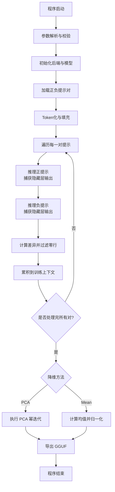

```cpp
int main(int argc, char ** argv) {
    std::setlocale(LC_NUMERIC, "C");                                    // 设置数字格式为C locale，避免小数点逗号问题
    common_params params;                                              // 创建通用参数对象
    params.out_file = "control_vector.gguf";                           // 设置默认输出文件名
    common_init();                                                     // 初始化 common 模块
    if (!common_params_parse(argc, argv, params, LLAMA_EXAMPLE_CVECTOR_GENERATOR, print_usage)) { return 1; }  // 解析命令行参数
    if (params.n_pca_iterations % params.n_pca_batch != 0) {          // 校验 PCA 参数：迭代次数必须是批量大小的倍数
        fprintf(stderr, "PCA iterations must by multiply of PCA batch size\n");
        return 1;
    }
    callback_data cb_data;                                             // 创建回调数据对象，用于收集隐藏层输出
    params.cb_eval = cb_eval;                                          // 将回调函数注册到参数中
    params.cb_eval_user_data = &cb_data;                               // 将回调数据指针传入
    params.warmup = false;                                             // 关闭预热，节省首次推理时间
    print_build_info();                                               // 打印编译信息
    llama_backend_init();                                             // 初始化 GGML 后端
    llama_numa_init(params.numa);                                      // 初始化 NUMA 策略
    auto llama_init = common_init_from_params(params);                 // 根据参数初始化模型和上下文
    auto * model = llama_init->model();                                // 获取模型指针
    auto * ctx   = llama_init->context();                              // 获取上下文指针
    int n_layers = llama_model_n_layer(model);                         // 获取模型层数
    int n_embd = llama_model_n_embd(model);                            // 获取嵌入维度
    char model_hint[128];                                              // 存储模型架构提示
    llama_model_meta_val_str(model, "general.architecture", model_hint, 128);  // 读取模型架构名称
    train_context ctx_train(n_embd, n_layers);                         // 创建训练上下文，管理所有差异数据
    prepare_entries(params, ctx_train);                                // 加载并校验正负提示对文件
    std::vector<tokenized_prompt> tokenized_prompts;                   // 存储所有 token 化后的提示对
    size_t n_total_tokens = 0;                                         // 统计总 token 数
    for (size_t i = 0; i < ctx_train.positive_entries.size(); ++i) {   // 遍历每一对提示
        tokenized_prompt t(ctx, ctx_train.positive_entries[i], ctx_train.negative_entries[i]);  // token 化并填充
        n_total_tokens += 2 * t.max_seq_len;                          // 累加正负提示的 token 数
        tokenized_prompts.push_back(std::move(t));                     // 存入向量
    }
    std::cout << "n_total_tokens: " << n_total_tokens << std::endl;    // 输出总 token 数
    for(size_t i = 0; i < ctx_train.positive_entries.size(); ++i) {    // 逐对推理
        bool success = false;
        tokenized_prompt t = tokenized_prompts[i];                     // 取出第 i 对提示
        cb_data.n_layers = n_layers;                                    // 设置回调数据的层数
        cb_data.n_tokens = t.max_seq_len;                               // 设置当前提示的 token 数（填充后最大长度）
        printf("Evaluating prompt[%d/%d]: \"%s\" - \"%s\" (%d tokens)\n",  // 打印进度
            (int) i+1, (int) ctx_train.positive_entries.size(),
            tokens_to_str(ctx, t.tokens_pos.cbegin(), t.tokens_pos.cend()).c_str(),
            tokens_to_str(ctx, t.tokens_neg.cbegin(), t.tokens_neg.cend()).c_str(),
            (int) t.max_seq_len);
        cb_data.is_eval_pos = true;                                     // 标记当前评估正提示
        success = get_hidden_layers(ctx, t.tokens_pos);                 // 推理正提示，收集隐藏层输出
        if (!success) break;
        cb_data.is_eval_pos = false;                                    // 标记当前评估负提示
        success = get_hidden_layers(ctx, t.tokens_neg);                 // 推理负提示，收集隐藏层输出
        if (!success) break;
        auto v_diff_filtered = cb_data.calc_diff();                     // 计算正负差异并过滤零行
        ctx_train.concat_diff_tmp(v_diff_filtered);                     // 将差异追加到训练上下文
        cb_data.reset();                                                // 清理回调数据，准备下一对
    }
    printf("Done evaluate prompts, unload model...\n");
    bool use_pca = params.cvector_dimre_method == DIMRE_METHOD_PCA;    // 判断是否使用 PCA 降维
    ctx_train.build_v_diff(use_pca);                                    // 构建最终差异矩阵
    if (use_pca) {
        PCA::pca_params pca_params;                                     // 配置 PCA 参数
        pca_params.n_threads    = params.cpuparams.n_threads;
        pca_params.n_batch      = params.n_pca_batch;
        pca_params.n_iterations = params.n_pca_iterations;
        PCA::run_pca(pca_params, ctx_train.v_diff, ctx_train.v_final);  // 执行 PCA 降维
    } else { mean::run(ctx_train.v_diff, ctx_train.v_final); }         // 否则使用均值法
    export_gguf(ctx_train.v_final, params.out_file, model_hint);       // 将控制向量导出为 GGUF
    llama_backend_free();                                               // 释放后端资源
    return 0;
}
```

这段代码定义、展示并实现了控制向量生成器的完整主流程：从命令行参数解析、正负提示对的加载与 token 化，到逐对推理采集隐藏层差异、降维计算，最终将控制向量导出为 GGUF 文件。你注意到它用 `params.cb_eval = cb_eval` 把回调函数注入到 common_params 中，使得每次 `llama_decode` 都能透明地捕获隐藏层输出——这是整个工具与 llama.cpp 引擎对话的唯一通道。注意主循环内部设置 `cb_data.n_tokens = t.max_seq_len` 使用的是填充后的最大序列长度，而非原始提示长度，这在后续 `cb_eval` 的校验中至关重要。

### 71.3.2 PCA 降维整体流程

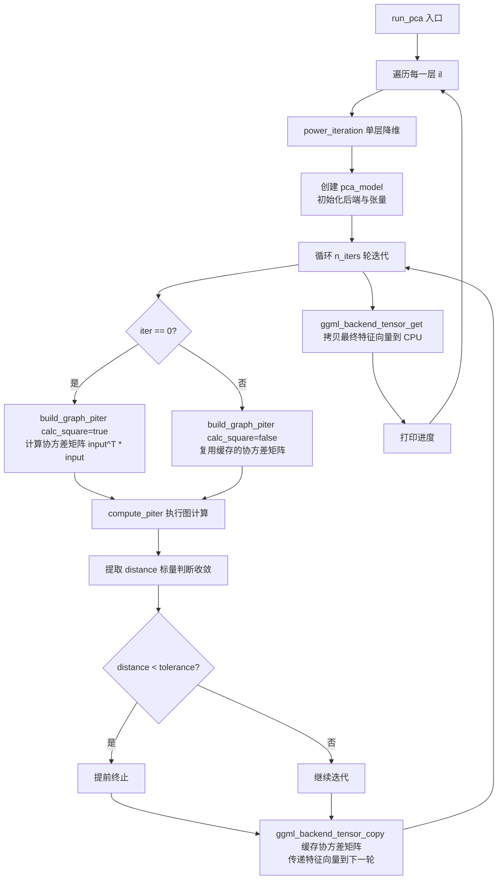

## 71.4 正负提示对管理 —— 构造「对比实验」的输入

控制向量的核心是「差异」：同一层在正提示（如「快乐」）和负提示（如「悲伤」）下的激活值之差。通过多组对比，可以统计出稳定的行为方向。这就要求你为工具提供成对的提示文本——每一对都是一次对照实验。`tokenized_prompt` 就是这批实验的输入封装：它负责把一对正负提示分别 token 化，再用空格 token 把较短的一方填充到相同长度，确保后续矩阵运算的维度对齐。

### 71.4.1 `tokenized_prompt`：提示对的封装与填充

源码路径：`tools/cvector-generator/cvector-generator.cpp` - `tokenized_prompt()`（第273-281行）

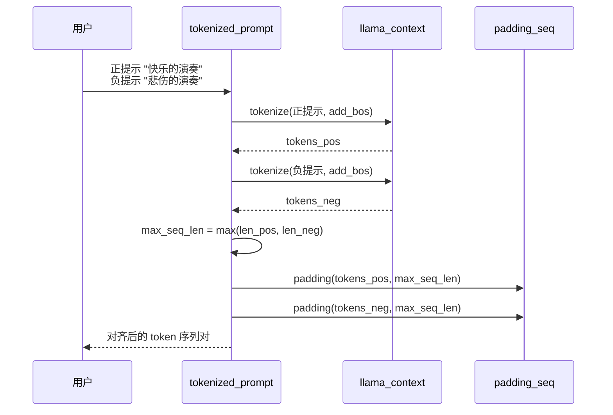

```cpp
tokenized_prompt(llama_context * ctx, std::string pos, std::string neg) {
    const llama_model * model = llama_get_model(ctx);                    // 获取模型指针，用于后续取词表
    const llama_vocab * vocab = llama_model_get_vocab(model);           // 获取模型词表
    const bool add_bos = llama_vocab_get_add_bos(vocab);               // 查询是否需要添加 begin-of-sentence token
    tokens_pos = common_tokenize(ctx, pos, add_bos, true);             // token 化正提示（保留特殊 token）
    tokens_neg = common_tokenize(ctx, neg, add_bos, true);             // token 化负提示（保留特殊 token）
    max_seq_len = std::max(tokens_pos.size(), tokens_neg.size());      // 计算两者中的最大长度
    padding_seq(ctx, tokens_pos, max_seq_len);                         // 将正提示填充到最大长度
    padding_seq(ctx, tokens_neg, max_seq_len);                         // 将负提示填充到最大长度
}
```

这段代码定义并实现了 `tokenized_prompt` 的构造函数：它把正负提示分别 token 化后，统一填充到相同长度，保证后续推理时两个序列的 batch 维度一致。你可能会问：为什么必须等长？因为 `llama_decode` 内部会把一个 batch 里的所有序列当作一个矩阵运算，维度不一致会直接导致计算失败。

### 71.4.2 `padding_seq()`：用空格 token 对齐长度

源码路径：`tools/cvector-generator/cvector-generator.cpp` - `padding_seq()`（第283-289行）

```mermaid
flowchart LR
    A[输入 token 序列] --> B{长度 < 目标长度?}
    B -- 是 --> C[tokenize(' ')]
    C --> D[取最后一个 token 作为 pad_tok]
    D --> E[追加 pad_tok]
    E --> B
    B -- 否 --> F[输出填充后序列]
```

```cpp
void padding_seq(llama_context * ctx, std::vector<llama_token> & tokens, size_t len) {
    std::vector<llama_token> pad_tokens = common_tokenize(ctx, " ", false);  // token 化一个空格（不加 BOS）
    llama_token pad_tok = pad_tokens.back();                                  // 取空格对应的 token 作为填充符
    while (tokens.size() < len) {                                              // 循环补到目标长度
        tokens.push_back(pad_tok);                                            // 尾部追加填充 token
    }
}
```

这段代码实现了 `padding_seq` 函数：它用一个单纯的空格 token 把较短的序列补齐到目标长度。选择空格 token 是有意为之——它是一个「中性」token，几乎不携带语义信息，不会污染模型对提示内容的编码，同时又能占据位置让 batch 维度对齐。

### 71.4.3 `prepare_entries()`：提示对的加载与校验

源码路径：`tools/cvector-generator/cvector-generator.cpp` - `prepare_entries()`（第353-367行）

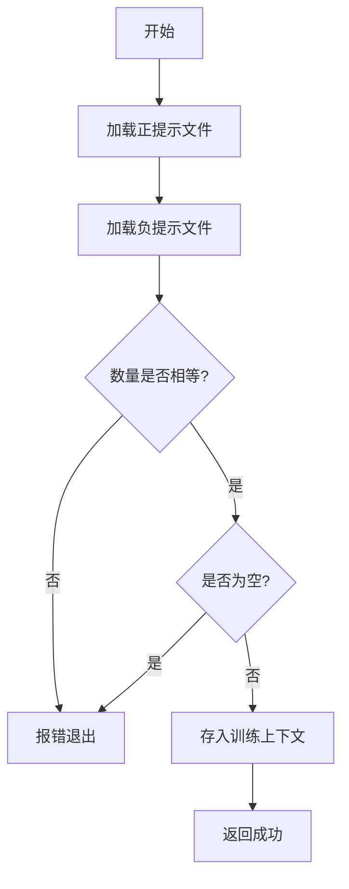

```cpp
static int prepare_entries(common_params & params, train_context & ctx_train) {
    std::vector<std::string> positive_prompts = ctrlvec_load_prompt_file(params.cvector_positive_file, true);  // 加载正提示文件（跳过空行）
    std::vector<std::string> negative_prompts = ctrlvec_load_prompt_file(params.cvector_negative_file, true);  // 加载负提示文件（跳过空行）
    if (positive_prompts.size() != negative_prompts.size()) {                  // 校验：正负提示数量必须相等
        fprintf(stderr, "number of positive and negative prompts must be equal\n");
        return 1;
    }
    if (positive_prompts.empty()) {                                            // 校验：至少要有一对提示
        fprintf(stderr, "must provide at least one prompt pair\n");
        return 1;
    }
    ctx_train.positive_entries = positive_prompts;                             // 存入训练上下文
    ctx_train.negative_entries = negative_prompts;                             // 存入训练上下文
    return 0;
}
```

这段代码实现了 `prepare_entries` 函数：它从两个独立文件中分别加载正负提示列表，然后强制校验两者数量相等且非空。这个校验很关键——如果数量不等，后续逐对推理时就会出现索引错位，提取的「差异」也就毫无意义了。

### 71.4.4 `ctrlvec_load_prompt_file()`：提示文件的读取

源码路径：`tools/cvector-generator/cvector-generator.cpp` - `ctrlvec_load_prompt_file()`（第301-314行）

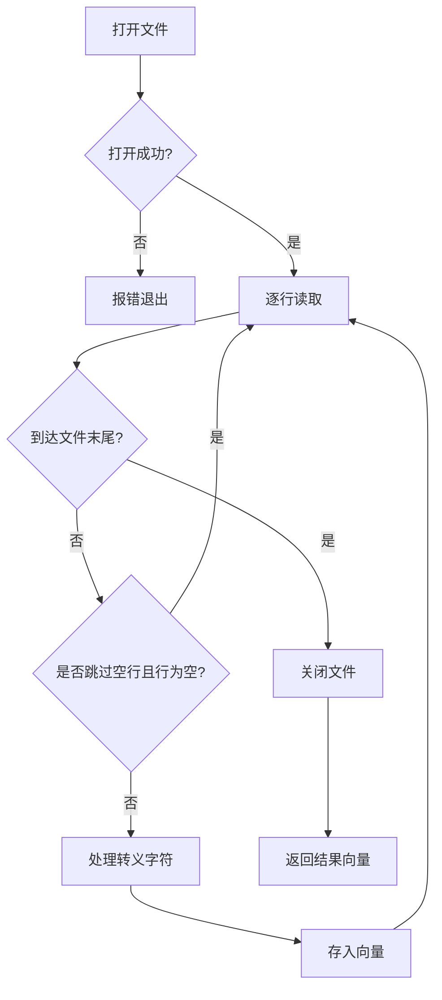

```cpp
static std::vector<std::string> ctrlvec_load_prompt_file(std::string path, bool skip_empty_lines) {
    std::vector<std::string> output;
    std::ifstream file(path);                                               // 打开提示文件
    if (!file.is_open()) {
        fprintf(stderr, "error: unable to open file: %s\n", path.c_str());  // 打印错误并退出
        exit(1);
    }
    std::string line;
    while (std::getline(file, line)) {                                      // 逐行读取
        bool is_skip = skip_empty_lines && line.empty();                    // 判断是否跳过空行
        if (!is_skip) { string_process_escapes(line); output.push_back(line); }  // 处理转义字符后存入
    }
    file.close();
    return output;
}
```

这段代码实现了 `ctrlvec_load_prompt_file` 函数：它按行读取提示文件，支持跳过空行，并用 `string_process_escapes` 处理 `\n` 之类的转义序列。把每行当作一条独立的正（或负）提示，最终返回一个字符串向量供后续配对使用。

## 71.5 隐藏层捕获机制 —— 在推理中「窃听」神经活动

有了输入，接下来要解决的问题是：如何拿到模型内部各层的输出？llama.cpp 提供了 `cb_eval` 回调机制，它在每次 `llama_decode` 时都会询问你对哪些张量感兴趣。工具的解法是：只捕获名称以 `l_out` 开头的张量（即各 Transformer 层的输出），在回调里把它们拷贝一份存起来，事后就能随意计算差异了。

### 71.5.1 `cb_eval()`：推理回调的入口

源码路径：`tools/cvector-generator/cvector-generator.cpp` - `cb_eval()`（第317-327行）

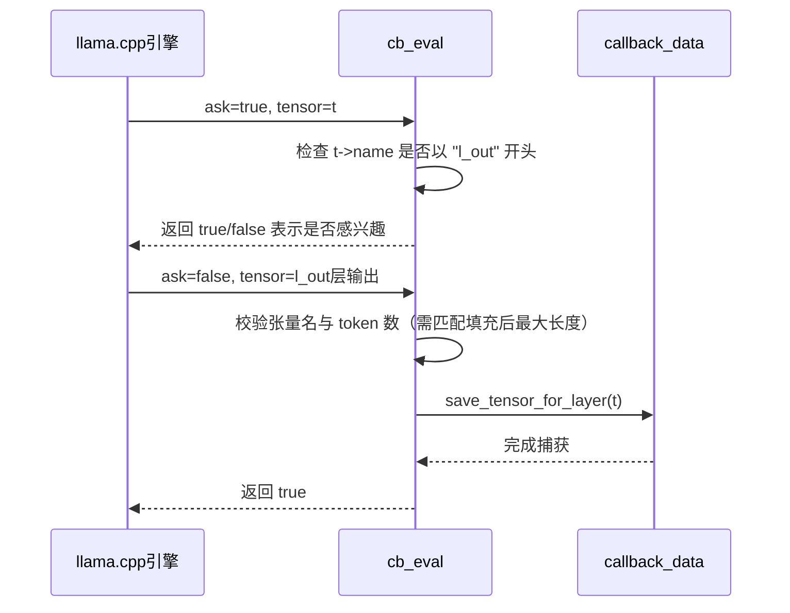

```cpp
static bool cb_eval(struct ggml_tensor * t, bool ask, void * user_data) {
    auto * cb_data = (callback_data *) user_data;                          // 取出回调数据
    static const char * l_out_name = "l_out";                             // 定义要捕获的层输出前缀
    const bool is_l_out = strncmp(t->name, l_out_name, strlen(l_out_name)) == 0;  // 判断张量名是否以 l_out 开头
    if (ask) { return is_l_out; }                                          // 如果是询问阶段，只声明对 l_out 感兴趣
    if (!is_l_out || t->ne[1] != cb_data->n_tokens) { return true; }      // 过滤：非 l_out 或 token 数不匹配（需等于填充后最大长度）则跳过
    cb_data->save_tensor_for_layer(t);                                     // 保存该层的输出张量
    return true;
}
```

这段代码实现了 `cb_eval` 回调函数：它是 llama.cpp 引擎与控制向量工具之间的唯一对话窗口。`ask=true` 时它只声明对 `l_out` 前缀张量的兴趣，引擎据此只把这些张量传回来；`ask=false` 时它校验张量名和 token 数（`t->ne[1]` 必须等于当前提示的填充后最大长度 `cb_data->n_tokens`），通过后调用 `save_tensor_for_layer` 完成实际捕获。这种「先声明、后捕获」的设计，避免了把整个计算图的所有中间张量都拷贝一遍。

### 71.5.2 `callback_data.save_tensor_for_layer()`：隐藏层张量的捕获

源码路径：`tools/cvector-generator/cvector-generator.cpp` - `save_tensor_for_layer()`（第80-106行）

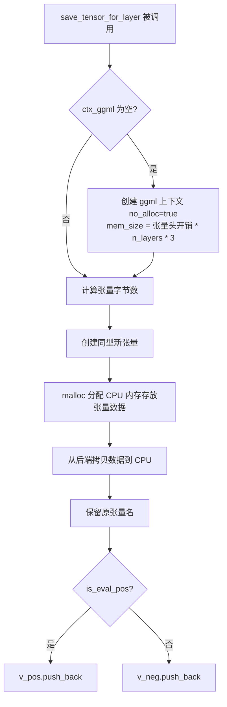

```cpp
void save_tensor_for_layer(struct ggml_tensor * t) {
    GGML_ASSERT(t->type == GGML_TYPE_F32);                                 // 断言张量类型为 F32
    if (ctx_ggml == nullptr) {                                             // 首次调用时创建临时 ggml 上下文
        struct ggml_init_params params_ggml = {
            /*.mem_size   =*/ ggml_tensor_overhead() * n_layers * 3u,  // 预留三倍层数的张量头空间以应对三个存储向量
            /*.mem_buffer =*/ NULL,
            /*.no_alloc   =*/ true,                                    // 不自动分配张量数据，手动管理
        };
        ctx_ggml = ggml_init(params_ggml);
    }
    auto n_bytes = ggml_nbytes(t);                                          // 计算张量字节数
    struct ggml_tensor * t_layer = ggml_new_tensor_2d(ctx_ggml, t->type, t->ne[0], t->ne[1]);  // 创建同型新张量
    t_layer->data = malloc(n_bytes);                                        // 分配 CPU 内存存放张量数据
    ggml_backend_tensor_get(t, t_layer->data, 0, n_bytes);                 // 从后端设备拷贝数据到 CPU
    ggml_set_name(t_layer, ggml_get_name(t));                              // 保留原张量名，便于后续按层索引
    if (is_eval_pos) { v_pos.push_back(t_layer); } else { v_neg.push_back(t_layer); }  // 按正/负分别存入
}
```

这段代码定义并实现了 `callback_data::save_tensor_for_layer`：它在回调触发时，把引擎传来的 `l_out` 张量从 GPU/CPU 后端完整拷贝一份到自主管理的 ggml 上下文中，并根据 `is_eval_pos` 标志把数据分流到 `v_pos` 或 `v_neg` 向量。这里有一个细节值得你注意：`no_alloc=true` 让上下文只管理张量元数据（结构体本身），`mem_size` 预留 `ggml_tensor_overhead() * n_layers * 3u` 字节用于存放张量头（对应 `v_pos`、`v_neg`、`v_diff_filtered` 三个向量的容量），而张量数据用 `malloc` 手动分配——这样可以精确控制生命周期，避免 ggml 自动分配器在多次回调中反复申请释放内存。

### 71.5.3 `get_hidden_layers()`：单次推理的执行

源码路径：`tools/cvector-generator/cvector-generator.cpp` - `get_hidden_layers()`（第329-336行）

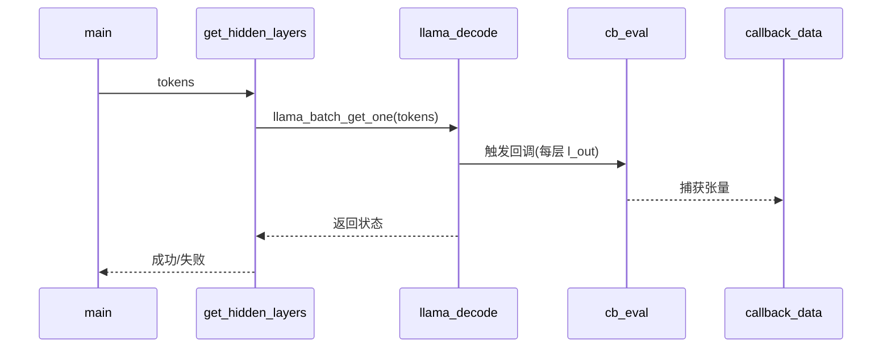

```cpp
static bool get_hidden_layers(llama_context * ctx, std::vector<llama_token> & tokens) {
    llama_memory_clear(llama_get_memory(ctx), true);                       // 清空 KV 缓存，确保每对提示从零开始
    if (llama_decode(ctx, llama_batch_get_one(tokens.data(), tokens.size()))) {  // 执行单次推理
        fprintf(stderr, "%s : failed to eval\n", __func__);
        return false;
    }
    return true;
}
```

这段代码实现了 `get_hidden_layers` 函数：它先清空 KV 缓存以保证每次推理的独立性，再用 `llama_batch_get_one` 把 token 序列打包成单条 batch 送入模型。在 `llama_decode` 执行期间，我们之前注册的 `cb_eval` 回调会被引擎自动触发，静默地把每一层的 `l_out` 输出收集到 `callback_data` 中——你看到的只是这一行 `llama_decode`，但背后已经完成了整层的「窃听」工作。

## 71.6 差异计算与过滤 —— 提取「净效应」信号

正负提示都推理完毕后，`callback_data` 里同时持有一份正样本输出和一份负样本输出。下一步要做的，就是对每一层计算 `v_pos[i] -= v_neg[i]`，得到「行为差异」张量。但这里有个麻烦：序列里有相当一部分是填充用的空格 token，它们对应的行全是零，会污染后续的降维计算。所以工具又实现了 `filter_nonzero_rows`，把这些无效行剔除掉。

### 71.6.1 `callback_data.calc_diff()`：正负差异的计算

源码路径：`tools/cvector-generator/cvector-generator.cpp` - `calc_diff()`（第108-117行）

```mermaid
flowchart TD
    A[calc_diff 开始] --> B[遍历每一层 il]
    B --> C[获取 v_pos[il] 数据指针 a]
    C --> D[获取 v_neg[il] 数据指针 b]
    D --> E[计算元素总数 n_elem]
    E --> F[原地计算 a[j] -= b[j]]
    F --> G[调用 filter_nonzero_rows]
    G --> H[结果存入 v_diff_filtered]
    H --> I{遍历完所有层?}
    I -- 否 --> B
    I -- 是 --> J[返回 v_diff_filtered]
```

```cpp
std::vector<struct ggml_tensor *> calc_diff() {
    for (float il = 0; il < v_pos.size(); il++) {                          // 遍历每一层（注意：il 为 float 类型，隐式转为整型索引，不规范但能工作）
        float * a = (float *) v_pos[il]->data;                             // 取正样本数据指针
        float * b = (float *) v_neg[il]->data;                             // 取负样本数据指针
        size_t n_elem = ggml_nelements(v_pos[il]);                         // 获取元素总数
        for (size_t j = 0; j < n_elem; j++) { a[j] -= b[j]; }             // 原地计算 a = a - b（正负差异）
        auto diff_filtered = filter_nonzero_rows(v_pos[il]);               // 过滤全零行，保留有效样本
        v_diff_filtered.push_back(diff_filtered);                          // 存入差异结果向量
    }
    return v_diff_filtered;
}
```

这段代码实现了 `callback_data::calc_diff`：它对每一层直接做原地减法 `a[j] -= b[j]`，把正样本张量就地改写成「正减负」的差异张量。这种原地修改省去了额外的拷贝开销，但代价是 `v_pos` 被破坏了——所以紧接着它调用 `filter_nonzero_rows` 基于这份差异张量提取有效行，再把过滤后的结果 push 到 `v_diff_filtered` 中，供后续的训练上下文累积。注意循环变量 `il` 使用 `float` 类型而非整型，虽然能通过隐式转换工作，但不符合规范，建议改为 `int` 或 `size_t`。

### 71.6.2 `callback_data.filter_nonzero_rows()`：有效行的提取

源码路径：`tools/cvector-generator/cvector-generator.cpp` - `filter_nonzero_rows()`（第119-151行）

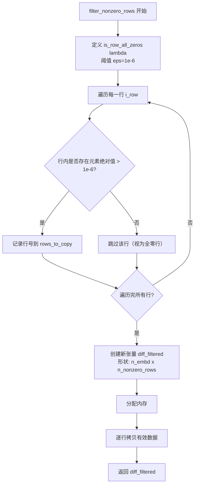

```cpp
struct ggml_tensor * filter_nonzero_rows(struct ggml_tensor * a) {
    auto is_row_all_zeros = [](struct ggml_tensor * t, int row, float eps) -> bool {  // 判断某行是否全为零（绝对值均 <= eps）
        int n_cols = t->ne[0];
        for (int col = 0; col < n_cols; ++col) {
            if (ggml_get_f32_nd(t, col, row, 0, 0) > eps) { return false; }  // 发现任一元素绝对值大于 eps 即返回 false
        }
        return true;
    };
    std::vector<int> rows_to_copy;
    for (int i_row = 0; i_row < a->ne[1]; i_row++) {                      // 遍历每一行
        if (!is_row_all_zeros(a, i_row, 1e-6)) { rows_to_copy.push_back(i_row); }  // 非零行（存在元素 > 1e-6）加入拷贝列表
    }
    int n_nonzero_rows = rows_to_copy.size();
    int n_embd = a->ne[0];
    GGML_ASSERT(n_nonzero_rows > 0);                                      // 断言至少有一行有效
    struct ggml_tensor * diff_filtered = ggml_new_tensor_2d(ctx_ggml, GGML_TYPE_F32, n_embd, n_nonzero_rows);  // 创建新张量
    ggml_format_name(diff_filtered, "diff_filtered_%s", a->name);         // 命名以便调试
    diff_filtered->data = malloc(ggml_nbytes(diff_filtered));             // 分配内存
    for (int dest_row = 0; dest_row < n_nonzero_rows; dest_row++) {       // 逐行拷贝有效数据
        int src_row = rows_to_copy[dest_row];
        for (int i = 0; i < n_embd; i++) {
            float src_elem = ggml_get_f32_nd(a, i, src_row, 0, 0);
            ggml_set_f32_nd(diff_filtered, i, dest_row, 0, 0, src_elem);
        }
    }
    return diff_filtered;
}
```

这段代码定义并实现了 `filter_nonzero_rows`：它逐行检查差异张量，用 `1e-6` 作为阈值剔除所有元素绝对值均小于该阈值的行（即那些只由填充空格 token 产生的无效位置），然后把有效行紧凑拷贝到一个形状为 `[n_embd, n_nonzero_rows]` 的新张量中。这一步至关重要——如果不做过滤，PCA 或均值计算都会被 padding 位置拉偏，最终提取的方向就不纯粹是行为信号了。

### 71.6.3 `callback_data.reset()`：资源的清理

源码路径：`tools/cvector-generator/cvector-generator.cpp` - `reset()`（第153-162行）

```mermaid
flowchart TD
    A[reset 开始] --> B[释放 v_pos 中所有张量数据]
    B --> C[释放 v_neg 中所有张量数据]
    C --> D[释放 v_diff_filtered 中所有张量数据]
    D --> E[清空 v_pos, v_neg, v_diff_filtered]
    E --> F{ctx_ggml 非空?}
    F -- 是 --> G[ggml_free(ctx_ggml)]
    G --> H[ctx_ggml = nullptr]
    F -- 否 --> H
    H --> I[结束]
```

```cpp
void reset() {
    for (auto ptr : v_pos) free(ptr->data);                               // 释放正样本张量数据
    for (auto ptr : v_neg) free(ptr->data);                               // 释放负样本张量数据
    for (auto ptr : v_diff_filtered) free(ptr->data);                     // 释放差异张量数据
    v_pos.clear();                                                         // 清空正样本向量
    v_neg.clear();                                                         // 清空负样本向量
    v_diff_filtered.clear();                                               // 清空差异向量
    if (ctx_ggml) { ggml_free(ctx_ggml); }                                 // 释放临时 ggml 上下文
    ctx_ggml = nullptr;                                                    // 置空，供下次复用时重建
}
```

这段代码实现了 `callback_data::reset`：它在每一对提示处理完成后，释放所有捕获张量的内存、清空向量，并销毁临时 ggml 上下文。之所以每次都要完整清理，是因为 `ctx_ggml` 用 `no_alloc=true` 创建，张量头和数据指针都是手动管理的——不显式释放就会内存泄漏，而 `n_layers * 3` 个张量头在成百上千对提示的循环里累积起来相当可观。

## 71.7 训练上下文 —— 汇总所有提示对的「差异大数据」

每一对提示都会产生一份过滤后的差异张量，如何把它们组织成最终可用于降维的矩阵？这就是 `train_context` 的职责。它像一个「训练仓库」：用 `v_diff_tmp` 以字节流形式累积所有提示对的差异数据，等全部推理完毕，再用 `build_v_diff` 把这些字节流构建成规整的二维张量 `[n_embd, n_total_samples]`（均值法）或 `[n_samples, n_embd]`（PCA），送入均值或 PCA 流水线。

### 71.7.1 `train_context`：差异数据的「训练仓库」

源码路径：`tools/cvector-generator/cvector-generator.cpp` - `train_context()`（第213-228行）

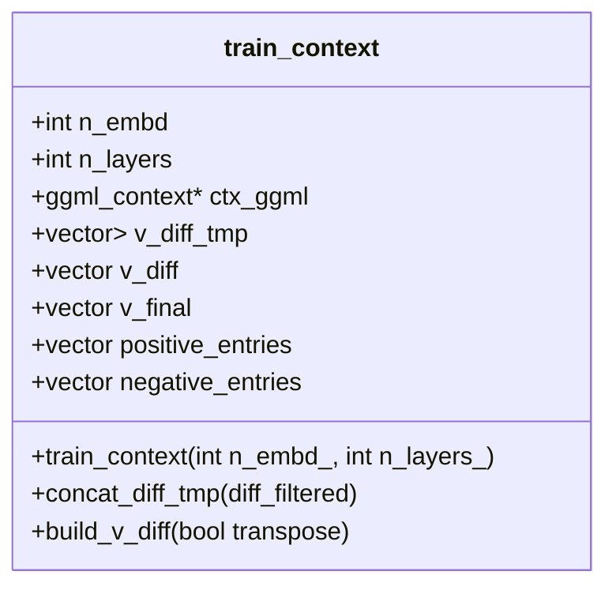

```cpp
train_context(int n_embd_, int n_layers_) {
    n_embd = n_embd_;                                                     // 记录嵌入维度
    n_layers = n_layers_;                                                 // 记录模型层数
    struct ggml_init_params params_ggml = {
        /*.mem_size   =*/ ggml_tensor_overhead() * (n_layers - 1) * 2u,  // 预留张量头空间
        /*.mem_buffer =*/ NULL,
        /*.no_alloc   =*/ true,                                          // 手动管理数据
    };
    ctx_ggml = ggml_init(params_ggml);
    for (int il = 0; il < n_layers - 1; il++) {                           // 为每一层（除最后一层外）预分配输出张量
        std::vector<uint8_t> empty;
        v_diff_tmp.push_back(empty);                                      // 初始化空的差异字节流
        auto t = ggml_new_tensor_1d(ctx_ggml, GGML_TYPE_F32, n_embd);    // 创建一维输出张量
        t->data = malloc(ggml_nbytes(t));                                 // 分配内存
        v_final.push_back(t);                                             // 存入最终控制向量容器
    }
}
```

这段代码定义并实现了 `train_context` 的构造函数：它为每一层（跳过最后一层，因为 `l_out` 不包含最终输出层——最后一层通常接 LM Head 而非 Transformer 层输出）预分配一个长度为 `n_embd` 的一维张量 `v_final`，用于存放降维后最终的控制向量；同时为每层初始化一个空的字节流 `v_diff_tmp`，用来以原始字节形式累积所有提示对的差异数据。这种「字节流 + 张量」的双层结构，是为了在累积阶段避免频繁重建张量元数据。

### 71.7.2 `concat_diff_tmp()`：差异的累积

源码路径：`tools/cvector-generator/cvector-generator.cpp` - `concat_diff_tmp()`（第230-238行）

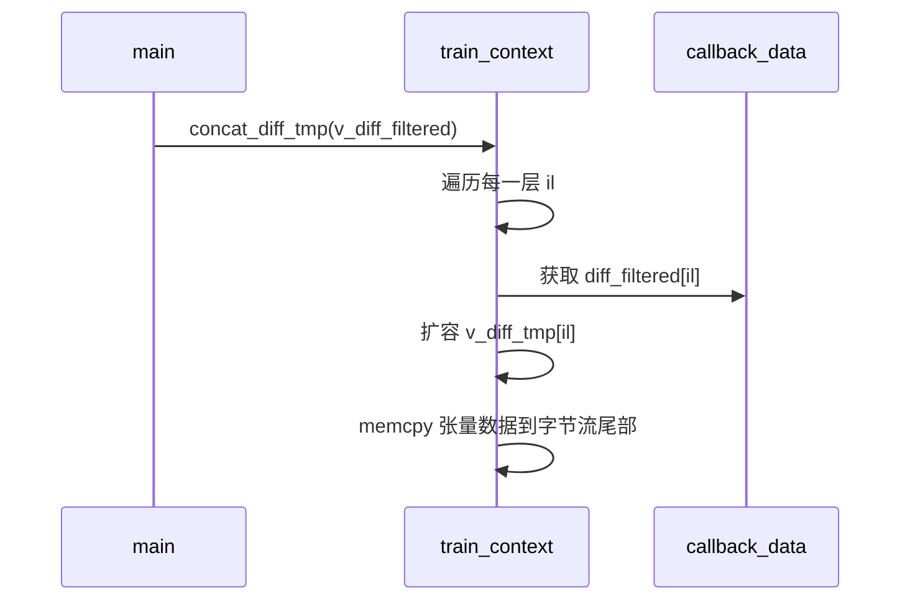

```cpp
void concat_diff_tmp(const std::vector<struct ggml_tensor *> & diff_filtered) {
    GGML_ASSERT((int) diff_filtered.size() == n_layers - 1);             // 断言差异数量与层数匹配
    for (int il = 0; il < n_layers - 1; il++) {                          // 遍历每一层
        auto t = diff_filtered[il];                                      // 取出该层的差异张量
        auto & diff_tmp = v_diff_tmp[il];                                // 取出该层的字节流
        size_t curr_size = diff_tmp.size();                              // 记录当前大小
        diff_tmp.resize(curr_size + ggml_nbytes(t));                     // 扩容，追加新数据
        memcpy(diff_tmp.data() + curr_size, t->data, ggml_nbytes(t));    // 拷贝张量数据到字节流
    }
}
```

这段代码实现了 `train_context::concat_diff_tmp`：它把每对提示产生的过滤后差异张量，以纯字节形式追加到对应层的字节流 `v_diff_tmp[il]` 后面。用字节流而非张量来累积，是为了让后续的 `build_v_diff` 可以一次性把所有样本的字节连续拷贝到一个规整的二维张量里，避免在循环中反复调整张量形状——这是典型的「先乱后整」数据处理策略。

### 71.7.3 `build_v_diff()`：最终差异矩阵的构建

源码路径：`tools/cvector-generator/cvector-generator.cpp` - `build_v_diff()`（第240-259行）

```mermaid
flowchart TD
    A[build_v_diff 开始] --> B[遍历每一层 il]
    B --> C[取出 v_diff_tmp[il] 字节流]
    C --> D[计算总浮点数 n_elem]
    D --> E[断言 n_elem % n_embd == 0]
    E --> F[计算样本行数 n_rows]
    F --> G{transpose?}
    G -- 是 --> H[创建张量 [n_rows, n_embd]<br/>逐元素搬运并转置<br/>适配 PCA 幂迭代输入]
    G -- 否 --> I[创建张量 [n_embd, n_rows]<br/>直接 memcpy<br/>适配 mean::run 列向量遍历]
    H --> J[存入 v_diff]
    I --> J
    J --> K[打印调试信息]
    K --> L[清空 v_diff_tmp[il]]
    L --> M{遍历完所有层?}
    M -- 否 --> B
    M -- 是 --> N[结束]
```

```cpp
void build_v_diff(bool transpose) {
    printf("build_v_diff\n");
    for (int il = 0; il < n_layers - 1; il++) {                          // 遍历每一层
        auto & diff_tmp = v_diff_tmp[il];                                // 取出该层的字节流
        int n_elem = diff_tmp.size() / sizeof(float);                   // 计算总浮点数个数
        GGML_ASSERT(n_elem % n_embd == 0);                              // 断言可整除（数据规整）
        int n_rows = n_elem / n_embd;                                    // 计算样本行数
        struct ggml_tensor * diff = transpose
            ? ggml_new_tensor_2d(ctx_ggml, GGML_TYPE_F32, n_rows, n_embd)    // 转置：[n_samples, n_embd] 适配 PCA
            : ggml_new_tensor_2d(ctx_ggml, GGML_TYPE_F32, n_embd, n_rows);   // 不转置：[n_embd, n_samples] 适配均值法
        ggml_set_name(diff, (std::string("diff_") + std::to_string(il)).c_str());  // 命名
        diff->data = malloc(ggml_nbytes(diff));                          // 分配内存
        if (transpose) {                                                // 若需要转置（PCA 场景）
            float * arr = (float *) diff_tmp.data();
            for (int ir = 0; ir < n_rows; ++ir) {                       // 逐元素搬运并转置
                for (int ic = 0; ic < n_embd; ++ic) {
                    float f = arr[ir*n_embd + ic];
                    ggml_set_f32_nd(diff, ir, ic, 0, 0, f);
                }
            }
        } else { memcpy(diff->data, diff_tmp.data(), ggml_nbytes(diff)); }  // 否则直接拷贝（均值法场景）
        v_diff.push_back(diff);                                          // 存入差异张量向量
        print_debug_tensor(diff);                                        // 打印调试信息
        diff_tmp.resize(0);                                              // 清空字节流，释放内存
    }
}
```

这段代码定义并实现了 `train_context::build_v_diff`：它把累积的字节流构建成规整的二维差异张量。当 `transpose=true`（PCA 场景）时，创建形状为 `[n_rows, n_embd]` 即 `[n_samples, n_embd]` 的张量，逐元素搬运实现转置，以满足幂迭代法要求输入形状为 `[n_samples, n_embd]` 以便直接计算 `input^T * input` 得到协方差矩阵；当 `transpose=false`（均值法场景）时，创建形状为 `[n_embd, n_rows]` 即 `[n_embd, n_samples]` 的张量并直接 `memcpy`，以匹配 `mean::run` 按列（样本维度）遍历求均值的逻辑。构建完成后它立即清空字节流，释放已用内存。

## 71.8 均值法：最简单的方向提取 —— 「平均即方向」

当你面对的样本量不大、或者各提示对产生的行为方向本身就高度一致时，不需要动用复杂的 PCA，直接取均值就能得到一个可用的控制向量。`mean.hpp` 中的 `mean::run` 就是为此而生的最简方案：对每一层，把所有样本在每个嵌入维度上的值求平均，再做 L2 归一化，让方向向量的长度恒为 1。

### 71.8.1 `mean::run()`：最简单的方向提取

源码路径：`tools/cvector-generator/mean.hpp` - `mean::run()`（第1-42行）

```mermaid
flowchart TD
    A[mean::run 开始] --> B[遍历每一层 il]
    B --> C[准备输出向量 ctrl_out<br/>命名为 direction.il+1]
    C --> D[断言输入输出维度匹配]
    D --> E[遍历每个嵌入维度 ic]
    E --> F[累加该维度所有样本值]
    F --> G[取均值 f /= n_samples]
    G --> H[写入 ctrl_out[ic]]
    H --> I{遍历完所有维度?}
    I -- 否 --> E
    I -- 是 --> J[计算 L2 范数]
    J --> K[归一化每个元素]
    K --> L[打印进度]
    L --> M{遍历完所有层?}
    M -- 否 --> B
    M -- 是 --> N[结束]
```

```cpp
namespace mean {

static void run(
        const std::vector<struct ggml_tensor *> & v_input, // shape of v_input[0]: [n_embd, n_samples]
        const std::vector<struct ggml_tensor *> & v_output) {
    printf("%s: Running mean...\n", __func__);
    for (size_t il = 0; il < v_input.size(); ++il) {                    // 遍历每一层
        // prepare output vector
        struct ggml_tensor * ctrl_out = v_output[il];
        ggml_format_name(ctrl_out, "direction.%zu", il+1);             // 命名为 direction.1, direction.2 ...

        // calculate mean vector
        struct ggml_tensor * t_layer = v_input[il];
        GGML_ASSERT(t_layer->ne[0] == ctrl_out->ne[0]); // == n_embd    // 断言维度匹配
        for (int ic = 0; ic < t_layer->ne[0]; ic++) {                  // 遍历每个嵌入维度
            float f = 0.0;
            for (int ir = 0; ir < t_layer->ne[1]; ir++) {              // 遍历所有样本
                f += ggml_get_f32_nd(t_layer, ic, ir, 0, 0);           // 累加该维度的值
            }
            f /= t_layer->ne[1];                                        // 取均值
            ggml_set_f32_1d(ctrl_out, ic, f);                          // 写入输出向量
        }

        // normalize output vector
        float norm = 0.0;
        for (int i = 0; i < ggml_nelements(ctrl_out); i++) {           // 计算 L2 范数
            float f = ggml_get_f32_1d(ctrl_out, i);
            norm += f*f;
        }
        norm = sqrt(norm);
        for (int i = 0; i < ggml_nelements(ctrl_out); i++) {           // 归一化
            float f = ggml_get_f32_1d(ctrl_out, i);
            ggml_set_f32_1d(ctrl_out, i, f / norm);
        }

        printf("%s: Done layer %d / %d\n", __func__, (int) il+1, (int) v_input.size());
    }
}

}
```

这段代码定义并实现了 `mean::run`：它对每一层的差异矩阵按列求均值，得到一个长度为 `n_embd` 的方向向量，随后做 L2 归一化使其长度恒为 1。输出向量被命名为 `direction.1`、`direction.2`……，与 llama.cpp 加载时的约定完全一致。均值法的优点显而易见——计算简单、无需迭代、没有随机性；缺点也很明显：它只取「平均方向」，如果不同提示对引出的行为方向存在多个子方向（比如「诚实」和「有条理」混在一起），均值就会把它们混成一个模糊的折中方向，不如 PCA 能分离出主成分。

## 71.9 PCA 降维：幂迭代法 —— 用 ggml 计算图求主成分

当样本量大、行为方向复杂时，均值法就力不从心了。PCA（主成分分析）能找出数据中方差最大的方向，也就是最「显著」的行为信号。传统 PCA 需要计算协方差矩阵再做特征分解，复杂度高且难以利用 GPU 加速。工具的选择是幂迭代法：通过反复矩阵乘法逼近最大特征向量，这个过程天然适合用 ggml 在 GPU 上并行加速。

### 71.9.1 `pca_params` 与 `pca_result`：PCA 的配置与中间结果

源码路径：`tools/cvector-generator/pca.hpp` - `pca_params` / `pca_result` 结构体定义（第21-53行）

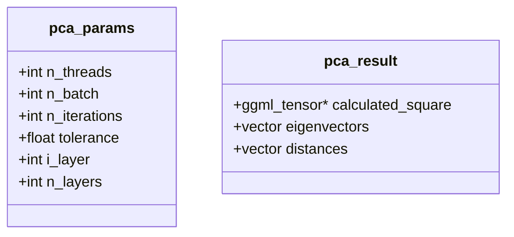

```cpp
struct pca_params {
    int n_threads = 1;          // 计算线程数（CPU 后端使用）
    int n_batch = 1;            // 每次图构建包含的迭代步数
    int n_iterations = 100;     // 总迭代次数（必须是 n_batch 的倍数）
    float tolerance = 1e-6;     // 收敛容差：特征向量变化小于此值即提前终止
    int i_layer = 0;            // 当前处理的层索引（用于日志输出）
    int n_layers = 0;           // 总层数（用于日志输出）
};

struct pca_result {
    struct ggml_tensor * calculated_square = NULL;    // 首轮计算出的协方差矩阵节点（仅持有指针，不拷贝数据）
    std::vector<struct ggml_tensor *> eigenvectors;   // 每批次迭代产生的特征向量节点（仅持有指针）
    std::vector<float> distances;                     // 每批次的收敛距离标量（唯一必须从设备拷回 CPU 的数据）
};
```

这两个结构体分别封装了 PCA 计算的超参数配置与单次图执行的产出。`pca_params` 把原本散落在各处的配置集中管理，方便在 `build_graph_piter`、`compute_piter`、`power_iteration`、`run_pca` 间传递。`pca_result` 采用「节点指针留在设备端、标量拷回主机端」的设计：协方差矩阵节点和特征向量节点只记录指针（因为后续迭代还要继续写入），而距离标量必须拷回 CPU 用于判断收敛——这种「按需拷贝」策略极大减少了设备↔主机的数据传输开销。

### 71.9.2 `pca_model`：PCA 计算的后端封装

源码路径：`tools/cvector-generator/pca.hpp` - `pca_model()`（第55-104行）

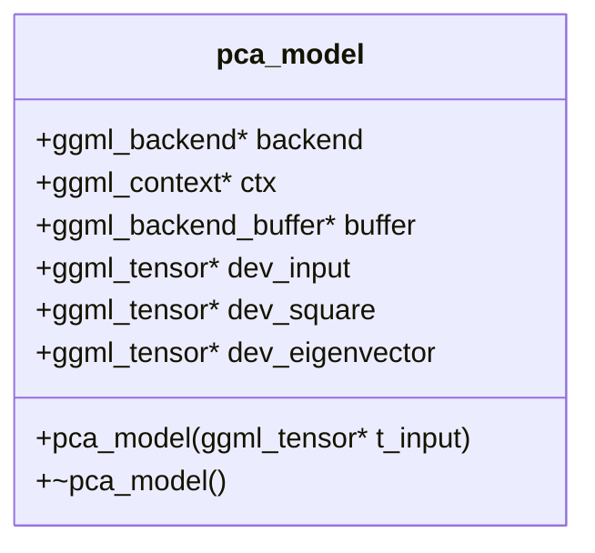

```cpp
pca_model(struct ggml_tensor * t_input) {
    #ifdef GGML_USE_CUDA
        fprintf(stderr, "%s: using CUDA backend\n", __func__);
        backend = ggml_backend_cuda_init(0); // init device 0        // 优先初始化 CUDA 后端
        if (!backend) {
            fprintf(stderr, "%s: ggml_backend_cuda_init() failed\n", __func__);
        }
    #endif
    // if there aren't GPU Backends fallback to CPU backend
    if (!backend) {
        backend = ggml_backend_cpu_init();                            // 没有 GPU 后端则回退到 CPU
    }
    const int num_tensors = 4;
    struct ggml_init_params params = {
        /*.mem_size   =*/ ggml_tensor_overhead() * num_tensors,
        /*.mem_buffer =*/ NULL,
        /*.no_alloc   =*/ true,
    };
    ctx = ggml_init(params);
    auto n_samples = t_input->ne[0];
    auto n_embd    = t_input->ne[1];
    dev_input       = ggml_new_tensor_2d(ctx, GGML_TYPE_F32, n_samples, n_embd);   // 输入矩阵 [n_samples, n_embd]
    dev_square      = ggml_new_tensor_2d(ctx, GGML_TYPE_F32, n_embd,    n_embd);    // 协方差矩阵 [n_embd, n_embd]
    dev_eigenvector = ggml_new_tensor_1d(ctx, GGML_TYPE_F32, n_embd);               // 特征向量 [n_embd]
    ggml_set_name(dev_input,       "dev_input");
    ggml_set_name(dev_square,      "dev_square");
    ggml_set_name(dev_eigenvector, "dev_eigenvector");
    buffer = ggml_backend_alloc_ctx_tensors(ctx, backend);           // 在后端分配张量内存
    ggml_backend_tensor_set(dev_input, t_input->data, 0, ggml_nbytes(t_input));  // 拷贝输入数据到设备
    // initialize eigenvector to random normalized vector
    {
        std::vector<float> random_vec(ggml_nelements(dev_eigenvector), 0.0);     // 生成随机向量
        std::default_random_engine generator(static_cast<unsigned int>(std::time(0)));
        std::uniform_real_distribution<float> distribution(0.0, 1.0);
        float sum_sqr = 0.0; // for normalizing random_vec
        for (size_t i = 0; i < random_vec.size(); ++i) {
            float f = distribution(generator);
            sum_sqr += f * f;
            random_vec[i] = f;
        }
        // normalize it
        float random_vec_norm = std::sqrt(sum_sqr);
        for (size_t i = 0; i < random_vec.size(); ++i) { random_vec[i] /= random_vec_norm; }
        ggml_backend_tensor_set(dev_eigenvector, random_vec.data(), 0, ggml_nbytes(dev_eigenvector));  // 写入设备
    }
}
```

这段代码定义并实现了 `pca_model` 的构造函数：它优先尝试初始化 CUDA 后端，失败则回退到 CPU，然后在后端上分配三个核心张量——输入矩阵 `dev_input`、协方差矩阵 `dev_square` 和特征向量 `dev_eigenvector`。这里有个工程细节值得你注意：特征向量不能初始化为全零（否则幂迭代会原地打转），所以工具用随机向量起步并立即归一化，保证迭代有一个非平凡的起点。

### 71.9.3 `~pca_model()`：资源释放

源码路径：`tools/cvector-generator/pca.hpp` - `~pca_model()`（第106-110行）

```mermaid
flowchart TD
    A[~pca_model 开始] --> B[ggml_free(ctx)]
    B --> C[ggml_backend_buffer_free(buffer)]
    C --> D[ggml_backend_free(backend)]
    D --> E[结束]
```

```cpp
~pca_model() {
    ggml_free(ctx);                 // 释放 ggml 上下文
    ggml_backend_buffer_free(buffer);  // 释放后端缓冲区
    ggml_backend_free(backend);     // 释放后端资源
}
```

这段代码实现了 `pca_model` 的析构函数：按顺序释放 ggml 上下文、后端缓冲区和后端设备。析构顺序是有意为之——先销毁上下文（它持有张量元数据），再释放缓冲区（它持有张量数据），最后才释放后端设备，避免在资源还未解绑时就撤掉底层驱动。

### 71.9.4 `build_graph_piter()`：幂迭代计算图的构建

源码路径：`tools/cvector-generator/pca.hpp` - `build_graph_piter()`（第113-158行）

```mermaid
flowchart TD
    A[build_graph_piter 开始] --> B{calc_square?}
    B -- 是 --> C[tmp_square = dev_input * dev_input<br/>计算协方差矩阵 input^T * input]
    B -- 否 --> D[input_square = dev_square]
    C --> D
    D --> E[old_eigen = dev_eigenvector]
    E --> F[循环 n_batch 次]
    F --> G[b_tensor = input_square * old_eigen<br/>幂迭代核心：b = A * v]
    G --> H[b_tensor = b_tensor / ||b_tensor||<br/>归一化]
    H --> I[distance = ||b_tensor - old_eigen||<br/>收敛判据]
    I --> J[old_eigen = b_tensor]
    J --> K[ggml_build_forward_expand(gf, distance)]
    K --> F
    F --> L[释放临时上下文 ctx0]
    L --> M[返回计算图 gf]
```

```cpp
static struct ggml_cgraph * build_graph_piter(
        const struct pca_params & params,
        const pca_model & model,
        bool calc_square = false) {
    GGML_ASSERT(params.n_batch > 0);
    // TODO: buf_size must be able to scale with params.n_batch
    static size_t buf_size = ggml_tensor_overhead()*GGML_DEFAULT_GRAPH_SIZE + ggml_graph_overhead();
    static std::vector<uint8_t> buf(buf_size);
    struct ggml_init_params params0 = {
        /*.mem_size   =*/ buf_size,
        /*.mem_buffer =*/ buf.data(),
        /*.no_alloc   =*/ true, // the tensors will be allocated later by ggml_allocr_alloc_graph()
    };
    // create a temporally context to build the graph
    struct ggml_context * ctx0 = ggml_init(params0);
    struct ggml_cgraph * gf = ggml_new_graph(ctx0);
    // turn v_diff_original into square matrix if needed
    struct ggml_tensor * tmp_square;
    if (calc_square) {
        tmp_square = ggml_mul_mat(ctx0, model.dev_input, model.dev_input);    // 计算 input^T * input（协方差矩阵）
        ggml_set_name(tmp_square, "tmp_square");
    }
    struct ggml_tensor * b_tensor;
    struct ggml_tensor * distance;
    struct ggml_tensor * old_eigen    = model.dev_eigenvector;                 // 上一轮的特征向量
    struct ggml_tensor * input_square = calc_square ? tmp_square : model.dev_square;  // 选择平方矩阵来源
    for (int i = 0; i < params.n_batch; ++i) {
        // b_tensor = square * eigenvector^T
        b_tensor = ggml_mul_mat(ctx0, input_square, old_eigen);              // 幂迭代核心：b = A * v
        ggml_set_name(b_tensor, "b_tensor");
        // normalize
        b_tensor = ggml_div_inplace(ctx0,
            b_tensor,
            ggml_sqrt_inplace(ctx0, ggml_sum_rows(ctx0, ggml_sqr(ctx0, b_tensor)))  // b = b / ||b||
        );
        ggml_format_name(b_tensor, "b_tensor_norm_%d", i);
        // calculate distance(new eigenvector - old eigenvector)
        // we don't use ggml_sub because it may not be implemented on GPU backend
        struct ggml_tensor * new_sub_old = ggml_add(ctx0, old_eigen, ggml_scale(ctx0, b_tensor, -1));  // new - old
        distance = ggml_sqrt_inplace(ctx0,
            ggml_sum_rows(ctx0, ggml_sqr_inplace(ctx0, new_sub_old)));       // ||new - old||，收敛判据
        ggml_format_name(distance, "distance_%d", i);
        old_eigen = b_tensor;
        // build operations nodes
        ggml_build_forward_expand(gf, distance);                               // 把计算节点加入图
    }
    // delete the temporally context used to build the graph
    ggml_free(ctx0);
    return gf;
}
```

这段代码定义并实现了 `build_graph_piter`：它构建了 PCA 幂迭代的 ggml 计算图。首次迭代时用 `ggml_mul_mat(dev_input, dev_input)` 算出协方差矩阵，后续迭代直接复用。核心循环里，每个批量步都执行「矩阵乘 → 归一化 → 计算与上一轮特征向量的距离」三步，并把距离节点注册到输出图中。你注意到它刻意用 `ggml_add + scale` 替代 `ggml_sub` 来算距离——注释里写得很直白：某些 GPU 后端没实现 `ggml_sub`，这是为了让同一张图能跨 CPU/CUDA 两种后端执行。

关于归一化步骤 `ggml_div_inplace(b_tensor, ggml_sqrt_inplace(ggml_sum_rows(ggml_sqr(b_tensor))))`：`ggml_sqr` 先逐元素平方，`ggml_sum_rows` 按行求和得到形状为 `[n_embd, 1]` 的列向量，`ggml_sqrt_inplace` 开方得到各行的 L2 范数，最后 `ggml_div_inplace` 利用 ggml 的广播机制将该列向量与 `b_tensor`（形状 `[n_embd, 1]` 或 `[1, n_embd]` 视布局而定）逐行相除完成归一化。

### 71.9.5 `compute_piter()`：图计算的执行与结果提取

源码路径：`tools/cvector-generator/pca.hpp` - `compute_piter()`（第160-199行）

```mermaid
sequenceDiagram
    participant power_iteration
    participant compute_piter
    participant 后端
    power_iteration->>compute_piter: gf, allocr
    compute_piter->>后端: ggml_gallocr_alloc_graph
    compute_piter->>后端: ggml_backend_graph_compute
    后端-->>compute_piter: GGML_STATUS_SUCCESS
    compute_piter->>compute_piter: 遍历图节点
    compute_piter->>compute_piter: 记录 b_tensor_norm_* 节点指针
    compute_piter->>后端: ggml_backend_tensor_get(distance_*)
    后端-->>compute_piter: float distance
    compute_piter->>compute_piter: 记录 distance 值
    compute_piter->>compute_piter: 记录 tmp_square 节点指针
    compute_piter-->>power_iteration: pca_result
```

```cpp
static ggml_status compute_piter(
        const struct pca_params & params,
        const pca_model & model,
        struct ggml_cgraph * gf,
        ggml_gallocr_t allocr,
        struct pca_result & result) {
    // allocate tensors
    ggml_gallocr_alloc_graph(allocr, gf);                                     // 用分配器为图分配后端内存
    if (ggml_backend_is_cpu(model.backend)) {
        ggml_backend_cpu_set_n_threads(model.backend, params.n_threads);      // 设置 CPU 线程数
    }
    ggml_status res = ggml_backend_graph_compute(model.backend, gf);         // 在后端上执行图计算
    if (res == GGML_STATUS_SUCCESS) {
        auto extract_i = [](std::string prefix, std::string str) -> int {     // 从节点名解析出迭代序号
            int i = -1;
            if (str.rfind(prefix, 0) == 0) {
                sscanf(str.c_str(), (prefix + "%d").c_str(), &i);
            }
            return i;
        };
        result.calculated_square = NULL;
        result.eigenvectors.clear();
        result.distances.clear();
        result.eigenvectors.resize(params.n_batch);
        result.distances.resize(params.n_batch);
        // get output nodes
        for (int i = 0; i < ggml_graph_n_nodes(gf); ++i) {                    // 遍历图中所有节点
            auto node = ggml_graph_node(gf, i);
            int iter = -1;
            // find b_tensor (without copying data from device)
            if ((iter = extract_i("b_tensor_norm_", node->name)) > -1) {     // 记录特征向量节点（不拷贝数据）
                result.eigenvectors[iter] = node;
            }
            // find distances, then copy data from device
            if ((iter = extract_i("distance_", node->name)) > -1) {          // 记录距离值（拷贝回 CPU）
                float d;
                ggml_backend_tensor_get(node, &d, 0, sizeof(float));
                result.distances[iter] = d;
            }
            // find tmp_square if it exists (without copying data from device)
            if (std::string(node->name) == "tmp_square") {                   // 记录协方差矩阵节点
                result.calculated_square = node;
            }
        }
    }
    return res;
}
```

这段代码定义并实现了 `compute_piter`：它负责执行 `build_graph_piter` 产出的计算图，并从图中提取执行结果。关键设计在于按节点类型区别对待——特征向量节点（`b_tensor_norm_*`）和协方差矩阵节点（`tmp_square`）只记录指针不拷贝数据（因为后续迭代还要继续写入），而距离节点（`distance_*`）则立即把单个 float 值从设备拷回 CPU，用于判断收敛。这种「按需拷贝」的策略把设备↔主机的数据传输降到了最低。

### 71.9.6 `power_iteration()`：幂迭代的主循环

源码路径：`tools/cvector-generator/pca.hpp` - `power_iteration()`（第201-238行）

```mermaid
flowchart TD
    A[power_iteration 开始] --> B[创建 pca_model]
    B --> C[创建 ggml_gallocr]
    C --> D[计算总轮数 n_iters = n_iterations / n_batch]
    D --> E[循环 iter = 0 到 n_iters-1]
    E --> F{iter == 0?}
    F -- 是 --> G[calc_square = true]
    F -- 否 --> H[calc_square = false]
    G --> I[build_graph_piter]
    H --> I
    I --> J[compute_piter 执行图计算]
    J --> K[遍历 distances 检查收敛]
    K --> L{distance < tolerance?}
    L -- 是 --> M[break 提前退出]
    L -- 否 --> N[继续]
    N --> O{calc_square?}
    O -- 是 --> P[复制 tmp_square 到 dev_square<br/>缓存协方差矩阵]
    O -- 否 --> Q[跳过]
    P --> R[复制 last_eigenvector 到 dev_eigenvector<br/>传递特征向量到下一轮]
    Q --> R
    R --> S[打印进度]
    S --> E
    E --> T[复制最终特征向量到 output]
    T --> U[释放 allocr]
    U --> V[结束]
```

```cpp
static void power_iteration(
        const struct pca_params & params,
        struct ggml_tensor * input, // shape of input: [n_samples, n_embd]
        struct ggml_tensor * output) {
    //printf("in power iteration\n");
    struct pca_model model(input);                                          // 创建 PCA 模型（含后端与张量）
    ggml_gallocr_t allocr = ggml_gallocr_new(ggml_backend_get_default_buffer_type(model.backend));  // 创建分配器
    struct pca_result result;
    struct ggml_tensor * last_eigenvector = NULL;
    int n_iters = params.n_iterations / params.n_batch; // more batch, fewer iterations  // 计算总轮数
    for (int iter = 0; iter < n_iters; ++iter) {
        bool calc_square = (iter == 0); // only need to calculate square for first iteration  // 仅首轮计算协方差矩阵
        struct ggml_cgraph * gf = build_graph_piter(params, model, calc_square);
        // ggml_graph_dump_dot(gf, nullptr, "/tmp/_cgraph.dot");
        compute_piter(params, model, gf, allocr, result);
        for (size_t k = 0; k < result.distances.size(); ++k) {              // 检查本轮是否收敛
            last_eigenvector = result.eigenvectors[k];
            if (result.distances[k] < params.tolerance) {
                break; // done                                                // 提前收敛则退出
            }
        }
        if (calc_square) {
            // copy and store the square matrix if needed
            GGML_ASSERT(result.calculated_square != NULL);
            ggml_backend_tensor_copy(result.calculated_square, model.dev_square);  // 缓存协方差矩阵：src=result.calculated_square -> dst=model.dev_square
        }
        {
            // copy last eigen vector and store as input for next iteration
            GGML_ASSERT(last_eigenvector != NULL);
            ggml_backend_tensor_copy(last_eigenvector, model.dev_eigenvector);      // 传递特征向量到下一轮：src=last_eigenvector -> dst=model.dev_eigenvector
        }
        printf("%s: layer %d/%d, iteration: %d / total: %d (batch = %d) ...\n",
            __func__, params.i_layer+1, params.n_layers, iter+1, n_iters, params.n_batch);
    }
    // get output tensor
    GGML_ASSERT(last_eigenvector);
    ggml_backend_tensor_get(last_eigenvector, output->data, 0, ggml_nbytes(last_eigenvector));  // 拷贝最终特征向量到 CPU
    //print_debug_tensor(output);
    ggml_gallocr_free(allocr);
    // TODO @ngxson : The output vector is randomly inverted
    // Solution: https://github.com/ggml-org/llama.cpp/pull/8069#issuecomment-2185328171
}
```

这段代码定义并实现了 `power_iteration`：它是 PCA 的主循环，负责协调模型、图构建、执行与结果回传。每轮迭代内部又按 `n_batch` 分为多个小批量执行（减少图构建开销），每批都会检查距离是否低于 `tolerance` 以提前收敛。首轮计算完协方差矩阵后，通过 `ggml_backend_tensor_copy` 把它缓存到 `model.dev_square`，后续轮次就不再重复计算。最后把特征向量从设备拷回 CPU 输出。注释里那个 TODO 也很有趣——幂迭代算出的特征向量方向可能整体翻转（乘以 -1），这在数学上等价但符号不确定，社区已经给出了处理方案。两处 `ggml_backend_tensor_copy` 参数顺序均为 `src -> dst`，注释已统一说明。

## 71.10 PCA 主循环与结果输出 —— 逐层生成控制向量

`power_iteration` 只负责单层的降维，`run_pca` 则是 PCA 流水线的总调度：它遍历所有层，为每一层的差异矩阵调用 `power_iteration`，产出最终的控制向量。

### 71.10.1 `run_pca()`：逐层生成控制向量

源码路径：`tools/cvector-generator/pca.hpp` - `run_pca()`（第240-254行）

```mermaid
sequenceDiagram
    participant main
    participant run_pca
    participant power_iteration
    main->>run_pca: pca_params, v_input, v_output
    run_pca->>run_pca: 遍历每一层 il
    run_pca->>run_pca: 准备输出向量 ctrl_out<br/>命名 direction.il+1
    run_pca->>run_pca: 设置 params.i_layer, n_layers
    run_pca->>power_iteration: params, v_input[il], ctrl_out
    power_iteration-->>run_pca: 完成该层降维
    run_pca->>run_pca: 打印进度
    run_pca-->>main: 所有层完成
```

```cpp
static void run_pca(
        struct pca_params & params,
        const std::vector<struct ggml_tensor *> & v_input, // shape of v_input[0]: [n_samples, n_embd]
        const std::vector<struct ggml_tensor *> & v_output) {
    printf("%s: Running PCA...\n", __func__);
    for (size_t il = 0; il < v_input.size(); ++il) {                    // 遍历每一层
        // prepare output vector
        struct ggml_tensor * ctrl_out = v_output[il];
        ggml_format_name(ctrl_out, "direction.%zu", il+1);             // 命名为 direction.1, direction.2 ...
        // run power_iteration
        params.i_layer = il;                                            // 设置当前层索引（用于日志）
        params.n_layers = v_input.size();                               // 设置总层数（用于日志）
        power_iteration(params, v_input[il], ctrl_out);                 // 对该层执行幂迭代
        printf("%s: Done layer %d / %d\n", __func__, (int) il+1, (int) v_input.size());
    }
}
```

这段代码定义并实现了 `run_pca`：它逐层调用 `power_iteration`，把每层的差异矩阵降维成一个长度为 `n_embd` 的控制向量，并统一命名为 `direction.1`、`direction.2`……。你可能会好奇：为什么每层的输出维度都是 `n_embd` 而不是更小？因为控制向量最终要加回到对应层的输出上，维度必须与该层输出完全一致——降维只是找方向，不能改变张量形状。

## 71.11 导出 GGUF —— 打包成 llama.cpp 可用的格式

所有层的控制向量都算好了，最后一步就是把它们打包成 llama.cpp 能识别的格式。`export_gguf` 创建一个空的 GGUF 上下文，写入 `general.architecture = "controlvector"` 等元数据，再逐层添加 `direction.0`、`direction.1`…… 张量，最终写盘。

### 71.11.1 `export_gguf()`：控制向量的打包

源码路径：`tools/cvector-generator/cvector-generator.cpp` - `export_gguf()`（第339-351行）

```mermaid
flowchart TD
    A[export_gguf 开始] --> B[创建空 GGUF 上下文]
    B --> C[写入 general.architecture = controlvector]
    C --> D[写入 controlvector.model_hint]
    D --> E[写入 controlvector.layer_count]
    E --> F[遍历所有层]
    F --> G[gguf_add_tensor 该层控制向量]
    G --> H[print_debug_tensor 打印调试信息]
    H --> I{遍历完?}
    I -- 否 --> F
    I -- 是 --> J[gguf_write_to_file]
    J --> K[gguf_free]
    K --> L[结束]
```

```cpp
static void export_gguf(const std::vector<struct ggml_tensor *> & v_ctrl, const std::string fname, const std::string model_hint) {
    struct gguf_context * ctx = gguf_init_empty();                      // 创建空的 GGUF 上下文
    const std::string arch = "controlvector";                          // 定义架构类型
    gguf_set_val_str(ctx, "general.architecture", arch.c_str());       // 写入架构元数据
    gguf_set_val_str(ctx, (arch + ".model_hint").c_str(), model_hint.c_str());  // 写入模型提示（源模型架构）
    gguf_set_val_i32(ctx, (arch + ".layer_count").c_str(), v_ctrl.size());       // 写入控制向量层数
    for (size_t i = 0; i < v_ctrl.size(); ++i) {
        gguf_add_tensor(ctx, v_ctrl[i]);                               // 添加该层的控制向量张量
        print_debug_tensor(v_ctrl[i]);                                 // 打印调试信息
        printf("Added tensor: %s\n", v_ctrl[i]->name);
    }
    printf("%s: writing file...\n", __func__);
    gguf_write_to_file(ctx, fname.c_str(), false);                     // 写入文件
    printf("%s: wrote file '%s'\n", __func__, fname.c_str());
    gguf_free(ctx);                                                    // 释放 GGUF 上下文
}
```

这段代码定义并实现了 `export_gguf`：它把所有层的控制向量打包成一个标准的 GGUF 文件。元数据部分写入了三个关键字段：`general.architecture = "controlvector"`（声明文件类型）、`controlvector.model_hint`（记录源模型架构，便于推理时匹配）、`controlvector.layer_count`（记录向量层数，供加载器预分配）。张量部分则逐层以 `direction.0`、`direction.1`…… 的命名写入，与 llama.cpp 加载端的约定一一对应。你在推理时只需加上 `--control-vector control_vector.gguf`，llama.cpp 就会在每层把对应向量加到 `l_out` 上，模型行为就被悄悄「调音」了。

## 71.12 辅助工具与调试 —— 提升开发体验的「小工具」

除了核心流程，工具箱里还有几个小函数，它们不改变算法结果，但极大提升了可调试性和可用性。

### 71.12.1 `tokens_to_str()`：token 序列的可读化

源码路径：`tools/cvector-generator/cvector-generator.cpp` - `tokens_to_str()`（第38-47行）

```mermaid
flowchart LR
    A[token ID 序列] --> B[遍历每个 token]
    B --> C[common_token_to_piece 转字符串片段]
    C --> D[拼接到结果字符串]
    D --> B
    B --> E[结束] --> F[返回可读字符串]
```

```cpp
template <class Iter>
static std::string tokens_to_str(llama_context * ctx, Iter begin, Iter end) {
    std::string ret;
    for (; begin != end; ++begin) { ret += common_token_to_piece(ctx, *begin); }  // 逐个 token 转回字符串
    return ret;
}
```

这段代码定义了 `tokens_to_str` 模板函数：它把 token ID 序列逐个转回可读的字符串片段并拼接。它在主流程的进度打印中被大量使用——你看到的 `"Evaluating prompt: \"快乐的演奏\" - \"悲伤的演奏\""` 就是由它生成的，让你能在日志里直接对照原始文本和 token 化结果。

### 71.12.2 `print_usage()`：使用说明

源码路径：`tools/cvector-generator/cvector-generator.cpp` - `print_usage()`（第52-61行）

```mermaid
flowchart TD
    A[print_usage 被调用] --> B[打印 CPU only 示例]
    B --> C[打印 with GPU 示例]
    C --> D[打印 advanced PCA 参数示例]
    D --> E[打印 using mean 示例]
    E --> F[返回]
```

```cpp
static void print_usage(int, char ** argv) {
    printf("\nexample usage:\n");
    printf("\n    CPU only:   %s -m ./llama-3.Q4_K_M.gguf\n", argv[0]);
    printf("\n    with GPU:   %s -m ./llama-3.Q4_K_M.gguf -ngl 99\n", argv[0]);
    printf("\n    advanced:   %s -m ./llama-3.Q4_K_M.gguf -ngl 99 --pca-iter 2000 --pca-batch 100\n", argv[0]);
    printf("\n    using mean: %s -m ./llama-3.Q4_K_M.gguf --method mean\n", argv[0]);
    printf("\n");
}
```

这段代码实现了 `print_usage`：它在命令行参数解析失败时打印四种典型使用场景——纯 CPU、GPU 卸载、高级 PCA 参数、以及切换到均值法。把这些示例直接写在报错路径上，用户不用翻文档就能立刻上手。

### 71.12.3 `print_debug_tensor()`：张量调试

源码路径：`tools/cvector-generator/pca.hpp` - `print_debug_tensor()`（第12-19行）

```mermaid
flowchart LR
    A[print_debug_tensor 开始] --> B[打印张量名、类型、形状]
    B --> C{with_data 为真?}
    C -- 是 --> D[打印前 DEBUG_POS+1 个元素值]
    C -- 否 --> E[直接返回]
    D --> E
    E --> F[结束]
```

```cpp
static void print_debug_tensor(struct ggml_tensor * t, bool with_data = true) {
    printf("%s: %s (%s): [%d, %d]\n", __func__, t->name, ggml_type_name(t->type), (int) t->ne[0], (int) t->ne[1]);  // 打印名称、类型、形状
    if (!with_data) return;
    printf("%s: %s[0] = [", __func__, t->name);
    for (size_t i = 0; i <= DEBUG_POS; i++) {
        printf(" %f,", ggml_get_f32_nd(t, i, 0, 0, 0));                    // 打印前几个元素
    }
    printf(" ... ]\n");
}
```

这段代码定义了 `print_debug_tensor`：它在 `build_v_diff`（`cvector-generator.cpp`）、`build_graph_piter`（被注释的 `ggml_graph_dump_dot` 附近）和 `power_iteration`（被注释的 `print_debug_tensor(output)`）中被调用，用于打印张量的名称、类型、形状和前几个元素值。`DEBUG_POS` 是在 `pca.hpp` 文件顶部通过 `#define DEBUG_POS 5` 定义的宏（未在提供的代码片段中显示，但在实际源码中存在），控制打印元素的数量。在开发阶段，这个函数能帮你快速确认差异矩阵是否构建正确、控制向量是否归一化——比如发现某层输出形状不是预期的 `[n_embd, n_samples]`，就能立刻定位到 `build_v_diff` 的转置逻辑。

## 71.13 设计中的取舍

为什么选择幂迭代法而非传统特征分解？传统 PCA 需要先计算协方差矩阵，再对其做特征分解（如 Jacobi 或 QR 算法），复杂度为 O(n³) 且难以并行化。幂迭代法把问题转化为反复的「矩阵-向量乘法 + 归一化」，每次迭代只需 O(n²) 的矩阵乘法，而且这种运算天然适合 ggml 在 GPU 上批量并行执行。对于 n_embd 在几千到几万的典型场景，幂迭代法既能利用 GPU 加速，又能在少量迭代内收敛，是精度、速度和硬件利用率的平衡点。

为什么用字节流而非张量来累积差异数据？如果每收到一对提示就直接拼接张量，需要在每次拼接时重建 ggml 上下文中的张量元数据，涉及大量的内存分配和张量头管理。改用 `std::vector<uint8_t>` 作为字节流缓冲，只在所有提示对都处理完毕后，一次性把连续的字节拷贝到规整的二维张量中——把元数据操作从 O(n_pairs) 降到了 O(1)，在处理成百上千对提示时收益明显。

为什么 `cb_eval` 只捕获 `l_out` 前缀的张量？模型计算图中有大量中间张量（Q、K、V、注意力分数、激活值等），如果全拷贝一遍，内存和带宽开销会非常大。`l_out` 是各 Transformer 层的最终输出，它已经融合了该层所有子运算的信息，是「层语义」的最紧凑表示。只捕获这些张量，既抓住了行为信号的精华，又把数据量控制在可处理的范围内——这是一种典型的「抓关键、略细节」的工程取舍。

为什么均值法和 PCA 需要两种独立实现？均值法本质上是逐维度求平均，运算是「列方向」的规约，直接用 CPU 循环就能高效完成，没有跨维度依赖，不需要构建计算图。PCA 的幂迭代涉及 `input^T * input` 和反复的 `A * v` 矩阵乘法，这些运算在 GPU 上才能发挥优势，必须走 ggml 计算图路径。两种方法的硬件特性和数据流完全不同，拆成两个实现比试图用统一框架覆盖要简单得多——这也符合 llama.cpp 「简单问题用简单方案」的一贯哲学。

## 71.14 动手练习

- 阅读 `tools/cvector-generator/cvector-generator.cpp` 中 `__main__`、`prepare_entries`、`ctrlvec_load_prompt_file`、`tokenized_prompt` 等实现。
- 回答问题：
  - 为什么要保证正负提示数量一致且非空？
  - `tokenized_prompt` 如何确保正负提示长度一致？
  - `n_total_tokens` 的统计意义是什么？
- 阅读 `cb_eval`、`callback_data.save_tensor_for_layer`、`callback_data.calc_diff` 与 `callback_data.filter_nonzero_rows`。
- 回答问题：
  - 为什么只捕获名称以 `l_out` 开头的张量？
  - `filter_nonzero_rows` 的过滤标准是什么？
  - 为什么需要在每对提示后调用 `reset()`？
- 阅读 `mean.hpp` 的 `mean::run` 与 `pca.hpp` 的 `run_pca`、`power_iteration`、`build_graph_piter`。
- 回答问题：
  - 均值法与 PCA 在方向提取上的差异是什么？
  - `build_graph_piter` 中为什么要批量处理多次迭代？
  - `power_iteration` 如何判断收敛？
- 阅读 `pca_params` 与 `pca_result` 结构体定义。
- 回答问题：
  - `pca_params` 中哪些字段用于控制迭代行为？哪些用于日志输出？
  - `pca_result` 为什么只拷贝 distance 标量而不拷贝特征向量张量数据？
- 阅读 `train_context.build_v_diff` 与 `export_gguf`。
- 回答问题：
  - 为什么在使用 PCA 时需要转置差异矩阵？
  - GGUF 中控制向量的命名规则是什么？
  - 元数据中的 `controlvector.layer_count` 作用是什么？

## 71.15 本章小结

这一章中我们学习了如何把「调节模型行为」这个抽象想法变成一条可运行的工程流水线。首先，我们从正负提示对出发，理解控制向量的核心是「差异」——用对照实验提取行为方向。接着，我们深入 `cb_eval` 回调机制，看工具如何在推理过程中透明地捕获各层的 `l_out` 输出，并通过 `calc_diff` 与 `filter_nonzero_rows` 把正负差异中的有效信号提取出来。然后，`train_context` 把所有提示对的差异累积成规整的二维矩阵，为降维准备好数据。降维环节提供了两条路径：均值法简单直接，适合方向一致的场景；PCA 幂迭代法利用 ggml 计算图在 GPU 上加速，能分离出数据中方差最大的主成分。最后，`export_gguf` 把所有层的控制向量打包成标准 GGUF 文件，供 llama.cpp 在推理时加载使用。

本章我们一起学习了以下概念：

| 概念 | 解释 |
|------|------|
| cb_eval 回调 | 在推理时拦截指定张量，收集每层隐藏状态 |
| 正负提示对 | 构造对比实验，提取行为方向的基础输入 |
| tokenized_prompt | 封装并填充正负提示 token 序列，保证长度一致 |
| callback_data | 存储并计算正/负激活差异的数据结构 |
| filter_nonzero_rows | 过滤 padding 行，保留有效激活样本 |
| train_context | 汇总所有提示对差异的「训练仓库」 |
| build_v_diff | 将临时字节流构建成二维差异矩阵 |
| mean::run | 取每层差异均值并归一化的方向提取方法 |
| PCA 幂迭代 | 用 ggml 图迭代求主成分方向的降维方法 |
| pca_params | PCA 超参数与日志信息的配置结构体 |
| pca_result | 单次图计算的中间产出（协方差矩阵、特征向量、距离） |
| build_graph_piter | 构建包含批量迭代的 PCA 计算图 |
| compute_piter | 执行图计算并提取特征向量与距离 |
| power_iteration | 多轮迭代直至收敛的主循环 |
| run_pca | 逐层调度 PCA 降维的总入口 |
| export_gguf | 将最终控制向量写入 GGUF 供推理使用 |

下一章中，我们将学习语音合成工具链，理解 OuteTTS 架构如何把文本编码、音频解码与 Griffin-Lim 波形重建串联成一条完整的 TTS 流水线，看看 llama.cpp 是如何把「文字」转化成「声音」的。


