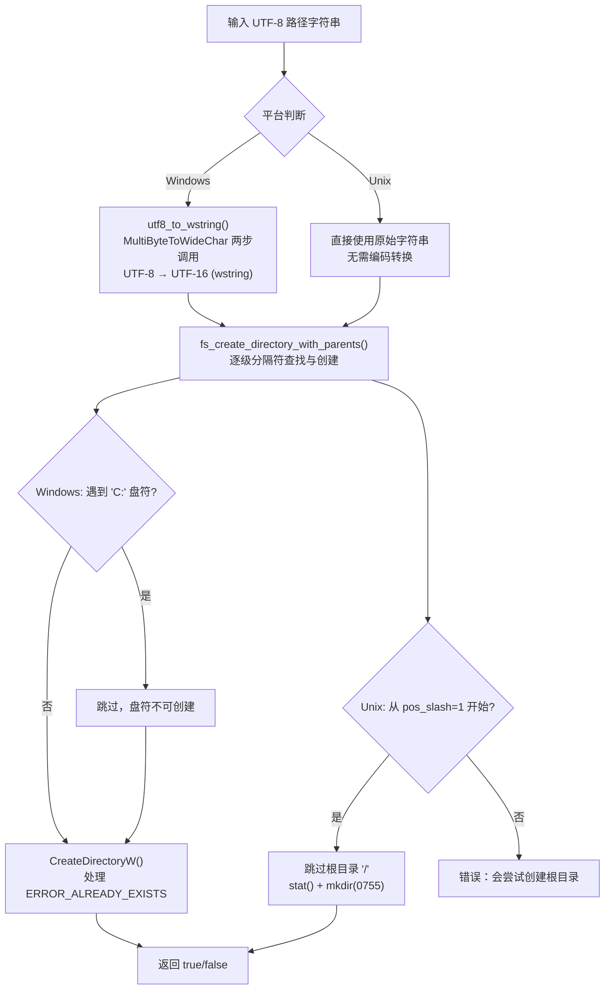
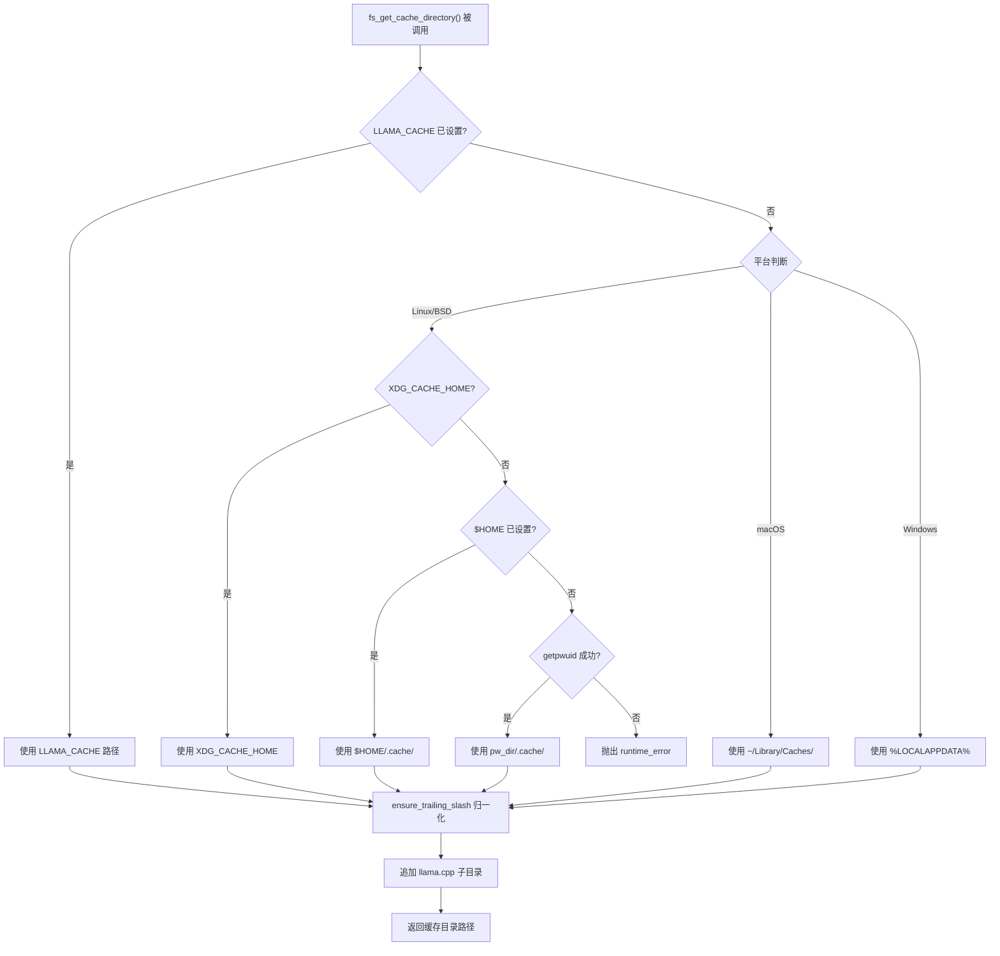
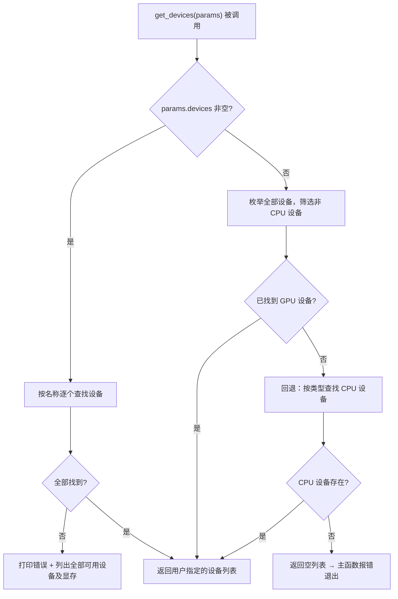
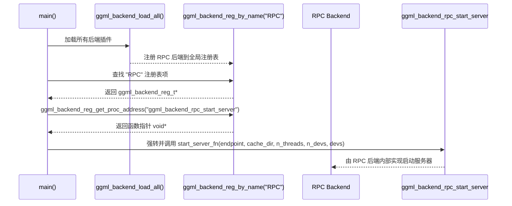

...[/content]` 标记中）。

[content]


# 第72章 远程推理与分布式计算 —— 跨越网络的「算力搬运」

## 学习目标

- 理解 rpc_server_params 结构体的设计哲学：值语义、默认线程数策略与引用传递的解析模式
- 掌握跨平台路径处理的三大技巧：UTF-8到宽字符转换、目录分隔符宏统一、递归目录创建（含Windows盘符跳过）
- 学会多级回退的缓存目录探测策略：环境变量优先级链（LLAMA_CACHE → XDG_CACHE_HOME → HOME → getpwuid）及macOS/Windows平台规范
- 理解命令行参数解析的防御式设计：严格数值校验、正则分割设备列表、未识别参数立即报错退出
- 掌握设备选择的三级火箭策略：显式指定 → GPU优先自动探测 → CPU回退保底
- 理解动态加载的插件化架构：ggml_backend_load_all、ggml_backend_reg_by_name、ggml_backend_reg_get_proc_address 的协作流程
- 认识RPC服务器的安全边界：无加密协议的风险警告与实验性功能定位

## 72.1 生活类比

想象 rpc-server 是一家**跨城算力快递公司的调度总站**：`rpc_server_params` 就是快递站的「运营配置表」，写明仓库地址（host）、收货窗口号（port）、快递员人数（threads）、可用车辆列表（devices），一切配置集中在一处，一眼看全。跨平台路径三兄弟——`utf8_to_wstring`、`DIRECTORY_SEPARATOR` 宏、`fs_create_directory_with_parents`——是不同城市的地址规则翻译官：有的城市用中文地址（UTF-8），有的用拼音（宽字符），有的用斜杠分隔街道，有的用反斜杠，翻译官确保无论哪种格式都能准确找到目的地。`fs_get_cache_directory` 的多级回退，就像寄包裹时找临时仓储点：先看客户指定的仓库（LLAMA_CACHE），没有就看城市标准仓库（XDG_CACHE_HOME），再找用户家后院（$HOME/.cache），最后实在不行查户口本（getpwuid），总有一个能放包裹。参数解析的防御式设计，如同快递站的收货检查员：重量（端口号）超出范围立即拒收，看不懂的地址（未知参数）直接退回并附上格式说明（print_usage），绝不含糊放行。设备选择的三级火箭策略，好比快递分拣的车辆调度：优先用客户指定的专车（-d 参数），没指定就派出所有货车（GPU），货车都没了就用自行车（CPU）也得送。动态加载的启动函数，就像调度总站不亲自送货，而是通过电话（函数指针）联系各区域车队经理（RPC 后端），让他们自己组织车队出发，总站只负责传达指令。而安全警告，则是快递站门口的红色警示牌：「本服务无保险柜（无加密），请勿将贵重物品暴露给外人（非本地绑定）」——醒目、直接、不容忽视。

## 72.2 源码地图

```
tools/rpc/rpc-server.cpp
├── 头文件与宏定义（1-24行）
│   ├── ggml-rpc.h               # RPC后端公共头文件
│   ├── DIRECTORY_SEPARATOR      # 跨平台目录分隔符宏（'\\\\' / '/'）
│   ├── Windows: windows.h, fcntl.h, io.h
│   └── Unix: unistd.h, sys/stat.h, pwd.h
├── rpc_server_params 结构体（27-32行）
│   ├── host        = "127.0.0.1"          # 默认仅监听本地回环
│   ├── port        = 50052                  # 默认RPC端口
│   ├── use_cache   = false                  # 本地文件缓存开关
│   ├── n_threads   = hardware_concurrency()/2  # 保守线程数策略
│   └── devices     = {}                     # 设备名称列表
├── 跨平台工具函数（43-133行）
│   ├── utf8_to_wstring()        # [Win] UTF-8 → wstring 转换（43-63行）
│   │   ├── MultiByteToWideChar()   # 第一次调用获取所需缓冲区大小
│   │   └── MultiByteToWideChar()   # 第二次调用执行实际转换
│   ├── fs_create_directory_with_parents()  # 递归创建目录（64-133行）
│   │   ├── GetFileAttributesW()    # [Win] 检查路径是否已存在且为目录
│   │   ├── CreateDirectoryW()      # [Win] 逐级创建目录，跳过盘符（C:）
│   │   │   └── ERROR_ALREADY_EXISTS  # 并发安全的重复创建处理
│   │   ├── stat()                  # [Unix] 检查路径存在性与类型
│   │   └── mkdir(path, 0755)       # [Unix] 逐级创建目录
├── 缓存目录获取（134-187行）
│   ├── fs_get_cache_directory()   # 跨平台缓存目录探测（134-187行）
│   │   ├── ensure_trailing_slash  # Lambda：确保路径以分隔符结尾
│   │   ├── LLAMA_CACHE            # 最高优先级：用户自定义缓存路径
│   │   ├── XDG_CACHE_HOME         # [Linux] XDG 规范缓存目录
│   │   ├── $HOME/.cache/          # [Linux] 标准用户缓存回退
│   │   ├── getpwuid(getuid())     # [Linux] 终极回退：从passwd数据库获取HOME
│   │   ├── ~/Library/Caches/      # [macOS] 平台规范缓存目录
│   │   ├── %LOCALAPPDATA%         # [Windows] 平台规范缓存目录
│   │   └── + "llama.cpp/"         # 追加项目子目录避免污染系统缓存根
├── 命令行解析与帮助（188-254行）
│   ├── print_usage()              # 打印帮助信息到 stderr（188-200行）
│   └── rpc_server_params_parse()  # 参数解析主函数（201-254行）
│       ├── -H/--host              # 绑定地址
│       ├── -t/--threads           # 线程数（必须为正整数）
│       ├── -d/--device            # 设备列表，正则 [,/]+ 分割
│       │   └── std::regex + sregex_token_iterator  # 兼容逗号/斜杠分隔
│       ├── -p/--port              # 端口号（1-65535范围校验）
│       ├── -c/--cache             # 启用本地文件缓存
│       └── -h/--help              # 打印帮助并退出
├── 设备发现（255-291行）
│   └── get_devices()              # 三级设备选择策略（255-291行）
│       ├── 第一级：按用户指定名称查找
│       │   ├── ggml_backend_dev_by_name()  # 按名称精确匹配
│       │   └── 失败时列出所有可用设备+显存信息
│       ├── 第二级：自动选择所有非CPU设备
│       │   ├── ggml_backend_dev_count()    # 枚举全部设备
│       │   └── ggml_backend_dev_type() != CPU  # GPU优先策略
│       └── 第三级：回退到CPU设备
│           └── ggml_backend_dev_by_type(CPU)  # 保底可用性
└── 主函数（292-344行）
    ├── std::setlocale(LC_NUMERIC, "C")  # 防止地区设置干扰数值解析
    ├── ggml_backend_load_all()           # 动态加载所有后端插件
    ├── rpc_server_params_parse()         # 解析命令行参数
    ├── 安全警告（host != 127.0.0.1时）    # 醒目标记非本地监听风险
    ├── get_devices()                     # 获取可用计算设备
    ├── 缓存目录惰性创建（仅--cache时）    # fs_get_cache_directory() + "rpc/"
    ├── ggml_backend_reg_by_name("RPC")   # 查找RPC后端注册表
    ├── ggml_backend_reg_get_proc_address()  # 动态获取启动函数指针
    │   └── "ggml_backend_rpc_start_server"  # 解耦的插件化启动入口
    └── start_server_fn(endpoint, cache_dir, n_threads, n_devs, devs)
```

### 72.2.1 rpc_server_params 结构体架构图

```mermaid
classDiagram
    class rpc_server_params {
        +std::string host
        +int port
        +bool use_cache
        +int n_threads
        +std::vector<std::string> devices
        +rpc_server_params()
    }
    note for rpc_server_params "值语义配置中枢\n所有字段带默认值\n无全局状态，便于测试"
    
    rpc_server_params --> "host = 127.0.0.1" : 默认本地回环
    rpc_server_params --> "port = 50052" : 默认RPC端口
    rpc_server_params --> "use_cache = false" : 缓存默认关闭
    rpc_server_params --> "n_threads = hardware_concurrency()/2" : 保守线程策略
    rpc_server_params --> "devices = {}" : 空即自动探测
```

### 72.2.2 跨平台路径处理流程图



## 72.3 RPC 服务器参数体系 —— 算力输出的「控制面板」

为什么需要一个独立的参数结构体 `rpc_server_params`？因为 RPC 服务器的配置项虽然不多，但每一项都直接决定服务器的网络行为与计算资源分配，集中管理比散落的全局变量可靠得多。它采用「值语义」设计：结构体在 `main()` 里构造，解析函数通过引用参数填充后返回布尔值，外部拿不到任何全局状态，测试时也容易构造不同的参数组合。线程数默认取 `hardware_concurrency()/2` 而非占满所有核心，是给操作系统和其他进程留出喘息空间——RPC 服务器要同时服务多个远程请求，留一半核心做调度远比跑满更稳。

跨平台路径处理的「三叉戟」解决了同一个可执行文件在 Windows 与 Unix 上的路径兼容问题。`utf8_to_wstring` 是 Windows 宽字符 API 的适配层，把命令行传进来的 UTF-8 字符串转成 UTF-16，因为 `CreateDirectoryW` 这类 API 只吃宽字符。`DIRECTORY_SEPARATOR` 宏在编译期就消除了 `/` 与 `\\` 的平台差异，让后续代码可以统一引用。`fs_create_directory_with_parents` 则把「逐级建目录」这个操作做成跨平台的 `mkdir -p`，而且在 Windows 上特意跳过 `C:` 这类盘符——它不是目录，不能被 `CreateDirectoryW` 创建。

### 72.3.1 rpc_server_params：配置中枢的值语义设计

源码路径：`tools/rpc/rpc-server.cpp` - `rpc_server_params`（1-42行）
核心结构体：`rpc_server_params`

```cpp
#include "ggml-rpc.h"                // RPC 后端公共头文件，提供 ggml_backend_reg_t 等类型
#ifdef _WIN32
#  define NOMINMAX                  // 防止 windows.h 中 min/max 宏污染 std::min/max
#  define DIRECTORY_SEPARATOR '\\'  // Windows 平台使用反斜杠作为路径分隔符
#  include <windows.h>             // Windows API：CreateDirectoryW、GetFileAttributesW 等
#  include <fcntl.h>               // 文件控制选项
#  include <io.h>                  // 文件 IO
#else
#  define DIRECTORY_SEPARATOR '/'   // Unix 平台使用正斜杠作为路径分隔符
#  include <unistd.h>              // POSIX API：mkdir、getuid 等
#  include <sys/stat.h>            // stat、mkdir、权限常量
#endif
#include <algorithm>               // std::max
#include <clocale>                  // std::setlocale
#include <codecvt>                  // 字符编码转换（预留）
#include <filesystem>               // 文件系统工具（预留，当前手写实现）
#include <regex>                    // std::regex：设备列表正则分割
#include <stdio.h>                  // fprintf、printf
#include <string>                   // std::string
#include <thread>                   // std::thread::hardware_concurrency
#include <vector>                   // std::vector
#if defined(__linux__)
#  include <sys/types.h>           // uid_t 类型定义
#  include <pwd.h>                 // getpwuid：从 passwd 数据库获取用户 HOME
#endif

struct rpc_server_params {
    std::string              host        = "127.0.0.1";   // 默认仅监听本地回环地址
    int                      port        = 50052;          // 默认 RPC 端口
    bool                     use_cache   = false;           // 本地文件缓存默认关闭
    int                      n_threads   = std::max(1U, std::thread::hardware_concurrency()/2);  // 保守线程数：最多使用一半核心
    std::vector<std::string> devices;                     // 设备名称列表，空表示自动探测
};
```

这段代码定义了 `rpc_server_params` 结构体与跨平台头文件骨架：五个字段覆盖了 RPC 服务器的全部运行时配置，且全部带默认值，确保即使一个参数都不传也能以合理配置启动。`n_threads` 的默认表达式先用 `std::max(1U, ...)` 保证至少 1 个线程，再取硬件并发数的一半，是「不占满、不归零」的保守策略。

### 72.3.2 utf8_to_wstring()：Windows 平台的编码翻译官

源码路径：`tools/rpc/rpc-server.cpp` - `utf8_to_wstring()`（43-63行）
关键函数：`utf8_to_wstring()`

```cpp
static std::wstring utf8_to_wstring(const std::string & str) {
    if (str.empty()) {                              // 空字符串快速返回，避免无意义的 API 调用
        return std::wstring();
    }

    int size = MultiByteToWideChar(CP_UTF8, 0, str.c_str(), (int)str.size(), NULL, 0);  // 第一次调用：仅获取所需宽字符缓冲区大小

    if (size <= 0) {                                // 转换失败（如非法 UTF-8 序列）
        return std::wstring();
    }

    std::wstring wstr(size, 0);                     // 分配指定长度的宽字符串缓冲区
    MultiByteToWideChar(CP_UTF8, 0, str.c_str(), (int)str.size(), &wstr[0], size);     // 第二次调用：执行实际的 UTF-8 → UTF-16 转换

    return wstr;
}
```

这段代码展示了 Windows 宽字符 API 经典的「两步调用」模式：第一次传 NULL 输出缓冲区拿大小，第二次才真正写入。这种写法避免了固定大小缓冲区溢出的风险，是跨平台代码适配 Windows 时的必备套路。

### 72.3.3 fs_create_directory_with_parents()：递归建目录的「mkdir -p」

源码路径：`tools/rpc/rpc-server.cpp` - `fs_create_directory_with_parents()`（64-133行）
关键函数：`fs_create_directory_with_parents()`

```cpp
static bool fs_create_directory_with_parents(const std::string & path) {
#ifdef _WIN32
    std::wstring wpath = utf8_to_wstring(path);     // Windows 宽字符 API 要求 UTF-16 输入

    const DWORD attributes = GetFileAttributesW(wpath.c_str());  // 检查路径是否已存在
    if ((attributes != INVALID_FILE_ATTRIBUTES) && (attributes & FILE_ATTRIBUTE_DIRECTORY)) {
        return true;                                 // 已存在且为目录，直接成功
    }

    size_t pos_slash = 0;

    while ((pos_slash = path.find('\\', pos_slash)) != std::string::npos) {  // 逐级定位反斜杠分隔符
        const std::wstring subpath = wpath.substr(0, pos_slash);              // 截取当前级子路径

        pos_slash += 1;

        if (subpath.length() == 2 && subpath[1] == ':') {  // 跳过盘符（如 "C:"），它不是可创建的目录
            continue;
        }

        const bool success = CreateDirectoryW(subpath.c_str(), NULL);  // 创建当前级目录

        if (!success) {
            const DWORD error = GetLastError();

            if (error == ERROR_ALREADY_EXISTS) {              // 并发场景下他人已创建
                const DWORD attributes = GetFileAttributesW(subpath.c_str());
                if (attributes == INVALID_FILE_ATTRIBUTES || !(attributes & FILE_ATTRIBUTE_DIRECTORY)) {
                    return false;                             // 存在但不是目录，创建失败
                }
            } else {
                return false;                                 // 其他错误（如权限不足）直接失败
            }
        }
    }

    return true;
#else
    struct stat info;
    if (stat(path.c_str(), &info) == 0) {                // 路径已存在
        return S_ISDIR(info.st_mode);                    // 校验是否为目录
    }

    size_t pos_slash = 1;                                // 从 1 开始，跳过根目录 "/"

    while ((pos_slash = path.find('/', pos_slash)) != std::string::npos) {
        const std::string subpath = path.substr(0, pos_slash);
        struct stat info;

        if (stat(subpath.c_str(), &info) == 0) {         // 中间级已存在
            if (!S_ISDIR(info.st_mode)) {
                return false;                             // 存在但不是目录
            }
        } else {
            const int ret = mkdir(subpath.c_str(), 0755);  // 创建中间级目录，rwxr-xr-x 权限
            if (ret != 0) {
                return false;
            }
        }

        pos_slash += 1;
    }

    return true;
#endif
}
```

这段代码对比了同一语义在两个平台的实现差异：Windows 分支用宽字符 API 配合 `ERROR_ALREADY_EXISTS` 实现并发安全的重复创建，并以盘符长度为 2 作为跳过条件；Unix 分支则用 `stat` + `mkdir` 逐级推进，`pos_slash` 从 1 起步是为了避开根目录 `/`（它必然存在，无需创建）。两个分支的返回值语义一致：成功返回 true，任一级失败立即返回 false。

## 72.4 跨平台缓存目录 —— 模型数据的「临时仓库」

RPC 服务器在启用本地缓存时需要一个可写的目录存放远程拉取的模型分片，但不同操作系统的「用户缓存」位置各不相同。`fs_get_cache_directory` 的设计哲学是「多级回退 + 平台规范」：不是简单取一个环境变量了事，而是构建一条优先级链，从最显式的用户意图一路回退到系统级的兜底信息，同时用 `ensure_trailing_slash` 这个 Lambda 把路径尾部的分隔符统一规范化，消除后续字符串拼接的二义性。最终路径都会追加 `llama.cpp` 子目录，避免把文件散落在系统缓存根里污染全局。

### 72.4.1 fs_get_cache_directory()：多级回退的缓存探测

源码路径：`tools/rpc/rpc-server.cpp` - `fs_get_cache_directory()`（134-187行）
关键函数：`fs_get_cache_directory()`

```cpp
static std::string fs_get_cache_directory() {
    std::string cache_directory = "";
    auto ensure_trailing_slash = [](std::string p) {     // 尾部斜杠归一化 Lambda
        if (p.back() != DIRECTORY_SEPARATOR) {
            p += DIRECTORY_SEPARATOR;
        }
        return p;
    };
    if (getenv("LLAMA_CACHE")) {                        // 最高优先级：用户自定义缓存路径
        cache_directory = std::getenv("LLAMA_CACHE");
    } else {
#if defined(__linux__) || defined(__FreeBSD__) || defined(_AIX__) || \
    defined(__OpenBSD__) || defined(__NetBSD__)
        if (std::getenv("XDG_CACHE_HOME")) {            // Linux 规范缓存目录
            cache_directory = std::getenv("XDG_CACHE_HOME");
        } else if (std::getenv("HOME")) {               // 用户家目录下的 .cache
            cache_directory = std::getenv("HOME") + std::string("/.cache/");
        } else {
#if defined(__linux__)
            struct passwd *pw = getpwuid(getuid());     // 终极回退：从 passwd 数据库获取 HOME
            if ((!pw) || (!pw->pw_dir)) {
                throw std::runtime_error("Failed to find $HOME directory");
            }

            cache_directory = std::string(pw->pw_dir) + std::string("/.cache/");
#else
            throw std::runtime_error("Failed to find $HOME directory");
#endif
        }
#elif defined(__APPLE__)
        cache_directory = std::getenv("HOME") + std::string("/Library/Caches/");  // macOS 平台规范
#elif defined(_WIN32)
        cache_directory = std::getenv("LOCALAPPDATA");  // Windows 平台规范
#elif defined(__EMSCRIPTEN__)
        GGML_ABORT("not implemented on this platform");
#else
#  error Unknown architecture
#endif
        cache_directory = ensure_trailing_slash(cache_directory);
        cache_directory += "llama.cpp";                 // 追加项目子目录，避免污染系统缓存根
    }
    return ensure_trailing_slash(cache_directory);
}
```

这段代码实现了跨平台缓存目录的多级回退探测：`LLAMA_CACHE` 是用户显式指定的最高优先级，一旦设置便直接采用且跳过平台分支；否则按 Linux（XDG → HOME → getpwuid）、macOS（`~/Library/Caches`）、Windows（`%LOCALAPPDATA%`）的平台规范依次尝试，最终统一追加 `llama.cpp` 子目录并保证尾部斜杠。`getpwuid` 这一级是为「环境变量被清空」这类极端场景准备的兜底，从系统 passwd 数据库直接读取用户主目录。

缓存目录的解析路径如下图所示：



## 72.5 命令行解析与设备发现 —— 算力资源的「扫描仪」

命令行解析层的目标是把用户的意图翻译成 `rpc_server_params` 里的字段，同时拒绝一切 malformed 的输入。它的防御式设计体现在三处：数值字段有严格范围（端口 1-65535、线程数必须为正），设备列表用正则 `[,/]+` 统一多种分隔符，未识别的参数立即打印错误并退出——绝不静默忽略，否则用户以为指定了某个选项、实际却没生效，调试成本极高。`print_usage` 把默认值直接嵌进帮助文本，让用户一眼看到「不传参时会是什么样」。

设备发现则遵循「三级火箭」策略：先看用户有没有显式指定 `-d`，有就按名称精确匹配并附带失败时的诊断信息；没指定就自动枚举所有非 CPU 设备，充分利用 GPU 算力；CPU 都没有才回退到 CPU 设备保底。这种设计让用户在「精确控制」与「开箱即用」之间自由切换。

### 72.5.1 print_usage()：帮助信息的出口

源码路径：`tools/rpc/rpc-server.cpp` - `print_usage()`（188-200行）
关键函数：`print_usage()`

```cpp
static void print_usage(int /*argc*/, char ** argv, rpc_server_params params) {
    fprintf(stderr, "Usage: %s [options]\n\n", argv[0]);           // 程序名 + 选项占位
    fprintf(stderr, "options:\n");
    fprintf(stderr, "  -h, --help                       show this help message and exit\n");
    fprintf(stderr, "  -t, --threads N                  number of threads for the CPU device (default: %d)\n", params.n_threads);
    fprintf(stderr, "  -d, --device <dev1,dev2,...>     comma-separated list of devices\n");
    fprintf(stderr, "  -H, --host HOST                  host to bind to (default: %s)\n", params.host.c_str());
    fprintf(stderr, "  -p, --port PORT                  port to bind to (default: %d)\n", params.port);
    fprintf(stderr, "  -c, --cache                      enable local file cache\n");
    fprintf(stderr, "\n");
}
```

这段代码把帮助信息输出到 `stderr` 而非 `stdout`，保持与错误消息一致的语义——帮助往往伴随「参数不对」的上下文触发。每个选项的默认值都从 `params` 现取现填，保证帮助文本与实际默认行为始终同步。

### 72.5.2 rpc_server_params_parse()：防御式参数解析

源码路径：`tools/rpc/rpc-server.cpp` - `rpc_server_params_parse()`（201-254行）
关键函数：`rpc_server_params_parse()`

```cpp
static bool rpc_server_params_parse(int argc, char ** argv, rpc_server_params & params) {
    std::string arg;
    for (int i = 1; i < argc; i++) {                              // 跳过 argv[0] 程序名
        arg = argv[i];
        if (arg == "-H" || arg == "--host") {
            if (++i >= argc) { return false; }                    // 缺少参数值
            params.host = argv[i];
        } else if (arg == "-t" || arg == "--threads") {
            if (++i >= argc) { return false; }
            params.n_threads = std::stoi(argv[i]);
            if (params.n_threads <= 0) {                          // 防御式校验：线程数必须为正
                fprintf(stderr, "error: invalid number of threads: %d\n", params.n_threads);
                return false;
            }
        } else if (arg == "-d" || arg == "--device") {
            if (++i >= argc) { return false; }
            const std::regex regex{ R"([,/]+)" };                 // 兼容逗号与斜杠的分隔正则
            std::string dev_str = argv[i];
            std::sregex_token_iterator iter(dev_str.begin(), dev_str.end(), regex, -1);  // 按匹配切分
            std::sregex_token_iterator end;
            for ( ; iter != end; ++iter) {
                try {
                    params.devices.push_back(*iter);
                } catch (const std::exception & ) {
                    fprintf(stderr, "error: invalid device: %s\n", iter->str().c_str());
                    return false;
                }
            }
        } else if (arg == "-p" || arg == "--port") {
            if (++i >= argc) { return false; }
            params.port = std::stoi(argv[i]);
            if (params.port <= 0 || params.port > 65535) {        // 端口范围 1-65535 校验
                return false;
            }
        } else if (arg == "-c" || arg == "--cache") {
            params.use_cache = true;
        } else if (arg == "-h" || arg == "--help") {
            print_usage(argc, argv, params);
            exit(0);
        } else {                                                  // 未识别参数：立即报错退出，拒绝静默失败
            fprintf(stderr, "error: unknown argument: %s\n", arg.c_str());
            print_usage(argc, argv, params);
            exit(0);
        }
    }
    return true;
}
```

这段代码实现了完整的命令行解析循环，每个选项都同时支持短形式（`-H`）与长形式（`--host`），并用 `++i` 前置递增安全地消费参数值。设备列表的正则 `[,/]+` 把 `cuda0,cuda1` 与 `cuda0/cuda1` 两种写法统一处理，`sregex_token_iterator` 配合 `-1` 捕获组返回所有非分隔符片段。未识别参数分支直接 `exit(0)` 并打印帮助，避免解析器 silently 吞掉未知输入。

### 72.5.3 get_devices()：设备选择的三级火箭

源码路径：`tools/rpc/rpc-server.cpp` - `get_devices()`（255-291行）
关键函数：`get_devices()`

```cpp
static std::vector<ggml_backend_dev_t> get_devices(const rpc_server_params & params) {
    std::vector<ggml_backend_dev_t> devices;
    if (!params.devices.empty()) {                                // 第一级：按用户指定名称精确查找
        for (auto device : params.devices) {
            ggml_backend_dev_t dev = ggml_backend_dev_by_name(device.c_str());
            if (dev) {
                devices.push_back(dev);
            } else {
                fprintf(stderr, "error: unknown device: %s\n", device.c_str());
                fprintf(stderr, "available devices:\n");
                for (size_t i = 0; i < ggml_backend_dev_count(); i++) {   // 列出全部可用设备辅助诊断
                    auto * dev = ggml_backend_dev_get(i);
                    size_t free, total;
                    ggml_backend_dev_memory(dev, &free, &total);
                    printf("  %s: %s (%zu MiB, %zu MiB free)\n",
                        ggml_backend_dev_name(dev), ggml_backend_dev_description(dev),
                        total / 1024 / 1024, free / 1024 / 1024);
                }
                return {};
            }
        }
    }

    if (devices.empty()) {                                        // 第二级：自动选择所有非 CPU 设备（GPU 优先）
        for (size_t i = 0; i < ggml_backend_dev_count(); i++) {
            ggml_backend_dev_t dev = ggml_backend_dev_get(i);
            if (ggml_backend_dev_type(dev) != GGML_BACKEND_DEVICE_TYPE_CPU) {
                devices.push_back(dev);
            }
        }
    }

    if (devices.empty()) {                                        // 第三级：回退到 CPU 设备保底
        ggml_backend_dev_t dev = ggml_backend_dev_by_type(GGML_BACKEND_DEVICE_TYPE_CPU);
        if (dev) {
            devices.push_back(dev);
        }
    }

    return devices;
}
```

这段代码实现了设备发现的三级回退策略：第一级按用户 `-d` 指定的名称精确匹配，失败时打印全部可用设备的名称、描述与显存/内存用量作为诊断信息；第二级枚举所有非 CPU 设备，把 GPU 之类的加速器全部纳入；第三级在没有任何 GPU 时回退到 CPU，保证最低限度的可运行性。每一级都以 `devices.empty()` 作为是否进入下一级的判断条件，逻辑清晰且无副作用。

设备选择的决策路径如下图所示：



## 72.6 主函数启动流程 —— 远程算力的「点火序列」

`main()` 是整个 RPC 服务器的点火序列，每一步都有明确的职责边界。开头的 `std::setlocale(LC_NUMERIC, "C")` 是最容易被忽略的细节——它强制用 C locale 处理数字，防止某些欧洲地区设置把小数点写成逗号，导致端口、线程数这类数值解析出错。随后 `ggml_backend_load_all()` 把所有编译进来的后端插件（CUDA、Metal、Vulkan 等）动态加载，让后续的设备发现能看到完整的硬件全家福。参数解析失败时立即退出，成功后若 host 不是 `127.0.0.1` 则打印醒目的安全警告：RPC 协议无加密，暴露到公网等于裸奔，且明确标注这是实验性功能。

拿到设备列表后，若启用了 `--cache`，才惰性创建 `rpc/` 缓存子目录——不启用时绝不做无意义的磁盘 IO。最后通过 `ggml_backend_reg_by_name("RPC")` 拿到 RPC 后端注册表，再用 `ggml_backend_reg_get_proc_address` 动态取出 `ggml_backend_rpc_start_server` 函数指针并调用。这一层间接调用是架构解耦的关键：主程序不关心 RPC 后端如何启动服务器，只要拿到函数指针、传入参数即可，后端可以随时热插拔。

### 72.6.1 main()：从解析到启动的完整链路

源码路径：`tools/rpc/rpc-server.cpp` - `main()`（292-344行）
关键函数：`main()`

```cpp
int main(int argc, char * argv[]) {
    std::setlocale(LC_NUMERIC, "C");                              // 强制 C locale，防止欧洲逗号小数点干扰数值解析

    ggml_backend_load_all();                                      // 动态加载所有可用后端插件

    rpc_server_params params;
    if (!rpc_server_params_parse(argc, argv, params)) {
        fprintf(stderr, "Invalid parameters\n");
        return 1;
    }

    if (params.host != "127.0.0.1") {                            // 非本地绑定触发安全警告
        fprintf(stderr, "\n");
        fprintf(stderr, "!!!!!!!!!!!!!!!!!!!!!!!!!!!!!!!!!!!!!!!!!!!!!!!!!!!!!!!!!!!\n");
        fprintf(stderr, "WARNING: Host ('%s') is != '127.0.0.1'\n", params.host.c_str());
        fprintf(stderr, "         Never expose the RPC server to an open network!\n");
        fprintf(stderr, "         This is an experimental feature and is not secure!\n");
        fprintf(stderr, "!!!!!!!!!!!!!!!!!!!!!!!!!!!!!!!!!!!!!!!!!!!!!!!!!!!!!!!!!!!\n");
        fprintf(stderr, "\n");
    }

    auto devices = get_devices(params);
    if (devices.empty()) {
        fprintf(stderr, "No devices found\n");
        return 1;
    }
    std::string endpoint = params.host + ":" + std::to_string(params.port);
    const char * cache_dir = nullptr;
    std::string cache_dir_str;
    if (params.use_cache) {                                       // 仅 --cache 启用时才创建缓存目录
        cache_dir_str = fs_get_cache_directory() + "rpc/";
        if (!fs_create_directory_with_parents(cache_dir_str)) {
            fprintf(stderr, "Failed to create cache directory: %s\n", cache_dir_str.c_str());
            return 1;
        }
        cache_dir = cache_dir_str.c_str();
    }

    ggml_backend_reg_t reg = ggml_backend_reg_by_name("RPC");     // 按名称查找 RPC 后端注册表
    if (!reg) {
        fprintf(stderr, "Failed to find RPC backend\n");
        return 1;
    }

    auto start_server_fn = (decltype(ggml_backend_rpc_start_server)*) ggml_backend_reg_get_proc_address(reg, "ggml_backend_rpc_start_server");  // 动态获取启动函数指针
    if (!start_server_fn) {
        fprintf(stderr, "Failed to obtain RPC backend start server function\n");
        return 1;
    }

    start_server_fn(endpoint.c_str(), cache_dir, params.n_threads, devices.size(), devices.data());  // 委托后端自行启动
    return 0;
}
```

这段代码完成了 RPC 服务器的完整启动链路：从 locale 初始化、后端插件加载、命令行解析，到安全警告、设备发现、缓存目录惰性创建，最后通过注册表动态获取启动函数并委托给 RPC 后端执行。`cache_dir` 用 `const char *` 指针传递，在 `--cache` 未启用时保持 nullptr，由后端自行判断是否需要缓存，避免了无意义的空字符串传递。

主启动流程的时序如下图所示：

```mermaid
flowchart TD
    A["main() 入口"] --> B["setlocale(LC_NUMERIC, \"C\")"]
    B --> C["ggml_backend_load_all() 加载全部后端插件"]
    C --> D["rpc_server_params_parse() 解析命令行"]
    D --> E{"参数合法?"}
    E -- 否 --> E1["打印 Invalid parameters，退出码 1"]
    E -- 是 --> F{"host != 127.0.0.1?"}
    F -- 是 --> G["打印醒目安全警告"]
    F -- 否 --> H["跳过警告"]
    G --> H
    H --> I["get_devices() 获取计算设备"]
    I --> J{"设备列表非空?"}
    J -- 否 --> J1["打印 No devices found，退出码 1"]
    J -- 是 --> K["拼装 endpoint = host:port"]
    K --> L{"use_cache ?"}
    L -- 是 --> M["创建缓存目录 fs_get_cache_directory() + rpc/"]
    M --> N{"创建成功?"}
    N -- 否 --> N1["打印失败信息，退出码 1"]
    N -- 是 --> O["cache_dir 指向该路径"]
    L -- 否 --> O
    O --> P["ggml_backend_reg_by_name(\"RPC\") 查找 RPC 后端"]
    P --> Q{"注册表存在?"}
    Q -- 否 --> Q1["打印 Failed to find RPC backend，退出码 1"]
    Q -- 是 --> R["ggml_backend_reg_get_proc_address 获取启动函数指针"]
    R --> S{"函数指针有效?"}
    S -- 否 --> S1["打印失败信息，退出码 1"]
    S -- 是 --> T["start_server_fn(endpoint, cache_dir, n_threads, n_devs, devs) 启动服务器"]
```

### 72.6.2 插件化架构交互图



## 72.7 设计中的取舍

**为什么不用静态链接 RPC 后端，而要通过 `ggml_backend_reg_by_name("RPC")` 动态查找？**

如果把 RPC 后端静态链进主程序，代码里就得直接调用 `ggml_backend_rpc_start_server`，看似省了一次注册表查询，实际上把主程序与某个具体后端实现绑死：后端要改名、换实现、或者按需裁剪功能，主程序都得跟着改。动态查找的代价只是一次字符串比较与一次函数指针获取，换来的却是「后端可热插拔」的弹性——RPC 后端可以独立编译、独立迭代，主程序一行不动。对于 llama.cpp 这种后端矩阵动辄十几种的项目，这种解耦不是过度设计，而是维持可维护性的前提。

**这种插件化设计的 trade-off 是什么？**

代价集中在错误处理的间接性上：如果 RPC 后端没编译进来，程序不会在链接期暴露问题，而是在运行期打印 `Failed to find RPC backend` 后退出，调试时需要多一步「确认后端是否启用」的排查。好处则是构建系统更灵活——CI 可以只编译主程序 + CPU 后端，RPC 后端按需开启，既减小二进制体积，又降低依赖链。本质上是把「编译期确定性」换成了「运行期灵活性」。

**为什么线程数默认 `hardware_concurrency()/2`，而不是直接用全部核心？**

RPC 服务器要同时处理多个远程请求的排队、网络 IO 与计算图调度，如果占满所有核心，一旦请求突发就没有任何余量做上下文切换，整体吞吐反而下降。取一半核心是给操作系统和网络栈留出喘息空间，是一种「留有余地」的工程直觉。用户依然可以用 `-t` 覆盖，默认值只是「大多数场景下合理」的起点。

**缓存目录为什么要设计多级回退，而不是只用一个环境变量？**

单一环境变量的方案看起来更简洁，但现实中用户可能在不同机器上以不同方式配置环境：有的通过 `LLAMA_CACHE` 显式指定，有的遵循 XDG 规范，有的连 `HOME` 都未设置（如某些服务账号场景）。多级回退把「用户显式意图 → 行业规范 → 用户主目录 → 系统数据库」串成一条链，任一环缺失都能继续往下找，最终才抛异常。代价是代码分支变多，换来的是在各种边缘环境下的可用性——RPC 服务器经常跑在容器或 CI 里，这些地方的环境变量往往不完整。

## 72.8 动手练习

- 阅读 `tools/rpc/rpc-server.cpp` 第 64-133 行的 `fs_create_directory_with_parents()` 函数，回答以下问题：
  1. 在 Windows 平台，当路径为 `C:\\Users\\test\\cache` 时，代码如何跳过 `C:` 盘符？为什么必须跳过？
  2. 当两个线程同时调用此函数创建同一目录时，`ERROR_ALREADY_EXISTS` 分支如何保证线程安全？
  3. 在 Unix 平台，如果路径中间某一级已存在但不是目录（比如是个普通文件），函数会如何处理？
  4. 为什么在 Unix 分支中 `pos_slash` 初始值为 1 而不是 0？

- 阅读 `tools/rpc/rpc-server.cpp` 第 255-291 行的 `get_devices()` 函数，完成以下分析：
  1. 画出该函数完整的三级回退决策树，标注每级的触发条件
  2. 如果用户通过 `-d cuda0,cuda1` 指定了两个设备但 `cuda1` 不存在，函数的返回结果是什么？为什么这样设计？
  3. 当系统只有 CPU 而无 GPU 时，第二级循环会跳过所有设备，此时 `devices` 为空。第三级如何通过 `ggml_backend_dev_by_type` 找到 CPU 设备？
  4. 错误分支中为什么使用 `printf` 而非 `fprintf(stderr, ...)` 打印可用设备列表？这是有意为之还是疏漏？

- 阅读 `tools/rpc/rpc-server.cpp` 第 292-344 行的 `main()` 函数，回答以下问题：
  1. `ggml_backend_reg_get_proc_address(reg, "ggml_backend_rpc_start_server")` 返回的是 `void*` 类型的通用指针，代码如何将其安全地转换为函数指针类型？
  2. 为什么不直接调用 `ggml_backend_rpc_start_server()` 函数，而要通过注册表动态获取？这种设计带来什么好处？
  3. 如果将 `ggml_backend_load_all()` 移到 `rpc_server_params_parse()` 之后会有什么影响？
  4. 假设 RPC 后端未编译进项目（`GGML_RPC=OFF`），程序会在哪一步失败？错误信息是什么？

- 针对 `fs_get_cache_directory()`（第 134-187 行），设计一组单元测试用例：
  1. 设计至少 6 个测试场景，覆盖所有环境变量组合（设置/未设置 LLAMA_CACHE、XDG_CACHE_HOME、HOME 等）
  2. 每个测试用例需要说明：预期返回值、需要 mock 的环境变量、验证的不变量（如尾部斜杠）
  3. 思考：如何在不修改全局环境的情况下测试这个函数？提示：考虑 `setenv`/`unsetenv` 或依赖注入
  4. 如果 `LLAMA_CACHE` 指向一个不存在的路径，函数是否会自动创建该目录？为什么？

- 假设需要为 rpc-server 添加一个 `--max-connections N` 参数，限制最大并发连接数：
  1. 在 `rpc_server_params` 结构体中添加 `max_connections` 字段，选择合适的默认值并解释理由
  2. 在 `rpc_server_params_parse()` 中添加参数解析逻辑，包括范围校验（如 1-1024）
  3. 在 `print_usage()` 中添加对应的帮助文本，保持与现有选项的格式一致
  4. 思考：`start_server_fn` 的函数签名不包含此参数，如何在 ABI 兼容的前提下传递它？

## 72.9 本章小结

这一章中我们深入了解了 rpc-server 的启动全链路。首先看到 `rpc_server_params` 如何以值语义集中管理 host、port、threads、devices、cache 五项配置，以及 `hardware_concurrency()/2` 这一保守的默认线程策略；其次掌握了跨平台路径处理的三件套——`utf8_to_wstring` 的宽字符转换、`DIRECTORY_SEPARATOR` 宏的编译期统一、`fs_create_directory_with_parents` 的递归创建与盘符跳过；接着解析了 `fs_get_cache_directory` 的多级回退探测与尾部斜杠归一化，并剖析了命令行解析中严格数值校验、正则分割设备列表、未识别参数立即报错的防御式设计；然后追踪了 `get_devices()` 的三级火箭策略——显式指定、GPU 优先、CPU 回退；最后看清了 `main()` 如何通过 locale 初始化、后端动态加载、安全警告、惰性缓存目录创建，以及注册表驱动的函数指针获取，把启动职责优雅地委托给 RPC 后端本身。

本章我们一起学习了以下概念：

| 概念 | 解释 |
|------|------|
| `rpc_server_params` | RPC 服务器配置中枢：host/port/threads/devices/cache 五要素的值语义封装 |
| `hardware_concurrency()/2` | 保守线程数策略——只用一半核心，为系统和其他进程留喘息空间 |
| `utf8_to_wstring()` | Windows 平台 UTF-8 → wstring 转换桥，解决 MultiByteToWideChar 两步调用 |
| `DIRECTORY_SEPARATOR` | 跨平台路径分隔符宏，编译期消除 `\\` 与 `/` 的平台差异 |
| `fs_create_directory_with_parents()` | 递归 mkdir 实现：逐级检查 + 创建，Windows 跳过盘符（C:），Unix 用 0755 权限 |
| `fs_get_cache_directory()` | 多级回退缓存目录探测：LLAMA_CACHE → XDG_CACHE_HOME → $HOME/.cache → getpwuid → 平台规范路径 |
| `ensure_trailing_slash` | 尾部斜杠归一化 Lambda，消除路径拼接的二义性 |
| `rpc_server_params_parse()` | 防御式参数解析：端口 1-65535 校验、正则 [,/]+ 分割设备列表、未知参数立即报错 |
| `get_devices()` | 三级设备选择：显式指定 → 非 CPU 全选 → CPU 回退保底 |
| `ggml_backend_load_all()` | 动态加载所有计算后端插件，实现后端热插拔架构 |
| `ggml_backend_reg_by_name("RPC")` | 按名称查找 RPC 后端注册表，实现主程序与后端实现的解耦 |
| `ggml_backend_reg_get_proc_address()` | 动态获取后端函数指针，避免硬编码函数调用，支持插件化扩展 |
| `std::setlocale(LC_NUMERIC, "C")` | 强制 C locale，防止欧洲逗号小数点等地区设置导致数值解析错误 |
| 安全警告机制 | 非 127.0.0.1 绑定时打印醒目警告，强调 RPC 无加密、仅限实验用途 |
| 缓存目录惰性创建 | 仅 --cache 启用时才创建 rpc/ 子目录，避免无意义的磁盘 IO |

下一章中，我们将学习语音合成工具链，探索基于 OuteTTS 架构的文本转语音流水线，理解从文本编码到音频解码再到 Griffin-Lim 波形重建的完整 TTS 流程。


