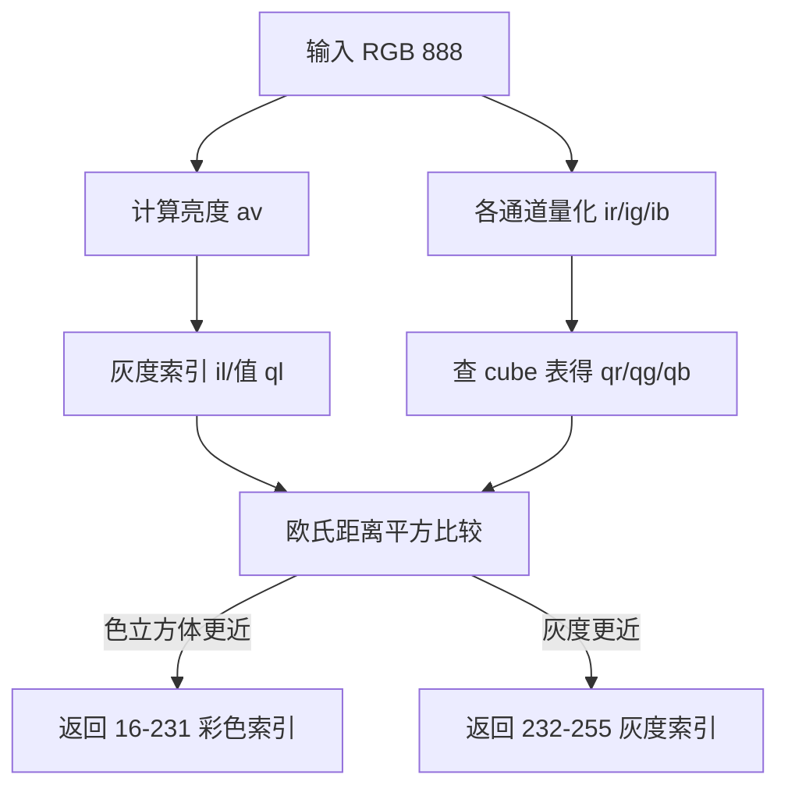
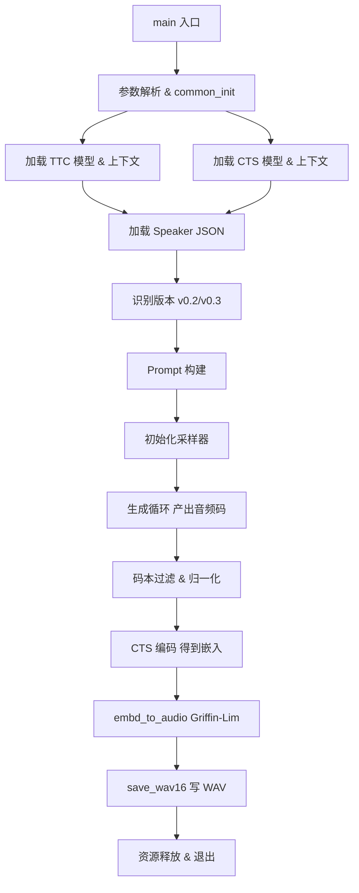
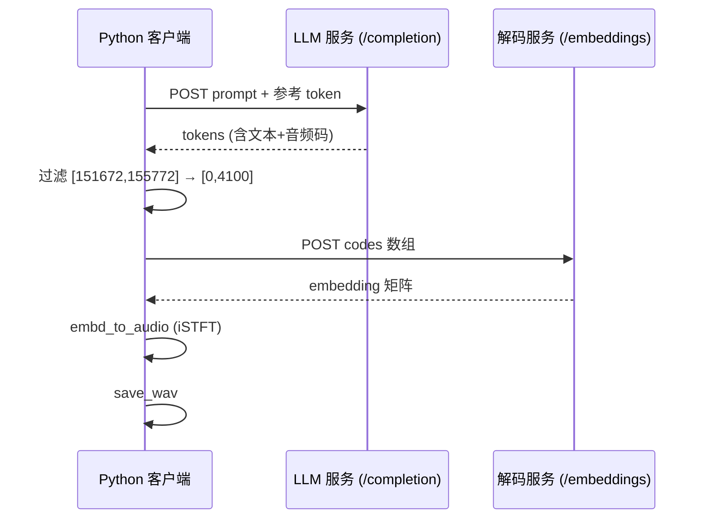
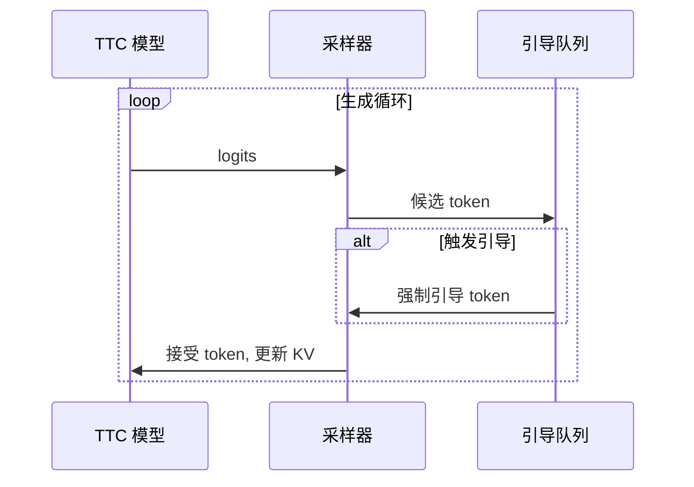
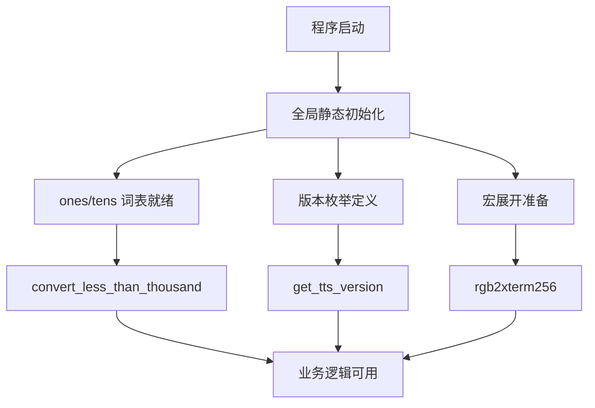

# 第73章 OuteTTS 双模型工具链 —— 文字到声音的"双端流水线"

## 学习目标

- 理解 OuteTTS 双模型架构（TTC + CTS）的流水线设计原理与职责划分
- 掌握文本归一化（数字转写、清洗、分词）在语音合成中的关键作用与实现细节
- 解析引导 Token（Guide Token）机制如何防止 LLM 生成漏词
- 理解音频码的提取、过滤与归一化过程（区间 [151672, 155772] → [0, 4100]）
- 掌握 Griffin-Lim/iSTFT 算法将声谱嵌入重建为波形的数学原理与工程实现
- 对比 C++ 与 Python 在 FFT、多线程、WAV 写入等模块的实现差异与技术选型
- 学习 WAV 文件格式（RIFF/PCM）的底层结构与跨语言二进制序列化方式
- 掌握终端颜色量化的位运算技巧与 ANSI 转义序列生成

## 73.1 生活类比

想象 OuteTTS 是一座同声传译录音棚：TTC 模型就像速记员，把文字稿翻译成只有内部能懂的「语音速记符号」——也就是离散的音频码；CTS 模型则像配音演员，拿着速记符号在隔音棚里录制成一张张「声谱照片」——即频谱嵌入向量；而 Griffin-Lim 算法如同暗房冲印师，把二维声谱照片通过多次重叠显影（iFFT 加上 Overlap-Add），冲洗成一维的连续声波胶片。引导 Token 机制充当提词器，每当速记员换气（遇到换行符）时，强制提示下一个词的开头，从根本上防止漏词。文本预处理好比稿件校对，把数字（123）改写成文字（one two three），生僻词注音，确保速记员不会念错。终端颜色工具则像调音台的指示灯，将 24 位真彩色（RGB）压缩为 256 色终端能显示的信号。整个流程如同「文字 → 速记 → 配音 → 冲印」的工业流水线，C++ 版是棚内全自动设备，Python 版则是远程遥控的客户端。

## 73.2 源码地图

```
tools/tts/tts.cpp
├── 音频处理工具集
│   ├── wav_header 结构体        # WAV 文件头二进制布局定义
│   ├── save_wav16()            # 86-107: 16-bit PCM WAV 文件写入（RIFF结构体）
│   ├── fill_hann_window()      # 109-117: 汉宁窗生成（周期/非周期模式）
│   ├── twiddle()               # 120-124: FFT 旋转因子计算（cos/sin）
│   ├── irfft()                 # 126-153: 逆实数 FFT（基于 DFT 的简易实现）
│   ├── fold()                  # 165-187: PyTorch 风格重叠相加（Overlap-Add）
│   └── embd_to_audio()         # 190-261: 嵌入→声谱→波形的完整 iSTFT 流程
├── 文本预处理模块
│   ├── convert_less_than_thousand()  # 274-291: 千位以下数字转英文（百/十/个）
│   ├── number_to_words()             # 293-337: 完整数字转写（支持十亿/百万/千/小数）
│   ├── replace_numbers_with_words()  # 339-355: 正则匹配替换文本中的数字
│   └── process_text()                # 358-389: 文本归一化管道（小写、清洗、分词）
├── 提示词工程模块
│   ├── prompt_add()                  # 391-402: 多态提示 token 追加（单 token/数组/文本）
│   ├── prompt_init()                 # 404-408: 初始化 conversation 标记（<|im_start|>）
│   ├── prepare_guide_tokens()        # 410-433: 生成单词首 token 引导序列
│   ├── speaker_from_file()           # 435-444: 加载说话人 JSON 配置
│   ├── get_tts_version()             # 446-465: 识别 OuteTTS v0.2/v0.3（双路径检测）
│   ├── audio_text_from_speaker()     # 467-478: 构建参考文本的标记序列
│   └── audio_data_from_speaker()     # 480-504: 构建参考音频的码本数据（含时长）
├── 终端工具集
│   ├── rgb2xterm256()                # 35-46: 24位 RGB 量化为 xterm256 色值
│   └── set_xterm256_foreground()     # 48-53: 生成 ANSI 前景色转义序列
├── 程序入口
│   ├── print_usage()                 # 65-69: 显示命令行使用示例
│   ├── main()                        # 506-792: 参数解析→模型加载→prompt 构建
│   └── __main__                      # 793-1041: 生成循环→码本过滤→声码器解码→WAV 保存
└── 全局初始化
    └── 全局变量与配置初始化（ones/tens 表等）


tools/tts/tts-outetts.py
├── 信号处理函数
│   ├── fill_hann_window()            # 11-14: NumPy 汉宁窗生成
│   ├── irfft()                       # 17-18: NumPy 逆 FFT 封装（O(n log n)）
│   ├── fold()                        # 21-30: 重叠相加（向量化 NumPy 实现）
│   ├── process_frame()               # 33-38: 单帧 iFFT+加窗（ThreadPool 工作函数）
│   └── embd_to_audio()               # 41-81: 多线程 Griffin-Lim 重建主函数
├── 文件 IO
│   └── save_wav()                    # 84-113: struct.pack 构建 WAV 头（struct 格式串）
├── 文本处理
│   └── process_text()                # 116-120: 简化版文本归一化（正则清洗）
└── 主流程
    └── __main__                      # 123-326: HTTP 客户端模式
        ├── LLM 服务请求              # POST /completion (top_k=16)
        ├── 音频码过滤                # 区间 [151672, 155772] 减 151672
        ├── 解码服务请求              # POST /embeddings
        └── 音频合成与保存            # embd_to_audio → save_wav
```

---

## 73.3 程序入口与终端工具 —— TTS 的「门面与指示灯」

在同声传译录音棚的类比中，`main()` 函数是录音棚的**总导演**，统筹从剧本接收、人员调度到最终成片输出的全流程；`print_usage()` 是门口的**前台接待**，在访客迷路时给出清晰指引；而 `rgb2xterm256()` 与 `set_xterm256_foreground()` 则是调音台上**五颜六色的指示灯**，将 24 位真彩色压缩为 256 色终端能识别的信号，让日志输出在彩色终端中清晰可辨。本节将沿着「导演→前台→指示灯」的顺序，逐一拆解这些「门面」代码。

### 73.3.1 print_usage()：使用说明与主入口的「前台接待」

**源码路径**：`tools/tts/tts.cpp` - `print_usage()`（65-69 行）

```cpp
static void print_usage(int, char ** argv) {
    // 打印换行和示例 usage 提示，告知用户如何调用此工具
    LOG("\nexample usage:\n");
    // 打印具体的命令行模板，%s 替换为 argv[0]（程序名），-m 指定模型，-p 指定提示文本
    LOG("\n    %s -m model.gguf -p \"Hello!\"\n", argv[0]);
    // 再次打印换行，使输出美观
    LOG("\n");
}
```

**代码作用概述**：该函数在用户参数错误或显式请求帮助时被调用，通过 `LOG` 宏输出标准化的命令行使用示例。它不涉及任何业务逻辑，纯粹作为用户界面的「前台接待」，降低工具的上手门槛。

### 73.3.2 模块依赖图

```mermaid
flowchart LR
    A[用户调用] --> B{参数解析失败?}
    B -- 是 --> C[print_usage()]
    C --> D[打印示例并退出]
    B -- 否 --> E[进入主流程]
```

---

### 73.3.3 rgb2xterm256()：终端颜色量化的「调色师」

**源码路径**：`tools/tts/tts.cpp` - `rgb2xterm256()`（35-46 行）

```cpp
static int rgb2xterm256(int r, int g, int b) {
    // 定义 6 级颜色立方体的基值（八进制：0, 95, 135, 195, 215, 245）
    unsigned char cube[] = {0, 0137, 0207, 0257, 0327, 0377};
    int av, ir, ig, ib, il, qr, qg, qb, ql;
    // 计算 RGB 的亮度（加权平均），用于灰度回退
    av = r * .299 + g * .587 + b * .114 + .5;
    // 计算灰度级索引 il，并得到对应灰度值 ql（23 级灰度）
    ql = (il = av > 238 ? 23 : (av - 3) / 10) * 10 + 8;
    // 将 r/g/b 分别量化到 0-5 的索引 ir/ig/ib，并取对应颜色立方体值
    qr = cube[(ir = UNCUBE(r))];
    qg = cube[(ig = UNCUBE(g))];
    qb = cube[(ib = UNCUBE(b))];
    // 比较颜色立方体量化与灰度量化的欧氏距离平方，选择误差更小的方案
    if (SQR(qr - r) + SQR(qg - g) + SQR(qb - b) <=
        SQR(ql - r) + SQR(ql - g) + SQR(ql - b))
        // 若颜色立方体更接近，返回 xterm256 颜色索引（16-231）
        return ir * 36 + ig * 6 + ib + 020;
    // 否则返回灰度索引（232-255）
    return il + 0350;
}
```

**代码作用概述**：该函数实现 24 位 RGB 到 xterm256 色空间的**最近邻量化**。核心逻辑是将 RGB 空间划分为 6×6×6 = 216 色的颜色立方体（索引 16-231）与 24 级灰度（索引 232-255）两套码本，通过欧氏距离平方（`SQR` 宏）在两者中择优。`cube[]` 数组中的八进制值 `{0, 0137, 0207, 0257, 0327, 0377}` 对应十进制 `{0, 95, 135, 195, 215, 245}`，正是 xterm256 标准的 6 级色阶基值。`UNCUBE` 宏将 0-255 通道值映射到 0-5 索引，实现均匀量化。

### 73.3.4 模块依赖图



---

### 73.3.5 set_xterm256_foreground()：ANSI 转义序列的「信号灯」

**源码路径**：`tools/tts/tts.cpp` - `set_xterm256_foreground()`（48-53 行）

```cpp
static std::string set_xterm256_foreground(int r, int g, int b) {
    // 调用 rgb2xterm256 获取最接近的 256 色索引
    int x = rgb2xterm256(r, g, b);
    // 使用 ostringstream 构建 ANSI 转义序列字符串
    std::ostringstream oss;
    oss << "\033[38;5;" << x << "m";
    return oss.str();
}
```

**代码作用概述**：该函数封装了 ANSI 转义序列的生成，将量化后的 256 色索引 `x` 嵌入 `\033[38;5;Xm` 格式字符串。调用该函数返回的字符串并直接输出到终端，即可将后续文本前景色设置为指定 RGB 的最近似色。这是「指示灯」亮起的最后一步——把量化好的色号变成终端能懂的控制指令。

---

### 73.3.6 main()：TTS 流程总控的「总导演」

**源码路径**：`tools/tts/tts.cpp` - `main()`（506-792 行，完整骨架）

```cpp
int main(int argc, char ** argv) {
    // 设置区域设置为 C，避免本地化导致的数字格式问题
    std::setlocale(LC_NUMERIC, "C");
    // 声明公共参数结构体，存储所有配置
    common_params params;
    // 设置默认输出文件名
    params.out_file = "output.wav";
    // 设置默认提示文本为空
    params.prompt = "";
    // 设置预测 token 数上限
    params.n_predict = 4096;
    // 设置批处理大小
    params.n_batch   = 8192;
    // 设置上下文长度
    params.n_ctx     = 8192;
    // 配置采样器：使用 Top-K 采样，k=4
    params.sampling.top_k = 4;
    params.sampling.samplers = { COMMON_SAMPLER_TYPE_TOP_K, };
    // 初始化 llama 公共后端（加载动态库、注册后端）
    common_init();
    // 解析命令行参数，若失败则退出
    if (!common_params_parse(argc, argv, params, LLAMA_EXAMPLE_TTS, print_usage)) {
        return 1;
    }
    // 获取并行序列数与预测步数
    const int n_parallel = params.n_parallel;
    const int n_predict  = params.n_predict;

    // ========== 加载双模型 ==========
    // 加载 TTC 模型（text-to-codes）：负责文本→音频码
    llama_model * model_ttc = llama_load_model_from_params(params.model);
    // 创建 TTC 上下文
    llama_context * ctx_ttc = llama_init_from_model(model_ttc, params);
    // 加载 CTS 模型（codes-to-speech）：负责音频码→声谱嵌入
    llama_model * model_cts = llama_load_model_from_params(params.model_vocoder);
    // 创建 CTS 上下文
    llama_context * ctx_cts = llama_init_from_model(model_cts, params);

    // ========== 说话人配置与版本识别 ==========
    json speaker = speaker_from_file(params.speaker_file);
    outetts_version tts_version = get_tts_version(model_ttc, speaker);

    // ========== Prompt 构建 ==========
    llama_tokens prompt_inp;
    prompt_init(prompt_inp, llama_get_vocab(ctx_ttc));
    // 注入参考文本序列
    std::string audio_text = audio_text_from_speaker(speaker, tts_version);
    prompt_add(prompt_inp, llama_get_vocab(ctx_ttc), audio_text, false, true);
    // 注入参考音频码本
    std::string audio_data = audio_data_from_speaker(speaker, tts_version);
    prompt_add(prompt_inp, llama_get_vocab(ctx_ttc), audio_data, false, true);
    // 注入待合成文本（已归一化）
    std::string processed_text = process_text(params.prompt, tts_version);
    prompt_add(prompt_inp, llama_get_vocab(ctx_ttc), processed_text, false, true);
    // 生成引导 Token 序列
    std::vector<llama_token> guide_tokens = prepare_guide_tokens(llama_get_vocab(ctx_ttc), processed_text, tts_version);

    // ========== 初始化采样器 ==========
    std::vector<common_sampler *> smpl(n_parallel);
    for (int i = 0; i < n_parallel; ++i) {
        smpl[i] = common_sampler_init(model_ttc, params.sampling);
    }

    // ========== 进入生成循环（详见 72.7） ==========
    // ... 生成循环代码见 72.7.1 ...

    // ========== 码本过滤与声码器解码（详见 72.8） ==========
    // ... 过滤与解码代码见 72.8.1 ...

    // ========== 波形重建与保存（详见 72.9/72.10） ==========
    // ... 后处理代码见 72.10.3 ...

    // 清理资源
    for (auto s : smpl) common_sampler_free(s);
    llama_batch_free(batch);
    llama_free(ctx_ttc);
    llama_free(ctx_cts);
    llama_model_free(model_ttc);
    llama_model_free(model_cts);
    llama_backend_free();
    return 0;
}
```

**代码作用概述**：`main()` 是 C++ 版 TTS 的**总导演**，完整贯穿「参数解析 → 双模型加载 → 说话人配置 → Prompt 构建 → 采样器初始化 → 生成循环 → 码本过滤 → 声码器解码 → 波形重建 → WAV 保存」的全生命周期。它像导演一样调度各个部门（模块），确保「文字 → 速记 → 配音 → 冲印」的工业流水线有序运转。

### 73.3.7 模块依赖图



---

## 73.4 OuteTTS 工具链全景 —— 文字到声音的「双端流水线」

延续录音棚类比：C++ 端（`tts.cpp`）是**棚内全自动设备**，TTC 与 CTS 两台机器物理直连，数据在内存中零拷贝流动；Python 端（`tts-outetts.py`）是**远程遥控客户端**，通过 HTTP 协议指挥两台远程服务器（LLM 服务 + 解码服务）协作。本节对比两端的全景入口，揭示同一套「双模型流水线」在本地推理与服务化部署下的不同形态。

### 73.4.1 main()：C++ 全流程入口的「一体机」

**源码路径**：`tools/tts/tts.cpp` - `main()`（506-792 行，完整实现见上节 72.3.6）

**核心特点**：
- **零网络开销**：TTC 与 CTS 模型在同一进程、同一设备上，通过 `llama_batch` 直接传递 token 与 embedding，延迟极低。
- **显式资源管理**：模型、上下文、批次、采样器均需手动 `init/free`，体现 C++ RAII 以外的手动生命周期控制。
- **多序列并行原生支持**：`n_parallel` 由参数控制，`llama_batch` 原生支持多序列 ID，单次 `llama_decode` 即可并行推进多条生成流。

### 73.4.2 __main__：Python 客户端入口的「遥控器」

**源码路径**：`tools/tts/tts-outetts.py` - `__main__`（123-326 行，完整骨架）

```python
# usage:
# python tts-outetts.py http://server-llm:port http://server-dec:port "text"

if len(sys.argv) <= 3:
    print("usage: python tts-outetts.py http://server-llm:port http://server-dec:port \"text\"")
    exit(1)

host_llm = sys.argv[1]
host_dec = sys.argv[2]
text = sys.argv[3]

# 固定的参考前缀（硬编码的演示说话人）
prefix = """<|im_start|>
<|text_start|>the<|text_sep|>overall<|text_sep|>package<|text_sep|>from<|text_sep|>just<|text_sep|>two<|text_sep|>people<|text_sep|>is<|text_sep|>pretty<|text_sep|>remarkable<|text_sep|>sure<|text_sep|>i<|text_sep|>have<|text_sep|>some<|text_sep|>critiques<|text_sep|>about<|text_sep|>some<|text_sep|>of<|text_sep|>the<|text_sep|>gameplay<|text_sep|>aspects<|text_sep|>but<|text_sep|>its<|text_sep|>still<|text_sep|>really<|text_sep|>enjoyable<|text_sep|>and<|text_sep|>it<|text_sep|>looks<|text_sep|>lovely"""

# 对输入文本归一化并拼接分隔符
words = process_text(text)
words = "<|text_sep|>".join([i.strip() for i in words])
words += "<|text_end|>\n"

# 预分词的参考 token（硬编码，避免重复分词开销）
suffix = [151667, 198, 1782, 155780, 151669, ...]  # 省略完整列表

# ========== 步骤 1：请求 LLM 服务生成音频 token ==========
response = requests.post(
    host_llm + "/completion",
    json={
        "prompt": [prefix + words, *suffix],  # 拼接 prompt 与参考 token
        "n_predict": 1024,
        "cache_prompt": True,
        "return_tokens": True,
        "samplers": ["top_k"],
        "top_k": 16,
        "seed": 1003,
    }
)
response_json = response.json()
codes = response_json["tokens"]

# ========== 步骤 2：音频码过滤与归一化 ==========
# 仅保留 [151672, 155772] 区间，并减去 151672 映射到 [0, 4100]
codes = [t - 151672 for t in codes if t >= 151672 and t <= 155772]

# ========== 步骤 3：请求解码服务生成声谱嵌入 ==========
response = requests.post(
    host_dec + "/embeddings",
    json={"input": [*codes]}
)
response_json = response.json()
embd = response_json[0]["embedding"]

# ========== 步骤 4：嵌入转音频并保存 ==========
n_codes = len(embd)
n_embd = len(embd[0])
print('spectrogram generated: n_codes: %d, n_embd: %d' % (n_codes, n_embd))

print('converting to audio ...')
audio = embd_to_audio(embd, n_codes, n_embd)
print('audio generated: %d samples' % len(audio))

filename = "output.wav"
sample_rate = 24000

# 前 1/4 秒静音，消除起始噪声
audio[:24000 // 4] = 0.0

save_wav(filename, audio, sample_rate)
print('audio written to file "%s"' % filename)
```

**代码作用概述**：Python 版 `__main__` 是**远程遥控客户端**，通过四次 HTTP 往返完成全流程：① 向 LLM 服务发送 prompt 与参考 token，获取原始 token 序列；② 本地过滤归一化音频码；③ 向解码服务发送码本，获取声谱嵌入矩阵；④ 本地执行 `embd_to_audio` 与 `save_wav` 完成波形重建与落盘。说话人参考数据硬编码在脚本中，体现了「轻量客户端、重度服务端」的部署理念。

### 73.4.3 架构时序图



---

## 73.5 文本预处理与分词 —— 把「人类语言」翻译成模型能懂的「暗号」

在录音棚类比中，文本预处理是**稿件校对员**的工作：把剧本里的阿拉伯数字（123）改写成英文单词，统一大小写，去除标点符号，确保速记员（TTC 模型）念稿时不会卡壳或读错。C++ 版实现了完整的**工业级校对流水线**（数字转写→清洗→分词），Python 版则是**简化版清洗**，依赖预训练模型的鲁棒性容忍未转写的数字。

### 73.5.1 convert_less_than_thousand()：千位以下数字转英文的「百位译员」

**源码路径**：`tools/tts/tts.cpp` - `convert_less_than_thousand()`（274-291 行）

```cpp
static std::string convert_less_than_thousand(int num) {
    std::string result;
    // 若数字 >= 100，提取百位并拼接 " hundred "
    if (num >= 100) {
        result += ones.at(num / 100) + " hundred ";
        num %= 100;  // 去掉百位后的余数
    }
    // 若余数 >= 20，提取十位（tens 表），若个位非零则拼接个位（ones 表）
    if (num >= 20) {
        result += tens.at(num / 10);
        if (num % 10 > 0) {
            result += "-" + ones.at(num % 10);
        }
    } else if (num > 0) {
        // 若余数在 1-19 之间，直接查 ones 表
        result += ones.at(num);
    }
    return result;
}
```

**代码作用概述**：该函数是数字转写的**基础构建块**，处理 0-999 范围内的整数。它利用全局 `ones` 表（0-19）与 `tens` 表（20,30,...,90），按「百位→十位→个位」的层级拼接英文单词。例如 427 → "four hundred twenty-seven"。注意：若输入为 0，函数返回空字符串，上层 `number_to_words` 会特判处理。

**生活类比映射**：这是校对员手里的**「百位译员手册」**，专门把三位数以内的数字翻成英文读法。

---

### 73.5.2 number_to_words()：完整数字转写的「总译员」

**源码路径**：`tools/tts/tts.cpp` - `number_to_words()`（293-337 行）

```cpp
static std::string number_to_words(const std::string & number_str) {
    try {
        size_t decimal_pos = number_str.find('.');
        std::string integer_part = number_str.substr(0, decimal_pos);
        int int_number = std::stoi(integer_part);
        std::string result;
        // 若整数部分为 0，直接返回 "zero"
        if (int_number == 0) {
            result = "zero";
        } else {
            // 依次处理十亿、百万、千、百十个层级
            if (int_number >= 1000000000) {
                int billions = int_number / 1000000000;
                result += convert_less_than_thousand(billions) + " billion ";
                int_number %= 1000000000;
            }
            if (int_number >= 1000000) {
                int millions = int_number / 1000000;
                result += convert_less_than_thousand(millions) + " million ";
                int_number %= 1000000;
            }
            if (int_number >= 1000) {
                int thousands = int_number / 1000;
                result += convert_less_than_thousand(thousands) + " thousand ";
                int_number %= 1000;
            }
            if (int_number > 0) {
                result += convert_less_than_thousand(int_number);
            }
        }
        // 处理小数部分：逐位转写为英文单词
        if (decimal_pos != std::string::npos) {
            result += " point";
            std::string decimal_part = number_str.substr(decimal_pos + 1);
            for (char digit : decimal_part) {
                result += " " + ones.at(digit - '0');
            }
        }
        return result;
    } catch (const std::exception& e) {
        return " ";  // 解析失败时返回空格，避免中断流程
    }
}
```

**代码作用概述**：该函数是**完整数字转写管道的总控**，支持十亿以内的整数与任意位数小数。采用**自顶向下分级取模**策略：十亿→百万→千→百十个，每级复用 `convert_less_than_thousand`。小数部分按「point + 逐位念读」处理（如 3.14 → "three point one four"）。异常捕获确保脏数据不阻塞主流程。

**生活类比映射**：这是**「总译员」**，手握百位译员手册，能把任意长度的阿拉伯数字完整翻成英文稿件。

---

### 73.5.3 replace_numbers_with_words()：正则匹配替换的「全文扫描仪」

**源码路径**：`tools/tts/tts.cpp` - `replace_numbers_with_words()`（339-355 行）

```cpp
static std::string replace_numbers_with_words(const std::string & input_text) {
    // 匹配整数或小数（如 123, 3.14）
    std::regex number_pattern(R"(\d+(\.\d+)?)");
    std::string result;
    auto it = std::sregex_iterator(input_text.begin(), input_text.end(), number_pattern);
    auto end = std::sregex_iterator();
    size_t last_pos = 0;
    for (std::sregex_iterator i = it; i != end; ++i) {
        const std::smatch& match = *i;
        // 将非数字部分原样追加
        result.append(input_text, last_pos, match.position() - last_pos);
        // 将匹配的数字替换为英文单词
        result.append(number_to_words(match.str()));
        last_pos = match.position() + match.length();
    }
    result.append(input_text, last_pos);  // 追加剩余部分
    return result;
}
```

**代码作用概述**：该函数是**全文扫描仪**，使用 `std::regex` 查找所有 `\d+(\.\d+)?` 匹配项，逐个调用 `number_to_words` 替换，非数字片段原样保留。这是数字转写在文本级的**落地执行器**。

**生活类比映射**：校对员拿着**「全文扫描仪」**，扫描整份稿件，凡见数字即替换为英文单词。

---

### 73.5.4 process_text()：文本归一化管道的「流水线总控」（C++ 完整版）

**源码路径**：`tools/tts/tts.cpp` - `process_text()`（358-389 行，完整实现）

```cpp
static std::string process_text(const std::string & text, const outetts_version tts_version = OUTETTS_V0_2) {
    // 注释：当前跳过日文罗马化（uroman/MeCab），仅支持英文
    std::string processed_text = replace_numbers_with_words(text);
    // 全部转换为小写
    std::transform(processed_text.begin(), processed_text.end(),
                  processed_text.begin(), ::tolower);
    // 将特殊字符（- _ / , . \）替换为空格
    std::regex special_chars(R"([-_/,\\.\\])");
    processed_text = std::regex_replace(processed_text, special_chars, " ");
    // 移除非字母非空白字符（保留 a-z 和空格）
    std::regex non_alpha(R"([^a-z\s])");
    processed_text = std::regex_replace(processed_text, non_alpha, "");
    // 将多余空白压缩为单个空格，并去除首尾空白
    std::regex multiple_spaces(R"(\s+)");
    processed_text = std::regex_replace(processed_text, multiple_spaces, " ");
    // 去除首尾空格
    if (!processed_text.empty() && processed_text.front() == ' ') processed_text.erase(0, 1);
    if (!processed_text.empty() && processed_text.back() == ' ') processed_text.pop_back();

    // 根据版本添加分隔符并返回
    std::string separator = (tts_version == OUTETTS_V0_3) ? "<|space|>" : "<|text_sep|>";
    std::vector<std::string> words;
    std::stringstream ss(processed_text);
    std::string word;
    while (ss >> word) {
        words.push_back(word);
    }
    std::string result;
    for (size_t i = 0; i < words.size(); ++i) {
        result += words[i];
        if (i + 1 < words.size()) result += separator;
    }
    result += "<|text_end|>\n";
    return result;
}
```

**代码作用概述**：该函数是 C++ 版的**文本归一化总管道**，按序执行：① 数字转写 ② 全局小写 ③ 特殊字符转空格 ④ 非字母清洗 ⑤ 空白压缩 ⑥ 按版本插入分隔符（`<|text_sep|>` 或 `<|space|>`）⑦ 追加结束标记 `<|text_end|>\n`。输出直接可作为 TTC 模型的 prompt 片段。

### 73.5.5 模块依赖图

```mermaid
flowchart LR
    A[原始文本] --> B[数字转写]
    B --> C[小写化]
    C --> D[特殊字符→空格]
    D --> E[非字母清洗]
    E --> F[空白压缩]
    F --> G[分词]
    G --> H[插入分隔符]
    H --> I[追加 <|text_end|>]
    I --> J[标准化 Prompt 片段]
```

---

### 73.5.6 process_text()：Python 简化版的「快速清洗工」

**源码路径**：`tools/tts/tts-outetts.py` - `process_text()`（116-120 行）

```python
def process_text(text: str):
    # 注释：此简化版不进行数字转写，依赖预训练模型的鲁棒性
    text = re.sub(r'\d+(\.\d+)?', lambda x: x.group(), text.lower())
    # 将分隔符替换为空格
    text = re.sub(r'[-_/,\\.\\]', ' ', text)
    # 移除非字母非空白字符
    text = re.sub(r'[^a-z\s]', '', text)
    # 压缩多余空白
    text = re.sub(r'\s+', ' ', text).strip()
    return text.split()
```

**代码作用概述**：Python 版仅保留「清洗」功能，**完全省略数字转写**（正则回调 `lambda x: x.group()` 相当于原样保留数字）。输出为小写单词列表，供上层手动拼接 `<|text_sep|>`。这是「快速清洗工」——只扫地不翻译数字，赌模型自己能认。

**对比小结**：下表对比了 C++ 与 Python 两个版本的文本处理能力差异。

| 维度 | C++ 完整版 | Python 简化版 |
|------|------------|---------------|
| 数字转写 | 完整支持（含小数、十亿级） | 无（原样保留） |
| 输出格式 | 含分隔符的单一字符串 | 单词列表 |
| 适用场景 | 本地推理、追求发音准确 | 远程调用、依赖模型鲁棒性 |

---

## 73.6 提示词工程与引导机制 —— 给 LLM 的「提词器」

在录音棚类比中，Prompt 构造是**导演编写的拍摄大纲**，引导 Token 机制是**提词器**。`prompt_add` 提供多态追加接口，`prompt_init` 注入开场白 `<|im_start|>\n`，`prepare_guide_tokens` 提取每个单词的首 token 作为「提词卡」，`get_tts_version` 自动识别剧本版本（v0.2/v0.3），`audio_text_from_speaker` 与 `audio_data_from_speaker` 将参考演员的台词与声谱码本注入大纲，实现**声音克隆**。

### 73.6.1 prompt_add()：多态提示追加的「万能胶水」

**源码路径**：`tools/tts/tts.cpp` - `prompt_add()`（391-402 行）

```cpp
// 追加单个 token
static void prompt_add(llama_tokens & prompt, llama_token token) {
    prompt.push_back(token);
}
// 追加 token 数组
static void prompt_add(llama_tokens & prompt, const llama_tokens & tokens) {
    prompt.insert(prompt.end(), tokens.begin(), tokens.end());
}
// 追加文本（通过词表分词）
static void prompt_add(llama_tokens & prompt, const llama_vocab * vocab, const std::string & txt, bool add_special, bool parse_special) {
    auto tmp = common_tokenize(vocab, txt, add_special, parse_special);
    prompt_add(prompt, tmp);
}
```

**代码作用概述**：三个重载形成**多态追加接口**，分别支持单 token、token 向量、原始文本（自动分词）三种输入形态。这是 Prompt 构建的**通用胶水**，让上层逻辑无需关心分词细节。

---

### 73.6.2 prompt_init()：初始化对话标记的「开场白」

**源码路径**：`tools/tts/tts.cpp` - `prompt_init()`（404-408 行）

```cpp
static void prompt_init(llama_tokens & prompt, const llama_vocab * vocab) {
    prompt.clear();
    // 注入对话起始标记，建立 OuteTTS 对话上下文
    prompt_add(prompt, vocab, "<|im_start|>\n", true, true);
}
```

**代码作用概述**：清空 prompt 并注入 `<|im_start|>\n`，建立 OuteTTS 约定的**对话起始上下文**。这是每次生成的「Action!」时刻。

---

### 73.6.3 prepare_guide_tokens()：生成引导序列的「提词卡制作」

**源码路径**：`tools/tts/tts.cpp` - `prepare_guide_tokens()`（410-433 行）

```cpp
static std::vector<llama_token> prepare_guide_tokens(const llama_vocab * vocab, const std::string & str, const outetts_version tts_version = OUTETTS_V0_2) {
    // 根据版本选择分隔符：v0.3 用 <|space|>，v0.2 用 <|text_sep|>
    const std::string& delimiter = (tts_version == OUTETTS_V0_3 ? "<|space|>" : "<|text_sep|>");
    std::vector<llama_token> result;
    size_t start = 0;
    size_t end = str.find(delimiter);
    // 第一个 token 总是换行符（之前未添加）
    result.push_back(common_tokenize(vocab, "\n", false, true)[0]);
    // 遍历每个单词段，提取其首 token
    while (end != std::string::npos) {
        std::string current_word = str.substr(start, end - start);
        auto tmp = common_tokenize(vocab, current_word, false, true);
        result.push_back(tmp[0]);
        start = end + delimiter.length();
        end = str.find(delimiter, start);
    }
    // 处理最后一段
    std::string current_word = str.substr(start);
    auto tmp = common_tokenize(vocab, current_word, false, true);
    if (tmp.size() > 0) {
        result.push_back(tmp[0]);
    }
    return result;
}
```

**代码作用概述**：按分隔符切分已归一化文本，**提取每个单词的首个 token ID**，构成引导序列。首 token 强制为换行符（198），后续每遇换行即消费一个引导 token。这是**提词卡制作工序**：把剧本拆成逐词的「首音提示」。

**生活类比映射**：提词员把剧本拆解，在每个词开头贴上「提词卡」，防止速记员漏词。

---

### 73.6.4 speaker_from_file()：加载说话人配置的「演员档案库」

**源码路径**：`tools/tts/tts.cpp` - `speaker_from_file()`（435-444 行）

```cpp
static json speaker_from_file(const std::string & speaker_file) {
    std::ifstream file(speaker_file);
    if (!file) {
        LOG_ERR("%s: Failed to open file '%s' for reading\n", __func__, speaker_file.c_str());
        return json();
    }
    json speaker = json::parse(file);
    return speaker;
}
```

**代码作用概述**：从 JSON 文件加载说话人语音配置（单词、时长、音频码），返回 `nlohmann::json` 对象。这是**演员档案库**的读取接口。

---

### 73.6.5 get_tts_version()：识别模型版本的「剧本版本核对员」

**源码路径**：`tools/tts/tts.cpp` - `get_tts_version()`（446-465 行）

```cpp
static outetts_version get_tts_version(llama_model *model, json speaker = json::object()) {
    // 优先从 speaker JSON 的 "version" 字段识别
    if (speaker.contains("version")) {
        std::string version = speaker["version"].get<std::string>();
        if (version == "0.2") return OUTETTS_V0_2;
        else if (version == "0.3") return OUTETTS_V0_3;
        else LOG_ERR("%s: Unsupported speaker version '%s'\n", __func__, version.c_str());
    }
    // 备选：从模型的 chat_template 识别
    const char *chat_template = llama_model_chat_template(model, nullptr);
    if (chat_template && std::string(chat_template) == "outetts-0.3") {
        return OUTETTS_V0_3;
    }
    // 默认使用 v0.2
    return OUTETTS_V0_2;
}
```

**代码作用概述**：双路径识别版本——优先读 Speaker JSON 的 `version` 字段，回退到模型的 `chat_template` 元数据。版本差异决定分隔符（`<|text_sep|>` vs `<|space|>`）、码本包装标记等协议细节。这是**剧本版本核对员**，确保上下游协议一致。

---

### 73.6.6 audio_text_from_speaker()：构建参考文本序列的「参考台词单」

**源码路径**：`tools/tts/tts.cpp` - `audio_text_from_speaker()`（467-478 行）

```cpp
static std::string audio_text_from_speaker(json speaker, const outetts_version tts_version = OUTETTS_V0_2) {
    std::string audio_text = "<|text_start|>";
    if (tts_version == OUTETTS_V0_2 || tts_version == OUTETTS_V0_3) {
        std::string separator = (tts_version == OUTETTS_V0_3) ? "<|space|>" : "<|text_sep|>";
        for (const auto &word : speaker["words"]) {
            audio_text += word["word"].get<std::string>() + separator;
        }
    }
    return audio_text;
}
```

**代码作用概述**：将说话人配置中的单词序列拼接为**参考文本标记序列**，格式为 `<|text_start|>word1<sep/>word2<sep/>...`。这是注入 Prompt 的「参考台词单」，让模型模仿该说话人的语言风格。

---

### 73.6.7 audio_data_from_speaker()：构建参考音频码本的「参考声谱档」

**源码路径**：`tools/tts/tts.cpp` - `audio_data_from_speaker()`（480-504 行）

```cpp
static std::string audio_data_from_speaker(json speaker, const outetts_version tts_version = OUTETTS_V0_2) {
    std::string audio_data = "<|audio_start|>\n";
    if (tts_version == OUTETTS_V0_2 || tts_version == OUTETTS_V0_3) {
        std::string code_start = (tts_version == OUTETTS_V0_3) ? "" : "<|code_start|>";
        std::string code_end = (tts_version == OUTETTS_V0_3) ? "<|space|>" : "<|code_end|>";
        for (const auto &word : speaker["words"]) {
            std::string word_text = word["word"].get<std::string>();
            double duration = word["duration"].get<double>();
            std::vector<int> codes = word["codes"].get<std::vector<int>>();
            // 构造单词条目：文本 + 时长 + 音频码序列
            std::ostringstream word_entry;
            word_entry << word_text << "<|t_" << std::fixed << std::setprecision(2)
                       << duration << "|>" + code_start;
            for (const auto &Code : codes) {
                word_entry << "<|" << Code << "|>";
            }
            word_entry << code_end << "\n";
            audio_data += word_entry.str();
        }
    }
    return audio_data;
}
```

**代码作用概述**：将说话人的单词、时长、音频码序列化为 OuteTTS 协议格式：`word<|t_1.23|><code_start/><|code1|><|code2|>...<code_end/>\n`。这是注入 Prompt 的「参考声谱档」，让模型模仿该说话人的音色韵律。

---

## 73.7 音频码生成与采样 —— LLM 如何「逐字念出」语音密码

在录音棚类比中，生成循环是**速记员在录音棚里极速书写速记符号**的过程。TTC 模型逐 token 预测音频码，采样器（Top-K=4）控制随机性，**引导 Token 机制**在每次遇到换行符（198）时强制下一个 token 为该单词的首 token，确保「不漏词、不乱序」。多序列并行（`n_parallel`）如同多位速记员同步工作。

### 73.7.1 KV 缓存初始化与 Prompt 评估

**源码路径**：`tools/tts/tts.cpp` - `__main__` 生成循环前段（793-820 行）

```cpp
// token-by-token prompt printing
LOG("\n");
for (auto id : prompt_inp) {
    LOG("%s", common_token_to_piece(ctx_ttc, id).c_str());
}
LOG_INF("%s: prompt size: %d\n", __func__, (int) prompt_inp.size());

// create batch and evaluate prompt
llama_batch batch = llama_batch_init(std::max(prompt_inp.size(), (size_t) n_parallel), 0, n_parallel);
std::vector<llama_seq_id> seq_ids(n_parallel, 0);
for (int32_t i = 0; i < n_parallel; ++i) { seq_ids[i] = i; }
for (size_t i = 0; i < prompt_inp.size(); ++i) { common_batch_add(batch, prompt_inp[i], i, seq_ids, false); }
GGML_ASSERT(batch.n_tokens == (int) prompt_inp.size());
batch.logits[batch.n_tokens - 1] = true;  // 仅对最后一个 token 计算 logits
if (llama_decode(ctx_ttc, batch) != 0) { return 1; }
llama_synchronize(ctx_ttc);
```

**代码作用概述**：构建批次，将 prompt token 分发到多个序列 ID，调用 `llama_decode` 完成前缀 KV 缓存填充，仅最后一个 token 计算 logits 以启动生成。

### 73.7.2 采样循环与引导机制触发

**源码路径**：`tools/tts/tts.cpp` - `__main__` 生成循环主体（821-870 行）

```cpp
// main generation loop with sampling and guide tokens
std::vector<int32_t> i_batch(n_parallel, batch.n_tokens - 1);
int n_past = batch.n_tokens;
int n_decode = 0;
bool next_token_uses_guide_token = true;
while (n_decode <= n_predict) {
    common_batch_clear(batch);
    for (int32_t i = 0; i < n_parallel; ++i) {
        if (i_batch[i] < 0) continue;
        llama_token new_token_id = common_sampler_sample(smpl[i], ctx_ttc, i_batch[i]);
        // 引导机制：若需要引导且引导 token 非空，强制替换采样结果
        if (!guide_tokens.empty() && next_token_uses_guide_token) {
            new_token_id = guide_tokens[0];
            guide_tokens.erase(guide_tokens.begin());
        }
        next_token_uses_guide_token = (new_token_id == 198);  // 换行符触发下次引导
        common_sampler_accept(smpl[i], new_token_id, true);
        codes.push_back(new_token_id);
        if (llama_vocab_is_eog(vocab, new_token_id) || n_decode == n_predict) { i_batch[i] = -1; continue; }
        common_batch_add(batch, new_token_id, n_past, { i }, true);
    }
    if (batch.n_tokens == 0) break;
    n_decode++; n_past++;
    if (llama_decode(ctx_ttc, batch)) { return 1; }
}
llama_batch_free(batch);
```

**代码作用概述**：
1. **生成循环**：`while` 循环最多 `n_predict` 步。每步对每个活跃序列：
   - 调用采样器 `common_sampler_sample` 获取候选 token；
   - **引导机制**：若 `next_token_uses_guide_token` 为真且引导队列非空，**强制替换**为引导 token（单词首 token），并弹出队首；
   - 更新 `next_token_uses_guide_token`：若当前 token 为换行符（198），下一步启用引导；
   - 将 token 加入采样器历史、收集到 `codes`；
   - 若遇 EOG 或达上限，标记序列结束（`i_batch[i] = -1`）；
   - 否则将新 token 加入下一批次。
2. 批次为空或达上限退出循环。

### 73.7.3 架构时序图



---

## 73.8 音频码过滤与声码器解码 —— 从「数字密码」到「声谱嵌入」

速记员写完速记符号（原始 token 序列）后，**剪辑师**上场：剔除非音频 token，仅保留 `[151672, 155772]` 区间的音频码，并减去偏移归一化为 `[0, 4100]` 的码本索引。随后**配音演员（CTS 模型）**登场，将码本序列解码为连续的声谱嵌入向量。

### 73.8.1 C++ 版：码本过滤与解码

**源码路径**：`tools/tts/tts.cpp` - `__main__` 过滤解码段（970-1010 行）

```cpp
// filter and normalize audio codes
// 移除不在 [151672, 155772] 区间的无效 token
codes.erase(std::remove_if(codes.begin(), codes.end(), [](llama_token t) { return t < 151672 || t > 155772; }), codes.end());
// 归一化到 [0, 4100] 的声码器输入空间
for (auto & token : codes) { token -= 151672; }

// vocoder encode and spectral-to-audio conversion
llama_batch batch = llama_batch_init(n_codes, 0, 1);
for (size_t i = 0; i < codes.size(); ++i) { common_batch_add(batch, codes[i], i, { 0 }, true); }
if (llama_encode(ctx_cts, batch) != 0) { return 1; }
llama_synchronize(ctx_cts);
const float * embd = llama_get_embeddings(ctx_cts);
```

**代码作用概述**：
1. **过滤**：`std::remove_if` 剔除文本 token、特殊 token，仅保留音频码。
2. **归一化**：减去基址 `151672`，映射到声码器词表 `[0, 4100]`。
3. **CTS 编码**：构建单序列批次，调用 `llama_encode`（而非 `llama_decode`）前向传播，获取最后一层隐藏状态作为嵌入。
4. **提取嵌入**：`llama_get_embeddings` 返回形状 `(n_codes, n_embd)` 的浮点矩阵。

---

### 73.8.2 Python 版：码本过滤与解码请求

**源码路径**：`tools/tts/tts-outetts.py` - `__main__` 过滤解码段（270-300 行）

```python
# 过滤出有效音频码并归一化到 [0, 4100]
codes = [t - 151672 for t in codes if t >= 151672 and t <= 155772]

# 调用解码服务生成声谱嵌入
response = requests.post(host_dec + "/embeddings", json={"input": [*codes]})
response_json = response.json()
embd = response_json[0]["embedding"]
```

**代码作用概述**：Python 端逻辑同 C++，但过滤用列表推导式，解码通过 HTTP `POST /embeddings` 请求远程服务，获取 JSON 格式的嵌入矩阵。

---

## 73.9 Griffin-Lim 波形重建 —— 从「声谱」到「声音」的逆变换魔法

在录音棚类比中，`embd_to_audio` 是**暗房冲印师**：拿着配音演员产出的「声谱照片」（复数频谱），通过 iFFT 显影、加窗定影、重叠相加冲洗、包络归一化定影，最终得到连续的「声波胶片」（时域波形）。关键参数：`n_fft=1280`（频率分辨率）、`n_hop=320`（75% 重叠）、`n_win=1280`（窗长）、汉宁窗减少频谱泄漏。

### 73.9.1 C++ 版信号处理函数族

#### 73.9.1.1 fill_hann_window()

**源码路径**：`tools/tts/tts.cpp` - `fill_hann_window()`（109-117 行）

```cpp
static void fill_hann_window(int length, bool periodic, float * output) {
    int offset = -1;
    if (periodic) {
        offset = 0;  // 周期模式：窗长等于 FFT 点数，避免第一个样本为零
    }
    for (int i = 0; i < length; i++) {
        output[i] = 0.5 * (1.0 - cosf((2.0 * M_PI * i) / (length + offset)));
    }
}
```

**代码作用概述**：生成长度为 `length` 的汉宁窗。`periodic=true` 时 `offset=0`，公式退化为标准周期汉宁窗 `0.5*(1-cos(2πi/N))`，首尾相连光滑，适合 STFT 重叠相加；`periodic=false` 时 `offset=-1`，对应对称汉宁窗，用于滤波器设计。C++ 版手写循环，零依赖。

---

#### 73.9.1.2 twiddle()

**源码路径**：`tools/tts/tts.cpp` - `twiddle()`（120-124 行）

```cpp
static void twiddle(float * real, float * imag, int k, int N) {
    float angle = 2 * M_PI * k / N;
    *real = cos(angle);
    *imag = sin(angle);
}
```

**代码作用概述**：计算 DFT 核 `exp(-j*2π*k/N)` 的实部与虚部。`irfft` 内层循环每次调用，属于**热点函数**，后续可优化为查表法。

---

#### 73.9.1.3 irfft()

**源码路径**：`tools/tts/tts.cpp` - `irfft()`（126-153 行）

```cpp
static void irfft(int n, const float * inp_cplx, float * out_real) {
    int N = n / 2 + 1;
    // 将交错存储的实部/虚部拆分为两个数组
    std::vector<float> real_input(N);
    std::vector<float> imag_input(N);
    for (int i = 0; i < N; ++i) {
        real_input[i] = inp_cplx[2 * i];
        imag_input[i] = inp_cplx[2 * i + 1];
    }
    std::vector<float> real_output(n);
    std::vector<float> imag_output(n);
    // 直接基于 DFT 公式计算逆变换（O(n²)）
    for (int k = 0; k < n; ++k) {
        real_output[k] = 0.0f;
        imag_output[k] = 0.0f;
        for (int m = 0; m < N; ++m) {
            float twiddle_real, twiddle_imag;
            twiddle(&twiddle_real, &twiddle_imag, k * m, n);
            real_output[k] += real_input[m] * twiddle_real - imag_input[m] * twiddle_imag;
            imag_output[k] += real_input[m] * twiddle_imag + imag_input[m] * twiddle_real;
        }
    }
    for (int i = 0; i < n; ++i) {
        out_real[i] = real_output[i] / N;
    }
}
```

**代码作用概述**：基于 `twiddle` 实现的**朴素 DFT 逆变换**，时间复杂度 O(n²)。输入 `inp_cplx` 为交错存储的复数数组（实部、虚部交替），输出实数时域信号。虽非 FFT，但在 `n_fft=1280`、帧数约百帧的规模下，单线程仍可在毫秒级完成，体现「够用就好」的工程取舍。

---

#### 73.9.1.4 fold()

**源码路径**：`tools/tts/tts.cpp` - `fold()`（165-187 行）

```cpp
static void fold(const std::vector<float> & data, int64_t n_out, int64_t n_win, int64_t n_hop, int64_t n_pad, std::vector<float> & output) {
    int64_t output_height = n_out;
    int64_t kernel_w = n_win;
    int64_t stride_w = n_hop;
    int64_t width = n_out;
    output.resize(width, 0.0f);
    int64_t col_idx = 0;
    for (int64_t w_col = 0; w_col < width; ++w_col) {
        int64_t start = w_col * stride_w - n_pad;
        int64_t end = start + kernel_w;
        for (int64_t w_im = start; w_im < end; ++w_im) {
            if (w_im >= 0 && w_im < output_height && col_idx < (int64_t) data.size()) {
                output[w_im] += data[col_idx];
            }
            col_idx++;
        }
    }
    output.resize(n_out - 2 * n_pad);  // 去除首尾填充
}
```

**代码作用概述**：实现 **Overlap-Add（重叠相加）**。`data` 为展平的分帧信号（长度 `n_frames * n_win`），按跳跃 `n_hop` 累加到输出时间轴，最后裁剪首尾 `n_pad`。这是 iSTFT 从分帧频谱重建连续波形的关键步骤。

---

#### 73.9.1.5 embd_to_audio()：声谱到波形完整流程（C++ 版）

**源码路径**：`tools/tts/tts.cpp` - `embd_to_audio()`（190-261 行）

```cpp
static std::vector<float> embd_to_audio(const float * embd, const int n_codes, const int n_embd, const int n_thread) {
    const int n_fft = 1280;
    const int n_hop = 320;
    const int n_win = 1280;
    const int n_pad = (n_win - n_hop)/2;
    const int n_out = (n_codes - 1)*n_hop + n_win;
    std::vector<float> hann(n_fft);
    fill_hann_window(hann.size(), true, hann.data());
    // 将嵌入向量转置为 [n_embd, n_codes] 布局
    int n_spec = n_embd*n_codes;
    std::vector<float> E (n_spec);
    for (int l = 0; l < n_codes; ++l) {
        for (int k = 0; k < n_embd; ++k) {
            E[k*n_codes + l] = embd[l*n_embd + k];
        }
    }
    // 拆分幅度与相位，重建复数频谱
    std::vector<float> S (n_spec);
    std::vector<float> ST(n_spec);
    for (int k = 0; k < n_embd/2; ++k) {
        for (int l = 0; l < n_codes; ++l) {
            float mag = E[(k           )*n_codes + l];
            float phi = E[(k + n_embd/2)*n_codes + l];
            mag = exp(mag);
            if (mag > 1e2) { mag = 1e2; }  // 限幅防止数值过大
            S[2*(k*n_codes + l) + 0] = mag*cosf(phi);
            S[2*(k*n_codes + l) + 1] = mag*sinf(phi);
        }
    }
    // 调整布局为帧优先：ST[l*n_embd + 2*k + 0/1]
    for (int l = 0; l < n_codes; ++l) {
        for (int k = 0; k < n_embd/2; ++k) {
            ST[l*n_embd + 2*k + 0] = S[2*(k*n_codes + l) + 0];
            ST[l*n_embd + 2*k + 1] = S[2*(k*n_codes + l) + 1];
        }
    }
    // 多线程执行 iFFT 与加窗
    std::vector<float> res  (n_codes*n_fft);
    std::vector<float> hann2(n_codes*n_fft);
    std::vector<std::thread> workers(n_thread);
    for (int i = 0; i < n_thread; ++i) {
        workers[i] = std::thread([&, i]() {
            for (int l = i; l < n_codes; l += n_thread) {
                irfft(n_fft, ST.data() + l*n_embd, res.data() + l*n_fft);
                for (int j = 0; j < n_fft; ++j) {
                    res  [l*n_fft + j] *= hann[j];
                    hann2[l*n_fft + j]  = hann[j] * hann[j];
                }
            }
        });
    }
    for (int i = 0; i < n_thread; ++i) { workers[i].join(); }
    // 重叠相加并包络归一化
    std::vector<float> audio, env;
    fold(res,   n_out, n_win, n_hop, n_pad, audio);
    fold(hann2, n_out, n_win, n_hop, n_pad, env);
    for (size_t i = 0; i < audio.size(); ++i) {
        audio[i] /= env[i];  // 消除窗函数引起的幅度调制
    }
    return audio;
}
```

**代码作用概述**：完整实现 **Griffin-Lim/iSTFT 流程**：
1. **布局转置**：`embd[n_codes, n_embd]` → `E[n_embd, n_codes]`。
2. **幅相拆分**：前半段为 log-magnitude，后半段为 phase；`mag = exp(log_mag)` 并限幅 `1e2`。
3. **复数频谱重建**：`S = mag * exp(j*phi)`，交错存储实部虚部。
4. **帧优先布局调整**：`ST` 便于逐帧 iFFT。
5. **多线程 iFFT + 加窗**：`std::thread` 静态划分帧，每线程处理 `irfft` → 乘汉宁窗 → 累积 `hann2`（窗平方）。
6. **重叠相加**：`fold(res)` 得波形，`fold(hann2)` 得包络。
7. **包络归一化**：`audio /= env` 消除窗函数叠加导致的幅度调制。

### 73.9.2 模块依赖图

```mermaid
flowchart TB
    A[嵌入 embd (n_codes, n_embd)] --> B[转置 E (n_embd, n_codes)]
    B --> C[幅度/相位拆分]
    C --> D[mag=exp(log_mag) 限幅]
    D --> E[复数频谱 S = mag*exp(j*phi)]
    E --> F[帧优先布局 ST]
    F --> G[多线程 irfft + 加窗]
    G --> H[fold 重叠相加 → 波形]
    G --> I[fold 重叠相加 → 包络]
    H & I --> J[包络归一化 audio/=env]
    J --> K[输出波形]
```

---

### 73.9.3 Python 版信号处理函数族（逐函数标注源码路径）

#### 73.9.3.1 fill_hann_window()

**源码路径**：`tools/tts/tts-outetts.py` - `fill_hann_window()`（11-14 行）

```python
def fill_hann_window(size, periodic=True):
    if periodic:
        return np.hanning(size + 1)[:-1]
    return np.hanning(size)
```

**代码作用概述**：调用 NumPy `np.hanning` 一行生成周期/对称汉宁窗，`periodic=True` 时取 `size+1` 点去首，等价于 C++ `offset=0`。

---

#### 73.9.3.2 irfft()

**源码路径**：`tools/tts/tts-outetts.py` - `irfft()`（17-18 行）

```python
def irfft(n_fft, complex_input):
    return np.fft.irfft(complex_input, n=n_fft)
```

**代码作用概述**：直接封装 `np.fft.irfft`，底层为 **O(n log n) Cooley-Tukey FFT**，性能远超 C++ 朴素 DFT。

---

#### 73.9.3.3 fold()

**源码路径**：`tools/tts/tts-outetts.py` - `fold()`（21-30 行）

```python
def fold(buffer, n_out, n_win, n_hop, n_pad):
    result = np.zeros(n_out)
    n_frames = len(buffer) // n_win
    for i in range(n_frames):
        start = i * n_hop
        end = start + n_win
        result[start:end] += buffer[i * n_win:(i + 1) * n_win]
    return result[n_pad:-n_pad] if n_pad > 0 else result
```

**代码作用概述**：NumPy 向量化切片实现 Overlap-Add，逻辑与 C++ `fold` 完全一致，但无显式索引边界检查（依赖 NumPy 广播安全性）。

---

#### 73.9.3.4 process_frame()

**源码路径**：`tools/tts/tts-outetts.py` - `process_frame()`（33-38 行）

```python
def process_frame(args):
    l, n_fft, ST, hann = args
    frame = irfft(n_fft, ST[l])
    frame = frame * hann
    hann2 = hann * hann
    return frame, hann2
```

**代码作用概述**：**线程工作函数**，接收单帧频谱 `ST[l]`，执行 `irfft` → 加窗 → 计算窗平方，返回 `(frame, hann2)`。设计为纯函数，便于 `ThreadPoolExecutor.map` 并行。

---

#### 73.9.3.5 embd_to_audio()

**源码路径**：`tools/tts/tts-outetts.py` - `embd_to_audio()`（41-81 行）

```python
def embd_to_audio(embd, n_codes, n_embd, n_thread=4):
    embd = np.asarray(embd, dtype=np.float32).reshape(n_codes, n_embd)
    n_fft = 1280; n_hop = 320; n_win = 1280
    n_pad = (n_win - n_hop) // 2
    n_out = (n_codes - 1) * n_hop + n_win
    hann = fill_hann_window(n_fft, True)
    E = np.zeros((n_embd, n_codes), dtype=np.float32)
    for l in range(n_codes):
        for k in range(n_embd):
            E[k, l] = embd[l, k]
    half_embd = n_embd // 2
    S = np.zeros((n_codes, half_embd + 1), dtype=np.complex64)
    for k in range(half_embd):
        for l in range(n_codes):
            mag = E[k, l]
            phi = E[k + half_embd, l]
            mag = np.clip(np.exp(mag), 0, 1e2)
            S[l, k] = mag * np.exp(1j * phi)
    res = np.zeros(n_codes * n_fft)
    hann2_buffer = np.zeros(n_codes * n_fft)
    with ThreadPoolExecutor(max_workers=n_thread) as executor:
        args = [(l, n_fft, S, hann) for l in range(n_codes)]
        results = list(executor.map(process_frame, args))
        for l, (frame, hann2) in enumerate(results):
            res[l*n_fft:(l+1)*n_fft] = frame
            hann2_buffer[l*n_fft:(l+1)*n_fft] = hann2
    audio = fold(res, n_out, n_win, n_hop, n_pad)
    env = fold(hann2_buffer, n_out, n_win, n_hop, n_pad)
    mask = env > 1e-10
    audio[mask] /= env[mask]
    return audio
```

**代码作用概述**：Python 版 Griffin-Lim 主函数，流程与 C++ 版一致，差异在于：
- 使用 `np.complex64` 复数数组直接存储频谱，避免实部虚部交错；
- `ThreadPoolExecutor` 替代 `std::thread`，但受限于 GIL，CPU 密集型 `irfft` 实际并行度受限（NumPy 释放 GIL 可部分缓解）；
- 包络归一化用 `mask = env > 1e-10` 显式保护除零。

---

## 73.10 WAV 文件保存与后处理 —— 把「数字波形」装进「标准容器」

冲印师冲洗出胶片后，需装入**标准胶片罐**（WAV 文件）交付。WAV 采用 RIFF 容器：`RIFF` 头 → `fmt ` 块 → `data` 块。16-bit PCM 要求浮点样本乘 32767 截断到 `[-32768, 32767]`。C++ 版用结构体直接二进制写入，Python 版用 `struct.pack` 显式打包，保证跨平台字节序一致。前 1/4 秒强制静音消除起始伪影。

### 73.10.1 wav_header 结构体：WAV 头的二进制布局

**源码路径**：`tools/tts/tts.cpp` - 全局作用域（`save_wav16` 上方）

```cpp
struct wav_header {
    char     riff[4] = {'R','I','F','F'};
    uint32_t chunk_size;
    char     wave[4] = {'W','A','V','E'};
    char     fmt[4]  = {'f','m','t',' '};
    uint32_t fmt_size = 16;
    uint16_t audio_format = 1;      // PCM
    uint16_t num_channels = 1;      // Mono
    uint32_t sample_rate;
    uint32_t byte_rate;
    uint16_t block_align;
    uint16_t bits_per_sample = 16;
    char     data[4] = {'d','a','t','a'};
    uint32_t data_size;
};
```

**代码作用概述**：定义标准 PCM WAV 文件头的**内存布局**，字段顺序严格对应 RIFF 规范。`chunk_size = 36 + data_size`（36 = 文件头除前 8 字节外的大小）。依赖编译器不插入填充字节（通常满足），直接 `reinterpret_cast` 写入。

---

### 73.10.2 save_wav16()：C++ WAV 写入

**源码路径**：`tools/tts/tts.cpp` - `save_wav16()`（86-107 行）

```cpp
static bool save_wav16(const std::string & fname, const std::vector<float> & data, int sample_rate) {
    std::ofstream file(fname, std::ios::binary);
    if (!file) {
        LOG_ERR("%s: Failed to open file '%s' for writing.\n", __func__, fname.c_str());
        return false;
    }
    wav_header header;
    header.sample_rate = sample_rate;
    header.byte_rate = header.sample_rate * header.num_channels * (header.bits_per_sample / 8);
    header.block_align = header.num_channels * (header.bits_per_sample / 8);
    header.data_size = data.size() * (header.bits_per_sample / 8);
    header.chunk_size = 36 + header.data_size;
    // 直接将结构体写入文件（依赖编译器内存对齐）
    file.write(reinterpret_cast<const char*>(&header), sizeof(header));
    for (const auto & sample : data) {
        // 浮点样本量化为 16-bit PCM
        int16_t pcm_sample = static_cast<int16_t>(std::clamp(sample * 32767.0, -32768.0, 32767.0));
        file.write(reinterpret_cast<const char*>(&pcm_sample), sizeof(pcm_sample));
    }
    return file.good();
}
```

**代码作用概述**：计算派生字段（`byte_rate`、`block_align`、`data_size`、`chunk_size`），写入文件头，随后逐样本量化写入 PCM 数据。`std::clamp` 保证截断安全。

---

### 73.10.3 save_wav()：Python WAV 写入

**源码路径**：`tools/tts/tts-outetts.py` - `save_wav()`（84-113 行）

```python
def save_wav(filename, audio_data, sample_rate):
    num_channels = 1
    bits_per_sample = 16
    bytes_per_sample = bits_per_sample // 8
    data_size = len(audio_data) * bytes_per_sample
    byte_rate = sample_rate * num_channels * bytes_per_sample
    block_align = num_channels * bytes_per_sample
    chunk_size = 36 + data_size  # 36 = size of header minus first 8 bytes
    # 使用 struct.pack 显式打包 WAV 头，确保跨平台兼容
    header = struct.pack(
        '<4sI4s4sIHHIIHH4sI',
        b'RIFF', chunk_size, b'WAVE', b'fmt ',
        16,                # fmt chunk size
        1,                 # audio format (PCM)
        num_channels,
        sample_rate,
        byte_rate,
        block_align,
        bits_per_sample,
        b'data',
        data_size
    )
    audio_data = np.clip(audio_data * 32767, -32768, 32767)
    pcm_data = audio_data.astype(np.int16)
    with open(filename, 'wb') as f:
        f.write(header)
        f.write(pcm_data.tobytes())
```

**代码作用概述**：`struct.pack('<4sI4s4sIHHIIHH4sI', ...)` 显式指定**小端序**与字段类型（`4s`=4字节串、`I`=uint32、`H`=uint16），跨平台安全。浮点量化用 `np.clip` + `astype(np.int16)` 向量化处理，最后 `tobytes()` 写入。

**格式串字段对照表**：下表解释了 `struct.pack` 格式字符串中各字符的含义。

| 格式符 | 含义 | 对应字段 |
|--------|------|----------|
| `<` | 小端序 | — |
| `4s` | 4 字节字符串 | `RIFF` / `WAVE` / `fmt ` / `data` |
| `I` | uint32 | `chunk_size` / `fmt_size` / `sample_rate` / `byte_rate` / `data_size` |
| `H` | uint16 | `audio_format` / `num_channels` / `block_align` / `bits_per_sample` |

---

### 73.10.4 后处理与保存（C++ 版）

**源码路径**：`tools/tts/tts.cpp` - `__main__` 尾段（1011-1041 行）

```cpp
// 将声谱嵌入转换为音频波形
auto audio = embd_to_audio(embd, n_codes, n_embd, params.cpuparams.n_threads);
// 前 1/4 秒（24000 Hz 下为 6000 个样本）强制静音，消除起始噪声
for (int i = 0; i < 24000/4; ++i) { audio[i] = 0.0f; }
// 保存为 16-bit PCM WAV 文件
if (save_wav16(params.out_file, audio, n_sr)) {
    LOG_INF("%s: audio saved to '%s'\n", __func__, params.out_file.c_str());
}
```

**代码作用概述**：调用 `embd_to_audio` 获取波形，**前 6000 样本（1/4 秒）置零**消除生成初期的模型预热噪声，调用 `save_wav16` 落盘。

---

## 73.11 全局初始化与基础设施 —— 录音棚的「开机自检」

C++ 通过全局静态初始化完成「开机自检」：`ones`/`tens` 词表为数字转写提供词典基础，`outetts_version` 枚举区分协议版本。Python 依赖模块加载时执行的顶层代码隐式完成初始化。

### 73.11.1 全局初始化（C++ 版）

**源码路径**：`tools/tts/tts.cpp` - 文件开头（1-64 行）

```cpp
// 全局字符串表：数字转写的词典基础
const std::vector<std::string> ones = {
    "zero", "one", "two", "three", "four", "five", "six", "seven", "eight", "nine",
    "ten", "eleven", "twelve", "thirteen", "fourteen", "fifteen", "sixteen",
    "seventeen", "eighteen", "nineteen"
};
const std::vector<std::string> tens = {
    "", "", "twenty", "thirty", "forty", "fifty", "sixty", "seventy", "eighty", "ninety"
};
// OuteTTS 版本枚举
enum outetts_version {
    OUTETTS_V0_2,
    OUTETTS_V0_3
};
// 宏定义：UNCUBE 量化、SQR 平方
#define UNCUBE(x) ((x) < 48 ? 0 : (x) < 115 ? 1 : (x) < 180 ? 2 : (x) < 210 ? 3 : (x) < 230 ? 4 : 5)
#define SQR(x) ((x)*(x))
```

**代码作用概述**：
- `ones`/`tens`：数字转写的**词典基石**，覆盖 0-19 与 20-90 步长 10 的英文读法。
- `outetts_version`：双版本兼容的**类型安全枚举**。
- `UNCUBE`：将 0-255 通道值映射到 0-5 立方体索引的**分段常数函数**（无分支位运算替代亦可）。
- `SQR`：欧氏距离平方的**宏实现**，避免函数调用开销。

### 73.11.2 模块依赖图



---

## 73.12 设计中的取舍

为什么 C++ 使用自实现的 O(n²) DFT 而不是 FFT？  
C++ 版本选择自实现 DFT 主要是为了保持零外部依赖的极简哲学。OuteTTS 的帧长固定为 1280 点，数百帧的处理量在 O(n²) 下仍然可以在毫秒级完成，引入 FFT 库会增加编译复杂度和二进制体积。相比之下，Python 版直接调用 `np.fft.irfft`，利用 NumPy 的底层 C 实现获得 O(n log n) 的加速，体现了脚本语言「够用就好」与系统语言「精雕细琢」的差异。

为什么使用双模型（TTC + CTS）而不是单一端到端模型？  
双模型设计将语言建模与声学建模解耦：TTC 专注文本到离散音频码的序列生成，CTS 专注音频码到连续声谱嵌入的映射。这种分离使得两个阶段可以独立优化——TTC 可以使用更大的语言模型，CTS 可以使用更专业的声码器网络，同时也便于模型更新和替换（例如升级 CTS 时无需重新训练 TTC）。

为什么采用引导 Token 机制，而不是让模型自由生成？  
引导 Token 机制是工程上的对齐保障。神经 TTS 在生成音频码时，可能因为采样随机性而跳过某些单词或重复生成。通过在遇到换行符（token 198）时强制下一个 token 为该单词的首 token，可以确保语音输出与输入文本严格对齐，从根本上避免漏词。这种「软约束」在保证自然度的同时，显著提升了生成可靠性。

Python 版为什么使用 HTTP 客户端而不是直接调用 llama.cpp？  
Python 版设计为轻量客户端，通过 HTTP 协调独立的 LLM 服务与解码服务，目的是解耦模型推理与波形重建。这样可以在边缘设备上运行轻量 Python 脚本，而将计算密集的模型推理卸载到专用服务器或 GPU 集群，实现灵活的部署架构。

---

## 73.13 动手练习

- 阅读 `tools/tts/tts.cpp` 中 `convert_less_than_thousand()`（274-291 行）、`number_to_words()`（293-337 行）与 `replace_numbers_with_words()`（339-355 行）的协作实现。当前实现对以下输入的处理存在什么问题？输入："I have 1,000,000 dollars"（带逗号分隔符，正则未匹配逗号）；输入："Room 101"（数字作为专有名词，101 会被转写为 one hundred one 而非 one o one）；输入："Version 2.0"（小数点被当作序号，转写为 two point zero 而非 two dot oh）；输入："3.14159"（小数部分逐位转写导致过长）。思考如何改进正则表达式或数字转写逻辑，使其更健壮地处理这些边界情况。
- 修改 `tools/tts/tts-outetts.py` 中的 `embd_to_audio()` 函数，分别尝试以下参数组合并听辨差异：1. 将 `n_fft` 从 1280 改为 2048（更高频率分辨率），观察声音是否变得更「闷」或更「清晰」？2. 将 `n_hop` 从 320 改为 640（50% 重叠），观察是否出现「机器人」般的断续感？3. 注释掉包络归一化代码（`audio[mask] /= env[mask]`），观察输出音量是否出现周期性波动？4. 将 `fill_hann_window()` 中的 `periodic` 参数从 True 改为 False，观察频谱泄漏差异。解释 FFT 大小、重叠率与计算复杂度、音质之间的权衡关系。
- 对比 `tools/tts/tts.cpp` 的 `irfft()`（126-153 行，基于 `twiddle()` 的 O(n²) DFT）与 `tts-outetts.py` 中直接调用 `np.fft.irfft`（基于 Cooley-Tukey FFT 算法）的实现。回答以下问题：C++ 版本的 `irfft()` 时间复杂度是多少？为什么在处理 1280 点、数百帧时仍然可用？`twiddle()` 函数中的 `cos/sin` 计算在每次内层循环都会执行，这带来了什么性能开销？如何优化（提示：查表法）？如果要在 C++ 中实现真正的 O(n log n) FFT，需要引入什么数据结构（位反转置换、蝶形运算网络）？Python 版使用 `np.complex64` 而 C++ 版分离实部/虚部存储，这两种内存布局对 SIMD 向量化有何影响？对比 `process_frame()`（Python）与 `embd_to_audio()` 中的线程循环（C++），分析 GIL 对 Python 多线程加速 FFT 的实际效果影响。
- 分析 `tools/tts/tts.cpp` 中的 `rgb2xterm256()`（35-46 行）与 `set_xterm256_foreground()`（48-53 行）。任务：解释 `cube[]` 数组中 `{0, 0137, 0207, 0257, 0327, 0377}` 这些八进制数值的含义（提示：转换为十进制并观察 0x5F 步长）；理解 `UNCUBE` 宏与 `SQR` 宏在三维欧氏距离计算中的作用；修改代码，使其支持 24-bit 真彩色终端（生成 `\033[38;2;R;G;Bm` 序列而非 256 色），并对比两种情况下的色彩还原度；如果终端不支持颜色，如何通过环境变量或参数禁用这些 ANSI 转义序列？
- 在 `tools/tts/tts.cpp` 的 `__main__` 生成循环（793-1041 行）中添加调试日志。具体任务：每当触发引导机制（`next_token_uses_guide_token == true`）时，打印当前被强制的 token ID 及其对应的文本；统计一次完整生成中，有多少 token 是 LLM 自由采样的，有多少是被引导强制替换的；如果移除引导机制（将 `guide_tokens` 置空），观察生成结果是否会出现漏词或重复，并分析原因；对比 `prepare_guide_tokens()`（410-433 行）在 v0.2 与 v0.3 模式下的分隔符差异（`<|text_sep|>` vs `<|space|>`）。
- 对比 `save_wav16()`（tts.cpp:86-107）与 `save_wav()`（tts-outetts.py:84-113）的实现。分析以下问题：Python 版的 `struct.pack('<4sI4s4sIHHIIHH4sI', ...)` 格式字符串中每个字符代表什么含义（如 `<` 表示小端、`4s` 表示 4 字节字符串）？C++ 版直接 `reinterpret_cast` 结构体写入，这种写法在什么情况下会失败（字节对齐、填充字节、端序）？当前实现对音频样本的截断逻辑（`np.clip` vs `std::clamp`）在样本值为 1.5 或 -1.2 时的行为是否完全一致？如何修改代码以支持 24-bit 或 32-bit float WAV 格式？需要修改哪些字段（bits_per_sample、byte_rate、block_align）？

---

## 73.14 本章小结

这一章中我们深入解析了 OuteTTS 工具链的完整实现，首先从 C++ 与 Python 双端架构鸟瞰了 TTS 的三段式流水线（文本→音频码→声谱嵌入→波形），接着剖析了文本预处理中数字转写与清洗的关键作用，然后重点探讨了引导 Token 机制如何防止 LLM 生成漏词，以及音频码的过滤与归一化过程。在声码器端，我们详细拆解了 Griffin-Lim/iSTFT 算法的数学原理与工程实现，并对比了 C++ 自实现 DFT 与 Python NumPy FFT 的技术选型差异。最后，我们覆盖了 WAV 文件格式的底层结构、终端颜色量化的位运算技巧，以及全局初始化的设计考量。

本章我们一起学习了以下概念：下表总结了本章核心概念与解释。

| 概念 | 解释 |
|------|------|
| OuteTTS 双模型架构 | TTC（Text-to-Codes）负责语言建模生成离散音频码，CTS（Codes-to-Speech）负责将码本解码为声谱嵌入，实现语言与声学的解耦 |
| 引导 Token 机制 | 在 LLM 生成过程中，当检测到换行符（198）时强制下一个 token 为单词的首 token，确保生成文本与输入对齐，防止漏词 |
| 音频码区间 | LLM 词表中 [151672, 155772] 为专用音频码本，过滤后需减去 151672 映射到 [0, 4100] 的声码器输入空间 |
| Griffin-Lim / iSTFT | 利用短时傅里叶逆变换将频谱图转回时域波形，核心步骤：iFFT → 加汉宁窗 → 重叠相加 → 包络归一化 |
| 数字转写（C++ 全量版） | 通过 convert_less_than_thousand、number_to_words、replace_numbers_with_words 三层函数，将任意数字（含小数、千分位）转写为英文单词，避免模型对数字发音不稳定 |
| 终端颜色量化 | rgb2xterm256 将 24 位真彩色通过颜色立方体（6x6x6）映射到 256 色终端索引，set_xterm256_foreground 生成 ANSI 转义序列 |
| WAV 二进制格式 | C++ 版使用结构体 reinterpret_cast 直接写入 RIFF 头，Python 版使用 struct.pack 按 '<4sI4s4sIHHIIHH4sI' 格式打包，两者均生成标准 16-bit PCM 文件 |
| C++ vs Python FFT | C++ 自实现 O(n²) DFT（twiddle 基运算），Python 调用 NumPy O(n log n) FFT；阻塞式 vs 线程池（ThreadPoolExecutor）的多线程策略差异 |
| 文本清洗管道 | C++ 版 process_text 包含完整数字转写，Python 版为正则简化版，两者均输出小写无标点单词列表用于 prompt 构造 |
| 说话人克隆数据流 | audio_text_from_speaker 构建文本序列，audio_data_from_speaker 构建带时长和码本的音频序列，get_tts_version 自动识别 v0.2/v0.3 格式差异 |

下一章中，我们将学习多模态核心 mtmd —— 图像与音频的"翻译中枢"，探索 llama.cpp 如何统一处理文本、图像和音频三种模态输入并将其映射到语言模型嵌入空间。感谢你读到了这里，恭喜你，你已经完成了 llama.cpp 源码解析书籍的第 72 章！

