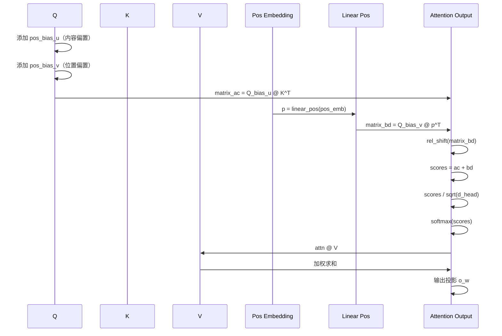
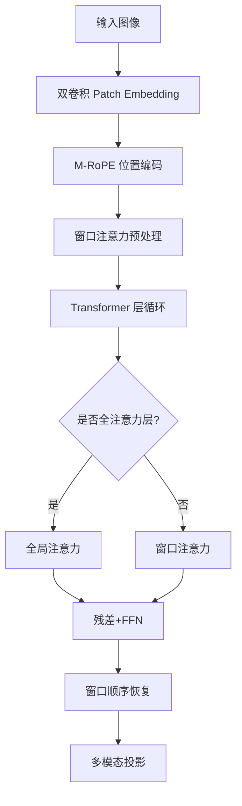
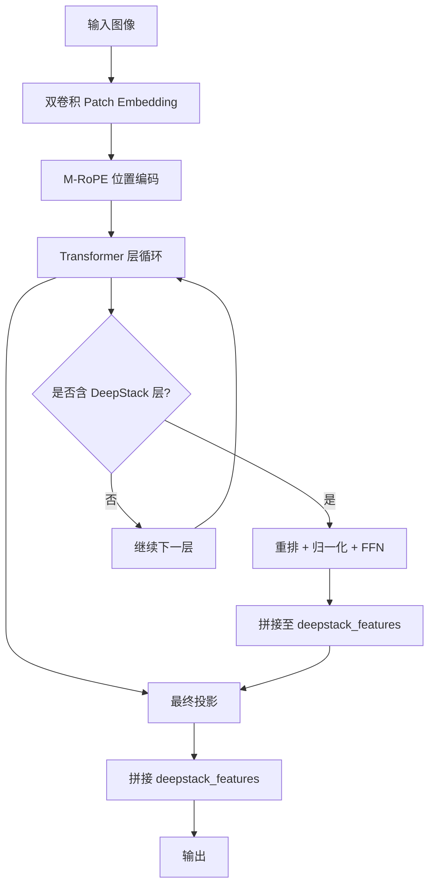
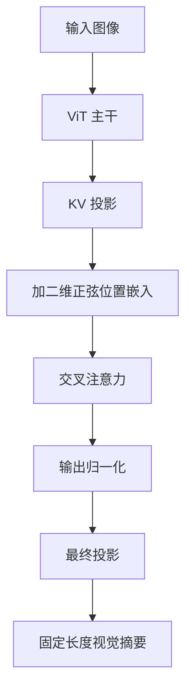
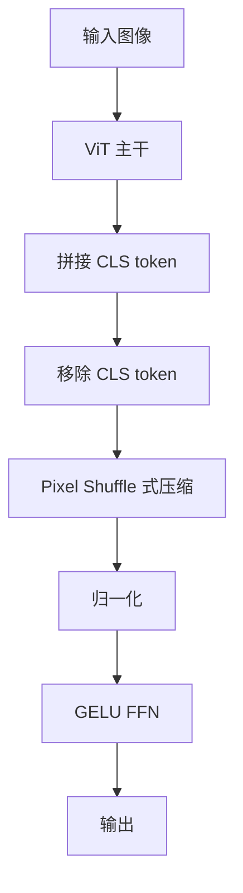
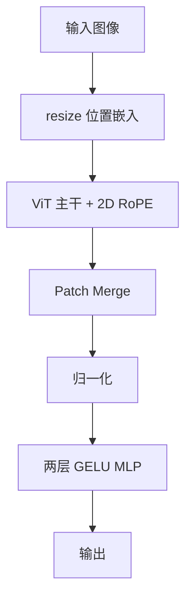
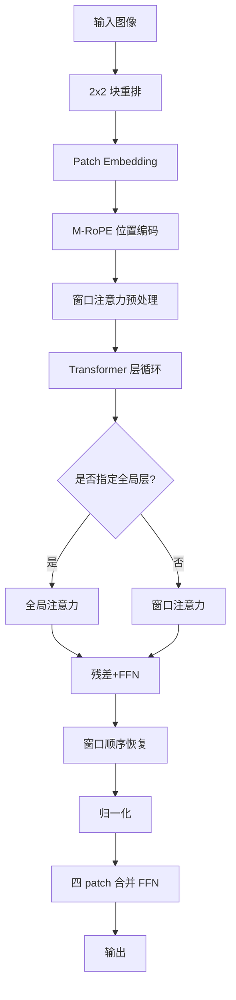
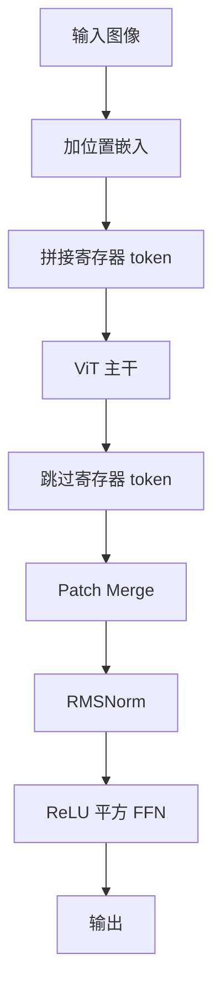
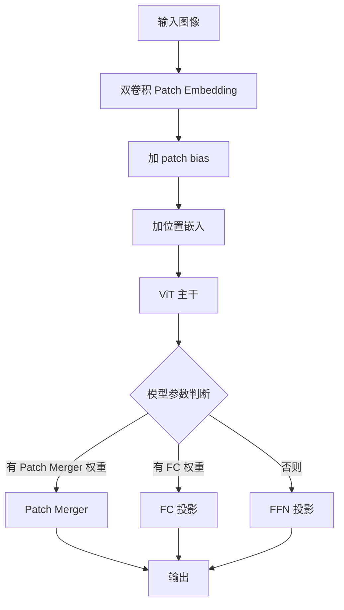
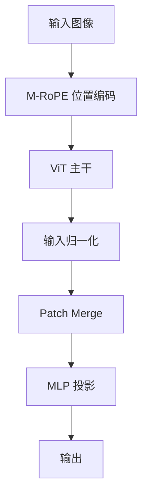

# 第77章 多模态编码器全景图谱：视觉与音频的多国语言翻译官

## 学习目标

- 理解视觉投影器（Projector）的核心作用与分类体系（MLP、Pixel Shuffle、Resampler、Perceiver、VisionPooler）
- 掌握 M-RoPE（多维旋转位置编码）与 2D-RoPE（含 NeoX 与交错模式）在视觉编码器中的实现差异
- 能够分析动态分辨率处理技术（窗口分区、像素重排、位置嵌入插值、3D 位置嵌入缩放）
- 理解音频编码器（Whisper/Conformer/MusicFlamingo）与视觉编码器的架构差异与特征提取流程
- 掌握特殊标记插入技术（IMG_BREAK、BOI/EOI、Image Newline）的实现原理与张量操作技巧
- 能够对比不同多模态架构（LLaVA、Qwen-VL、MiniCPM、Kimi、MobileNetV5、OCR 专用）的图构建策略
- 掌握 MobileNetV5 轻量化视觉编码器的构建逻辑（Edge Residual、Inverted Residual、Multi-Query Attention、MSFA）
- 理解 Gemma4V 可逆线性层（Clippable Linear）与视觉池化（VisionPooler）的钳制机制
- 理解现代多模态模型的通用架构模式：patch embedding → 位置编码（绝对/旋转）→ Transformer 主干 → 特征压缩（合并/池化/重采样）→ 投影到文本空间 → 特殊标记包裹

## 77.1 生活类比：一家跨国翻译公司

想象多模态模型是一家跨国翻译公司，专门把图像和音频这两种“外语”翻译成语言模型能够理解的文本向量。公司的第一站是视觉编码器，它像外联接待处一样接收原始像素，通过 ViT 把颜色、轮廓、物体和空间关系整理成高维特征。接着，Projector 充当专业术语翻译官：LLaVA 的 MLP 逐个 token 完成映射，Llama4 和 InternVL 的 Pixel Shuffle 像把多张纸缩印到一张纸上，MiniCPM-V 的 Resampler 则像摘要撰写员，用固定数量的查询向量从大量视觉信息中提炼重点，HunyuanOCR 的卷积投影器则通过空间合并浓缩文档特征。

每个图像块还需要一位位置坐标标记员。绝对位置嵌入可以提供固定的行列编号；Qwen2-VL 和 Qwen3-VL 采用 M-RoPE，将位置拆分到多个维度中以适应动态高宽比；Gemma4V、Llama4 和 Kimi 则使用 2D-RoPE，把特征维度分给横向和纵向坐标。翻译完成后，文件整理员还会插入 IMG_BREAK、BOI/EOI 或 Image Newline，明确图像边界、行结构和视角边界，避免语言模型把所有视觉 token 误读成无结构的长串向量。

对于手机等资源受限的客户，公司会派出 MobileNetV5 便携式扫描仪。它通过 Edge Residual、Inverted Residual、MQA 和 MSFA 在降低计算成本的同时保留关键细节。CogVLM 与 Gemma4V 则像内容压缩专家：前者使用 SwiGLU 门控，让重要信息获得更大“通行权”；后者使用 VisionPooler 平均池化和 Clippable Linear，把大量视觉内容压缩到更稳定的表示中。文档客户由 OCR 专用团队负责，DeepSeek-OCR 让 SAM 双光镜聚焦局部文字、让 CLIP 镜片把握整页语义；HunyuanOCR 通过 Perceiver 式卷积投影和行末换行符保存版式结构。

如果客户提交的是录音或音乐，音频部门会接手。Whisper 是高效的音频速记员，通过双层 Conv1D 快速压缩时间帧，再由 Transformer 记录时序上下文；Conformer 则像声波雕刻师，先经过多层卷积子采样，再在每个复合块中结合前馈网络、相对位置注意力和卷积模块，最后用半残差缩放保持长序列处理的稳定性。不同模型只是聘用了不同专长的部门，但它们最终都遵循同一条工作链：接收原始模态、提取结构化特征、压缩信息、映射到语言空间，并用标记把结果交给语言模型。

## 77.2 源码地图

本章对应的源码集中在 `tools/mtmd/models/`，`models.h` 负责声明各类图构建器，具体 `.cpp` 文件负责实现 `build()` 及其辅助函数。

```text
tools/mtmd/models/
├── models.h
│   ├── clip_graph_siglip
│   │   ├── clip_graph_siglip(...)
│   │   └── build()
│   ├── clip_graph_gemma4v
│   │   ├── clip_graph_gemma4v(...)
│   │   ├── build()
│   │   └── build_mm()
│   ├── clip_graph_pixtral
│   │   ├── clip_graph_pixtral(...)
│   │   └── build()
│   ├── clip_graph_qwen2vl
│   │   ├── clip_graph_qwen2vl(...)
│   │   └── build()
│   ├── clip_graph_qwen3vl
│   │   ├── clip_graph_qwen3vl(...)
│   │   └── build()
│   ├── clip_graph_youtuvl
│   │   ├── clip_graph_youtuvl(...)
│   │   └── build()
│   ├── clip_graph_minicpmv
│   │   ├── clip_graph_minicpmv(...)
│   │   └── build()
│   ├── clip_graph_internvl
│   │   ├── clip_graph_internvl(...)
│   │   └── build()
│   ├── clip_graph_nemotron_v2_vl
│   │   ├── clip_graph_nemotron_v2_vl(...)
│   │   └── build()
│   ├── clip_graph_llama4
│   │   ├── clip_graph_llama4(...)
│   │   └── build()
│   ├── clip_graph_kimivl
│   │   ├── clip_graph_kimivl(...)
│   │   └── build()
│   ├── clip_graph_paddleocr
│   │   ├── clip_graph_paddleocr(...)
│   │   └── build()
│   ├── clip_graph_cogvlm
│   │   ├── clip_graph_cogvlm(...)
│   │   └── build()
│   ├── clip_graph_llava
│   │   ├── clip_graph_llava(...)
│   │   └── build()
│   ├── clip_graph_whisper_enc
│   │   ├── clip_graph_whisper_enc(...)
│   │   └── build()
│   ├── clip_graph_deepseekocr
│   │   ├── clip_graph_deepseekocr(...)
│   │   └── build()
│   ├── clip_graph_conformer
│   │   ├── clip_graph_conformer(...)
│   │   └── build()
│   ├── clip_graph_glm4v
│   │   ├── clip_graph_glm4v(...)
│   │   └── build()
│   ├── clip_graph_hunyuanocr
│   │   ├── clip_graph_hunyuanocr(...)
│   │   └── build()
│   ├── clip_graph_mobilenetv5
│   │   ├── clip_graph_mobilenetv5(...)
│   │   ├── build()
│   │   ├── rms_norm_2d()
│   │   ├── pad_same_2d()
│   │   ├── build_edge_residual()
│   │   ├── build_inverted_residual()
│   │   └── build_mobilenet_attn()
│   └── clip_graph_kimik25
│       ├── clip_graph_kimik25(...)
│       ├── build()
│       └── resize_position_embeddings_3d()
├── siglip.cpp
│   └── clip_graph_siglip::build()（1-82行）
├── gemma4v.cpp
│   ├── clip_graph_gemma4v::build()（5-133行）
│   └── clip_graph_gemma4v::build_mm()（134-147行）
├── pixtral.cpp
│   └── clip_graph_pixtral::build()（1-88行）
├── qwen2vl.cpp
│   └── clip_graph_qwen2vl::build()（1-139行）
├── qwen3vl.cpp
│   └── clip_graph_qwen3vl::build()（1-180行）
├── youtuvl.cpp
│   └── clip_graph_youtuvl::build()（1-188行）
├── minicpmv.cpp
│   └── clip_graph_minicpmv::build()（1-81行）
├── internvl.cpp
│   └── clip_graph_internvl::build()（3-55行）
├── nemotron-v2-vl.cpp
│   └── clip_graph_nemotron_v2_vl::build()（3-28行）
├── llama4.cpp
│   └── clip_graph_llama4::build()（1-100行）
├── kimivl.cpp
│   └── clip_graph_kimivl::build()（7-49行）
├── paddleocr.cpp
│   └── clip_graph_paddleocr::build()（2-37行）
├── cogvlm.cpp
│   └── clip_graph_cogvlm::build()（4-74行）
├── llava.cpp
│   └── clip_graph_llava::build()（9-447行）
├── whisper-enc.cpp
│   └── clip_graph_whisper_enc::build()（1-78行）
├── deepseekocr.cpp
│   ├── window_partition()（8-27行）
│   ├── window_unpartition()（30-49行）
│   ├── get_rel_pos()（52-81行）
│   └── clip_graph_deepseekocr::build()（103-352行）
├── conformer.cpp
│   └── clip_graph_conformer::build()（1-190行）
├── glm4v.cpp
│   └── clip_graph_glm4v::build()（1-69行）
├── hunyuanocr.cpp
│   └── clip_graph_hunyuanocr::build()（1-51行）
├── mobilenetv5.cpp
│   ├── clip_graph_mobilenetv5::__main__()（1行）
│   ├── rms_norm_2d()（1-17行）
│   ├── pad_same_2d()（19-52行）
│   ├── build_edge_residual()（54-87行）
│   ├── build_inverted_residual()（89-139行）
│   ├── build_mobilenet_attn()（141-228行）
│   └── build()（230-406行）
└── kimik25.cpp
    ├── clip_graph_kimik25::resize_position_embeddings_3d()（10-28行）
    └── clip_graph_kimik25::build()（30-88行）
```

整体继承关系可以概括为：

```text
clip_graph
├── clip_graph_siglip
├── clip_graph_gemma4v
├── clip_graph_pixtral
├── clip_graph_qwen2vl
├── clip_graph_qwen3vl
├── clip_graph_youtuvl
├── clip_graph_minicpmv
├── clip_graph_internvl
├── clip_graph_nemotron_v2_vl
├── clip_graph_llama4
├── clip_graph_kimivl
├── clip_graph_paddleocr
├── clip_graph_cogvlm
├── clip_graph_llava
├── clip_graph_whisper_enc
├── clip_graph_deepseekocr
├── clip_graph_conformer
├── clip_graph_glm4v
├── clip_graph_hunyuanocr
├── clip_graph_mobilenetv5
└── clip_graph_kimik25
```

这些类共享输入构造、归一化、注意力、FFN 和图扩展等基础能力；当某种架构需要特殊布局或特殊投影时，再在派生类中覆盖 `build()`，或者像 MobileNetV5、Gemma4V 和 Kimi-K2.5 一样增加辅助方法。

## 77.3 OCR 专用编码器：文档翻译师的双光镜

本节重点解析 DeepSeek-OCR、HunyuanOCR 和 PaddleOCR。它们服务于同一类客户：高分辨率扫描件、表格、复杂排版和小字号文本。DeepSeek-OCR 的 SAM 分支像文档翻译师的近焦镜片，使用窗口注意力捕捉局部纹理；CLIP 分支像远焦镜片，负责整页语义。HunyuanOCR 则更像摘要撰写员，在 ViT 后用卷积投影器快速压缩空间特征；PaddleOCR 在 M-RoPE 和 Patch Merge 后使用 MLP 完成映射。

### 77.3.1 window_partition()/window_unpartition()/get_rel_pos()：局部注意力与位置插值

源码路径：`tools/mtmd/models/deepseekocr.cpp` - `window_partition()`（8-27行）、`window_unpartition()`（30-49行）、`get_rel_pos()`（52-81行）

```cpp
static ggml_tensor * window_partition(ggml_context * ctx0, ggml_tensor * x, const int window) {
    auto [c, w, h, b] = x->ne;                                   // 解构输入维度：[通道, 宽, 高, 批次]
    const int64_t px  = (window - w % window) % window;          // 计算宽度方向所需的右侧填充
    const int64_t py  = (window - h % window) % window;          // 计算高度方向所需的下侧填充
    const int64_t npw = (w + px) / window;                       // 计算水平方向窗口数量
    const int64_t nph = (h + py) / window;                       // 计算垂直方向窗口数量
    ggml_tensor * cur = x;                                       // 从输入特征图开始
    if (px > 0 || py > 0) {                                      // 如果空间尺寸不能整除窗口
        cur = ggml_pad(ctx0, cur, 0, static_cast<int>(px), static_cast<int>(py), 0); // 对宽、高补齐
    }
    cur = ggml_reshape_4d(ctx0, cur, c * window, npw, window, nph * b); // 把窗口宽合并到通道维
    cur = ggml_cont(ctx0, ggml_permute(ctx0, cur, 0, 2, 1, 3));          // 交换窗口网格维度并连续化
    cur = ggml_reshape_4d(ctx0, cur, c, window, window, npw * nph * b);  // 将每个窗口恢复为独立样本
    return cur;                                               // 输出：[通道, 窗口宽, 窗口高, 窗口总数×批次]
}
```

`window_partition()` 将一张大图切成若干个局部窗口。这里没有调用高层窗口算子，而是使用 `reshape`、`permute` 和 `cont` 手动重排内存，因此可以明确控制 ggml 的维度布局。若宽、高不能被窗口大小整除，函数先补齐边缘，保证每个窗口形状一致。

```cpp
static ggml_tensor * window_unpartition(ggml_context * ctx0,
                                        ggml_tensor *  x,
                                        const int      w,
                                        const int      h,
                                        const int      window) {
    const int64_t c = x->ne[0];                                  // 读取窗口张量的通道数
    const int64_t px  = (window - w % window) % window;           // 重新计算宽度方向的原填充量
    const int64_t py  = (window - h % window) % window;           // 重新计算高度方向的原填充量
    const int64_t npw = (w + px) / window;                       // 计算水平方向窗口数
    const int64_t nph = (h + py) / window;                       // 计算垂直方向窗口数
    const int64_t b = x->ne[3] / (npw * nph);                    // 根据窗口总数还原批次大小
    ggml_tensor * cur = x;                                       // 从窗口张量开始恢复
    cur = ggml_reshape_4d(ctx0, cur, c * window, window, npw, nph * b); // 恢复窗口网格布局
    cur = ggml_cont(ctx0, ggml_permute(ctx0, cur, 0, 2, 1, 3));          // 调整空间维度顺序
    cur = ggml_reshape_4d(ctx0, cur, c, w + px, h + py, b);       // 合并窗口为带填充的特征图
    cur = ggml_view_4d(ctx0, cur, cur->ne[0], w, h, cur->ne[3],  // 创建视图裁剪掉填充区域
                       cur->nb[1], cur->nb[2], cur->nb[3], 0);    // 保留原始宽、高和步长
    cur = ggml_cont(ctx0, cur);                                  // 连续化并返回结果
    return cur;                                                  // 输出：[通道, 原始宽, 原始高, 批次]
}
```

`window_unpartition()` 是前者的逆变换：先恢复窗口网格，再用 `ggml_view_4d()` 裁掉补齐区域。`b` 必须从窗口总数反推，否则局部注意力后的张量无法重新对应到原始批次。这一步对于将局部注意力窗口的输出还原为原始输入布局至关重要，是 SAM 分支中局部层与全局层交替使用的基础。

```cpp
static ggml_tensor * get_rel_pos(ggml_context * ctx0,
                                 ggml_tensor *  rel_pos,          // 相对位置表：[长度, 通道]
                                 ggml_tensor *  indices,           // 相对位置索引：[查询尺寸, 键尺寸]
                                 const int      q_size,             // 查询序列长度
                                 const int      k_size) {           // 键序列长度
    const int64_t C = rel_pos->ne[0];                              // 读取通道数
    const int64_t L = rel_pos->ne[1];                              // 读取位置表长度
    GGML_ASSERT(indices != nullptr);                               // 检查索引张量存在
    GGML_ASSERT(indices->type == GGML_TYPE_I32);                   // 检查索引必须为 I32
    GGML_ASSERT(indices->ne[0] == k_size);                         // 检查索引的键维度
    GGML_ASSERT(indices->ne[1] == q_size);                         // 检查索引的查询维度
    const auto max_rel_dist = 2 * std::max(q_size, k_size) - 1;     // 计算所需的相对距离表长度
    ggml_tensor * cur = rel_pos;                                   // 从原始相对位置表开始
    if (max_rel_dist != L) {                                       // 如果预训练长度与当前尺寸不匹配
        const int64_t ne0 = cur->ne[0];                            // 保存通道维度
        const int64_t ne1 = cur->ne[1];                            // 保存位置长度
        const int64_t ne2 = cur->ne[2];                            // 保存第三维
        const int64_t ne3 = cur->ne[3];                            // 保存第四维
        cur = ggml_reshape_3d(ctx0,                                      // 将位置维移到便于插值的维度
                              ggml_cont(ctx0, ggml_permute(ctx0, cur, 1, 0, 2, 3)),
                              ne1, 1, ne0 * ne2 * ne3);             // 展平成可插值布局
        cur = ggml_reshape_4d(                                     // 插值后恢复四维形状
            ctx0,
            ggml_interpolate(ctx0, cur, max_rel_dist, 1, ne0 * ne2 * ne3, 1,
                             GGML_SCALE_MODE_BILINEAR),             // 沿位置长度双线性插值
            max_rel_dist, ne0, ne2, ne3);                          // 设定新的位置表长度
        cur = ggml_cont(ctx0, ggml_permute(ctx0, cur, 1, 0, 2, 3)); // 恢复通道在前的位置表布局
    }
    const int qk = q_size * k_size;                                // 计算查询与键的索引总数
    cur = ggml_reshape_3d(ctx0,                                      // 将查表结果恢复为三维偏置
                          ggml_get_rows(ctx0, cur,                 // 按相对位置索引收集向量
                                        ggml_reshape_1d(ctx0, indices, qk)), // 将索引展平为一维
                          C, k_size, q_size);                      // 输出：[C, 键长度, 查询长度]
    return cur;                                                     // 返回相对位置偏置
}
```

`get_rel_pos()` 解决了动态分辨率下的位置表长度问题。当窗口尺寸或全局特征图尺寸改变时，所需相对距离数量也会改变，源码先沿位置轴做双线性插值，再使用 `ggml_get_rows()` 根据索引查表。这样既保留了预训练位置表的连续结构，也能适配新的空间尺寸。

### 77.3.2 clip_graph_deepseekocr::build()：SAM 与 CLIP 双光镜融合

源码路径：`tools/mtmd/models/deepseekocr.cpp` - `clip_graph_deepseekocr::build()`（103-352行）

```cpp
ggml_cgraph * clip_graph_deepseekocr::build() {
    // ... (SAM分支构建代码，包含 window_partition 和 window_unpartition)
    ggml_tensor * sam_out;
    {
        // patch embedding
        ggml_tensor * inpL = ggml_conv_2d_sk_p0(ctx0, model.patch_embed_proj_w, inp_raw); // 输入图像卷积嵌入
        inpL = ggml_add(ctx0, inpL, ggml_reshape_3d(ctx0, model.patch_embed_proj_b, 1, 1, n_embd)); // 添加偏置
        inpL = ggml_cont(ctx0, ggml_permute(ctx0, inpL, 1, 2, 0, 3)); // 调整为 [C, W, H, B]
        // ... 添加位置嵌入，若尺寸不匹配则进行双三次插值
        for (int il = 0; il < n_layer; il++) {
            // ... 局部层使用 window_partition，全局层使用完整特征图
            // ... 计算相对位置偏置 rw, rh 并构建 mask
            cur = build_attn(layer.o_w, layer.o_b, Q, K, V, mask, scale, il); // 注意力层
            if (hparams.is_global_attn(il) == false) {
                cur = window_unpartition(ctx0, cur, w0, h0, window); // 局部层逆窗口分区
            }
            // ... 残差连接与 FFN
        }
        // ... Neck 卷积与下采样
        sam_out = cur;
    }
    // ... (CLIP分支构建代码)
    ggml_tensor * clip_out;
    {
        // 将 SAM 输出展平并添加 CLS token
        // ... 位置嵌入调整与拼接
        ggml_tensor * cur = build_vit(inp, n_pos, NORM_TYPE_NORMAL, FFN_GELU_QUICK, learned_pos_embd, nullptr); // CLIP ViT
        clip_out = cur;
    }
    // 融合 SAM 与 CLIP 输出
    ggml_tensor * cur;
    cur = ggml_concat(ctx0, clip_out, sam_out, 0); // 沿特征维拼接
    cur = ggml_reshape_2d(ctx0, cur, 2 * n_embd, clip_n_patches); // 重排为二维
    cur = ggml_mul_mat(ctx0, model.mm_fc_w, cur); // mm_fc 线性投影
    cur = ggml_add(ctx0, cur, model.mm_fc_b);
    // ... 插入 image_newline 与 view_seperator
}
```

DeepSeek-OCR 的构建流程如下：

```text
输入图像
  ├── SAM 分支：Patch Embedding → 局部/全局窗口注意力 → Neck → SAM 特征
  └── CLIP 分支：SAM 特征展平 → CLS + 位置嵌入 → CLIP ViT → CLIP 特征
                    ↓
              通道维度拼接
                    ↓
             mm_fc 线性投影
                    ↓
       每行追加 image_newline
                    ↓
       末尾追加 view_seperator
```

SAM 分支中的局部层先调用 `window_partition()`，全局层直接使用完整特征图；注意力通过水平相对位置偏置和垂直相对位置偏置相加，形成二维空间掩码。经过 Neck 卷积后，SAM 输出被复制给 CLIP 分支。CLIP 分支补充 CLS token 和可插值的位置嵌入，得到更偏向全局语义的表示。两路特征最终沿 `dim=0` 拼接，再由 `mm_fc` 投影回统一维度。

对于文档翻译师而言，这一步就是把近焦镜片看到的小字纹理和远焦镜片看到的整页语义装订到同一份报告中。`image_newline` 在每行末尾插入换行向量，`view_seperator` 在序列末尾标记视角边界，使语言模型能够重建文档的二维结构。

### 77.3.3 HunyuanOCR 与 PaddleOCR：卷积摘要员和 M-RoPE 定位员

源码路径：`tools/mtmd/models/hunyuanocr.cpp` - `clip_graph_hunyuanocr::build()`（1-51行）

```cpp
ggml_cgraph * clip_graph_hunyuanocr::build() {
    const int merge = hparams.n_merge;                       // 合并因子
    const int pw    = n_patches_x;                          // 宽度方向patch数
    const int ph    = n_patches_y;                          // 高度方向patch数
    ggml_tensor * pos_embd = resize_position_embeddings(GGML_SCALE_MODE_BILINEAR); // 适配动态尺寸位置嵌入
    ggml_tensor * inp = build_inp();                        // 构建输入
    ggml_tensor * cur = build_vit(inp, n_patches, NORM_TYPE_NORMAL, hparams.ffn_op, pos_embd, nullptr); // ViT主干
    // perceiver projector
    cur = build_norm(cur, model.mm_pre_norm_w, nullptr, NORM_TYPE_RMS, eps, -1); // RMSNorm
    // [C, W*H] -> [W, H, C] 以便卷积
    cur = ggml_reshape_3d(ctx0, cur, n_embd, pw, ph);
    cur = ggml_permute(ctx0, cur, 2, 0, 1, 3);
    cur = ggml_cont(ctx0, cur);
    // Conv2d(1152->2304, k=2, s=2) + GELU + Conv2d(2304->4608, k=1, s=1)
    cur = ggml_conv_2d(ctx0, model.mm_0_w, cur, merge, merge, 0, 0, 1, 1); // 空间分辨率减半、通道扩展
    if (model.mm_0_b) {
        cur = ggml_add(ctx0, cur, ggml_reshape_3d(ctx0, model.mm_0_b, 1, 1, model.mm_0_b->ne[0])); // 加偏置
    }
    cur = ggml_gelu(ctx0, cur);                             // GELU 激活
    cur = ggml_conv_2d(ctx0, model.mm_1_w, cur, 1, 1, 0, 0, 1, 1); // 1x1卷积完成通道投影
    // ... 沿 W 轴拼接 image_newline，并 insert begin/end tokens
}
```

HunyuanOCR 先使用 `resize_position_embeddings()` 适配动态输入，再调用 `build_vit()` 提取视觉特征。投影器部分先进行 RMSNorm，然后将 `[C, W*H]` 重排为 `[W, H, C]`，通过 `Conv2D(k=2,s=2)` 将空间分辨率减半、通道数扩展，再经过 GELU 和 `1×1 Conv2D` 完成通道投影。其后沿 W 轴拼接 `image_newline`，再投影到 LLM 隐藏维度，最后用 begin/end 标记包裹整个序列。

这就是 OCR 团队中的摘要撰写员：先把相邻 patch 合并成更紧凑的段落，再在每行末尾保留换行提示。与 DeepSeek-OCR 的双编码器融合相比，HunyuanOCR 更强调单一 ViT 输出后的空间压缩。

源码路径：`tools/mtmd/models/paddleocr.cpp` - `clip_graph_paddleocr::build()`（2-37行）

PaddleOCR 创建长度为 `n_pos * 4` 的位置输入，并设置四段等长的 `mrope_sections`。`ggml_rope_multi()` 将四维位置 ID 应用到视觉 Q/K；随后通过 `resize_position_embeddings()`、ViT、Patch Merge 和两层 MLP 生成最终视觉特征。这里的 M-RoPE 像高级定位员，将不同轴向的位置信息分段写入注意力头，而 Patch Merge 则负责在投影前压缩空间 token。为了弥补之前章节缺乏代码展示的缺憾，这里给出 PaddleOCR 位置编码与投影的核心片段：

```cpp
ggml_cgraph * clip_graph_paddleocr::build() {
    const int n_pos            = n_patches;                  // patch 总数
    const int num_position_ids = n_pos * 4;                  // M-RoPE 每个位置需要4维ID
    int mrope_sections[4] = {d_head/4, d_head/4, d_head/4, d_head/4}; // 四段等长切分
    ggml_tensor * positions = ggml_new_tensor_1d(ctx0, GGML_TYPE_I32, num_position_ids); // 创建位置张量
    ggml_set_name(positions, "positions");
    ggml_set_input(positions);
    // 定义 M-RoPE 位置编码函数
    auto add_pos = [&](ggml_tensor * cur, const clip_layer &) {
        return ggml_rope_multi(ctx0, cur, positions, nullptr,
                               d_head/2, mrope_sections, GGML_ROPE_TYPE_VISION,
                               32768, 10000, 1, 0, 1, 32, 1);  // 对 Q/K 应用多维旋转位置编码
    };
    ggml_tensor * learned_pos_embd = resize_position_embeddings(); // 可学习位置嵌入插值
    ggml_tensor * inp = build_inp();                            // 构建输入张量
    ggml_tensor * cur = build_vit(inp, n_patches, NORM_TYPE_NORMAL, hparams.ffn_op, learned_pos_embd, add_pos); // ViT主干
    {
        cur = build_norm(cur, model.mm_input_norm_w, model.mm_input_norm_b, NORM_TYPE_NORMAL, 1e-5, -1); // 输入归一化
        const int scale_factor = model.hparams.n_merge;         // 合并因子
        cur = build_patch_merge_permute(cur, scale_factor);     // Patch Merge 压缩空间 token
        cur = build_ffn(cur, model.mm_1_w, model.mm_1_b, nullptr, nullptr, model.mm_2_w, model.mm_2_b, hparams.ffn_op, -1); // MLP投影
        cb(cur, "mlp_out", -1);
    }
    ggml_build_forward_expand(gf, cur);                         // 构建计算图
    return gf;
}
```

PaddleOCR 的 M-RoPE 使用四段等长的 `mrope_sections`，将视觉位置 ID 输入 Q/K 的旋转编码。ViT 输出先经过输入归一化，再由 `build_patch_merge_permute()` 合并 patch，最后经两层 MLP 投影。它的空间压缩位于 MLP 之前，与 HunyuanOCR 在卷积后插入换行符的策略不同。

## 77.4 CogVLM 与 Gemma4V：两位内容压缩专家

CogVLM 和 Gemma4V 都负责把视觉特征压缩并交给语言模型，但路线不同。CogVLM 是门控专家，用 SwiGLU 让信息经过重要性阀门；Gemma4V 是池化专家，用 VisionPooler 压缩 token，再用 Clippable Linear 控制数值范围。

### 77.4.1 clip_graph_cogvlm::build()：SwiGLU 门控投影与边界标记

源码路径：`tools/mtmd/models/cogvlm.cpp` - `clip_graph_cogvlm::build()`（4-74行）

```cpp
ggml_cgraph * clip_graph_cogvlm::build() {
    // ... 输入构建与位置编码
    // 拼接 CLS token 和位置嵌入
    inp = ggml_concat(ctx0, inp, model.class_embedding, 1);
    inp = ggml_add(ctx0, inp, model.position_embeddings);
    ggml_tensor * inpL = inp;
    for (int il = 0; il < n_layer; il++) {                    // Transformer 层循环
        auto & layer = model.layers[il];
        ggml_tensor * cur = inpL;
        cur = build_mm(layer.qkv_w, cur);                     // QKV 投影
        cur = ggml_add(ctx0, cur, layer.qkv_b);
        // ... 3D 视图分割 Q/K/V
        cur = build_attn(layer.o_w, layer.o_b, Qcur, Kcur, Vcur, nullptr, kq_scale, il); // 注意力
        cur = build_norm(cur, layer.ln_1_w, layer.ln_1_b, NORM_TYPE_NORMAL, eps, il);  // LayerNorm
        cur = ggml_add(ctx0, cur, inpL);                      // 残差连接
        inpL = cur;
        cur = build_ffn(cur, layer.ff_up_w, layer.ff_up_b, layer.ff_gate_w, layer.ff_gate_b, layer.ff_down_w, layer.ff_down_b, hparams.ffn_op, il); // FFN
        cur = build_norm(cur, layer.ln_2_w, layer.ln_2_b, NORM_TYPE_NORMAL, eps, il);  // LayerNorm
        cur = ggml_add(ctx0, cur, inpL);                      // 残差连接
        inpL = cur;
    }
    // 移除 CLS token
    ggml_tensor * cur = ggml_view_2d(ctx0, inpL, n_embd, n_patches, ggml_row_size(inpL->type, n_embd), 0);
    cur = build_mm(model.mm_model_proj, cur);                 // 投影到中间空间
    cur = build_norm(cur, model.mm_post_fc_norm_w, model.mm_post_fc_norm_b, NORM_TYPE_NORMAL, 1e-5, -1); // 归一化
    cur = ggml_gelu_inplace(ctx0, cur);                       // GELU 激活
    ggml_tensor * h_to_4h = build_mm(model.mm_h_to_4h_w, cur); // 主分支
    ggml_tensor * gate = build_mm(model.mm_gate_w, cur);       // 门控分支
    gate = ggml_swiglu_split(ctx0, gate, h_to_4h);            // SwiGLU： gate * silu(h_to_4h)
    cur = build_mm(model.mm_4h_to_h_w, gate);                 // 输出投影
    cur = ggml_concat(ctx0, model.mm_boi, cur, 1);            // 序列开头拼接 BOI
    cur = ggml_concat(ctx0, cur, model.mm_eoi, 1);            // 序列末尾拼接 EOI
    ggml_build_forward_expand(gf, cur);
    return gf;
}
```

`build()` 首先拼接 CLS token 和绝对位置嵌入，随后循环执行 Transformer 层。每层通过 QKV 投影、注意力、LayerNorm、残差、带门控的 FFN 和第二次残差更新隐藏状态。移除 CLS token 后，视觉 patch 特征经过 `mm_model_proj` 投影和 GELU，再分成主分支 `h_to_4h` 与门控分支 `gate`：

```text
cur
├── h_to_4h = mm_h_to_4h_w(cur)
└── gate    = mm_gate_w(cur)
             ↓
      silu(h_to_4h) × gate
             ↓
       mm_4h_to_h_w
```

`ggml_swiglu_split()` 让门控分支控制主分支信息的通过比例。最后，`mm_boi` 在序列开头拼接，`mm_eoi` 在末尾拼接，形成明确的图像边界。对于内容压缩专家而言，BOI/EOI 就像报告封面和封底，告诉语言模型视觉内容从哪里开始、在哪里结束。

### 77.4.2 clip_graph_gemma4v::build_mm()：可逆线性层的数值钳制

源码路径：`tools/mtmd/models/gemma4v.cpp` - `clip_graph_gemma4v::build_mm()`（134-147行）

```cpp
ggml_tensor * clip_graph_gemma4v::build_mm(ggml_tensor * w, ggml_tensor * x) const {
    auto it = model.clamp_info_map.find(w->name);       // 根据权重名称查找钳制配置
    if (it == model.clamp_info_map.end()) {             // 没有配置时执行普通矩阵乘
        return ggml_mul_mat(ctx0, w, x);                // 返回线性层输出
    } else {                                            // 有配置时启用 Clippable Linear
        const auto & clamp_info = it->second;           // 读取输入和输出范围
        ggml_tensor * clamped = ggml_clamp(             // 对输入进行钳制
            ctx0, x, clamp_info.inp_min, clamp_info.inp_max); // 将输入限制在指定区间
        ggml_tensor * out = ggml_mul_mat(ctx0, w, clamped);    // 对钳制后的输入执行矩阵乘
        out = ggml_clamp(                                // 对输出再次钳制
            ctx0, out, clamp_info.out_min, clamp_info.out_max); // 限制线性层输出范围
        return out;                                     // 返回稳定的输出张量
    }
}
```

`build_mm()` 通过权重名称选择是否启用钳制。输入钳制避免异常激活放大矩阵乘，输出钳制则防止线性层结果继续传播极端值。它不改变线性层参数规模，却能提高量化或深层视觉网络中的数值稳定性。这种机制借鉴了可逆网络的设计思想，确保在长链计算中梯度与激活值保持在合理范围内，是 Gemma4V 在低精度推理场景下保持精度的关键工程细节。

### 77.4.3 clip_graph_gemma4v::build()：VisionPooler 平均池化与 2D RoPE

源码路径：`tools/mtmd/models/gemma4v.cpp` - `clip_graph_gemma4v::build()`（5-133行）

```cpp
ggml_cgraph * clip_graph_gemma4v::build() {
    ggml_tensor * inp_raw = build_inp_raw();                  // 获取原始输入
    inp_raw = ggml_scale_bias(ctx0, inp_raw, 2.0f, -1.0f);    // 像素从 [0,1] 映射到 [-1,1]
    ggml_tensor * inp = ggml_conv_2d(ctx0, model.patch_embeddings_0, inp_raw, patch_size, patch_size, 0, 0, 1, 1); // patch 卷积嵌入
    inp = ggml_reshape_2d(ctx0, inp, n_patches, n_embd);      // 重排为 token 序列
    inp = ggml_cont(ctx0, ggml_transpose(ctx0, inp));        // 调整为 [C, N] 布局
    // 创建 X/Y 位置索引并查表添加位置嵌入
    ggml_tensor * pos_x = ggml_new_tensor_1d(ctx0, GGML_TYPE_I32, n_patches);
    // ... pos_y 同理
    // position_embeddings 存储为 X/Y 两个查找表
    ggml_tensor * emb_x = ggml_get_rows(ctx0, tbl_x, pos_x);  // 查询 X 轴位置表
    ggml_tensor * emb_y = ggml_get_rows(ctx0, tbl_y, pos_y);  // 查询 Y 轴位置表
    inp = ggml_add(ctx0, inp, emb_x);                         // 加 X 位置
    inp = ggml_add(ctx0, inp, emb_y);                         // 加 Y 位置
    // 定义 add_pos 回调：前半维用 pos_x 做 NeoX RoPE，后半维用 pos_y 做 NeoX RoPE
    auto add_pos = [&](ggml_tensor * cur, const clip_layer &) {
        // ... 对 cur 的前半维做 pos_x 的 RoPE
        // ... 对 cur 的后半维做 pos_y 的 RoPE
        cur = ggml_concat(ctx0, first, second, 0);            // 沿特征维拼接
        return cur;
    };
    ggml_tensor * cur = build_vit(inp, n_patches, NORM_TYPE_RMS, hparams.ffn_op, nullptr, add_pos); // ViT 主干
    // VisionPooler
    {
        const int kernel_size = hparams.n_merge;               // 池化核大小
        cur = ggml_cont_4d(ctx0, ggml_transpose(ctx0, cur), n_patches_x, n_patches_y, n_embd, 1); // 恢复二维网格
        cur = ggml_pool_2d(ctx0, cur, GGML_OP_POOL_AVG, kernel_size, kernel_size, kernel_size, kernel_size, 0, 0); // 平均池化
        cur = ggml_reshape_3d(ctx0, cur, out_x * out_y, n_embd, 1); // 重排
        cur = ggml_cont(ctx0, ggml_transpose(ctx0, cur));    // 调整为 [C, N] 布局
        cur = ggml_scale(ctx0, cur, sqrtf((float)n_embd));   // 缩放
    }
    // 可选的标准差修正
    if (model.std_bias && model.std_scale) {
        cur = ggml_sub(ctx0, cur, model.std_bias);            // 减去均值偏置
        cur = ggml_mul(ctx0, cur, model.std_scale);           // 乘以尺度
    }
    cur = build_mm(model.mm_input_proj_w, cur);               // 多模态投影（可能启用钳制）
    cur = ggml_rms_norm(ctx0, cur, hparams.eps);              // RMSNorm
    ggml_build_forward_expand(gf, cur);
    return gf;
}
```

Gemma4V 先把像素从 `[0,1]` 映射到 `[-1,1]`，再通过卷积完成 patch embedding。位置表被拆成 X/Y 两个查找表，分别根据 `pos_x` 和 `pos_y` 查找并加入 patch 特征。注意力阶段把通道维一分为二：前半部分用 X 位置执行 NeoX RoPE，后半部分用 Y 位置执行 NeoX RoPE，最后沿特征维拼接。

ViT 输出进入 VisionPooler 后，先恢复为二维网格，再用 `ggml_pool_2d(..., GGML_OP_POOL_AVG, ...)` 平均池化。若 `n_merge=2`，token 数约降为原来的四分之一；池化结果再乘以 `sqrt(n_embd)`，并可选地执行均值/尺度修正，最后通过 `build_mm()` 和 RMSNorm 得到文本空间嵌入。内容压缩专家在这里完成了“把四页内容压成一页摘要”的工作。

## 77.5 MobileNetV5：移动端的便携式扫描仪

MobileNetV5 面向资源受限设备。它不像大型 ViT 那样依赖完整的全局注意力，而是将卷积、残差、下采样和轻量注意力组合起来。可以把它看作移动端的便携式扫描仪：Edge Residual 负责初步捕捉边缘，Inverted Residual 在低成本下扩展和压缩通道，MQA 聚焦重要区域，MSFA 将不同尺度的扫描结果拼成一张清晰的报告。

### 77.5.1 rms_norm_2d()/pad_same_2d()：二维通道归一化与 SAME Padding

源码路径：`tools/mtmd/models/mobilenetv5.cpp` - `rms_norm_2d()`（1-17行）、`pad_same_2d()`（19-52行）

```cpp
ggml_tensor * clip_graph_mobilenetv5::rms_norm_2d(ggml_tensor * inp, ggml_tensor * weight, float eps) {
    // inp: [W, H, C, B]（宽、高、通道、批次）
    ggml_tensor * cur = ggml_permute(ctx0, inp, 2, 1, 0, 3); // [W,H,C,B] -> [C,H,W,B]
    cur = ggml_cont(ctx0, cur);
    cur = ggml_rms_norm(ctx0, cur, eps);                     // 在通道维执行 RMSNorm
    if (weight) {
        cur = ggml_mul(ctx0, cur, weight);                   // 乘以可学习权重
    }
    cur = ggml_permute(ctx0, cur, 2, 1, 0, 3);               // 恢复为 [W,H,C,B]
    cur = ggml_cont(ctx0, cur);
    return cur;
}
```

`rms_norm_2d()` 将 `[W,H,C,B]` 转换成 `[C,H,W,B]`，让 RMSNorm 在通道维执行，再转回原布局。这种布局调整保证了归一化是在特征通道维度进行的，而不是在宽或高维度，符合卷积神经网络中 BatchNorm 或 LayerNorm 的语义。

```cpp
ggml_tensor* clip_graph_mobilenetv5::pad_same_2d(ggml_tensor* inp, int kernel_h, int kernel_w, int stride_h, int stride_w, int dilation_h, int dilation_w) {
    const int64_t ih = inp->ne[1];  // 输入高度
    const int64_t iw = inp->ne[0];  // 输入宽度
    // 计算 SAME 填充下的输出尺寸（向上取整）
    const int64_t oh = (ih + stride_h - 1) / stride_h;
    const int64_t ow = (iw + stride_w - 1) / stride_w;
    // 计算所需的总填充量
    const int64_t pad_h = std::max((int64_t)0, (oh - 1) * stride_h + (kernel_h - 1) * dilation_h + 1 - ih);
    const int64_t pad_w = std::max((int64_t)0, (ow - 1) * stride_w + (kernel_w - 1) * dilation_w + 1 - iw);
    // 非对称拆分填充
    const int pad_h_top = pad_h / 2;
    const int pad_h_bottom = pad_h - pad_h_top;
    const int pad_w_left = pad_w / 2;
    const int pad_w_right = pad_w - pad_w_left;
    // 应用填充
    if (pad_h > 0 || pad_w > 0) {
        inp = ggml_pad_ext(ctx0, inp, pad_w_left, pad_w_right, pad_h_top, pad_h_bottom, 0, 0, 0, 0);
        // 依次对应 width padding (dim 0) 和 height padding (dim 1)
    }
    return inp;
}
```

`pad_same_2d()` 则根据输出尺寸、卷积核、步长和膨胀率计算 TensorFlow 风格的非对称填充，保证步长为 2 时仍能覆盖完整边界。它先计算 SAME 填充下期望的输出尺寸，然后反推所需的总填充量，再非对称地分配到上下左右，确保特征图在卷积后保持空间尺寸的整除关系。

### 77.5.2 build_edge_residual()/build_inverted_residual()：边缘残差与倒残差

源码路径：`tools/mtmd/models/mobilenetv5.cpp` - `build_edge_residual()`（54-87行）、`build_inverted_residual()`（89-139行）

```cpp
ggml_tensor * clip_graph_mobilenetv5::build_edge_residual(ggml_tensor * inp, const mobilenetv5_block & block, int stride) {
    ggml_tensor * cur = inp;
    // 1. 3x3 扩张卷积
    if (stride == 2) {                                        // 下采样分支
        cur = pad_same_2d(cur, 3, 3, stride, stride);        // SAME 填充
        cur = ggml_conv_2d_direct(ctx0, block.s0_conv_exp_w, cur, stride, stride, 0, 0, 1, 1); // 步长为2的卷积
    } else {                                                  // 普通分支
        cur = ggml_conv_2d_direct(ctx0, block.s0_conv_exp_w, cur, stride, stride, 1, 1, 1, 1); // 步长为1，填充1
    }
    // 归一化与激活
    if (block.s0_bn1_w) cur = rms_norm_2d(cur, block.s0_bn1_w); // RMSNorm
    cur = ggml_gelu(ctx0, cur);                                // GELU
    // 2. 1x1 点卷积
    cur = ggml_conv_2d_direct(ctx0, block.s0_conv_pwl_w, cur, 1, 1, 0, 0, 1, 1); // 点卷积
    if (block.s0_bn2_w) cur = rms_norm_2d(cur, block.s0_bn2_w); // RMSNorm
    // 3. 残差连接（仅当空间尺寸和通道数匹配时）
    if (stride == 1 && inp->ne[2] == cur->ne[2] && inp->ne[0] == cur->ne[0]) {
        cur = ggml_add(ctx0, cur, inp);                       // 输入残差
    }
    return cur;
}
```

`build_edge_residual()` 由 3×3 扩张卷积和 1×1 点卷积组成。步长为 2 时先调用 `pad_same_2d()` 再卷积完成下采样；步长为 1 时使用标准对称 padding。只有空间尺寸和通道数都匹配时才连接输入残差。

```cpp
ggml_tensor * clip_graph_mobilenetv5::build_inverted_residual(ggml_tensor * inp, const mobilenetv5_block & block, int stride) {
    ggml_tensor * cur = inp;
    // 1. 可选的 DW-Start（步长始终为1）
    if (block.dw_start_w) {
        int k = block.dw_start_w->ne[0];                      // 卷积核大小 3 或 5
        int p = k / 2;                                        // 对称填充
        cur = ggml_conv_2d_dw(ctx0, block.dw_start_w, cur, 1, 1, p, p, 1, 1); // 深度卷积
        if (block.dw_start_bn_w) cur = rms_norm_2d(cur, block.dw_start_bn_w);
    }
    // 2. 1x1 点卷积扩展
    if (block.pw_exp_w) {
        cur = ggml_conv_2d_direct(ctx0, block.pw_exp_w, cur, 1, 1, 0, 0, 1, 1); // 点卷积
        if (block.pw_exp_bn_w) cur = rms_norm_2d(cur, block.pw_exp_bn_w);
        cur = ggml_gelu(ctx0, cur);                           // GELU
    }
    // 3. 可选的 DW-Mid（步长为2时下采样）
    if (block.dw_mid_w) {
        int k = block.dw_mid_w->ne[0];
        if (stride > 1) {                                     // 下采样：使用 SAME 填充
            cur = pad_same_2d(cur, k, k, stride, stride);
            cur = ggml_conv_2d_dw(ctx0, block.dw_mid_w, cur, stride, stride, 0, 0, 1, 1); // 深度卷积下采样
        } else {                                              // 普通卷积：对称填充
            int p = k / 2;
            cur = ggml_conv_2d_dw(ctx0, block.dw_mid_w, cur, stride, stride, p, p, 1, 1);
        }
        if (block.dw_mid_bn_w) cur = rms_norm_2d(cur, block.dw_mid_bn_w);
        cur = ggml_gelu(ctx0, cur);
    }
    // 4. 1x1 点卷积投影
    if (block.pw_proj_w) {
        cur = ggml_conv_2d_direct(ctx0, block.pw_proj_w, cur, 1, 1, 0, 0, 1, 1); // 点卷积
        if (block.pw_proj_bn_w) cur = rms_norm_2d(cur, block.pw_proj_bn_w);
    }
    // Layer Scale
    if (block.layer_scale_w) {
        cur = ggml_mul(ctx0, cur, block.layer_scale_w);       // 逐元素缩放
    }
    // 5. 残差连接
    bool same_spatial = (inp->ne[0] == cur->ne[0]) && (inp->ne[1] == cur->ne[1]); // 空间尺寸匹配
    bool same_channel = (inp->ne[2] == cur->ne[2]);           // 通道数匹配
    if (same_spatial && same_channel) {
        cur = ggml_add(ctx0, cur, inp);                       // 输入残差
    }
    return cur;
}
```

`build_inverted_residual()` 的顺序是：

```text
可选 DW-Start
    ↓
1×1 Pointwise Expansion
    ↓
可选 DW-Mid（步长为2时下采样）
    ↓
1×1 Pointwise Projection
    ↓
Layer Scale
    ↓
Residual Add
```

深度可分离卷积只在每个通道内部提取空间信息，1×1 卷积负责通道混合，因此比标准卷积更节省参数和计算量。

### 77.5.3 build_mobilenet_attn()：MQA 多查询注意力与 MSFA

源码路径：`tools/mtmd/models/mobilenetv5.cpp` - `build_mobilenet_attn()`（141-228行）

```cpp
ggml_tensor * clip_graph_mobilenetv5::build_mobilenet_attn(ggml_tensor * inp, const mobilenetv5_block & block) {
    ggml_tensor * cur = inp;
    // 1. RMSNorm
    if (block.attn_norm_w) {
        cur = rms_norm_2d(cur, block.attn_norm_w, 1e-6f);
    }
    // 2. Q 投影：保持全分辨率
    ggml_tensor * q = ggml_conv_2d_direct(ctx0, block.attn_q_w, cur, 1, 1, 0, 0, 1, 1); // 1x1 卷积
    // 3. K 投影：先下采样（stride=2 深度卷积），再投影
    ggml_tensor * k_inp = cur;
    if (block.attn_k_dw_w) {
        int k_size = block.attn_k_dw_w->ne[0];                // 通常为3
        k_inp = pad_same_2d(cur, k_size, k_size, 2, 2);       // SAME 填充
        k_inp = ggml_conv_2d_dw(ctx0, block.attn_k_dw_w, k_inp, 2, 2, 0, 0, 1, 1); // 深度卷积下采样
        if (block.attn_k_norm_w) {
            k_inp = rms_norm_2d(k_inp, block.attn_k_norm_w, 1e-6f);
        }
    }
    ggml_tensor * k = ggml_conv_2d_direct(ctx0, block.attn_k_w, k_inp, 1, 1, 0, 0, 1, 1); // 1x1 卷积
    // 4. V 投影：先下采样（stride=2 深度卷积），再投影
    // ... 与 K 类似
    // 5. 调整张量布局以进行 MQA
    q = ggml_permute(ctx0, q, 1, 0, 2, 3); // [D, N, n_head, B]
    k = ggml_permute(ctx0, k, 1, 0, 2, 3); // [D, M, 1, B]
    v = ggml_cont(ctx0, v); // [M, D, 1, B]
    // 6. 注意力计算
    float scale = 1.0f / sqrtf((float)D);
    ggml_tensor * scores = ggml_mul_mat(ctx0, k, q);          // QK^T
    scores = ggml_scale(ctx0, scores, scale);                 // 缩放
    scores = ggml_soft_max(ctx0, scores);                     // Softmax
    ggml_tensor * kqv = ggml_mul_mat(ctx0, v, scores);        // 加权求和
    // 7. 输出投影与残差
    kqv = ggml_reshape_4d(ctx0, kqv, W, H, D * n_head, B);
    kqv = ggml_cont(ctx0, kqv);
    cur = ggml_conv_2d_direct(ctx0, block.attn_o_w, kqv, 1, 1, 0, 0, 1, 1); // 1x1 卷积输出
    if (inp->ne[0] == cur->ne[0] && inp->ne[2] == cur->ne[2]) { // 尺寸匹配
        if (block.layer_scale_w) {
            cur = ggml_mul(ctx0, cur, block.layer_scale_w);   // 层缩放
        }
        cur = ggml_add(ctx0, cur, inp);                       // 残差连接
    }
    return cur;
}
```

MQA 中，Q 保持全分辨率，而 K/V 先经过深度可分离卷积和步长为 2 的 SAME Padding，下采样为更小的空间网格。设 Q token 数为 `N`、K/V token 数为 `M`，注意力复杂度从 `O(N²)` 变成 `O(NM)`。在典型的二维步长 2 下，`M≈N/4`，因此计算量约为标准全分辨率注意力的四分之一。

随后，`scores = QKᵀ / √D`，经过 Softmax 后与 V 相乘，再通过 1×1 输出投影恢复空间布局，并在尺寸匹配时执行残差连接。便携式扫描仪只为 Q 保留完整观察能力，却让 K/V 以较低分辨率提供参考，从而显著降低成本。

MSFA 位于 `clip_graph_mobilenetv5::build()` 中，负责融合 Stage 2/3 的中间特征：

```text
Stage 2：32×32×C1 ─────────────┐
                               ├─ 通道拼接 → 1×1 扩展 → GELU
Stage 3：16×16×C2 → 上采样2倍 ──┘
                                      ↓
                              1×1 投影压缩
                                      ↓
                              平均池化到16×16
                                      ↓
                                  RMSNorm
```

源码路径：`tools/mtmd/models/mobilenetv5.cpp` - `clip_graph_mobilenetv5::build()`（230-406行）

MSFA 先以高分辨率特征作为目标，将较低分辨率特征用最近邻上采样对齐，然后沿 `dim=2` 拼接通道。两个 1×1 卷积完成通道扩展与投影，最后通过平均池化得到统一的 `16×16` 输出。

### 77.5.4 MobileNetV5 的完整数据流

```text
输入图像
  ↓
Stem：SAME Conv 3×3，stride=2
  ↓
Edge Residual Blocks
  ↓
Inverted Residual Blocks
  ↓
MQA Blocks：全分辨率Q + 下采样K/V
  ↓
Stage 2/3 特征收集
  ↓
MSFA：上采样 → 通道拼接 → 1×1 FFN → 平均池化
  ↓
RMSNorm → 展平 → √C 缩放
  ↓
多模态投影 → RMSNorm
```

MobileNetV5 的整个计算图在 `build()`（230-406行）中被组装：首先应用 Stem 卷积进行快速下采样，然后按预定义阶段顺序堆叠构建好的基本块。当累积到 Stage 2 和 Stage 3 末尾时，把当前特征保存到 `intermediate_features` 向量。全部块完成后，MSFA 对收集到的多尺度特征进行对齐、拼接和压缩，最后通过 Gemma 3n 风格的多模态投影层输出。这套流程将轻量卷积骨干与多层次特征融合相结合，使移动端设备也能获得足够丰富的视觉表示。

## 77.6 音频编码器：音频速记员与声波雕刻师

视觉编码器处理二维空间，音频编码器处理一维时间序列。Whisper 像音频速记员，优先快速压缩；Conformer 像声波雕刻师，使用卷积、相对位置注意力和复合残差结构反复雕琢时序细节。

### 77.6.1 clip_graph_whisper_enc::build()：Conv1D 下采样与多投影器适配

源码路径：`tools/mtmd/models/whisper-enc.cpp` - `clip_graph_whisper_enc::build()`（1-78行）

```cpp
ggml_cgraph * clip_graph_whisper_enc::build() {
    const int n_frames = img.nx;                              // 输入音频帧数
    const int n_pos    = n_frames / 2;                        // 第一层卷积后序列长度减半
    ggml_tensor * inp = build_inp_raw(1);                     // 获取原始音频输入
    // conv1d 块：双层 Conv1D 下采样
    {
        ggml_tensor * cur = ggml_conv_1d_ph(ctx0, model.conv1d_1_w, inp, 1, 1); // 第一层卷积（步长1）
        cur = ggml_add(ctx0, cur, model.conv1d_1_b);          // 加偏置
        cur = ggml_gelu_erf(ctx0, cur);                       // GELU_ERF 激活
        cur = ggml_conv_1d_ph(ctx0, model.conv1d_2_w, cur, 2, 1); // 第二层卷积（步长2）
        cur = ggml_add(ctx0, cur, model.conv1d_2_b);          // 加偏置
        cur = ggml_gelu_erf(ctx0, cur);                       // GELU_ERF 激活
        inp = ggml_cont(ctx0, ggml_transpose(ctx0, cur));    // 转置为 [C, T] 布局
    }
    // 截取位置嵌入前 n_pos 个位置
    ggml_tensor * pos_embd_selected = ggml_view_2d(ctx0, model.position_embeddings,
        model.position_embeddings->ne[0], n_pos, model.position_embeddings->nb[1], 0);
    ggml_tensor * cur = build_vit(inp, n_pos, NORM_TYPE_NORMAL, hparams.ffn_op, pos_embd_selected, nullptr); // Transformer 编码器
    // 可选的帧堆叠
    if (model.audio_has_stack_frames()) {
        cur = build_stack(cur, hparams.proj_stack_factor, n_embd); // 堆叠相邻帧到特征维
    }
    // 根据 proj_type 选择不同的音频投影器
    if (proj_type == PROJECTOR_TYPE_ULTRAVOX) {               // Ultravox：双 RMSNorm 与 SwiGLU
        cur = ggml_rms_norm(ctx0, cur, 1e-6);
        cur = ggml_mul(ctx0, cur, model.mm_norm_pre_w);
        cur = build_mm(model.mm_1_w, cur);
        cur = ggml_swiglu_swapped(ctx0, cur);
        // ... 另一组 RMSNorm
    } else if (proj_type == PROJECTOR_TYPE_QWEN2A) {          // Qwen2A：单层线性投影
        cur = build_mm(model.mm_fc_w, cur);
        cur = ggml_add(ctx0, cur, model.mm_fc_b);
    } else if (proj_type == PROJECTOR_TYPE_VOXTRAL || proj_type == PROJECTOR_TYPE_MUSIC_FLAMINGO) { // 两层 FFN
        cur = build_ffn(cur, model.mm_1_w, model.mm_1_b, nullptr, nullptr, model.mm_2_w, model.mm_2_b, FFN_GELU_ERF, -1);
    } else if (proj_type == PROJECTOR_TYPE_GLMA) {            // GLMA：归一化、帧堆叠、FFN 与边界标记
        cur = ggml_norm(ctx0, cur, hparams.eps);
        // ... 帧堆叠、FFN、BOI/EOI 边界标记
    }
    ggml_build_forward_expand(gf, cur);
    return gf;
}
```

Whisper 首先调用 `build_inp_raw(1)` 获取音频输入。第一层 Conv1D 使用步长 1，第二层 Conv1D 使用步长 2，二者都使用 GELU_ERF，因此时间帧长度缩短为原来的一半。位置嵌入通过 `ggml_view_2d()` 截取前 `n_pos` 个位置，再交给 `build_vit()` 实际构建 Transformer 编码器。

可选的 `build_stack()` 会把相邻若干帧沿特征维拼接，使序列长度进一步缩短为原来的 `1/stack_factor`，而单帧特征维度扩大为原来的 `stack_factor` 倍。最后，函数根据 `proj_type` 选择不同的音频投影器。

### 77.6.2 clip_graph_conformer::build()：相对位置注意力与卷积模块

源码路径：`tools/mtmd/models/conformer.cpp` - `clip_graph_conformer::build()`（1-190行）

```cpp
// 预编码器：三次步长为2的时间/频率下采样
{
    // layer.0 - conv2d (stride=2)
    cur = ggml_conv_2d(ctx0, model.pre_encode_conv_X_w[0], cur, 2, 2, 1, 1, 1, 1);
    cur = ggml_add(ctx0, cur, model.pre_encode_conv_X_b[0]); // 加偏置
    cur = ggml_relu_inplace(ctx0, cur);                      // ReLU 激活
    // layer.2 - dw conv2d (stride=2)
    cur = ggml_conv_2d_dw_direct(ctx0, model.pre_encode_conv_X_w[2], cur, 2, 2, 1, 1, 1, 1); // 深度卷积
    // layer.3 - conv2d (stride=1)
    // ... 依次进行卷积、ReLU、深度卷积、1x1卷积等
    // 展平通道与频率轴
    cur = ggml_cont(ctx0, ggml_permute(ctx0, cur, 0, 2, 1, 3));
    cur = ggml_reshape_2d(ctx0, cur, cur->ne[0] * cur->ne[1], cur->ne[2]);
    // 投影到编码维度
    cur = build_mm(model.pre_encode_out_w, cur);
    cur = ggml_add(ctx0, cur, model.pre_encode_out_b);
}
// Conformer 块循环
for (int il = 0; il < hparams.n_layer; il++) {
    const auto & layer = model.layers[il];
    auto * residual = cur;
    // 1. FFN1（输出×0.5）
    cur = build_norm(cur, layer.ff_norm_w, layer.ff_norm_b, NORM_TYPE_NORMAL, 1e-5, il); // LayerNorm
    cur = build_ffn(cur, layer.ff_up_w, layer.ff_up_b, nullptr, nullptr, layer.ff_down_w, layer.ff_down_b, FFN_SILU, il); // FFN
    const auto fc_factor = 0.5f;                              // 半残差缩放因子
    residual = ggml_add(ctx0, residual, ggml_scale(ctx0, cur, fc_factor)); // 残差 + 0.5×FFN1
    // 2. 相对位置自注意力
    {
        cur = build_norm(residual, layer.ln_1_w, layer.ln_1_b, NORM_TYPE_NORMAL, 1e-5, il);
        ggml_tensor * Qcur = build_mm(layer.q_w, cur);        // Q 投影
        ggml_tensor * Q_bias_u = ggml_add(ctx0, Qcur, layer.pos_bias_u); // 内容偏置
        ggml_tensor * Q_bias_v = ggml_add(ctx0, Qcur, layer.pos_bias_v); // 位置偏置
        ggml_tensor * Kcur = build_mm(layer.k_w, cur);        // K 投影
        ggml_tensor * Vcur = build_mm(layer.v_w, cur);        // V 投影
        // matrix_ac = Q_bias_u × K^T
        ggml_tensor * matrix_ac = ggml_mul_mat(ctx0, Q_bias_u, Kcur);
        // p = linear_pos(pos_emb)
        auto * p = build_mm(layer.linear_pos_w, pos_emb);
        // matrix_bd = Q_bias_v × p^T
        auto * matrix_bd = ggml_mul_mat(ctx0, Q_bias_v, p);
        // rel_shift(matrix_bd)：将绝对索引转换为相对距离形式
        {
            matrix_bd = ggml_pad(ctx0, matrix_bd, 1, 0, 0, 0);
            matrix_bd = ggml_roll(ctx0, matrix_bd, 1, 0, 0, 0);
            matrix_bd = ggml_reshape_3d(ctx0, matrix_bd, q_len, pos_len + 1, h);
            matrix_bd = ggml_view_3d(ctx0, matrix_bd, q_len, pos_len, h, matrix_bd->nb[1], matrix_bd->nb[2], matrix_bd->nb[0] * q_len);
            matrix_bd = ggml_cont_3d(ctx0, matrix_bd, pos_len, q_len, h);
        }
        auto * scores = ggml_add(ctx0, matrix_ac, matrix_bd); // 分数 = ac + bd
        scores = ggml_scale(ctx0, scores, 1.0f / std::sqrt(d_head)); // 缩放
        ggml_tensor * attn = ggml_soft_max(ctx0, scores);     // Softmax
        ggml_tensor * x    = ggml_mul_mat(ctx0, attn, Vcur);  // attn × V
        ggml_tensor * out = build_mm(layer.o_w, x);           // 输出投影
        cur = out;
    }
    residual = ggml_add(ctx0, residual, cur);                 // 残差 + 注意力
    // 3. 卷积模块（GLU + SSM Conv）
    cur = build_norm(residual, layer.norm_conv_w, layer.norm_conv_b, NORM_TYPE_NORMAL, 1e-5, il);
    {
        auto * x = cur;
        x = build_mm(layer.conv_pw1_w, x);                    // pointwise 投影
        // GLU：分割为内容分支和门控分支，sigmoid 门控
        ggml_tensor * gate = ggml_sigmoid(ctx0, ggml_view_2d(ctx0, x, d, x->ne[1], x->nb[1], d * x->nb[0]));
        x = ggml_mul(ctx0, ggml_view_2d(ctx0, x, d, x->ne[1], x->nb[1], 0), gate); // 内容×门控
        x = ggml_cont(ctx0, ggml_transpose(ctx0, x));
        x = ggml_ssm_conv(ctx0, x, layer.conv_dw_w);          // SSM 深度卷积（f32 精度）
        x = ggml_add(ctx0, x, layer.conv_dw_b);               // 加偏置
        x = ggml_silu(ctx0, x);                               // SiLU 激活
        x = build_mm(layer.conv_pw2_w, x);                    // pointwise 投影恢复维度
        cur = x;
    }
    residual = ggml_add(ctx0, residual, cur);                 // 残差 + 卷积
    // 4. FFN2（输出×0.5）
    cur = build_norm(residual, layer.ff_norm_1_w, layer.ff_norm_1_b, NORM_TYPE_NORMAL, 1e-5, il);
    cur = build_ffn(cur, layer.ff_up_1_w, layer.ff_up_1_b, nullptr, nullptr, layer.ff_down_1_w, layer.ff_down_1_b, FFN_SILU, il);
    residual = ggml_add(ctx0, residual, ggml_scale(ctx0, cur, fc_factor)); // 残差 + 0.5×FFN2
    cur = build_norm(residual, layer.ln_2_w, layer.ln_2_b, NORM_TYPE_NORMAL, 1e-5, il); // 最终 LayerNorm
}
// 音频适配器
cur = build_norm(cur, model.mm_0_w, model.mm_0_b, NORM_TYPE_NORMAL, 1e-5, -1);
cur = build_ffn(cur, model.mm_1_w, model.mm_1_b, nullptr, nullptr, model.mm_3_w, model.mm_3_b, FFN_GELU_ERF, -1);
```

Conformer 的预编码器包含三次步长为 2 的时间/频率下采样，每次由卷积、激活和通道调整层组成，随后把通道轴与频率轴展平并投影到编码维度。

每个 Conformer 块包含四个部分：

```text
FFN1（输出×0.5）
    ↓
相对位置自注意力
    ↓
卷积模块（GLU + SSM Conv）
    ↓
FFN2（输出×0.5）
    ↓
最终 LayerNorm
```

相对位置注意力把内容分数和位置分数分离：

```text
Q_bias_u = Q + pos_bias_u
Q_bias_v = Q + pos_bias_v

matrix_ac = Q_bias_u × Kᵀ
p         = linear_pos(pos_emb)
matrix_bd = Q_bias_v × pᵀ

scores = (matrix_ac + rel_shift(matrix_bd)) / √d_head
attn   = softmax(scores)
output = attn × V
```

其中 `rel_shift` 通过 `pad`、`roll`、`reshape` 和 `view` 将绝对索引形式的位置分数转换为相对距离形式。卷积模块中的 GLU 把 pointwise 投影结果拆成内容分支和 sigmoid 门控分支，再使用 `ggml_ssm_conv()` 以 f32 精度执行深度卷积，最后经 SiLU 和第二个 pointwise 投影恢复维度。

与标准 Transformer 的直接残差不同，Conformer 的两个 FFN 都只以 `0.5` 倍加入残差：

```text
residual = residual + 0.5 × FFN1
...
residual = residual + 0.5 × FFN2
```

这能避免复合块中两个 FFN 同时产生过大的更新，使深层音频编码更加稳定。

### 77.6.3 Conformer 相对位置注意力时序图



## 77.7 其他视觉编码器家族：从通用 ViT 到专用压缩器

本章重点展开了 OCR、CogVLM、Gemma4V、MobileNetV5、Whisper 和 Conformer；下面补充源码地图中其他 `clip_graph_*` 类的构建方法，避免把它们误认为只是未实现的占位类。

### 77.7.1 clip_graph_llava::build()：视觉特征栈与多类型投影器

源码路径：`tools/mtmd/models/llava.cpp` - `clip_graph_llava::build()`（9-447行）

```cpp
ggml_cgraph * clip_graph_llava::build() {
    // ... 输入构建与位置嵌入
    ggml_tensor * inp = build_inp();
    inp = ggml_concat(ctx0, inp, model.class_embedding, 1);  // 拼接 CLS token
    inp = ggml_add(ctx0, inp, ggml_get_rows(ctx0, model.position_embeddings, positions)); // 加位置嵌入
    ggml_tensor * inpL = inp;
    std::vector<ggml_tensor *> embedding_stack;               // 存储中间层特征
    // 遍历 Transformer 层，收集指定中间层的特征
    for (int il = 0; il < max_feature_layer; il++) {
        auto & layer = model.layers[il];
        ggml_tensor * cur = inpL;
        if (vision_feature_layer.find(il) != vision_feature_layer.end()) {
            embedding_stack.push_back(cur);                   // 收集中间层特征
        }
        // 注意力层与 FFN、残差连接
        // ...
    }
    ggml_tensor * embeddings = inpL;
    // 如果指定了多层特征，则沿特征维拼接
    if (!embedding_stack.empty()) {
        embeddings = embedding_stack[0];
        for (size_t i = 1; i < embedding_stack.size(); i++) {
            embeddings = ggml_concat(ctx0, embeddings, embedding_stack[i], 0); // 特征栈拼接
        }
    }
    // 根据投影器类型进行后处理
    if (hparams.has_llava_projector) {
        // ... 根据 proj_type 选择 MLP、MLP_NORM、LDP、LDPV2 等
    }
}
```

LLaVA 首先创建 patch embedding，并根据 `vision_feature_layer` 在 ViT 的指定层收集隐藏状态。多个中间层通过 `embedding_stack` 沿特征维拼接，形成多尺度视觉特征。如果 `has_llava_projector` 为假，则直接输出 ViT 特征；否则根据 `proj_type` 选择 MLP、MLP_NORM、LDP、LDPV2 或 GLM_EDGE。

LDP 会在 MLP 后重排为二维网格，使用深度卷积、池化、门控和全连接层完成局部细节处理。LDPV2 的关键路径是：

```text
mlp_0 → GELU → mlp_2
       ↓
   reshape 24×24
       ↓
   AvgPool 2×2
       ↓
   peg_0 深度卷积 3×3
       ↓
   bias + 残差
       ↓
   flatten
```

GLM_EDGE 则使用主卷积路径和适配器路径：先通过 stride=2 的卷积压缩空间，再使用归一化、GELU 和 SwiGLU 投影，最终拼接 BOI/EOI。对翻译公司而言，LLaVA 是总调度员，它根据客户的投影器类型安排不同的后处理部门。

### 77.7.2 clip_graph_siglip::build()：多种投影策略的统一入口

源码路径：`tools/mtmd/models/siglip.cpp` - `clip_graph_siglip::build()`（1-82行）

```cpp
ggml_cgraph * clip_graph_siglip::build() {
    ggml_tensor * inp = build_inp();                          // 构建输入
    ggml_tensor * learned_pos_embd = model.position_embeddings;
    if (proj_type == PROJECTOR_TYPE_LFM2 || proj_type == PROJECTOR_TYPE_PHI4) {
        learned_pos_embd = resize_position_embeddings();      // 调整位置嵌入尺寸
    }
    ggml_tensor * cur = build_vit(inp, n_patches, NORM_TYPE_NORMAL, hparams.ffn_op, learned_pos_embd, nullptr); // ViT 主干
    if (proj_type == PROJECTOR_TYPE_GEMMA3) {
        // 二维平均池化、RMSNorm 和输入投影
        cur = ggml_pool_2d(ctx0, cur, GGML_OP_POOL_AVG, kernel_size, kernel_size, kernel_size, kernel_size, 0, 0);
        cur = ggml_rms_norm(ctx0, cur, eps);
        cur = ggml_mul(ctx0, cur, model.mm_soft_emb_norm_w);
        // ...
    } else if (proj_type == PROJECTOR_TYPE_IDEFICS3) {
        // pixel_shuffle 式 Patch Merge 与线性投影
        cur = build_patch_merge_permute(cur, scale_factor);   // Patch Merge
        cur = build_mm(model.mm_fc_w, cur);                   // 线性投影
    } else if (proj_type == PROJECTOR_TYPE_LFM2) {
        // pixel unshuffle 块与 GELU FFN
        cur = build_patch_merge_permute(cur, scale_factor);   // Patch Merge
        // ... 输入归一化与 FFN
    } else if (proj_type == PROJECTOR_TYPE_JANUS_PRO || proj_type == PROJECTOR_TYPE_PHI4) {
        cur = build_ffn(cur, model.mm_0_w, model.mm_0_b, nullptr, nullptr, model.mm_1_w, model.mm_1_b, FFN_GELU, -1); // 两层 FFN
    }
    ggml_build_forward_expand(gf, cur);
    return gf;
}
```

SigLIP 先通过 `build_vit()` 获得视觉特征。LFM2 和 PHI4 会先调整位置嵌入；GEMMA3 使用二维平均池化、RMSNorm 和输入投影；IDEFICS3 使用 `build_patch_merge_permute()` 和线性投影；LFM2 使用 pixel unshuffle、可选输入归一化和 GELU FFN；JANUS_PRO 与 PHI4 使用不同参数的两层 FFN。它的价值在于把多个模型家族的投影分支收束到同一个图构建入口。

### 77.7.3 clip_graph_qwen2vl::build()：双卷积 Patch Embedding、M-RoPE 与窗口注意力

源码路径：`tools/mtmd/models/qwen2vl.cpp` - `clip_graph_qwen2vl::build()`（1-139行）

```cpp
// 双卷积 Patch Embedding：两路卷积结果相加
ggml_tensor * inp = ggml_conv_2d(ctx0, model.patch_embeddings_0, inp_raw, patch_size, patch_size, 0, 0, 1, 1); // 第一路卷积
{
    auto inp_1 = ggml_conv_2d(ctx0, model.patch_embeddings_1, inp_raw, patch_size, patch_size, 0, 0, 1, 1); // 第二路卷积
    inp = ggml_add(ctx0, inp, inp_1);                           // 两路相加
    // 重排相邻 patch 为统一序列
    inp = ggml_permute(ctx0, inp, 1, 2, 0, 3);                  // [w, h, c, b] -> [c, w, h, b]
    // ... 多次 reshape 和 permute 将 2x2 邻域合并到特征维
}
// M-RoPE 位置编码
ggml_tensor * positions = ggml_new_tensor_1d(ctx0, GGML_TYPE_I32, num_position_ids); // 创建位置张量
int mrope_sections[4] = {d_head/4, d_head/4, d_head/4, d_head/4}; // 四段等长切分
// ... 在注意力前对 Q/K 应用 ggml_rope_multi
// 窗口注意力的索引预处理
if (use_window_attn) {
    inv_window_idx = ggml_new_tensor_1d(ctx0, GGML_TYPE_I32, n_pos / 4); // 逆窗口索引
    // ...
    inpL = ggml_get_rows(ctx0, inpL, inv_window_idx);           // 重排到窗口顺序
}
// Transformer 层循环
for (int il = 0; il < n_layer; il++) {
    const bool full_attn = use_window_attn ? (il + 1) % n_wa_pattern == 0 : true; // 周期选择全局层
    // ... 注意力与 FFN
    ggml_tensor * attn_mask = full_attn ? nullptr : window_mask; // 非全局层使用窗口掩码
    cur = build_attn(layer.o_w, layer.o_b, Qcur, Kcur, Vcur, attn_mask, kq_scale, il);
}
// 窗口顺序恢复
if (use_window_attn) {
    embeddings = ggml_get_rows(ctx0, embeddings, window_idx);  // 恢复原始空间顺序
}
```

Qwen2-VL 使用两路卷积得到 patch 特征并相加，然后通过 `reshape`、`permute` 和 `cont` 将相邻 patch 重排成统一序列。位置部分创建长度为 `n_pos*4` 的输入位置张量，并通过 `ggml_rope_multi()` 对 Q/K 应用 M-RoPE。

窗口注意力模式下，`inv_window_idx` 先把输入重排到窗口顺序，非全局层使用 `window_mask`，全局层则不使用掩码。启用 Flash Attention 时，窗口掩码被转换为 F16，以匹配高效注意力内核的数据类型要求。Transformer 结束后，再通过 `window_idx` 恢复输出顺序，最后经 FFN 投影。



### 77.7.4 clip_graph_qwen3vl::build()：M-RoPE 与 DeepStack

源码路径：`tools/mtmd/models/qwen3vl.cpp` - `clip_graph_qwen3vl::build()`（1-180行）

```cpp
// 双卷积 patch embedding 与 M-RoPE 设置与 Qwen2-VL 类似
// ...
// deepstack_features：保存中间层特征
ggml_tensor * deepstack_features = nullptr;
const int merge_factor = hparams.n_merge > 0 ? hparams.n_merge * hparams.n_merge : 4; // 默认 2x2=4
for (int il = 0; il < n_layer; il++) {
    // ... 注意力与 FFN
    if (layer.has_deepstack()) {
        ggml_tensor * feat = ggml_reshape_3d(ctx0, cur, n_embd * merge_factor, n_pos / merge_factor, batch_size); // 重排特征
        feat = build_norm(feat, layer.deepstack_norm_w, layer.deepstack_norm_b, norm_t, eps, il); // 归一化
        feat = build_ffn(feat, layer.deepstack_fc1_w, layer.deepstack_fc1_b, nullptr, nullptr, layer.deepstack_fc2_w, layer.deepstack_fc2_b, FFN_GELU, il); // 两层 FFN
        if (!deepstack_features) {
            deepstack_features = feat;                        // 初始化
        } else {
            deepstack_features = ggml_concat(ctx0, deepstack_features, feat, 0); // 沿特征维拼接
        }
    }
}
// 最终投影
ggml_tensor * embeddings = inpL;
embeddings = ggml_reshape_3d(ctx0, embeddings, n_embd * 4, n_pos / 4, batch_size); // 2x2 Patch Merge
embeddings = build_ffn(embeddings, model.mm_0_w, model.mm_0_b, nullptr, nullptr, model.mm_1_w, model.mm_1_b, FFN_GELU, -1); // 多模态投影
if (deepstack_features) {
    embeddings = ggml_concat(ctx0, embeddings, deepstack_features, 0); // 拼接 DeepStack 特征
}
```

Qwen3-VL 延续双卷积 patch embedding 和 M-RoPE，但增加了 `deepstack_features`。当某层具备 DeepStack 参数时，源码把该层输出按 `merge_factor` 重排，经过归一化和两层 FFN，随后沿特征维拼接到最终投影结果。这样，最终视觉表示同时包含主干末层语义和中间层的多尺度信息。



### 77.7.5 clip_graph_llama4::build()：Pixel Shuffle 与二维 RoPE

源码路径：`tools/mtmd/models/llama4.cpp` - `clip_graph_llama4::build()`（1-100行）

```cpp
ggml_cgraph * clip_graph_llama4::build() {
    GGML_ASSERT(model.class_embedding != nullptr);
    GGML_ASSERT(model.position_embeddings != nullptr);
    const int n_pos = n_patches + 1;                          // +1 给 CLS
    // 创建 2D 位置索引
    ggml_tensor * pos_h = ggml_new_tensor_1d(ctx0, GGML_TYPE_I32, n_pos);
    ggml_tensor * pos_w = ggml_new_tensor_1d(ctx0, GGML_TYPE_I32, n_pos);
    // Llama4UnfoldConvolution：模仿 Unfold 的 im2col 卷积
    {
        ggml_tensor * kernel = ggml_reshape_4d(ctx0, model.patch_embeddings_0, patch_size, patch_size, 3, n_embd); // 将卷积核重排为4维
        inp = ggml_im2col(ctx0, kernel, inp, patch_size, patch_size, 0, 0, 1, 1, true, inp->type); // im2col 模拟 Unfold
        inp = build_mm(model.patch_embeddings_0, inp);        // 矩阵乘进行卷积
        inp = ggml_reshape_2d(ctx0, inp, n_embd, n_patches);  // 重排为 token 序列
    }
    inp = ggml_concat(ctx0, inp, model.class_embedding, 1);   // 拼接 CLS token
    // 二维 RoPE（NeoX 模式，第一部分 X 轴，第二部分 Y 轴）
    auto add_pos = [&](ggml_tensor * cur, const clip_layer &) {
        return build_rope_2d(ctx0, cur, pos_w, pos_h, hparams.rope_theta, false); // 二维 RoPE
    };
    ggml_tensor * cur = build_vit(inp, n_pos, NORM_TYPE_NORMAL, hparams.ffn_op, model.position_embeddings, add_pos); // ViT 主干
    // 移除 CLS token
    cur = ggml_view_2d(ctx0, cur, n_embd, n_patches, ggml_row_size(cur->type, n_embd), 0);
    // Pixel Shuffle：将空间邻域重排到通道维
    {
        const int scale_factor = model.hparams.n_merge;       // 合并因子
        GGML_ASSERT(n_patches_x == n_patches_y);              // 要求正方形输入
        cur = ggml_reshape_4d(ctx0, cur, n_embd * scale_factor, n_patches_x / scale_factor, n_patches_y, bsz);
        cur = ggml_permute(ctx0, cur, 0, 2, 1, 3);            // 交换空间维度
        cur = ggml_cont_4d(ctx0, cur, n_embd * scale_factor * scale_factor, n_patches_x / scale_factor, n_patches_y / scale_factor, bsz); // 收集邻域到通道
        cur = ggml_cont_2d(ctx0, cur, n_embd * scale_factor * scale_factor, n_patches / scale_factor / scale_factor); // 展平
    }
    // 两层 GELU MLP 与多模态投影
    cur = build_mm(model.mm_model_mlp_1_w, cur);
    cur = ggml_gelu(ctx0, cur);
    cur = build_mm(model.mm_model_mlp_2_w, cur);
    cur = ggml_gelu(ctx0, cur);
    cur = build_mm(model.mm_model_proj, cur);
    cb(cur, "projected", -1);
    // 构建图
    ggml_build_forward_expand(gf, cur);
    return gf;
}
```

Llama4 用 `ggml_im2col()` 模拟 `UnfoldConvolution`，生成 patch 序列后拼接 CLS token。`build_rope_2d(..., false)` 把特征维分成 X/Y 两部分执行二维旋转位置编码。移除 CLS 后，通过四维 reshape 和 permute 把空间信息重排到通道维，实现 Pixel Shuffle。随后经过两层 GELU MLP 和多模态投影。

Pixel Shuffle 并不是平均池化：它不直接求均值，而是把邻域内多个空间位置重新排列到通道维，因此能在压缩 token 数的同时保留更多局部信息。

### 77.7.6 clip_graph_pixtral::build()：Patch Merger 与 IMG_BREAK

源码路径：`tools/mtmd/models/pixtral.cpp` - `clip_graph_pixtral::build()`（1-88行）

```cpp
ggml_cgraph * clip_graph_pixtral::build() {
    // 创建 2D 位置索引
    ggml_tensor * pos_h = ggml_new_tensor_1d(ctx0, GGML_TYPE_I32, n_patches);
    ggml_tensor * pos_w = ggml_new_tensor_1d(ctx0, GGML_TYPE_I32, n_patches);
    // 交错模式二维 RoPE
    auto add_pos = [&](ggml_tensor * cur, const clip_layer &) {
        return build_rope_2d(ctx0, cur, pos_h, pos_w, hparams.rope_theta, true); // 交错布局
    };
    ggml_tensor * inp = build_inp();                          // 构建输入
    ggml_tensor * cur = build_vit(inp, n_patches, NORM_TYPE_RMS, hparams.ffn_op, nullptr, add_pos); // 无学习型绝对位置嵌入
    // Patch Merger（使用 im2col 模拟 unfold）
    if (model.mm_patch_merger_w) {
        cur = ggml_mul(ctx0, ggml_rms_norm(ctx0, cur, eps), model.mm_input_norm_w); // RMSNorm
        cur = ggml_reshape_3d(ctx0, cur, n_embd, n_patches_x, n_patches_y);        // 重排为 2D 网格
        cur = ggml_permute(ctx0, cur, 2, 0, 1, 3);                                  // [x, y, n_embd]
        cur = ggml_cont(ctx0, cur);
        ggml_tensor * kernel = ggml_view_3d(ctx0, cur, n_merge, n_merge, cur->ne[2], 0, 0, 0); // 虚拟 kernel
        cur = ggml_im2col(ctx0, kernel, cur, n_merge, n_merge, 0, 0, 1, 1, true, inp->type);   // im2col 模拟 unfold
        cur = ggml_reshape_2d(ctx0, cur, cur->ne[0], cur->ne[1] * cur->ne[2]);
        cur = build_mm(model.mm_patch_merger_w, cur);          // 投影到 n_embd
    }
    // GELU FFN
    cur = build_ffn(cur, model.mm_1_w, model.mm_1_b, nullptr, nullptr, model.mm_2_w, model.mm_2_b, FFN_GELU, -1);
    // IMG_BREAK token 插入
    if (model.token_embd_img_break) {
        const int p_y = n_merge > 0 ? n_patches_y / n_merge : n_patches_y;
        const int p_x = n_merge > 0 ? n_patches_x / n_merge : n_patches_x;
        const int p_total = p_x * p_y;                        // 每行 patch 数
        const int n_tokens_output = p_total + p_y - 1;        // 每行末尾插入一个 IMG_BREAK，最后一行除外
        ggml_tensor * tmp = ggml_reshape_3d(ctx0, cur, n_embd_text, p_x, p_y); // [n_embd, p_x, p_y]
        ggml_tensor * tok = ggml_new_tensor_3d(ctx0, tmp->type, n_embd_text, 1, p_y); // 创建 IMG_BREAK 张量
        tok = ggml_scale(ctx0, tok, 0.0);                     // 清零
        tok = ggml_add(ctx0, tok, model.token_embd_img_break); // 加入 token 向量
        tmp = ggml_concat(ctx0, tmp, tok, 1);                 // 沿每行末尾拼接 [n_embd, p_x+1, p_y]
        cur = ggml_view_2d(ctx0, tmp, n_embd_text, n_tokens_output, ggml_row_size(tmp->type, n_embd_text), 0); // 展平为 2D
    }
    ggml_build_forward_expand(gf, cur);
    return gf;
}
```

Pixtral 不使用学习型绝对位置嵌入，而是通过 `build_rope_2d(..., true)` 应用交错布局的二维 RoPE。ViT 输出经 Patch Merger 和 GELU FFN 后，如果存在 `token_embd_img_break`，源码把 token 视为 `[n_embd, p_x, p_y]` 的三维张量，在每一行末尾拼接一个 IMG_BREAK token。除最后一行外，每行都保留一个分隔符，从而让语言模型感知图像的行结构。

### 77.7.7 clip_graph_minicpmv::build()：查询式 Resampler

源码路径：`tools/mtmd/models/minicpmv.cpp` - `clip_graph_minicpmv::build()`（1-81行）

```cpp
ggml_cgraph * clip_graph_minicpmv::build() {
    GGML_ASSERT(model.class_embedding == nullptr);
    const int n_pos = n_patches;
    const int n_embd_proj = n_mmproj_embd;
    // 为 Resampler 创建正弦位置编码所需的 omega、pos_h、pos_w
    ggml_tensor * omega = ggml_new_tensor_1d(ctx0, GGML_TYPE_F32, n_embd_proj / 4); // 频率向量
    // ... pos_h, pos_w 均为 [1, n_pos]
    // 从位置表查询 ViT 的可学习位置嵌入
    ggml_tensor * learned_pos_embd = ggml_get_rows(ctx0, model.position_embeddings, positions);
    ggml_tensor * inp = build_inp();                          // 构建输入
    ggml_tensor * embeddings = build_vit(inp, n_pos, NORM_TYPE_NORMAL, hparams.ffn_op, learned_pos_embd, nullptr); // ViT 主干
    // Resampler 投影
    ggml_tensor * q = model.mm_model_query;                   // 固定数量的查询向量
    ggml_tensor * v = build_mm(model.mm_model_kv_proj, embeddings); // KV 投影
    q = build_norm(q, model.mm_model_ln_q_w, model.mm_model_ln_q_b, NORM_TYPE_NORMAL, eps, -1); // 查询归一化
    v = build_norm(v, model.mm_model_ln_kv_w, model.mm_model_ln_kv_b, NORM_TYPE_NORMAL, eps, -1); // KV 归一化
    // 构建二维正弦位置嵌入并加到 K
    ggml_tensor * pos_embed = nullptr;
    {
        // theta_x = omega * pos_w
        // theta_y = omega * pos_h
        // pos_embd_x = [sin(theta_x), cos(theta_x)]
        // pos_embd_y = [sin(theta_y), cos(theta_y)]
        // pos_embed = [pos_embd_x, pos_embd_y]
        pos_embed = ggml_concat(ctx0, pos_embd_x, pos_embd_y, 0);
    }
    ggml_tensor * k = ggml_add(ctx0, v, pos_embed);           // K = V + 位置嵌入
    // 交叉注意力：Q 为固定查询，K/V 来自视觉特征
    {
        const int d_head = 128;
        int n_head = n_embd_proj / d_head;
        int num_query = hparams.minicpmv_query_num;           // 查询数量
        ggml_tensor * Q = ggml_add(ctx0, build_mm(model.mm_model_attn_q_w, q), model.mm_model_attn_q_b); // Q 投影
        ggml_tensor * K = ggml_add(ctx0, build_mm(model.mm_model_attn_k_w, k), model.mm_model_attn_k_b); // K 投影
        ggml_tensor * V = ggml_add(ctx0, build_mm(model.mm_model_attn_v_w, v), model.mm_model_attn_v_b); // V 投影
        // ... 3D reshape
        embeddings = build_attn(model.mm_model_attn_o_w, model.mm_model_attn_o_b, Q, K, V, nullptr, resampler_kq_scale, -1); // 交叉注意力
    }
    embeddings = build_norm(embeddings, model.mm_model_ln_post_w, model.mm_model_ln_post_b, NORM_TYPE_NORMAL, eps, -1); // 归一化
    embeddings = build_mm(model.mm_model_proj, embeddings);   // 最终投影
    ggml_build_forward_expand(gf, embeddings);
    return gf;
}
```

MiniCPM-V 先用 ViT 提取 patch 特征，然后把可学习的 `mm_model_query` 作为固定数量的查询向量。视觉特征经过 KV 投影并加入二维正弦位置嵌入，查询向量经过 Q 投影，Q/K/V 进入交叉注意力。由于查询数量固定，Resampler 可以把任意数量的视觉 patch 压缩成稳定长度的输出序列。它像摘要撰写员，只保留固定页数的重点摘要，而不是把整本扫描件原样递交给语言模型。



### 77.7.8 clip_graph_internvl::build()：Pixel Shuffle 式动态分辨率压缩

源码路径：`tools/mtmd/models/internvl.cpp` - `clip_graph_internvl::build()`（3-55行）

```cpp
ggml_cgraph * clip_graph_internvl::build() {
    GGML_ASSERT(model.class_embedding != nullptr);
    GGML_ASSERT(model.position_embeddings != nullptr);
    const int n_pos = n_patches + 1;                          // +1 给 CLS
    ggml_tensor * inp = build_inp();                          // 构建输入
    inp = ggml_concat(ctx0, inp, model.class_embedding, 1);   // 拼接 CLS token
    ggml_tensor * cur = build_vit(inp, n_pos, norm_t, hparams.ffn_op, model.position_embeddings, nullptr); // ViT 主干
    cur = ggml_view_2d(ctx0, cur, n_embd, n_patches, ggml_row_size(cur->type, n_embd), 0); // 移除 CLS token
    // Pixel Shuffle 式动态分辨率压缩
    {
        const int scale_factor = model.hparams.n_merge;       // 合并因子
        GGML_ASSERT(scale_factor > 0);
        cur = ggml_reshape_4d(ctx0, cur, n_embd * scale_factor, height / scale_factor, width, bsz); // 重排为 4D
        cur = ggml_permute(ctx0, cur, 0, 2, 1, 3);            // 调整空间维度
        cur = ggml_cont_4d(ctx0, cur, n_embd * scale_factor * scale_factor, height / scale_factor, width / scale_factor, bsz); // 收集邻域到通道
        cur = ggml_permute(ctx0, cur, 0, 2, 1, 3);            // 再次调整
        cur = ggml_cont_2d(ctx0, cur, n_embd * scale_factor * scale_factor, cur->ne[1] * cur->ne[2]); // 展平
    }
    // 归一化与 GELU FFN
    cur = build_norm(cur, model.mm_0_w, model.mm_0_b, NORM_TYPE_NORMAL, 1e-5, -1);
    cur = build_ffn(cur, model.mm_1_w, model.mm_1_b, nullptr, nullptr, model.mm_3_w, model.mm_3_b, FFN_GELU, -1);
    ggml_build_forward_expand(gf, cur);
    return gf;
}
```

InternVL 先拼接 CLS token 并运行 ViT，再移除 CLS。之后通过四维 reshape 和 permute，将相邻 `scale_factor×scale_factor` 的空间 patch 收集到通道维，最终形成 Pixel Shuffle 风格的压缩表示，再经过归一化和 GELU FFN 投影。该流程适合动态分辨率，因为空间 token 可以按合并因子灵活重排。



### 77.7.9 clip_graph_kimivl::build()：Kimi-VL 的二维 RoPE 与 Patch Merge

源码路径：`tools/mtmd/models/kimivl.cpp` - `clip_graph_kimivl::build()`（7-49行）

```cpp
ggml_cgraph * clip_graph_kimivl::build() {
    // 创建2D位置张量
    ggml_tensor * pos_h = ggml_new_tensor_1d(ctx0, GGML_TYPE_I32, n_patches); // 高度方向位置索引
    ggml_set_name(pos_h, "pos_h");
    ggml_set_input(pos_h);

    ggml_tensor * pos_w = ggml_new_tensor_1d(ctx0, GGML_TYPE_I32, n_patches); // 宽度方向位置索引
    ggml_set_name(pos_w, "pos_w");
    ggml_set_input(pos_w);

    ggml_tensor * learned_pos_embd = resize_position_embeddings(); // 动态尺寸位置嵌入调整

    // 定义添加2D位置编码的函数（NeoX 模式，交错布局）
    auto add_pos = [&](ggml_tensor * cur, const clip_layer &) {
        return build_rope_2d(ctx0, cur, pos_w, pos_h, hparams.rope_theta, false); // 二维 RoPE
    };

    // 构建输入和ViT主干
    ggml_tensor * inp = build_inp();                          // 构建输入张量
    ggml_tensor * cur = build_vit(inp, n_patches, NORM_TYPE_NORMAL, hparams.ffn_op, learned_pos_embd, add_pos); // ViT 主干，同时接入绝对位置嵌入和旋转位置编码
    cb(cur, "vit_out", -1);

    {
        // patch合并：将相邻空间patch重新排列到特征维
        const int scale_factor = model.hparams.n_merge;       // 合并因子
        cur = build_patch_merge_permute(cur, scale_factor);   // Patch Merge

        // 投影归一化层
        int proj_inp_dim = cur->ne[0];                        // 投影输入维度
        cur = ggml_view_2d(ctx0, cur, n_embd, cur->ne[1] * scale_factor * scale_factor, ggml_row_size(cur->type, n_embd), 0); // 扩展视图
        cur = ggml_norm(ctx0, cur, 1e-5);                     // LayerNorm
        cur = ggml_mul(ctx0, cur, model.mm_input_norm_w);     // 乘以缩放权重
        cur = ggml_add(ctx0, cur, model.mm_input_norm_b);     // 加偏置
        cur = ggml_view_2d(ctx0, cur, proj_inp_dim, cur->ne[1] / scale_factor / scale_factor, ggml_row_size(cur->type, proj_inp_dim), 0); // 恢复为合并后 token 数
        cb(cur, "proj_inp_normed", -1);

        // MLP投影
        cur = build_ffn(cur, model.mm_1_w, model.mm_1_b, nullptr, nullptr, model.mm_2_w, model.mm_2_b, FFN_GELU, -1); // 两层 GELU FFN
        cb(cur, "proj_out", -1);
    }

    // 构建计算图
    ggml_build_forward_expand(gf, cur);

    return gf;
}
```

Kimi-VL 创建 `pos_h` 和 `pos_w` 两个位置输入，调用 `resize_position_embeddings()` 获取动态位置嵌入，并在 ViT 中通过 `build_rope_2d(..., false)` 应用二维 RoPE。ViT 后调用 `build_patch_merge_permute()`，把相邻空间 patch 合并到特征维，再经过归一化和两层 GELU MLP。它与 Kimi-K2.5 的主要区别在于位置嵌入处理：Kimi-VL 通过通用 resize 函数并作为 `build_vit()` 参数传入。



### 77.7.10 clip_graph_kimik25::resize_position_embeddings_3d()/build()：矩形位置表与手动相加

源码路径：`tools/mtmd/models/kimik25.cpp` - `resize_position_embeddings_3d()`（10-28行）、`clip_graph_kimik25::build()`（30-88行）

```cpp
ggml_tensor * clip_graph_kimik25::resize_position_embeddings_3d(uint32_t interpolation_mode) {
    ggml_tensor * pos_embd = model.position_embeddings;
    const int height = img.ny / patch_size;                    // 目标高度 patch 数
    const int width  = img.nx / patch_size;                    // 目标宽度 patch 数
    const uint32_t mode = interpolation_mode;
    GGML_ASSERT(pos_embd);                                     // 确保位置嵌入存在
    const int64_t stored_c = pos_embd->ne[0];                  // 存储的通道数 C
    const int64_t orig_w = pos_embd->ne[1];                    // 存储的宽度 W
    const int64_t orig_h = pos_embd->ne[2];                    // 存储的高度 H
    GGML_ASSERT(stored_c == n_embd);                           // 确保通道数匹配
    if (height == (int)orig_h && width == (int)orig_w) {       // 尺寸匹配，无需插值
        return ggml_cont_2d(ctx0, pos_embd, n_embd, width * height); // 直接展平为 [C, H*W]
    }
    pos_embd = ggml_permute(ctx0, pos_embd, 2, 1, 0, 3);       // 调整维度以进行插值
    pos_embd = ggml_interpolate(ctx0, pos_embd, height, width, n_embd, 1, mode); // BICUBIC 插值到目标高度和宽度
    pos_embd = ggml_permute(ctx0, pos_embd, 2, 1, 0, 3);       // 恢复原始维度顺序
    pos_embd = ggml_cont_2d(ctx0, pos_embd, n_embd, width * height); // 展平为 [C, H*W]
    return pos_embd;
}
```

`resize_position_embeddings_3d()` 将位置嵌入存储为 `[C,W,H]`。当输入尺寸与存储尺寸相同时，直接展平为 `[C,H*W]`；否则先 permute 成插值布局，使用 `GGML_SCALE_MODE_BICUBIC` 调整到目标高度和宽度，再 permute 回去并展平。这样输入不必是正方形，例如从 `64×64` 变为 `200×200` 时，插值目标就是 `height=200`、`width=200`；若输入是矩形，则两个目标尺寸分别传入，不会强行假设正方形。

```cpp
ggml_cgraph * clip_graph_kimik25::build() {
    ggml_tensor * pos_h = ggml_new_tensor_1d(ctx0, GGML_TYPE_I32, n_patches); // 高度位置索引
    ggml_set_name(pos_h, "pos_h");
    ggml_set_input(pos_h);

    ggml_tensor * pos_w = ggml_new_tensor_1d(ctx0, GGML_TYPE_I32, n_patches); // 宽度位置索引
    ggml_set_name(pos_w, "pos_w");
    ggml_set_input(pos_w);

    ggml_tensor * learned_pos_embd = resize_position_embeddings_3d(GGML_SCALE_MODE_BICUBIC); // 3D 位置嵌入插值
    // 定义二维 RoPE 位置编码函数（交错模式）
    auto add_pos = [&](ggml_tensor * cur, const clip_layer &) {
        cur = build_rope_2d(ctx0, cur, pos_w, pos_h, hparams.rope_theta, false); // 交错 2D RoPE
        return cur;
    };

    ggml_tensor * inp = build_inp();                          // 构建输入
    // 手动添加可学习位置嵌入（避免在 build_vit 内部添加失败的问题）
    inp = ggml_add(ctx0, inp, learned_pos_embd);              // 输入加可学习绝对位置嵌入
    // 通过 build_vit 构建 Transformer主干，并传入自定义的旋转位置编码函数
    ggml_tensor * cur = build_vit(inp, n_patches, NORM_TYPE_NORMAL, hparams.ffn_op, nullptr, add_pos);
    cb(cur, "vit_out", -1);

    {
        // patch_merger：合并相邻空间 patch
        const int scale_factor = model.hparams.n_merge;       // 合并因子
        cur = build_patch_merge_permute(cur, scale_factor);   // Patch Merge

        // projection norm：归一化合并后的特征
        int proj_inp_dim = cur->ne[0];                        // 投影输入维度
        int n_merged_patches = cur->ne[1];                    // 合并后的 token 数量
        cur = ggml_view_2d(ctx0, cur, n_embd, n_merged_patches * scale_factor * scale_factor, ggml_row_size(cur->type, n_embd), 0); // 扩展视图
        cur = ggml_norm(ctx0, cur, hparams.eps);              // LayerNorm
        cur = ggml_mul(ctx0, cur, model.mm_input_norm_w);     // 乘以缩放权重
        cur = ggml_add(ctx0, cur, model.mm_input_norm_b);     // 加偏置
        cur = ggml_view_2d(ctx0, cur, proj_inp_dim, n_merged_patches, ggml_row_size(cur->type, proj_inp_dim), 0); // 恢复为合并后 token 数
        cb(cur, "proj_inp_normed", -1);

        // projection mlp：两层 GELU FFN
        cur = build_ffn(cur, model.mm_1_w, model.mm_1_b, nullptr, nullptr, model.mm_2_w, model.mm_2_b, FFN_GELU, -1);
        cb(cur, "proj_out", -1);
    }

    // 构建计算图
    ggml_build_forward_expand(gf, cur);
    return gf;
}
```

`build()` 创建 `pos_h`、`pos_w`，通过 `build_rope_2d(..., false)` 应用交错二维 RoPE。源码特别选择在 `build_vit()` 外部执行：

```text
输入 patch
  ↓
learned_pos_embd = resize_position_embeddings_3d(BICUBIC)
  ↓
inp = inp + learned_pos_embd
  ↓
build_vit(..., pos_embd=nullptr, add_pos=2D RoPE)
  ↓
build_patch_merge_permute()
  ↓
投影输入归一化
  ↓
GELU FFN
```

这说明 Kimi-K2.5 同时使用了可学习绝对位置嵌入和旋转位置编码。`build_patch_merge_permute()` 则负责将空间邻域重排到特征维，使后续投影一次处理合并后的 patch 组。若把位置嵌入改回 `build_vit()` 内部，需要确认基类是否真的把传入的位置张量加到正确节点；源码注释指出，直接在那里处理曾导致 `ggml_add` 未发生，因此当前实现选择手动添加以保证计算图正确。

### 77.7.11 clip_graph_youtuvl::build()：M-RoPE 与窗口顺序恢复

源码路径：`tools/mtmd/models/youtuvl.cpp` - `clip_graph_youtuvl::build()`（1-188行）

```cpp
ggml_cgraph * clip_graph_youtuvl::build() {
    // 预处理：将输入图像按 m=2 的局部块重排
    {
        // ... 多次 reshape/permute 将图像切分为 2x2 块
        inp = ggml_cont_3d(ctx0, inp, 3*patch_size* patch_size, Hm * Wm * m * m, 1); // 展平为块序列
    }
    inp = build_mm(model.patch_embeddings_0, inp);            // Patch Embedding
    if (model.patch_bias) {
        inp = ggml_add(ctx0, inp, model.patch_bias);          // 加偏置
    }
    inp = ggml_reshape_2d(ctx0, inp, n_embd, n_patches);      // 重排为 token 序列
    // M-RoPE 位置编码
    ggml_tensor * positions = ggml_new_tensor_1d(ctx0, GGML_TYPE_I32, num_position_ids); // 位置张量
    // 窗口注意力索引设置与 Qwen2-VL 类似
    if (use_window_attn) {
        // ... 创建 inv_window_idx 和 window_mask
        inpL = ggml_get_rows(ctx0, inpL, inv_window_idx);     // 重排到窗口顺序
    }
    // Transformer 层循环
    for (int il = 0; il < n_layer; il++) {
        const bool full_attn = use_window_attn ? hparams.wa_layer_indexes.count(il) > 0 : true; // 指定全局注意力层
        // ... 注意力与 FFN
        ggml_tensor * attn_mask = full_attn ? nullptr : window_mask; // 非全局层使用窗口掩码
        cur = build_attn(layer.o_w, layer.o_b, Qcur, Kcur, Vcur, attn_mask, kq_scale, il);
    }
    // 窗口顺序恢复
    if (use_window_attn) {
        const int spatial_merge_unit = 4;                     // 空间合并单位
        embeddings = ggml_reshape_2d(ctx0, embeddings, n_embd * spatial_merge_unit, n_patches / spatial_merge_unit);
        embeddings = ggml_get_rows(ctx0, embeddings, window_idx); // 恢复原始空间顺序
        embeddings = ggml_reshape_3d(ctx0, embeddings, n_embd, n_patches, batch_size);
    }
    // 归一化与四 patch 合并 FFN
    embeddings = build_norm(embeddings, model.mm_input_norm_w, nullptr, NORM_TYPE_RMS, 1e-6, -1);
    embeddings = ggml_reshape_3d(ctx0, embeddings, n_embd * 4, n_pos / 4, batch_size); // 2x2 Patch Merge
    embeddings = build_ffn(embeddings, model.mm_0_w, model.mm_0_b, nullptr, nullptr, model.mm_1_w, model.mm_1_b, FFN_GELU, -1); // FFN 投影
    ggml_build_forward_expand(gf, embeddings);
    return gf;
}
```

YouTuVL 先用多次 reshape/permute 将输入图像按 `m=2` 的局部块重排，再进行 patch embedding。它与 Qwen2-VL 类似地创建 `window_mask`、`window_idx` 和 `inv_window_idx`，在指定层使用窗口注意力，其他层使用全局注意力。Q/K 通过 M-RoPE 编码，Transformer 结束后用 `window_idx` 恢复原始空间顺序，接着执行归一化、四 patch 合并和 FFN 投影。与 Qwen2-VL 通过周期模式选择全局层不同，YouTuVL 直接用 `wa_layer_indexes` 指定全局注意力层。



### 77.7.12 clip_graph_nemotron_v2_vl::build()：寄存器标记与 Patch Merge

源码路径：`tools/mtmd/models/nemotron-v2-vl.cpp` - `clip_graph_nemotron_v2_vl::build()`（3-28行）

```cpp
ggml_cgraph * clip_graph_nemotron_v2_vl::build() {
    GGML_ASSERT(model.class_embedding != nullptr);
    GGML_ASSERT(model.position_embeddings != nullptr);

    const int n_registers = model.class_embedding->ne[1];     // 寄存器 token 数量
    const int n_pos = n_patches + n_registers;                // 序列总长度

    ggml_tensor * inp = build_inp();                          // 构建输入

    // 添加位置嵌入（GGUF 转换时已针对固定 512x512 输入预下采样）
    inp = ggml_add(ctx0, inp, model.position_embeddings);     // 加位置嵌入
    cb(inp, "inp_pos", -1);

    inp = ggml_concat(ctx0, model.class_embedding, inp, 1);   // 拼接寄存器 token 到序列开头

    ggml_tensor * cur = build_vit(inp, n_pos, NORM_TYPE_NORMAL, hparams.ffn_op, nullptr, nullptr); // ViT 主干

    // 通过视图跳过寄存器 token，只保留 patch 特征
    cur = ggml_view_2d(ctx0, cur,
        n_embd, n_patches,
        ggml_row_size(cur->type, n_embd),
        n_registers * ggml_row_size(cur->type, n_embd));      // offset 跳过寄存器

    cur = build_patch_merge_permute(cur, model.hparams.n_merge); // Patch Merge

    {
        cur = build_norm(cur, model.mm_0_w, nullptr, NORM_TYPE_RMS, 1e-6, -1); // RMSNorm
        cur = build_ffn(cur, model.mm_1_w, nullptr, nullptr, nullptr, model.mm_3_w, nullptr, FFN_RELU_SQR, -1); // ReLU 平方 FFN
    }

    ggml_build_forward_expand(gf, cur);

    return gf;
}
```

Nemotron-V2-VL 把 `class_embedding` 视为多个 register token，先将位置嵌入加入 patch，再把 registers 拼接到序列前端。ViT 完成后通过视图跳过 register，只保留 patch 特征，然后执行 Patch Merge、RMSNorm 和 `FFN_RELU_SQR` 投影。它适合把少量全局寄存器信息引入视觉主干，同时避免寄存器 token 进入最终视觉 patch 序列。



### 77.7.13 clip_graph_glm4v::build()：双卷积路径与多级投影

源码路径：`tools/mtmd/models/glm4v.cpp` - `clip_graph_glm4v::build()`（1-69行）

```cpp
ggml_cgraph * clip_graph_glm4v::build() {
    GGML_ASSERT(model.patch_bias != nullptr);                 // 必须存在 patch 偏置
    GGML_ASSERT(model.class_embedding == nullptr);            // 不使用 class embedding
    const int batch_size = 1;
    norm_type norm_t = NORM_TYPE_RMS;
    ggml_tensor * inp_raw = build_inp_raw();                  // 获取原始输入
    inp = ggml_conv_2d(ctx0, model.patch_embeddings_0, inp_raw, patch_size, patch_size, 0, 0, 1, 1); // patch 卷积嵌入
    // 添加 patch bias 与位置嵌入
    inp = ggml_add(ctx0, inp, model.patch_bias);              // 加 patch 偏置
    ggml_tensor * positions = ggml_new_tensor_1d(ctx0, GGML_TYPE_I32, n_pos); // 位置索引
    inp = ggml_add(ctx0, inp, ggml_get_rows(ctx0, model.position_embeddings, positions)); // 加位置嵌入
    // ViT 主干
    ggml_tensor * cur = build_vit(inp, n_pos, norm_t, hparams.ffn_op, nullptr, nullptr);
    // 根据模型参数执行多级投影（Patch Merger、FC 或 FFN）
    // ... 依 model.mm_patch_merger_w、model.mm_fc_w 等判断
    ggml_build_forward_expand(gf, cur);
    return gf;
}
```

GLM4V 的图构建器要求存在 patch bias 且不使用 class embedding。它从原始输入开始，通过 patch 卷积、位置编码和 ViT 主干提取特征，之后根据模型参数执行 Patch Merger、FC 或 FFN 投影。其核心特征是将视觉 backbone 与多级适配器组合，使输出维度和布局符合 GLM-4V 的语言侧接口。



### 77.7.14 clip_graph_paddleocr::build()：四段式 M-RoPE 与 MLP-AR

源码路径：`tools/mtmd/models/paddleocr.cpp` - `clip_graph_paddleocr::build()`（2-37行）

```cpp
ggml_cgraph * clip_graph_paddleocr::build() {
    const int n_pos            = n_patches;                  // patch 总数
    const int num_position_ids = n_pos * 4;                  // M-RoPE 每个位置需要4维ID
    int mrope_sections[4] = {d_head/4, d_head/4, d_head/4, d_head/4}; // 四段等长切分
    ggml_tensor * positions = ggml_new_tensor_1d(ctx0, GGML_TYPE_I32, num_position_ids); // 创建位置张量
    ggml_set_name(positions, "positions");
    ggml_set_input(positions);
    // 定义 M-RoPE 位置编码函数
    auto add_pos = [&](ggml_tensor * cur, const clip_layer &) {
        return ggml_rope_multi(ctx0, cur, positions, nullptr,
                               d_head/2, mrope_sections, GGML_ROPE_TYPE_VISION,
                               32768, 10000, 1, 0, 1, 32, 1);  // 对 Q/K 应用多维旋转位置编码
    };
    ggml_tensor * learned_pos_embd = resize_position_embeddings(); // 可学习位置嵌入插值
    ggml_tensor * inp = build_inp();                            // 构建输入张量
    ggml_tensor * cur = build_vit(inp, n_patches, NORM_TYPE_NORMAL, hparams.ffn_op, learned_pos_embd, add_pos); // ViT主干
    cb(cur, "vit_out", -1);
    {
        // mlp_AR paddleocr projector
        cur = build_norm(cur, model.mm_input_norm_w, model.mm_input_norm_b, NORM_TYPE_NORMAL, 1e-5, -1); // 输入归一化
        const int scale_factor = model.hparams.n_merge;         // 合并因子
        cur = build_patch_merge_permute(cur, scale_factor);     // Patch Merge 压缩空间 token
        cur = build_ffn(cur, model.mm_1_w, model.mm_1_b, nullptr, nullptr, model.mm_2_w, model.mm_2_b, hparams.ffn_op, -1); // MLP投影
        cb(cur, "mlp_out", -1);
    }
    ggml_build_forward_expand(gf, cur);                         // 构建计算图
    return gf;
}
```

PaddleOCR 的 M-RoPE 使用四段等长的 `mrope_sections`，将视觉位置 ID 输入 Q/K 的旋转编码。ViT 输出先经过输入归一化，再由 `build_patch_merge_permute()` 合并 patch，最后经两层 MLP 投影。它的空间压缩位于 MLP 之前，与 HunyuanOCR 在卷积后插入换行符的策略不同。



## 77.8 设计中的取舍

### 77.8.1 为什么不同模型选择不同的视觉投影器？

MLP 逐 token 映射，结构简单且特征损失较少，但 token 数不变，语言模型侧开销较大。Pixel Shuffle 通过空间到通道的重排减少 token 数，保留局部信息的能力通常强于平均池化，但对输入布局和尺寸约束更敏感。VisionPooler 通过平均池化获得很高的效率，却可能抹平小目标和细笔画。Resampler 用固定查询向量进行交叉注意力，能将变长视觉输入压缩为固定长度，但需要额外的注意力参数和计算。Perceiver 式卷积投影在局部空间压缩方面效率较高，适合 OCR 等需要保留二维排列的任务。

### 77.8.2 为什么 MobileNetV5 使用 MQA？

标准多头注意力为每个头分别生成 K/V，参数和内存访问较多。MQA 让多个 Q 头共享较少的 K/V 表示，并且源码进一步对 K/V 做 stride=2 的深度卷积下采样，使注意力从 `O(N²)` 降为 `O(NM)`。代价是 K/V 的表达多样性降低，但在移动设备上，降低显存访问和矩阵乘规模通常更加重要。

### 77.8.3 为什么 DeepSeek-OCR 使用 SAM+CLIP 双编码器？

SAM 的局部窗口注意力适合精细纹理和小字号字符，CLIP 的全局 ViT 更适合整页语义和版面上下文。两者沿通道维拼接后再投影，可以同时保留局部和全局证据。代价是计算量增加，但对于 OCR，字符细节和页面结构往往缺一不可。

### 77.8.4 为什么 Kimi-K2.5 要把位置嵌入手动加在 build_vit() 外部？

`resize_position_embeddings_3d()` 输出的是适配当前矩形 patch 网格的绝对位置表，而 `build_rope_2d()` 又负责注意力内部的旋转位置编码。源码注释指出，将可学习位置嵌入直接交给 `build_vit()` 曾导致对应的 `ggml_add` 没有发生，因此实现选择先执行 `inp = ggml_add(inp, learned_pos_embd)`，再以空位置嵌入参数调用 `build_vit()`。这是一种围绕计算图实际行为做出的工程性取舍。

## 77.9 动手练习

1. **对比五种投影器的压缩与映射策略**

   阅读 `llama4.cpp` 的 Pixel Shuffle、`minicpmv.cpp` 的 Resampler、`gemma4v.cpp` 的 VisionPooler、`mobilenetv5.cpp` 的 MSFA 和 `cogvlm.cpp` 的 SwiGLU，分析空间重排、平均池化、查询式摘要、卷积融合和门控 FFN 的差异。

2. **深入 M-RoPE 与 2D-RoPE 的实现差异**

   对比 `qwen2vl.cpp`、`qwen3vl.cpp`、`llama4.cpp`、`kimivl.cpp` 和 `kimik25.cpp`，画出 `d_head=64` 时 M-RoPE 四段位置 ID 与二维 RoPE 前后半维切分方式。

3. **分析窗口注意力与相对位置编码**

   对比 Qwen2-VL 的索引重排、DeepSeek-OCR 的窗口分区，以及 YouTuVL 的窗口层选择；计算 `window=14`、`n_pos=1024` 时局部注意力与全局注意力的复杂度差异。

4. **解析 MobileNetV5**

   追踪 Edge Residual、Inverted Residual、MQA 和 MSFA 的张量布局，绘制 `32×32` 和 `16×16` 特征如何对齐、拼接并下采样到 `16×16`。

5. **追踪音频编码器**

   对比 Whisper 的双层 Conv1D、`build_stack()` 和多投影器分支与 Conformer 的卷积子采样、RelPos 注意力、GLU 和 SSM Conv，说明半残差缩放对稳定性的影响。

6. **设计 OCR 特殊标记策略**

   比较 DeepSeek-OCR 的 `image_newline`、Pixtral 的 `IMG_BREAK`、HunyuanOCR 的行末换行符和 CogVLM 的 BOI/EOI。进一步思考如何把横向插入改为适合竖排文档的纵向插入。

7. **探索高分辨率图像的 3D 位置嵌入**

   追踪 Kimi-K2.5 从 `[C,H,W]` 位置表到矩形目标尺寸的 BICUBIC 插值过程，并比较 `kimivl.cpp` 的通用 resize 与 `kimik25.cpp` 的手动 `ggml_add`。

8. **分析 LLaVA 的特征栈与 GLM-Edge**

   追踪 `vision_feature_layer`、`embedding_stack`、LDP、LDPV2 和 GLM_EDGE 的路径，重点绘制 `mlp_2 → AvgPool → peg_0 → 残差` 的张量变化。

9. **阅读 models.h 的类声明**

   统计所有 `clip_graph_*` 类，标出具有额外辅助方法的类，并根据 `clip_graph` 基类补充一个新的派生类声明。

## 77.10 本章小结

本章从“跨国翻译公司”的比喻出发，系统梳理了 llama.cpp 多模态视觉与音频编码器的源码结构。我们分析了 DeepSeek-OCR 的 SAM+CLIP 双编码器、HunyuanOCR 的卷积式 Perceiver 投影、PaddleOCR 的 M-RoPE 与 Patch Merge，也对比了 CogVLM 的 SwiGLU 门控和 Gemma4V 的 VisionPooler 与 Clippable Linear。

随后，我们深入 MobileNetV5 的 SAME Padding、Edge Residual、Inverted Residual、MQA 和 MSFA，说明轻量化视觉编码器如何在移动设备上平衡计算成本与特征质量。在音频方向，我们追踪了 Whisper 的 Conv1D、Transformer、帧堆叠和多投影器，以及 Conformer 的卷积子采样、相对位置注意力、GLU、SSM Conv 和半残差缩放。

此外，本章补充说明了源码地图中其他视觉编码器的构建方式：LLaVA 的中间层特征栈与多投影器、SigLIP 的多分支投影、Qwen2/3-VL 的 M-RoPE、Llama4 的 Pixel Shuffle、Pixtral 的 IMG_BREAK、MiniCPM-V 的 Resampler、InternVL 的空间重排、Kimi 系列的二维/三维位置编码、YouTuVL 的窗口注意力、Nemotron 的 register token 以及 GLM4V 的多级投影。虽然每个模型的细节不同，但它们都可以归纳为同一条通用流水线：patch embedding → 位置编码 → Transformer 或卷积主干 → 特征压缩 → 文本空间投影 → 特殊标记或归一化输出。

本章我们一起学习了以下概念：

| 概念 | 解释 |
|------|------|
| MLP Projector | 逐 token 进行线性映射和激活，用于弥合视觉特征与文本嵌入空间之间的差异 |
| Pixel Shuffle / VisionPooler | Pixel Shuffle 通过空间到通道重排压缩 token；VisionPooler 通过二维平均池化降低空间分辨率 |
| M-RoPE | 通过多段位置 ID 对视觉 Q/K 施加多维旋转位置编码，适合动态高宽比输入 |
| 2D-RoPE | 将特征维分配给 X/Y 轴，使用 NeoX 或交错模式表达二维空间关系 |
| Resampler / Perceiver | 使用固定查询或卷积投影压缩变长视觉特征 |
| Window Attention | 将大特征图划分为局部窗口，降低注意力的二次复杂度 |
| DeepStack | 从视觉 Transformer 中间层提取特征，并沿特征维度拼接到最终输出 |
| Special Tokens | IMG_BREAK、BOI/EOI、Image Newline 和 View Separator 用于保留图像边界与二维结构 |
| SAM+CLIP 双塔 | SAM 提取局部细节，CLIP 提取全局语义，再通过通道拼接融合 |
| Relative Position Encoding | 使用相对距离而非绝对坐标表达位置关系，并可通过插值适配动态尺寸 |
| MobileNetV5 Blocks | 由 Edge Residual、Inverted Residual 和 MQA 组成的轻量视觉主干 |
| MSFA | 收集不同阶段的特征，上采样对齐后按通道拼接并压缩到目标分辨率 |
| 3D Position Embedding | Kimi-K2.5 使用 `[C,H,W]` 位置表并通过 BICUBIC 插值支持矩形动态分辨率 |
| Clippable Linear | Gemma4V 在矩阵乘之前和之后对张量执行范围钳制 |
| Whisper Conv1D Subsampling | 双层 Conv1D 将音频帧序列压缩，再交给 Transformer 编码 |
| Conformer Block | 由双 FFN、相对位置注意力、GLU 和 SSM Conv 组成的复合音频编码块 |
| Vision Feature Layer / Embedding Stack | LLaVA 从指定 ViT 中间层收集特征并沿通道维拼接 |

