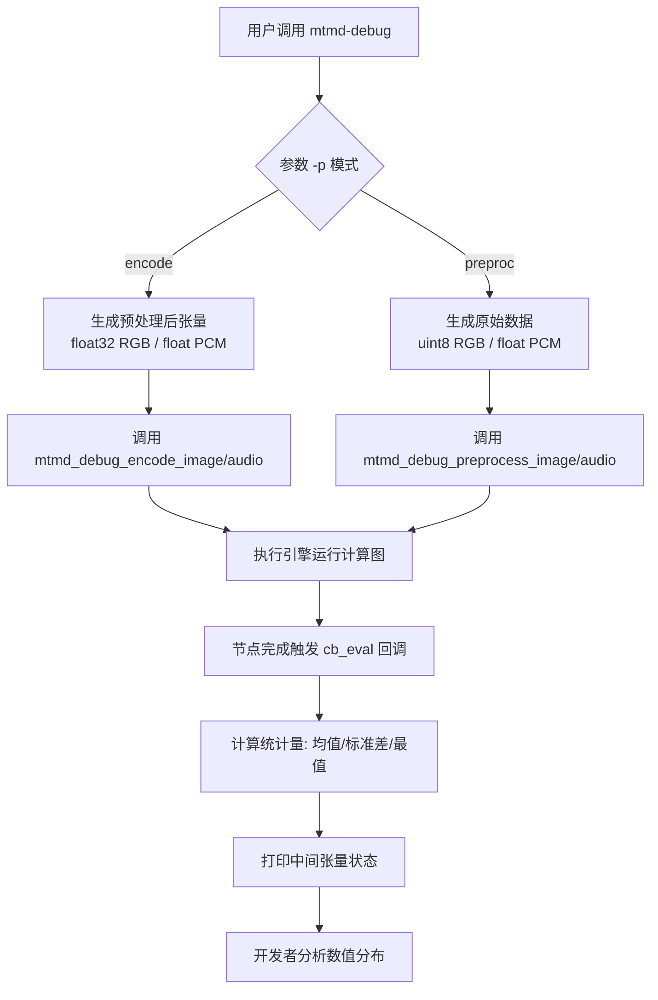
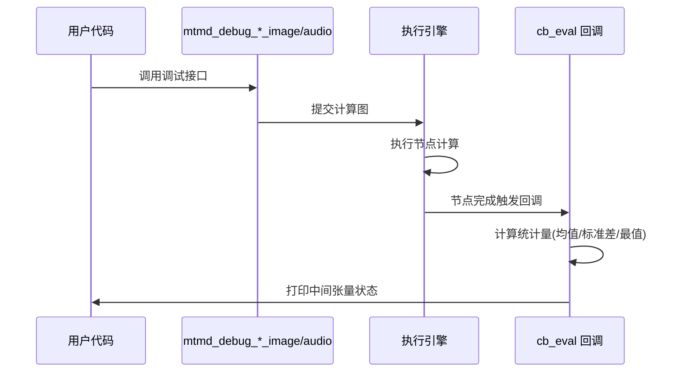
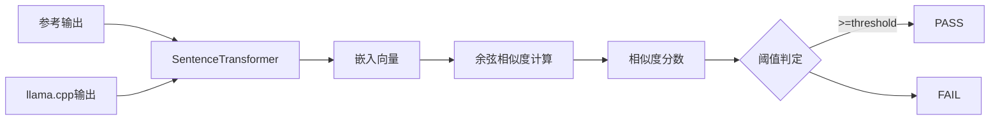

# 第78章 合成数据触发器与镜像比对 —— 多模态管线的「听诊器」与「显微镜」

## 学习目标

- 理解 mtmd-debug 工具的双模调试设计哲学（编码与预处理分离）及其在多模态管线分层验证中的核心价值。
- 掌握合成测试数据（纯色/棋盘格/正弦波）在多模态调试中的应用方法，理解不同信号类型针对特定计算路径的验证能力。
- 熟悉内部调试接口的隔离设计原则与 cb_eval 回调机制，理解「最小侵入式」中间张量观测的实现方式。
- 了解废弃二进制命令的优雅迁移策略与跨平台路径处理，掌握防御性编程在工具链维护中的应用。
- 掌握基于 SentenceTransformer 的语义相似度计算在端到端测试中的应用，理解其相较于精确文本匹配的鲁棒性优势。
- 理解 Python 测试脚本的路径解析与资源管理最佳实践，掌握基于 `__file__` 的相对路径解析技术。

## 78.1 生活类比

想象多模态模型是一家精密仪器制造厂，mtmd-debug 工具就是厂里的「质量检测仪」：合成图像/音频 = 标准测试件（纯白、纯黑、棋盘格如同标准的灰度卡、色块）；encode 模式 = 成品性能测试（检验最终输出是否符合规格）；preproc 模式 = 原材料检验（检查进料是否符合加工标准）；cb_eval 回调 = 生产线上的透明观察窗（可以看到每个工序的中间状态）；deprecation-warning = 旧设备上的「此设备已淘汰，请使用新型号」标签；DeepSeek-OCR 测试 = 与进口设备（HuggingFace）进行「对表」验证，确保测量结果一致。就像质检员不会直接拆解成品来检查内部结构，而是通过标准测试信号观察中间过程，mtmd-debug 也是通过标准输入和回调机制来「听诊」模型内部状态。这一类比将贯穿全章：每当我们提到「听诊」，指的就是通过合成信号与回调观测中间计算；每当提到「显微镜」，指的就是端到端的语义比对验证最终输出质量。

## 78.2 源码地图

```
tools/mtmd/debug/
├── mtmd-debug.cpp
│   ├── __main__                        # 主入口：参数解析、上下文初始化、模式分流（52-195行）
│   │   ├── 初始化阶段（52-87行）        # 参数解析、上下文创建、回调注入
│   │   ├── 输入生成阶段（96-158行）     # 合成信号生成（encode/preproc分支）
│   │   └── 执行分流（166-189行）        # 调用对应调试接口
│   └── show_additional_info()          # 帮助信息展示：参数说明与测试类型列表（21-50行）
│
├── mtmd-debug.h
│   ├── mtmd_debug_encode_image()       # 图像编码调试：float32 RGB输入验证ViT（9行）
│   ├── mtmd_debug_encode_audio()       # 音频编码调试：PCM样本广播至n_mel（10行）
│   ├── mtmd_debug_preprocess_image()   # 图像预处理调试：uint8原始数据验证缩放归一化（12行）
│   └── mtmd_debug_preprocess_audio()   # 音频预处理调试：验证分帧与梅尔滤波（13行）
│
tools/mtmd/deprecation-warning.cpp
├── main()                              # 废弃入口处理（6-25行）
│   ├── setlocale(LC_NUMERIC, "C")     # 防御性区域设置
│   ├── argv[0]路径解析                 # 跨平台文件名提取（/与\）
│   └── EXIT_FAILURE返回                # 强制退出并提示迁移到llama-mtmd-cli
│
tools/mtmd/tests/test-deepseek-ocr.py
├── run_mtmd_deepseek_ocr()             # 封装subprocess调用llama-mtmd-cli（12-54行）
│   ├── 固定参数配置                    # --temp 0、-n 1024、--chat-template deepseek-ocr
│   └── Free OCR与Markdown OCR双模式    # 分别调用不同提示词
├── compute_embedding_similarity()      # 语义相似度计算（57-72行）
│   ├── SentenceTransformer加载         # Qwen/Qwen3-Embedding-0.6B默认
│   └── 余弦相似度计算                  # util.similarity.cos_sim
├── read_expected_output()              # 参考输出文件读取（75-82行）
├── main()                              # 测试主流程：路径校验、双模式执行、阈值判定（85-153行)
└── __main__                            # 脚本入口点（156-157行）
```

## 78.3 mtmd-debug：合成数据触发器 —— 多模态管线的「听诊器」

### 78.3.1 __main__：程序主入口（初始化阶段、输入生成阶段、执行分流）

**源码路径：`tools/mtmd/debug/mtmd-debug.cpp` - `__main__`（52-195行）**

mtmd-debug 是 llama.cpp 多模态（mtmd）子系统内部的调试工具，它的核心设计哲学是**双模调试**：既支持对编码器的前向传播进行调试（`encode` 模式），也支持对预处理流水线进行调试（`preproc` 模式）。这种分离至关重要，因为多模态模型的数据流向通常是：原始输入 → 预处理（缩放、归一化、通道重排） → 编码器（ViT/音频编码器） → 投影器 → LLM 嵌入空间。mtmd-debug 让我们能像听诊器一样，分别「听诊」这两个关键阶段。

#### 78.3.1.1 初始化阶段（52-87行）

```cpp
// 源码路径：tools/mtmd/debug/mtmd-debug.cpp:52-87
int main(int argc, char ** argv) {
    std::setlocale(LC_NUMERIC, "C");           // 1. 固定数值 locale，确保浮点数格式跨平台一致
    ggml_time_init();                          // 2. 初始化 ggml 计时器
    common_params params;                      // 3. 公共参数结构体
    common_init();                             // 4. 初始化日志等公共设施
    if (!common_params_parse(argc, argv, params, LLAMA_EXAMPLE_MTMD, show_additional_info)) {
        return 1;                              // 5. 参数解析失败直接返回
    }
    mtmd_helper_log_set(common_log_default_callback, nullptr);  // 6. 设置 mtmd 日志回调
    if (params.mmproj.path.empty()) {          // 7. 必须提供 --mmproj
        show_additional_info(argc, argv);
        LOG_ERR("ERR: Missing --mmproj argument\n");
        return 1;
    }
    LOG_INF("%s: loading model: %s\n", __func__, params.model.path.c_str());
    mtmd::context_ptr ctx_mtmd;                // 8. 智能指针管理 mtmd 上下文
    common_init_result_ptr llama_init;         // 9. llama 初始化结果
    base_callback_data cb_data;                // 10. 回调用户数据
    llama_init = common_init_from_params(params);  // 11. 初始化 llama 上下文
    {
        auto * model = llama_init->model();    // 12. 获取 llama 模型指针
        const char * clip_path = params.mmproj.path.c_str();  // 13. 投影文件路径
        mtmd_context_params mparams = mtmd_context_params_default();  // 14. 默认 mtmd 参数
        mparams.use_gpu          = params.mmproj_use_gpu;
        mparams.print_timings    = true;
        mparams.n_threads        = params.cpuparams.n_threads;
        mparams.flash_attn_type  = params.flash_attn_type;
        mparams.warmup           = params.warmup;
        mparams.image_min_tokens = params.image_min_tokens;
        mparams.image_max_tokens = params.image_max_tokens;
        {  // 15. 强制注入调试回调 —— 核心机制
            mparams.cb_eval_user_data = &cb_data;
            mparams.cb_eval = common_debug_cb_eval<false>;
        }
        ctx_mtmd.reset(mtmd_init_from_file(clip_path, model, mparams));  // 16. 创建 mtmd 上下文
        if (!ctx_mtmd.get()) {
            LOG_ERR("Failed to load vision model from %s\n", clip_path);
            exit(1);
        }
    }
}
```

上述代码完成了调试工具的核心初始化：
1. **固定数值 locale**（第 1 行）：防止德语等区域设置下小数点变为逗号，导致日志解析失败。
2. **强制注入调试回调**（第 15 行块）：将 `common_debug_cb_eval<false>` 与用户数据 `cb_data` 绑定到 `mtmd_context_params`，实现**非侵入式中间张量观测**。回调会在计算图执行的关键节点被触发，打印张量的统计信息（均值、标准差、最值等），而不修改任何计算逻辑。
3. **配置透传**（第 14 行）：线程数、GPU使用、Flash Attention类型等参数直接从通用参数结构透传，保证调试环境与生产环境一致。

#### 78.3.1.2 输入生成阶段（96-158行）

```cpp
// 源码路径：tools/mtmd/debug/mtmd-debug.cpp:96-158
// ...（前文省略参数校验代码）
input = params.image[0];  // 取第一个 --image 参数
if (params.prompt.empty() || params.prompt == "encode") {  // encode 模式分支
    std::vector<std::vector<float>> image;  // float32 RGB 张量 [H, W*3]
    std::vector<float> samples;             // 音频 PCM 样本
    if (input == "black") {
        for (int i = 0; i < inp_size; ++i) {
            auto row = std::vector<float>(inp_size * 3, 0.0f);  // 全 0.0
            image.push_back(row);
        }
    } else if (input == "white") {
        for (int i = 0; i < inp_size; ++i) {
            auto row = std::vector<float>(inp_size * 3, 1.0f);  // 全 1.0
            image.push_back(row);
        }
    } else if (input == "gray") {
        for (int i = 0; i < inp_size; ++i) {
            auto row = std::vector<float>(inp_size * 3, 0.5f);  // 全 0.5
            image.push_back(row);
        }
    } else if (input == "cb") {  // checkerboard 棋盘格
        for (int i = 0; i < inp_size; ++i) {
            auto row = std::vector<float>(inp_size * 3, 0.0f);
            image.push_back(row);
        }
        for (int y = 0; y < inp_size; ++y) {
            for (int x = 0; x < inp_size; ++x) {
                float v = ((x + y) % 2) ? 0.0f : 1.0f;  // 交替 0/1
                image[y][x * 3 + 0] = v;
                image[y][x * 3 + 1] = v;
                image[y][x * 3 + 2] = v;
            }
        }
    } else if (input == "one") {
        samples = std::vector<float>(inp_size, 1.0f);  // 音频全 1.0
    } else if (input == "zero") {
        samples = std::vector<float>(inp_size, 0.0f);  // 音频全 0.0
    } else if (input == "half") {
        samples = std::vector<float>(inp_size, 0.5f);  // 音频全 0.5
    } else if (input == "1010") {  // 音频方波
        samples.resize(inp_size);
        for (int i = 0; i < inp_size; ++i) {
            samples[i] = (i % 2) ? 0.0f : 1.0f;
        }
    } else {
        LOG_ERR("ERR: Invalid input specified with --image/--audio\n");
        show_additional_info(argc, argv);
        return 1;
    }
} else if (params.prompt == "preproc") {  // preproc 模式分支
    std::vector<uint8_t> rgb_values;   // 原始 uint8 RGB 字节流
    std::vector<float> pcm_samples;    // 音频 PCM 样本
    if (input == "black") {
        rgb_values = std::vector<uint8_t>(inp_size * inp_size * 3, 0);  // 全 0
    } else if (input == "white") {
        rgb_values = std::vector<uint8_t>(inp_size * inp_size * 3, 255);  // 全 255
    } else if (input == "gray") {
        rgb_values = std::vector<uint8_t>(inp_size * inp_size * 3, 128);  // 全 128
    } else if (input == "cb") {
        rgb_values.resize(inp_size * inp_size * 3);
        for (int y = 0; y < inp_size; ++y) {
            for (int x = 0; x < inp_size; ++x) {
                uint8_t v = ((x + y) % 2) ? 0 : 255;  // 交替 0/255
                rgb_values[(y * inp_size + x) * 3 + 0] = v;
                rgb_values[(y * inp_size + x) * 3 + 1] = v;
                rgb_values[(y * inp_size + x) * 3 + 2] = v;
            }
        }
    } else if (input == "one") {
        pcm_samples = std::vector<float>(inp_size, 1.0f);
    } else if (input == "zero") {
        pcm_samples = std::vector<float>(inp_size, 0.0f);
    } else if (input == "half") {
        pcm_samples = std::vector<float>(inp_size, 0.5f);
    } else if (input == "440") {  // 440Hz 正弦波 —— 音频预处理特有
        pcm_samples.resize(inp_size);
        float freq = 440.0f;
        float sample_rate = mtmd_get_audio_sample_rate(ctx_mtmd.get());
        float pi = 3.14159265f;
        for (int i = 0; i < inp_size; ++i) {
            pcm_samples[i] = sinf(2 * pi * freq * i / sample_rate);
        }
    } else {
        LOG_ERR("ERR: Invalid input specified with --image/--audio\n");
        show_additional_info(argc, argv);
        return 1;
    }
}
```

两个模式的**数据结构即契约**设计：
- **encode 模式**：图像用 `vector<vector<float>>` 表示已归一化的 float32 RGB（0.0-1.0）；音频用 `vector<float>` 表示 PCM。绕过预处理，直接喂给编码器。
- **preproc 模式**：图像用扁平 `vector<uint8_t>` 表示原始字节流（0-255），需显式宽高；音频同 encode。完整走预处理流水线。

合成信号的选择极具针对性：
- 图像：`black/white/gray` 验证基础色彩响应与归一化；`cb`（棋盘格）验证空间结构感知（卷积核、注意力窗口）。
- 音频：`one/zero/half` 验证直流偏置与静音处理；`1010`（方波）验证高频分量响应；`440Hz` 正弦波验证频谱特征提取准确性（标准音高 A4）。

#### 78.3.1.3 执行分流（166-189行）

```cpp
// 源码路径：tools/mtmd/debug/mtmd-debug.cpp:166-189
// run encode pass
LOG_INF("Running encode pass for input type: %s\n", input.c_str());
if (samples.size() > 0) {  // 音频分支
    LOG_INF("Input audio with %zu samples, type: %s\n", samples.size(), input.c_str());
    mtmd_debug_encode_audio(ctx_mtmd.get(), samples);
} else {  // 图像分支
    LOG_INF("Input image with dimensions %d x %d, type: %s\n", inp_size, inp_size, input.c_str());
    mtmd_debug_encode_image(ctx_mtmd.get(), image);
}
// ... preproc 模式同理，调用 mtmd_debug_preprocess_image/audio
```

执行分流根据数据容器类型（`samples` vs `image`/`rgb_values`）自动路由到对应的调试接口，类型系统在编译期防止图像/音频数据流混淆。

#### 78.3.1.4 流程图：双模调试分流与回调观测



流程图展示了双模调试的完整链路：`encode` 与 `preproc` 两条路径在数据生成阶段分离，最终汇聚到统一的 `cb_eval` 回调机制进行中间值观测。

### 78.3.2 show_additional_info：帮助信息展示

**源码路径：`tools/mtmd/debug/mtmd-debug.cpp` - `show_additional_info`（21-50行）**

```cpp
// 源码路径：tools/mtmd/debug/mtmd-debug.cpp:21-50
static void show_additional_info(int /*argc*/, char ** argv) {
    LOG(
        "Internal debugging tool for mtmd; See mtmd-debug.md for the pytorch equivalent code\n"
        "Note: we repurpose some args from other examples, they will have different meaning here\n"
        "\n"
        "Usage: %s -m <model> --mmproj <mmproj> -p <mode> -n <size> --image <image> --audio <audio>\n"
        "\n"
        "    -n <size>: number of pixels per edge for image (always square image), or number of samples for audio\n"
        "\n"
        "    -p \"encode\" (debugging encode pass, default case):\n"
        "        --image can be:\n"
        "          \"white\", \"black\", \"gray\": filled 1.0f, 0.0f and 0.5f respectively\n"
        "          \"cb\": checkerboard pattern, alternate 1.0f and 0.0f\n"
        "        --audio can be:\n"
        "          \"one\", \"zero\", \"half\": filled 1.0f, 0.0f and 0.5f respectively\n"
        "          \"1010\": checkerboard pattern, alternate 1.0f and 0.0f\n"
        "\n"
        "    -p \"preproc\" (debugging preprocessing pass):\n"
        "        --image can be:\n"
        "          \"white\", \"black\", \"gray\": filled image with respective colors\n"
        "          \"cb\": checkerboard pattern\n"
        "        --audio can be:\n"
        "          \"one\", \"zero\", \"half\": filled 1.0f, 0.0f and 0.5f respectively\n"
        "          \"440\": sine wave with 440 Hz frequency\n"
        "\n",
        argv[0]
    );
}
```

该函数集中定义了工具的使用契约，清晰列出了两种模式下支持的合成信号类型，是开发者快速上手的「说明书」。

## 78.4 调试接口契约 —— 中间值的「侦探工具包」

**源码路径：`tools/mtmd/debug/mtmd-debug.h`**

mtmd-debug.h 中声明的四个接口构成了一个完整的 2×2 调试矩阵：{encode, preproc} × {image, audio}。这些接口明确标注为「仅供内部调试」，不进入公开 API 表面，体现了**最小暴露原则**。

### 78.4.1 mtmd_debug_encode_image：图像编码调试接口

**源码路径：`tools/mtmd/debug/mtmd-debug.h:9`**

```cpp
// 源码路径：tools/mtmd/debug/mtmd-debug.h:9
MTMD_API void mtmd_debug_encode_image(mtmd_context * ctx, const std::vector<std::vector<float>> & image);
```

- **输入**：已预处理的 float32 RGB 张量，形状为 [H, W×3]，值域 0.0-1.0
- **作用**：直接送入 Vision Transformer 主干网络，验证前向传播的数值正确性
- **典型用途**：排查注意力计算、LayerNorm、MLP 等核心算子的数值偏差

该接口接收已经过预处理的浮点张量，绕过了缩放、归一化等前置步骤，直接作用于编码器主干，是验证 ViT 前向传播数值正确性的「显微镜」。

### 78.4.2 mtmd_debug_encode_audio：音频编码调试接口

**源码路径：`tools/mtmd/debug/mtmd-debug.h:10`**

```cpp
// 源码路径：tools/mtmd/debug/mtmd-debug.h:10
MTMD_API void mtmd_debug_encode_audio(mtmd_context * ctx, const std::vector<float> & input);
```

- **输入**：float PCM 样本序列
- **特殊行为**：内部自动将单通道输入广播至 `n_mel` 维度（梅尔频谱通道数），适配编码器期望的输入形状
- **作用**：验证 Whisper/Conformer 等音频编码器的前向传播

### 78.4.3 mtmd_debug_preprocess_image：图像预处理调试接口

**源码路径：`tools/mtmd/debug/mtmd-debug.h:12`**

```cpp
// 源码路径：tools/mtmd/debug/mtmd-debug.h:12
MTMD_API void mtmd_debug_preprocess_image(mtmd_context * ctx, const std::vector<uint8_t> & rgb_values, int nx, int ny);
```

- **输入**：原始 uint8 RGB 字节流，需显式指定宽高
- **作用**：验证图像缩放、归一化、通道重排、Patchify 等预处理步骤
- **典型用途**：排查 LLaVA-UHD 切片、动态分辨率、不同模型特定的预处理差异

该接口接收原始字节流，完整走完预处理流水线，是验证「原材料加工」质量的「听诊器」。

### 78.4.4 mtmd_debug_preprocess_audio：音频预处理调试接口

**源码路径：`tools/mtmd/debug/mtmd-debug.h:13`**

```cpp
// 源码路径：tools/mtmd/debug/mtmd-debug.h:13
MTMD_API void mtmd_debug_preprocess_audio(mtmd_context * ctx, const std::vector<float> & pcm_samples);
```

- **输入**：原始 PCM 样本
- **作用**：验证分帧、加窗、STFT、梅尔滤波器组计算等频谱特征提取流程
- **典型用途**：排查 440Hz 正弦波在梅尔频谱图上的峰值位置是否正确

### 78.4.5 时序图：调试接口的回调观测机制



时序图展示了调试接口如何通过执行引擎内部的回调机制，在不修改核心计算逻辑的前提下实现中间值的透明观测。所有接口的共同特征是：**不返回处理结果，而是通过 `cb_eval` 回调输出中间值**。这种设计遵循「最小侵入式」调试原则：
- 被测代码逻辑保持纯净，无需修改返回值或添加调试分支
- 回调在计算图执行引擎内部被触发，捕获真实的运行时张量状态
- 开发者可通过回调数据重构中间层的激活分布，定位数值溢出、梯度消失等问题

## 78.5 废弃命令迁移引导 —— 旧用户的「路标置换」

### 78.5.1 main：废弃入口处理函数

**源码路径：`tools/mtmd/deprecation-warning.cpp:6-25`**

```cpp
// 源码路径：tools/mtmd/deprecation-warning.cpp:6-25
int main(int argc, char** argv) {
    std::setlocale(LC_NUMERIC, "C");           // 1. 防御性 locale 设置：固定数值格式
    std::string filename = "main";             // 2. 默认文件名
    if (argc >= 1) {                           // 3. 从 argv[0] 获取实际程序名
        filename = argv[0];
    }
    size_t pos = filename.find_last_of("/\\"); // 4. 跨平台路径分隔符匹配（Unix /, Windows \）
    if (pos != std::string::npos) {
        filename = filename.substr(pos+1);     // 5. 提取纯文件名
    }
    fprintf(stdout, "\n");                     // 6. 空行分隔
    fprintf(stdout, "WARNING: The binary '%s' is deprecated.\n", filename.c_str());  // 7. 弃用警告
    fprintf(stdout, "Please use 'llama-mtmd-cli' instead.\n");  // 8. 迁移指引
    fprintf(stdout, "\n");
    return EXIT_FAILURE;                       // 9. 非零退出码：强制构建脚本感知失败
}
```

tools/mtmd/deprecation-warning.cpp 是一个极简但设计周全的迁移引导工具。当用户误调用旧版二进制（如 `mtmd-cli`）时，它不会静默失败，而是打印醒目警告并返回 `EXIT_FAILURE`。

**设计要点解析：**

1. **显式失败策略**（第 9 行）：返回 `EXIT_FAILURE` 而非 `EXIT_SUCCESS` 是关键设计决策。它强制 CI/CD 流水线、构建脚本、包装器感知到「此路不通」，避免旧命令在脚本中静默通过导致后续难以诊断的故障。符合 Unix 哲学：错误即非零退出。

2. **可执行文件名的自感知**（第 3-5 行）：从 `argv[0]` 提取程序名，同时处理 Unix（`/`）和 Windows（`\`）路径分隔符。无论用户通过软链接、绝对路径、相对路径调用，警告信息中都会显示准确的被调用二进制名。`find_last_of("/\\")` 的双分隔符匹配是跨平台兼容的关键细节。

3. **Locale 的防御性设置**（第 1 行）：`std::setlocale(LC_NUMERIC, "C")` 确保数字格式化（如浮点数的小数点）不受系统区域设置影响。在德语等使用逗号作小数分隔符的环境中，缺少这行代码会导致日志解析工具失效。这是跨平台工具的标准防御性编程实践。

#### 78.5.1.1 流程图：废弃命令迁移引导流程

```mermaid
flowchart TD
    A[用户调用旧版二进制] --> B[main() 入口]
    B --> C[setlocale(LC_NUMERIC, "C")]
    C --> D[从 argv[0] 解析文件名]
    D --> E{路径分隔符检测}
    E -->|Unix /| F[提取文件名]
    E -->|Windows \| G[提取文件名]
    F --> H[打印弃用警告]
    G --> H
    H --> I[打印迁移指引]
    I --> J[返回 EXIT_FAILURE]
    J --> K[构建脚本/CI 感知失败]
    K --> L[强制迁移到 llama-mtmd-cli]
```

流程图展示了废弃命令工具的完整执行流程：从参数解析到跨平台路径处理，再到显式失败退出，形成完整的「路标置换」闭环。

## 78.6 DeepSeek-OCR 端到端验证 —— 与 HuggingFace 的「镜像比对」

### 78.6.1 run_mtmd_deepseek_ocr：llama.cpp 侧推理执行

**源码路径：`tools/mtmd/tests/test-deepseek-ocr.py:12-54`**

```python
# 源码路径：tools/mtmd/tests/test-deepseek-ocr.py:12-54
def run_mtmd_deepseek_ocr(
        model_path: str,
        mmproj_path: str,
        image_path: str,
        bin_path: str,
        prompt: str = "Free OCR."
) -> str:
    """
    Run inference using llama.cpp mtmd-cli.
    """
    cmd = [
        bin_path,                    # llama-mtmd-cli 二进制路径
        "-m", model_path,            # GGUF 模型路径
        "--mmproj", mmproj_path,     # 多模态投影文件路径
        "--image", image_path,       # 输入图像路径
        "-p", prompt,                # 提示词：Free OCR 或 Markdown OCR
        "--chat-template", "deepseek-ocr",  # 强制使用 DeepSeek-OCR 专用模板
        "--temp", "0",               # 贪婪采样，消除随机性，保证可复现
        "-n", "1024",                # 最大生成 token 数
    ]

    print(f"Running llama.cpp command: {' '.join(cmd)}")

    result = subprocess.run(
        cmd,
        capture_output=True,
        text=False,                  # 二进制模式捕获，手动解码
        timeout=300                  # 300秒超时防止挂死
    )

    if result.returncode != 0:
        stderr = result.stderr.decode('utf-8', errors='replace')
        print(f"llama.cpp stderr: {stderr}")
        raise RuntimeError(f"llama-mtmd-cli failed with code {result.returncode}")

    output = result.stdout.decode('utf-8', errors='replace').strip()
    print(f"llama.cpp output length: {len(output)} chars")
    return output
```

该函数封装了 `llama-mtmd-cli` 子进程调用：
- **关键参数**：`--temp 0` 确保确定性输出；`--chat-template deepseek-ocr` 强制使用专用模板，保证多模态投影对齐。
- **鲁棒的进程管理**：`subprocess.run` 捕获标准输出/错误流，设置 300 秒超时防止挂死，非零返回码时抛出 `RuntimeError` 中断测试。

### 78.6.2 read_expected_output：参考输出文件读取

**源码路径：`tools/mtmd/tests/test-deepseek-ocr.py:75-82`**

```python
# 源码路径：tools/mtmd/tests/test-deepseek-ocr.py:75-82
def read_expected_output(file_path: str) -> str:
    """
    Read expected OCR output from file.
    """
    cur_path = Path(__file__).parent          # 基于脚本自身路径解析
    expected_path = str(cur_path / file_path) # 拼接相对路径
    with open(expected_path, "r", encoding="utf-8") as f:
        return f.read().strip()
```

基于 `__file__` 动态解析路径，确保测试脚本**可从任意工作目录执行**。参考输出存储为文本文件（`test-1-extracted.txt`）和 Markdown 文件（`test-1-extracted.md`），版本控制友好。这种路径解析方式解决了「脚本在不同工作目录下被调用时相对路径失效」的经典问题。

### 78.6.3 compute_embedding_similarity：语义相似度计算

**源码路径：`tools/mtmd/tests/test-deepseek-ocr.py:57-72`**

```python
# 源码路径：tools/mtmd/tests/test-deepseek-ocr.py:57-72
def compute_embedding_similarity(text1: str, text2: str, model_name: str) -> float:
    """
    Compute cosine similarity between two texts using embedding model.
    """
    print(f"Loading embedding model: {model_name}")

    # Use sentence-transformers for easier embedding extraction
    embed_model = SentenceTransformer(model_name)  # 默认 Qwen/Qwen3-Embedding-0.6B

    print("Computing embeddings...")
    embeddings = embed_model.encode([text1, text2], convert_to_numpy=True)

    similarity = util.similarity.cos_sim([embeddings[0]], [embeddings[1]])[0][0]
    return float(similarity)
```

这是测试的核心创新：**不依赖原始 logits 对比，而是使用语义嵌入模型计算余弦相似度**。
- **优势**：对文本顺序调整、同义词替换、标点差异具有鲁棒性
- **阈值**：默认 0.7，可通过 `--threshold` 调整，平衡灵敏度与误报率
- **模型选择**：Qwen3-Embedding-0.6B 体积小、速度快、多语言能力强，适合 CI 环境

#### 78.6.3.1 流程图：语义相似度计算链路



流程图展示了语义相似度计算的完整链路：双文本编码 → 向量空间映射 → 余弦相似度 → 阈值判定。

### 78.6.4 main：测试主流程与结果报告

**源码路径：`tools/mtmd/tests/test-deepseek-ocr.py:85-153`**

```python
# 源码路径：tools/mtmd/tests/test-deepseek-ocr.py:85-153
def main():
    ap = argparse.ArgumentParser(description="Compare llama.cpp and HuggingFace DeepSeek-OCR outputs")
    ap.add_argument("--llama-model", default="gguf_models/deepseek-ai/deepseek-ocr-f16.gguf",
                    help="Path to llama.cpp GGUF model")
    ap.add_argument("--mmproj", default="gguf_models/deepseek-ai/mmproj-deepseek-ocr-f16.gguf",
                    help="Path to mmproj GGUF file")
    ap.add_argument("--image", default="test-1.jpeg",
                    help="Path to test image")
    ap.add_argument("--llama-bin", default="build/bin/llama-mtmd-cli",
                    help="Path to llama-mtmd-cli binary")
    ap.add_argument("--embedding-model", default="Qwen/Qwen3-Embedding-0.6B",
                    help="Embedding model for similarity computation")
    ap.add_argument("--threshold", type=float, default=0.7,
                    help="Minimum similarity threshold for pass")
    args = ap.parse_args()

    # Validate paths
    # script directory + image
    mtmd_dir = Path(__file__).parent.parent
    args.image = str(mtmd_dir / args.image)
    # project directory + llama model
    args.llama_model = str(mtmd_dir.parent.parent / args.llama_model)
    # project directory + mmproj
    args.mmproj = str(mtmd_dir.parent.parent / args.mmproj)
    args.llama_bin = str(mtmd_dir.parent.parent / args.llama_bin)
    if not Path(args.image).exists():
        print(f"Error: Image not found: {args.image}")
        sys.exit(1)
    if not Path(args.llama_model).exists():
        print(f"Error: Model not found: {args.llama_model}")
        sys.exit(1)
    if not Path(args.mmproj).exists():
        print(f"Error: mmproj not found: {args.mmproj}")
        sys.exit(1)

    print("=" * 60)
    print("DeepSeek-OCR: llama.cpp vs HuggingFace Comparison")
    print("=" * 60)

    # Run llama.cpp inference
    print("\n[2/3] Running llama.cpp implementation...")
    llama_free_ocr = run_mtmd_deepseek_ocr(
        args.llama_model,
        args.mmproj,
        args.image,
        args.llama_bin
    )

    llama_md_ocr = run_mtmd_deepseek_ocr(
        args.llama_model,
        args.mmproj,
        args.image,
        args.llama_bin,
        prompt="<|grounding|>Convert the document to markdown."
    )

    expected_free_ocr = read_expected_output("test-1-extracted.txt")
    expected_md_ocr = read_expected_output("test-1-extracted.md")

    # Compute similarity
    print("\n[3/3] Computing embedding similarity...")
    free_ocr_similarity = compute_embedding_similarity(
        expected_free_ocr,
        llama_free_ocr,
        args.embedding_model
    )

    md_ocr_similarity = compute_embedding_similarity(
        expected_md_ocr,
        llama_md_ocr,
        args.embedding_model
    )

    # Results
    print("\n" + "=" * 60)
    print("RESULTS")
    print("=" * 60)
    print(f"\nReference Model output:\n{'-' * 40}")
    print(expected_free_ocr)
    print(f"\nDeepSeek-OCR output:\n{'-' * 40}")
    print(llama_free_ocr)
    print(f"\n{'=' * 60}")
    print(f"Cosine Similarity: {free_ocr_similarity:.4f}")
    print(f"Threshold: {args.threshold}")
    print(f"Result: {'PASS' if free_ocr_similarity >= args.threshold else 'FAIL'}")
    print("=" * 60)

    # Markdown OCR results
    print(f"\nReference Model Markdown output:\n{'-' * 40}")
    print(expected_md_ocr)
    print(f"\nDeepSeek-OCR Markdown output:\n{'-' * 40}")
    print(llama_md_ocr)
    print(f"\n{'=' * 60}")
    print(f"Cosine Similarity (Markdown): {md_ocr_similarity:.4f}")
    print(f"Threshold: {args.threshold}")
    print(f"Result: {'PASS' if md_ocr_similarity >= args.threshold else 'FAIL'}")
    print("=" * 60)
```

`main()` 函数编排了完整的测试流水线：
1. **路径解析与校验**：自动将相对路径解析为项目根目录下的绝对路径（基于 `Path(__file__).parent.parent` 向上两级到达项目根目录）。
2. **双模式推理**：依次执行 Free OCR（`prompt="Free OCR."`）和 Markdown OCR（`prompt="<|grounding|>Convert the document to markdown."`）。
3. **相似度计算**：分别与对应参考输出计算相似度。
4. **详细报告**：打印参考输出、实际输出、相似度数值、PASS/FAIL 判定。

测试同时验证两种 OCR 模式，**两种任务均达标才算通过**。这确保了模型在不同提示词下的投影器行为都正确，体现了「显微镜」级别的细致验证。

### 78.6.5 __main__：脚本入口点

**源码路径：`tools/mtmd/tests/test-deepseek-ocr.py:156-157`**

```python
# 源码路径：tools/mtmd/tests/test-deepseek-ocr.py:156-157
if __name__ == "__main__":
    main()
```

这是标准的 Python 脚本入口守卫。其作用是：
1. **双重身份支持**：文件既可作为可执行脚本直接运行（`python test-deepseek-ocr.py`），也可作为模块被其他测试脚本导入复用（`from test_deepseek_ocr import run_mtmd_deepseek_ocr`）。
2. **避免副作用**：导入模块时不会自动执行测试流程，防止在 pytest 等测试框架收集测试时误触发耗时的推理过程。
3. **标准化实践**：符合 Python 社区通用约定，工具类脚本均采用此模式，保证与生态工具链兼容。

这种模式在 `tools/mtmd/tests/` 目录下的多个测试脚本中一致使用，体现了代码库的工程化规范。

## 78.7 设计中的取舍

### 78.7.1 为什么调试接口不返回结果，而是用回调输出中间值？

**直接返回结果的方案**：修改接口签名返回张量或统计信息。
**回调方案的优势**：
1. **零侵入**：被测计算图无需修改，回调由执行引擎在节点完成时自动触发。
2. **全覆盖**：一个回调可捕获图中所有节点的中间值，而非仅最后输出。
3. **性能可控**：回调内仅做统计打印，不涉及张量拷贝或序列化开销。
4. **解耦**：调试逻辑与核心计算逻辑完全分离，生产构建可直接编译掉回调。

mtmd-debug 场景下，开发者关心的是「中间层激活值分布是否正常」，而非最终输出，回调模式完美契合。

### 78.7.2 为什么用合成信号而非真实数据进行单元级调试？

**真实数据的局限**：真实图像/音频包含复杂语义，难以将输出异常归因到具体计算步骤（是预处理错？注意力错？投影错？）。
**合成信号的优势**：
- `black/white/gray` 孤立验证归一化系数与偏置
- `checkerboard` 孤立验证空间感知（卷积/注意力窗口）
- `440Hz sine` 孤立验证频谱提取准确性
- 数学特征已知，偏差即刻可见

Trade-off：合成信号无法覆盖真实数据分布的边缘情况，需配合集成测试（如 DeepSeek-OCR 测试）形成完整验证体系。

### 78.7.3 为什么用语义相似度而非精确文本匹配？

**精确匹配的局限**：OCR 输出对空白、换行、标点极其敏感，微小的排版差异会导致测试失败，但语义可能完全一致。
**语义相似度的优势**：
- 容忍「表达差异」，聚焦「语义一致」
- 单一指标（余弦相似度）即可量化匹配度
- 可配置阈值适应不同严格度需求

Trade-off：引入了嵌入模型作为外部依赖，增加了测试环境复杂度，但收益远大于成本。

### 78.7.4 为什么弃用工具返回 EXIT_FAILURE 而非 EXIT_SUCCESS？

**EXIT_SUCCESS 的风险**：构建脚本、包装器、CI 流水线会认为命令「成功执行」，旧二进制继续在自动化流程中残留，延迟迁移。
**EXIT_FAILURE 的收益**：
- 立即暴露问题，强制迁移
- 符合 Unix 哲学：错误即非零退出
- 警告信息 + 非零退出 = 完整的「路标置换」体验

## 78.8 动手练习

### 78.8.1 练习 1：分析 mtmd-debug 的参数分流机制

阅读 `tools/mtmd/debug/mtmd-debug.cpp` 第 52-195 行 `__main__` 函数，重点分析：
1. `params.prompt` 如何决定执行路径（encode vs preproc）？默认行为是什么？
2. 在 encode 模式下，为什么图像使用 `std::vector<std::vector<float>>` 而 preproc 模式使用 `std::vector<uint8_t>`？
3. `inp_size` 参数在图像和音频场景中分别代表什么含义？
4. 尝试扩展代码：添加一个新的合成图像类型 `gradient`（从左到右 0.0 到 1.0 渐变），需要修改哪些分支？

### 78.8.2 练习 2：调试接口的契约分析

阅读 `tools/mtmd/debug/mtmd-debug.h` 中的四个接口声明，回答以下问题：
1. `mtmd_debug_encode_image` 与 `mtmd_debug_preprocess_image` 的输入数据类型有何本质区别？这反映了怎样的调试策略？
2. 为什么这些函数不返回处理结果，而是通过 `cb_eval` 回调输出中间值？这种设计有什么优势？
3. 如果要在音频编码调试中支持立体声（双声道）输入，接口需要如何修改？
4. 查看 `mtmd-debug.cpp` 第 82-86 行，解释 `cb_eval_user_data` 与 `cb_eval` 是如何被强制注入到 `mtmd_context_params` 中的？

### 78.8.3 练习 3：废弃命令迁移工具的实现细节

阅读 `tools/mtmd/deprecation-warning.cpp` 第 6-25 行，完成以下分析：
1. 为什么程序要主动返回 `EXIT_FAILURE` 而不是 `EXIT_SUCCESS`？这体现了怎样的设计哲学？
2. `std::setlocale(LC_NUMERIC, "C")` 的作用是什么？如果没有这行代码，在什么情况下会出现问题？
3. 代码如何处理 Windows 和 Unix 风格的路径分隔符？如果用户通过软链接调用程序，`argv[0]` 会显示什么？
4. 尝试改进该程序：使其不仅提示使用 `llama-mtmd-cli`，还能自动转发参数并执行新命令（提示：使用 `execvp` 或 `system` 调用）

### 78.8.4 练习 4：DeepSeek-OCR 测试的阈值调优实验

阅读 `tools/mtmd/tests/test-deepseek-ocr.py` 全文，设计一个实验方案：
1. 当前默认相似度阈值是 0.7，如果将其提高到 0.9 或降低到 0.5，分别会对测试结果产生什么影响？
2. 为什么测试脚本选择使用 SentenceTransformer 计算语义相似度，而不是直接对比编辑距离（Levenshtein Distance）或精确匹配？
3. `run_mtmd_deepseek_ocr` 函数中通过 `--temp 0` 强制确定性输出，如果移除该参数，测试会变得不稳定吗？为什么？
4. 尝试修改 `compute_embedding_similarity` 函数，使其同时返回余弦相似度和欧氏距离，并对比两种度量在 OCR 文本对比中的敏感性差异

### 78.8.5 练习 5：参考输出文件的加载机制与路径管理

阅读 `tools/mtmd/tests/test-deepseek-ocr.py` 第 75-82 行 `read_expected_output()` 函数，回答以下问题：
1. 为什么使用 `Path(__file__).parent` 而不是相对路径直接打开文件？这解决了什么问题？
2. 如果测试脚本被从其他目录调用（如 `python tools/mtmd/tests/test-deepseek-ocr.py`），路径解析会如何变化？
3. 尝试扩展该函数：支持从压缩包（zip）中读取期望输出文件，需要添加哪些逻辑？
4. 查看第 156-157 行的 `__main__` 入口点，它对整个测试流程起到了什么作用？如果直接导入该模块而不运行，会发生什么？

## 78.9 本章小结

这一章中我们学习了多模态调试与测试的核心工具与策略。首先深入剖析了 `mtmd-debug` 这一「听诊器」工具，它通过合成测试信号（纯色、棋盘格、正弦波）与双模调试设计（encode/preproc），实现了对多模态管线编码器前向传播与预处理流水线的分层隔离验证。其次详细解读了内部调试接口的契约设计，理解了「最小侵入式」回调机制如何在不修改核心逻辑前提下捕获中间张量状态。接着分析了废弃命令迁移工具的优雅弃用策略，包括显式失败、跨平台路径解析与防御性 locale 设置。最后完整拆解了 DeepSeek-OCR 端到端测试的双重验证策略、语义相似度计算与路径资源管理最佳实践。

本章我们一起学习了以下概念：

| 概念 | 解释 |
|------|------|
| mtmd-debug工具 | 多模态管线听诊器，支持encode/preproc双阶段调试 |
| 合成测试信号 | black/white/gray/cb(图像)与one/zero/half/1010/440(音频)，用于隔离验证特定功能 |
| cb_eval回调注入 | 强制注入common_debug_cb_eval<false>，实现非侵入式中间张量观测 |
| 调试接口矩阵 | encode/preproc × image/audio 四接口组合，覆盖两种数据类型与两种处理阶段 |
| 优雅弃用策略 | 打印警告+EXIT_FAILURE，而非静默失败，引导用户迁移至llama-mtmd-cli |
| 跨平台路径处理 | 同时匹配/与\分隔符，确保argv[0]解析在Windows与Unix一致 |
| 语义相似度验证 | 使用SentenceTransformer计算余弦相似度，替代strict文本匹配，容忍措辞差异 |
| 双模式OCR测试 | 同时验证Free OCR与Markdown OCR两种任务，确保全部达标才算通过 |
| 防御性locale设置 | setlocale(LC_NUMERIC, "C")确保数字格式化不受系统区域设置影响 |
| 最小侵入式调试 | 通过回调输出中间值而非修改返回值，保持被测代码逻辑纯净 |
| 路径资源管理 | 基于__file__的相对路径解析，确保测试脚本可在任意工作目录运行 |
| 脚本入口守卫 | if __name__ == "__main__": 实现脚本直执行与模块导入的双重身份支持 |

下一章中，我们将学习 llama.cpp 的测试体系总览，走进"模型推理的质量守门人"，了解 C++ 测试程序、Python 工具脚本、Jinja 模板测试框架以及构建产物如何协同保障推理引擎的正确性、性能和跨平台兼容性。


