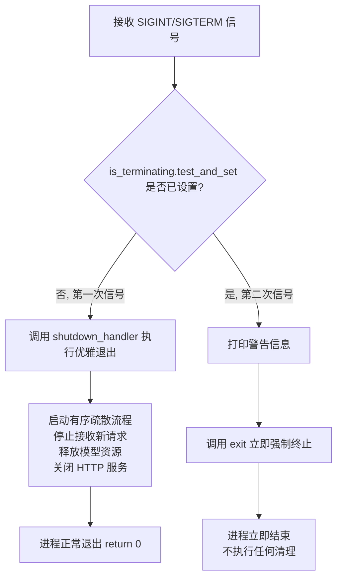
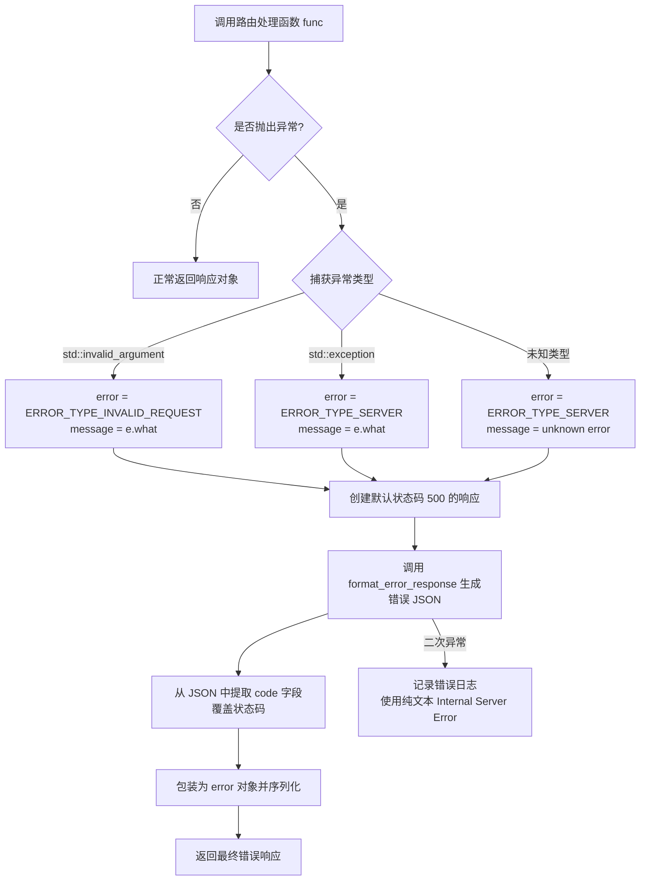
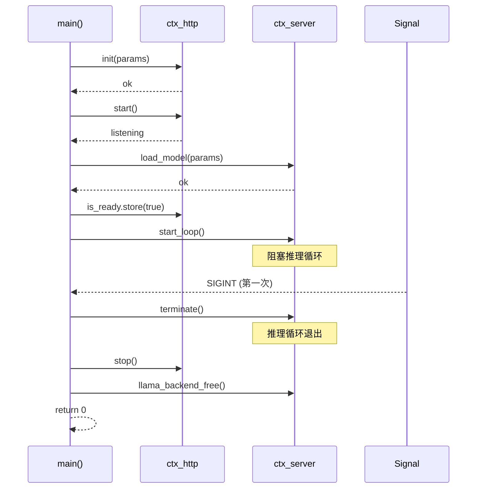
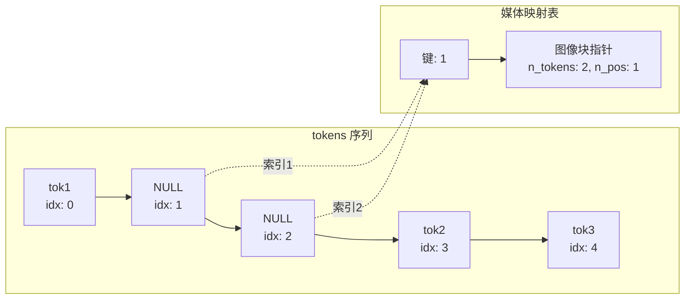
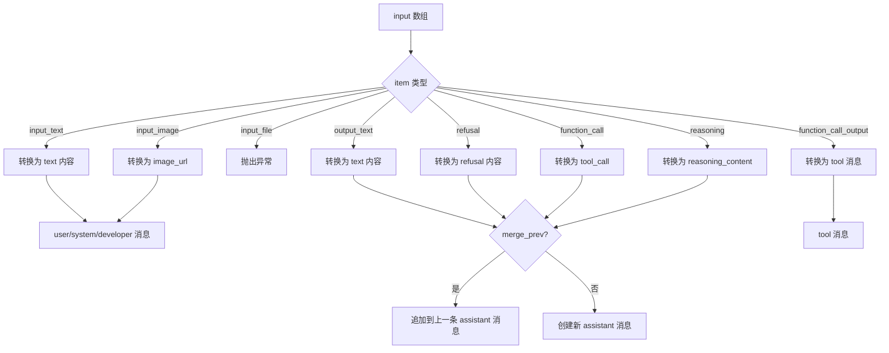
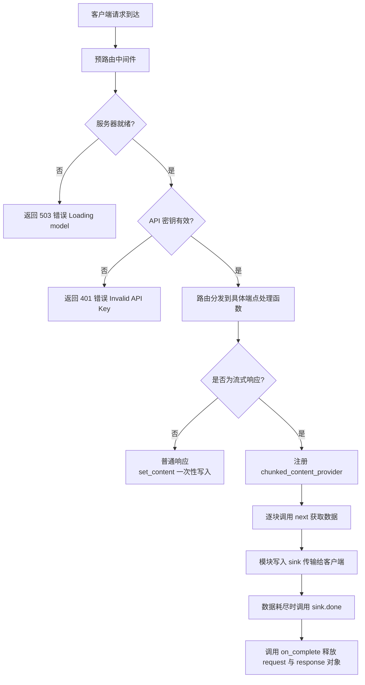

# 第79章 服务端保护机制与多模态容器 —— 从银行双重警报到智能金库

## 学习目标

- 理解 server.cpp 全局作用域中信号处理与异常封装机制的设计意图
- 掌握 `signal_handler` 与 `ex_wrapper` 在服务端稳定性保障中的角色分工
- 理解 `main()` 函数如何利用这些全局基础设施协调 HTTP 服务与推理引擎的生命周期
- 掌握 server_tokens 类中 `process_chunk` 与 MTMD 上下文的交互细节以及 LoRA 适配器动态管理工具链
- 能够分析服务端启动时优雅退出与错误响应的实现原理
- 掌握 HTTP 上下文初始化过程中 SSL、中间件、静态资源与线程池的配置逻辑
- 掌握 server_tokens 容器完整生命周期管理（构造、移动、销毁）与多模态媒体块的映射维护机制
- 理解 OpenAI/Anthropic 协议转换层的参数解析、SSE 流式格式化与跨协议转换原理
- 掌握服务端基础工具函数（Base64、UTF-8、FNV 哈希、JSON 校验）在请求处理管道中的支撑作用

## 79.1 生活类比

想象 llama-server 的 `server.cpp` 是一家**高可用银行**的应急指挥中心。`signal_handler` 就像一套双重警报系统：第一次警报响起时，系统会启动有序疏散（优雅退出），引导客户和员工安全离开；但如果第二次警报再次响起，说明情况危急到无法等待，系统会立即触发紧急破门（强制终止），避免更严重的损失。每个操作窗口都装有防弹玻璃罩，这就是 `ex_wrapper` 的角色——无论内部业务（路由处理函数）发生什么爆炸（异常），它都能将问题转化为一张标准的错误回执单（HTTP 错误响应），确保柜台外的客户永远看不到内部的火光。而 `main()` 则是这家银行的行长，他依靠这些精心设计的安全设施，才能在早晨安心开门营业（启动服务），在晚上有序拉闸断电（清理资源），让整个系统在各种意外情况下都能保持稳定运行。

`server_tokens` 则像是银行的**智能运钞车与多币种金库管理系统**。`pos_next()` 和 `size_up_to_pos()` 负责精确计算运输路线的长度（位置）与实际货币箱数（token），特别是在处理外币（多模态块）时，需要仔细进行汇率换算（token 数与位置数并不总是一致）。`push_back()` 家族提供了三种灵活的入库方式：普通钞票（单个 token）、整箱外币（媒体块）以及整辆运钞车的合并（另一个 server_tokens 对象）。`keep_first()` 和 `get_common_prefix()` 就像库存优化算法，帮助我们保留最常用的货币面额，同时快速识别重复的运钞路线，避免重复劳动。而 `process_chunk()` 则是外币兑换窗口，将黄金、珠宝（图像/音频等媒体数据）按照实时汇率折算成标准货币单位（token embedding），让所有资产都能在统一的系统中流转。最后，`validate()` 是入库前的质检员，确保每一张钞票（token）都在合法的范围内，每一个外币箱（媒体块）都有完整的报关单（映射关系）。

HTTP 上下文（`server_http_context`）则是银行的**前台大厅与安保中心**。`init()` 负责布置大厅的安保设施（API 密钥检查）、装修风格（CORS 策略），并决定大厅是开放营业（HTTP）还是进入 VIP 通道（HTTPS）。回到我们的银行案例，`init()` 就好比给大厅安装旋转门和门禁系统，`process_handler_response()` 则是大堂经理，面对普通客户（普通响应）直接带领至柜台快速办理，面对 VIP 大客户（流式响应）则开启专属通道，分批护送其进出。而协议转换器（`convert_responses_to_chatcmpl`、`convert_anthropic_to_oai`）就像大厅里的**多语种服务台**——无论客户用英文（OpenAI）、法文（Anthropic）还是其他方言（Responses）说话，服务台都能流利地将其翻译成银行内部的统一语言（Chat Completion 格式），让后端柜员无需学习多国语言就能处理所有客户的需求。

## 79.2 源码地图

```
tools/server/server.cpp
├── __main__ # 全局作用域基础设施
│   ├── shutdown_handler 声明                 # 全局退出处理器指针
│   ├── is_terminating 标志                   # 原子标志防止重复终止
│   ├── signal_handler()                      # 信号处理：区分首次/二次中断
│   └── ex_wrapper()                          # 路由异常统一包装器
└── main()                                    # 服务端启动总入口
    ├── 参数解析与配置校验
    ├── HTTP 上下文初始化 (ctx_http.init)
    ├── 路由注册（单模型/路由器模式）
    ├── 模型加载与主循环启动
    └── 优雅退出清理逻辑
tools/server/server-common.h
├── __main__ # 全局工具函数与类型定义
│   ├── json_value()                          # JSON 安全取值模板
│   ├── format_error_response()               # 统一错误响应格式化
│   ├── random_string() / gen_chatcmplid() / gen_tool_call_id()  # 随机 ID 生成
│   ├── json_is_array_of_*() / json_get_nested_values()  # JSON 数据校验工具
│   ├── base64_decode()                       # Base64 解码
│   ├── tokenize_mixed() / tokenize_input_prompts()  # 混合输入分词
│   ├── validate_utf8() / is_valid_utf8()     # UTF-8 校验
│   ├── fnv_hash()                            # FNV 哈希算法
│   ├── lora_all_alora() / lora_should_clear_cache() / parse_lora_request() / are_lora_equal() / lora_get_enabled_ids() # LoRA 管理工具
│   ├── oaicompat_completion_params_parse() / oaicompat_chat_params_parse()  # OpenAI 参数解析
│   ├── convert_responses_to_chatcmpl() / convert_anthropic_to_oai()  # 协议转换
│   ├── format_embeddings_response_oaicompat() / format_response_rerank()  # 响应格式化
│   ├── format_oai_sse() / format_oai_resp_sse() / format_anthropic_sse()  # SSE 格式化
│   ├── get_token_probabilities() / safe_json_to_str() / tokens_to_str() / tokens_to_output_formatted_string()  # 输出工具
│   ├── format_prompt_infill() / format_prompt_rerank()  # 提示词格式化
│   └── server_grammar_trigger                # 语法触发器封装
│       ├── server_grammar_trigger()          # 构造函数
│       └── to_json()                         # JSON 序列化
├── server_tokens                             # 文本 token + 多模态 chunk 容器
│   ├── server_tokens() / ~server_tokens()    # 构造与析构
│   ├── server_tokens(const server_tokens&) = delete / operator=(const server_tokens&) = delete  # 拷贝控制
│   ├── server_tokens(server_tokens&&) / operator=(server_tokens&&)  # 移动语义
│   ├── operator[] / size() / empty() / clear()  # 基础容器操作
│   ├── pos_next() / size_up_to_pos()         # 位置换算
│   ├── push_back() (llama_token/chunk/server_tokens) / insert()  # 多态插入
│   ├── keep_first() / get_common_prefix()    # 缓存与截断管理
│   ├── detokenize() / validate() / clone()   # 输出与验证
│   ├── str() / find_chunk()                  # 调试与查找
│   ├── get_text_tokens() / set_token()       # 投机解码支持
│   └── process_chunk()                       # 处理单个多模态块
├── server_chat_params                        # 聊天请求公共参数
└── server_http_req / server_http_res         # HTTP 请求响应抽象
tools/server/server-common.cpp
├── __main__ # 基础工具函数实现
│   ├── format_error_response()               # 错误响应格式化实现
│   ├── random_string() / gen_chatcmplid() / gen_tool_call_id()
│   ├── base64_decode() (static inline)       # Base64 解码
│   ├── json_is_array_of_numbers() 等 JSON 校验
│   ├── json_get_nested_values()              # 嵌套 JSON 提取
│   ├── tokenize_mixed() / tokenize_input_subprompt() / tokenize_input_prompts()  # 分词实现
│   ├── validate_utf8() / is_valid_utf8() / fnv_hash()  # 编码与哈希
│   ├── process_mtmd_prompt() / handle_media()  # 多模态处理
│   ├── lora_all_alora() / lora_should_clear_cache() / parse_lora_request() / are_lora_equal() / lora_get_enabled_ids()  # LoRA 工具
│   ├── oaicompat_completion_params_parse() / oaicompat_chat_params_parse()  # 参数解析
│   ├── convert_responses_to_chatcmpl() / convert_anthropic_to_oai()  # 协议转换实现
│   ├── format_embeddings_response_oaicompat() / format_response_rerank()  # 响应格式化实现
│   ├── get_token_probabilities() / safe_json_to_str() / tokens_to_str() / tokens_to_output_formatted_string()  # 输出实现
│   ├── format_oai_sse() / format_oai_resp_sse() / format_anthropic_sse() / format_openai_sse()  # SSE 实现
│   └── format_prompt_infill() / format_prompt_rerank()  # 提示词实现
└── server_tokens 实现
    ├── server_tokens() (各种构造函数)
    ├── pos_next() / size_up_to_pos()
    ├── push_back() (单token/chunk/另一个tokens)
    ├── insert() / get_text_tokens() / set_token()
    ├── keep_first() / get_common_prefix()
    ├── detokenize() / validate() / clone()
    ├── str() / find_chunk()
    └── process_chunk()                       # 调用 mtmd_helper_eval_chunk_single
tools/server/server-http.h
├── server_http_req                           # HTTP 请求封装
│   └── get_param()                           # 参数获取
├── server_http_res                           # HTTP 响应封装
│   └── is_stream()                           # 流式响应判断
└── server_http_context                       # HTTP 上下文
    ├── server_http_context() / ~server_http_context()  # 构造析构
    ├── init() / start() / stop()             # 生命周期
    └── get() / post()                        # 路由注册
tools/server/server-http.cpp
├── __main__ # 实现细节
│   ├── Impl 类 (Pimpl 模式)                  # 内部实现封装
│   ├── log_server_request()                  # AI 语聊日志
│   ├── get_params() / get_headers() / build_query_string() # 请求解析
│   └── set_headers()                         # 响应头设置
└── server_http_context 实现
    ├── server_http_context() / ~server_http_context()  # 构造析构实现
    ├── init()                                # SSL/中间件/静态资源配置
    ├── start() / stop()                      # 启动停止
    ├── get() / post()                        # 路由实现
    └── process_handler_response()            # 响应处理（含流式）
```

## 79.3 全局安全设施与优雅退出 —— server.cpp 全局作用域的“安全气囊”

当我们启动 llama-server 时，首要任务是确保它在各种意外情况下都能优雅应对。回到银行案例，这一节要剖析的是应急指挥中心（`server.cpp` 全局作用域）的核心安全设施。这些机制让 HTTP 路由层可以专注于业务逻辑，而不必每个端点都手写 try-catch 和信号处理。我们将看到 `signal_handler` 如何作为双重警报系统、`ex_wrapper` 如何作为防弹玻璃罩、`main()` 如何利用这些设施完成完整的生命周期管理，包括启动阶段即注册信号处理器，以及异常到 HTTP 响应的统一转换。

### 79.3.1 `signal_handler()`：信号双重检测的“总电闸”

源码路径：`tools/server/server.cpp` - 全局声明（3-4行）与 `signal_handler()`（10-17行）

```cpp
// 第 3-4 行：全局声明与初始化
// ① 声明全局的关闭处理函数指针，类型为接受 int 返回 void 的函数对象
static std::function<void(int)> shutdown_handler;
// ② 原子标志位，初始化为未设置状态，用于防止重复终止
static std::atomic_flag is_terminating = ATOMIC_FLAG_INIT;

// 第 10-17 行：信号处理回调函数定义
// ③ 信号处理回调函数：处理 SIGINT/SIGTERM 信号
static inline void signal_handler(int signal) {
    // ④ 尝试设置原子标志；若 test_and_set 返回 true，说明该标志已被设置过，即这是第二次信号
    if (is_terminating.test_and_set()) {
        // ⑤ 打印警告信息，说明用户已连续触发两次中断
        fprintf(stderr, "Received second interrupt, terminating immediately.\n");
        // ⑥ 立即强制退出进程，不再执行任何清理操作
        exit(1);
    }
    // ⑦ 第一次信号到达，调用挂接的全局关闭处理器（由 main() 赋予实际逻辑）
    shutdown_handler(signal);
}
```

这段代码定义了服务端的全局安全基础设施之一——双重警报机制。`shutdown_handler` 像一个"总电闸"，`signal_handler` 是双重警报系统。`shutdown_handler` 作为一个全局变量，允许 `main()` 在启动早期就为其赋值，而信号处理器在捕获到 `SIGINT`/`SIGTERM` 信号时能够动态调用正确的清理函数。这是一个典型的"注册-回调"模式：`signal_handler` 只负责判断"这是第几次警报"，而 `shutdown_handler` 真正知道"应该如何响应这一次警报"。

下面的流程图展示了信号处理的双重检测流程：



那么为什么需要 `is_terminating` 这个原子标志呢？试想如果没有它，如果用户连续按两次 Ctrl+C，第二次信号会再次触发 `shutdown_handler`。此时如果第一次的清理过程还未完成，就会导致重复清理和潜在的资源竞争。使用原子标志确保只有第一次信号触发真正的清理逻辑，后续信号直接强制终止，避免清理过程被反复打断。`std::atomic_flag` 的 `test_and_set()` 操作是原子性的，这意味着即使两个信号几乎同时到达（如 SIGINT 和 SIGTERM 连续触发），也能保证只有一个分支进入清理逻辑，另一个直接进入强制退出路径。

在这个设计中，`main()` 扮演了重要的角色：它在调用 `signal()` 或 `sigaction()` 注册 `signal_handler` 之前（详见 80.3.3 节第 ㊳-㊴ 步），就已经为 `shutdown_handler` 赋了值。这意味着信号处理器从注册的那一刻起就处于可用状态，不存在"信号到达但处理器未就绪"的空窗期。

### 79.3.2 `ex_wrapper()`：路由异常的“防弹玻璃罩”

源码路径：`tools/server/server.cpp` - `ex_wrapper()`（19-49行）

```cpp
// 第 19 行：定义高阶函数 ex_wrapper，接收一个路由处理器并返回经过异常包装的版本
static server_http_context::handler_t ex_wrapper(server_http_context::handler_t func) {
    // 第 20 行：返回一个新的 lambda，它接收请求并返回响应对象指针
    return [func = std::move(func)](const server_http_req & req) -> server_http_res_ptr {
        // 第 21 行：存储错误消息的字符串变量
        std::string message;
        // 第 22 行：存储错误类型的枚举变量（如无效请求、服务器错误等）
        error_type error;
        try {
            // 第 23 行：尝试调用原始的处理函数
            return func(req);
        } catch (const std::invalid_argument & e) {
            // 第 24 行：捕获标准库的非法参数异常
            // 第 25 行：将异常映射为"无效请求"错误类型
            error = ERROR_TYPE_INVALID_REQUEST;
            // 第 26 行：将异常消息传递给 message 变量
            message = e.what();
        } catch (const std::exception & e) {
            // 第 27 行：捕获任何其他标准库异常
            // 第 28 行：将异常映射为"服务器错误"类型
            error = ERROR_TYPE_SERVER;
            // 第 29 行：将异常消息传递给 message 变量
            message = e.what();
        } catch (...) {
            // 第 30 行：捕获所有未知的非标准异常
            // 第 31 行：同样映射为"服务器错误"类型
            error = ERROR_TYPE_SERVER;
            // 第 32 行：使用固定的未知错误消息
            message = "unknown error";
        }
        // 第 33 行：创建一个新的 HTTP 响应对象
        auto res = std::make_unique<server_http_res>();
        // 第 34 行：设置默认状态码为 500（服务器内部错误）
        res->status = 500;
        try {
            // 第 35 行：调用格式化错误响应函数，生成标准化的错误 JSON
            json error_data = format_error_response(message, error);
            // 第 36 行：从错误数据中提取"code"字段覆盖状态码（如 400/401/500）
            res->status = json_value(error_data, "code", 500);
            // 第 37 行：将错误数据包装为标准 API 格式 `{"error": {...}}` 并序列化为字符串
            res->data = safe_json_to_str({{ "error", error_data }});
            // 第 38 行：记录警告日志，包含完整的错误响应内容
            SRV_WRN("got exception: %s\n", res->data.c_str());
        } catch (const std::exception & e) {
            // 第 39 行：捕获格式化错误响应时产生的二次异常
            SRV_ERR("got another exception: %s | while handling exception: %s\n",
                    e.what(), message.c_str());
            // 第 40 行：兜底返回纯文本错误信息
            res->data = "Internal Server Error";
        }
        // 第 41 行：返回包含错误信息的响应对象
        return res;
    };
}
```

这段代码定义了服务端的另一个全局安全基础设施——路由异常的"防弹玻璃罩"。`ex_wrapper` 是一个高阶函数：它接收一个路由处理器（如 `routes.get_health`、`routes.post_completions`），返回一个新的经异常安全包装的处理器。当路由内部抛出异常时，包装器捕获并按类型映射为 HTTP 状态码，最终统一转换为 JSON 格式的错误响应。

该函数的**异常到 HTTP 响应的统一转换**逻辑可归纳为：`std::invalid_argument`（参数错误）→ 400 Bad Request；`std::exception`（其他标准异常）→ 500 Internal Server Error；未知异常 → 500 Internal Server Error。这种映射机制使得 API 调用方能够快速识别错误类别，而不需要解析复杂的错误消息。

异常处理流程图如下：



值得注意的是，`ex_wrapper` 内部还包含了一个内层 try-catch，用于保护错误格式化过程本身。这是**防御性编程**的典范：即使 `format_error_response` 或 `safe_json_to_str` 因为意外原因（如错误消息含非法字符）抛出异常，外层代码仍然可以返回一个基本的错误响应，确保客户端总是能收到回应，而不是连接被无预警地中断。此外，`SRV_WRN` 记录的警告日志包含了完整的错误响应内容，在调试阶段无需额外引入断点或日志器，即可在前端错误响应被吞掉时追踪到根本原因。

### 79.3.3 `main()`：协调全局设施的总指挥

源码路径：`tools/server/server.cpp` - `main()`（51-337行）

```cpp
// 第 51 行：main 函数入口，接收命令行参数 argc 和 argv
int main(int argc, char ** argv) {
    // 第 52 行：设置数字区域设置为 "C"，确保浮点数格式的一致性（避免某些 locale 使用逗号作为小数点）
    std::setlocale(LC_NUMERIC, "C");
    // 第 53 行：声明通用参数结构体，用于存储所有用户配置（模型路径、端口、线程数等）
    common_params params;
    // 第 54 行：初始化 common 库（注册日志系统、构建信息等）
    common_init();
    // 第 55 行：解析命令行参数到 params 中，失败则返回 1 表示进程退出
    if (!common_params_parse(argc, argv, params, LLAMA_EXAMPLE_SERVER)) {
        // 第 56 行：参数解析失败，直接返回错误码 1
        return 1;
    }
    // 第 57 行：嵌入模式校验：确保 n_batch 不超过 n_ubatch
    if (params.embedding && params.n_batch > params.n_ubatch) {
        // 第 58 行：记录警告，说明嵌入模式下批次设置不合理
        LOG_WRN("%s: embeddings enabled with n_batch (%d) > n_ubatch (%d)\n",
                __func__, params.n_batch, params.n_ubatch);
        // 第 59 行：提示解决方案
        LOG_WRN("%s: setting n_batch = n_ubatch = %d to avoid assertion failure\n",
                __func__, params.n_ubatch);
        // 第 60 行：修正 n_batch 为 n_ubatch 的值，以避免底层的断言失败
        params.n_batch = params.n_ubatch;
    }
    // 第 61 行：并行数自动模式设置
    if (params.n_parallel < 0) {
        // 第 62 行：当 n_parallel 为负（自动模式）时，使用 4 作为默认并行数
        // 第 63 行：同时启用统一 KV 缓存（多序列共享缓存）
        params.n_parallel = 4;
        params.kv_unified = true;
    }
    // 第 64 行：模型别名为空且模型名非空时，用模型名填充
    if (params.model_alias.empty() && !params.model.name.empty()) {
        // 第 65 行：将模型名称作为别名添加到集合中，确保路由模式下也能通过名称查找模型
        params.model_alias.insert(params.model.name);
    }
    // 第 66 行：创建服务端上下文对象，它封装了推理引擎的状态
    server_context ctx_server;
    // 第 67 行：初始化 llama 后端（CPU/SIMD 指令集检测、内存池初始化）
    llama_backend_init();
    // 第 68 行：初始化 NUMA 优化（若启用）
    llama_numa_init(params.numa);
    // 第 69 行：打印构建信息（编译时间、提交哈希、编译选项）
    LOG_INF("build_info: %s\n", build_info.c_str());
    // 第 70 行：打印系统信息和运行时配置摘要
    LOG_INF("%s\n", common_params_get_system_info(params).c_str());
    // 第 71 行：创建 HTTP 上下文对象（内部使用 Pimpl 模式隐藏细节）
    server_http_context ctx_http;
    // 第 72 行：初始化 HTTP 服务器，配置 SSL/中间件/线程池
    if (!ctx_http.init(params)) {
        // 第 73 行：记录错误日志
        LOG_ERR("%s: failed to initialize HTTP server\n", __func__);
        // 第 74 行：初始化失败，返回错误码 1
        return 1;
    }
    // 第 75 行：创建路由注册器，管理所有 API 端点
    server_routes routes(params, ctx_server);
    // 第 76 行：创建工具管理器
    server_tools tools;
    // 第 77 行：判断是否为路由器模式（未指定具体模型）
    bool is_router_server = params.model.path.empty();
    // 第 78 行：可选的模型路由管理器，仅在路由器模式下实例化
    std::optional<server_models_routes> models_routes{};
    if (is_router_server) {
        // 第 79 行：进入路由器模式分支
        // 第 80 行：初始化多模型管理器（见第 82 章）
        models_routes.emplace(params, argc, argv);
        // 第 81 行：将所有推理相关路由设置为代理转发
        routes.get_metrics = models_routes->proxy_get;
        // 第 82 行：POST 类型的代理转发
        routes.post_completions = models_routes->proxy_post;
        // 第 83-95 行：（省略）将 chat/completions、embeddings、rerank 等路由全部设置为 proxy_post
        // 第 96 行：注册模型管理端点（加载模型）
        ctx_http.post("/models/load",   ex_wrapper(models_routes->post_router_models_load));
        // 第 97 行：注册模型管理端点（卸载模型）
        ctx_http.post("/models/unload", ex_wrapper(models_routes->post_router_models_unload));
    }
    // 第 98 行：注册所有 REST 端点（以下每个都用 ex_wrapper 保护）
    ctx_http.get ("/health",              ex_wrapper(routes.get_health)); // 健康检查
    ctx_http.post("/completion",          ex_wrapper(routes.post_completions)); // 文本补全
    ctx_http.post("/chat/completions",    ex_wrapper(routes.post_chat_completions)); // 聊天补全
    // 第 99-129 行：（省略）注册 /completions、/embeddings、/rerank、/tokenize 等所有端点
    // 第 130 行：定义清理函数，用于退出时回收资源
    std::function<void()> clean_up;
    if (is_router_server) {
        // 第 131 行：路由器模式的清理逻辑
        clean_up = [&models_routes]() {
            // 第 132 行：打印清理日志
            SRV_INF("%s: cleaning up before exit...\n", __func__);
            // 第 133 行：判断多模型管理器是否存在
            if (models_routes.has_value()) {
                // 第 134 行：卸载所有子模型
                models_routes->models.unload_all();
            }
            // 第 135 行：释放后端资源
            llama_backend_free();
        };
        // 第 136 行：启动 HTTP 服务器
        ctx_http.start();
        // 第 137 行：立即标记就绪（不加载模型）
        ctx_http.is_ready.store(true);
        // 第 138 行：设置关闭处理为停止 HTTP
        shutdown_handler = [&](int) { ctx_http.stop(); };
    } else {
        // 第 139 行：单模型模式的清理逻辑
        clean_up = [&ctx_http, &ctx_server]() {
            // 第 140 行：停止 HTTP 服务
            ctx_http.stop();
            // 第 141 行：终止推理循环
            ctx_server.terminate();
            // 第 142 行：释放后端
            llama_backend_free();
        };
        // 第 143 行：先启动 HTTP 以便响应 /health（健康检查可提前报告"加载中"状态）
        ctx_http.start();
        // 第 144 行：加载模型
        if (server_models::is_child_server()) {
            // 第 145 行：若是子服务器，安装睡眠状态变更通知
            ctx_server.on_sleeping_changed([](bool sleeping) {
                // 第 146 行：通知主路由器服务器当前睡眠状态
                server_models::notify_router_sleeping_state(sleeping);
            });
        }
        // 第 147 行：加载模型
        if (!ctx_server.load_model(params)) {
            // 第 148 行：加载失败则执行清理
            clean_up();
            // 第 149 行：如果 HTTP 线程正在运行
            if (ctx_http.thread.joinable()) {
                // 第 150 行：等待 HTTP 线程退出
                ctx_http.thread.join();
            }
            // 第 151 行：返回错误码 1
            return 1;
        }
        // 第 152 行：更新路由元数据（如聊天模板、模型名）
        routes.update_meta(ctx_server);
        // 第 153 行：标记服务器就绪
        ctx_http.is_ready.store(true);
        // 第 154 行：设置关闭处理为终止推理循环
        shutdown_handler = [&](int) {
            // 第 155 行：仅终止推理循环，HTTP 服务保持运行
            ctx_server.terminate();
        };
    }
    // 第 156 行：注册信号处理器（Unix 或 Windows 平台）
#if defined (__unix__) || (defined (__APPLE__) && defined (__MACH__))
    // 第 157 行：配置 sigaction 结构体
    struct sigaction sigint_action;
    // 第 158 行：设置信号处理函数
    sigint_action.sa_handler = signal_handler;
    // 第 159 行：清空信号掩码
    sigemptyset (&sigint_action.sa_mask);
    // 第 160 行：无特殊标志
    sigint_action.sa_flags = 0;
    // 第 161 行：注册 SIGINT 信号处理器
    sigaction(SIGINT, &sigint_action, NULL);
    // 第 162 行：注册 SIGTERM 信号处理器
    sigaction(SIGTERM, &sigint_action, NULL);
#elif defined (_WIN32)
    // 第 163 行：Windows 控制台事件处理
    auto console_ctrl_handler = +[](DWORD ctrl_type) -> BOOL {
        // 第 164 行：仅处理 Ctrl+C 事件，转发给 signal_handler
        return (ctrl_type == CTRL_C_EVENT) ? (signal_handler(SIGINT), true) : false;
    };
    // 第 165 行：注册控制台事件处理器
    SetConsoleCtrlHandler(console_ctrl_handler, true);
#endif
    if (is_router_server) {
        // 第 166 行：路由器模式主线程保持存活
        if (ctx_http.thread.joinable()) {
            // 第 167 行：阻塞当前线程直到 HTTP 服务器停止
            ctx_http.thread.join();
        }
        // 第 168 行：HTTP 服务器停止后执行清理
        clean_up();
    } else {
        // 第 169 行：单模型模式分支
        // 第 170 行：创建监视线程（支持子服务器模式）
        std::thread monitor_thread;
        if (server_models::is_child_server()) {
            // 第 171 行：设置子服务器监视器
            monitor_thread = server_models::setup_child_server(shutdown_handler);
        }
        // 第 172 行：启动主循环（阻塞直到终止信号）
        ctx_server.start_loop();
        // 第 173 行：主循环退出后执行清理
        clean_up();
        // 第 174 行：等待 HTTP 线程退出
        if (ctx_http.thread.joinable()) {
            // 第 175 行：连接 HTTP 线程
            ctx_http.thread.join();
        }
        // 第 176 行：等待监视线程退出
        if (monitor_thread.joinable()) {
            // 第 177 行：连接监视线程
            monitor_thread.join();
        }
        // 第 178 行：打印内存使用情况
        auto * ll_ctx = ctx_server.get_llama_context();
        if (ll_ctx != nullptr) {
            llama_memory_breakdown_print(ll_ctx);
        }
    }
    // 第 179 行：正常退出
    return 0;
}
```

这段代码展示了 `main()` 如何作为"总指挥"，精心编排参数解析、HTTP 初始化、路由注册、模型加载和主循环启动的时序。在启动阶段，`main()` 就完成了对 `shutdown_handler` 的赋值，并且立即使用 `sigaction`/`SetConsoleCtrlHandler` 注册 `signal_handler`。这意味着从信号处理器注册的那一刻起，服务端就具备了优雅退出的能力。这种**"先注册信号处理，再进入主循环"**的时序保证了任何时刻收到终止信号，系统都能以可控的方式退出，不会出现资源泄漏或僵死状态。

关键的设计决策是**"先启动 HTTP，再加载模型"**。这样做的目的是：即使模型加载需要较长时间（如从网络下载），用户也能通过 `/health` 端点了解服务器状态，而不是面对一个无法访问的服务。

让我们用一张时序图来呈现单模型模式的启动与关闭流程：



Router 模式的差异在于它不需要加载模型。主进程只是一个"调度员"，负责接收请求并将其代理给各个子服务器进程。这也解释了为什么 Router 模式能立即标记 `is_ready`——它本身没有模型需要加载。

## 79.4 统一令牌容器与提示词处理 —— server_tokens 这座“多模态装箱工厂”

现在，让我们走进 `server_tokens` 这座“多模态装箱工厂”。回到银行案例，这里是金库中唯一的货品入库与调度中心。在构建提示词并送入 llama.cpp 推理引擎之前，服务端需要将各种形式的输入（纯文本、图像、音频）统一管理。这个类比贯穿始终：`pos_next()` 是运钞车的路线计算器，`push_back()` 是入库通道，`process_chunk()` 则是外币兑换窗口，`validate()` 是质检员，`clone()` 是复印机。

### 79.4.1 `server_tokens` 类：多模态容器的声明

源码路径：`tools/server/server-common.h` - `server_tokens`（118-196行）

```cpp
// 第 118 行：默认构造函数，创建一个空的 token 容器
class server_tokens {
public:
    // 第 119 行：默认构造函数
    server_tokens() = default;
    // 第 120 行：默认析构函数，自动释放智能指针管理的资源
    ~server_tokens() = default;

    // 第 125 行：删除拷贝构造函数
    server_tokens(const server_tokens&) = delete;
    // 第 126 行：删除拷贝赋值运算符
    server_tokens& operator=(const server_tokens&) = delete;

    // 第 129 行：默认移动构造函数
    server_tokens(server_tokens&&) = default;
    // 第 130 行：默认移动赋值运算符
    server_tokens& operator=(server_tokens&&) = default;

    // 第 132 行：非常量 operator[]，返回可变引用
    llama_token& operator[](size_t index) { return tokens[index]; }
    // 第 133 行：常量 operator[]，返回常量引用
    const llama_token& operator[](size_t index) const { return tokens[index]; }

    // 第 135 行：从 mtmd 输入块构造（多模态模式）
    server_tokens(mtmd::input_chunks & mtmd_chunks, bool has_mtmd);
    // 第 136 行：从纯 token 列表构造（文本模式）
    server_tokens(const llama_tokens & tokens, bool has_mtmd);

    // 第 139 行：生成调试用字符串
    std::string str() const;
    // 第 142 行：计算下一个位置；若 n_tokens < 0 表示所有 token
    llama_pos pos_next(int64_t n_tokens = -1) const;
    // 第 145 行：获取位置小于 max_pos 的 token 数量
    size_t size_up_to_pos(llama_pos max_pos) const;
    // 第 147 行：查找指定索引对应的媒体块
    const mtmd::input_chunk_ptr & find_chunk(size_t idx) const;

    // 第 149 行：添加单个文本 token
    void push_back(llama_token tok);
    // 第 152 行：添加媒体块（图像/音频）
    void push_back(const mtmd_input_chunk * chunk);
    // 第 155 行：合并另一个 server_tokens 对象
    void push_back(server_tokens & tokens);
    // 第 158 行：插入 token 列表（仅文本模式）
    void insert(const llama_tokens & inp_tokens);

    // 第 161 行：获取文本 token 列表（用于投机解码、上下文移动等）
    const llama_tokens & get_text_tokens() const;
    // 第 164 行：设置指定位置的 token（用于投机解码）
    void set_token(llama_pos pos, llama_token id);

    // 第 166 行：获取 token 数量
    size_t size() const { return tokens.size(); }
    // 第 168 行：判断是否为空
    bool empty() const { return tokens.empty(); }
    // 第 170-174 行：清空所有 token 和媒体映射
    void clear() {
        // 第 171 行：清空媒体映射表
        map_idx_to_media.clear();
        // 第 172 行：清空 token 列表
        tokens.clear();
    }

    // 第 176 行：仅保留前 n 个 token
    void keep_first(size_t n);
    // 第 178 行：反分词为字符串
    std::string detokenize(const llama_context * ctx, bool special) const;
    // 第 180 行：计算与另一个容器的公共前缀长度
    size_t get_common_prefix(const server_tokens & b) const;
    // 第 183 行：验证所有 token 均在词汇表范围内
    bool validate(const struct llama_context * ctx) const;

    // 第 186-193 行：处理指定位置的媒体块（编码或解码）
    int32_t process_chunk(llama_context * ctx, mtmd_context * mctx,
                         size_t idx, llama_pos pos, int32_t seq_id,
                         size_t & n_tokens_out) const;
    // 第 196 行：深拷贝自身（用于保存/恢复）
    server_tokens clone() const;

private:
    // 第 199 行：是否启用多模态（影响位置计算和映射）
    bool has_mtmd = false;
    // 第 200 行：token 列表（普通 token 和 LLAMA_TOKEN_NULL 占位符交替）
    llama_tokens tokens;
    // 第 201 行：媒体块映射表：起始 token 索引 → 媒体块指针
    std::map<size_t, mtmd::input_chunk_ptr> map_idx_to_media;
};
```

这段代码描绘了 `server_tokens` 类的设计蓝图。其三个核心字段决定了它的设计哲学：`has_mtmd` 标志区分"纯文本"和"多模态"两种模式；`tokens` 存储实际的 token 序列；`map_idx_to_media` 记录每个媒体块的起始索引。这种设计让 `server_tokens` 能够像普通 `std::vector` 一样使用，同时内部隐含了位置与 token 数量的复杂换算逻辑。

这种设计的本质是让文本 token 与媒体块（图像、音频）共享同一个序列，但媒体块在 `tokens` 数组中表现为连续的 `LLAMA_TOKEN_NULL` 占位符。真正的媒体数据被保存在 `map_idx_to_media` 映射中，映射的键是媒体块在 `tokens` 中的起始索引。这种策略使上层推理引擎能够以统一的视图处理混合输入，而无需感知媒体数据的实际内容。

下面的架构图展示了 `server_tokens` 的核心数据布局——token 列表与媒体映射表的协同工作模式：



**拷贝控制策略**：删除拷贝构造/赋值防止两个对象共享同一个媒体块指针，而移动操作则保留下高效的所有权转移。这种模式在多模态资源管理中是必要的，因为媒体块数据（如图像的张量表示）通常很占用内存。`clear()` 方法会同时清空 `map_idx_to_media` 和 `tokens`，确保不留下任何残留映射。

### 79.4.2 `pos_next()`：位置换算机制

源码路径：`tools/server/server-common.cpp` - `server_tokens::pos_next()`（200-248行）

```cpp
// 第 200 行：函数签名：根据给定 token 数量计算对应的下一个位置索引
llama_pos server_tokens::pos_next(int64_t n_tokens) const {
    // 第 201 行：非多模态模式：位置与 token 数量一一对应
    if (!has_mtmd) {
        // 第 202 行：若未指定 token 数量（n_tokens < 0），返回总 token 数
        if (n_tokens < 0) {
            // 第 203 行：直接使用 token 数量作为位置
            return tokens.size();
        }
        // 第 204 行：文本模式下位置与 token 数量直接对应
        return n_tokens;
    }
    // 第 205 行：多模态模式：需要遍历计算
    if (n_tokens < 0) {
        // 第 206 行：所有 token 的总位置数：文本 token 占 1 个位置，媒体块占 n_pos 个位置
        llama_pos res = tokens.size();
        // 第 207 行：遍历每个媒体块
        for (auto it = map_idx_to_media.begin(); it != map_idx_to_media.end(); ++it) {
            // 第 208 行：获取媒体块指针
            const auto & chunk = it->second;
            // 第 209 行：累加：n_pos - n_tokens 即为该块引入的额外位置数（正数或零）
            res += mtmd_input_chunk_get_n_pos(chunk.get()) - mtmd_input_chunk_get_n_tokens(chunk.get());
        }
        // 第 210 行：返回计算出的总位置数
        return res;
    }
    // 第 211 行：指定 token 数量：从前往后逐个计算
    int64_t idx = 0;       // 第 212 行：token 索引
    llama_pos pos = 0;     // 第 213 行：位置累计
    // 第 214 行：断言：请求的 token 数不能超过总 token 数
    GGML_ASSERT(n_tokens <= (int64_t)tokens.size());
    // 第 215 行：遍历 token 列表直到达到目标数量
    while (idx < n_tokens) {
        // 第 216 行：检查当前索引是否为媒体块的起始位置
        const auto media_it = map_idx_to_media.find(idx);
        if (media_it != map_idx_to_media.end()) {
            // 第 217 行：是媒体块，获取块对象
            const auto & chunk = media_it->second;
            // 第 218 行：获取该块的位置数（如 1 个位置）
            const llama_pos n_pos = mtmd_input_chunk_get_n_pos(chunk.get());
            // 第 219 行：获取该块的 token 数（如 576 个 token）
            const size_t n_tok = mtmd_input_chunk_get_n_tokens(chunk.get());
            // 第 220 行：位置跳跃 n_pos
            pos += n_pos;
            // 第 221 行：token 索引跳跃 n_tok
            idx += n_tok;
        } else {
            // 第 222 行：普通文本 token
            pos++;           // 第 223 行：位置 +1
            idx++;           // 第 224 行：token 索引 +1
        }
    }
    // 第 225 行：返回最终的位置累计值
    return pos;
}
```

这段代码实现的是"token 数 → 位置"的换算，核心在于理解多模态块的特殊性：**一个图像块可能包含 576 个 token，但只占用 1 个位置**。也就是说，在 KV 缓存中，这个图像块被压缩成单个位置。`pos_next()` 遍历 token 序列，遇到媒体块时按位置数跳跃，遇到文本 token 时逐位累加。

`pos_next()` 在 KV 缓存管理中至关重要。当我们需要计算已有 token 占据的缓存位置时，不能简单使用 token 数量，因为多模态块会"压缩"位置空间。

### 79.4.3 `push_back()` 家族：多态插入的“三条入库通道”

源码路径：`tools/server/server-common.cpp` - `server_tokens::push_back()`（311-359行）

```cpp
// 第 311 行：重载 1：添加单个文本 token
void server_tokens::push_back(llama_token tok) {
    // 第 312 行：拒绝添加空 token（LLAMA_TOKEN_NULL 是媒体占位符）
    if (tok == LLAMA_TOKEN_NULL) {
        // 第 313 行：抛出一个运行时错误
        throw std::runtime_error("Invalid token");
    }
    // 第 314 行：直接添加到 token 列表尾部
    tokens.emplace_back(tok);
}

// 第 319 行：重载 2：添加媒体块
void server_tokens::push_back(const mtmd_input_chunk * chunk) {
    // 第 320 行：获取媒体块类型
    auto type = mtmd_input_chunk_get_type(chunk);
    // 第 321 行：判断是否为图像或音频类型
    if (type == MTMD_INPUT_CHUNK_TYPE_IMAGE ||
        type == MTMD_INPUT_CHUNK_TYPE_AUDIO) {
        // 第 322 行：多模态类型必须开启 has_mtmd，否则以下是未定义行为
        GGML_ASSERT(has_mtmd);
        // 第 323 行：获取该块的 token 数量
        const size_t n_tokens = mtmd_input_chunk_get_n_tokens(chunk);
        // 第 324 行：记录起始索引（当前 token 列表长度）
        size_t start_idx = tokens.size();
        // 第 325 行：插入 n_tokens 个空 token 作为占位符
        for (size_t i = 0; i < n_tokens; ++i) {
            // 第 326 行：逐个添加空 token
            tokens.emplace_back(LLAMA_TOKEN_NULL);
        }
        // 第 327 行：深拷贝媒体块以确保所有权独立，避免悬挂指针
        mtmd::input_chunk_ptr new_chunk(mtmd_input_chunk_copy(chunk));
        // 第 328 行：建立起始索引 → 媒体块的映射
        map_idx_to_media[start_idx] = std::move(new_chunk);
    } else if (type == MTMD_INPUT_CHUNK_TYPE_TEXT) {
        // 第 329 行：文本类型：提取 token 数组
        size_t n_tokens;
        // 第 330 行：获取文本块的 token 数组和数量
        const auto * text_tokens = mtmd_input_chunk_get_tokens_text(chunk, &n_tokens);
        // 第 331 行：逐个添加文本 token（递归调用重载 1）
        for (size_t i = 0; i < n_tokens; ++i) {
            // 第 332 行：递归调用 push_back(llama_token)
            push_back(text_tokens[i]);
        }
    } else {
        // 第 333 行：未知类型：直接终止（这是不可恢复的错误）
        GGML_ABORT("Invalid chunk type");
    }
}

// 第 343 行：重载 3：合并另一个 server_tokens 对象
void server_tokens::push_back(server_tokens & tokens) {
    // 第 344 行：记录当前 token 数作为起始位置
    size_t start_idx = size();
    // 第 345 行：逐 token 添加（调用重载 1）
    for (size_t i = 0; i < tokens.size(); i++) {
        // 第 346 行：逐个复制 token
        push_back(tokens[i]);
    }
    // 第 347 行：如果源容器有多模态数据
    if (tokens.has_mtmd) {
        // 第 348 行：双方都必须开启多模态模式，否则映射会错乱
        GGML_ASSERT(has_mtmd);
        // 第 349 行：遍历源容器中的媒体块
        for (auto it = tokens.map_idx_to_media.begin();
             it != tokens.map_idx_to_media.end(); ++it) {
            // 第 350 行：获取源媒体块指针
            auto * chunk = tokens.map_idx_to_media[it->first].get();
            // 第 351 行：深拷贝媒体块（保证所有权独立）
            mtmd::input_chunk_ptr new_chunk(mtmd_input_chunk_copy(chunk));
            // 第 352 行：调整索引偏移后建立映射
            map_idx_to_media[start_idx + it->first] = std::move(new_chunk);
        }
    }
}
```

这段代码展示了 `push_back()` 的三个重载如何提供"单 token"、"媒体块"和"整个容器"三种插入方式。其中最关键的技巧在于：**媒体块在 token 列表中表现为连续的空 token 占位符**，真正的数据被保存在映射表中。这种方式保证了 token 列表的长度与实际序列一致，使上层 LLM 能够正确解析输入，同时保留了媒体块的语义信息。

这里体现了深拷贝的关键设计权衡：`push_back(const mtmd_input_chunk*)` 中的深拷贝操作保证了多模态数据的**所有权独立性**。调用方（如 `process_mtmd_prompt()`）在构造 `server_tokens` 对象后可能立即释放原始媒体块（或在下一次迭代中重用该内存）。如果 `server_tokens` 只是简单地持有原始指针而不进行深拷贝，那么后续访问这些媒体块时就会产生悬垂指针，导致未定义行为（崩溃或错误结果）。虽然深拷贝带来了额外的内存分配和拷贝开销，但它换来了内存安全性和对象生命周期的独立性。

### 79.4.4 `get_common_prefix()`：KV 缓存复用的“公共前缀探测器”

源码路径：`tools/server/server-common.cpp` - `server_tokens::get_common_prefix()`（415-459行）

```cpp
// 第 415 行：函数签名：计算与另一个 server_tokens 的公共前缀长度
size_t server_tokens::get_common_prefix(const server_tokens & b) const {
    // 第 416 行：取两者长度的较小值作为遍历范围
    const size_t max_idx = std::min(tokens.size(), b.tokens.size());
    // 第 417 行：纯文本模式：直接逐 token 比较
    if (!has_mtmd) {
        // 第 418 行：遍历所有潜在公共位置
        for (size_t i = 0; i < max_idx; ++i) {
            // 第 419 行：token 相同则继续
            if (tokens[i] == b.tokens[i]) {
                // 第 420 行：继续循环
                continue;
            }
            // 第 421 行：遇到不同 token，当前位置即为公共前缀长度
            return i;
        }
        // 第 422 行：全部相同，返回较小长度
        return max_idx;
    }
    // 第 423 行：多模态模式：需要处理媒体块 ID 比较
    for (size_t i = 0; i < max_idx; ++i) {
        // 第 424 行：获取当前对象的 token
        const llama_token ai = tokens[i];
        // 第 425 行：获取另一对象的 token
        const llama_token bi = b.tokens[i];
        // 第 426 行：双方都是媒体占位符时，需要比较媒体块内容
        if (ai == LLAMA_TOKEN_NULL && bi == LLAMA_TOKEN_NULL) {
            // 第 427 行：获取各自的媒体块信息（通过 find_chunk 查找）
            const auto & a_chunk = find_chunk(i);
            // 第 428 行：获取另一对象的媒体块
            const auto & b_chunk = b.find_chunk(i);
            // 第 429 行：断言两份媒体块都存在
            GGML_ASSERT(a_chunk && b_chunk);
            // 第 430 行：提取媒体块的唯一 ID
            const std::string id_ai = mtmd_input_chunk_get_id(a_chunk.get());
            // 第 431 行：提取另一媒体块的唯一 ID
            const std::string id_bi = mtmd_input_chunk_get_id(b_chunk.get());
            // 第 432 行：提取媒体块的 token 数量
            const size_t n_tok_a = mtmd_input_chunk_get_n_tokens(a_chunk.get());
            // 第 433 行：提取另一媒体块的 token 数量
            const size_t n_tok_b = mtmd_input_chunk_get_n_tokens(b_chunk.get());
            // 第 434 行：ID 和长度都相同则视为公共部分
            if (id_ai == id_bi && n_tok_a == n_tok_b) {
                // 第 435 行：断言：媒体块的 token 数必须大于 0
                GGML_ASSERT(n_tok_a > 0 && "Invalid media chunk");
                // 第 436 行：跳过整个媒体块的 token（包括所有占位符）
                i += n_tok_a - 1;
                // 第 437 行：继续循环
                continue;
            }
            // 第 438 行：媒体块不同，当前索引即公共前缀长度
            return i;
        }
        // 第 439 行：普通 token 相同则继续
        if (ai == bi) {
            // 第 440 行：继续循环
            continue;
        }
        // 第 441 行：普通 token 不同，返回当前索引
        return i;
    }
    // 第 442 行：所有 token 都相同，返回较小长度
    return max_idx;
}
```

这段代码是 KV 缓存复用优化的核心算法。当新用户请求与之前的请求共享前缀时，可以重用已计算好的 KV 缓存，而不是重新计算整个 prompt。但多模态场景下，两个媒体块即使 token 数量相同，如果图片内容不同，也不能视为公共前缀，因此实现了基于 ID 的媒体块比较。

这种优化在多用户、多轮对话场景中非常关键。例如，在聊天应用的连续对话中，用户发送的每条新消息通常与之前的消息共享大部分前缀，复用 KV 缓存可以大幅减少推理时间。

### 79.4.5 `process_chunk()`：媒体块的“外币兑换窗口”

源码路径：`tools/server/server-common.cpp` - `server_tokens::process_chunk()`（483-508行）

```cpp
// 第 483-484 行：函数签名：处理指定索引的媒体块，将其编码为 token embedding
int32_t server_tokens::process_chunk(llama_context * ctx, mtmd_context * mctx,
            size_t idx, llama_pos pos, int32_t seq_id, size_t & n_tokens_out) const {
    // 第 485 行：根据索引查找对应的媒体块
    const auto & chunk = find_chunk(idx);
    // 第 486-487 行：根据媒体块类型选择日志标签（image 或 audio）
    const char * name = mtmd_input_chunk_get_type(chunk.get()) == MTMD_INPUT_CHUNK_TYPE_IMAGE
                        ? "image" : "audio";
    // 第 488 行：记录开始处理日志
    SRV_INF("processing %s...\n", name);
    // 第 489 行：获取批处理大小
    int32_t n_batch = llama_n_batch(ctx);
    // 第 490 行：记录处理开始时间
    int64_t t0 = ggml_time_ms();
    // 第 491 行：声明输出变量：处理后 KV 缓存的新位置
    llama_pos new_n_past;
    // 第 492-499 行：调用 MTMD 辅助器进行单块评估（编码）
    int32_t result = mtmd_helper_eval_chunk_single(mctx, ctx,
        chunk.get(), pos, seq_id, n_batch, true, &new_n_past);
    // 第 500 行：记录处理完成时间
    SRV_INF("%s processed in %" PRId64 " ms\n", name, ggml_time_ms() - t0);
    // 第 501 行：检查结果是否成功
    if (result != 0) {
        // 第 502 行：记录错误日志
        LOG_ERR("mtmd_helper_eval failed with status %d", result);
        // 第 503 行：输出 token 数为 0
        n_tokens_out = 0;
        // 第 504 行：返回错误码
        return result;
    }
    // 第 505 行：成功时，输出该块产生的 token 数量
    n_tokens_out = mtmd_input_chunk_get_n_tokens(chunk.get());
    // 第 506 行：返回成功状态码 0
    return 0;
}
```

这段代码展示了多模态输入进入推理引擎的关键节点。`process_chunk()` 将图像或音频块传递给 MTMD 辅助器，由后者调用视觉/音频编码器，将媒体数据转换为模型可以理解的 token embedding。正如“外币兑换窗口”将黄金、珠宝折算成标准货币单位，`process_chunk()` 将媒体数据转换为模型可处理的 token embedding，使所有输入在统一的系统中流转。

`n_tokens_out` 的返回值并非任意设定的数字，而是直接取自 `mtmd_input_chunk_get_n_tokens(chunk.get())`。这保持了 KV 缓存中的位置与 token 数量的严格一致性：该媒体块在 KV 缓存中恰好占用了这些位置，因此调用方可以利用此返回值精确地计算下一个媒体块的起始位置，避免位置错乱。

`process_chunk()` 的关键输入 `pos` 是媒体块在序列中的起始位置。如果当前序列已经包含前面的文本 token，那么 `pos` 就需要是文本 token 占用的位置数。这也就是为什么 `pos_next()` 必须正确处理多模态场景的原因。

### 79.4.6 `validate()`：完整性的“质检员”

源码路径：`tools/server/server-common.cpp` - `server_tokens::validate()`（461-481行）

```cpp
// 第 461 行：函数签名：验证 token 列表的完整性
bool server_tokens::validate(const struct llama_context * ctx) const {
    // 第 462 行：获取模型对象
    const llama_model * model = llama_get_model(ctx);
    // 第 463 行：获取词汇表对象
    const llama_vocab * vocab = llama_model_get_vocab(model);
    // 第 464 行：获取词表大小
    const int32_t n_vocab = llama_vocab_n_tokens(vocab);
    // 第 465 行：遍历所有 token
    for (size_t i = 0; i < tokens.size(); ++i) {
        // 第 466 行：获取当前 token 的常量引用
        const auto & t = tokens[i];
        if (t == LLAMA_TOKEN_NULL) {
            // 第 467 行：媒体占位符：必须能在映射表中找到对应块
            try {
                // 第 468 行：查找媒体块
                const auto & chunk = find_chunk(i);
                // 第 469 行：获取该块的 token 数量
                size_t n_tokens = mtmd_input_chunk_get_n_tokens(chunk.get());
                // 第 470 行：跳过该媒体块的所有 token
                i += n_tokens - 1;
            } catch (const std::exception & e) {
                // 第 471 行：找不到块：验证失败
                return false;
            }
        } else if (t < 0 || t >= n_vocab) {
            // 第 472 行：普通 token 必须在词表范围内
            // 第 473 行：越界则验证失败
            return false;
        }
    }
    // 第 474 行：所有 token 均合法
    return true;
}
```

这段代码实现了发送到推理引擎前的最后一道"安全门"。`validate()` 确保每个媒体占位符都有对应的媒体块且块大小正确，并确保每个普通 token 在词汇表的有效范围内（否则 llama.cpp 会崩溃或产生荒谬输出）。这是 API 层与底层推理引擎之间最重要的完整性保障。

### 79.4.7 `clone()`：深拷贝的“复印机”

源码路径：`tools/server/server-common.cpp` - `server_tokens::clone()`（510-522行）

```cpp
// 第 510 行：函数签名：深拷贝当前对象
server_tokens server_tokens::clone() const {
    // 第 511 行：创建目标对象
    server_tokens res;
    // 第 512 行：复制标志位
    res.has_mtmd = has_mtmd;
    // 第 513 行：复制 token 列表（值拷贝）
    res.tokens   = tokens;
    // 第 514 行：遍历源对象的媒体块映射表
    for (auto it = map_idx_to_media.begin();
         it != map_idx_to_media.end(); ++it) {
        // 第 515 行：获取源媒体块的索引
        size_t idx = it->first;
        // 第 516 行：获取源媒体块指针
        const mtmd::input_chunk_ptr & chunk = it->second;
        // 第 517 行：深拷贝媒体块并重建映射（确保完全独立）
        res.map_idx_to_media[idx] =
            mtmd::input_chunk_ptr(mtmd_input_chunk_copy(chunk.get()));
    }
    // 第 518 行：返回深拷贝对象
    return res;
}
```

`clone()` 则是不可或缺的"复印机"，用于需要保留原始 prompt 的场景，比如服务端需要保存用户的历史消息供后续请求使用。由于 `server_tokens` 的拷贝构造已被删除，`clone()` 成为唯一获取独立副本的途径，它通过显式深拷贝所有媒体块来确保新对象完全独立于源对象。

## 79.5 多语种服务台 —— 协议翻译与格式转换

llama-server 的核心价值之一在于：它能同时服务 OpenAI、Anthropic、Responses 等多种 API 协议的客户端。回到银行案例，这些协议转换器就是大厅里的**多语种服务台**——无论客户用英文（OpenAI）、法文（Anthropic）还是其他方言（Responses）说话，服务台都能流利地将其翻译成银行内部的统一语言（Chat Completion 格式），让后端柜员无需学习多国语言就能处理所有客户的需求。这些协议使用不同的请求/响应格式、不同的消息结构，甚至不同的错误约定。本节将剖析 `server-common.cpp` 中的协议转换引擎，理解它如何扮演"多语种服务台"的角色。

### 79.5.1 `convert_responses_to_chatcmpl()`：将 Responses 请求翻译成内部标准格式

源码路径：`tools/server/server-common.cpp` - `convert_responses_to_chatcmpl()`（1126-1547行）

```cpp
// 第 1126 行：函数签名：将 OpenAI Responses API 请求体转换为 Chat Completion 格式
json convert_responses_to_chatcmpl(const json & response_body) {
    // 第 1127 行：校验：'input' 字段必选
    if (!response_body.contains("input")) {
        // 第 1128 行：抛出参数异常
        throw std::invalid_argument("'input' is required");
    }
    // 第 1129 行：校验：'previous_response_id' 不被支持
    if (!json_value(response_body, "previous_response_id", std::string{}).empty()) {
        // 第 1130 行：抛出异常说明不支持
        throw std::invalid_argument("llama.cpp does not support 'previous_response_id'.");
    }
    // 第 1131 行：获取 input 值
    const json input_value = response_body.at("input");
    // 第 1132 行：创建输出对象，先复制响应体的其他字段
    json chatcmpl_body = response_body;
    // 第 1133 行：移除 input 字段（后续用 messages 替代）
    chatcmpl_body.erase("input");
    // 第 1134 行：创建消息数组
    std::vector<json> chatcmpl_messages;
    // 第 1135 行：处理 instructions 字段（system prompt）
    if (response_body.contains("instructions")) {
        // 第 1136 行：将 instructions 映射为 system 消息
        chatcmpl_messages.push_back({
            {"role",    "system"},
            // 第 1137 行：提取字符串值
            {"content", json_value(response_body, "instructions", std::string())},
        });
        // 第 1138 行：从输出对象中移除 instructions 字段
        chatcmpl_body.erase("instructions");
    }
    // 第 1139 行：处理字符串类型 input（单个用户消息）
    if (input_value.is_string()) {
        // 第 1140 行：直接创建 user 角色消息
        chatcmpl_messages.push_back({
            {"role",    "user"},
            // 第 1141 行：内容为字符串本身
            {"content", input_value},
        });
    } else if (input_value.is_array()) {
        // 第 1142 行：处理输入项数组
        for (json item : input_value) {
            // 第 1143 行：判断是否可合并到前一条消息（前一条是 assistant）
            bool merge_prev = !chatcmpl_messages.empty() &&
                              chatcmpl_messages.back().value("role", "") == "assistant";
            // 第 1144 行：将直接的字符串 content 转换为对象数组
            if (exists_and_is_string(item, "content")) {
                // 第 1145 行：构建对象数组格式
                item["content"] = json::array({
                    json {
                        // 第 1146 行：嵌入 text 和 type 字段
                        {"text", item.at("content")},
                        {"type", "input_text"}
                    }
                });
            }
            // 第 1147 行：处理 user/system/developer 消息
            if (exists_and_is_array(item, "content") &&
                exists_and_is_string(item, "role") &&
                (item.at("role") == "user" ||
                 item.at("role") == "system" ||
                 item.at("role") == "developer"))
            {
                // 第 1148 行：构建新的内容数组
                std::vector<json> chatcmpl_content;
                // 第 1149 行：遍历输入内容块
                for (const json & input_item : item.at("content")) {
                    // 第 1150 行：获取块类型
                    const std::string type = json_value(input_item, "type", std::string());
                    // 第 1151 行：文本输入映射为 text 类型
                    if (type == "input_text") {
                        // 第 1152 行：转换为 text 格式
                        chatcmpl_content.push_back({
                            {"text", input_item.at("text")},
                            {"type", "text"},
                        });
                    // 第 1153 行：图像输入映射为 image_url
                    } else if (type == "input_image") {
                        // 第 1154 行：转换为 image_url 格式
                        chatcmpl_content.push_back({
                            {"image_url", json {
                                // 第 1155 行：传递图像 URL
                                {"url", input_item.at("image_url")}
                            }},
                            {"type", "image_url"},
                        });
                    // 第 1156 行：文件输入暂不支持
                    } else if (type == "input_file") {
                        // 第 1157 行：抛出异常
                        throw std::invalid_argument("'input_file' is not supported");
                    } else {
                        // 第 1158 行：未知类型抛出异常
                        throw std::invalid_argument("'type' must be one of 'input_text', 'input_image', or 'input_file'");
                    }
                }
                // 第 1159 行：清理 item，移除 type 字段
                item.erase("type");
                // 第 1160 行：移除 status 字段
                item.erase("status");
                // 第 1161 行：设置转换后的内容
                item["content"] = chatcmpl_content;
                // 第 1162 行：将消息添加到数组
                chatcmpl_messages.push_back(item);
            // 第 1163 行：处理 assistant 输出消息
            } else if (exists_and_is_array(item, "content") &&
                exists_and_is_string(item, "role") &&
                item.at("role") == "assistant" &&
                exists_and_is_string(item, "type") &&
                item.at("type") == "message")
            {
                // 第 1164 行：构建输出内容数组
                auto chatcmpl_content = json::array();
                // 第 1165 行：遍历输出内容块
                for (const auto & output_text : item.at("content")) {
                    // 第 1166 行：获取输出块类型
                    const std::string type = json_value(output_text, "type", std::string());
                    // 第 1167 行：output_text 映射为 text 类型
                    if (type == "output_text") {
                        // 第 1168 行：转换为 text 格式
                        chatcmpl_content.push_back({
                            {"text", output_text.at("text")},
                            {"type", "text"},
                        });
                    // 第 1169 行：refusal 类型保持不变
                    } else if (type == "refusal") {
                        // 第 1170 行：转换为 refusal 格式
                        chatcmpl_content.push_back({
                            {"refusal", output_text.at("refusal")},
                            {"type", "refusal"},
                        });
                    } else {
                        // 第 1171 行：未知类型抛出异常
                        throw std::invalid_argument("'type' must be one of 'output_text' or 'refusal'");
                    }
                }
                // 第 1172 行：可合并时追加到上一条 assistant 消息
                if (merge_prev) {
                    // 第 1173 行：获取上一条消息
                    auto & prev_msg = chatcmpl_messages.back();
                    // 第 1174 行：确保 content 是数组
                    if (!exists_and_is_array(prev_msg, "content")) {
                        // 第 1175 行：初始化为空数组
                        prev_msg["content"] = json::array();
                    }
                    // 第 1176 行：获取上一条消息的 content 引用
                    auto & prev_content = prev_msg["content"];
                    // 第 1177 行：将当前内容追加到末尾
                    prev_content.insert(prev_content.end(),
                                        chatcmpl_content.begin(),
                                        chatcmpl_content.end());
                // 第 1178 行：否则创建新的 assistant 消息
                } else {
                    // 第 1179 行：移除 status 字段
                    item.erase("status");
                    // 第 1180 行：移除 type 字段
                    item.erase("type");
                    // 第 1181 行：设置转换后的内容
                    item["content"] = chatcmpl_content;
                    // 第 1182 行：将消息添加到数组
                    chatcmpl_messages.push_back(item);
                }
            // 第 1183 行：处理函数调用工具
            } else if (exists_and_is_string(item, "arguments") &&
                exists_and_is_string(item, "call_id") &&
                exists_and_is_string(item, "name") &&
                exists_and_is_string(item, "type") &&
                item.at("type") == "function_call")
            {
                // 第 1184 行：构建 tool_call 对象
                json tool_call = {
                    {"function", json {
                        // 第 1185 行：传递参数
                        {"arguments", item.at("arguments")},
                        // 第 1186 行：传递函数名
                        {"name",      item.at("name")},
                    }},
                    // 第 1187 行：传递调用 ID
                    {"id",   item.at("call_id")},
                    // 第 1188 行：类型为函数
                    {"type", "function"},
                };
                // 第 1189 行：可合并时追加到上一条 assistant 消息的 tool_calls
                if (merge_prev) {
                    // 第 1190 行：获取上一条消息
                    auto & prev_msg = chatcmpl_messages.back();
                    // 第 1191 行：确保 tool_calls 是数组
                    if (!exists_and_is_array(prev_msg, "tool_calls")) {
                        // 第 1192 行：初始化为空数组
                        prev_msg["tool_calls"] = json::array();
                    }
                    // 第 1193 行：添加新的工具调用
                    prev_msg["tool_calls"].push_back(tool_call);
                } else {
                    // 第 1194 行：否则创建新的 assistant 消息
                    chatcmpl_messages.push_back(json {
                        // 第 1195 行：设置角色为 assistant
                        {"role",       "assistant"},
                        // 第 1196 行：设置工具调用数组
                        {"tool_calls", json::array({tool_call})}
                    });
                }
            // 第 1197 行：处理函数调用输出
            } else if (exists_and_is_string(item, "call_id") &&
                (exists_and_is_string(item, "output") || exists_and_is_array(item, "output")) &&
                exists_and_is_string(item, "type") &&
                item.at("type") == "function_call_output")
            {
                // 第 1198 行：字符串类型直接映射
                if (item.at("output").is_string()) {
                    // 第 1199 行：创建 tool 角色消息
                    chatcmpl_messages.push_back(json {
                        // 第 1200 行：设置内容
                        {"content",      item.at("output")},
                        // 第 1201 行：设置角色为 tool
                        {"role",         "tool"},
                        // 第 1202 行：设置工具调用 ID
                        {"tool_call_id", item.at("call_id")},
                    });
                } else {
                    // 第 1203 行：数组类型需要逐个转换（input_text → text）
                    json chatcmpl_outputs = item.at("output");
                    // 第 1204 行：遍历输出数组
                    for (json & chatcmpl_output : chatcmpl_outputs) {
                        // 第 1205 行：校验输出块类型必须为 input_text
                        if (!chatcmpl_output.contains("type") ||
                            chatcmpl_output.at("type") != "input_text") {
                            // 第 1206 行：抛出异常
                            throw std::invalid_argument("Output of tool call should be 'Input text'");
                        }
                        // 第 1207 行：转换类型为 text
                        chatcmpl_output["type"] = "text";
                    }
                    // 第 1208 行：创建 tool 角色消息
                    chatcmpl_messages.push_back(json {
                        // 第 1209 行：设置内容
                        {"content",      chatcmpl_outputs},
                        // 第 1210 行：设置角色
                        {"role",         "tool"},
                        // 第 1211 行：设置工具调用 ID
                        {"tool_call_id", item.at("call_id")},
                    });
                }
            // 第 1212 行：处理推理内容
            } else if (exists_and_is_array(item, "summary") &&
                exists_and_is_string(item, "type") &&
                item.at("type") == "reasoning")
            {
                // 第 1213 行：提取推理文本
                if (!exists_and_is_array(item, "content") ||
                    item.at("content").empty()) {
                    // 第 1214 行：抛出异常
                    throw std::invalid_argument("item['content'] is invalid");
                }
                // 第 1215 行：合并或创建带有 reasoning_content 的消息
                if (merge_prev) {
                    // 第 1216 行：设置上一条消息的推理内容
                    auto & prev_msg = chatcmpl_messages.back();
                    // 第 1217 行：从第一个内容块提取文本
                    prev_msg["reasoning_content"] = item.at("content")[0].at("text");
                } else {
                    // 第 1218 行：创建新的 assistant 消息
                    chatcmpl_messages.push_back(json {
                        // 第 1219 行：角色为 assistant
                        {"role", "assistant"},
                        // 第 1220 行：空内容数组
                        {"content", json::array()},
                        // 第 1221 行：设置推理内容
                        {"reasoning_content", item.at("content")[0].at("text")},
                    });
                }
            } else {
                // 第 1222 行：无法确定类型时抛出异常
                throw std::invalid_argument("Cannot determine type of 'item'");
            }
        }
    } else {
        // 第 1223 行：input 类型不合法
        throw std::invalid_argument("'input' must be a string or array of objects");
    }
    // 第 1224 行：将消息数组写入输出对象
    chatcmpl_body["messages"] = chatcmpl_messages;
    // 第 1225 行：处理工具定义
    if (response_body.contains("tools")) {
        // 第 1226-1235 行：工具格式转换，添加 strict 字段等（省略细节）
        chatcmpl_body["tools"] = chatcmpl_tools;
    }
    // 第 1236 行：将 max_output_tokens 映射为 max_tokens
    if (response_body.contains("max_output_tokens")) {
        // 第 1237 行：移除旧字段
        chatcmpl_body.erase("max_output_tokens");
        // 第 1238 行：设置新字段
        chatcmpl_body["max_tokens"] = response_body["max_output_tokens"];
    }
    // 第 1239 行：返回标准 Chat Completion 请求
    return chatcmpl_body;
}
```

这段代码演示了如何将 OpenAI 的 Responses API（一种更新的接口风格）转换为其自身的 Chat Completion 格式。关键在于 **`merge_prev` 逻辑**：Responses API 允许将多个输出项（如推理、文本、工具调用）放在独立的 item 中，而 Chat Completion 则需要将同一角色的所有内容合并到一条消息里。`merge_prev` 会在上一条消息是 assistant 时，将当前内容追加上去。

为什么要进行这种转换？因为 llama.cpp 服务端内部已经围绕 Chat Completion 格式构建了完整的处理链。将 Responses 请求"降级"为该格式后，就可以复用所有现有的推理逻辑。

下面的流程图展示了 `convert_responses_to_chatcmpl` 如何处理 `input` 数组中的各种输入项类型：



### 79.5.2 `convert_anthropic_to_oai()`：将 Anthropic 消息翻译为 OpenAI 格式的双语词典

源码路径：`tools/server/server-common.cpp` - `convert_anthropic_to_oai()`（1549-1794行）

```cpp
// 第 1549 行：函数签名：将 Anthropic Messages API 请求转换为 OpenAI Chat Completion 格式
json convert_anthropic_to_oai(const json & body) {
    // 第 1550 行：初始化输出对象
    json oai_body;
    // 第 1551 行：初始化消息数组
    json oai_messages = json::array();
    // 第 1552 行：处理 system 字段
    auto system_param = json_value(body, "system", json());
    // 第 1553 行：检查 system 是否为空
    if (!system_param.is_null()) {
        // 第 1554 行：存储拼接后的系统提示词
        std::string system_content;
        // 第 1555 行：system 可以是字符串
        if (system_param.is_string()) {
            // 第 1556 行：直接获取字符串
            system_content = system_param.get<std::string>();
        // 第 1557 行：也可以是块数组
        } else if (system_param.is_array()) {
            // 第 1558 行：遍历所有块
            for (const auto & block : system_param) {
                // 第 1559 行：只处理 text 类型块
                if (json_value(block, "type", std::string()) == "text") {
                    // 第 1560 行：拼接文本内容
                    system_content += json_value(block, "text", std::string());
                }
            }
        }
        // 第 1561 行：映射为 system 角色消息
        oai_messages.push_back({
            {"role", "system"},
            // 第 1562 行：设置内容
            {"content", system_content}
        });
    }
    // 第 1563 行：校验 messages 字段
    if (!body.contains("messages")) {
        // 第 1564 行：抛出异常
        throw std::runtime_error("'messages' is required");
    }
    // 第 1565 行：获取 messages 数组
    const json & messages = body.at("messages");
    // 第 1566 行：遍历每条消息
    for (const auto & msg : messages) {
        // 第 1567 行：获取消息角色
        std::string role = json_value(msg, "role", std::string());
        // 第 1568 行：无 content 的 assistant 消息直接跳过
        if (!msg.contains("content")) {
            if (role == "assistant") {
                // 第 1569 行：跳过
                continue;
            }
            // 第 1570 行：非 assistant 直接透传
            oai_messages.push_back(msg);
            // 第 1571 行：继续下一轮
            continue;
        }
        // 第 1572 行：获取 content 字段
        const json & content = msg.at("content");
        // 第 1573 行：字符串类型的 content 直接传递
        if (content.is_string() || !content.is_array()) {
            // 第 1574 行：直接透传
            oai_messages.push_back(msg);
            // 第 1575 行：继续下一轮
            continue;
        }
        // 第 1576 行：初始化工具调用数组
        json tool_calls = json::array();
        // 第 1577 行：初始化转换后的内容数组
        json converted_content = json::array();
        // 第 1578 行：初始化工具结果数组
        json tool_results = json::array();
        // 第 1579 行：初始化推理内容字符串
        std::string reasoning_content;
        // 第 1580 行：标记是否存在工具调用
        bool has_tool_calls = false;
        // 第 1581 行：遍历内容块
        for (const auto & block : content) {
            // 第 1582 行：获取块类型
            std::string type = json_value(block, "type", std::string());
            // 第 1583 行：普通文本块直接复制
            if (type == "text") {
                // 第 1584 行：原样添加到内容数组
                converted_content.push_back(block);
            // 第 1585 行：思考块转换为 reasoning_content
            } else if (type == "thinking") {
                // 第 1586 行：拼接推理文本
                reasoning_content += json_value(block, "thinking", std::string());
            // 第 1587 行：图像块转换为 image_url 格式
            } else if (type == "image") {
                // 第 1588 行：获取源信息
                json source = json_value(block, "source", json::object());
                // 第 1589 行：获取源类型
                std::string source_type = json_value(source, "type", std::string());
                // 第 1590 行：base64 类型的图像
                if (source_type == "base64") {
                    // 第 1591 行：获取媒体类型（默认 JPEG）
                    std::string media_type = json_value(source, "media_type", std::string("image/jpeg"));
                    // 第 1592 行：获取 base64 数据
                    std::string data = json_value(source, "data", std::string());
                    // 第 1593 行：拼接 data URI
                    std::ostringstream ss;
                    // 第 1594 行：构造完整 data URI
                    ss << "data:" << media_type << ";base64," << data;
                    // 第 1595 行：添加 image_url 内容
                    converted_content.push_back({"type", "image_url"}, {"image_url", {"url", ss.str()}});
                // 第 1596 行：URL 类型的图像
                } else if (source_type == "url") {
                    // 第 1597 行：获取 URL
                    std::string url = json_value(source, "url", std::string());
                    // 第 1598 行：直接传递 URL
                    converted_content.push_back({"type", "image_url"}, {"image_url", {"url", url}});
                }
            // 第 1599 行：工具调用块转换为 tool_calls
            } else if (type == "tool_use") {
                // 第 1600 行：构建工具调用对象
                tool_calls.push_back({
                    {"id", json_value(block, "id", std::string())},
                    {"type", "function"},
                    {"function", {
                        {"name", json_value(block, "name", std::string())},
                        {"arguments", json_value(block, "input", json::object()).dump()}
                    }}
                });
                // 第 1601 行：标记存在工具调用
                has_tool_calls = true;
            // 第 1602 行：工具结果块转换为 tool 角色消息
            } else if (type == "tool_result") {
                // 第 1603 行：获取工具使用 ID
                std::string tool_use_id = json_value(block, "tool_use_id", std::string());
                // 第 1604 行：获取结果内容
                auto result_content = json_value(block, "content", json());
                // 第 1605 行：初始化结果文本
                std::string result_text;
                // 第 1606 行：字符串类型直接提取
                if (result_content.is_string()) {
                    // 第 1607 行：获取字符串
                    result_text = result_content.get<std::string>();
                // 第 1608 行：数组类型需要遍历
                } else if (result_content.is_array()) {
                    // 第 1609 行：遍历内容块
                    for (const auto & c : result_content) {
                        // 第 1610 行：只拼接 text 类型
                        if (json_value(c, "type", std::string()) == "text") {
                            // 第 1611 行：追加文本
                            result_text += json_value(c, "text", std::string());
                        }
                    }
                }
                // 第 1612 行：创建 tool 角色消息
                tool_results.push_back({
                    {"role", "tool"},
                    {"tool_call_id", tool_use_id},
                    {"content", result_text}
                });
            }
        }
        // 第 1613 行：合并转换后的内容到消息
        if (!converted_content.empty() || has_tool_calls || !reasoning_content.empty()) {
            // 第 1614 行：创建新消息对象
            json new_msg = {{"role", role}};
            // 第 1615 行：判断是否有普通内容
            if (!converted_content.empty()) {
                // 第 1616 行：设置内容
                new_msg["content"] = converted_content;
            // 第 1617 行：有工具调用或推理内容时使用空字符串
            } else if (has_tool_calls || !reasoning_content.empty()) {
                // 第 1618 行：设置空内容
                new_msg["content"] = "";
            }
            // 第 1619 行：判断是否有工具调用
            if (!tool_calls.empty()) {
                // 第 1620 行：设置工具调用数组
                new_msg["tool_calls"] = tool_calls;
            }
            // 第 1621 行：判断是否有推理内容
            if (!reasoning_content.empty()) {
                // 第 1622 行：设置推理内容
                new_msg["reasoning_content"] = reasoning_content;
            }
            // 第 1623 行：将消息添加到数组
            oai_messages.push_back(new_msg);
        }
        // 第 1624 行：添加工具结果消息
        for (const auto & tool_msg : tool_results) {
            // 第 1625 行：逐条添加
            oai_messages.push_back(tool_msg);
        }
    }
    // 第 1626 行：将消息数组写入输出对象
    oai_body["messages"] = oai_messages;
    // 第 1627 行：转换 tools 字段
    if (body.contains("tools")) {
        // 第 1628-1635 行：将 Anthropic 工具格式转换为 OpenAI 格式（省略细节）
        oai_body["tools"] = oai_tools;
    }
    // 第 1636 行：转换 tool_choice 字段
    if (body.contains("tool_choice")) {
        // 第 1637-1643 行："any"/"tool" → "required"，"auto" → "auto"
    }
    // 第 1644 行：转换 stop_sequences 为 stop
    if (body.contains("stop_sequences")) {
        // 第 1645 行：直接映射
        oai_body["stop"] = body.at("stop_sequences");
    }
    // 第 1646 行：处理 max_tokens（Anthropic 必填，此处设为可选的 4096）
    if (body.contains("max_tokens")) {
        // 第 1647 行：直接映射
        oai_body["max_tokens"] = body.at("max_tokens");
    } else {
        // 第 1648 行：设置默认值 4096
        oai_body["max_tokens"] = 4096;
    }
    // 第 1649 行：传递公共参数
    for (const auto & key : {"temperature", "top_p", "top_k", "stream"}) {
        // 第 1650 行：检查是否存在
        if (body.contains(key)) {
            // 第 1651 行：直接复制
            oai_body[key] = body.at(key);
        }
    }
    // 第 1652 行：处理 Anthropic 特有的, httplib::Response & res) {
    // 第 374 行：进入流式响应的处理路径
    if (response->is_stream()) {
        // 第 375 行：直接设置状态码（客户端需要首先收到状态码）
        res.status = response->status;
        // 第 376 行：设置响应头
        set_headers(res, response->headers);
        // 第 377 行：获取内容类型
        std::string content_type = response->content_type;
        // 第 378 行：将请求对象所有权转移至共享指针以延长生命周期
        std::shared_ptr<server_http_req> q_ptr = std::move(request);
        // 第 379 行：将响应对象所有权转移至共享指针以延长生命周期
        std::shared_ptr<server_http_res> r_ptr = std::move(response);
        // 第 380 行：定义分块内容提供器（回调函数）
        const auto chunked_content_provider =
                [response = r_ptr](size_t, httplib::DataSink & sink) -> bool {
            // 第 381 行：存储从上层获取的数据块
            std::string chunk;
            // 第 382 行：从上层获取下一块数据
            bool has_next = response->next(chunk);
            // 第 383 行：判断是否有数据可发送
            if (!chunk.empty()) {
                // 第 384 行：写入数据到可发送 sink
                if (!sink.write(chunk.data(), chunk.size())) {
                    // 第 385 行：客户端关闭连接，停止传输
                    return false;
                }
                // 第 386 行：记录已发送块的信息
                SRV_DBG("http: streamed chunk: %s\n", chunk.c_str());
            }
            // 第 387 行：没有更多数据时完成流
            if (!has_next) {
                // 第 388 行：标记流结束
                sink.done();
                // 第 389 行：记录流结束日志
                SRV_DBG("%s", "http: stream ended\n");
            }
            // 第 390 行：告诉 httplib 是否继续传输
            return has_next;
        };
        // 第 391 行：定义流完成回调，用于释放资源
        const auto on_complete = [request = q_ptr,
                                  response = r_ptr](bool) mutable {
            // 第 392 行：释放响应对象（若为最后一个引用则析构）
            response.reset();
            // 第 393 行：释放请求对象
            request.reset();
        };
        // 第 394 行：挂载块状传输内容提供器到 httplib
        res.set_chunked_content_provider(content_type,
                                         chunked_content_provider, on_complete);
    } else {
        // 第 395 行：普通响应的处理分支
        // 第 396 行：设置状态码
        res.status = response->status;
        // 第 397 行：设置响应头
        set_headers(res, response->headers);
        // 第 398 行：一次性写入全部内容
        res.set_content(response->data, response->content_type);
    }
}
```

`process_handler_response()` 的核心职责是**区分普通响应和流式响应**：普通响应使用 `res.set_content()` 一次性写入，而流式响应则通过 `set_chunked_content_provider` 注册回调，由 httplib 在网络可写时逐块调用，实现数据分块推送。该函数同时负责管理请求与响应对象的生命周期，确保它们在流结束前保持存活（防止悬垂引用），并在 `on_complete` 中释放资源。

这段代码的关键在于**生命周期管理**。在流式响应中，`response->next(chunk)` 是惰性的（每次在网络可写时被调用），所以 `request` 和 `response` 必须保持存活直到流结束。通过 `std::shared_ptr` 捕获它们并在 `on_complete` 中释放，确保了资源的安全回收。`on_complete` 回调被设计为 mutable lambda，因为它需要修改捕获的 shared_ptr，而 `reset()` 操作会递减引用计数，当最后一个引用被释放时，`server_http_res` 对象（以及其中可能包含的推理任务引用）将被析构。

### 79.5.3 HTTP 路由的完整请求流程

当客户端请求到达时，整个请求通过预路由中间件、路由分发、响应生成与返回的完整流程如下图所示：



这张流程图展示了从请求进入到响应返回的完整路径。每一步（就绪检查、密钥校验、路由分发、流式处理）都是服务端稳定性的关键保障。

## 79.6 设计中的取舍

问：为什么使用 `std::function` 而不是裸函数指针作为 `shutdown_handler`？

答：裸函数指针无法捕获 lambda 表达式的状态，而 `shutdown_handler` 需要在不同模式下捕获不同的上下文（Router 模式捕获 `models_routes`，单模型模式捕获 `ctx_server`）。`std::function` 的灵活性和对 lambda 的支持使其成为更合理的选择。权衡是引入了少量堆内存分配（`std::function` 可能在存储较大捕获对象时使用堆），以及无法直接比较两个 `std::function` 是否相等。但在信号处理的高频调用路径上，这些开销可以忽略不计。

问：为什么 `server_tokens` 删除拷贝构造而保留移动构造？

答：媒体块指针是独占资源（`mtmd::input_chunk_ptr`），如果允许拷贝，两个对象会共享同一个指针，导致双重释放。移动构造则安全地转移所有权，且不产生深拷贝开销。这种设计的 trade-off 在于：如果调用方确实需要独立的副本（如 `clone()` 方法），必须显式调用深拷贝函数，而不能依赖拷贝构造。但它换来了更清晰的所有权模型和更好的性能。

问：为什么 `init()` 使用中间件链而不是在路由函数内部分支处理？

答：在路由函数内部分支处理会导致大量重复代码（每个端点都要检查 API 密钥、就绪状态），且容易遗漏。使用中间件链将这些横切关注点集中到一起，任何新注册的路由自动获得相同保护。这种设计的 trade-off 是引入了额外的间接层，调试时需要在预路由处理器与具体路由处理器之间跳转。但它显著提升了代码的可维护性和安全性。

问：为什么在 `main()` 中先启动 HTTP 再加载模型？

答：先启动 HTTP 服务可以让用户在模型加载期间通过 `/health` 或 `/metrics` 端点感知服务状态，同时 LoadModel 失败时无需关闭整个进程即可返回错误信息。外部监控系统可以利用这些端点来报告"加载中"状态，而不是面对连接失败。trade-off 在于：在模型加载完成之前，HTTP 服务实际上不能处理任何推理请求，因此需要额外的 `is_ready` 标志来区分"启动中"与"就绪"状态。这增加了系统的状态管理复杂度，但显著提升了可运维性和用户体验。

问：为什么 `server_tokens` 采用 `std::map`（而非 `std::vector`）存储媒体映射？

答：媒体块的索引映射关系是稀疏的——在一段长文本中，可能只在几个特定位置插入媒体块。使用 `std::map` 可以高效地支持按索引查找（`find_chunk()`），同时在 `keep_first()` 截断时能够快速移除超出范围的映射项。此外，`get_common_prefix()` 需要频繁检查"当前索引是否为媒体块的起始位置"，`std::map` 的 `find` 操作在对数时间内完成。trade-off 是 `std::map` 的内存占用高于 `std::vector`，且插入时可能存在缓存不友好的问题。但在典型的多模态提示中，媒体块数量通常只有1到10个，`std::map` 的常数开销完全可以接受，而它带来的代码简洁性和语义清晰度更为关键。

问：为什么 `server_tokens::push_back()` 需要深拷贝媒体块？

答：调用方（如 `process_mtmd_prompt()`）在构造 `server_tokens` 对象后可能立即释放原始媒体块（或在下一次迭代中重用该内存）。如果 `server_tokens` 只是简单地持有原始指针而不是深拷贝，那么后续访问这些媒体块时就会产生悬垂指针，导致未定义行为（崩溃或错误结果）。trade-off 是深拷贝带来了额外的内存分配和拷贝开销。但在多模态场景中，媒体块数据通常是一次性的（每个请求独立处理），且 `clone()` 方法提供了显式的深拷贝控制，使深拷贝的成本可控。

问：为什么 `lora_should_clear_cache()` 在判断时使用复杂的逻辑组合？

答：LoRA 适配器切换时，如果 KV 缓存中的表示仍然有效，则可以继续使用旧缓存，避免昂贵的重新计算。启用 Alora 机制的 LoRA 在运行中可以动态激活/停用而不影响缓存，因此当新旧列表均为 Alora 时可以跳过缓存清除。trade-off 是增加了一些逻辑复杂度，但换来的是在频繁切换 LoRA 场景下的显著性能提升（节省了完整的 KV 缓存重算时间）。

## 79.7 动手练习

1. **分析 server.cpp 的全局信号处理机制**
   阅读 `tools/server/server.cpp` 第 1-50 行（全局作用域）与 `main()` 函数中的信号注册部分：
   1. `shutdown_handler` 与 `is_terminating` 的声明与初始化
   2. `signal_handler` 函数的实现逻辑：第一次信号与第二次信号的行为差异
   3. `main()` 中 `sigaction` / `SetConsoleCtrlHandler` 的调用位置
   回答问题：
   - 为什么需要 `is_terminating` 这个原子标志？直接调用 `shutdown_handler` 会有什么风险？
   - `signal_handler` 为什么要调用 `exit(1)` 而不是继续执行？
   - 在 router 模式和单模型模式下，`shutdown_handler` 被赋值的 lambda 表达式有何不同？

2. **研究 ex_wrapper 的异常转换逻辑**
   聚焦 `server.cpp` 中 `ex_wrapper` 函数的实现（约第 19-49 行）：
   1. 它捕获了哪些类型的异常（`std::invalid_argument` / `std::exception` / 未知异常）？
   2. 如何将异常转换为 `format_error_response` 格式的 JSON 响应？
   3. 为什么 `res->status` 要从 `json_value` 中再次提取 `code` 字段？
   回答问题：
   - 如果路由处理函数抛出非标准异常（如整数或字符串），`ex_wrapper` 能否捕获？
   - 为什么要在 `ex_wrapper` 内部使用 `SRV_WRN` 记录警告日志？这对调试有什么帮助？

3. **追踪 main() 的启动时序与模式分支**
   阅读 `server.cpp` 中 `main()` 函数（第 51-337 行），重点观察：
   1. `common_params_parse` 之后对 `n_parallel` 和 `model_alias` 的修正逻辑
   2. `ctx_http.init()` 与 `ctx_http.start()` 之间插入 `is_router_server` 判断的意义
   3. 单模型模式下 `ctx_server.load_model()` 与 `ctx_server.start_loop()` 的调用顺序
   回答问题：
   - 为什么要在 `ctx_http.start()` 之后才加载模型（`load_model`）？
   - Router 模式下为什么直接设置 `ctx_http.is_ready` 而不等待模型加载？
   - `main()` 结尾处的 `ctx_http.thread.join()` 和 `monitor_thread.join()` 分别在什么条件下执行？

4. **验证 server_tokens 的多模态处理完整性**
   结合 `server-common.h` 与 `server-common.cpp` 中 `server_tokens` 的实现：
   1. 查看 `process_chunk()` 如何调用 `mtmd_helper_eval_chunk_single`
   2. 分析 `push_back(const mtmd_input_chunk*)` 中图像/音频块与文本块的处理差异
   3. 理解 `validate()` 如何确保媒体块占位符（LLAMA_TOKEN_NULL）与映射表的一致性
   回答问题：
   - `process_chunk()` 返回的 `n_tokens_out` 与 `mtmd_input_chunk_get_n_tokens()` 的关系是什么？
   - 当 `has_mtmd` 为 false 时，`pos_next()` 与 `size_up_to_pos()` 为何可以直接使用 token 数量代替位置？
   - `keep_first()` 在截断时如何保护媒体块不被破坏？

5. **探究 HTTP 上下文的初始化与请求处理流程**
   阅读 `server-http.cpp` 中 `server_http_context::init()` 与 `process_handler_response()`：
   1. `init()` 中如何配置 SSL 证书、API 密钥中间件和静态资源服务？
   2. `get()`/`post()` 路由如何把 `httplib` 的请求响应对象转换为 `server_http_req`/`server_http_res`？
   3. `process_handler_response()` 如何区分普通响应和流式响应（chunked transfer）？
   回答问题：
   - 为什么使用 Pimpl（Pointer to Implementation）模式封装 `httplib::Server`？
   - 在 `process_handler_response()` 中，流式响应的 `on_complete` 回调做了什么资源清理工作？

6. **解析 OpenAI 与 Anthropic 协议转换**
   阅读 `server-common.cpp` 中的 `convert_anthropic_to_oai()` 和 `convert_responses_to_chatcmpl()`：
   1. 分析 `convert_anthropic_to_oai()` 如何处理 thinking 块、tool_use 块和 tool_result 块的转换
   2. 追踪 `convert_responses_to_chatcmpl()` 中 `input` 数组的多类型处理逻辑（input_text、input_image、function_call 等）
   3. 理解 `format_anthropic_sse()` 与 `format_oai_sse()` 在 SSE 事件格式上的差异
   回答问题：
   - 为什么 Anthropic 的 `thinking` 块需要转换为 `reasoning_content` 字段？
   - `convert_responses_to_chatcmpl()` 中的 `merge_prev` 逻辑在什么情况下触发，解决了什么问题？
   - SSE 格式化中为什么 `data: ` 前缀和双换行符是必需的？

7. **掌握基础工具函数的工程实现**
   阅读 `server-common.cpp` 中的基础工具函数：
   1. `base64_decode()` 如何处理非标准长度和填充字符
   2. `validate_utf8()` 与 `is_valid_utf8()` 在截断判断逻辑上的差异
   3. `tokenize_mixed()` 如何混合处理字符串、token ID 数组和多模态对象
   4. `fnv_hash()` 的算法原理及其在媒体缓存中的作用
   回答问题：
   - `base64_decode()` 中 `char_array_4` 和 `char_array_3` 的位移操作实现了什么转换？
   - 为什么 `validate_utf8()` 只检查末尾的字节序列，而 `is_valid_utf8()` 检查整个字符串？
   - 在 `tokenize_mixed()` 中，`add_special` 参数对第一个元素和后续元素的处理有何不同？

## 79.8 本章小结

这一章中我们深入探索了 llama-server 服务端的底层基础设施，如同一座精密运作的银行体系：全局安全设施是应急指挥中心，`server_tokens` 是智能金库，协议转换器是多语种服务台，HTTP 上下文则是前台大厅，而基础工具函数则是遍布全行的精密仪器库。我们围绕这些组件，从信号处理、异常封装、生命周期管理到多模态容器、协议转换和 HTTP 配置逐一展开。

首先，我们剖析了 `server.cpp` 的全局作用域，理解了 `shutdown_handler`、`is_terminating` 原子标志和 `signal_handler` 如何构成双重警报系统，实现首次信号优雅退出、二次信号强制终止的安全机制。接着，我们学习了 `ex_wrapper` 如何将各种 C++ 异常转换为标准化的 JSON 错误响应，让路由层可以专注于业务逻辑。然后，我们剖析了 `main()` 函数的启动时序，理解了它如何在"先启动 HTTP 服务，再加载模型"的编排下，确保服务端即使模型尚未就绪也能响应健康检查。我们还深入研究了 `server_tokens` 类，理解了它如何通过 `has_mtmd` 标志、token 列表和媒体映射表同时承载文本与多模态数据，以及 `pos_next()`、`get_common_prefix()`、`process_chunk()` 等核心方法如何支撑 KV 缓存管理、多模态编码和公共前缀复用。此外，我们还探索了基础工具函数（Base64 解码、UTF-8 校验、FNV 哈希、LoRA 管理）的设计与实现。最后，我们深入了解了协议转换层（`convert_responses_to_chatcmpl`、`convert_anthropic_to_oai`）、SSE 格式化器（`format_oai_sse`、`format_anthropic_sse`）以及 HTTP 上下文的初始化与响应处理机制。

本章我们一起学习了以下概念：

| 概念 | 解释 |
|------|------|
| `signal_handler()` | 信号处理函数，利用 `is_terminating` 原子标志实现首次信号优雅退出、二次信号立即终止的双重机制 |
| `ex_wrapper()` | 路由处理函数的异常安全包装器，将各种 C++ 异常转换为带状态码的 JSON 错误响应 |
| `main()` | 服务端总入口，组织参数解析、HTTP 初始化、双模式路由注册、模型加载与启动主循环 |
| `server_tokens` 类 | 统一文本 token 与多模态媒体块的容器，支撑提示词处理与 KV 缓存管理 |
| `server_tokens::process_chunk()` | 调用 MTMD 辅助器编码单个图像或音频块，是多模态输入进入推理前的关键处理节点 |
| `server_tokens::get_common_prefix()` | 计算两个 token 序列的公共前缀长度，用于 KV 缓存复用优化 |
| `server_http_context::init()` | HTTP 初始化方法，配置 API 密钥校验、CORS、静态资源服务和线程池 |
| `process_handler_response()` | 统一响应处理函数，区分普通响应与流式响应，管理 chunked transfer 编码 |
| `convert_responses_to_chatcmpl()` | 将 OpenAI Responses API 请求体转换为 Chat Completion 格式 |
| `convert_anthropic_to_oai()` | Anthropic Messages API 到 OpenAI 格式的转换器 |
| `format_oai_sse()` / `format_anthropic_sse()` | Server-Sent Events 格式化器，分别处理 OpenAI 和 Anthropic 风格的流式响应编码 |
| `validate_utf8()` / `is_valid_utf8()` | UTF-8 编码校验工具，确保输入文本不会因乱码导致处理异常 |
| `fnv_hash()` | FNV-1a 哈希算法实现，为多模态数据生成唯一标识符 |
| `tokenize_mixed()` | 混合类型输入分词器，支持字符串、token 数组和混合数组的统一转换 |

感谢你读到了这里，恭喜你完成了第 80 章的学习。通过本章，你掌握了 llama-server 服务端保护机制与多模态容器的核心设计，为深入理解后续章节（如模型调度与路由管理）打下了坚实基础。

