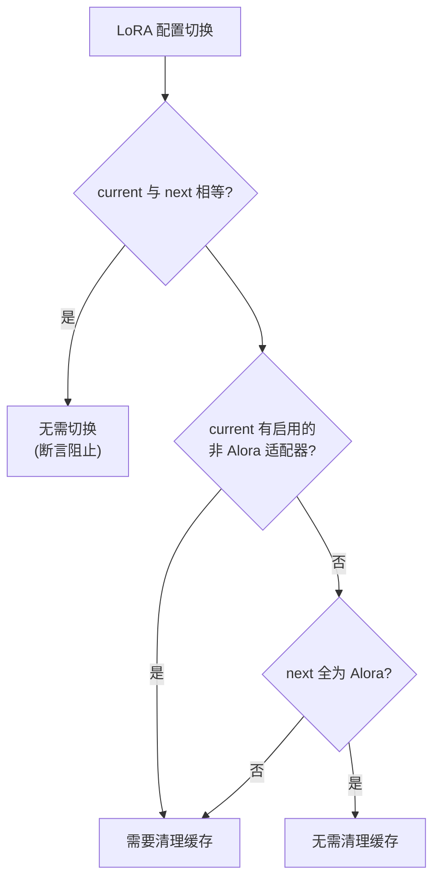
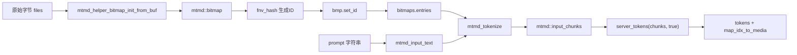
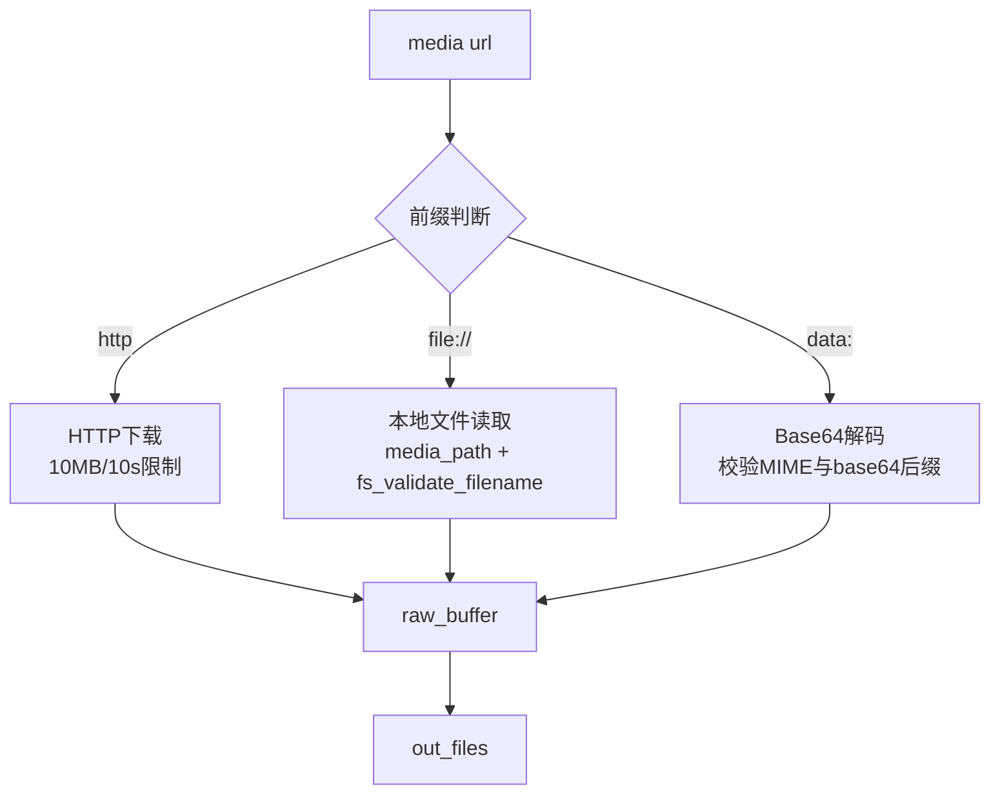
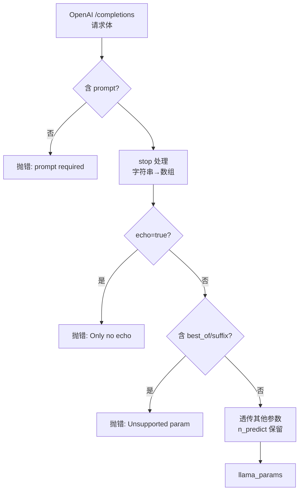
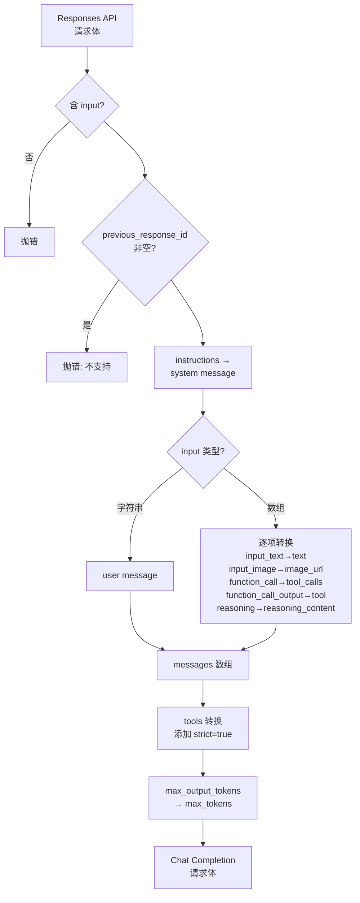
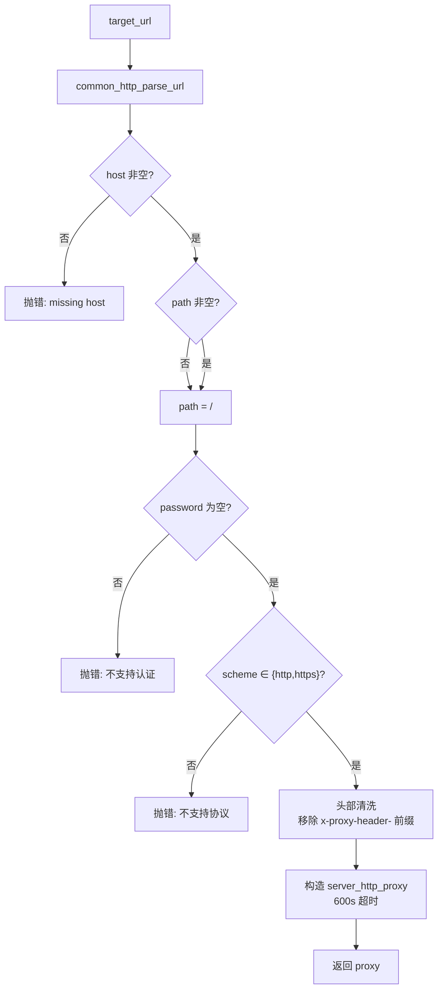

# 第80章 OpenAI / Anthropic 协议兼容层 —— 跨厂商的"语言同声传译"

## 学习目标

- 理解server_tokens容器如何统一管理文本Token与多模态块（图像/音频），掌握token索引到媒体块的映射机制
- 掌握LoRA适配器管理工具：alora检测、缓存清理判断、请求解析与启用ID提取
- 掌握多模态数据处理流水线：Base64解码、FNV哈希生成、MTMD分词与混合输入解析的完整链路
- 理解OpenAI与Anthropic API协议的双向转换逻辑，包括消息格式、工具调用与流式响应的规范化处理
- 掌握/media处理与URL解析：HTTP下载、本地文件读取与Base64数据解码的三通道处理
- 掌握SSE（Server-Sent Events）三种格式（OpenAI标准、Responses API、Anthropic）的差异化实现与UTF-8安全校验
- 掌握FIM（Fill-In-Middle）提示词构造与Rerank提示词模板
- 理解HTTP服务器抽象层设计：Pimpl模式封装cpp-httplib、中间件链（认证/状态检查）、静态资源服务与流式响应桥接
- 掌握CORS反向代理的安全实现：URL解析、协议白名单验证、头部清洗与超时控制

## 80.1 生活类比

把llama-server的基础设施想象成一家**国际快递中转枢纽**：
- **server_tokens** = 智能集装箱系统：普通货物（文本Token）与特殊货物（图像/音频集装箱）混装，每个集装箱贴有唯一RFID标签（FNV哈希），支持整箱装卸与部分拆箱（keep_first）
- **多模态预处理** = 海关翻译与安检：Base64是货物外包装解码，MTMD分词是将图像拆解为标准托盘单位（Token），FNV哈希是货物溯源码
- **协议转换引擎** = 多语言同声传译室：OpenAI、Anthropic、Responses是不同国家的贸易文件格式，convert_*函数是精通多语的翻译官，确保语义无损转换
- **SSE流式输出** = 实时物流追踪广播：format_*_sse是三种不同语言的广播系统（标准/带事件类型/Anthropic风格），is_valid_utf8是确保广播字符编码正确的校验员
- **server_http_context** = 枢纽大楼的基础设施：Pimpl模式是隐藏复杂管线的装饰墙，中间件（认证/状态检查）是安检闸机与门禁系统，WebUI静态资源是楼内的导航显示屏
- **CORS代理** = 跨境转运专用通道：proxy_request是检查货物目的地（URL白名单）、更换包装标签（头部清洗）、安排专线运输（600秒超时）的特殊物流通道
就像枢纽需要协调不同规格的集装箱与多国语言文件，llama-server的infrastructure层默默支撑着上层繁杂的协议与数据格式差异。

## 80.2 源码地图

```
tools/server/server-common.h
├── struct server_grammar_trigger   # 语法触发器包装
│   ├── server_grammar_trigger()    # 默认构造
│   ├── server_grammar_trigger(const common_grammar_trigger&) # 从通用触发器构造
│   ├── server_grammar_trigger(const json&) # JSON反序列化
│   └── to_json()                   # 序列化为JSON
├── struct server_http_req          # HTTP请求抽象
│   ├── get_param()                 # 获取请求参数
│   └── （字段：params/headers/path/...）
├── struct server_http_res          # HTTP响应抽象
│   ├── is_stream()                 # 判断是否为流式响应
│   └── （字段：next回调/data/status/...）
├── struct server_chat_params       # 聊天参数结构
├── template json_value()           # 带默认值的JSON取值
├── json format_error_response()    # 错误响应格式化
├── class server_tokens             # 多模态Token容器
│   ├── server_tokens()             # 默认构造
│   ├── ~server_tokens()            # 析构（默认）
│   ├── server_tokens(const server_tokens&)    # 拷贝构造（已删除）
│   ├── operator=(const server_tokens&)      # 拷贝赋值（已删除）
│   ├── server_tokens(server_tokens&&)       # 移动构造
│   ├── operator=(server_tokens&&)           # 移动赋值
│   ├── operator[] / operator[] const        # 下标访问（读写/只读）
│   ├── server_tokens(mtmd::input_chunks&, bool)  # 从mtmd块构造
│   ├── server_tokens(const llama_tokens&, bool)  # 从token列表构造
│   ├── str()                       # 调试字符串生成
│   ├── pos_next()                  # 计算下一位置（考虑多模态块）
│   ├── size_up_to_pos()            # 位置到token索引的逆映射
│   ├── find_chunk()                # 根据索引查找媒体块
│   ├── push_back(llama_token)      # 添加单个文本token
│   ├── push_back(const mtmd_input_chunk*) # 添加媒体块
│   ├── push_back(server_tokens&)   # 合并另一tokens对象
│   ├── insert()                    # 插入token列表
│   ├── get_text_tokens()           # 提取纯文本token序列
│   ├── set_token()                 # 设置指定位置token
│   ├── size()                      # 获取token数量
│   ├── empty()                     # 判空
│   ├── clear()                     # 清空容器
│   ├── keep_first()                # 保留前n个token（KV缓存截断）
│   ├── detokenize()                # 反分词为字符串
│   ├── get_common_prefix()         # 计算公共前缀长度
│   ├── validate()                  # 合法性校验
│   ├── process_chunk()             # 处理多模态块编码
│   └── clone()                     # 深拷贝
└── （声明的工具函数，见下方cpp条目）

tools/server/server-common.cpp
├── 基础工具
│   ├── format_error_response()     # 错误响应格式化
│   ├── random_string()             # 32位随机字符串
│   ├── gen_chatcmplid()            # 聊天ID生成
│   ├── gen_tool_call_id()          # 工具调用ID生成
│   ├── json_is_array_of_numbers()  # 纯数字数组校验
│   ├── json_is_array_of_mixed_numbers_strings() # 混合数组校验
│   ├── json_is_array_and_contains_numbers() # 含数字数组校验
│   ├── json_get_nested_values()    # 嵌套JSON取值
│   ├── safe_json_to_str()          # 安全JSON序列化
│   ├── tokens_to_str()             # token转字符串（多重重载）
│   ├── tokens_to_output_formatted_string() # 格式化输出字符串
│   └── base64_decode()             # Base64解码（两处实现）
├── LoRA管理
│   ├── lora_all_alora()            # 全Alora检测
│   ├── lora_should_clear_cache()   # 缓存清理判断
│   ├── parse_lora_request()        # 解析LoRA请求
│   ├── are_lora_equal()            # LoRA集合相等性比较
│   └── lora_get_enabled_ids()      # 获取启用ID列表
├── 多模态与分词
│   ├── validate_utf8()             # UTF-8安全截断
│   ├── fnv_hash()                  # FNV-1a哈希
│   ├── process_mtmd_prompt()       # MTMD提示词处理
│   ├── tokenize_mixed()            # 混合输入分词
│   ├── tokenize_input_subprompt()  # 子提示分词
│   ├── tokenize_input_prompts()    # 批量提示分词
│   └── handle_media()              # 媒体URL处理（HTTP/file/Base64）
├── API兼容层
│   ├── oaicompat_completion_params_parse()  # /completions参数解析
│   ├── oaicompat_chat_params_parse()        # /chat/completions参数解析
│   ├── convert_responses_to_chatcmpl()      # Responses→ChatCompletion转换
│   └── convert_anthropic_to_oai()           # Anthropic→OpenAI转换
└── 响应格式化
    ├── format_embeddings_response_oaicompat() # 嵌入响应格式化
    ├── format_response_rerank()    # 重排序响应格式化
    ├── get_token_probabilities()   # Token概率提取
    ├── format_oai_sse()            # OpenAI标准SSE
    ├── format_oai_resp_sse()       # Responses API SSE
    ├── format_anthropic_sse()      # Anthropic SSE
    ├── format_openai_sse()         # 旧版OpenAI SSE
    ├── is_valid_utf8()             # 严格UTF-8校验
    ├── format_prompt_infill()      # FIM填充提示构造
    └── format_prompt_rerank()      # 重排序提示构造

tools/server/server-http.h
├── struct server_http_res          # HTTP响应结构
│   └── is_stream()                 # 流式判断
├── struct server_http_req          # HTTP请求结构
│   └── get_param()                 # 参数获取
└── class server_http_context       # HTTP服务器上下文
    ├── server_http_context()       # 构造
    ├── ~server_http_context()      # 析构
    ├── init()                      # 初始化服务器
    ├── start()                     # 启动监听
    ├── stop()                      # 停止服务
    ├── get()                       # 注册GET路由
    └── post()                      # 注册POST路由

tools/server/server-http.cpp
├── log_server_request()            # 请求日志记录
├── server_http_context::Impl       # Pimpl实现类
│   └── Impl()                      # 内部构造
├── 请求响应工具
│   ├── set_headers()               # 设置响应头
│   ├── get_params()                # 提取查询参数
│   ├── get_headers()               # 提取请求头
│   ├── build_query_string()        # 构建查询字符串
│   └── process_handler_response()  # 响应桥接处理
└── server_http_context实现
    ├── server_http_context()       # 构造（Pimpl初始化）
    ├── ~server_http_context()      # 析构
    ├── init()                      # 完整初始化（SSL/中间件/线程池）
    ├── start()                     # 端口绑定与线程启动
    ├── stop()                      # 停止服务
    ├── get()                       # GET路由注册实现
    └── post()                      # POST路由注册实现

tools/server/server-cors-proxy.h
├── proxy_request()                 # CORS代理核心逻辑
├── proxy_handler_post()            # POST代理处理器
└── proxy_handler_get()             # GET代理处理器
```

## 80.3 server_tokens 类 —— 多模态 Token 的"集装箱式"封装

`server_tokens` 是 llama-server 中承载多模态输入的核心数据结构。它像一个**智能集装箱系统**，既能装载普通货物（文本 Token），又能装载特殊货物（图像/音频媒体块），并通过 RFID 标签（`map_idx_to_media` 映射）实现 O(1) 定位。这种设计统一了文本与多模态的处理路径，让上层推理逻辑无需感知底层数据的异构性。

### 80.3.1 类结构总览

下表展示 `server_tokens` 类的完整接口分布，按功能域分组呈现：

| 功能域 | 方法 | 作用 |
|--------|------|------|
| 生命周期 | 默认构造、析构、拷贝构造（删除）、拷贝赋值（删除）、移动构造、移动赋值 | 控制对象创建与转移，禁止浅拷贝 |
| 访问器 | `operator[]`、`size()`、`empty()`、`get_text_tokens()` | 只读/读写访问 token 序列 |
| 构造入口 | `(mtmd_chunks, bool)`、`(llama_tokens, bool)` | 从多模态块或纯文本构造 |
| 媒体块管理 | `push_back(chunk)`、`find_chunk()`、`map_idx_to_media` | 建立 token 索引→媒体块映射 |
| 容器操作 | `push_back(token)`、`push_back(tokens&)`、`insert()`、`clear()`、`set_token()` | 序列增删改与合并 |
| 位置映射 | `pos_next()`、`size_up_to_pos()` | token 索引与位置的双向转换 |
| KV 缓存 | `keep_first()` | 安全截断，防止媒体块被切断 |
| 序列化 | `str()`、`detokenize()`、`clone()`、`validate()`、`process_chunk()` | 调试、反分词、深拷贝、合法性校验、编码 |
| 前缀匹配 | `get_common_prefix()` | 多模态感知的公共前缀计算 |

```mermaid
classDiagram
    direction TB
    class server_tokens {
        -llama_tokens tokens
        -std::map~size_t, mtmd::input_chunk_ptr~ map_idx_to_media
        -bool has_mtmd
        +server_tokens() = default
        +~server_tokens() = default
        +server_tokens(const server_tokens&) = delete
        +operator=(const server_tokens&) = delete
        +server_tokens(server_tokens&&) = default
        +operator=(server_tokens&&) = default
        +llama_token operator[](size_t)
        +const llama_token& operator[](size_t) const
        +server_tokens(mtmd::input_chunks&, bool)
        +server_tokens(const llama_tokens&, bool)
        +std::string str() const
        +llama_pos pos_next(int64_t) const
        +size_t size_up_to_pos(llama_pos) const
        +const mtmd::input_chunk_ptr& find_chunk(size_t) const
        +void push_back(llama_token)
        +void push_back(const mtmd_input_chunk*)
        +void push_back(server_tokens&)
        +void insert(const llama_tokens&)
        +const llama_tokens& get_text_tokens() const
        +void set_token(llama_pos, llama_token)
        +size_t size() const
        +bool empty() const
        +void clear()
        +void keep_first(size_t)
        +std::string detokenize(ctx, bool) const
        +size_t get_common_prefix(const server_tokens&) const
        +bool validate(const llama_context*) const
        +int32_t process_chunk(ctx, mctx, idx, pos, seq_id, n_tokens_out) const
        +server_tokens clone() const
    }
    server_tokens ..> mtmd::input_chunk_ptr : 持有
```

### 80.3.2 双构造入口与生命周期管理

**源码路径：`tools/server/server-common.cpp` - `server_tokens` 构造函数（第195-196行）**

```cpp
// 多模态构造入口：从 mtmd::input_chunks 逐个推入
server_tokens::server_tokens(mtmd::input_chunks & mtmd_chunks, bool has_mtmd) : has_mtmd(has_mtmd) {
    for (size_t i = 0; i < mtmd_chunks.size(); ++i) {
        push_back(mtmd_chunks[i]);   // 逐块入箱，自动区分 IMAGE/AUDIO/TEXT
    }
}
// 纯文本构造入口：直接持有 token 向量
server_tokens::server_tokens(const llama_tokens & tokens, bool has_mtmd) : has_mtmd(has_mtmd), tokens(tokens) {
}
```

**逐行注释与解释**：
- 第1行：多模态构造函数接收 `mtmd::input_chunks` 与 `has_mtmd` 标志，初始化列表设置标志后，遍历所有 chunk 调用 `push_back(const mtmd_input_chunk*)`，该函数会根据 chunk 类型插入 `LLAMA_TOKEN_NULL` 占位符或文本 token，并建立 `map_idx_to_media` 映射。
- 第2行：纯文本构造函数直接接收 `llama_tokens` 向量并拷贝到成员 `tokens`，标记 `has_mtmd=false`，不产生任何媒体块映射。这种双入口设计让同一容器类型可以同时服务纯文本与多模态两种场景。

**类型即图纸**：在头文件中，`server_tokens` 显式删除了拷贝构造/赋值，仅保留移动语义，防止媒体块指针的意外浅拷贝导致双重释放或悬空指针。

```cpp
server_tokens(const server_tokens&) = delete;
server_tokens& operator=(const server_tokens&) = delete;
server_tokens(server_tokens&&) = default;
server_tokens& operator=(server_tokens&&) = default;
```

### 80.3.3 operator[] 与 size/empty：容器的"读写门禁"

**源码路径：`tools/server/server-common.h`（第132-133行、第166-168行）**

```cpp
llama_token operator[](size_t index) { return tokens[index]; }              // 读写访问
const llama_token& operator[](size_t index) const { return tokens[index]; } // 只读访问
size_t size() const { return tokens.size(); }                              // token 数量
bool empty() const { return tokens.empty(); }                              // 判空
```

**逐行注释与解释**：
- `operator[]` 提供了类似 `std::vector` 的下标访问，非 const 版本返回值拷贝（因 `llama_token` 是 int 类型，拷贝成本可忽略），const 版本返回 const 引用以禁止修改。
- `size()` 与 `empty()` 直接委托给内部 `tokens` 向量，是 STL 风格的容器接口，方便与标准算法（如 `std::find`、范围 for）协同工作。

### 80.3.4 pos_next()：位置与 Token 的"时空转换器"

**源码路径：`tools/server/server-common.cpp` - `pos_next()`（第200-248行）**

```cpp
llama_pos server_tokens::pos_next(int64_t n_tokens) const {
    if (!has_mtmd) {
        // 纯文本模式：位置数等于 token 数，一一对应
        if (n_tokens < 0) {
            return tokens.size();
        }
        return n_tokens;
    }
    if (n_tokens < 0) {
        // n_tokens < 0 表示"取全序列"，需累加所有媒体块的 (n_pos - n_tok) 差值
        llama_pos res = tokens.size();
        for (auto it = map_idx_to_media.begin(); it != map_idx_to_media.end(); ++it) {
            const auto & chunk = it->second;
            res += mtmd_input_chunk_get_n_pos(chunk.get()) - mtmd_input_chunk_get_n_tokens(chunk.get());
        }
        return res;
    }
    // 指定 n_tokens 时按索引遍历，遇到媒体块按 n_pos 累加、按 n_tok 跳过
    int64_t idx = 0;
    llama_pos pos = 0;
    GGML_ASSERT(n_tokens <= (int64_t)tokens.size());
    while (idx < n_tokens) {
        const auto media_it = map_idx_to_media.find(idx);
        if (media_it != map_idx_to_media.end()) {
            const auto & chunk = media_it->second;
            const llama_pos n_pos = mtmd_input_chunk_get_n_pos(chunk.get());
            const size_t n_tok = mtmd_input_chunk_get_n_tokens(chunk.get());
            pos += n_pos;
            idx += n_tok;
        } else {
            pos++;
            idx++;
        }
    }
    return pos;
}
```

**逐行注释与解释**：
- 第203-209行：纯文本模式下，位置数 `n_pos` 等于 token 数 `n_tok`，直接返回 `n_tokens` 或 `tokens.size()`，因为每个 token 恰好占据一个位置。
- 第210-218行：`n_tokens < 0` 表示"全序列"，遍历所有媒体块累加 `(n_pos - n_tok)` 差值，得到总位置数。这里体现了媒体块"位置膨胀"的特性——一个块可能占据多个位置但只对应一个 token 索引。
- 第219-239行：指定 `n_tokens` 时，按索引遍历：遇到媒体块则按 `n_pos` 累加位置、按 `n_tok` 跳过索引；普通 token 则位置+1、索引+1，保持同步。

**核心洞察**：多模态场景下，**一个媒体块可能对应多个位置但仅占用一个 Token 索引**（如一张图片编码为 256 个位置但仅插入 1 个 `LLAMA_TOKEN_NULL`）。`pos_next()` 正是解决这种"位置膨胀"与"索引压缩"不匹配的转换器。

下表总结两种模式的差异：

| 模式 | n_pos（位置数） | n_tok（Token 数） | 映射关系 |
|------|----------------|-------------------|----------|
| 纯文本 | = token 数 | = token 数 | 一一对应 |
| 多模态 | > token 数 | < n_pos | 一个媒体块占据多个位置，但只产生少量占位 token |

### 80.3.5 size_up_to_pos()：逆向映射的"定位导航"

**源码路径：`tools/server/server-common.cpp` - `size_up_to_pos()`（第250-281行）**

```cpp
size_t server_tokens::size_up_to_pos(llama_pos max_pos) const {
    if (!has_mtmd) {
        return std::min((size_t)max_pos, tokens.size());
    }
    size_t idx = 0;
    llama_pos pos = 0;
    while (idx < tokens.size()) {
        const auto media_it = map_idx_to_media.find(idx);
        if (media_it != map_idx_to_media.end()) {
            const auto & chunk = media_it->second;
            const llama_pos n_pos = md_input_chunk_get_n_pos(chunk.get());
            const size_t n_tok = mtmd_input_chunk_get_n_tokens(chunk.get());
            pos += n_pos;
            idx += n_tok;
        } else {
            pos++;
            idx++;
        }
        if (pos >= max_pos) {
            break;
        }
    }
    return idx;
}
```

**逐行注释与解释**：
- 第251-252行：纯文本模式下位置与 token 索引一一对应，直接取 `min(max_pos, tokens.size())`。
- 第254-270行：多模态模式下，按索引遍历并累加位置，遇到媒体块时按 `n_pos` 增加位置计数、按 `n_tok` 跳跃索引，直到位置达到 `max_pos` 时停止，返回当前 token 索引。

这段代码实现了**位置到 Token 索引的逆映射**：给定最大位置 `max_pos`，返回不超过该位置的最大 token 索引。逻辑与 `pos_next()` 镜像对称，都是在媒体块边界处处理 `n_pos` 与 `n_tok` 的差异。

### 80.3.6 str() / find_chunk()：调试与媒体块定位

**源码路径：`tools/server/server-common.cpp` - `str()`（第283-300行）、`find_chunk()`（第302-309行）**

```cpp
std::string server_tokens::str() const {
    std::ostringstream oss;
    oss << "tokens: ";
    for (size_t idx = 0; idx < tokens.size(); ++idx) {
        llama_token t = tokens[idx];
        oss << "idx:" << idx << " ";
        if (t == LLAMA_TOKEN_NULL) {
            oss << "<embd> ";          // 多模态占位符标记
        } else {
            oss << t << " ";
        }
    }
    oss << "\n";
    oss << "image idx: ";
    for (const auto & it : map_idx_to_media) {
        oss << it.first << ", ";     // 输出所有媒体块起始索引
    }
    return oss.str();
}

const mtmd::input_chunk_ptr & server_tokens::find_chunk(size_t idx) const {
    auto it = map_idx_to_media.find(idx);
    if (it != map_idx_to_media.end()) {
        return it->second;
    }
    throw std::runtime_error("Chunk not found");  // 未找到则抛异常
}
```

**逐行注释与解释**：
- `str()` 遍历 token 序列，对 `LLAMA_TOKEN_NULL` 占位符输出 `<embd>` 标记，最后列出所有媒体块的起始索引，用于调试日志中快速判断容器状态。
- `find_chunk()` 在 `map_idx_to_media` 中查找指定索引对应的媒体块，利用 `std::map` 的 O(logN) 查找；若不存在则抛出运行时异常，这种"快速失败"策略便于在开发阶段尽早暴露逻辑错误。

### 80.3.7 push_back 系列：容器的"装配流水线"

#### 80.3.7.1 push_back(llama_token)：单文本 token 入箱

**源码路径：`tools/server/server-common.cpp`（第311-317行）**

```cpp
void server_tokens::push_back(llama_token tok) {
    if (tok == LLAMA_TOKEN_NULL) {
        throw std::runtime_error("Invalid token");  // 拒绝空 token
    }
    tokens.emplace_back(tok);
}
```

**逐行注释与解释**：
- 第312-313行：显式拒绝 `LLAMA_TOKEN_NULL`，因为占位符只能由 `push_back(chunk)` 创建，直接调用此重载插入占位符会破坏 `map_idx_to_media` 的一致性。

#### 80.3.7.2 push_back(const mtmd_input_chunk*)：媒体块入箱的"标准化作业"

**源码路径：`tools/server/server-common.cpp` - `push_back(chunk)`（第319-341行）**

```cpp
void server_tokens::push_back(const mtmd_input_chunk * chunk) {
    auto type = mtmd_input_chunk_get_type(chunk);
    if (type == MTMD_INPUT_CHUNK_TYPE_IMAGE || type == MTMD_INPUT_CHUNK_TYPE_AUDIO) {
        GGML_ASSERT(has_mtmd);
        const size_t n_tokens = mtmd_input_chunk_get_n_tokens(chunk);
        size_t start_idx = tokens.size();
        for (size_t i = 0; i < n_tokens; ++i) {
            tokens.emplace_back(LLAMA_TOKEN_NULL);  // 插入占位符序列
        }
        mtmd::input_chunk_ptr new_chunk(mtmd_input_chunk_copy(chunk));  // 深拷贝 chunk
        map_idx_to_media[start_idx] = std::move(new_chunk);           // 建立索引映射
    } else if (type == MTMD_INPUT_CHUNK_TYPE_TEXT) {
        size_t n_tokens;
        const auto * text_tokens = mtmd_input_chunk_get_tokens_text(chunk, &n_tokens);
        for (size_t i = 0; i < n_tokens; ++i) {
            push_back(text_tokens[i]);  // 文本块直接逐个推入
        }
    } else {
        GGML_ABORT("Invalid chunk type");  // 未知类型直接终止
    }
}
```

**逐行注释与解释**：
- 第321-330行：**图像/音频块** → 插入 `n_tokens` 个 `LLAMA_TOKEN_NULL` 占位符，记录 `start_idx` 到 `map_idx_to_media`，深拷贝 chunk 指针（`mtmd_input_chunk_copy`）。
- 第331-335行：**文本块** → 直接提取内部 token 序列逐个 `push_back`，不产生占位符，不建立媒体映射。
- 第336-337行：未知类型直接 `GGML_ABORT` 终止程序，防止非法数据进入推理流程。

**本质区别**：图像/音频是"压缩表示"（大量位置压缩为少量占位 Token），文本是"原样传递"。这种设计让 Transformer 的位置编码能正确作用于媒体内容的每个位置，同时保持 KV 缓存索引的紧凑。

#### 80.3.7.3 push_back(server_tokens&)：合并另一容器

**源码路径：`tools/server/server-common.cpp`（第343-359行）**

```cpp
void server_tokens::push_back(server_tokens & tokens) {
    size_t start_idx = size();
    for (size_t i = 0; i < tokens.size(); i++) {
        push_back(tokens[i]);
    }
    if (tokens.has_mtmd) {
        GGML_ASSERT(has_mtmd);  // 合并多模态容器要求双方都是多模态
        for (auto it = tokens.map_idx_to_media.begin(); it != tokens.map_idx_to_media.end(); ) {
            auto * chunk = tokens.map_idx_to_media[it->first].get();
            mtmd::input_chunk_ptr new_chunk(mtmd_input_chunk_copy(chunk));
            map_idx_to_media[start_idx + it->first] = std::move(new_chunk);  // 偏移索引
        }
    }
}
```

**逐行注释与解释**：
- 第344-346行：先逐个复制 token 序列。
- 第347-358行：若源容器有多模态数据，要求当前容器也必须是多模态（`GGML_ASSERT`），然后遍历源容器的 `map_idx_to_media`，深拷贝每个媒体块并以 `start_idx + 原索引` 为新键插入当前容器的映射中，保证合并后索引连续正确。

### 80.3.8 insert() / get_text_tokens() / set_token()：非多模态专用工具

**源码路径：`tools/server/server-common.cpp`（第361-375行）**

```cpp
void server_tokens::insert(const llama_tokens & inp_tokens) {
    GGML_ASSERT(!has_mtmd);  // 仅限纯文本模式
    tokens.insert(tokens.end(), inp_tokens.begin(), inp_tokens.end());
}

const llama_tokens & server_tokens::get_text_tokens() const {
    GGML_ASSERT(!has_mtmd);  // 仅限纯文本模式
    return tokens;
}

void server_tokens::set_token(llama_pos pos, llama_token id) {
    GGML_ASSERT(!has_mtmd);  // 仅限纯文本模式
    tokens[pos] = id;
}
```

**逐行注释与解释**：
- `insert()` 将外部 token 列表追加到容器末尾，用于上下文滑动（ctx shift）等场景。
- `get_text_tokens()` 返回内部 token 向量的 const 引用，用于推测式解码（speculative decoding）中提取纯文本序列。
- `set_token()` 允许修改指定位置的 token，为推测式解码的"接受/拒绝"步骤提供写入能力。
- 三个函数均用 `GGML_ASSERT(!has_mtmd)` 限制仅在纯文本模式下使用，避免在多模态场景下误用导致 `map_idx_to_media` 不一致。

### 80.3.9 keep_first()：KV 缓存截断的"安全剪刀"

**源码路径：`tools/server/server-common.cpp` - `keep_first()`（第377-400行）**

```cpp
void server_tokens::keep_first(size_t n) {
    GGML_ASSERT(n <= tokens.size());
    if (has_mtmd) {
        if (n == tokens.size()) {
            return;  // 无需截断
        }
        if (n > 0) {
            // 关键安全检查：防止在媒体块中间截断
            if (tokens[n - 1] == LLAMA_TOKEN_NULL && tokens[n] == LLAMA_TOKEN_NULL) {
                find_chunk(n - 1);  // 若前后都是占位符，说明截断点在块中间，抛异常
            }
        }
        for (auto it = map_idx_to_media.begin(); it != map_idx_to_media.end(); ) {
            size_t idx = it->first;
            if (idx >= n) {
                it = map_idx_to_media.erase(it);  // 清理被截断的媒体块
            } else {
                ++it;
            }
        }
    }
    tokens.resize(n);  // 实际截断 token 序列
}
```

**逐行注释与解释**：
- 第379-381行：若 `n` 等于 token 总数，直接返回。
- 第382-387行：**关键安全检查**——若截断点 `n-1` 和 `n` 都是 `LLAMA_TOKEN_NULL`，说明截断点正处于同一个媒体块的占位序列中间，调用 `find_chunk(n-1)` 会抛出异常，避免 KV 缓存出现"半张图片"导致的语义破坏。
- 第388-396行：遍历 `map_idx_to_media`，删除所有起始索引 `>= n` 的媒体块。
- 第398行：`tokens.resize(n)` 完成实际截断。

### 80.3.10 detokenize() / clone() / validate() / process_chunk()：序列化与编码

**源码路径：`tools/server/server-common.cpp`（第402-522行）**

```cpp
std::string server_tokens::detokenize(const llama_context * ctx, bool special) const {
    llama_tokens text_tokens;
    text_tokens.reserve(tokens.size());
    for (const auto & t : tokens) {
        if (t != LLAMA_TOKEN_NULL) {
            text_tokens.push_back(t);  // 过滤掉多模态占位符
        }
    }
    return common_detokenize(ctx, text_tokens, special);
}

server_tokens server_tokens::clone() const {
    server_tokens res;
    res.has_mtmd = has_mtmd;
    res.tokens   = tokens;
    for (auto it = map_idx_to_media.begin(); it != map_idx_to_media.end(); ++it) {
        size_t idx = it->first;
        const mtmd::input_chunk_ptr & chunk = it->second;
        res.map_idx_to_media[idx] = mtmd::input_chunk_ptr(mtmd_input_chunk_copy(chunk.get()));  // 深拷贝每个块
    }
    return res;
}

bool server_tokens::validate(const struct llama_context * ctx) const {
    const llama_model * model = llama_get_model(ctx);
    const llama_vocab * vocab = llama_model_get_vocab(model);
    const int32_t n_vocab = llama_vocab_n_tokens(vocab);
    for (size_t i = 0; i < tokens.size(); ++i) {
        const auto & t = tokens[i];
        if (t == LLAMA_TOKEN_NULL) {
            try {
                const auto & chunk = find_chunk(i);
                size_t n_tokens = mtmd_input_chunk_get_n_tokens(chunk.get());
                i += n_tokens - 1;  // 跳过整个媒体块
            } catch (const std::exception & e) {
                return false;  // 占位符无对应块，非法
            }
        } else if (t < 0 || t >= n_vocab) {
            return false;  // 普通 token 超出词汇表范围
        }
    }
    return true;
}

int32_t server_tokens::process_chunk(
            llama_context * ctx,
            mtmd_context * mctx,
            size_t idx,
            llama_pos pos,
            int32_t seq_id,
            size_t & n_tokens_out) const {
    const auto & chunk = find_chunk(idx);
    const char * name = mtmd_input_chunk_get_type(chunk.get()) == MTMD_INPUT_CHUNK_TYPE_IMAGE
                        ? "image" : "audio";
    SRV_INF("processing %s...\n", name);
    int32_t n_batch = llama_n_batch(ctx);
    int64_t t0 = ggml_time_ms();
    llama_pos new_n_past;
    int32_t result = mtmd_helper_eval_chunk_single(mctx, ctx,
        chunk.get(),
        pos,
        seq_id,
        n_batch,
        true,
        &new_n_past);
    SRV_INF("%s processed in %" PRId64 " ms\n", name, ggml_time_ms() - t0);
    if (result != 0) {
        LOG_ERR("mtmd_helper_eval failed with status %d", result);
        n_tokens_out = 0;
        return result;
    }
    n_tokens_out = mtmd_input_chunk_get_n_tokens(chunk.get());
    return 0;
}
```

**逐行注释与解释**：
- `detokenize()` 过滤掉 `LLAMA_TOKEN_NULL` 占位符后调用 `common_detokenize`，用于生成用户可见的文本输出。
- `clone()` 是显式的深拷贝入口，复制所有 token 并对每个媒体块调用 `mtmd_input_chunk_copy`，解决拷贝构造被删除后的复制需求。
- `validate()` 检查每个 token：普通 token 必须在词汇表范围内，占位符必须有对应的媒体块且块大小正确，用于推理前的合法性校验。
- `process_chunk()` 将指定媒体块送入 `mtmd_helper_eval_chunk_single` 进行编码（图像/音频→embedding），记录处理耗时，是多模态推理的实际执行单元。

### 80.3.11 get_common_prefix()：多模态感知的"指纹比对"

**源码路径：`tools/server/server-common.cpp` - `get_common_prefix()`（第415-459行）**

```cpp
size_t server_tokens::get_common_prefix(const server_tokens & b) const {
    const size_t max_idx = std::min(tokens.size(), b.tokens.size());
    if (!has_mtmd) {
        for (size_t i = 0; i < max_idx; ++i) {
            if (tokens[i] == b.tokens[i]) {
                continue;
            }
            return i;
        }
        return max_idx;
    }
    for (size_t i = 0; i < max_idx; ++i) {
        const llama_token ai =   tokens[i];
        const llama_token bi = b.tokens[i];
        if (ai == LLAMA_TOKEN_NULL && bi == LLAMA_TOKEN_NULL) {
            const auto & a_chunk =   find_chunk(i);
            const auto & b_chunk = b.find_chunk(i);
            GGML_ASSERT(a_chunk && b_chunk);
            const std::string id_ai = mtmd_input_chunk_get_id(a_chunk.get());
            const std::string id_bi = mtmd_input_chunk_get_id(b_chunk.get());
            const size_t n_tok_a = mtmd_input_chunk_get_n_tokens(a_chunk.get());
            const size_t n_tok_b = mtmd_input_chunk_get_n_tokens(b_chunk.get());
            if (id_ai == id_bi && n_tok_a == n_tok_b) {
                GGML_ASSERT(n_tok_a > 0 && "Invalid media chunk");
                i += n_tok_a - 1;  // 匹配成功则跳过整个媒体块
                continue;
            }
            return i;
        }
        if (ai == bi) {
            continue;
        }
        return i;
    }
    return max_idx;
}
```

**逐行注释与解释**：
- 纯文本模式：逐 token 比对，遇到第一个不匹配即返回。
- 多模态模式：遇到双方均为 `LLAMA_TOKEN_NULL` 时，比较媒体块的 **ID（FNV哈希）** 与 **token数量**，而非逐个比较占位符。匹配成功则一次性跳过整个媒体块（`i += n_tok_a - 1`），实现 O(媒体块数) 而非 O(token数) 的比较复杂度。

## 80.4 基础工具函数集 —— 文字处理的"瑞士军刀"

这些函数构成了服务端处理 JSON、字符串、Token 等基础数据类型的"标准库"。它们虽不直接参与推理，却是参数解析、错误处理、响应格式化的基石。

### 80.4.1 json_value()：带默认值与类型安全的 JSON 取值器

**源码路径：`tools/server/server-common.h`（第52-63行）**

```cpp
template <typename T>
static T json_value(const json & body, const std::string & key, const T & default_value) {
    if (body.contains(key) && !body.at(key).is_null()) {
        try {
            return body.at(key);  // 尝试直接返回目标类型
        } catch (NLOHMANN_JSON_NAMESPACE::detail::type_error const & err) {
            // 类型不匹配时打印警告并回退默认值
            LOG_WRN("Wrong type supplied for parameter '%s'. Expected '%s', using default value: %s\n",
                    key.c_str(), json(default_value).type_name(), err.what());
            return default_value;
        }
    } else {
        return default_value;
    }
}
```

**逐行注释与解释**：
- 第53-54行：先检查 key 存在且非 null，再尝试将 JSON 值转为模板类型 `T`。
- 第55-60行：若 nlohmann/json 抛出 `type_error`（如期望 string 但实际是 number），捕获后记录警告日志并返回默认值，避免请求解析中断。
- 第61-63行：key 不存在或为 null 时直接返回默认值。

该函数是整个参数解析层的"安全网"，使客户端传入错误类型时服务端仍能优雅降级。

### 80.4.2 format_error_response()：标准化错误响应生成器

**源码路径：`tools/server/server-common.cpp` - `format_error_response()`（第18-47行）**

```cpp
json format_error_response(const std::string & message, const enum error_type type) {
    std::string type_str;
    int code = 500;
    switch (type) {
        case ERROR_TYPE_INVALID_REQUEST: type_str = "invalid_request_error"; code = 400; break;
        case ERROR_TYPE_AUTHENTICATION: type_str = "authentication_error"; code = 401; break;
        case ERROR_TYPE_NOT_FOUND: type_str = "not_found_error"; code = 404; break;
        case ERROR_TYPE_SERVER: type_str = "server_error"; code = 500; break;
        case ERROR_TYPE_PERMISSION: type_str = "permission_error"; code = 403; break;
        case ERROR_TYPE_NOT_SUPPORTED: type_str = "not_supported_error"; code = 501; break;
        case ERROR_TYPE_UNAVAILABLE: type_str = "unavailable_error"; code = 503; break;
        case ERROR_TYPE_EXCEED_CONTEXT_SIZE: type_str = "exceed_context_size_error"; code = 400; break;
    }
    return json {"code": code, "message": message, "type": type_str};
}
```

**逐行注释与解释**：
- 第19-29行：`switch` 根据错误类型枚举同时设置 HTTP 状态码（`code`）与语义化类型字符串（`type_str`），覆盖了从客户端错误（400/401/403/404）到服务端错误（500/501/503）的完整谱系。
- 第31行：返回统一的 JSON 对象 `{code, message, type}`，客户端可通过 `type` 字段做精细化错误分发。

### 80.4.3 random_string() / gen_chatcmplid() / gen_tool_call_id()：唯一标识生成器

**源码路径：`tools/server/server-common.cpp`（第53-76行）**

```cpp
std::string random_string() {
    static const std::string str("0123456789ABCDEFGHIJKLMNOPQRSTUVWXYZabcdefghijklmnopqrstuvwxyz");
    std::random_device rd;
    std::mt19937 generator(rd());  // 梅森旋转算法，高质量随机源
    std::string result(32, ' ');
    for (int i = 0; i < 32; ++i) {
        result[i] = str[generator() % str.size()];
    }
    return result;
}

std::string gen_chatcmplid() {
    return "chatcmpl-" + random_string();  // 符合 OpenAI 规范的前缀
}

std::string gen_tool_call_id() {
    return random_string();  // 工具调用 ID 无需特定前缀
}
```

**逐行注释与解释**：
- `random_string()` 使用 `std::mt19937` 梅森旋转算法生成 32 位字母数字串，`std::random_device` 提供种子熵。
- `gen_chatcmplid()` 添加 `chatcmpl-` 前缀，符合 OpenAI `chat.completion` 对象的 ID 命名规范。
- `gen_tool_call_id()` 直接复用，用于工具调用链路追踪。

### 80.4.4 JSON 类型探测三件套：参数解析的"类型守卫"

**源码路径：`tools/server/server-common.cpp`（第528-570行）**

```cpp
bool json_is_array_of_numbers(const json & data) {
    if (data.is_array()) {
        for (const auto & e : data) {
            if (!e.is_number_integer()) return false;  // 必须全是整数
        }
        return true;
    }
    return false;
}

bool json_is_array_of_mixed_numbers_strings(const json & data) {
    bool seen_string = false;
    bool seen_number = false;
    if (data.is_array()) {
        for (const auto & e : data) {
            seen_string |= e.is_string();
            seen_number |= e.is_number_integer();
            if (seen_number && seen_string) return true;  // 早期退出
        }
    }
    return false;
}

bool json_is_array_and_contains_numbers(const json & data) {
    if (data.is_array()) {
        for (const auto & e : data) {
            if (e.is_number_integer()) return true;  // 至少一个整数
        }
        return false;
    }
    return false;
}
```

**逐行注释与解释**：
- `json_is_array_of_numbers()`：判断是否为**纯整数数组**，用于直接提取 `llama_tokens`。
- `json_is_array_of_mixed_numbers_strings()`：判断是否为**字符串+整数混合数组**，用于调用 `tokenize_mixed()`。
- `json_is_array_and_contains_numbers()`：判断是否为**包含至少一个整数的数组**，用于批量提示词分词的分支判断。
- 三个函数均采用早出（early return）策略，避免不必要的遍历。

### 80.4.5 json_get_nested_values()：嵌套 JSON 的"路径取值器"

**源码路径：`tools/server/server-common.cpp` - `json_get_nested_values()`（第572-594行）**

```cpp
json json_get_nested_values(const std::vector<std::string> & paths, const json & js) {
    json result = json::object();
    for (const std::string & path : paths) {
        json current = js;
        const auto keys = string_split<std::string>(path, '/');  // 用 '/' 分割路径
        bool valid_path = true;
        for (const std::string & k : keys) {
            if (valid_path && current.is_object() && current.contains(k)) {
                current = current[k];
            } else {
                valid_path = false;  // 路径不存在则标记无效
            }
        }
        if (valid_path) result[path] = current;  // 仅保存有效路径的值
    }
    return result;
}
```

**逐行注释与解释**：
- 该函数接收一组 `a/b/c` 格式的路径列表，从 JSON 对象中按路径提取嵌套值，返回路径→值的映射。
- 路径分割使用 `string_split` 以 `/` 为分隔符，逐层深入 JSON 对象。
- 若某层路径不存在，`valid_path` 置 false，最终不将该路径加入结果集，避免返回 null 值污染调用方逻辑。

### 80.4.6 base64_decode()：Base64 解码的"还原机"

**源码路径：`tools/server/server-common.cpp`（第166-196行，第876-897行有重复实现）**

```cpp
static inline raw_buffer base64_decode(const std::string & encoded_string) {
    int i = 0, j = 0, in_ = 0;
    int in_len = encoded_string.size();
    uint8_t char_array_4[4];
    uint8_t char_array_3[3];
    raw_buffer ret;
    while (in_len-- && (encoded_string[in_] != '=') && is_base64(encoded_string[in_])) {
        char_array_4[i++] = encoded_string[in_]; in_++;
        if (i == 4) {
            for (i = 0; i < 4; i++) char_array_4[i] = base64_chars.find(char_array_4[i]);
            char_array_3[0] = ((char_array_4[0]) << 2) + ((char_array_4[1] & 0x30) >> 4);
            char_array_3[1] = ((char_array_4[1] & 0xf) << 4) + ((char_array_4[2] & 0x3c) >> 2);
            char_array_3[2] = ((char_array_4[2] & 0x3) << 6) + char_array_4[3];
            for (i = 0; i < 3; i++) ret.push_back(char_array_3[i]);
            i = 0;
        }
    }
    if (i) {
        for (j = i; j < 4; j++) char_array_4[j] = 0;
        for (j = 0; j < 4; j++) char_array_4[j] = base64_chars.find(char_array_4[j]);
        char_array_3[0] = ((char_array_4[0]) << 2) + ((char_array_4[1] & 0x30) >> 4);
        char_array_3[1] = ((char_array_4[1] & 0xf) << 4) + ((char_array_4[2] & 0x3c) >> 2);
        char_array_3[2] = ((char_array_4[2] & 0x3) << 6) + char_array_4[3];
        for (j = 0; j < i - 1; j++) ret.push_back(char_array_3[j]);
    }
    return ret;
}
```

**逐行注释与解释**：
- 主循环每读入 4 个 Base64 字符（6bit×4=24bit）解码为 3 字节，遇到 `=` 填充或非法字符时停止。
- 位运算实现 6bit→8bit 的转换：`char_array_4[0]` 的高 2bit 与 `char_array_4[1]` 的高 4bit 组合为第 1 字节，依此类推。
- 末尾 `if (i)` 处理不足 4 字符的尾组，填充 0 后仅输出 `i-1` 个字节（因最后一个 6bit 组实际只贡献部分字节）。
- 注意文件中存在两个完全相同的实现（第166行和第876行），建议后续重构合并以降低维护成本。

### 80.4.7 tokens_to_str() 与 tokens_to_output_formatted_string()：Token→字符串转换

**源码路径：`tools/server/server-common.cpp`（第1938-1972行）**

```cpp
// 模板实现：对任意迭代器范围逐 token 转字符串
template <class Iter>
static std::string tokens_to_str(const llama_vocab * ctx, Iter begin, Iter end) {
    std::string ret;
    for (; begin != end; ++begin) {
        ret += common_token_to_piece(ctx, *begin);
    }
    return ret;
}

// 上下文版本：从 model 获取 vocab
std::string tokens_to_str(llama_context * ctx, const llama_tokens & tokens) {
    auto model = llama_get_model(ctx);
    return tokens_to_str(llama_model_get_vocab(model), tokens.begin(), tokens.end());
}

// 词汇表版本：直接接收 vocab
std::string tokens_to_str(const llama_vocab * vocab, const llama_tokens & tokens) {
    return tokens_to_str(vocab, tokens.begin(), tokens.end());
}

// 格式化输出：处理不完整的 UTF-8 多字节字符
std::string tokens_to_output_formatted_string(const llama_context * ctx, const llama_token token) {
    std::string out = token == LLAMA_TOKEN_NULL ? "" : common_token_to_piece(ctx, token);
    // 若输出为单字节且最高位为 1，说明是不完整的多字节字符片段
    if (out.size() == 1 && (out[0] & 0x80) == 0x80) {
        std::stringstream ss;
        ss << std::hex << (out[0] & 0xff);
        std::string res(ss.str());
        out = "byte: \\x" + res;  // 以 \xHH 格式输出，避免乱码
    }
    return out;
}
```

**逐行注释与解释**：
- `tokens_to_str` 提供三重载：模板版本接受任意迭代器，上下文版本自动从 model 提取 vocab，词汇表版本直接使用 vocab。
- `tokens_to_output_formatted_string()` 专为流式输出设计：当 token 解码后为单字节且最高位为 1（如 UTF-8 多字节序列的后续字节被单独切分），将其转为 `byte: \xHH` 字面量，防止输出乱码。

### 80.4.8 safe_json_to_str()：安全的 JSON 序列化

**源码路径：`tools/server/server-common.cpp` - `safe_json_to_str()`（第1934-1936行）**

```cpp
std::string safe_json_to_str(const json & data) {
    return data.dump(-1, ' ', false, json::error_handler_t::replace);
}
```

**逐行注释与解释**：
- `dump(-1, ' ', false, ...)` 指定紧凑格式（indent=-1）、空格分隔、不强制 ASCII 转义。
- `error_handler_t::replace` 表示遇到非法 UTF-8 字节时用替换字符（U+FFFD）替代，而不是抛出异常，确保 SSE 流式输出不会因个别脏字符中断。

## 80.5 LoRA 适配器管理 —— 参数高效的"微调指挥家"

### 80.5.1 lora_all_alora()：Alora 模式全检测

**源码路径：`tools/server/server-common.cpp` - `lora_all_alora()`（第82-94行）**

```cpp
bool lora_all_alora(const std::vector<common_adapter_lora_info> & loras) {
    bool found_alora = false;
    for (const auto & lora : loras) {
        if (lora.scale != 0) {  // 仅检查启用的适配器
            if (llama_adapter_get_alora_n_invocation_tokens(lora.ptr) == 0) {
                return false;  // 存在非 Alora 的启用适配器
            }
            found_alora = true;
        }
    }
    return found_alora;  // 所有启用适配器均为 Alora 且至少存在一个
}
```

**逐行注释与解释**：
- 遍历所有**非零缩放**的 LoRA 适配器，若任意一个的 `alora_n_invocation_tokens == 0`（未启用 Alora 机制），立即返回 `false`。
- 只有**所有**非零适配器均为 Alora 且至少存在一个时返回 `true`，确保"全 Alora"语义的严格性。

### 80.5.2 are_lora_equal() 与 lora_get_enabled_ids()：相等性比较与启用 ID 提取

**源码路径：`tools/server/server-common.cpp`（第131-159行）**

```cpp
bool are_lora_equal(
        const std::vector<common_adapter_lora_info> & l1,
        const std::vector<common_adapter_lora_info> & l2) {
    if (l1.size() != l2.size()) return false;
    for (size_t i = 0; i < l1.size(); ++i) {
        // 比较 scale 和 ptr，忽略 path 字段以降低比较复杂度
        if (l1[i].scale != l2[i].scale || l1[i].ptr != l2[i].ptr) {
            return false;
        }
    }
    return true;
}

std::vector<size_t> lora_get_enabled_ids(const std::vector<common_adapter_lora_info> & loras) {
    std::vector<size_t> enabled_ids;
    for (size_t i = 0; i < loras.size(); ++i) {
        if (loras[i].scale > 0) {  // scale > 0 视为启用
            enabled_ids.push_back(i);
        }
    }
    return enabled_ids;
}
```

**逐行注释与解释**：
- `are_lora_equal()` 比较两个 LoRA 集合的大小与每个位置的 `scale` 和 `ptr`（适配器指针），故意忽略 `path` 字段，因为同一路径加载的适配器指针必然相同，比较 path 无额外收益。
- `lora_get_enabled_ids()` 返回所有 `scale > 0` 的适配器索引列表，用于 `lora_should_clear_cache()` 判断当前是否有启用的非 Alora 适配器。

### 80.5.3 lora_should_clear_cache()：KV 缓存清理策略

**源码路径：`tools/server/server-common.cpp` - `lora_should_clear_cache()`（第100-116行）**

```cpp
bool lora_should_clear_cache(
        const std::vector<common_adapter_lora_info> & current,
        const std::vector<common_adapter_lora_info> & next) {
    GGML_ASSERT(!are_lora_equal(current, next));  // 前置条件：两者不相等
    return (!(lora_get_enabled_ids(current).empty() || lora_all_alora(current)) ||
        !lora_all_alora(next));
}
```

**逐行注释与解释**：
- 返回 `true` 表示需要清理 KV 缓存，逻辑拆解为两部分：
  1. `!(当前无启用 || 当前全 Alora)`：即"当前有启用的非 Alora 适配器"→ 缓存已被污染，切换任何配置都必须清理。
  2. `!lora_all_alora(next)`：即"目标配置非全 Alora"→ 新配置会污染缓存，必须先清理旧缓存。

下表总结清理策略的决策路径：

| 当前状态 | 目标状态 | 是否清理缓存 | 原因 |
|----------|----------|-------------|------|
| 无启用 LoRA | 任意 | 否 | 当前缓存未被污染 |
| 全 Alora | 全 Alora | 否 | 双方均不污染缓存 |
| 全 Alora | 非全 Alora | 是 | 目标会污染缓存 |
| 有非 Alora | 任意 | 是 | 当前缓存已被污染 |

这体现了 Alora 机制的核心优势：**Alora 适配器通过额外的调用 token 隔离了 KV 缓存影响，允许热切换而不污染缓存**。



### 80.5.4 parse_lora_request()：请求解析为 ID→Scale 映射

**源码路径：`tools/server/server-common.cpp` - `parse_lora_request()`（第118-129行）**

```cpp
std::map<int, float> parse_lora_request(const json & data) {
    std::map<int, float> lora;
    for (const auto & entry : data) {
        int id      = json_value(entry, "id", -1);
        float scale = json_value(entry, "scale", 0.0f);
        lora[id] = scale;
    }
    return lora;
}
```

**逐行注释与解释**：
- 将 JSON 数组 `[{"id": 0, "scale": 0.5}, ...]` 解析为 `std::map<int, float>`，后续用于 `llama_set_adapters_lora()` 配置。
- `json_value` 提供默认值（id 默认 -1，scale 默认 0.0f），避免字段缺失时抛异常。
- 注意：若 JSON 包含重复 ID，`std::map` 会保留最后一个值（覆盖语义）。

## 80.6 多模态预处理流水线 —— 图像音频的"Token 化翻译官"

### 80.6.1 fnv_hash()：媒体数据的"指纹生成器"

**源码路径：`tools/server/server-common.cpp` - `fnv_hash()`（第653-665行）**

```cpp
static std::string fnv_hash(const uint8_t * data, size_t len) {
    const uint64_t fnv_prime = 0x100000001b3ULL;
    uint64_t hash = 0xcbf29ce484222325ULL;
    for (size_t i = 0; i < len; ++i) {
        hash ^= data[i];
        hash *= fnv_prime;
    }
    return std::to_string(hash);
}
```

**逐行注释与解释**：
- FNV-1a 64位哈希算法：初始偏移 `0xcbf29ce484222325ULL`，质数 `0x100000001b3ULL`。
- 逐字节异或后乘法，利用乘法的雪崩效应确保输入微小变化产生完全不同的哈希值。
- 为每个图像/音频文件生成唯一 ID，用于 `server_tokens::map_idx_to_media` 的去重键、`get_common_prefix()` 的媒体块身份比对、MTMD 编码器的缓存键。

### 80.6.2 process_mtmd_prompt()：多模态分词总入口

**源码路径：`tools/server/server-common.cpp` - `process_mtmd_prompt()`（第667-696行）**

```cpp
server_tokens process_mtmd_prompt(mtmd_context * mctx, std::string prompt, std::vector<raw_buffer> files) {
    mtmd::bitmaps bitmaps;
    for (auto & file : files) {
        mtmd::bitmap bmp(mtmd_helper_bitmap_init_from_buf(mctx, file.data(), file.size()));
        if (!bmp.ptr) {
            throw std::runtime_error("Failed to load image or audio file");
        }
        std::string hash = fnv_hash(bmp.data(), bmp.n_bytes());
        bmp.set_id(hash.c_str());
        bitmaps.entries.push_back(std::move(bmp));
    }
    std::vector<server_tokens> inputs;
    mtmd_input_text inp_txt = {prompt.c_str(), true, true};
    mtmd::input_chunks chunks(mtmd_input_chunks_init());
    auto bitmaps_c_ptr = bitmaps.c_ptr();
    int32_t tokenized = mtmd_tokenize(mctx, chunks.ptr.get(), &inp_txt, bitmaps_c_ptr.data(), bitmaps_c_ptr.size());
    if (tokenized != 0) throw std::runtime_error("Failed to tokenize prompt");
    auto result = server_tokens(chunks, true);
    return result;
}
```

**逐行注释与解释**：
- 第668-676行：**原始字节→Bitmap**：`mtmd_helper_bitmap_init_from_buf` 解码图像/音频，`fnv_hash` 计算哈希并 `set_id` 标记，存入 `bitmaps.entries`。
- 第677-683行：**MTMD 分词**：构造 `mtmd_input_text`（`true, true` 表示添加特殊标记与解析），初始化 `mtmd::input_chunks`，调用 `mtmd_tokenize` 将文本提示与 bitmap 序列融合。
- 第684-685行：**封装**：构造 `server_tokens(chunks, true)` 完成 token 与媒体块的映射绑定。



### 80.6.3 tokenize_input_subprompt()：四种提示格式的统一解析器

**源码路径：`tools/server/server-common.cpp` - `tokenize_input_subprompt()`（第706-736行）**

```cpp
static server_tokens tokenize_input_subprompt(const llama_vocab * vocab, mtmd_context * mctx, const json & json_prompt, bool add_special, bool parse_special) {
    constexpr char JSON_STRING_PROMPT_KEY[] = "prompt_string";
    constexpr char JSON_MTMD_DATA_KEY[] = "multimodal_data";
    const bool has_mtmd = mctx != nullptr;
    if (json_prompt.is_string() || json_is_array_of_mixed_numbers_strings(json_prompt)) {
        llama_tokens tmp = tokenize_mixed(vocab, json_prompt, add_special, parse_special);
        return server_tokens(tmp, false);
    } else if (json_is_array_of_numbers(json_prompt)) {
        llama_tokens tmp = json_prompt.get<llama_tokens>();
        return server_tokens(tmp, false);
    } else if (json_prompt.contains(JSON_STRING_PROMPT_KEY)) {
        if (json_prompt.contains(JSON_MTMD_DATA_KEY)) {
            if (!has_mtmd) throw std::runtime_error("Multimodal data provided, but model does not support multimodal requests.");
            std::vector<raw_buffer> files;
            for (const auto & entry : json_prompt.at(JSON_MTMD_DATA_KEY)) {
                files.push_back(base64_decode(entry));
            }
            return process_mtmd_prompt(mctx, json_prompt.at(JSON_STRING_PROMPT_KEY), files);
        } else {
            llama_tokens tmp = tokenize_mixed(vocab, json_prompt.at(JSON_STRING_PROMPT_KEY), add_special, parse_special);
            return server_tokens(tmp, false);
        }
    } else {
        throw std::runtime_error("\"prompt\" elements must be a string, a list of tokens, a JSON object containing a prompt string, or a list of mixed strings & tokens.");
    }
}
```

**逐行注释与解释**：
- 第708-713行：**字符串或混合数组** → `tokenize_mixed()` 分词为纯文本 tokens。
- 第714-717行：**纯数字数组** → 直接 `get<llama_tokens>()` 作为 token 列表。
- 第718-730行：**JSON 对象**：若含 `prompt_string` 且含 `multimodal_data`，先 `base64_decode` 每个条目再调用 `process_mtmd_prompt()`；否则仅分词 `prompt_string`。
- 第731-733行：其他格式直接抛错，确保输入合法性。

下表展示四种输入格式的支持情况：

| 输入格式 | 处理路径 | 多模态支持 |
|----------|----------|------------|
| 字符串 / 混合数组 | `tokenize_mixed()` → 纯文本 tokens | 否 |
| 纯数字数组 | 直接 `get<llama_tokens>()` | 否 |
| `{"prompt_string": "..."}` | `tokenize_mixed()` | 否 |
| `{"prompt_string": "...", "multimodal_data": [...]}` | `base64_decode` → `process_mtmd_prompt()` | **是** |

### 80.6.4 tokenize_input_prompts()：批量提示分词入口

**源码路径：`tools/server/server-common.cpp` - `tokenize_input_prompts()`（第738-755行）**

```cpp
std::vector<server_tokens> tokenize_input_prompts(const llama_vocab * vocab, mtmd_context * mctx, const json & json_prompt, bool add_special, bool parse_special) {
    std::vector<server_tokens> result;
    if (json_prompt.is_array() && !json_is_array_and_contains_numbers(json_prompt)) {
        result.reserve(json_prompt.size());
        for (const auto & p : json_prompt) {
            result.push_back(tokenize_input_subprompt(vocab, mctx, p, add_special, parse_special));
        }
    } else {
        result.push_back(tokenize_input_subprompt(vocab, mctx, json_prompt, add_special, parse_special));
    }
    if (result.empty()) throw std::runtime_error("\"prompt\" must not be empty");
    return result;
}
```

**逐行注释与解释**：
- 若 `json_prompt` 是数组且**不含数字**（即由多个子提示对象组成的数组），逐个调用 `tokenize_input_subprompt()` 分词。
- 否则（字符串、数字数组、单个对象）作为单个子提示处理。
- 最后检查结果非空，防止空提示进入推理流程。

### 80.6.5 validate_utf8()：流式输出的"安全裁缝"

**源码路径：`tools/server/server-common.cpp` - `validate_utf8()`（第631-651行）**

```cpp
size_t validate_utf8(const std::string& text) {
    size_t len = text.size();
    if (len == 0) return 0;
    for (size_t i = 1; i <= 4 && i <= len; ++i) {
        unsigned char c = text[len - i];
        if ((c & 0xE0) == 0xC0) {
            if (i < 2) return len - i;  // 2字节序列首字节后无后续字节
        } else if ((c & 0xF0) == 0xE0) {
            if (i < 3) return len - i;  // 3字节序列首字节后无足够后续字节
        } else if ((c & 0xF8) == 0xF0) {
            if (i < 4) return len - i;  // 4字节序列首字节后无足够后续字节
        }
    }
    return len;
}
```

**逐行注释与解释**：
- 从字符串末尾向前检查最后 1~4 字节，若发现多字节序列的首字节（`0xC0`/`0xE0`/`0xF0` 头）但后续字节数不足，返回截断长度。
- 与 `is_valid_utf8()` 的"全或无"不同，`validate_utf8()` 返回的是**可安全发送的最大长度**，确保流式输出的每个 SSE chunk 独立合法。

### 80.6.6 handle_media()：媒体 URL 的三通道处理器

**源码路径：`tools/server/server-common.cpp` - `handle_media()`（第795-835行）**

```cpp
static void handle_media(std::vector<raw_buffer> & out_files, json & media_obj, const std::string & media_path) {
    std::string url = json_value(media_obj, "url", std::string());
    if (string_starts_with(url, "http")) {
        common_remote_params params;
        params.max_size = 1024 * 1024 * 10;  // 10MB 限制
        params.timeout  = 10;
        SRV_INF("downloading image from '%s'\n", url.c_str());
        auto res = common_remote_get_content(url, params);
        if (200 <= res.first && res.first < 300) {
            SRV_INF("downloaded %zu bytes\n", res.second.size());
            raw_buffer data;
            data.insert(data.end(), res.second.begin(), res.second.end());
            out_files.push_back(data);
        } else {
            throw std::runtime_error("Failed to download image");
        }
    } else if (string_starts_with(url, "file://")) {
        if (media_path.empty()) throw std::invalid_argument("file:// URLs are not allowed unless --media-path is specified");
        std::string file_path = url.substr(7);
        raw_buffer data;
        if (!fs_validate_filename(file_path, true)) throw std::invalid_argument("file path is not allowed: " + file_path);
        SRV_INF("loading image from local file '%s'\n", (media_path + file_path).c_str());
        std::ifstream file(media_path + file_path, std::ios::binary);
        if (!file) throw std::invalid_argument("file does not exist or cannot be opened: " + file_path);
        data.assign((std::istreambuf_iterator<char>(file)), std::istreambuf_iterator<char>());
        out_files.push_back(data);
    } else {
        std::vector<std::string> parts = string_split<std::string>(url, ',');
        if (parts.size() != 2) throw std::runtime_error("Invalid url value");
        else if (!string_starts_with(parts[0], "data:image/")) throw std::runtime_error("Invalid url format: " + parts[0]);
        else if (!string_ends_with(parts[0], "base64")) throw std::runtime_error("url must be base64 encoded");
        else {
            auto base64_data = parts[1];
            auto decoded_data = base64_decode(base64_data);
            out_files.push_back(decoded_data);
        }
    }
}
```

**逐行注释与解释**：
- **HTTP(s) 通道**：`common_remote_get_content` 下载，10MB 大小限制、10 秒超时，防止恶意大文件或慢响应拖垮服务。
- **file:// 通道**：必须指定 `--media-path`，`fs_validate_filename` 防路径穿越，读取本地文件。
- **data: 通道**：严格校验 `data:image/` 前缀与 `base64` 后缀后解码。

下表总结三通道安全处理：

| 协议 | 处理逻辑 | 安全措施 |
|------|----------|----------|
| `http(s)://` | `common_remote_get_content` 下载 | 10MB 大小限制、10 秒超时 |
| `file://` | 本地文件读取 | **必须指定 `--media-path`**、`fs_validate_filename` 路径穿越防护 |
| `data:image/...;base64,` | `base64_decode` 解码 | 严格校验 MIME 前缀与 base64 后缀 |



## 80.7 OpenAI API 参数解析 —— 兼容层的"字段翻译官"

### 80.7.1 oaicompat_completion_params_parse()：/completions 端点解析

**源码路径：`tools/server/server-common.cpp` - `oaicompat_completion_params_parse()`（第762-793行）**

```cpp
json oaicompat_completion_params_parse(const json & body) {
    json llama_params;
    if (!body.contains("prompt")) throw std::runtime_error("\"prompt\" is required");
    if (body.contains("stop") && body.at("stop").is_string()) {
        llama_params["stop"] = json::array({body.at("stop").get<std::string>()});  // 字符串自动包装为数组
    } else {
        llama_params["stop"] = json_value(body, "stop", json::array());
    }
    if (json_value(body, "echo", false)) throw std::runtime_error("Only no echo is supported");
    static const std::vector<std::string> unsupported_params { "best_of", "suffix" };
    for (const auto & param : unsupported_params) {
        if (body.contains(param)) throw std::runtime_error("Unsupported param: " + param);
    }
    for (const auto & item : body.items()) {
        if (!llama_params.contains(item.key()) || item.key() == "n_predict") {
            llama_params[item.key()] = item.value();  // 其他参数透传
        }
    }
    return llama_params;
}
```

**逐行注释与解释**：
- 第764-765行：必需字段 `prompt` 校验。
- 第766-770行：`stop` 字符串自动包装为数组，方便后续统一处理。
- 第771-772行：显式拒绝 `echo=true`（llama.cpp 不支持回显）。
- 第773-777行：拒绝 `best_of`、`suffix` 等不支持的参数。
- 第778-783行：其他参数透传到 `llama_params`，但 `n_predict` 优先保留已有值（避免被客户端值覆盖）。



### 80.7.2 oaicompat_chat_params_parse()：/chat/completions 端点解析

**源码路径：`tools/server/server-common.cpp` - `oaicompat_chat_params_parse()`（第840-872行）**

```cpp
json oaicompat_chat_params_parse(json & body, const server_chat_params & opt, std::vector<raw_buffer> & out_files) {
    // 核心逻辑：遍历 messages 数组，调用 handle_media() 处理图像 URL
    // 支持 response_format 中的 json_schema 类型
    // tool_choice 支持 auto/required/none/函数名四种模式
    // 将 OpenAI Chat 格式的 messages（含文本、图像URL、工具调用）
    // 转换为内部 server_tokens 序列
}
```

**解释**：
该函数较长（约300行），核心是将 OpenAI Chat 格式的 `messages`（含文本、图像 URL、工具调用）转换为内部 `server_tokens` 序列，同时处理 `tools`/`tool_choice`/`response_format` 等结构化输出参数。`out_files` 输出参数收集所有媒体数据，供后续 `process_mtmd_prompt()` 使用。

## 80.8 协议转换引擎 —— OpenAI 与 Anthropic 格式的"同声传译"

### 80.8.1 convert_responses_to_chatcmpl()：Responses API → Chat Completion 降级转换

**源码路径：`tools/server/server-common.cpp` - `convert_responses_to_chatcmpl()`（第1126-1547行，约420行）**

```cpp
json convert_responses_to_chatcmpl(const json & response_body) {
    if (!response_body.contains("input")) {
        throw std::invalid_argument("'input' is required");
    }
    if (!json_value(response_body, "previous_response_id", std::string{}).empty()) {
        throw std::invalid_argument("llama.cpp does not support 'previous_response_id'.");
    }

    const json input_value = response_body.at("input");
    json chatcmpl_body = response_body;
    chatcmpl_body.erase("input");
    std::vector<json> chatcmpl_messages;

    if (response_body.contains("instructions")) {
        chatcmpl_messages.push_back({
            {"role",    "system"},
            {"content", json_value(response_body, "instructions", std::string())},
        });
        chatcmpl_body.erase("instructions");
    }

    if (input_value.is_string()) {
        // input 为字符串 → user 角色消息
        chatcmpl_messages.push_back({
            {"role",    "user"},
            {"content", input_value},
        });
    } else if (input_value.is_array()) {
        // input 为数组 → 逐项转换
        for (json item : input_value) {
            bool merge_prev = !chatcmpl_messages.empty() && chatcmpl_messages.back().value("role", "") == "assistant";
            // ... 详见下方表格映射
        }
    }

    chatcmpl_body["messages"] = chatcmpl_messages;

    if (response_body.contains("tools")) {
        // tools 转换：保持 function 类型，添加 strict=true 默认值
    }
    if (response_body.contains("max_output_tokens")) {
        chatcmpl_body.erase("max_output_tokens");
        chatcmpl_body["max_tokens"] = response_body["max_output_tokens"];
    }

    return chatcmpl_body;
}
```

**逐行注释与解释**：
- 第1128-1132行：校验 `input` 必需，拒绝 `previous_response_id`（llama.cpp 无状态会话）。
- 第1134-1137行：`instructions` 转换为 `system` 角色消息。
- 第1139-1143行：`input` 为字符串时直接作为 `user` 消息。
- 第1145-1147行：`input` 为数组时逐项转换，`merge_prev` 标志用于连续 assistant 消息的合并。

下表展示核心字段映射：

| Responses 字段 | Chat Completion 映射 |
|----------------|----------------------|
| `instructions` (string) | `system` role message |
| `input` (string) | `user` role message |
| `input` (array of items) | 逐项转换：`input_text`→`text`、`input_image`→`image_url`、`function_call`→`tool_calls`、`function_call_output`→`tool` role、`reasoning`→`reasoning_content` |
| `tools` (function类型) | 保持 `function` 类型，添加 `strict=true` 默认值 |
| `max_output_tokens` | 重命名为 `max_tokens` |

**关键细节**：
- `merge_prev` 逻辑：连续的 assistant 消息合并 `content` 或 `tool_calls`。
- `reasoning` 块转换为 `reasoning_content` 字段（OpenAI 扩展）。
- 不支持 `previous_response_id`（抛出异常）。
- `input_file` 类型暂不支持（抛出异常）。



### 80.8.2 convert_anthropic_to_oai()：Anthropic Messages → OpenAI Chat 转换

**源码路径：`tools/server/server-common.cpp` - `convert_anthropic_to_oai()`（第1549-1794行，约245行）**

```cpp
json convert_anthropic_to_oai(const json & body) {
    json oai_body;
    json oai_messages = json::array();

    // 1. system prompt 转换：字符串或内容块数组 → 单一 system message
    auto system_param = json_value(body, "system", json());
    if (!system_param.is_null()) {
        std::string system_content;
        if (system_param.is_string()) {
            system_content = system_param.get<std::string>();
        } else if (system_param.is_array()) {
            for (const auto & block : system_param) {
                if (json_value(block, "type", std::string()) == "text") {
                    system_content += json_value(block, "text", std::string());
                }
            }
        }
        oai_messages.push_back({{"role", "system"}, {"content", system_content}});
    }

    // 2. messages 遍历：
    //    - text 块 → 保留
    //    -, httplib::Response & res) {
    if (response->is_stream()) {
        // 流式响应：使用 chunked content provider
        res.status = response->status;
        set_headers(res, response->headers);
        std::string content_type = response->content_type;
        std::shared_ptr<server_http_req> q_ptr = std::move(request);
        std::shared_ptr<server_http_res> r_ptr = std::move(response);
        const auto chunked_content_provider = [response = r_ptr](size_t, httplib::DataSink & sink) -> bool {
            std::string chunk;
            bool has_next = response->next(chunk);
            if (!chunk.empty()) {
                if (!sink.write(chunk.data(), chunk.size())) { return false; }
            }
            if (!has_next) { sink.done(); }
            return has_next;
        };
        const auto on_complete = [request = q_ptr, response = r_ptr](bool) mutable {
            response.reset(); request.reset();  // 释放资源，防止循环引用泄漏
        };
        res.set_chunked_content_provider(content_type, chunked_content_provider, on_complete);
    } else {
        // 非流式响应：一次性写入
        res.status = response->status;
        set_headers(res, response->headers);
        res.set_content(response->data, response->content_type);
    }
}
```

**逐行注释与解释**：
- 流式响应使用 `set_chunked_content_provider` 注册回调，`chunked_content_provider` 中调用 `response->next(chunk)` 逐块生成，`on_complete` 回调中 `reset()` 释放资源。
- 使用 `std::shared_ptr` 在 lambda 捕获中安全延长 `request`/`response` 生命周期，防止异步写入期间对象被销毁。
- 非流式响应直接 `set_content()` 一次性写入。

## 80.9 CORS 反向代理 —— 内嵌的"通道小信使"

### 80.9.1 proxy_request()：三层安全校验的转发核心

**源码路径：`tools/server/server-cors-proxy.h` - `proxy_request()`（第15-61行）**

```cpp
static server_http_res_ptr proxy_request(const server_http_req & req, std::string method) {
    std::string target_url = req.get_param("url");
    common_http_url parsed_url = common_http_parse_url(target_url);

    if (parsed_url.host.empty()) {
        throw std::runtime_error("invalid target URL: missing host");  // 第1层：Host 非空
    }
    if (parsed_url.path.empty()) {
        parsed_url.path = "/";  // 默认路径
    }
    if (!parsed_url.password.empty()) {
        throw std::runtime_error("authentication in target URL is not supported");  // 第2层：禁止 password
    }
    if (parsed_url.scheme != "http" && parsed_url.scheme != "https") {
        throw std::runtime_error("unsupported URL scheme in target URL: " + parsed_url.scheme);  // 第3层：协议白名单
    }

    SRV_INF("proxying %s request to %s://%s:%i%s\n", method.c_str(), parsed_url.scheme.c_str(), parsed_url.host.c_str(), parsed_url.port, parsed_url.path.c_str());

    std::map<std::string, std::string> headers;
    for (auto [key, value] : req.headers) {
        auto new_key = key;
        if (string_starts_with(new_key, "x-proxy-header-")) {
            string_replace_all(new_key, "x-proxy-header-", "");  // 头部清洗：移除 x-proxy-header- 前缀
        }
        headers[new_key] = value;
    }

    auto proxy = std::make_unique<server_http_proxy>(
            method, parsed_url.scheme, parsed_url.host, parsed_url.port, parsed_url.path, headers, req.body, req.should_stop,
            600, // timeout_read (default to 10 minutes)
            600  // timeout_write (default to 10 minutes)
    );
    return proxy;
}
```

**逐行注释与解释**：
- 第17-29行：**三层安全校验**——Host 非空、禁止 password（防止凭据泄露）、协议白名单（仅 http/https）。
- 第37-43行：**头部清洗**——移除 `x-proxy-header-` 前缀，允许客户端通过 `X-Proxy-Header-Authorization: Bearer xxx` 传递真实认证头。
- 第45-54行：构造 `server_http_proxy`，默认 600 秒（10 分钟）读写超时，适配大模型长流式响应。

下表总结三层安全校验：

| 安全层 | 检查项 | 失败行为 |
|--------|--------|----------|
| 第1层 | Host 非空 | 抛错：missing host |
| 第2层 | password 为空 | 抛错：不支持认证信息 |
| 第3层 | scheme 为 http/https | 抛错：unsupported URL scheme |



### 80.9.2 proxy_handler_post() / proxy_handler_get()：代理处理器

**源码路径：`tools/server/server-cors-proxy.h`（第63-69行）**

```cpp
static server_http_context::handler_t proxy_handler_post = [](const server_http_req & req) -> server_http_res_ptr {
    return proxy_request(req, "POST");  // POST 代理
};

static server_http_context::handler_t proxy_handler_get = [](const server_http_req & req) -> server_http_res_ptr {
    return proxy_request(req, "GET");   // GET 代理
};
```

**逐行注释与解释**：
- 两个处理器是 `server_http_context::handler_t` 类型的 lambda，分别指定 HTTP 方法为 POST 和 GET，调用 `proxy_request()` 完成转发。

## 80.10 设计中的取舍

### 80.10.1 为什么 server_tokens 删除拷贝构造但保留移动语义？

**答案**：媒体块由 `mtmd::input_chunk_ptr`（智能指针）管理，拷贝会导致双重释放或引用计数混淆。移动语义实现零成本所有权转移，符合 RAII 原则。上层若需复制，显式调用 `clone()` 深拷贝。

### 80.10.2 为什么 LoRA 缓存清理策略不对称（current 非 Alora 必须清理，next 非 Alora 必须清理）？

**答案**：**单向污染原则**。非 Alora LoRA 直接修改模型权重，污染 KV 缓存；Alora 通过额外调用 token 隔离缓存，不污染。
- `current` 有非 Alora → 缓存已被污染，切换任何配置都必须清理
- `next` 有非 Alora → 新配置会污染缓存，必须清理旧缓存重建

### 80.10.3 为什么 SSE 格式要实现三套（OpenAI标准、Responses、Anthropic）而不是统一一种？

**答案**：**生态兼容性优先**。客户端 SDK（openai-python、anthropic-sdk、各类前端库）强绑定特定 SSE 格式。统一格式会破坏现有客户端生态，迁移成本极高。三套格式化函数共享 `safe_json_to_str()` 核心序列化，边际维护成本可控。

### 80.10.4 为什么 `validate_utf8()` 返回截断长度而 `is_valid_utf8()` 返回布尔值？

**答案**：**流式 vs 批量的场景差异**。
- 批量响应（非流式）：要么完整合法要么拒绝 → `is_valid_utf8()` 布尔门卫
- 流式响应：Token 级增量发送，必然出现截断多字节字符 → `validate_utf8()` 裁剪到最近合法边界，保证每个 SSE chunk 独立合法

## 80.11 动手练习

1. **多模态 Token 容器深度剖析**
   - 阅读 `tools/server/server-common.cpp` 第200-248行（`pos_next()`）、250-281行（`size_up_to_pos()`）和319-341行（`push_back(chunk)`），回答：
     1. 当处理一个包含图像的提示词时，`n_pos`（位置数）与 `n_tokens`（Token数）为何可能不一致？`pos_next()` 如何协调这种差异？
     2. `push_back(const mtmd_input_chunk * chunk)` 如何处理 IMAGE/AUDIO 与 TEXT 两种类型的chunk？两种类型的处理逻辑有何本质区别？
     3. 如果要在 `keep_first()` 中实现安全的KV缓存截断，为什么需要检查 `tokens[n-1] == LLAMA_TOKEN_NULL && tokens[n] == LLAMA_TOKEN_NULL`？这防止了哪种错误场景？
     4. `process_chunk()` 如何与 `mtmd_helper_eval_chunk_single` 协作完成图像编码？

2. **LoRA 适配器管理机制**
   - 阅读 `tools/server/server-common.cpp` 第82-159行的LoRA相关函数，分析：
     1. `lora_all_alora()` 如何判断一组适配器是否全部启用Alora机制？为什么要求所有非零缩放适配器都满足条件？
     2. `lora_should_clear_cache()` 在什么情况下会建议清除KV缓存？当前的逻辑存在哪些边界情况？
     3. `parse_lora_request()` 返回的 `std::map<int, float>` 如何被用于配置适配器？如果JSON中包含重复ID会如何处理？

3. **协议转换逻辑逆向工程**
   - 对比阅读 `convert_responses_to_chatcmpl()`（1126-1547行）与 `convert_anthropic_to_oai()`（1549-1794行），分析：
     1. 两个函数在处理 `input`/`messages` 字段时，分别如何应对字符串与数组两种输入类型？
     2. Anthropic特有的 `thinking` 块与 `tool_use`/`tool_result` 是如何映射到OpenAI的 `reasoning_content` 与 `tool_calls`/tool角色的？
     3. 如果OpenAI Responses API 新增一个 `input_audio` 输入类型，参照现有 `input_image` 的处理逻辑，应在 `convert_responses_to_chatcmpl()` 的哪个分支添加支持？需要修改哪些关键路径？

4. **媒体URL处理与安全校验**
   - 阅读 `handle_media()`（795-835行）与 `base64_decode()`（166-196行），思考：
     1. `handle_media()` 支持哪三种媒体URL格式？每种格式对应的安全校验措施是什么（如 `fs_validate_filename`）？
     2. 对于 `file://` 协议，为什么要求 `media_path` 非空？如果允许任意本地文件路径会有什么安全风险？
     3. `base64_decode()` 如何处理4字节组块与尾部填充？为什么要检查 `is_base64()` 字符有效性？

5. **SSE 流式响应与 UTF-8 安全**
   - 阅读 `format_oai_sse()`（1974-1993行）、`format_anthropic_sse()`（1905-1925行）、`is_valid_utf8()`（1927-1955行）与 `validate_utf8()`（631-651行），完成：
     1. 对比三种SSE格式函数在输出结构上的差异：`format_oai_sse` 为何不需要 `event:` 字段？RFC 8895规定的空行终止符在代码中如何体现？
     2. `is_valid_utf8()` 使用何种算法检测1-4字节的UTF-8序列？如果检测到非法序列，该函数返回false会给上游调用者带来什么影响？
     3. `validate_utf8()` 与 `is_valid_utf8()` 的设计目标有何不同？为什么前者返回截断长度而后者返回布尔值？
     4. 手动构造一个包含中文与英文混合的非法UTF-8字节序列，跟踪 `is_valid_utf8()` 的执行路径，验证其在哪个字节位置返回false。

6. **HTTP 中间件与代理安全机制**
   - 阅读 `server_http_context::init()`（63-286行）中的中间件注册部分、`process_handler_response()`（373-416行）与 `proxy_request()`（15-61行），思考：
     1. `middleware_validate_api_key` 如何同时支持 `Authorization: Bearer` 与 `X-Api-Key` 两种认证头？如果客户端同时提供两者且不匹配，代码的行为是什么？
     2. `process_handler_response()` 如何处理流式响应与非流式响应的差异？`std::shared_ptr` 在这里解决了什么生命周期问题？
     3. `proxy_request()` 中对目标URL的验证包含哪三层安全检查（协议、Host、认证信息）？为什么明确禁止 `password` 字段？
     4. 如果要将CORS代理的超时时间从600秒改为可配置参数，需要修改 `server_http_proxy` 构造的哪部分？涉及哪些结构体的变更？

## 80.12 本章小结

这一章中我们学习了 llama-server 基础设施层的核心组件。首先深入剖析了 `server_tokens` 这一多模态 Token 容器，理解它如何通过 `LLAMA_TOKEN_NULL` 占位符与 `map_idx_to_media` 映射统一管理文本与图像/音频块，并掌握了 `pos_next()`/`size_up_to_pos()` 解决位置编码与 Token 索引不匹配的核心算法。其次掌握了基础工具函数集：随机标识生成、JSON 类型探测、Base64 解码等。接着分析了 LoRA 适配器管理机制，特别是 Alora 模式对 KV 缓存热切换的支持。然后追踪了多模态预处理全流水线：FNV 哈希指纹生成、MTMD 分词入口、四种提示格式统一解析、三通道媒体 URL 安全处理。之后详细对比了 OpenAI Responses API 与 Anthropic Messages API 到 Chat Completion 的双向协议转换逻辑。随后剖析了三种 SSE 流式响应格式（OpenAI标准、Responses事件类型、Anthropic自适应）的差异化实现，以及双重 UTF-8 校验机制。最后剖析了 HTTP 服务器核心的 Pimpl 封装、中间件链（API Key认证+状态检查）、流式响应桥接器，以及 CORS 反向代理的三层安全校验与头部清洗机制。

本章我们一起学习了以下概念：

| 概念 | 解释 |
|------|------|
| `server_tokens` | 多模态Token容器，统一管理文本序列与媒体块（图像/音频）的映射关系 |
| `pos_next()` / `size_up_to_pos()` | 位置与Token索引的双向映射，处理多模态场景下n_pos与n_tok的差异 |
| `map_idx_to_media` | Token索引到媒体块的哈希映射，实现O(1)复杂度的媒体块定位 |
| `keep_first()` | KV缓存截断保护，防止在媒体块中间切断导致的语义错误 |
| `lora_all_alora()` / `lora_should_clear_cache()` | LoRA适配器的Alora模式检测与KV缓存清理策略判断 |
| `base64_decode()` | Base64字符串到原始字节流的解码器，支持4字节组块处理 |
| `fnv_hash()` | FNV-1a 64位哈希算法，为媒体数据生成唯一标识符 |
| `process_mtmd_prompt()` | 多模态分词主入口，整合文本提示与图像/音频数据为统一Token序列 |
| `handle_media()` | 媒体URL统一处理：支持HTTP下载、本地文件读取与Base64数据解码 |
| `oaicompat_completion_params_parse()` | OpenAI /completions端点参数解析，处理stop序列与参数透传 |
| `convert_responses_to_chatcmpl()` | OpenAI Responses API向传统Chat Completion的降级转换器 |
| `convert_anthropic_to_oai()` | Anthropic Messages API到OpenAI格式的完整转换（含thinking块处理） |
| `format_oai_sse()` / `format_anthropic_sse()` | Server-Sent Events的两种格式化实现：OpenAI标准与Anthropic风格 |
| `is_valid_utf8()` / `validate_utf8()` | UTF-8编码的双重校验：严格合法性验证与安全截断长度计算 |
| `format_prompt_infill()` | FIM填充任务的提示词构造器，支持前缀/后缀/额外上下文切片 |
| `server_http_context` | HTTP服务器上下文，采用Pimpl模式封装cpp-httplib实现 |
| `middleware_validate_api_key` | API密钥中间件，支持Bearer Token与X-Api-Key头验证 |
| `process_handler_response()` | 响应桥接器，统一处理流式（chunked）与非流式响应的分发 |
| `proxy_request()` | CORS反向代理核心，实现URL白名单验证、头部清洗与超时控制 |

下一章中，我们将学习模型与多模型路由机制，理解服务端如何管理多个模型实例的生命周期，包括加载、卸载、LRU 淘汰、状态同步以及父子进程间的代理转发。

