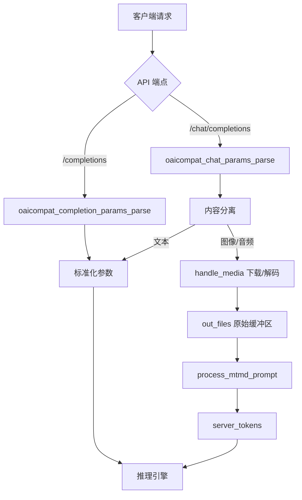
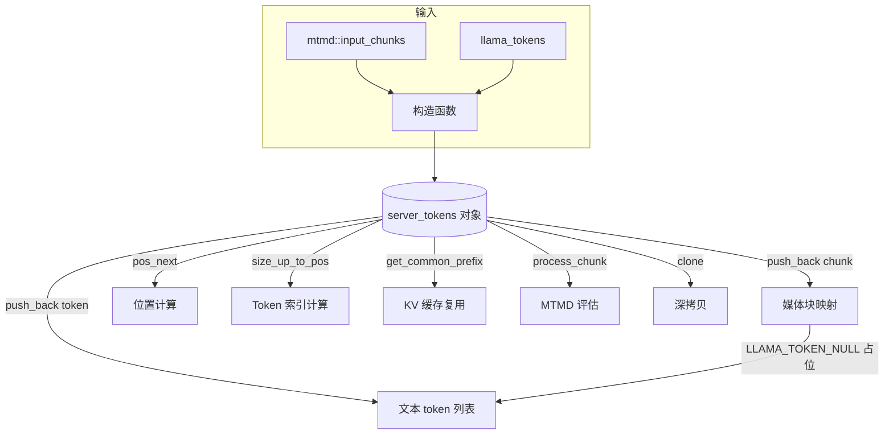
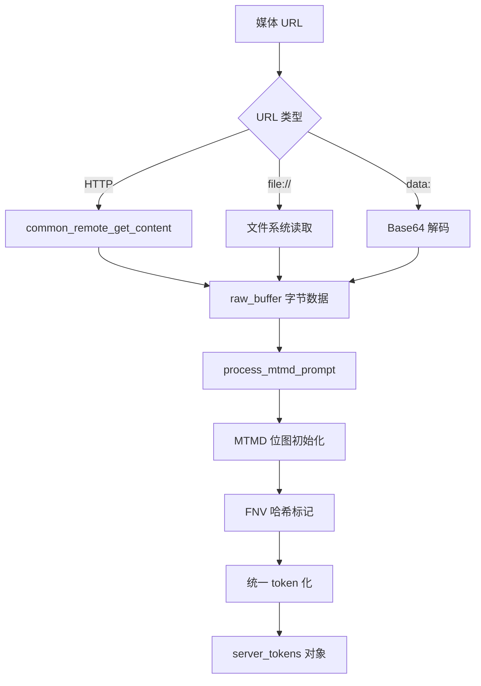
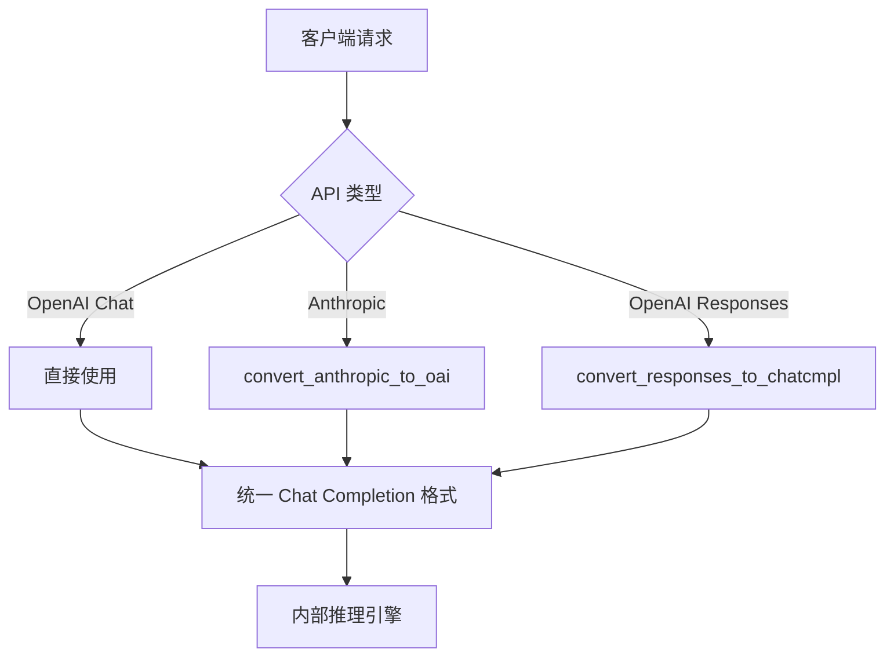
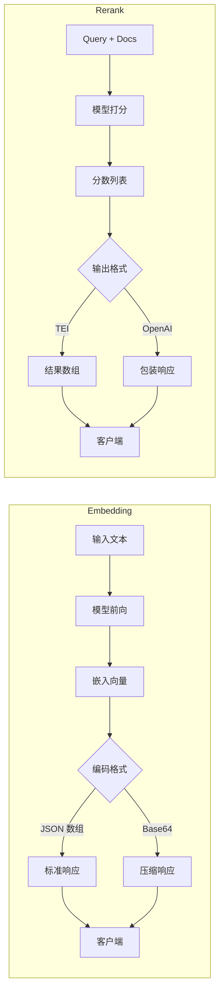
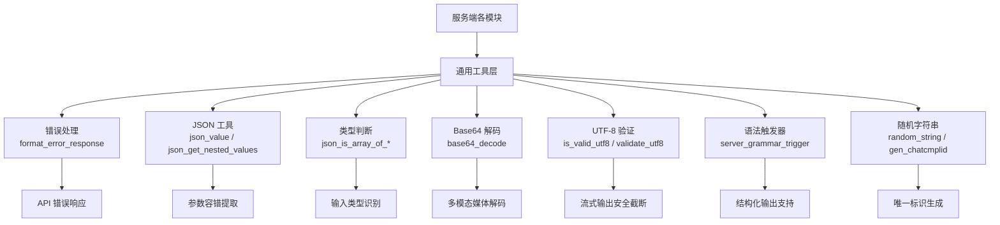

# 第81章 API 协议转换与多模态处理 —— 跨厂商接口的「同声传译」

## 学习目标

- 掌握 llama.cpp 服务端如何处理多协议兼容的推理请求
- 理解 server_tokens 容器如何统一文本与多模态数据
- 深入 API 协议转换的架构设计与实现细节
- 掌握 SSE 流式响应的格式化规范与最佳实践
- 理解 Embedding 与 Rerank 等特殊任务的响应构造
- 了解多模态媒体处理的完整流水线
- 掌握 JSON 工具函数与字符串处理在服务端开发中的应用

## 81.1 生活类比

llama.cpp 服务端是一套**全能翻译与装配流水线**。想象你经营着一家国际快递公司，每天要处理来自全球各地的包裹。有的客户送来的是标准纸箱（纯文本请求），有的送来的是易碎的工艺品（图像）或录音带（音频），还有的客户用的是不同的单据格式（OpenAI、Anthropic、Responses API）。

在这条流水线上，**server_tokens** 就是那位**快递分拣员**，他同时处理包裹单据（文本 token）和特殊货物（图像/音频块），两样东西要分别存储，但最终要合并成一张统一的运单供下一步处理。这位分拣员对贵重物品有严格的**保险柜管理**——对于包含图像等大型资源的容器，他禁用随意复制（=delete），只允许整体搬运（move），确保资源不会意外泄漏或被多个副本重复占用。此外，当需要验证包裹的完整性时，他也会严格比对每件贵重物品的保险编号（FNV 哈希），确保在搬运途中没有发生任何偷换或损坏。

当客户送来**大箱套小箱**的混合货物（字符串中混入 token ID）时，**tokenize_mixed()** 就是那台**智能包装机器**，能自动拆开并合并成标准格式。而 **handle_media()** 则扮演**采购员的采买清单**角色，支持三种渠道获取媒体：**网购 URL**（HTTP 下载）、**本地自提**（file:// 邮编验证）、**加急快递**（Base64 内联）。

当收到的单据是法文（Anthropic API）或德文（Responses API）时，**convert_anthropic_to_oai()** 和 **convert_responses_to_chatcmpl()** 就是**跨语言的专业翻译**，把客户的措辞和句子结构完整改写成 OpenAI 的格式，同时保留所有细节与语气（temperature、top_p 等参数）。

当推理引擎开始实时输出时，**format_oai_sse()** 就是**实时直播的字幕机**，每产生一个 token 就装进数据包（`data: {...}\n\n`），按 RFC 8895 规范的通信协议逐个发送，确保客户端能边接收边显示。而 **format_response_rerank()** 则是**成绩单反馈员**，把学生作业（文档）与题目（query）对比后，按得分排序，以标准 JSON 格式呈现给上层应用。**process_mtmd_prompt()** 则是**多语种文件柜**的管理员，先将图像转为 FNV 哈希指纹，然后统一整理装箱，与文本 prompt 融合成一体的多模态表示供模型理解。

## 81.2 源码地图

```
tools/server/server-common.cpp
├── 参数解析与 LoRA 管理
│   ├── oaicompat_completion_params_parse()   # OpenAI 兼容参数解析 (/completions)
│   ├── oaicompat_chat_params_parse()         # OpenAI 兼容参数解析 (/chat/completions)
│   ├── tokenize_mixed()                      # 混合输入分词（字符串/token数组）
│   ├── lora_all_alora()                      # 检查是否全部为 Alora 适配器
│   ├── lora_should_clear_cache()             # 智能判断是否需要清空 KV 缓存
│   ├── parse_lora_request()                  # 解析 LoRA 配置的 JSON 数据
│   ├── are_lora_equal()                      # 比较两个 LoRA 配置是否相同
│   └── lora_get_enabled_ids()                # 获取所有启用（scale>0）的 LoRA 索引

├── 多模态令牌容器 server_tokens 类
│   ├── 构造函数与拷贝控制
│   │   ├── server_tokens(server_tokens&&)      # 移动构造
│   │   ├── operator=(server_tokens&&)          # 移动赋值
│   │   ├── server_tokens(const server_tokens&) = delete  # 禁用拷贝
│   │   └── operator=(const server_tokens&) = delete      # 禁用拷贝赋值
│   ├── 核心访问与操作
│   │   ├── server_tokens::pos_next()           # 计算下一个位置（考虑多模态）
│   │   ├── server_tokens::size_up_to_pos()     # 从位置反推 token 索引
│   │   ├── server_tokens::str()                # 生成调试字符串表示
│   │   ├── server_tokens::find_chunk()         # 根据索引查找媒体块
│   │   ├── server_tokens::push_back()          # 添加 token/媒体块/server_tokens（三重重载）
│   │   ├── server_tokens::insert()             # 插入 token 列表（非多模态）
│   │   ├── server_tokens::get_text_tokens()    # 获取纯文本 token 列表
│   │   ├── server_tokens::set_token()          # 设置指定位置的 token
│   │   ├── server_tokens::operator[]           # 下标访问 token
│   │   ├── server_tokens::size() / empty()     # 大小查询
│   │   └── server_tokens::clear()              # 清空容器
│   ├── 边界与验证
│   │   ├── server_tokens::keep_first()         # 保留前 n 个 token（清理媒体块）
│   │   ├── server_tokens::detokenize()         # token 转字符串（过滤占位符）
│   │   ├── server_tokens::get_common_prefix()  # 计算公共前缀
│   │   ├── server_tokens::validate()           # 验证 token 有效性
│   │   └── server_tokens::process_chunk()      # 处理多模态块（调用 MTMD）
│   └── server_tokens::clone()                  # 深拷贝整个对象

├── 多模态媒体处理
│   ├── process_mtmd_prompt()                   # 处理图像/音频与文本混合提示
│   ├── handle_media()                          # 多源媒体读取（HTTP/file/base64）
│   ├── tokenize_input_subprompt()              # 支持四种输入格式的分词
│   ├── tokenize_input_prompts()                # 处理多个子提示
│   └── fnv_hash()                              # FNV-1a 哈希计算媒体 ID

├── API 协议转换
│   ├── convert_responses_to_chatcmpl()         # Responses API → ChatCompletions
│   └── convert_anthropic_to_oai()              # Anthropic API → OpenAI 格式

├── SSE 流式响应与概率处理
│   ├── format_oai_sse()                        # OpenAI 原生 SSE 格式
│   ├── format_openai_sse()                     # OpenAI SSE 兼容格式
│   ├── format_oai_resp_sse()                   # Responses API SSE 格式
│   ├── format_anthropic_sse()                  # Anthropic 风格 SSE
│   ├── safe_json_to_str()                      # JSON 序列化安全包装
│   ├── get_token_probabilities()               # 获取 token 概率分布
│   ├── tokens_to_str()                         # token 序列转字符串
│   └── tokens_to_output_formatted_string()     # 处理不完整 UTF-8 的输出

├── Embedding 与 Rerank 格式化
│   ├── format_embeddings_response_oaicompat()  # 标准 Embedding 响应
│   ├── format_response_rerank()                # Rerank 响应（TEI 或 OpenAI 格式）
│   ├── format_prompt_rerank()                  # 构建 Rerank 提示词模板
│   └── format_prompt_infill()                  # 构建 FIM 提示词

├── 其他工具函数
│   ├── format_error_response()                 # 格式化错误响应 JSON
│   ├── random_string()                         # 生成随机字符串
│   ├── gen_chatcmplid()                        # 生成聊天完成 ID
│   ├── gen_tool_call_id()                      # 生成工具调用 ID
│   ├── base64_decode()                         # Base64 解码
│   ├── json_is_array_of_*()                    # JSON 数组类型判断（3 个变体）
│   ├── json_get_nested_values()                # 提取嵌套 JSON 路径值
│   ├── is_valid_utf8()                         # 验证 UTF-8 编码合法性
│   └── validate_utf8()                         # UTF-8 验证与长度计算

tools/server/server-common.h
├── json_value<T>()                             # 类型安全的 JSON 值提取
├── server_grammar_trigger 类                    # 语法触发器包装器
│   ├── server_grammar_trigger()                # 默认/值/JSON 构造
│   └── to_json()                               # 序列化为 JSON
├── server_tokens 类声明（完整接口与拷贝控制）
├── server_chat_params 结构体                    # 服务端聊天参数
└── 30+ 个公共函数声明
```

## 81.3 参数解析与 LoRA 管理 —— 翻译请求的「词汇表管理员」

当客户端调用 llama-server 的 `/completions` 或 `/chat/completions` 端点时，请求参数往往以异构的 JSON 格式到达。有的用户发送普通字符串 prompt，有的发送 token ID 数组，还有的发送字符串与 token 混合的数组。这套解析层承担了「翻译官」职责，将这些五花八门的输入统一为 llama.cpp 内部可识别的参数结构。

### 81.3.1 `oaicompat_completion_params_parse()`：OpenAI 兼容请求的「入口检查站」

源码路径：`tools/server/server-common.cpp` - `oaicompat_completion_params_parse()`（762-793行）
头文件声明：`tools/server/server-common.h` - `oaicompat_completion_params_parse()`（291行）

```cpp
json oaicompat_completion_params_parse(const json & body) {
    // ① 创建内部参数容器
    json llama_params;
    // ② 检查必需的 prompt 字段
    if (!body.contains("prompt")) throw std::runtime_error("\"prompt\" is required");
    // ③ 处理 stop 序列：字符串转数组
    if (body.contains("stop") && body.at("stop").is_string()) {
        llama_params["stop"] = json::array({body.at("stop").get<std::string>()});
    } else {
        llama_params["stop"] = json_value(body, "stop", json::array());
    }
    // ④ 拒绝不支持的 echo 参数
    if (json_value(body, "echo", false)) throw std::runtime_error("Only no echo is supported");
    // ⑤ 定义不支持的参数列表
    static const std::vector<std::string> unsupported_params { "best_of", "suffix" };
    // ⑥ 逐一检查并拒绝
    for (const auto & param : unsupported_params) {
        if (body.contains(param)) throw std::runtime_error("Unsupported param: " + param);
    }
    // ⑦ 透传所有其余参数
    for (const auto & item : body.items()) {
        if (!llama_params.contains(item.key()) || item.key() == "n_predict") {
            llama_params[item.key()] = item.value();
        }
    }
    // ⑧ 返回标准化参数
    return llama_params;
}
```

这段代码实现了 OpenAI 兼容 `/completions` 请求的标准解析流程。函数采用「宽进严出」策略：第②步强制要求 prompt 字段存在，任何缺失都会立即报错；第③步把 stop 统一为数组格式（OpenAI 允许字符串或数组）；第④⑤⑥步显式拒绝 echo、best_of、suffix 等 llama.cpp 不支持的功能——之所以称之为「激素脸」机制，是因为它像敏感肌遇到刺激物一样，一碰到不支持的参数就立即红肿报警（抛出异常），而不是装作看不见继续处理，这种"直接拒绝"的设计避免了用户因为静默忽略而得到不符合预期的结果；最后第⑦步将剩余所有参数原样透传到内部参数对象中，确保用户意图不丢失。

### 81.3.2 `oaicompat_chat_params_parse()`：聊天补全请求的「多模态通道」

源码路径：`tools/server/server-common.cpp` - `oaicompat_chat_params_parse()`（840-872行）
头文件声明：`tools/server/server-common.h` - `oaicompat_chat_params_parse()`（294-298行）

```cpp
json oaicompat_chat_params_parse(
    json & body,                                    // ① 请求体
    const server_chat_params & opt,                 // ② 服务端全局参数
    std::vector<raw_buffer> & out_files) {          // ③ 输出：存储解码后的媒体文件
    json llama_params;
    // ④ 透传除 content 以外的顶层参数
    for (const auto & item : body.items()) {
        if (item.key() != "content") {
            llama_params[item.key()] = item.value();
        }
    }
    // ⑤ 初始化输出文件容器
    out_files.clear();
    out_files.reserve(8);
    // ⑥ 检查是否存在 content 字段
    if (body.contains("content")) {
        // ⑦ 内容可以是非数组（如字符串）或数组
        const json & content = body.at("content");
        if (!content.is_null()) {
            if (!content.is_array()) {
                // ⑧ 非数组内容（如纯文本）直接透传
                llama_params["content"] = content;
            } else {
                // ⑨ 数组内容遍历，分离文本与多模态数据
                json filtered_content = json::array();
                for (const auto & item : content) {
                    if (item.contains("type")) {
                        // ⑩ 多模态内容：提取 URL 并解码为文件
                        if (item.at("type") == "image_url") {
                            handle_media(out_files, item.at("image_url"), opt.media_path);
                        } else if (item.at("type") == "input_audio") {
                            handle_media(out_files, item.at("input_audio"), opt.media_path);
                        } else {
                            filtered_content.push_back(item);
                        }
                    } else {
                        // ⑪ 普通内容块（如文本）直接保留
                        filtered_content.push_back(item);
                    }
                }
                // ⑫ 设置过滤后的内容
                llama_params["content"] = filtered_content;
            }
        }
    }
    // ⑬ 返回标准化参数
    return llama_params;
}
```

这段代码是 `/chat/completions` 端点请求处理的「分拣漏斗」。与 `oaicompat_completion_params_parse()` 不同，该函数的核心职责在于处理多模态内容——第⑩行检测到 `image_url` 或 `input_audio` 类型的块时，会调用 `handle_media()` 将 URL 下载或解码为原始字节数据并存入 `out_files`，同时从 `content` 数组中过滤掉这些多模态元素。第⑧行的分支处理兼容了纯文本请求（content 为字符串）与多模态请求（content 为数组）两种场景。这种设计将媒体解码逻辑从请求解析中解耦，使得后续的 tokenization 流程可以统一处理文本与媒体数据。

### 81.3.3 `tokenize_mixed()`：混合输入的「分词魔法」

源码路径：`tools/server/server-common.cpp` - `tokenize_mixed()`（596-629行）
头文件声明：`tools/server/server-common.h` - `tokenize_mixed()`（227行）

```cpp
llama_tokens tokenize_mixed(const llama_vocab * vocab, const json & json_prompt, bool add_special, bool parse_special) {
    // ① 初始化输出 token 序列
    llama_tokens prompt_tokens;
    // ② 判断是否为数组格式
    if (json_prompt.is_array()) {
        bool first = true;
        // ③ 遍历数组中的每个元素
        for (const auto & p : json_prompt) {
            // ④ 元素为字符串时执行分词
            if (p.is_string()) {
                auto s = p.template get<std::string>();
                llama_tokens p;
                // ⑤ 首个元素添加特殊 token，后续不添加避免重复
                if (first) {
                    p = common_tokenize(vocab, s, add_special, parse_special);
                    first = false;
                } else {
                    p = common_tokenize(vocab, s, false, parse_special);
                }
                // ⑥ 合并分词结果
                prompt_tokens.insert(prompt_tokens.end(), p.begin(), p.end());
            } else {
                // ⑦ 数字元素直接作为 token
                if (first) first = false;
                prompt_tokens.push_back(p.template get<llama_token>());
            }
        }
    } else {
        // ⑧ 非数组：直接作为字符串分词
        auto s = json_prompt.template get<std::string>();
        prompt_tokens = common_tokenize(vocab, s, add_special, parse_special);
    }
    // ⑨ 返回最终 token 序列
    return prompt_tokens;
}
```

这段代码实现了对三种 prompt 格式的「分词魔法」。核心设计在于第⑤行的 `first` 标志：对于混合数组（如 `["Hello", 1234, "world"]`），首元素执行完整分词（可能注入 BOS 等特殊 token），而后续元素只做普通分词（`add_special=false`），避免在同一 prompt 中重复添加特殊 token——一个 prompt 中只需要一个 BOS 标记来标识序列开始，如果每一段字符串都经过 `add_special=true` 的分词，就会出现多个 BOS token 混杂在序列中，干扰模型对输入结构的理解。第⑦行的直接 token 传递则允许客户端绕过分词，直接指定 token ID，为高级用户提供了精细控制能力。

### 81.3.4 `lora_should_clear_cache()`：LoRA 切换的「智能决策器」

源码路径：`tools/server/server-common.cpp` - `lora_should_clear_cache()`（100-116行）
头文件声明：`tools/server/server-common.h` - `lora_should_clear_cache()`（107-110行）

```cpp
bool lora_should_clear_cache(
        const std::vector<common_adapter_lora_info> & current,
        const std::vector<common_adapter_lora_info> & next) {
    // ① 前置断言：两个 LoRA 集合必须不同
    GGML_ASSERT(!are_lora_equal(current, next));
    // ② 核心判断逻辑
    return (!(lora_get_enabled_ids(current).empty() || lora_all_alora(current)) ||
        !lora_all_alora(next));
}
```

这段代码体现了 LoRA 缓存管理的「智能决策」智慧。第①行断言确保我们只在 LoRA 集合确实发生变化时才调用此函数。第②行的判断逻辑包含两个条件：

1. **当前集合**：如果当前没有启用的 LoRA（空集合）或全部是 Alora（应用层 LoRA），则无需清空缓存
2. **下一集合**：如果下一个集合全部是 Alora，也无需清空缓存

这意味着只有当普通 LoRA（需要重算模型权重）被启用或禁用时，才需要清空 KV 缓存。这种设计在保证正确性的同时，最大限度地保留了缓存，提升了推理性能。

### 81.3.5 参数解析与 LoRA 管理的架构透视



这个流程图清晰地展示了参数解析的完整路径：`/completions` 端点走简单透传路径（C→E→K），而 `/chat/completions` 则需要额外的内容分离步骤，多模态数据被解码为原始缓冲区后，在 `process_mtmd_prompt` 中与文本结合生成统一的 `server_tokens` 对象，最后进入推理引擎。

## 81.4 多模态令牌容器 —— 文本与图像的「双层集装箱」

在 llama.cpp 服务端，一个推理请求可能同时包含文本和图像/音频。**server_tokens** 类就像一个专门设计的双层集装箱——上层整齐码放普通文本 token，下层则放置需要特殊处理的媒体块。

### 81.4.1 `server_tokens` 类定义：多重装载的「容器原型」

头文件声明：`tools/server/server-common.h` - `server_tokens` 类声明（118-195行）

```cpp
class server_tokens {
public:
    server_tokens() = default;
    ~server_tokens() = default;

    // ① 禁用拷贝构造与拷贝赋值（防止意外复制）
    server_tokens(const server_tokens&) = delete;
    server_tokens& operator=(const server_tokens&) = delete;

    // ② 仅允许移动语义（高效转移所有权）
    server_tokens(server_tokens&&) = default;
    server_tokens& operator=(server_tokens&&) = default;

    // ③ 核心访问接口
    llama_token operator[](size_t index) { return tokens[index]; }
    const llama_token& operator[](size_t index) const { return tokens[index]; }

    // ④ 从 mtmd 输入块或 llama_tokens 初始化
    server_tokens(mtmd::input_chunks & mtmd_chunks, bool has_mtmd);
    server_tokens(const llama_tokens & tokens, bool has_mtmd);

    // ⑤ 位置转换接口
    llama_pos pos_next(int64_t n_tokens = -1) const;
    size_t size_up_to_pos(llama_pos max_pos) const;

    // ⑥ 媒体块查找
    const mtmd::input_chunk_ptr & find_chunk(size_t idx) const;

    // ⑦ 三重重载的 push_back
    void push_back(llama_token tok);
    void push_back(const mtmd_input_chunk * chunk);
    void push_back(server_tokens & tokens);

    // ⑧ 长度与状态查询
    size_t size() const { return tokens.size(); }
    bool empty() const { return tokens.empty(); }
    void clear() {
        map_idx_to_media.clear();
        tokens.clear();
    }

    // ⑨ 验证与克隆
    bool validate(const struct llama_context * ctx) const;
    server_tokens clone() const;

private:
    bool has_mtmd = false;                    // 多模态模式标志
    llama_tokens tokens;                       // 文本 token 列表
    std::map<size_t, mtmd::input_chunk_ptr> map_idx_to_media;  // 媒体块映射
};
```

这段代码定义了 server_tokens 类的完整接口。设计哲学的核心在第①②行：**禁用拷贝、仅允许移动**。这是因为 `map_idx_to_media` 中的 `mtmd::input_chunk_ptr` 指向可能包含大型图像或音频数据的堆内存，如果允许隐式拷贝，稍有不慎就会导致性能下降或资源泄漏。移动语义则保证了所有权的安全转移，同时保持高效。

第④行的两个构造函数分别处理两种初始化场景：多模态输入块（来自 mtmd 编码器）和纯文本 token 列表。构造函数是拷贝控制策略的第一个应用场景——当外部传入 mtmd 输入块时，构造函数通过内部的 `push_back` 逐一填入 token 和媒体块映射，而非直接浅拷贝整个容器，从而巩固了"只允许移动"的约束。第⑦行的三重重载 `push_back` 是整个容器的「万向节」，统一了三种添加方式。私有成员中的 `map_idx_to_media` 是「双层集装箱」的关键：它建立了 token 索引到媒体块的映射，使得一个图像 token（`LLAMA_TOKEN_NULL`）可以对应多个逻辑位置。

### 81.4.2 `server_tokens` 内部工作流



这个流程图展示了 server_tokens 的内部结构：输入来源有两种（MTMD 编码器输出的 `input_chunks` 或纯文本 `llama_tokens`），构造函数将它们统一转换为 `server_tokens` 对象，内部同时维护文本 token 列表和媒体块映射，所有核心操作（位置计算、索引转换、公共前缀、MTMD 评估、深拷贝）都基于这两个数据结构的协同工作。

### 81.4.3 `server_tokens::pos_next()`：位置换算的「空间魔法师」

实现源码：`tools/server/server-common.cpp` - `server_tokens::pos_next()`（200-248行）
头文件声明：`tools/server/server-common.h` - `pos_next()`（142行）

```cpp
llama_pos server_tokens::pos_next(int64_t n_tokens) const {
    // ① 纯文本模式：位置 = token 数量
    if (!has_mtmd) {
        if (n_tokens < 0) {
            return tokens.size();
        }
        return n_tokens;
    }
    // ② 多模态模式：需要遍历媒体块
    if (n_tokens < 0) {
        // ③ 计算总位置数（含媒体块的额外位置）
        llama_pos res = tokens.size();
        for (auto it = map_idx_to_media.begin(); it != map_idx_to_media.end(); ++it) {
            const auto & chunk = it->second;
            res += mtmd_input_chunk_get_n_pos(chunk.get()) - mtmd_input_chunk_get_n_tokens(chunk.get());
        }
        return res;
    }
    // ④ 逐块遍历计算
    int64_t idx = 0;
    llama_pos pos = 0;
    GGML_ASSERT(n_tokens <= (int64_t)tokens.size());
    while (idx < n_tokens) {
        const auto media_it = map_idx_to_media.find(idx);
        if (media_it != map_idx_to_media.end()) {
            // ⑤ 媒体块：累加其位置数
            const auto & chunk = media_it->second;
            const llama_pos n_pos = mtmd_input_chunk_get_n_pos(chunk.get());
            const size_t n_tok = mtmd_input_chunk_get_n_tokens(chunk.get());
            pos += n_pos;
            idx += n_tok;
        } else {
            // ⑥ 普通 token：位置 +1
            pos++;
            idx++;
        }
    }
    // ⑦ 返回计算后的位置
    return pos;
}
```

这段代码是 server_tokens 最核心的「空间换算术」。在纯文本模式（第①行）下，位置与 token 索引一一对应。但在多模态模式下（第②行以后），图像或音频块可能需要占用多个逻辑位置（如 32 个位置），却只对应一个 token 索引。函数通过遍历 `map_idx_to_media` 精准计算每个媒体块占用的位置数（第⑤行），普通 token 则占 1 个位置（第⑥行），最终得到准确的位置偏移。这个函数在 KV 缓存管理和序列续写中至关重要，因为模型需要知道每个 token 的正确位置编码。

### 81.4.4 `server_tokens::get_common_prefix()`：公共前缀的「语义比较器」

实现源码：`tools/server/server-common.cpp` - `server_tokens::get_common_prefix()`（415-459行）
头文件声明：`tools/server/server-common.h` - `get_common_prefix()`（180行）

```cpp
size_t server_tokens::get_common_prefix(const server_tokens & b) const {
    // ① 取较小长度作为比较上限
    const size_t max_idx = std::min(tokens.size(), b.tokens.size());
    // ② 纯文本模式：逐 token 比较
    if (!has_mtmd) {
        for (size_t i = 0; i < max_idx; ++i) {
            if (tokens[i] == b.tokens[i]) {
                continue;
            }
            return i;
        }
        return max_idx;
    }
    // ③ 多模态模式：需要比较媒体块
    for (size_t i = 0; i < max_idx; ++i) {
        const llama_token ai =   tokens[i];
        const llama_token bi = b.tokens[i];
        // ④ 都是媒体占位符：比较 ID 与大小
        if (ai == LLAMA_TOKEN_NULL && bi == LLAMA_TOKEN_NULL) {
            const auto & a_chunk =   find_chunk(i);
            const auto & b_chunk = b.find_chunk(i);
            GGML_ASSERT(a_chunk && b_chunk);
            const std::string id_ai = mtmd_input_chunk_get_id(a_chunk.get());
            const std::string id_bi = mtmd_input_chunk_get_id(b_chunk.get());
            const size_t n_tok_a = mtmd_input_chunk_get_n_tokens(a_chunk.get());
            const size_t n_tok_b = mtmd_input_chunk_get_n_tokens(b_chunk.get());
            // ⑤ ID 相同且大小相同：视为相同媒体块
            if (id_ai == id_bi && n_tok_a == n_tok_b) {
                GGML_ASSERT(n_tok_a > 0 && "Invalid media chunk");
                i += n_tok_a - 1;
                continue;
            }
            return i;
        }
        // ⑥ 普通 token 比较
        if (ai == bi) {
            continue;
        }
        return i;
    }
    // ⑦ 返回公共前缀长度
    return max_idx;
}
```

这段代码实现了语义级别的公共前缀比较。在纯文本模式（第②行）下，逐 token 比较直到遇到差异。但在多模态模式（第③行）下，两个 `LLAMA_TOKEN_NULL` 占位符不能简单视为相同——需要进一步验证它们指向的媒体块是否真的是同一份内容（第④⑤行）。这里通过比较媒体块的 FNV 哈希 ID 和 token 数量来实现真正语义等价判断。这个结果直接驱动 KV 缓存的复用逻辑：识别出哪些历史推理可以保留（公共前缀部分），哪些需要重新计算，从而在连续的多轮对话或工具调用中避免冗余的前向传播，显著提升推理吞吐量。

## 81.5 多模态媒体处理 —— 图像与音频的「通关海关」

当请求中包含图像或音频时，llama.cpp 服务端需要完成解码、哈希标记和 token 化等一系列复杂操作。这套流程统一由 `process_mtmd_prompt` 总负责，配合 `handle_media` 完成多源获取。

### 81.5.1 `process_mtmd_prompt()`：媒体内容的「检验与标记」

实现源码：`tools/server/server-common.cpp` - `process_mtmd_prompt()`（667-696行）
头文件声明：`tools/server/server-common.h` - `process_mtmd_prompt()`（235行）

```cpp
server_tokens process_mtmd_prompt(mtmd_context * mctx, std::string prompt, std::vector<raw_buffer> files) {
    // ① 初始化位图容器
    mtmd::bitmaps bitmaps;
    // ② 逐文件处理
    for (auto & file : files) {
        // ③ 从缓冲区初始化位图
        mtmd::bitmap bmp(mtmd_helper_bitmap_init_from_buf(mctx, file.data(), file.size()));
        if (!bmp.ptr) {
            throw std::runtime_error("Failed to load image or audio file");
        }
        // ④ 计算 FNV 哈希作为唯一 ID
        std::string hash = fnv_hash(bmp.data(), bmp.n_bytes());
        bmp.set_id(hash.c_str());
        bitmaps.entries.push_back(std::move(bmp));
    }
    // ⑤ 初始化输入容器
    std::vector<server_tokens> inputs;
    mtmd_input_text inp_txt = {prompt.c_str(), true, true};
    mtmd::input_chunks chunks(mtmd_input_chunks_init());
    auto bitmaps_c_ptr = bitmaps.c_ptr();
    // ⑥ 调用 mtmd_tokenize 完成统一分词
    int32_t tokenized = mtmd_tokenize(mctx, chunks.ptr.get(), &inp_txt, bitmaps_c_ptr.data(), bitmaps_c_ptr.size());
    if (tokenized != 0) throw std::runtime_error("Failed to tokenize prompt");
    // ⑦ 构建并返回 server_tokens
    auto result = server_tokens(chunks, true);
    return result;
}
```

这段代码是多模态提示处理的主流程。核心工作包括：第③行将原始字节解码为位图（图像）或波形（音频），若失败则抛出异常；第④行计算 FNV 哈希作为唯一指纹——这个哈希在后续的 KV 缓存管理和序列比较中发挥关键作用；第⑥行调用 `mtmd_tokenize` 将文本与媒体统一转为 token 块序列，返回值非零时同样抛出异常终止处理，确保无效的媒体数据不会进入推理管线。最终返回的 `server_tokens` 对象同时包含文本 token 和媒体块映射，实现了异构数据的同构化。

### 81.5.2 `handle_media()`：多源媒体的「采购清单」

实现源码：`tools/server/server-common.cpp` - `handle_media()`（795-835行）
头文件声明：`tools/server/server-common.h` - `handle_media()`（228行）

```cpp
static void handle_media(std::vector<raw_buffer> & out_files, json & media_obj, const std::string & media_path) {
    // ① 提取 URL 字段
    std::string url = json_value(media_obj, "url", std::string());
    // ② HTTP/HTTPS 下载
    if (string_starts_with(url, "http")) {
        common_remote_params params;
        params.max_size = 1024 * 1024 * 10;  // 限制 10MB
        params.timeout  = 10;
        SRV_INF("downloading image from '%s'\n", url.c_str());
        auto res = common_remote_get_content(url, params);
        // ③ 检查 HTTP 状态码
        if (200 <= res.first && res.first < 300) {
            SRV_INF("downloaded %zu bytes\n", res.second.size());
            raw_buffer data;
            data.insert(data.end(), res.second.begin(), res.second.end());
            out_files.push_back(data);
        } else {
            throw std::runtime_error("Failed to download image");
        }
    } else if (string_starts_with(url, "file://")) {
        // ④ 本地文件读取（需显式启用）
        if (media_path.empty()) throw std::invalid_argument("file:// URLs are not allowed unless --media-path is specified");
        std::string file_path = url.substr(7);
        raw_buffer data;
        // ⑤ 路径遍历防护
        if (!fs_validate_filename(file_path, true)) throw std::invalid_argument("file path is not allowed: " + file_path);
        SRV_INF("loading image from local file '%s'\n", (media_path + file_path).c_str());
        std::ifstream file(media_path + file_path, std::ios::binary);
        if (!file) throw std::invalid_argument("file does not exist or cannot be opened: " + file_path);
        data.assign((std::istreambuf_iterator<char>(file)), std::istreambuf_iterator<char>());
        out_files.push_back(data);
    } else {
        // ⑥ Base64 内联解码
        std::vector<std::string> parts = string_split<std::string>(url, ',');
        if (parts.size() != 2) throw std::runtime_error("Invalid url value");
        else if (!string_starts_with(parts[0], "data:image/")) throw std::runtime_error("Invalid url format: " + parts[0]);
        else if (!string_ends_with(parts[0], "base64")) throw std::runtime_error("url must be base64 encoded");
        else {
            auto base64_data = parts[1];
            auto decoded_data = base64_decode(base64_data);
            out_files.push_back(decoded_data);
        }
    }
}
```

这段代码是媒体的多源采购分支逻辑。三层防护机制覆盖了每种来源：在 HTTP 分支（第②③行）中，10MB 的大小限制有效防止了恶意请求导致的资源耗尽，HTTP 状态码检查确保只接受成功的下载响应；在 `file://` 分支（第④⑤行）中，`fs_validate_filename` 阻止路径遍历攻击，同时要求显式指定 `--media-path` 才允许本地文件访问，文件打开失败也会被捕获并抛出异常；在最后的 Base64 分支中，验证 MIME 类型必须以 `data:image/` 开头且声明为 base64 编码。每一分支都有明确的安全边界和失败处理，兼顾了功能性与安全性。

### 81.5.3 多模态媒体处理：`process_mtmd_prompt()` 与 `handle_media()` 的流水线概述



这个流程图展示了多模态媒体处理的完整流水线。三种来源的媒体数据（HTTP、file://、Base64）最终被统一为 `raw_buffer` 原始字节流，进入 `process_mtmd_prompt` 后经过位图初始化、哈希标记和统一 token 化，最终生成包含文本与媒体的 `server_tokens` 对象。这个流水线的关键设计在于各阶段的解耦：媒体获取（handle_media）、媒体编码（process_mtmd_prompt）和容器管理（server_tokens）各自独立，便于测试和维护。

## 81.6 API 协议转换 —— OpenAI 与 Anthropic 的「同声传译」

llama.cpp 服务端的野心是成为一个「全能翻译官」：无论客户端使用哪种 API 协议（OpenAI、Anthropic 或 Responses），都能被翻译成内部统一格式处理。

### 81.6.1 `convert_anthropic_to_oai()`：Anthropic API 的「结构重塑」

实现源码：`tools/server/server-common.cpp` - `convert_anthropic_to_oai()`（1549-1794行）
头文件声明：`tools/server/server-common.h` - `convert_anthropic_to_oai()`（304行）

```cpp
json convert_anthropic_to_oai(const json & body) {
    // ① 创建转换后的 JSON 对象
    json oai_body;
    // ② 初始化消息数组
    json oai_messages = json::array();
    // ③ 提取 system 参数
    auto system_param = json_value(body, "system", json());
    if (!system_param.is_null()) {
        std::string system_content;
        // ④ system 可以是字符串或文本块数组
        if (system_param.is_string()) {
            system_content = system_param.get<std::string>();
        } else if (system_param.is_array()) {
            for (const auto & block : system_param) {
                if (json_value(block, "type", std::string()) == "text") {
                    system_content += json_value(block, "text", std::string());
                }
            }
        }
        // ⑤ 转换为 role=system 消息
        oai_messages.push_back({
            {"role", "system"},
            {"content", system_content}
        });
    }

    // ⑥ 检查消息字段
    if (!body.contains("messages")) {
        throw std::runtime_error("'messages' is required");
    }
    const json & messages = body.at("messages");
    // ⑦ 逐条处理消息
    if (messages.is_array()) {
        for (const auto & msg : messages) {
            std::string role = json_value(msg, "role", std::string());
            if (!msg.contains("content")) {
                // ⑧ 无内容消息直接透传
                if (role == "assistant") {
                    continue;
                }
                oai_messages.push_back(msg);
                continue;
            }
            const json & content = msg.at("content");
            // ⑨ 字符串或非数组内容直接透传
            if (content.is_string() || !content.is_array()) {
                oai_messages.push_back(msg);
                continue;
            }
            // ⑩ 初始化工具调用与内容块
            json tool_calls = json::array();
            json converted_content = json::array();
            json tool_results = json::array();
            std::string reasoning_content;
            bool has_tool_calls = false;
            // ⑪ 遍历内容块
            for (const auto & block : content) {
                std::string type = json_value(block, "type", std::string());
                // ⑫ 文本块直接添加
                if (type == "text") {
                    converted_content.push_back(block);
                } else if (type == "thinking") {
                    // ⑬ 思考块保留到 reasoning_content
                    reasoning_content += json_value(block, "thinking", std::string());
                } else if (type == "image") {
                    // ⑭ 图像块统一为 image_url 格式
                    json source = json_value(block, "source", json::object());
                    std::string source_type = json_value(source, "type", std::string());
                    if (source_type == "base64") {
                        // ⑮ base64 源转为 data URI
                        std::string media_type = json_value(source, "media_type", std::string("image/jpeg"));
                        std::string data = json_value(source, "data", std::string());
                        std::ostringstream ss;
                        ss << "data:" << media_type << ";base64," << data;
                        converted_content.push_back({
                            {"type", "image_url"},
                            {"image_url", {{"url", ss.str()}}}
                        });
                    } else if (source_type == "url") {
                        // ⑯ URL 源直接使用
                        std::string url = json_value(source, "url", std::string());
                        converted_content.push_back({
                            {"type", "image_url"},
                            {"image_url", {{"url", url}}}
                        });
                    }
                } else if (type == "tool_use") {
                    // ⑰ 工具调用转换为 tool_calls
                    tool_calls.push_back({
                        {"id", json_value(block, "id", std::string())},
                        {"type", "function"},
                        {"function", {
                            {"name", json_value(block, "name", std::string())},
                            {"arguments", json_value(block, "input", json::object()).dump()}
                        }}
                    });
                    has_tool_calls = true;
                } else if (type == "tool_result") {
                    // ⑱ 工具结果提取文本
                    std::string tool_use_id = json_value(block, "tool_use_id", std::string());
                    auto result_content = json_value(block, "content", json());
                    std::string result_text;
                    if (result_content.is_string()) {
                        result_text = result_content.get<std::string>();
                    } else if (result_content.is_array()) {
                        for (const auto & c : result_content) {
                            if (json_value(c, "type", std::string()) == "text") {
                                result_text += json_value(c, "text", std::string());
                            }
                        }
                    }
                    // ⑲ 生成独立的 tool 消息
                    tool_results.push_back({
                        {"role", "tool"},
                        {"tool_call_id", tool_use_id},
                        {"content", result_text}
                    });
                }
            }
            // ⑳ 组装完整消息
            if (!converted_content.empty() || has_tool_calls || !reasoning_content.empty()) {
                json new_msg = {{"role", role}};
                if (!converted_content.empty()) {
                    new_msg["content"] = converted_content;
                } else if (has_tool_calls || !reasoning_content.empty()) {
                    new_msg["content"] = "";
                }
                if (!tool_calls.empty()) {
                    new_msg["tool_calls"] = tool_calls;
                }
                if (!reasoning_content.empty()) {
                    new_msg["reasoning_content"] = reasoning_content;
                }
                oai_messages.push_back(new_msg);
            }
            // ㉑ 追加工具结果消息
            for (const auto & tool_msg : tool_results) {
                oai_messages.push_back(tool_msg);
            }
        }
    }
    // ㉒ 写入消息数组
    oai_body["messages"] = oai_messages;

    // ㉓ 转换工具定义
    if (body.contains("tools")) {
        const json & tools = body.at("tools");
        if (tools.is_array()) {
            json oai_tools = json::array();
            for (const auto & tool : tools) {
                // ㉔ Anthropic input_schema → OpenAI parameters
                oai_tools.push_back({
                    {"type", "function"},
                    {"function", {
                        {"name", json_value(tool, "name", std::string())},
                        {"description", json_value(tool, "description", std::string())},
                        {"parameters", tool.contains("input_schema") ? tool.at("input_schema") : json::object()}
                    }}
                });
            }
            oai_body["tools"] = oai_tools;
        }
    }

    // ㉕ 转换 tool_choice
    if (body.contains("tool_choice")) {
        const json & tc = body.at("tool_choice");
        if (tc.is_object()) {
            std::string type = json_value(tc, "type", std::string());
            // ㉖ auto 保持，any/tool 转为 required
            if (type == "auto") {
                oai_body["tool_choice"] = "auto";
            } else if (type == "any" || type == "tool") {
                oai_body["tool_choice"] = "required";
            }
        }
    }

    // ㉗ stop_sequences → stop（此转换仅当 stop_sequences 为数组时有效）
    if (body.contains("stop_sequences")) {
        if (body.at("stop_sequences").is_array()) {
            oai_body["stop"] = body.at("stop_sequences");
        }
    }

    // ㉘ max_tokens 处理（Anthropic 必需，OpenAI 可选）
    if (body.contains("max_tokens")) {
        oai_body["max_tokens"] = body.at("max_tokens");
    } else {
        oai_body["max_tokens"] = 4096;
    }

    // ㉙ 透传通用参数（temperature、top_p、top_k、stream）
    for (const auto & key : {"temperature", "top_p", "top_k", "stream"}) {
        if (body.contains(key)) {
            oai_body[key] = body.at(key);
        }
    }

    // ㉚ 处理 Anthropic 特有的_body) {
    // ① 检查必需的 input 字段
    if (!response_body.contains("input")) {
        throw std::invalid_argument("'input' is required");
    }
    // ② 拒绝不支持的 previous_response_id
    if (!json_value(response_body, "previous_response_id", std::string{}).empty()) {
        throw std::invalid_argument("llama.cpp does not support 'previous_response_id'.");
    }

    // ③ 复制并清理原始 body
    const json input_value = response_body.at("input");
    json chatcmpl_body = response_body;
    chatcmpl_body.erase("input");
    std::vector<json> chatcmpl_messages;

    // ④ instructions → system 消息
    if (response_body.contains("instructions")) {
        chatcmpl_messages.push_back({
            {"role",    "system"},
            {"content", json_value(response_body, "instructions", std::string())},
        });
        chatcmpl_body.erase("instructions");
    }

    // ⑤ 字符串 input 直接作为用户消息
    if (input_value.is_string()) {
        chatcmpl_messages.push_back({
            {"role",    "user"},
            {"content", input_value},
        });
    } else if (input_value.is_array()) {
        // ⑥ 数组 input 逐项处理
        for (json item : input_value) {
            // ⑦ 判断是否可合并到上一条 assistant 消息
            bool merge_prev = !chatcmpl_messages.empty() && chatcmpl_messages.back().value("role", "") == "assistant";

            // ⑧ 字符串 content 转为数组格式
            if (exists_and_is_string(item, "content")) {
                item["content"] = json::array({
                    json {{"text", item.at("content")}, {"type", "input_text"}}
                });
            }

            // ⑨ 输入消息（用户/系统/开发者）
            if (exists_and_is_array(item, "content") &&
                exists_and_is_string(item, "role") &&
                (item.at("role") == "user" ||
                    item.at("role") == "system" ||
                    item.at("role") == "developer")) {
                // ⑩ 转换每个内容块
                std::vector<json> chatcmpl_content;
                for (const json & input_item : item.at("content")) {
                    const std::string type = json_value(input_item, "type", std::string());
                    // ⑪ input_text → text
                    if (type == "input_text") {
                        if (!input_item.contains("text")) {
                            throw std::invalid_argument("'Input text' requires 'text'");
                        }
                        chatcmpl_content.push_back({
                            {"text", input_item.at("text")},
                            {"type", "text"},
                        });
                    } else if (type == "input_image") {
                        // ⑫ input_image → image_url
                        if (!input_item.contains("image_url")) {
                            throw std::invalid_argument("'image_url' is required");
                        }
                        chatcmpl_content.push_back({
                            {"image_url", json {{"url", input_item.at("image_url")}}},
                            {"type", "image_url"},
                        });
                    } else if (type == "input_file") {
                        // ⑬ 明确拒绝文件输入
                        throw std::invalid_argument("'input_file' is not supported by llamacpp at this moment");
                    } else {
                        throw std::invalid_argument("'type' must be one of 'input_text', 'input_image', or 'input_file'");
                    }
                }
                // ⑭ 清理并添加消息
                if (item.contains("type")) item.erase("type");
                if (item.contains("status")) item.erase("status");
                item["content"] = chatcmpl_content;
                chatcmpl_messages.push_back(item);
            } else if (exists_and_is_array(item, "content") &&
                exists_and_is_string(item, "role") &&
                item.at("role") == "assistant" &&
                exists_and_is_string(item, "type") &&
                item.at("type") == "message") {
                // ⑮ 输出消息（assistant）：处理 output_text 和 refusal
                auto chatcmpl_content = json::array();
                for (const auto & output_text : item.at("content")) {
                    const std::string type = json_value(output_text, "type", std::string());
                    if (type == "output_text") {
                        if (!exists_and_is_string(output_text, "text")) {
                            throw std::invalid_argument("'Output text' requires 'text'");
                        }
                        chatcmpl_content.push_back({
                            {"text", output_text.at("text")},
                            {"type", "text"},
                        });
                    } else if (type == "refusal") {
                        if (!exists_and_is_string(output_text, "refusal")) {
                            throw std::invalid_argument("'Refusal' requires 'refusal'");
                        }
                        chatcmpl_content.push_back({
                            {"refusal", output_text.at("refusal")},
                            {"type", "refusal"},
                        });
                    } else {
                        throw std::invalid_argument("'type' must be one of 'output_text' or 'refusal'");
                    }
                }
                // ⑯ 消息合并机制：若前一条是 assistant 消息，则合并内容
                if (merge_prev) {
                    auto & prev_msg = chatcmpl_messages.back();
                    if (!exists_and_is_array(prev_msg, "content")) {
                        prev_msg["content"] = json::array();
                    }
                    auto & prev_content = prev_msg["content"];
                    prev_content.insert(prev_content.end(), chatcmpl_content.begin(), chatcmpl_content.end());
                } else {
                    item.erase("status");
                    item.erase("type");
                    item["content"] = chatcmpl_content;
                    chatcmpl_messages.push_back(item);
                }
            } else if (exists_and_is_string(item, "arguments") &&
                exists_and_is_string(item, "call_id") &&
                exists_and_is_string(item, "name") &&
                exists_and_is_string(item, "type") &&
                item.at("type") == "function_call") {
                // ⑰ 函数调用（function_call）：转换为 tool_calls
                json tool_call = {
                    {"function", json {
                        {"arguments", item.at("arguments")},
                        {"name",      item.at("name")},
                    }},
                    {"id",   item.at("call_id")},
                    {"type", "function"},
                };
                // ⑱ 同样支持合并到前一条 assistant 消息
                if (merge_prev) {
                    auto & prev_msg = chatcmpl_messages.back();
                    if (!exists_and_is_array(prev_msg, "tool_calls")) {
                        prev_msg["tool_calls"] = json::array();
                    }
                    prev_msg["tool_calls"].push_back(tool_call);
                } else {
                    chatcmpl_messages.push_back(json {
                        {"role",       "assistant"},
                        {"tool_calls", json::array({tool_call})}
                    });
                }
            } else if (exists_and_is_string(item, "call_id") &&
                (exists_and_is_string(item, "output") || exists_and_is_array(item, "output")) &&
                exists_and_is_string(item, "type") &&
                item.at("type") == "function_call_output") {
                // ⑲ 函数调用输出（function_call_output）：转换为 role=tool 消息
                if (item.at("output").is_string()) {
                    chatcmpl_messages.push_back(json {
                        {"content",      item.at("output")},
                        {"role",         "tool"},
                        {"tool_call_id", item.at("call_id")},
                    });
                } else {
                    // ⑳ 输出为数组时，逐项转换类型
                    json chatcmpl_outputs = item.at("output");
                    for (json & chatcmpl_output : chatcmpl_outputs) {
                        if (!chatcmpl_output.contains("type") || chatcmpl_output.at("type") != "input_text") {
                            throw std::invalid_argument("Output of tool call should be 'Input text'");
                        }
                        chatcmpl_output["type"] = "text";
                    }
                    chatcmpl_messages.push_back(json {
                        {"content",      chatcmpl_outputs},
                        {"role",         "tool"},
                        {"tool_call_id", item.at("call_id")},
                    });
                }
            } else if (exists_and_is_array(item, "summary") &&
                exists_and_is_string(item, "type") &&
                item.at("type") == "reasoning") {
                // ㉑ 推理块（reasoning）：提取 reasoning_content
                if (!exists_and_is_array(item, "content")) {
                    throw std::invalid_argument("item['content'] is not an array");
                }
                if (item.at("content").empty()) {
                    throw std::invalid_argument("item['content'] is empty");
                }
                if (!exists_and_is_string(item.at("content")[0], "text")) {
                    throw std::invalid_argument("item['content']['text'] is not a string");
                }
                // ㉒ 合并到前一条 assistant 消息或创建新消息
                if (merge_prev) {
                    auto & prev_msg = chatcmpl_messages.back();
                    prev_msg["reasoning_content"] = item.at("content")[0].at("text");
                } else {
                    chatcmpl_messages.push_back(json {
                        {"role", "assistant"},
                        {"content", json::array()},
                        {"reasoning_content", item.at("content")[0].at("text")},
                    });
                }
            } else {
                // ㉓ 无法识别的 item 类型直接报错
                throw std::invalid_argument("Cannot determine type of 'item'");
            }
        }
    } else {
        throw std::invalid_argument("'input' must be a string or array of objects");
    }

    // ㉔ 设置消息数组
    chatcmpl_body["messages"] = chatcmpl_messages;

    // ㉕ 转换工具定义（添加 strict 默认值）
    if (response_body.contains("tools")) {
        std::vector<json> chatcmpl_tools;
        for (json resp_tool : response_body.at("tools")) {
            if (json_value(resp_tool, "type", std::string()) != "function") {
                throw std::invalid_argument("'type' of tool must be 'function'");
            }
            resp_tool.erase("type");
            if (!resp_tool.contains("strict")) {
                resp_tool["strict"] = true;
            }
            chatcmpl_tools.push_back({
                {"type", "function"},
                {"function", resp_tool}
            });
        }
        chatcmpl_body.erase("tools");
        chatcmpl_body["tools"] = chatcmpl_tools;
    }

    // ㉖ max_output_tokens → max_tokens
    if (response_body.contains("max_output_tokens")) {
        chatcmpl_body.erase("max_output_tokens");
        chatcmpl_body["max_tokens"] = response_body["max_output_tokens"];
    }

    return chatcmpl_body;
}
```

这段代码是 Responses API 到 Chat Completion 格式的转换器，涵盖了完整的消息类型映射。与 `convert_anthropic_to_oai()` 类似，它处理消息、工具调用等字段的映射，但有几个独特的设计点：**指令处理**（第④行）——`instructions` 字段被转换为 `role=system` 消息；**消息合并机制**（第⑦、⑯、⑱、㉒行）——当连续的输出消息都来自 assistant 时进行合并，避免 OpenAI 格式中的冗余；**严格的类型校验**（第⑪⑫⑬行）——对每个内容块的类型进行明确检查，遇到不支持的类型直接报错，而非静默忽略。此外，它还处理了函数调用的输出（`function_call_output`）到 `role=tool` 消息的转换，以及对推理块（`reasoning`）的 `reasoning_content` 提取。

### 81.6.2 `convert_anthropic_to_oai()` 与 `convert_responses_to_chatcmpl()` 的架构对比：跨协议转换的「漏斗」



这个流程图展示了协议转换的「漏斗」架构。所有外部请求通过不同转换器统一为 Chat Completion 格式，再交给内部引擎处理。这种设计的优势在于**单一内部协议**（推理引擎只需理解一种消息格式，简化了核心逻辑），**插件式扩展**（新增厂商支持只需编写一个新的转换器，无需修改引擎），以及**集中式维护**（转换逻辑集中在 server-common.cpp，便于测试与调试）。

## 81.7 SSE 流式响应与 JSON 工具 —— 实时数据的「广播员」

Server-Sent Events（SSE）是 llama.cpp 服务端实现流式推理输出的核心技术。基于 HTTP/HTTPS，SSE 天然与 RESTful API 集成，无需额外的 WebSocket 握手。

### 81.7.1 `format_oai_sse()`：OpenAI 原生 SSE 的「字幕机」

实现源码：`tools/server/server-common.cpp` - `format_oai_sse()`（1974-1993行）
头文件声明：`tools/server/server-common.h` - `format_oai_sse()`（339行）

```cpp
std::string format_oai_sse(const json & data) {
    std::ostringstream ss;
    // ① 定义内部发送 lambda
    auto send_single = [&ss](const json & data) {
        ss << "data: " <<
            safe_json_to_str(data) <<
            "\n\n"; // required by RFC 8895 - A message is terminated by a blank line (two line terminators in a row).
    };

    // ② 数组逐条发送
    if (data.is_array()) {
        for (const auto & item : data) {
            send_single(item);
        }
    } else {
        // ③ 单对象直接发送
        send_single(data);
    }

    return ss.str();
}
```

这段代码实现了 OpenAI 原生 SSE 格式。第①行的 lambda 是整个函数的核心：它按照 RFC 8895 规范构建数据帧——`data:` 前缀标识数据行，`\n\n`（两个换行）表示消息终结，确保客户端能够正确解析事件边界。数组输入（第②行）被逐条发送，支持一次产生多个事件；单对象输入（第③行）则直接发送。与 Responses 和 Anthropic 的 SSE 不同，这种格式不包含 `event:` 字段，因为 OpenAI Chat Completions API 的所有事件都隐含为 `chat.completion.chunk` 类型。

### 81.7.2 `format_anthropic_sse()`：Anthropic 风格 SSE 的「方言」

实现源码：`tools/server/server-common.cpp` - `format_anthropic_sse()`（1905-1925行）
头文件声明：`tools/server/server-common.h` - `format_anthropic_sse()`（344行）

```cpp
std::string format_anthropic_sse(const json & data) {
    std::ostringstream ss;
    // ① 内部发送 lambda
    auto send_event = [&ss](const json & event_obj) {
        // ② 检查是否包含 event 和 data 字段
        if (event_obj.contains("event") && event_obj.contains("data")) {
            // ③ 完整事件：发送 event + data 双行
            ss << "event: " << event_obj.at("event").get<std::string>() << "\n";
            ss << "data: " << safe_json_to_str(event_obj.at("data")) << "\n\n";
        } else {
            // ④ 无 event 字段：仅发送 data
            ss << "data: " << safe_json_to_str(event_obj) << "\n\n";
        }
    };
    // ⑤ 数组逐条发送
    if (data.is_array()) {
        for (const auto & event : data) {
            send_event(event);
        }
    } else {
        // ⑥ 单对象直接发送
        send_event(data);
    }
    return ss.str();
}
```

这段代码实现了 Anthropic 风格的 SSE 格式。与 OpenAI 格式的关键差异在于 `event` 字段：Anthropic 规范要求每个事件携带事件类型（如 `message_start`、`content_block_delta` 等），帮助客户端区分不同阶段的数据。第②行的类型检查提供了向后兼容——如果事件对象已经包含 `event` + `data` 结构（第③行），则完整输出；否则退化为纯 `data` 格式（第④行）。这种灵活的处理方式让同一个函数既能服务 Anthropic API，也能兼容其他格式。

### 81.7.3 `format_oai_resp_sse()`：Responses API 的「事件流」

实现源码：`tools/server/server-common.cpp` - `format_oai_resp_sse()`（1995-2013行）
头文件声明：`tools/server/server-common.h` - `format_oai_resp_sse()`（341行）

```cpp
std::string format_oai_resp_sse(const json & data) {
    std::ostringstream ss;
    // ① 内部发送 lambda
    auto send_single = [&ss](const json & event_obj) {
        // ② 强制要求包含 event 字段，并输出双行结构
        ss << "event: " << event_obj.at("event").get<std::string>() << "\n";
        ss << "data: " << safe_json_to_str(event_obj.at("data")) << "\n\n";
    };

    // ③ 数组逐条发送
    if (data.is_array()) {
        for (const auto & item : data) {
            send_single(item);
        }
    } else {
        // ④ 单对象直接发送
        send_single(data);
    }
    return ss.str();
}
```

这段代码实现了 OpenAI Responses API 的 SSE 格式。与 `format_anthropic_sse()` 的差异在于，第②行**强制**要求每个事件对象包含 `event` 字段，如果没有则直接抛出 `out_of_range` 异常，而不是像 Anthropic 那样提供退路。这是因为 Responses API 的规范中，每个事件都必须有明确的事件类型标识（如 `response.created`、`response.output_text.delta` 等），客户端依赖 `event` 字段区分不同阶段的数据。这种设计更严格，但也更明确，避免了客户端对无类型事件的猜测。

### 81.7.4 `get_token_probabilities()`：概率分布的「统计员」

实现源码：`tools/server/server-common.cpp` - `get_token_probabilities()`（1896-1932行）
头文件声明：`tools/server/server-common.h` - `get_token_probabilities()`（327行）

```cpp
std::vector<llama_token_data> get_token_probabilities(llama_context * ctx, int idx) {
    std::vector<llama_token_data> cur;

    // ① 获取第 idx 个位置的 logits
    const auto * logits = llama_get_logits_ith(ctx, idx);
    const llama_token * sampled_ids = llama_get_sampled_candidates_ith(ctx, idx);
    const int n_logits = llama_get_sampled_logits_count_ith(ctx, idx);

    // ② 初始化概率向量
    cur.resize(n_logits);
    if (sampled_ids) {
        // ③ 使用采样候选 ID（标准路径）
        for (int i = 0; i < n_logits; i++) {
            cur[i] = llama_token_data{sampled_ids[i], logits[i], 0.0f};
        }
    } else {
        // ④ 退化路径：使用 token ID 作为索引
        for (llama_token token_id = 0; token_id < n_logits; token_id++) {
            cur[token_id] = llama_token_data{token_id, logits[token_id], 0.0f};
        }
    }

    // ⑤ 按 logits 降序排序
    std::sort(cur.begin(), cur.end(), [](const llama_token_data & a, const llama_token_data & b) {
        return a.logit > b.logit;
    });

    // ⑥ 应用 softmax 归一化
    float max_l = cur[0].logit;
    float cum_sum = 0.0f;
    for (size_t i = 0; i < cur.size(); ++i) {
        float p = expf(cur[i].logit - max_l);
        cur[i].p = p;
        cum_sum += p;
    }
    // ⑦ 概率归一化
    for (size_t i = 0; i < cur.size(); ++i) {
        cur[i].p /= cum_sum;
    }

    return cur;
}
```

这段代码实现了 token 概率提取的标准流程。第③行优先使用 `llama_get_sampled_candidates_ith` 提供的采样候选 ID——这是 GPU 后端采样优化后的路径，只返回考虑中的 token；如果该函数返回空指针（如纯 CPU 后端），则退化到第④行的全词汇表路径。第⑤行的排序确保了概率从高到低排列，方便客户端展示 Top-N 候选；第⑥⑦行的 softmax 计算采用了数值稳定性技巧：先减去最大值 `max_l` 再取指数，避免 `expf` 溢出导致 `NaN` 或无穷大。该函数提取的概率数据通常会被编码为 SSE 事件中的 `logprobs` 字段，随流式响应一并发送给客户端，使应用能够实时展示模型置信度或实现基于概率的自适应解码。

### 81.7.5 `format_oai_sse()` / `format_anthropic_sse()` / `format_oai_resp_sse()` 的架构对比：三类「广播方言」

```mermaid
graph LR
    A[内部推理事件] --> B[JSON 事件对象]
    B --> C{目标 API}
    C -->|OpenAI Chat| D[format_oai_sse<br>data: {...}<br><br>]
    C -->|OpenAI Responses| E[format_oai_resp_sse<br>event: xxx<br>data: {...}<br><br>]
    C -->|Anthropic| F[format_anthropic_sse<br>event: xxx<br>data: {...}<br><br>]
    D --> G[客户端]
    E --> G
    F --> G
```

这个流程图对比了三种 SSE 格式的差异。核心区别在于是否包含 `event:` 行：OpenAI Chat 格式（D）不需要，而 Responses（E）和 Anthropic（F）格式需要。三种格式都遵循 RFC 8895 规范，使用空行（`\n\n`）作为消息终结符。这种设计让客户端可以根据使用的 API 类型，自动选择合适的解析器。

## 81.8 Embedding 与 Rerank 专用格式化 —— 任务型的「定制包装」

除了聊天补全，llama-server 还支持 embedding 和 rerank 两种特殊任务。它们有不同的输入输出格式，需要专用的响应构造逻辑。

### 81.8.1 `format_embeddings_response_oaicompat()`：Embedding 响应的「标准包装」

实现源码：`tools/server/server-common.cpp` - `format_embeddings_response_oaicompat()`（1796-1844行）
头文件声明：`tools/server/server-common.h` - `format_embeddings_response_oaicompat()`（308-312行）

```cpp
json format_embeddings_response_oaicompat(
        const json & request,
        const std::string & model_name,
        const json & embeddings,
        bool use_base64) {
    // ① 初始化数据数组与 token 计数
    json data = json::array();
    int32_t n_tokens = 0;
    int i = 0;
    // ② 遍历每个嵌入结果
    for (const auto & elem : embeddings) {
        json embedding_obj;

        if (use_base64) {
            // ③ base64 编码嵌入向量以减少 JSON 大小
            const auto& vec = json_value(elem, "embedding", json::array()).get<std::vector<float>>();
            const char* data_ptr = reinterpret_cast<const char*>(vec.data());
            size_t data_size = vec.size() * sizeof(float);
            embedding_obj = {
                {"embedding", base64::encode(data_ptr, data_size)},
                {"index", i++},
                {"object", "embedding"},
                {"encoding_format", "base64"}
            };
        } else {
            // ④ 标准 JSON 数组格式
            embedding_obj = {
                {"embedding", json_value(elem, "embedding", json::array())},
                {"index", i++},
                {"object", "embedding"}
            };
        }
        data.push_back(embedding_obj);

        // ⑤ 累计 token 数
        n_tokens += json_value(elem, "tokens_evaluated", 0);
    }

    // ⑥ 组装标准响应
    json res = json {
        {"model", json_value(request, "model", model_name)},
        {"object", "list"},
        {"usage", json {
            {"prompt_tokens", n_tokens},
            {"total_tokens", n_tokens}
        }},
        {"data", data}
    };

    return res;
}
```

这段代码构造了 OpenAI 兼容的嵌入响应。第③行的 `use_base64` 选项是高维向量场景下的关键优化：一个 1024 维的 fp32 向量用 JSON 数组表示需要约 5KB，而 base64 编码只需约 1.3KB，体积减少超过 70%；同时，`encoding_format: base64` 字段与 OpenAI 官方规范一致，确保客户端只需按标准流程解码即可恢复向量。第⑤行的 `tokens_evaluated` 累加统计了所有输入的 token 消耗，作为 `prompt_tokens` 返回给用户参考。响应格式（第⑥行）严格遵循 OpenAI 的 `{"data": [...], "usage": {...}, "object": "list"}` 结构，确保客户端可以无缝迁移。

### 81.8.2 `format_response_rerank()`：Rerank 响应的「成绩单」

实现源码：`tools/server/server-common.cpp` - `format_response_rerank()`（1846-1894行）
头文件声明：`tools/server/server-common.h` - `format_response_rerank()`（315-321行）

```cpp
json format_response_rerank(
        const json & request,
        const std::string & model_name,
        const json & ranks,
        bool is_tei_format,
        std::vector<std::string> & texts,
        int top_n) {
    // ① 初始化统计变量
    int32_t n_tokens = 0;
    bool return_text = is_tei_format && json_value(request, "return_text", false);
    std::vector<json> elements;
    // ② 根据格式选择分数标签
    std::string score_label = is_tei_format ? "score" : "relevance_score";
    // ③ 遍历每个排序结果
    for (const auto & rank : ranks) {
        int index = json_value(rank, "index", 0);
        json elem = json{
            {"index", index},
            {score_label, json_value(rank, "score", 0.0)},
        };
        n_tokens += json_value(rank, "tokens_evaluated", 0);
        // ④ TEI 格式可选返回原文
        if (return_text) {
            elem["text"] = std::move(texts[index]);
        }
        elements.push_back(elem);
    }

    // ⑤ 按分数降序排序
    std::sort(elements.begin(), elements.end(), [score_label](const json& a, const json& b) {
        return json_value(a, score_label, 0.0) > json_value(b, score_label, 0.0);
    });

    // ⑥ 截断到 top_n
    elements.resize(std::min(top_n, (int)elements.size()));
    json results = elements;

    // ⑦ TEI 格式直接返回结果数组
    if (is_tei_format) return results;

    // ⑧ OpenAI 兼容格式包装为完整响应
    json res = json{
        {"model", json_value(request, "model", model_name)},
        {"object", "list"},
        {"usage", json{
            {"prompt_tokens", n_tokens},
            {"total_tokens", n_tokens}
        }},
        {"results", results}
    };

    return res;
}
```

这段代码实现了 Rerank 响应的双模式输出。TEI 格式（第⑦行）直接返回结果数组，表面简单但功能丰富——支持 `return_text` 选项（第④行）返回原文内容；OpenAI 兼容格式（第⑧行）则包装为包含 `model`、`usage` 的标准对象。双模式设计的动机是：不同的上层应用（如 LangChain、Haystack 或私有 RAG 流程）对 Rerank 接口的请求格式有不同偏好，提供两种兼容格式可让 llama.cpp 无缝嵌入这些生态系统。当 TEI 格式的 `return_text=true` 时，返回的 `text` 字段会占用较大带宽，而 OpenAI 格式的 `top_n` 截断（第⑥行）则允许客户端只获取前 N 个结果，二者可以灵活配合使用以平衡数据量与完整性。第⑤行的降序排序确保了最相关的文档排在前面。

### 81.8.3 `format_prompt_infill()`：Fill-In-Middle 的「代码编织」

实现源码：`tools/server/server-common.cpp` - `format_prompt_infill()`（1957-2047行）
头文件声明：`tools/server/server-common.h` - `format_prompt_infill()`（355-365行）

```cpp
llama_tokens format_prompt_infill(
        const llama_vocab * vocab,
        const json & input_prefix,
        const json & input_suffix,
        const json & input_extra,
        const int n_batch,
        const int n_predict,
        const int n_ctx,
        const bool spm_infill,
        const llama_tokens & tokens_prompt
    ) {
    // ① 初始化额外内容 token 容器
    llama_tokens extra_tokens;
    extra_tokens.reserve(n_ctx);
    // ② 分词前缀与后缀
    auto tokens_prefix = tokenize_mixed(vocab, input_prefix, false, false);
    auto tokens_suffix = tokenize_mixed(vocab, input_suffix, false, false);
    // ③ 处理仓库标记（fim_rep）
    if (llama_vocab_fim_rep(vocab) != LLAMA_TOKEN_NULL) {
        static const auto k_fim_repo = common_tokenize(vocab, "myproject\n", false, false);
        extra_tokens.push_back(llama_vocab_fim_rep(vocab));
        extra_tokens.insert(extra_tokens.end(), k_fim_repo.begin(), k_fim_repo.end());
    }
    // ④ 处理附加文件
    for (const auto & chunk : input_extra) {
        const std::string text     = json_value(chunk, "text",     std::string());
        const std::string filename = json_value(chunk, "filename", std::string("tmp"));
        // ⑤ 使用 fim_sep 分隔文件
        if (llama_vocab_fim_sep(vocab) != LLAMA_TOKEN_NULL) {
            const auto k_fim_file = common_tokenize(vocab, filename + "\n", false, false);
            extra_tokens.insert(extra_tokens.end(), llama_vocab_fim_sep(vocab));
            extra_tokens.insert(extra_tokens.end(), k_fim_file.begin(), k_fim_file.end());
        } else {
            // ⑥ 退化方案：使用文本标记
            // 将 "\n\n--- snippet ---\n\n" 逐字节转义为十六进制序列，避免硬编码不可见字符
            static const char k_chunk_prefix_str[] = {0x0a, 0x0a, 0x2d, 0x2d, 0x2d, 0x20, 0x73, 0x6e, 0x69, 0x70, 0x70, 0x65, 0x74, 0x20, 0x2d, 0x2d, 0x2d, 0x0a, 0x0a, 0x00};
            static const auto k_chunk_prefix_tokens = common_tokenize(vocab, k_chunk_prefix_str, false, false);
            extra_tokens.insert(extra_tokens.end(), k_chunk_prefix_tokens.begin(), k_chunk_prefix_tokens.end());
        }
        const auto chunk_tokens = common_tokenize(vocab, text, false, false);
        extra_tokens.insert(extra_tokens.end(), chunk_tokens.begin(), chunk_tokens.end());
    }
    // ⑦ 添加默认文件名标记
    if (llama_vocab_fim_sep(vocab) != LLAMA_TOKEN_NULL) {
        static const auto k_fim_file = common_tokenize(vocab, "filename\n", false, false);
        extra_tokens.insert(extra_tokens.end(), llama_vocab_fim_sep(vocab));
        extra_tokens.insert(extra_tokens.end(), k_fim_file.begin(), k_fim_file.end());
    }
    // ⑧ 动态截取前缀与后缀
    const int n_prefix_take = std::min<int>(tokens_prefix.size(),                3*(n_batch/4));
    const int n_suffix_take = std::min<int>(tokens_suffix.size(), std::max<int>(0, (n_batch/4) - (2 + tokens_prompt.size())));
    // ⑨ 计算额外内容预算
    const int n_extra_take = std::min<int>(std::max<int>(0, n_ctx - (n_batch) - 2*n_predict), extra_tokens.size());
    // ⑩ 截取前缀与后缀
    tokens_prefix.erase(tokens_prefix.begin(), tokens_prefix.begin() + tokens_prefix.size() - n_prefix_take);
    tokens_suffix.resize(n_suffix_take);
    // ⑪ 组装 FIM 结构
    tokens_prefix.insert(tokens_prefix.begin(), llama_vocab_fim_pre(vocab));
    tokens_prefix.insert(tokens_prefix.end(),   tokens_prompt.begin(), tokens_prompt.end());
    tokens_suffix.insert(tokens_suffix.begin(), llama_vocab_fim_suf(vocab));
    auto embd_inp = spm_infill ? tokens_suffix : tokens_prefix;
    auto embd_end = spm_infill ? tokens_prefix : tokens_suffix;
    // ⑫ 添加 BOS
    if (llama_vocab_get_add_bos(vocab)) {
        embd_inp.insert(embd_inp.begin(), llama_vocab_bos(vocab));
    }
    // ⑬ 合并额外内容并添加 fim_mid
    embd_inp.insert(embd_inp.begin(), extra_tokens.end() - n_extra_take, extra_tokens.end());
    embd_inp.insert(embd_inp.end(), embd_end.begin(), embd_end.end());
    embd_inp.push_back(llama_vocab_fim_mid(vocab));
    return embd_inp;
}
```

这段代码实现了 Fill-In-Middle 的完整提示词构建。在 `k_chunk_prefix_str` 中，`0x0a` 表示换行符 `\n`，`0x2d` 表示连字符 `-`，`0x20` 表示空格，整体构成 `"\n\n--- snippet ---\n\n"` 这样的分隔标记，用于在没有专门 FIM token 时以纯文本标识附加文件的边界。动态截取策略（第⑧⑨行）是核心：**前缀最多可占用 3/4 的 batch 预算**（`3*(n_batch/4)`），后缀和额外内容在剩余的 1/4 batch 空间中分配，其中后缀还要减去 2 个 token（留给 `fim_suf` 和 `fim_mid`）以及 prompt token 的占用；额外内容的预算是 `n_ctx - n_batch - 2*n_predict`，即总上下文窗口减去单次推理批次大小和两倍的预测长度——这样的计算确保了所有内容加起来不会超出上下文窗口。第⑪行的 `spm_infill` 标志处理不同分词器的差异——SPM（SentencePiece）风格将后缀放在前面，BPE 风格将前缀放在前面。第⑬行在末尾追加 `fim_mid` token，表示模型应该从此处开始生成填充内容。整套逻辑支持多文件代码编辑场景，使得模型能够理解「当前文件」与「附属文件」的上下文关系。

### 81.8.4 `format_embeddings_response_oaicompat()` 与 `format_response_rerank()` 的架构对比：任务型的「双通道包装」



这个流程图对比了 Embedding 和 Rerank 两种任务的响应构造路径。Embedding 主要关注向量的编码方式（JSON 数组 vs Base64），Rerank 则关注结果的格式与排序策略。两者都支持灵活的输出格式，满足不同客户端的兼容性需求。

## 81.9 通用工具函数集 —— 服务端的「瑞士军刀」

server-common 模块还提供了大量辅助函数，从错误处理到 JSON 操作，构成服务端的基础设施层。

### 81.9.1 `format_error_response()`：错误响应的「标准化工厂」

实现源码：`tools/server/server-common.cpp` - `format_error_response()`（18-47行）
头文件声明：`tools/server/server-common.h` - `format_error_response()`（90行）

```cpp
json format_error_response(const std::string & message, const enum error_type type) {
    std::string type_str;
    int code = 500;
    // ① 错误类型映射表
    switch (type) {
        case ERROR_TYPE_INVALID_REQUEST: type_str = "invalid_request_error"; code = 400; break;
        case ERROR_TYPE_AUTHENTICATION: type_str = "authentication_error"; code = 401; break;
        case ERROR_TYPE_NOT_FOUND: type_str = "not_found_error"; code = 404; break;
        case ERROR_TYPE_SERVER: type_str = "server_error"; code = 500; break;
        case ERROR_TYPE_PERMISSION: type_str = "permission_error"; code = 403; break;
        case ERROR_TYPE_NOT_SUPPORTED: type_str = "not_supported_error"; code = 501; break;
        case ERROR_TYPE_UNAVAILABLE: type_str = "unavailable_error"; code = 503; break;
        case ERROR_TYPE_EXCEED_CONTEXT_SIZE: type_str = "exceed_context_size_error"; code = 400; break;
    }
    // ② 构建标准化错误响应
    return json {{"code", code}, {"message", message}, {"type", type_str}};
}
```

这段代码是错误类型的「映射器」。它建立了内部错误枚举到 HTTP 状态码和标准错误类型的对应关系，确保错误响应符合 OpenAI 的错误规范。`type_str` 字段对客户端至关重要——它提供的是机器可读的错误分类标识（如 `"invalid_request_error"` 代表参数错误），客户端可以通过对该字段的程序化比较来决定重试、降级或直接报错，而不需要解析人类可读的 `message` 文本。同时，`code` 字段提供了标准的 HTTP 状态码，既符合 RESTful API 设计惯例，也让基于 HTTP 的监控系统能够自动感知错误严重性。

### 81.9.2 `json_value<T>()`：JSON 提取的「防弹夹」

源码路径：`tools/server/server-common.h` - `json_value<T>()`（52-63行）

```cpp
template <typename T>
static T json_value(const json & body, const std::string & key, const T & default_value) {
    // ① 检查键存在且值非 null
    if (body.contains(key) && !body.at(key).is_null()) {
        try {
            // ② 尝试类型转换
            return body.at(key);
        } catch (NLOHMANN_JSON_NAMESPACE::detail::type_error const & err) {
            // ③ 类型不匹配时记录警告并使用默认值
            LOG_WRN("Wrong type supplied for parameter '%s'. Expected '%s', using default value: %s\n",
                    key.c_str(), json(default_value).type_name(), err.what());
            return default_value;
        }
    } else {
        // ④ 键不存在时使用默认值
        return default_value;
    }
}
```

这段代码是 JSON 值提取的安全包装器。核心防御在于第③行：当请求中的参数类型与预期不符时（例如客户端发送 `"temperature": "0.5"` 而不是 `0.5`），不会抛异常中断整个请求，而是记录警告并使用默认值。这种「宽容设计」保证了部分参数错误不会导致整个推理请求失败，在面向不可控的外部客户端时尤为重要——真实世界的 API 调用者经常使用动态类型语言（如 Python、JavaScript），他们的 JSON 序列化库可能产生类型偏差，而服务端的宽容处理则能显著减少因类型不匹配导致的请求失败。

### 81.9.3 `server_grammar_trigger`：语法触发器的「序列化桥梁」

源码路径：`tools/server/server-common.h` - `server_grammar_trigger` 类（66-86行）

```cpp
class server_grammar_trigger {
public:
    // ① 默认构造函数
    server_grammar_trigger() = default;

    // ② 从 common_grammar_trigger 值构造
    server_grammar_trigger(const common_grammar_trigger & value) : value(value) {}

    // ③ 从 JSON 对象构造
    server_grammar_trigger(const json & in) {
        value.type = (common_grammar_trigger_type) in.at("type").get<int>();
        value.value = in.at("value").get<std::string>();
        if (value.type == COMMON_GRAMMAR_TRIGGER_TYPE_TOKEN) {
            value.token = (llama_token) in.at("token").get<int>();
        }
    }

    // ④ 序列化为 JSON
    json to_json() const {
        json out {
            {"type", (int) value.type},
            {"value", value.value},
        };
        if (value.type == COMMON_GRAMMAR_TRIGGER_TYPE_TOKEN) {
            out["token"] = (int) value.token;
        }
        return out;
    }

private:
    common_grammar_trigger value;
};
```

这段代码是 `common_grammar_trigger` 的 JSON 序列化适配器。第③行的构造从 JSON 解析类型、值，并根据类型决定是否读取可选的 token 字段；第④行的 `to_json()` 则执行反向序列化。这种包装器模式使得内部的数据结构可以透明地与外部 JSON API 交互，而无需修改底层的 `common_grammar_trigger` 类。它主要用于结构化输出（如 JSON schema 约束）场景，客户端可以通过该结构指定触发词与对应的 token。

### 81.9.4 `validate_utf8()`：UTF-8 验证的「边界守卫」

实现源码：`tools/server/server-common.cpp` - `validate_utf8()`（631-651行）
头文件声明：`tools/server/server-common.h` - `validate_utf8()`（232行）

```cpp
size_t validate_utf8(const std::string& text) {
    // ① 获取文本长度
    size_t len = text.size();
    if (len == 0) return 0;
    // ② 检查末尾 1-4 字节的 UTF-8 序列
    for (size_t i = 1; i <= 4 && i <= len; ++i) {
        unsigned char c = text[len - i];
        // ③ 检查是否为多字节序列的首字节
        if ((c & 0xE0) == 0xC0) {
            // ④ 2 字节序列：需至少有 2 字节
            if (i < 2) return len - i;
        } else if ((c & 0xF0) == 0xE0) {
            // ⑤ 3 字节序列：需至少有 3 字节
            if (i < 3) return len - i;
        } else if ((c & 0xF8) == 0xF0) {
            // ⑥ 4 字节序列：需至少有 4 字节
            if (i < 4) return len - i;
        }
    }
    // ⑦ 没有不完整的字符
    return len;
}
```

这段代码用于检测字符串末尾是否有不完整的 UTF-8 字符。例如，一个 3 字节的中文字符如果只生成了 2 个字节（因为流式传输中断），第⑤行会检测到首字节是 `0xE0` 模式但缺少足够的后续字节，返回 `len - 2` 表示前 `len-2` 个字节是安全的。注意循环从 `i = 1` 开始，因为 `len` 为 0 时已提前返回，所以 `len - i` 不会下溢。服务端在拼接流式输出时，会先调用 `validate_utf8()` 丢弃末尾的不完整字节，再调用 `is_valid_utf8()` 从整体上验证拼接结果的编码合法性——前者解决"流式截断"问题，后者确保"整体合规"。

### 81.9.5 通用工具函数集：服务端「瑞士军刀」的架构分层



这个架构图展示了通用工具函数在服务端各模块中的支撑作用。从错误处理到 JSON 提取，从类型判断到 UTF-8 验证，这些基础能力构成了服务端的「基础设施层」——所有上层模块（协议转换、多模态处理、SSE 格式化等）都直接或间接依赖于这些工具函数提供的稳定、安全的基础操作，确保整个服务端在面对多样化客户端请求时能够保持健壮性和一致性。

## 81.10 设计中的取舍

### 81.10.1 为什么不用统一的协议转换库（如 LiteLLM）？

LiteLLM 提供了成熟的协议转换层，但 llama.cpp 选择了自行实现。原因在于：LiteLLM 等库设计面向通用场景，需要支持几十种不同平台的差异化协议，代码量庞大且依赖重，引入了大量的网络请求处理、动态导入和配置管理逻辑。而 llama.cpp 只需要支持 OpenAI、Anthropic、Responses 三种协议。自行实现的转换逻辑（约 600 行代码）更加轻量、可控性强，可以直接调用内部数据结构（如 server_tokens）而非经过 JSON 序列化-反序列化的中间层。这种设计牺牲了扩展性，换取了性能与维护便利性，符合 llama.cpp 「零依赖、极简主义」的设计哲学。

### 81.10.2 为什么使用 SSE 而非 WebSocket？

SSE 基于 HTTP 协议，天然支持 RESTful API 的无状态请求-响应模型，客户端只需使用原生的 `EventSource` API 即可接收流式数据，无需额外的握手协议。此外，LLM 推理是单向的「服务器→客户端」数据流（用户一次性提交请求，模型逐 token 生成响应），SSE 的设计恰好匹配这种方向性。虽然 WebSocket 支持双向通信且不受 HTTP 连接数限制，但其复杂的协议状态和调试难度在这一场景下并不划算。需要指出的是，HTTP/1.1 对同一域名的并发连接数有限制（通常为 6 个），但这在 llama-server 的典型部署场景（本地或内网服务、少量并发用户）下很少成为瓶颈；相比之下，WebSocket 不受此限制，适合需要大量并发长连接的高负载场景，但这种复杂度对于本地推理服务而言并不必要。

### 81.10.3 为什么格式化为双行结构 `event:\n data:\n\n` 而非单行？

SSE 规范（RFC 8895）要求每个事件可以被多个字段描述，包括可选的 `event` 类型标识和必需的 `data` 载荷。使用双行结构允许客户端在收到事件时先检查 `event` 字段来决定处理方式，再读取 `data` 字段获取实际内容。这种分离设计使得不同类型的推理事件（如 `content_block_delta` 与 `message_stop`）可以被统一处理，同时保持了可扩展性——未来可以添加新的字段（如 `id`、`retry`）而不破坏现有解析逻辑。此外，浏览器原生的 `EventSource` API 会自动解析这种双行结构，将 `event` 映射为事件类型、`data` 映射为消息内容，因此服务端采用双行结构能够与客户端原生解析无缝衔接。虽然双行结构意味着服务端需要对 `event` 和 `data` 分别序列化（而不是一次性输出整个 JSON 对象），但这额外的序列化开销通常远小于网络传输时延，可以忽略不计。

## 81.11 动手练习

1. **阅读与理解 server_tokens 类的位置转换逻辑**

   - 阅读 server-common.cpp 第 200-281 行，深入理解 pos_next() 和 size_up_to_pos() 的实现：
     1. 纯文本模式（has_mtmd = false）与多模态模式（has_mtmd = true）的差异在哪？
     2. 为什么多模态模式下需要遍历 map_idx_to_media？
     3. 多模态块的位置数是固定的吗？如何通过 mtmd_input_chunk_get_n_pos() 获取？
     4. 如果一个图像占 32 个位置但只有 1 个 token，pos_next() 应该如何计算？
   - 请回答以下问题：
     - 如果 tokens = [t1, NULL, NULL, NULL, t5]，其中 NULL 表示媒体占位符，pos_next(4) 会返回什么？为什么？
     - size_up_to_pos(3) 在同样输入下会返回什么？
     - 这两个函数在哪些场景中被调用？（查找 llama_ctx_shift / llama_kv_cache_seq_rm 相关代码）

2. **分析 API 协议转换的实现细节**

   - 阅读 server-common.cpp 第 1549-1794 行的 convert_anthropic_to_oai() 函数：

   1. 画出 Anthropic API 请求 JSON 与 OpenAI Chat Completion 请求 JSON 的结构对比表。

   2. 深入理解 content blocks 的处理逻辑：

      - text 类型：什么情况下会发生合并？

      - image 类型：base64 与 URL 两种来源如何统一为 OpenAI 的 image_url 格式？

      - tool_use 类型：如何转换为 tool_calls 数组？

      - tool_result 类型：为什么需要生成独立的 role=tool 消息？

      - thinking 类型：reasoning_content 如何被保留并附加到消息中？

   3. 对比分析 convert_responses_to_chatcmpl()（第 1126-1547 行）：

      - Responses API 的 input_item_list 结构有什么特殊之处？

      - 是否存在与 Anthropic 转换相似的模式？（如消息合并逻辑）

   4. 回答：为什么要将这些协议转换逻辑集中在一个模块，而不是分散到不同的 API 处理器？

3. **调试 SSE 流式响应格式化**

   - 假设你正在调试一个 llama-server 的流式聊天请求，发现客户端收到的 SSE 数据格式异常：

   1. 参考 server-common.cpp 第 1974-2021 行的三个 SSE 格式化函数：

      - format_oai_sse()

      - format_oai_resp_sse()

      - format_anthropic_sse()

   2. 分析以下问题：

      - a) 为什么 format_oai_resp_sse() 和 format_anthropic_sse() 需要 event 字段，而 format_oai_sse() 不需要？

      - b) RFC 8895 规范要求什么样的结束符？safe_json_to_str() 的作用是什么？

      - c) 如果 JSON 数据中包含换行符或特殊字符，会不会破坏 SSE 结构？如何避免？

   3. 手工验证：假设有这么一个 JSON 对象：`{"id": "123", "choices": [{"delta": {"content": "你好\n世界"}}]}`

      - 用 format_oai_sse() 格式化后会生成什么样的字符串？（写出实际字节）

      - 用 format_anthropic_sse() 格式化后，会添加什么额外的字段？

   4. 提出改进建议：如果需要在 SSE 中添加错误回传或标准日志信息，应该修改哪个函数？

4. **设计一个 Embedding API 的性能优化方案**

   - 阅读 server-common.cpp 第 1796-1844 行的 format_embeddings_response_oaicompat()：

   1. 理解当前实现的工作原理：

      - use_base64 参数的作用是什么？为什么能减少 JSON 大小？

      - 为什么要统计 tokens_evaluated 作为 prompt_tokens？

      - 响应中的 data 数组、usage 对象分别有什么作用？

   2. 假设你正在为一个生产环境优化嵌入服务，当前的响应大小是主要瓶颈：

      - a) 除了 base64 编码，还能采用什么压缩方式？（提示：考虑 protobuf、lz4 等）

      - b) 如果用户只关心嵌入向量本身，不关心 token 计费信息，能否提供 lightweight 模式？

   3. 性能测试场景：

      - 假设你需要处理一个包含 100 个文档的嵌入查询，每个嵌入是 1024 维 fp32 向量

      - 计算：使用 JSON 数组 vs base64 编码，响应体的大小差异是多少？

   4. 提出改进代码的提案：如何在不破坏 API 兼容性的前提下，添加一个 `?encoding_format=lz4` 的新选项？

5. **深入分析 Rerank 提示词的模板机制**

   - 阅读 server-common.cpp 第 2049-2079 行的 format_prompt_rerank()：

   1. 分析两层模板逻辑：

      - 什么情况下会使用 llama_model_chat_template() 提供的内嵌模板？

      - 如果没有内嵌模板，fallback 逻辑如何工作？为什么要手动构建 [BOS] query [EOS] [SEP] doc [EOS] 结构？

   2. 参考几个具体的 rerank 模型（如 bge-reranker、colbert 等）：

      - 这些模型的 chat template 是什么样的？

      - 模板中的 {query} 和 {document} 占位符是怎么定义的？

   3. 实际应用场景：

      - 假设你需要为一个自定义模型配置 rerank 模板，该模板应该怎么写？

      - 如果模型的词表中没有 [SEP] token，会出现什么问题？fallback 逻辑怎么办？

   4. 代码修改练习：如何在 llama.cpp 中添加对 {instruction} 占位符的支持，用于指导 rerank 模型理解任务？

6. **评估多模态媒体处理的安全与稳定性**

   - 分析 server-common.cpp 第 795-835 行的 handle_media() 函数：

   1. 安全性检查清单：

      - HTTP/HTTPS 下载是否限制了文件大小？为什么初始化为 10MB？

      - file:// 协议在什么条件下启用？这个限制的原因是什么？

      - base64 内联格式是否有验证机制？（提示：查看 base64_decode 的错误处理）

   2. 威胁模型分析：

      - a) 恶意用户能否通过精心构造的 base64 字符串造成内存溢出？

      - b) HTTP 重定向或 DNS 劫持能否绕过 fs_validate_filename() 检查？

      - c) 如果服务端运行在无网络环境，HTTP 下载会怎样失败？

   3. 实际事故场景：

      - 假设某用户提交了一个 1GB 的 base64 图像，会发生什么？

      - 如果 HTTP 服务器返回了 Content-Type: text/html 而不是图像数据，handle_media() 能否检测？

   4. 改进提案：你会为 handle_media() 添加哪些额外的验证或日志记录？（至少提出 3 个具体方案）

   5. 测试用例设计：编写一组测试用例，覆盖：

      - 超大 base64 输入

      - 非法 URL 格式

      - 权限受限的文件路径

      - 数据 URI 的 MIME 类型欺骗（如 data:text/html;base64,... 而非 data:image/...）

7. **理解 UTF-8 验证函数在服务端的应用场景**

   - 阅读 server-common.cpp 第 631-651 行的 validate_utf8() 和第 1927-1955 行的 is_valid_utf8()：

   1. 这两个函数的核心差异是什么？各自适用于什么场景？

   2. validate_utf8() 为什么使用 int64_t i 而不是 size_t？它处理的是什么特殊情况？

   3. tokens_to_output_formatted_string()（第 1956-1972 行）为什么单独处理字节级的不完整 UTF-8 字符？

   4. 假设客户端收到了一段乱码文本，可能是什么原因导致的？

   5. 改进建议：能否添加一个 format_utf8_safe() 函数，自动修复常见的 UTF-8 编码问题？

## 81.12 本章小结

这一章中，我们完整剖析了 llama.cpp 服务端的 API 协议转换与多模态处理核心模块。首先，我们从参数解析与 LoRA 管理入手，理解了 `oaicompat_completion_params_parse()` 如何严格校验必需参数并透传完整用户意图，也明白了 `tokenize_mixed()` 如何灵活处理字符串、token 数组和混合数组三种输入格式。其次，我们深入 server_tokens 这个核心容器，掌握了位置与 token 索引的双向转换机制（`pos_next()` 和 `size_up_to_pos()`），理解了其禁用拷贝、仅允许移动的设计如何保证大型媒体资源的安全，以及 `find_chunk()`、`insert()` 等方法如何协同维护媒体块映射的一致性。接着，我们剖析了 `process_mtmd_prompt()` 和 `handle_media()` 如何构建多模态处理流水线，理解了 FNV 哈希标记和 HTTP/file/base64 三种媒体源的统一获取机制。然后，我们详细阅读了 `convert_anthropic_to_oai()` 和 `convert_responses_to_chatcmpl()` 这两个协议转换器，学会了消息合并、工具调用映射、思考过程保留等核心转换策略。之后，我们通过 SSE 格式化函数理解了三种流式输出格式（OpenAI、Responses、Anthropic）的差异与 RFC 8895 规范的遵循，以及 Embedding 和 Rerank 两种特殊任务的响应构造模式。我们还讨论了使用自行实现协议转换而非通用库、使用 SSE 而非 WebSocket 等设计取舍。最后，我们回顾了 common 模块中的通用工具函数，包括错误格式化、类型安全的 JSON 提取、UTF-8 验证等，理解了这些基础能力如何支撑整个服务端的稳定运行。

本章我们一起学习了以下概念：

| 概念 | 解释 |
|------|------|
| oaicompat_completion_params_parse | OpenAI 兼容 `/completions` 请求参数解析，处理 stop 序列、拒绝不支持的参数，透传所有用户意图 |
| oaicompat_chat_params_parse | OpenAI 兼容 `/chat/completions` 请求参数解析，分离文本与多模态内容，调用 handle_media 解码媒体 |
| tokenize_mixed | 混合输入分词：字符串、token 数组、混合数组统一为 llama_tokens 序列 |
| server_tokens | 文本与多模态数据的统一容器，支持位置转换、媒体块映射、验证与深拷贝，禁用拷贝构造确保资源安全 |
| server_tokens::pos_next() / size_up_to_pos() | 位置与 token 索引的双向转换，多模态模式下的核心算法 |
| server_tokens::get_common_prefix() | 比较两个 server_tokens 的公共前缀，用于 KV 缓存复用与状态恢复 |
| server_tokens::push_back() 三重重载 | 统一入口支持单 token、媒体块、另一个 server_tokens 的追加，自动维护索引映射 |
| process_mtmd_prompt() | 多模态提示处理主管：调用 MTMD 编码器生成嵌入、按 FNV 哈希标记媒体 |
| handle_media() | 媒体多源支持：HTTP 远程下载（10MB 限制）、本地文件（需明确启用）、Base64 解码 |
| convert_anthropic_to_oai() | Anthropic API 转 OpenAI 格式：消息、工具调用、思考过程的智能映射 |
| convert_responses_to_chatcmpl() | OpenAI Responses API 转 Chat Completion：输入结构化转换为消息数组 |
| format_oai_sse() / format_anthropic_sse() / format_oai_resp_sse() | SSE 流式响应格式化：data+event 结构，遵循 RFC 8895 规范，支持增量传输 |
| format_embeddings_response_oaicompat() | Embedding 响应生成：支持 base64 编码减少 JSON 大小，自动统计 token 计费 |
| format_response_rerank() | Rerank 响应格式化：TEI 或 OpenAI 兼容双模式，按分数降序排序，支持 top_n 截断 |
| format_prompt_infill() | Fill-In-Middle 提示词构建：正确处理前缀、后缀、额外上下文，支持多个 FIM 特殊 token |
| format_prompt_rerank() | Rerank 提示词生成：优先使用模型内嵌模板，退化为标准的 [BOS] query [EOS] [SEP] doc [EOS] 结构 |
| lora_all_alora() / lora_should_clear_cache() | LoRA 缓存决策：判断是否需要清空 KV 缓存，平衡正确性与性能 |
| json_value<T>() / json_get_nested_values() | 类型安全的 JSON 值提取与嵌套路径访问，支持默认值与类型错误警告 |
| server_tokens::validate() / process_chunk() | 多模态验证与处理：确保 token 合法性、调用 MTMD 生成嵌入表示 |
| is_valid_utf8() / validate_utf8() | UTF-8 编码合法性验证：前者整体校验，后者定位截断边界，确保流式输出无乱码 |
| server_grammar_trigger | 语法触发器包装器：支持 type/value/token 的 JSON 序列化与反序列化，其中 type 对应 `common_grammar_trigger_type` 枚举，用于结构化输出 |

下一章中，我们将继续深入 llama.cpp 的推理引擎核心，探索采样算法与模型内部的任务调度细节。感谢你读到这里，恭喜你，你已经完成了 API 协议转换与多模态处理这一重要章节的学习。


