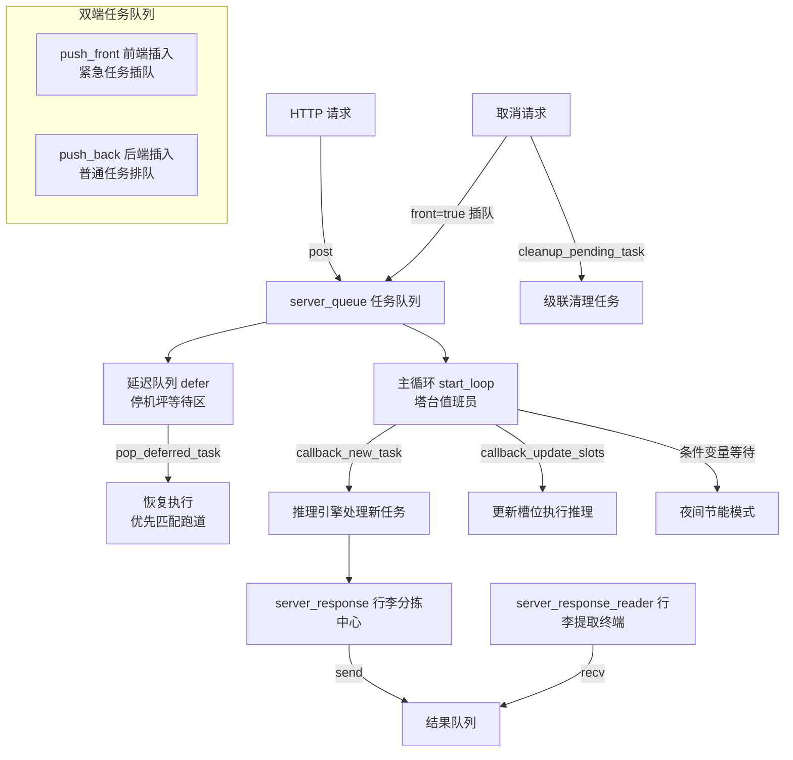
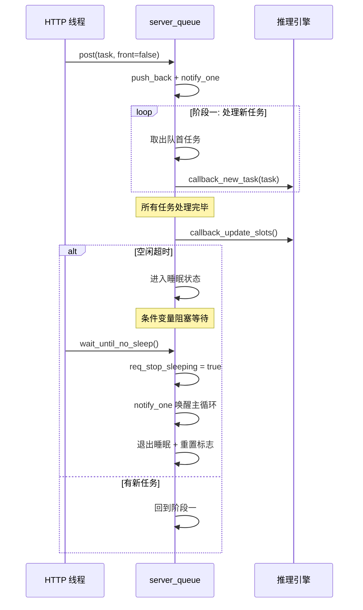
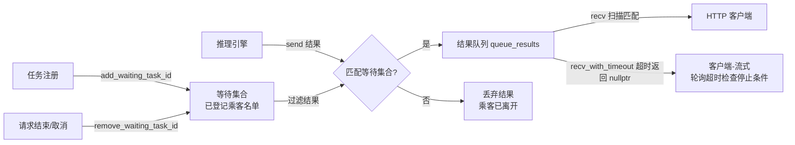
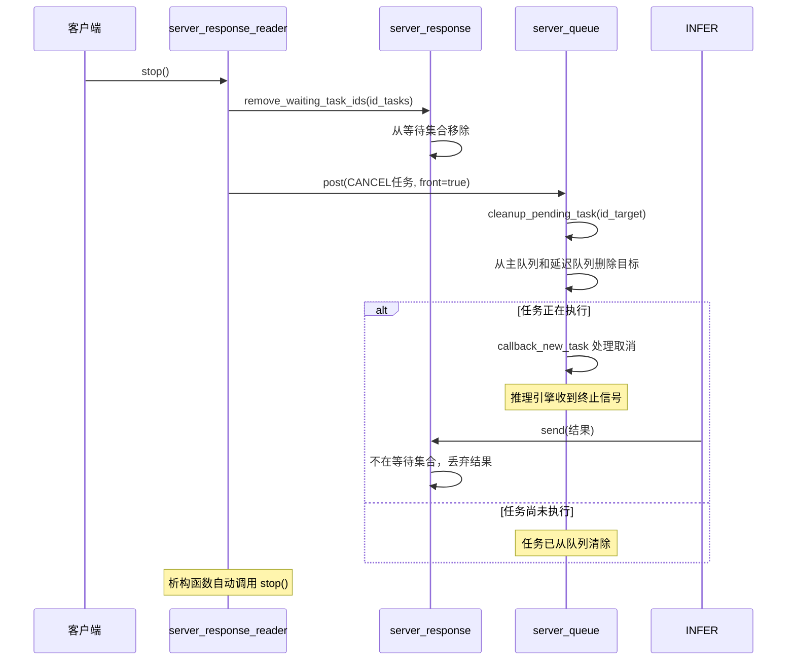

# 第83章 任务调度与队列系统 —— 并发推理的「空中流量管制塔台」

## 学习目标

- 理解 server_queue 在并发推理中的核心职责与双端队列设计
- 掌握延迟队列（deferred queue）与槽位优先唤醒机制
- 理解主循环三阶段模型（处理新任务/更新槽位/等待睡眠）与空闲节能设计
- 掌握 server_response 的等待集合机制与生产者-消费者同步原语
- 理解 server_response_reader 的生成器模式与 RAII 资源管理
- 掌握任务取消的级联清理机制与异常路径安全保障
- 能独立实现基于条件变量的多线程任务调度器

## 83.1 生活类比

想象 llama-server 的并发系统是一座**现代化智能机场**。**server_queue** 就是机场塔台调度系统——管理所有待起飞（待推理）的航班（任务）。它采用**双端队列**设计——紧急航班（如取消请求）可以从 front 插队优先起飞，普通航班则按序在 back 排队。当跑道（KV 缓存槽位）被占用时，航班会被暂时调度到停机坪等待区（延迟队列），而 `pop_deferred_task` 则像塔台调度员，当指定跑道空闲时会优先安排此前等待该跑道的航班起飞。

**server_response** 对应机场的行李分拣中心，确保每位乘客（任务）拿到自己的行李（结果）。它维护一份已登记等待行李的乘客名单（`waiting_task_ids`），行李传送带（`queue_results`）按航班号匹配分拣；当乘客离开时，系统会同时清理其遗留行李，防止传送带堵塞。**server_response_reader** 则是自助行李提取终端——乘客（客户端）通过它一件件取行李（流式响应），直到取完为止；若乘客紧急取消行程，`stop()` 会立即清理其所有行李并通知地勤。整个系统遵循 RAII 析构原则，乘客离开机场时自动注销登机牌，防止资源泄漏。就像塔台需要精确协调跑道、处理紧急插队和夜间节能模式一样，server_queue 同样需要管理任务优先级、槽位竞争和服务器空闲功耗——三者共同构成了并发推理系统高效运转的基石。

## 83.2 源码地图

```text
tools/server/server-queue.h                          # 类声明与内联实现（20-127行）
├── struct server_queue (20-127行)
│   ├── int post(server_task && task, bool front = false) [25-43]      # 提交单个任务到队列
│   ├── int post(std::vector<server_task> && tasks, bool front = false) [45-69]  # 批量提交任务
│   ├── void defer(server_task && task) [71-77]                        # 将任务加入延迟队列
│   ├── int get_new_id() [79-83]                                       # 获取唯一任务ID
│   ├── void pop_deferred_task(int id_slot) [85-110]                   # 从延迟队列弹出任务
│   ├── void wait_until_no_sleep() [112-128]                           # 等待直到退出睡眠状态
│   ├── bool is_sleeping() [70-73]                                     # 查询睡眠状态
│   ├── void terminate() [130-135]                                     # 终止主循环
│   ├── void start_loop(int64_t idle_sleep_ms = -1) [137-212]          # 启动主处理循环
│   ├── size_t queue_tasks_deferred_size() [94-97]                     # 延迟队列大小
│   ├── void on_new_task(...) [102-104]                                # 注册新任务回调
│   ├── void on_update_slots(...) [107-109]                            # 注册槽位更新回调
│   ├── void on_sleeping_state(...) [114-123]                          # 注册睡眠状态回调
│   └── void cleanup_pending_task(int id_target) [214-225]             # 清理未完成任务
├── struct server_response (129-164行)
│   ├── void add_waiting_task_id(int id_task) [229-235]                # 注册等待任务
│   ├── void add_waiting_task_ids(...) [237-245]                       # 批量注册等待任务
│   ├── void remove_waiting_task_id(int id_task) [247-260]             # 移除任务并清理结果
│   ├── void remove_waiting_task_ids(...) [262-270]                    # 批量移除等待
│   ├── server_task_result_ptr recv(...) [272-293, 321-325]            # 阻塞接收结果
│   ├── server_task_result_ptr recv_with_timeout(...) [295-319]        # 带超时接收
│   ├── void send(server_task_result_ptr && result) [327-340]          # 发送结果
│   └── void terminate() [342-346]                                     # 终止等待循环
└── struct server_response_reader (166-215行)
    ├── server_response_reader(...) [184-185]                          # 构造函数
    ├── ~server_response_reader() [186-188]                            # 析构自动stop
    ├── int get_new_id() [190-192]                                     # 获取任务ID
    ├── void post_task(server_task && task, bool front) [348-356]      # 提交单任务
    ├── void post_tasks(...) [358-375]                                 # 提交批量任务（含子任务）
    ├── bool has_next() const [377-380]                                # 检查结果流状态
    ├── server_task_result_ptr next(...) [381-408]                     # 生成器：获取下一结果
    ├── batch_response wait_for_all(...) [410-426]                     # 聚合所有结果
    └── void stop() [428-445]                                          # 取消并清理任务
```

## 83.3 server_queue 任务队列基础设施 —— 服务端推理的「飞行计划受理中心」

server_queue 是 llama-server 的并发核心。它像一座机场塔台的飞行计划受理中心，负责接收 HTTP 请求转化的推理任务，并按优先级调度给后端处理线程。不同于简单的 FIFO 队列，它采用**双端队列（deque）**设计，支持从 front 插入实现紧急任务插队（如取消请求），同时引入**延迟队列（deferred queue）**机制处理暂时无法执行的任务（如等待 KV 缓存槽位释放）。线程安全由 `std::mutex` 保护，`std::condition_variable` 实现生产者-消费者模式。

### 83.3.1 server_queue::post()：单任务与批量任务的入队策略

源码路径：`tools/server/server-queue.cpp` - `server_queue::post()`（25-69行）；`tools/server/server-queue.h` - `server_queue::post()`（48-51行）

```cpp
// 单任务入队（第25-43行）
int server_queue::post(server_task && task, bool front) {
    std::unique_lock<std::mutex> lock(mutex_tasks);        // ① 加锁保护队列
    GGML_ASSERT(task.id != -1);                             // ② 断言任务ID有效
    // 取消任务特殊处理：
    if (task.type == SERVER_TASK_TYPE_CANCEL) {             // ③ 如果是取消任务
        cleanup_pending_task(task.id_target);               // ④ 清理目标任务
    }
    const int task_id = task.id;                            // ⑤ 保存任务ID用于返回
    QUE_DBG("new task, id = %d, front = %d\n", task_id, front); // ⑥ 打印调试日志
    if (front) {                                            // ⑦ 前端插入（紧急）
        queue_tasks.push_front(std::move(task));            // ⑧ 移动到队头插队
    } else {                                                // ⑨ 后端插入（普通）
        queue_tasks.push_back(std::move(task));             // ⑩ 追加到队尾排队
    }
    time_last_task = ggml_time_ms();                        // ⑪ 更新时间戳（防睡眠）
    condition_tasks.notify_one();                           // ⑫ 唤醒等待线程
    return task_id;                                         // ⑬ 返回任务ID
}

// 批量任务入队（第45-69行）
int server_queue::post(std::vector<server_task> && tasks, bool front) {
    std::unique_lock<std::mutex> lock(mutex_tasks);         // ① 加锁保护
    for (auto & task : tasks) {                             // ② 遍历所有任务
        if (task.id == -1) {                                // ③ 如果ID未分配
            task.id = id++;                                 // ④ 自动分配唯一ID
        }
        if (task.type == SERVER_TASK_TYPE_CANCEL) {         // ⑤ 取消任务特殊处理
            cleanup_pending_task(task.id_target);           // ⑥ 清理目标
        }
        QUE_DBG("new task, id = %d/%d, front = %d\n",       // ⑦ 打印调试信息
                task.id, (int) tasks.size(), front);
        if (front) {                                        // ⑧ 前端插入
            queue_tasks.push_front(std::move(task));        // ⑨ 插队
        } else {                                            // ⑩ 后端插入
            queue_tasks.push_back(std::move(task));         // ⑪ 排队
        }
    }
    time_last_task = ggml_time_ms();                        // ⑫ 更新时间戳
    condition_tasks.notify_one();                           // ⑬ 唤醒主循环
    return 0;                                               // ⑭ 返回固定值
}
```

这段代码实现了任务入队的核心逻辑。关键设计是：**front 参数控制插入位置**——如同机场紧急航班（如医疗救援、取消请求）可以从起飞队列最前方优先获批起飞，普通任务则通过 `push_back` 按序排队等待。取消任务会在入队前触发 `cleanup_pending_task()` 级联清理，确保被取消的任务立即从队列中移除，就像塔台在取消航班时同步释放其占用的跑道资源。每次入队都会更新 `time_last_task` 时间戳，向主循环传达「仍有航班活动」的信号，防止其因空闲超时而进入睡眠模式。

### 83.3.2 server_queue::defer()/pop_deferred_task()：延迟队列的槽位亲和性

源码路径：`tools/server/server-queue.cpp` - `server_queue::defer()`/`pop_deferred_task()`（71-110行）；`tools/server/server-queue.h` - `server_queue::defer()`/`pop_deferred_task()`（54, 62行）

```cpp
// 延迟任务入队（第71-77行）
void server_queue::defer(server_task && task) {
    std::unique_lock<std::mutex> lock(mutex_tasks);         // ① 加锁
    QUE_DBG("defer task, id = %d\n", task.id);              // ② 打印调试日志
    queue_tasks_deferred.push_back(std::move(task));        // ③ 加入延迟队列尾部
    time_last_task = ggml_time_ms();                        // ④ 更新时间戳
    condition_tasks.notify_one();                           // ⑤ 唤醒主循环（但不会立即执行）
}

// 从延迟队列弹出任务（第85-110行）
void server_queue::pop_deferred_task(int id_slot) {
    std::unique_lock<std::mutex> lock(mutex_tasks);         // ① 加锁
    if (!queue_tasks_deferred.empty()) {                    // ② 延迟队列非空
        // 优先寻找使用指定槽位的任务
        bool found = false;                                 // ③ 标记是否找到
        for (auto it = queue_tasks_deferred.begin();        // ④ 遍历延迟队列
             it != queue_tasks_deferred.end(); ++it) {
            if (it->id_slot == id_slot) {                   // ⑤ 找到匹配槽位
                QUE_DBG("pop deferred task (use slot %d), id_task = %d\n", id_slot, it->id); // ⑥ 打印日志
                queue_tasks.emplace_front(std::move(*it));  // ⑦ 移到主队列前端
                queue_tasks_deferred.erase(it);             // ⑧ 从延迟队列删除
                found = true;                               // ⑨ 标记已找到
                break;                                      // ⑩ 退出循环
            }
        }
        // 没找到特定槽位任务，则弹出第一个延迟任务
        if (!found) {                                       // ⑪ 未找到匹配
            QUE_DBG("pop deferred task, id_task = %d\n",    // ⑫ 打印日志
                    queue_tasks_deferred.front().id);
            queue_tasks.emplace_front(                      // ⑬ 移到主队列前端
                std::move(queue_tasks_deferred.front()));
            queue_tasks_deferred.pop_front();               // ⑭ 弹出延迟队列头
        }
    }
    time_last_task = ggml_time_ms();                        // ⑮ 更新时间戳
    condition_tasks.notify_one();                           // ⑯ 唤醒主循环
}
```

这段代码实现了延迟队列的两级调度。`defer()` 将暂时无法执行的任务暂存到延迟队列——如同航班因跑道被占用而进入停机坪等待区；`pop_deferred_task(id_slot)` 在槽位释放时被调用，**优先唤醒使用该槽位的延迟任务**（槽位亲和性），确保 KV Cache 的局部性最大化——就像塔台调度员看到指定跑道清空后，优先安排此前等待该跑道的航班起飞，而不是机械地按到达顺序放行。如果找不到匹配槽位的任务，则回退到 FIFO 策略弹出最早的延迟任务。这种设计避免了任务反复入队导致的活锁问题。

### 83.3.3 server_queue::is_sleeping()/queue_tasks_deferred_size()/回调注册：运行时状态查询与监听回调

源码路径：`tools/server/server-queue.h` - `server_queue::is_sleeping()`（70-73行）、`queue_tasks_deferred_size()`（94-97行）、`on_new_task()`（102-104行）、`on_update_slots()`（107-109行）、`on_sleeping_state()`（114-123行）

```cpp
// 睡眠状态查询（第70-73行）
bool is_sleeping() {
    std::unique_lock<std::mutex> lock(mutex_tasks);         // ① 加锁
    return sleeping;                                        // ② 返回睡眠标志
}
```

```cpp
// 延迟队列大小查询（第94-97行）
size_t queue_tasks_deferred_size() {
    std::unique_lock<std::mutex> lock(mutex_tasks);         // ① 加锁
    return queue_tasks_deferred.size();                     // ② 返回延迟队列大小
}
```

```cpp
// 新任务回调注册（第102-104行）
void on_new_task(std::function<void(server_task &&)> callback) {
    callback_new_task = std::move(callback);                // 替换回调
}
```

```cpp
// 槽位更新回调注册（第107-109行）
void on_update_slots(std::function<void(void)> callback) {
    callback_update_slots = std::move(callback);            // 替换回调
}
```

```cpp
// 睡眠状态回调注册（第114-123行）
void on_sleeping_state(std::function<void(bool)> callback) {
    if (callback_sleeping_state) {                          // ① 已有回调
        auto prev_callback = std::move(callback_sleeping_state); // ② 保存旧回调
        callback_sleeping_state = [prev_callback, callback](bool sleeping) { // ③ 链式组合
            prev_callback(sleeping);                        // ④ 先调旧回调
            callback(sleeping);                             // ⑤ 再调新回调
        };
    } else {                                                // ⑥ 无已注册回调
        callback_sleeping_state = std::move(callback);      // ⑦ 直接设置
    }
}
```

这段代码提供了运行时状态查询和回调注册功能。`is_sleeping()` 和 `queue_tasks_deferred_size()` 供外部模块（如 server_metrics）查询队列状态——如同机场管理层随时查看塔台是否进入夜间节能模式、停机坪有多少等待航班；`on_new_task()`、`on_update_slots()` 分离任务接收与槽位计算，实现**关注点分离**；`on_sleeping_state()` 支持多回调链式注册，允许多个模块（如监控系统和功耗管理器）同时监听睡眠状态切换。

### 83.3.4 server_queue::get_new_id()/cleanup_pending_task()：ID 分配与任务清理

源码路径：`tools/server/server-queue.cpp` - `get_new_id()`/`cleanup_pending_task()`（79-83, 214-225行）；`tools/server/server-queue.h` - `get_new_id()`（57行）、`cleanup_pending_task()`（126行）

```cpp
// 唯一ID分配（第79-83行）
int server_queue::get_new_id() {
    std::unique_lock<std::mutex> lock(mutex_tasks);         // ① 加锁保护计数器
    int new_id = id++;                                      // ② 原子递增分配
    return new_id;                                          // ③ 返回新ID
}

// 清理未完成任务（第214-225行）
void server_queue::cleanup_pending_task(int id_target) {
    // 无需加锁，因为调用方（post）已持有锁
    auto rm_func = [id_target](const server_task & task) {  // ① 定义删除谓词
        return task.id == id_target;                        // ② 匹配目标ID
    };
    queue_tasks.erase(                                      // ③ 主队列中删除
        std::remove_if(queue_tasks.begin(),                 // ④ 用remove_if移动
                       queue_tasks.end(),                   // ⑤ 需要删除的元素
                       rm_func),                            // ⑥ 到容器末尾
        queue_tasks.end());                                 // ⑦ 然后erase删除
    queue_tasks_deferred.erase(                             // ⑧ 延迟队列同删除
        std::remove_if(queue_tasks_deferred.begin(),        // ⑨ 同样的策略
                       queue_tasks_deferred.end(), rm_func),
        queue_tasks_deferred.end());
}
```

这段代码实现 ID 分配和级联清理。`get_new_id()` 在锁保护下通过自增计数器保证 ID 唯一性，如同一座机场的航班编号系统确保每架航班有唯一标识。`cleanup_pending_task()` 采用**remove-erase 惯用法**同时清理主队列和延迟队列中所有匹配目标任务，它是取消任务的核心清理逻辑，被 `post()` 中的取消分支调用——就像塔台收到取消某航班的指令后，同时从起飞队列和停机坪等待区移除该航班的一切调度安排。

### 83.3.5 server_queue 任务队列基础设施 —— 塔台全景架构图



如上图所示，整个任务队列系统呈现清晰的层级结构：HTTP 请求通过 `post()` 进入双端任务队列，一部分任务因等待槽位进入延迟队列（停机坪），主循环 `start_loop` 则作为塔台值班员驱动任务流转，最终结果通过 `server_response` 这个行李分拣中心分发至乘客（客户端）的提取终端。

## 83.4 server_queue 主循环调度机制 —— 永不停歇的「塔台值班员」

start_loop 是整个任务调度系统的核心驱动，采用三阶段工作模型：处理新任务 → 更新槽位 → 等待新任务。它像一个不知疲倦的塔台值班员，持续接收、调度和执行推理任务，并在空闲时进入节能睡眠模式。

### 83.4.1 server_queue::start_loop()：三阶段主循环与睡眠管理

源码路径：`tools/server/server-queue.cpp` - `server_queue::start_loop()`（137-212行）；`tools/server/server-queue.h` - `start_loop()`（88行）

```cpp
// 主循环（第137-212行）
void server_queue::start_loop(int64_t idle_sleep_ms) {
    running = true;                                         // ① 设置运行标志
    time_last_task = ggml_time_ms();                        // ② 记录最后任务时间
    constexpr auto max_wait_time = std::chrono::seconds(1); // ③ 最大等待1秒
    
    // 判断是否应进入睡眠（第148-153行）
    auto should_sleep = [&]() -> bool {
        // 调用者必须持有 mutex_tasks
        if (idle_sleep_ms < 0) {                            // ④ 未启用睡眠
            return false;                                   // ⑤ 永不睡眠
        }
        int64_t now = ggml_time_ms();                       // ⑥ 获取当前时间
        return (now - time_last_task) >= idle_sleep_ms;     // ⑦ 超时则睡眠
    };
    
    while (true) {                                          // ⑧ 主循环开始
        // ===== 阶段一：处理新任务 =====
        QUE_DBG("%s", "processing new tasks\n");            // ⑨ 打印日志
        while (true) {                                      // ⑩ 内层任务处理循环
            std::unique_lock<std::mutex> lock(mutex_tasks); // ⑪ 加锁检查队列
            if (!running) {                                 // ⑫ 已终止
                QUE_DBG("%s", "terminate\n");               // ⑬ 打印终止日志
                return;                                     // ⑭ 退出主循环
            }
            if (queue_tasks.empty()) {                      // ⑮ 队列为空
                lock.unlock();                              // ⑯ 解锁
                break;                                      // ⑰ 跳出内层循环
            }
            server_task task = std::move(queue_tasks.front()); // ⑱ 取出队首任务
            queue_tasks.pop_front();                        // ⑲ 弹出队首
            lock.unlock();                                  // ⑳ 解锁（缩小临界区）
            QUE_DBG("processing task, id = %d\n", task.id); // ㉑ 打印任务ID
            callback_new_task(std::move(task));             // ㉒ 调用推理回调
        }
        
        // ===== 阶段二：更新槽位 =====
        QUE_DBG("%s", "update slots\n");                    // ㉓ 打印日志
        callback_update_slots();                            // ㉔ 执行推理主流程
        {
            std::unique_lock<std::mutex> lock(mutex_tasks); // ㉕ 加锁
            time_last_task = ggml_time_ms();                // ㉖ 重置空闲计时器
        }
        
        // ===== 阶段三：等待新任务 =====
        QUE_DBG("%s", "waiting for new tasks\n");           // ㉗ 打印日志
        while (true) {                                      // ㉘ 内层等待循环
            std::unique_lock<std::mutex> lock(mutex_tasks); // ㉙ 加锁
            if (!running || !queue_tasks.empty()) {         // ㉚ 有工作或终止
                break;                                      // ㉛ 回到阶段一
            }
            if (should_sleep()) {                           // ㉜ 应进入睡眠
                QUE_INF("%s", "entering sleeping state\n"); // ㉝ 打印日志
                sleeping = true;                            // ㉞ 设置睡眠标志
                callback_sleeping_state(true);              // ㉟ 通知外部
                req_stop_sleeping = false;                  // ㊱ 重置唤醒请求
                condition_tasks.wait(lock, [&]{             // ㊲ 阻塞等待唤醒
                    return (!running || req_stop_sleeping); // ㊳ 条件：终止或唤醒
                });
                if (!running) {                             // ㊴ 可能睡眠中终止
                    break;                                  // ㊵ 退出等待
                }
                QUE_INF("%s", "exiting sleeping state\n");  // ㊶ 打印日志
                req_stop_sleeping = false;                  // ㊷ 重置唤醒标志
                callback_sleeping_state(false);             // ㊸ 通知退出睡眠
                sleeping = false;                           // ㊹ 清除睡眠标志
                time_last_task = ggml_time_ms();            // ㊺ 重置计时
                condition_tasks.notify_all();               // ㊻ 通知 wait_until_no_sleep
                break;                                      // ㊼ 回到阶段一
            } else {                                        // ㊽ 未触发睡眠
                bool res = condition_tasks.wait_for(        // ㊾ 限时等待新任务
                    lock, max_wait_time, [&]{
                        return (!queue_tasks.empty() || !running); // ㊿ 条件
                    });
                if (res) {                                  // 51 新任务到达
                    break;                                  // 52 回到阶段一
                }                                           // 53 超时继续循环
            }
        }
    }
}
```

这段代码是整个任务调度系统的核心——如同塔台值班员的三班倒循环。**三阶段模型**清晰分离了任务接收和推理计算：阶段一处理新任务（接听航班申请）、阶段二执行推理（指挥航班起飞）、阶段三等待（瞭望天空等待新航班）。关键设计包括：**缩小临界区**（解锁后再调用回调，避免长时间持有锁，如同塔台人员不会握着通话器完成整套调度流程）、**空闲睡眠**（超过 `idle_sleep_ms` 未收到任务时进入睡眠，零 CPU 占用的待机，如同机场夜间关闭不必要跑道的节能措施）、**限时轮询**（最多等待 1 秒后重新检查睡眠条件，如同值班员每隔数分钟扫视一次雷达屏幕），以及**二次检查终止状态**（避免虚假唤醒导致的问题）。

### 83.4.2 server_queue::terminate()/wait_until_no_sleep()：优雅停止与唤醒协调

源码路径：`tools/server/server-queue.cpp` - `terminate()`/`wait_until_no_sleep()`（112-135行）；`tools/server/server-queue.h` - `wait_until_no_sleep()`（68行）、`terminate()`（76行）

```cpp
// 等待退出睡眠（第112-128行）
void server_queue::wait_until_no_sleep() {
    std::unique_lock<std::mutex> lock(mutex_tasks);         // ① 加锁
    if (!sleeping) {                                        // ② 不在睡眠
        return;                                             // ③ 直接返回
    } else {                                                // ④ 正在睡眠
        if (!req_stop_sleeping) {                           // ⑤ 尚未请求唤醒
            QUE_DBG("%s", "requesting to stop sleeping\n"); // ⑥ 打印日志
            req_stop_sleeping = true;                       // ⑦ 设置唤醒请求
            condition_tasks.notify_one();                   // ⑧ 通知主循环
        }
        QUE_DBG("%s", "waiting until no sleep\n");          // ⑨ 打印日志
        condition_tasks.wait(lock, [&]{                     // ⑩ 阻塞等待
            return !sleeping;                               // ⑪ 直到退出睡眠
        });
    }
}

// 优雅终止（第130-135行）
void server_queue::terminate() {
    std::unique_lock<std::mutex> lock(mutex_tasks);         // ① 加锁
    running = false;                                        // ② 清除运行标志
    condition_tasks.notify_all();                           // ③ 广播唤醒所有等待线程
}
```

这段代码实现了睡眠唤醒协调和优雅终止。`wait_until_no_sleep()` 供外部线程调用，若主循环正在睡眠则请求唤醒并阻塞等待——如同有紧急航班夜间抵达时，值班人员按下唤醒铃并等待塔台恢复值守；`terminate()` 通过清除 `running` 标志并广播条件变量，确保所有等待线程（包括正在睡眠的主循环）都能安全退出——如同机场正式关闭时，塔台广播通知所有岗位下班。

### 83.4.3 server_queue 主循环三阶段时序图

源码路径：`tools/server/server-queue.cpp` - `server_queue::start_loop()`（137-212行），`server_queue::terminate()`（130-135行），`server_queue::wait_until_no_sleep()`（112-128行）



## 83.5 server_response 响应分发与等待集合 —— 推理结果的「行李分拣中心」

server_response 是服务端的响应分发中心，维护**等待任务集合**和**结果队列**。它确保只有已注册任务的结果才会被接收，避免脏数据污染。

### 83.5.1 server_response::add_waiting_task_id(s)/remove_waiting_task_id(s)：等待集合的注册与注销

源码路径：`tools/server/server-queue.cpp` - `add_waiting_task_id(s)`/`remove_waiting_task_id(s)`（229-270行）；`tools/server/server-queue.h` - `add_waiting_task_id(s)`（139, 141行）、`remove_waiting_task_id(s)`（144, 147行）

```cpp
// 注册单个任务（第229-235行）
void server_response::add_waiting_task_id(int id_task) {
    RES_DBG("add task %d to waiting list...\n", id_task);   // ① 打印日志
    std::unique_lock<std::mutex> lock(mutex_results);       // ② 加锁保护集合
    waiting_task_ids.insert(id_task);                       // ③ 加入等待集合
}

// 批量注册任务（第237-245行）
void server_response::add_waiting_task_ids(
        const std::unordered_set<int> & id_tasks) {
    std::unique_lock<std::mutex> lock(mutex_results);       // ① 加锁
    for (const auto & id_task : id_tasks) {                 // ② 遍历所有ID
        RES_DBG("add task %d to waiting list...\n", id_task); // ③ 打印日志
        waiting_task_ids.insert(id_task);                   // ④ 加入集合
    }
}

// 移除单个任务并清理结果（第247-260行）
void server_response::remove_waiting_task_id(int id_task) {
    RES_DBG("remove task %d from waiting list...\n", id_task); // ① 打印日志
    std::unique_lock<std::mutex> lock(mutex_results);       // ② 加锁
    waiting_task_ids.erase(id_task);                        // ③ 从集合移除
    // 清理该任务的所有待处理结果
    queue_results.erase(                                    // ④ 删除结果队列中
        std::remove_if(queue_results.begin(),               // ⑤ 删除条件
                       queue_results.end(),                 // ⑥ 的匹配结果
                       [id_task](const server_task_result_ptr & res) {
                           return res->id == id_task;       // ⑦ 匹配任务ID
                       }),
        queue_results.end());                               // ⑧ 结束位置
}

// 批量移除任务（第262-270行）
void server_response::remove_waiting_task_ids(
        const std::unordered_set<int> & id_tasks) {
    std::unique_lock<std::mutex> lock(mutex_results);       // ① 加锁
    for (const auto & id_task : id_tasks) {                 // ② 遍历所有ID
        RES_DBG("remove task %d from waiting list...\n", id_task); // ③ 日志
        waiting_task_ids.erase(id_task);                    // ④ 从集合移除
    }
}
```

这段代码实现了等待集合的增删管理。特别值得注意 `remove_waiting_task_id()` 的**双重清理**：除了从等待集合移除标记，还会通过 remove-erase 惯用法清理该任务的待处理结果——如同乘客离开机场时，系统同时注销其登机牌并从传送带上移走其遗留行李，防止已取消任务的结果泄漏到无关请求，造成资源浪费。

### 83.5.2 server_response::recv()/recv_with_timeout()：阻塞与超时接收

源码路径：`tools/server/server-queue.cpp` - `recv()`/`recv_with_timeout()`（272-325行）；`tools/server/server-queue.h` - `recv()`（150, 157行）、`recv_with_timeout()`（154行）

```cpp
// 阻塞接收（第272-293行）
server_task_result_ptr server_response::recv(
        const std::unordered_set<int> & id_tasks) {
    while (true) {                                          // ① 无限循环
        std::unique_lock<std::mutex> lock(mutex_results);   // ② 加锁
        condition_results.wait(lock, [&]{                   // ③ 条件变量等待
            if (!running) {                                 // ④ 已终止
                RES_DBG("%s : queue result stop\n", "recv");// ⑤ 打印日志
                std::terminate();                           // ⑥ 强制终止进程
            }
            return !queue_results.empty();                  // ⑦ 结果队列非空
        });
        for (size_t i = 0; i < queue_results.size(); i++) { // ⑧ 扫描结果队列
            if (id_tasks.find(queue_results[i]->id) !=      // ⑨ 匹配任务ID
                id_tasks.end()) {
                server_task_result_ptr res =                // ⑩ 取出结果
                    std::move(queue_results[i]);
                queue_results.erase(                        // ⑪ 从队列移除
                    queue_results.begin() + i);
                return res;                                 // ⑫ 返回结果
            }
        }
    }
    // should never reach here
}

// 带超时接收（第295-319行）
server_task_result_ptr server_response::recv_with_timeout(
        const std::unordered_set<int> & id_tasks, int timeout) {
    while (true) {                                          // ① 无限循环
        std::unique_lock<std::mutex> lock(mutex_results);   // ② 加锁
        for (int i = 0; i < (int) queue_results.size(); i++) { // ③ 先扫描已有结果
            if (id_tasks.find(queue_results[i]->id) !=      // ④ 匹配任务ID
                id_tasks.end()) {
                server_task_result_ptr res =                // ⑤ 取出
                    std::move(queue_results[i]);
                queue_results.erase(                        // ⑥ 移除
                    queue_results.begin() + i);
                return res;                                 // ⑦ 返回
            }
        }
        std::cv_status cr_res =                             // ⑧ 限时等待
            condition_results.wait_for(lock,
                std::chrono::seconds(timeout));
        if (!running) {                                     // ⑨ 已终止
            RES_DBG("%s : queue result stop\n", __func__);  // ⑩ 打印日志
            std::terminate();                               // ⑪ 强制终止
        }
        if (cr_res == std::cv_status::timeout) {            // ⑫ 超时
            return nullptr;                                 // ⑬ 返回空指针
        }
    }
}

// 单任务版本（第321-325行）
server_task_result_ptr server_response::recv(int id_task) {
    std::unordered_set<int> id_tasks = {id_task};           // ① 构造包含单个任务ID的集合
    return recv(id_tasks);                                  // ② 委托给多任务版本，复用阻塞匹配逻辑
}
```

这段代码实现了结果的接收机制。**`std::terminate()` 策略**值得关注——当系统终止时无法优雅返回（因为调用方是 HTTP 线程），只能强制终止进程保证服务端一致性，如同机场因紧急情况永久关闭时，所有仍在等待行李的乘客必须立刻离开航站楼。`recv()` 支持多任务集合匹配，返回**第一个**到达的匹配结果；`recv_with_timeout()` 先扫描已有结果再等待，避免超时后仍有可用结果的情况。

### 83.5.3 server_response::send()/terminate()：结果匹配与终止

源码路径：`tools/server/server-queue.cpp` - `send()`/`terminate()`（327-346行）；`tools/server/server-queue.h` - `send()`（160行）、`terminate()`（163行）

```cpp
// 发送结果（第327-340行）
void server_response::send(server_task_result_ptr && result) {
    RES_DBG("sending result for task id = %d\n", result->id); // ① 打印日志
    std::unique_lock<std::mutex> lock(mutex_results);       // ② 加锁
    for (const auto & id_task : waiting_task_ids) {         // ③ 遍历等待集合
        if (result->id == id_task) {                        // ④ 匹配任务ID
            RES_DBG("task id = %d pushed to result queue\n", // ⑤ 打印日志
                    result->id);
            queue_results.emplace_back(std::move(result));  // ⑥ 入队结果
            condition_results.notify_all();                 // ⑦ 唤醒所有等待线程
            return;                                         // ⑧ 返回
        }
    }
}

// 终止响应（第342-346行）
void server_response::terminate() {
    running = false;                                        // ① 清除运行标志
    condition_results.notify_all();                         // ② 唤醒所有等待
}
```

这段代码实现了结果的分发。`send()` 的关键是**结果-等待集合匹配**：只有任务 ID 在等待集合中的结果才会被入队，否则直接丢弃。这防止了已取消任务的结果进入队列——如同行李分拣中心只将行李放入仍在等候的乘客名下，无人认领的行李会被直接弃置。`terminate()` 通过设置 `running=false` 并广播，使得所有正在 `recv()` 中阻塞的线程因 `std::terminate()` 而退出。

### 83.5.4 server_response 响应分发数据流图

源码路径：`tools/server/server-queue.cpp` - `server_response::send()`（327-340行），`remove_waiting_task_id()`（247-260行），`recv_with_timeout()`（295-319行）



如上图所示，推理引擎产生的结果首先经过等待集合的过滤，只有与活跃任务匹配的结果才能进入结果队列以供客户端消费，未注册的结果则被直接丢弃，从源头上防止了脏数据的传播——就像行李分拣中心的传送带只将行李送入对应航班号的分拣口。

## 83.6 server_response_reader 响应读取器 —— 面向客户端的「自助行李提取终端」

server_response_reader 为上层 HTTP 处理层提供简洁的迭代器风格 API，屏蔽底层队列交互细节。它像自助行李提取终端，客户端通过它逐件提取结果。

### 83.6.1 server_response_reader::post_task()/post_tasks()：任务提交与状态初始化

源码路径：`tools/server/server-queue.cpp` - `post_task()`/`post_tasks()`（348-375行）；`tools/server/server-queue.h` - `post_task()`（196行）、`post_tasks()`（197行）

```cpp
// 提交单个任务（第348-356行）
void server_response_reader::post_task(server_task && task, bool front) {
    GGML_ASSERT(id_tasks.empty() &&                         // ① 断言reader未使用过
        "post_task() can only be called once per reader");
    GGML_ASSERT(!task.is_parent() &&                        // ② 断言非父任务
        "not supported, use post_tasks() instead");
    task.index = 0;                                         // ③ 设置索引为0
    id_tasks.insert(task.id);                               // ④ 加入本地ID集合
    states.push_back(task.create_state());                  // ⑤ 创建状态跟踪
    queue_results.add_waiting_task_id(task.id);             // ⑥ 注册到等待集合
    queue_tasks.post(std::move(task), front);               // ⑦ 提交到任务队列
}

// 批量提交任务（第358-375行）
void server_response_reader::post_tasks(
        std::vector<server_task> && tasks, bool front) {
    GGML_ASSERT(id_tasks.empty() &&                         // ① 断言reader未使用过
        "post_tasks() can only be called once per reader");
    id_tasks = server_task::get_list_id(tasks);             // ② 收集所有任务ID
    states.reserve(tasks.size());                           // ③ 预分配状态数组
    size_t index = 0;                                       // ④ 初始化索引
    for (auto & task : tasks) {                             // ⑤ 遍历所有任务
        task.index = index++;                               // ⑥ 分配索引
        states.push_back(task.create_state());              // ⑦ 创建状态
        // 为子任务创建独立状态
        for (auto & child_task : task.child_tasks) {        // ⑧ 遍历子任务
            child_task.index = index++;                     // ⑨ 分配子任务索引
            states.push_back(child_task.create_state());    // ⑩ 创建子任务状态
        }
    }
    GGML_ASSERT(states.size() == id_tasks.size());          // ⑪ 断言状态数匹配
    queue_results.add_waiting_task_ids(id_tasks);           // ⑫ 批量注册等待
    queue_tasks.post(std::move(tasks), front);              // ⑬ 批量提交任务
}
```

这段代码实现了任务提交——如同乘客在自助行李提取终端刷登机牌后，系统会登记该乘客的所有托运行李单据，并为每件行李建立一个独立的追踪记录。`post_task()` 用于单个任务，`post_tasks()` 支持批量任务及其子任务——每个子任务都有独立的索引和状态跟踪，对应每件行李的独立传输记录。`create_state()` 为任务关联 `task_result_state`，用于跟踪生成过程中的增量状态（如聊天上下文）。

### 83.6.2 server_response_reader::has_next()/next()：流式生成器

源码路径：`tools/server/server-queue.cpp` - `has_next()`/`next()`（377-408行）；`tools/server/server-queue.h` - `has_next()`（198行）、`next()`（201行）

```cpp
// 检查是否还有结果（第377-380行）
bool server_response_reader::has_next() const {
    return !cancelled &&                                    // ① 未被取消
           received_count < id_tasks.size();                // ② 已收数少于总数
}

// 获取下一个结果（第381-408行）
server_task_result_ptr server_response_reader::next(
        const std::function<bool()> & should_stop) {
    while (true) {                                          // ① 无限循环
        server_task_result_ptr result =                     // ② 带超时接收
            queue_results.recv_with_timeout(
                id_tasks, polling_interval_seconds);
        if (result == nullptr) {                            // ③ 超时无结果
            if (should_stop()) {                            // ④ 检查停止条件
                SRV_DBG("%s", "stopping wait for next result...\n"); // ⑤ 日志
                return nullptr;                             // ⑥ 返回空
            }
        } else {                                            // ⑦ 收到结果
            if (result->is_error()) {                       // ⑧ 是错误
                stop();                                     // ⑨ 取消剩余任务
                SRV_DBG("%s", "received error result, stopping...\n"); // ⑩ 日志
                return result;                              // ⑪ 返回错误
            }
            if (!states.empty()) {                          // ⑫ 有状态跟踪
                const size_t idx = result->index;           // ⑬ 获取索引
                GGML_ASSERT(idx < states.size());           // ⑭ 断言范围
                result->update(states[idx]);                // ⑮ 更新增量状态
            }
            if (result->is_stop()) {                        // ⑯ 是停止标志
                received_count++;                           // ⑰ 计数+1
            }
            return result;                                  // ⑱ 返回结果
        }
    }
    // should not reach here
}
```

这段代码实现了流式生成器。`next()` 使用 `recv_with_timeout()` 实现**轮询式等待**——超时后检查 `should_stop()` 条件，支持 HTTP 连接断开检测，如同行李提取终端每隔几秒检查传送带同时留意乘客是否已按下「放弃等待」按钮。收到错误结果时自动调用 `stop()` 取消剩余任务；`result->update(states[idx])` 实现增量状态聚合，为聊天上下文等场景提供累积更新。

### 83.6.3 server_response_reader::wait_for_all()：批量结果聚合

源码路径：`tools/server/server-queue.cpp` - `wait_for_all()`（410-426行）；`tools/server/server-queue.h` - `wait_for_all()`（213行）

```cpp
// 批量等待所有结果（第410-426行）
server_response_reader::batch_response
server_response_reader::wait_for_all(
        const std::function<bool()> & should_stop) {
    batch_response batch_res;                               // ① 创建批量响应
    batch_res.results.clear();                              // ② 清空结果数组
    batch_res.results.resize(id_tasks.size());              // ③ 预分配大小
    while (has_next()) {                                    // ④ 循环直到取完
        auto res = next(should_stop);                       // ⑤ 获取下一结果
        if (res == nullptr) {                               // ⑥ 被停止
            batch_res.is_terminated = true;                 // ⑦ 标记终止
            return batch_res;                               // ⑧ 返回部分结果
        }
        if (res->is_error()) {                              // ⑨ 有错误
            batch_res.error = std::move(res);               // ⑩ 保存错误
            return batch_res;                               // ⑪ 直接返回
        }
        const size_t idx = res->index;                      // ⑫ 获取索引
        GGML_ASSERT(idx < batch_res.results.size() &&       // ⑬ 断言范围
                "index out of range");
        GGML_ASSERT(batch_res.results[idx] == nullptr &&    // ⑭ 断言无重复
                "duplicate result received");
        batch_res.results[idx] = std::move(res);            // ⑮ 按索引归档
    }
    return batch_res;                                       // ⑯ 返回完整结果
}
```

这段代码实现了批量结果的聚合——如同乘客一次性领取所有托运行李，终端将每件行李按登机牌顺序放入对应取件口。`wait_for_all()` 将结果按索引归档到预分配的数组，支持错误提前终止和部分结果返回。**移动语义**（`std::move(res)`）避免了复制开销，同时通过断言检测重复结果（同一索引被赋值两次，如同同一件行李出现在两个取件口）。

### 83.6.4 server_response_reader::stop() 与 server_queue::cleanup_pending_task()：级联取消与清理

源码路径：`tools/server/server-queue.cpp` - `server_response_reader::stop()`（428-445行）、`server_queue::cleanup_pending_task()`（214-225行）；`tools/server/server-queue.h` - `stop()`（215行）、`cleanup_pending_task()`（126行）

```cpp
// 取消并清理任务（第428-445行）
void server_response_reader::stop() {
    queue_results.remove_waiting_task_ids(id_tasks);        // ① 先从等待集合移除
    if (has_next() && !cancelled) {                         // ② 有未完成任务
        cancelled = true;                                   // ③ 标记已取消
        std::vector<server_task> cancel_tasks;              // ④ 创建取消列表
        cancel_tasks.reserve(id_tasks.size());              // ⑤ 预分配空间
        for (const auto & id_task : id_tasks) {             // ⑥ 遍历所有任务
            SRV_WRN("cancel task, id_task = %d\n", id_task);// ⑦ 打印警告
            server_task task(SERVER_TASK_TYPE_CANCEL);      // ⑧ 创建取消任务
            task.id_target = id_task;                       // ⑨ 设置目标ID
            queue_results.remove_waiting_task_id(id_task);  // ⑩ 再次清理
            cancel_tasks.push_back(std::move(task));        // ⑪ 加入取消列表
        }
        // 插入队列前端，最高优先级
        queue_tasks.post(std::move(cancel_tasks), true);    // ⑫ 前端插队提交
    } else {                                                // ⑬ 已全部完成
        SRV_DBG("%s", "all tasks already finished, no need to cancel\n"); // ⑭ 日志
    }
}

// 清理未完成任务（第214-225行，被 post() 中取消分支调用）
void server_queue::cleanup_pending_task(int id_target) {
    // 无需加锁，因为调用方（post）已持有锁
    auto rm_func = [id_target](const server_task & task) {  // ① 定义删除谓词
        return task.id == id_target;                        // ② 匹配目标ID
    };
    queue_tasks.erase(                                      // ③ 主队列中删除
        std::remove_if(queue_tasks.begin(),                 // ④ remove_if移动
                       queue_tasks.end(),                   // ⑤ 需要删除的元素
                       rm_func),                            // ⑥ 到容器末尾
        queue_tasks.end());                                 // ⑦ 然后erase删除
    queue_tasks_deferred.erase(                             // ⑧ 延迟队列同删除
        std::remove_if(queue_tasks_deferred.begin(),        // ⑨ 同样的策略
                       queue_tasks_deferred.end(), rm_func),
        queue_tasks_deferred.end());
}
```

这段代码实现了级联取消与清理。关键设计是**`front=true` 插队**——取消任务必须以最高优先级执行，如同乘客紧急取消行程时，系统以最高的优先级处理其行李撤回请求，避免被正常排队阻塞。`cleanup_pending_task()` 随后会清除主队列和延迟队列中的目标任务，实现两级清理——如同同时从起飞等待区和停机坪移除该乘客的所有相关航班安排。`cancelled` 标志记录取消状态，避免重复取消。

### 83.6.5 server_response_reader::stop() 取消流程时序图

源码路径：`tools/server/server-queue.cpp` - `server_response_reader::stop()`（428-445行），`server_queue::cleanup_pending_task()`（214-225行）



## 83.7 设计中的取舍

本章涉及的三个核心组件——server_queue、server_response 和 server_response_reader——在设计与实现中面临了多组冲突目标（如响应性、正确性、可靠性）之间的权衡。以下逐一剖析这些关键取舍背后的考量。

### 83.7.1 响应性：为什么使用轮询扫描加超时等待，而不是简单的阻塞等待？

流式响应场景要求 `next()` 能够响应客户端断开连接（`should_stop()` 回调）。如果使用无限阻塞等待，HTTP 线程将无法感知连接断开，导致资源无法及时释放。通过 `recv_with_timeout()` 实现轮询式等待，在超时后检查 `should_stop()` 条件，实现了响应性与资源管理的平衡。代价是可能引入最多 1 秒（polling_interval_seconds）的额外延迟，但相比推理本身毫秒级到秒级的耗时，这个延迟可以接受。

### 83.7.2 正确性：为什么不用 `notify_all` 替代逐任务匹配？

`send()` 使用遍历等待集合的方式进行结果匹配，而不是简单 `notify_all`。这是因为结果必须与任务准确对应，确保只有已注册任务的结果被接收。遍历等待集合虽然复杂度为 O(n)，但保证了结果正确性——未注册的任务结果会被丢弃。如果改用广播方式，虽然减少了遍历开销，但需要额外的过滤机制，反而增加了复杂度。

### 83.7.3 可靠性：为什么 `recv()` 终止时使用 `std::terminate()` 而不是优雅返回？

`recv()` 的调用方是 HTTP 处理线程。如果返回 `nullptr` 或错误，HTTP 层需要额外分支处理异常返回。更关键的是，此时服务端已处于终止状态，优雅返回难以保障一致性。`std::terminate()` 强制终止进程，避免进一步的不确定行为。虽然这看起来粗暴，但在服务端关闭的场景下，这是最简单可靠的策略。

## 83.8 动手练习

### 83.8.1 练习1：分析任务队列的线程安全机制

阅读 `tools/server/server-queue.cpp` 中 `server_queue::post()`（25-69行）和 `server_queue::start_loop()`（137-212行）。分析 `mutex_tasks` 和 `condition_tasks` 如何配合实现生产者-消费者模式；解释为什么 `start_loop` 中使用两次 `lock.unlock()` 和 `lock.lock()` 来缩小临界区；思考如果 `callback_update_slots()` 执行时间较长，如何避免新任务饥饿。

**步骤1**：识别 `post()` 中 `notify_one()` 与 `start_loop()` 中 `condition_tasks.wait_for/wait` 的对应关系。
**步骤2**：分析阶段一中每次取出任务前的短暂加锁-解锁周期。
**步骤3**：讨论 `callback_update_slots()` 耗时场景下，新任务如何在阶段三的 `wait_for` 循环中被及时感知。

### 83.8.2 练习2：实现延迟队列的槽位亲和性测试

基于 `server_queue::defer()`（71-77行）和 `pop_deferred_task()`（85-110行）的实现。编写单元测试：提交三个任务（id=1,2,3），其中任务2指定 id_slot=5，其余默认；先 defer 所有任务，然后调用 `pop_deferred_task(5)`，验证是否只有任务2被激活；再调用一次 `pop_deferred_task(999)`，观察是否按 FIFO 顺序弹出剩余任务；思考这种设计如何优化 KV Cache 的局部性。

**步骤1**：构造 `server_task` 对象并设置 `id_slot` 字段。
**步骤2**：依次调用 `defer()` 并断言延迟队列大小。
**步骤3**：调用 `pop_deferred_task(5)` 后检查主队列中激活的任务 ID。
**步骤4**：调用 `pop_deferred_task(999)` 后检查 FIFO 弹出顺序。

### 83.8.3 练习3：理解 server_response 的结果匹配与清理

以 `server_response::send()`（327-340行）和 `remove_waiting_task_id()`（247-260行）为对象。绘制 `waiting_task_ids` 与 `queue_results` 的数据流图，说明结果如何被筛选；分析 `remove_waiting_task_id` 中 `std::remove_if` 的遍历效率与一致性保证；当服务器收到客户端断开连接时，如何通过此方法防止已删除任务的结果泄漏到无关请求。

**步骤1**：建立 `waiting_task_ids` → `send()` → `queue_results` 的流程图。
**步骤2**：分析 `remove_waiting_task_id` 对 `queue_results` 的并发安全影响。
**步骤3**：追踪断连场景下 `remove_waiting_task_id` 与 `send()` 的时序竞争可能性。

### 83.8.4 练习4：对比流式与批量响应的内存管理

对比 `server_response_reader::next()`（381-408行）与 `wait_for_all()`（410-426行）的实现差异。解释 `next()` 中 `result->update(states[idx])` 如何实现增量状态聚合（如聊天上下文）；`wait_for_all()` 中 `batch_res.results[idx] = std::move(res)` 为何使用移动语义；思考在流式场景下，如果客户端提前断开，`stop()` 如何保证服务端推理立即停止并释放 KV Cache。

**步骤1**：阅读 `server_task_result::update()` 的实现，说明其如何累积 `token` 到 `context`。
**步骤2**：对比 `std::move` 与拷贝在长文本结果上的内存开销差异。
**步骤3**：追踪 `stop()` 中 `front=true` 的取消任务如何使正在执行的推理迅速终止。

### 83.8.5 练习5：设计取消任务的级联传播实验

研究 `server_response_reader::stop()`（428-445行）与 `server_queue::cleanup_pending_task()`（214-225行）的协作。说明为什么取消任务要设置 `front=true` 插入队列头部；追踪 `SERVER_TASK_TYPE_CANCEL` 从 `post()` 到 `cleanup_pending_task()` 的完整路径；设计实验：同时提交 A、B、C 三个任务，在 B 执行途中调用 `reader.stop()`，验证 C 是否被阻止执行，以及是否避免了已分配资源的泄漏。

**步骤1**：追踪 `post()` 中 `task.type == SERVER_TASK_TYPE_CANCEL` 分支的调用链。
**步骤2**：验证 `cleanup_pending_task()` 对主队列和延迟队列的双重清理。
**步骤3**：设计多任务实验并验证取消后结果队列无残留。

## 83.9 本章小结

本章我们深入探讨了 llama-server 的任务调度与队列系统，它就像并发推理的「空中流量管制塔台」。首先我们认识了 `server_queue` 的核心架构——双端队列设计支持紧急任务插队，延迟队列处理槽位竞争，`std::mutex` 与 `std::condition_variable` 协作实现线程安全的生产者-消费者模式。其次我们剖析了 `start_loop` 的三阶段工作模型：处理新任务、更新槽位、等待睡眠，理解了空闲睡眠节能机制和优雅终止策略。接着我们学习了 `server_response` 的等待集合机制，掌握了任务注册与注销、结果匹配与清理的核心逻辑。最后我们探索了 `server_response_reader` 的生成器模式封装，理解了流式与批量响应的双重支持、级联取消和 RAII 资源管理。

本章我们一起学习了以下概念：

| 概念 | 解释 |
|------|------|
| `server_queue` | 并发任务调度的核心，采用双端队列+延迟队列设计，支持优先级插队与空闲睡眠节能 |
| `callback_new_task/update_slots` | 主循环回调 hook，分离任务接收与槽位计算，实现关注点分离 |
| `defer/pop_deferred_task` | 槽位竞争优化机制，暂存无法立即执行的任务，按槽位优先唤醒，提高 KV Cache 利用率 |
| `server_response::waiting_task_ids` | 基于集合的任务注册机制，确保只处理有效活跃任务，防止脏数据 |
| `add_waiting_task_id(s)` | 向等待集合注册单个或批量任务 ID，建立结果接收许可 |
| `remove_waiting_task_id(s)` | 从等待集合注销任务 ID，并同步清理已入队的待处理结果 |
| `recv/recv_with_timeout` | 阻塞与超时接收策略，支持单任务与多任务聚合等待，适配流式与非流式场景 |
| `std::terminate` 策略 | 服务终止时强制结束进程，确保 HTTP 线程无法继续执行，保障服务端一致性 |
| `server_response_reader` | 生成器模式封装，提供 next() 流式接口与 wait_for_all() 批量接口，自动管理任务生命周期 |
| `stop()` 级联取消 | 通过向队列前端插入 SERVER_TASK_TYPE_CANCEL 实现高优先级取消，触发 cleanup_pending_task 级联清理 |
| `sleeping/req_stop_sleeping` | 空闲睡眠机制，通过条件变量与回调通知实现零 CPU 占用的待机唤醒 |
| `wait_until_no_sleep` | 外部线程唤醒协调接口，请求退出睡眠并阻塞等待直至主循环恢复运行 |
| RAII 析构 | 析构自动调用 stop()，确保异常安全；task_result_state 跟踪生成上下文与增量结果 |

下一章中，我们将深入任务参数与结果模块，理解一次推理请求在服务端内部的完整数据生命周期——从 JSON 请求解析、多协议序列化到提示缓存复用，看 `task_params`、`server_task` 和 `server_prompt_cache` 如何协同支撑整个推理流程。

