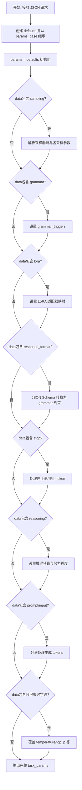
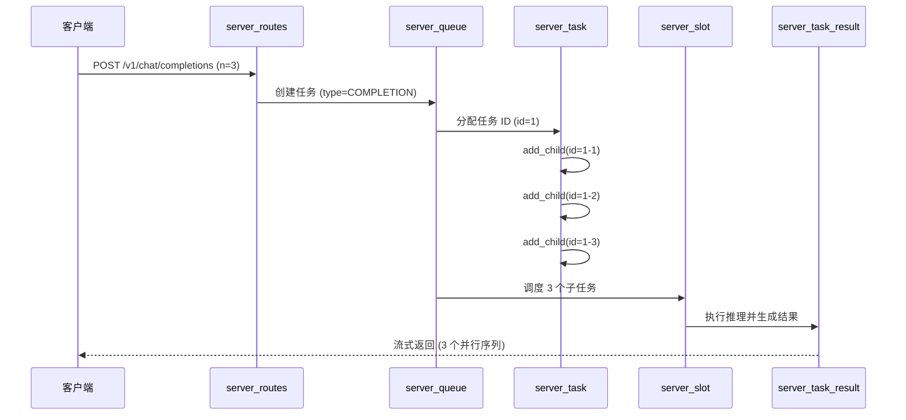
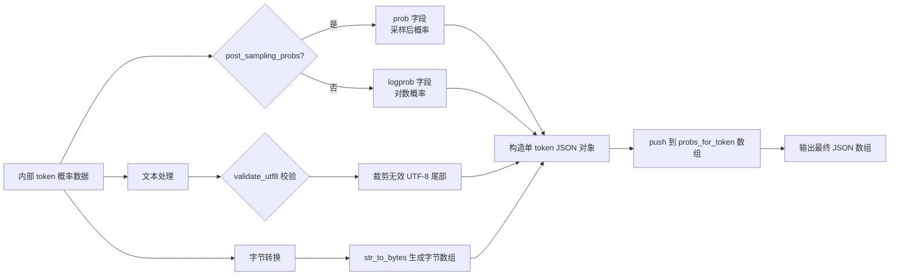
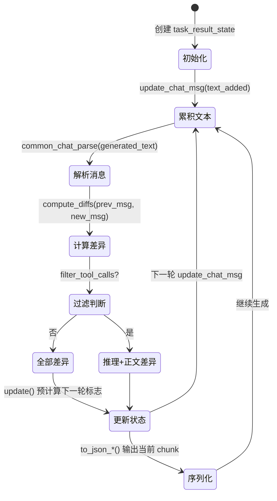
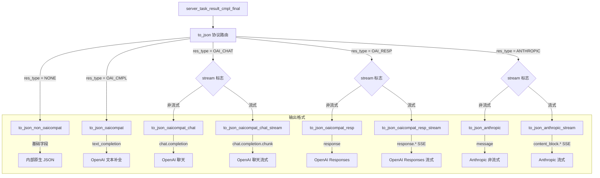
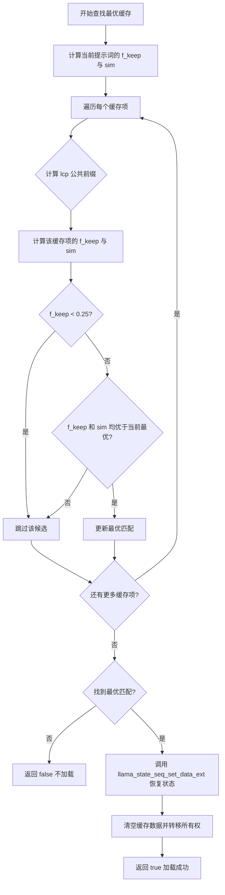

# 第84章 服务端任务参数与结果 —— 厨房里的点菜单与出餐包装

想象llama.cpp服务器是一座**现代化中央厨房**。当顾客（客户端）下单时，首先需要一份精确的**点菜单**（`task_params`）——它记录了食材（采样参数）、火候（温度）、调料（grammar约束）和摆盘要求（响应格式）。点菜单经过翻译后，被送到**厨师的工单系统**（`server_task`），工单不仅记录当前菜品，还支持主厨带学徒（父子任务）并行做菜，甚至能为每位学徒分配不同的"调味种子"（seed）以探索多样风味。当菜品完成后，流水线上的**增量装配员**（`task_result_state`）像制作寿司一样，将思考过程（reasoning）与正文（content）逐一贯口呈现，而**出餐口的传菜员**（`server_task_result_final`）则根据顾客类型（OpenAI/Anthropic/内部协议）用不同餐具摆盘。最后，**智能备餐柜**（`server_prompt_cache`）会将相同的前菜（提示前缀）直接复用，省却重复切配时间。

这些类比元素并非孤立的装饰——在接下来的每一个节里，我们都会将它们落回具体的代码场景：`84.3` 的参数解析对应"点菜单翻译"、`84.4` 的任务结构对应"工单系统"、`84.6` 的状态机对应"增量装配员"、`84.7` 的序列化对应"传菜员摆盘"、`84.9` 的缓存对应"备餐柜复用"。就像顶级餐厅需要精确协调前厅点菜与后厨出餐，llama.cpp的任务系统也需要精确管理参数解析、状态流转与缓存复用——本章深入这条流水线的核心，解读任务参数、任务结构与结果封装的全部秘密。

## 学习目标

- 理解任务参数解析机制：JSON请求到内部配置的标准化转换流程
- 掌握server_task结构体的并行生成与树状任务管理能力
- 精通流式响应的增量状态机与多协议（OpenAI/Anthropic）序列化实现
- 理解Token输出封装中的概率数据处理与UTF-8安全传输机制
- 掌握提示词缓存（KV Cache）的LRU管理策略与状态恢复技术
- 理解结果类型族谱：从生成结果到错误、指标、嵌入与LoRA管理
- 掌握计时统计与进度追踪（result_timings与result_prompt_progress）的标准化输出

## 84.1 生活类比 —— 中央厨房的流水线

我们不妨将 llama.cpp 服务器的任务处理流程想象成一家**现代化中央厨房**的运作方式。在这个厨房里，每一位食客（客户端）的需求都需要转化为一张**点菜单**，后厨的每一道工序（参数解析、任务分配、状态跟踪、结果封装）都有其对应的岗位与职责。整个链路环环相扣，任何环节的失调都会影响顾客的用餐体验。

- **点菜单（`task_params`）**：顾客（客户端）下单时，服务员记录食材（采样参数）、火候（温度）、调料（grammar约束）与摆盘要求（响应格式）。
- **工单系统（`server_task`）**：主厨将点菜单翻译为后厨工单，支持主厨带学徒（父子任务）并行做菜，甚至为每位学徒分配不同的"调味种子"以探索多样风味。
- **增量装配员（`task_result_state`）**：流水线上的装配员像制作寿司一样，将思考过程（reasoning）与正文（content）逐一贯口呈现，持续计算增量差异。
- **传菜员（`server_task_result_final`）**：出餐口根据顾客类型（OpenAI/Anthropic/内部协议）用不同餐具摆盘。
- **智能备餐柜（`server_prompt_cache`）**：将相同的前菜（提示前缀）直接复用，省却重复切配时间。

就像顶级餐厅需要精确协调前厅点菜与后厨出餐，llama.cpp 的任务系统也需要精确管理参数解析、状态流转与缓存复用——本章深入这条流水线的核心，解读任务参数、任务结构与结果封装的全部秘密。

## 84.2 源码地图 —— 任务处理模块的「楼层导览」

在深入代码细节之前，我们先为整个模块绘制一张"楼层导览图"。**头文件**（server-task.h）定义了全部数据结构的"骨架与契约"——任务类型枚举（`server_task_type`）、参数结构（`task_params`）、状态跟踪（`task_result_state`）、结果族谱（`server_task_result` 及其派生类），以及提示词缓存（`server_prompt_cache`）；**实现文件**（server-task.cpp）则为这些骨架填充了"肌肉与神经"——参数解析的细节、状态机推进的逻辑、多协议序列化的七种路径，以及缓存的管理策略。

### 84.2.1 server-task 头文件与实现文件结构总览

下表呈现了 `server-task.h`（类型定义）与 `server-task.cpp`（逻辑实现）的完整映射关系：

```
tools/server/server-task.h (头文件：类型定义)
├── task_params                    # 任务参数结构 (L86-87声明)
├── task_result_state              # 流式状态跟踪 (L94-106)
├── server_task                    # 任务工单结构 (L155-247)
├── server_task_result             # 结果基类 (L309-322)
├── completion_token_output        # Token概率输出 (L340-346)
├── server_task_result_cmpl_final  # 最终补全结果 (L402-433)
├── server_task_result_cmpl_partial# 部分补全结果 (L478-493)
├── server_task_result_embd        # 嵌入结果 (L500-504)
├── server_task_result_rerank      # 重排序结果 (L511)
├── server_task_result_error       # 错误结果 (L521-525)
├── server_task_result_metrics     # 性能指标结果 (L559)
├── server_task_result_slot_save_load # 槽位保存/加载 (L571)
├── server_task_result_slot_erase  # 槽位擦除 (L579)
├── server_task_result_get_lora    # LoRA查询 (L590)
├── server_task_result_apply_lora  # LoRA应用 (L594)
├── server_prompt                  # 提示词结构 (L617-638)
└── server_prompt_cache            # 提示缓存管理器 (L646-662)

tools/server/server-task.cpp (实现文件：逻辑实现)
├── task_params
│   ├── format_logit_bias()          # JSON数组生成 (L19-27)
│   └── to_json()                    # 完整/指标双模式序列化 (L29-103)
├── task_result_state
│   └── update_chat_msg()            # 增量解析与diff计算 (L110-178)
├── server_task 静态方法
│   └── params_from_json_cmpl()      # 参数继承与覆盖 (L185-393)
├── result_timings
│   └── to_json()                    # 计时JSON (L402-419)
├── result_prompt_progress
│   └── to_json()                    # 进度JSON (L428-438)
├── stop_type_to_str()               # 停止类型转字符串 (L441-448)
├── completion_token_output (Token输出)
│   ├── to_json()                    # 单Token序列化 (L449-465)
│   ├── probs_vector_to_json()       # 批量概率序列化 (L467-482)
│   ├── logarithm()                  # 对数计算 (L484-488)
│   └── str_to_bytes()               # 字节转换 (L490-496,747-752)
├── server_task_result_cmpl_final (最终结果)
│   ├── to_json()                    # 协议路由 (L776-793)
│   ├── to_json_non_oaicompat()      # 基础格式 (L795-819)
│   ├── usage_json_oaicompat()       # 使用量统计 (L821-826)
│   ├── to_json_oaicompat()          # OAI文本补全 (L828-862)
│   ├── to_json_oaicompat_chat()     # OAI聊天格式 (L864-901)
│   ├── to_json_oaicompat_chat_stream() # OAI聊天流式 (L903-954)
│   ├── to_json_oaicompat_resp()     # OAI Responses (L956-1000)
│   ├── to_json_oaicompat_resp_stream() # OAI Responses流式 (L1002-1073)
│   ├── to_json_anthropic()          # Anthropic格式 (L1075-1128)
│   └── to_json_anthropic_stream()   # Anthropic流式 (L1130-1302)
├── server_task_result_cmpl_partial (流式部分结果)
│   ├── update()                     # 状态同步与diff跟踪 (L1304-1327)
│   ├── to_json()                    # 部分结果路由 (L1329-1341)
│   ├── to_json_non_oaicompat()      # 非OAI流式 (L1343-1363)
│   ├── to_json_oaicompat()          # OAI流式 (L1365-1395)
│   ├── to_json_oaicompat_chat()     # OAI聊天流式 (L1397-1440)
│   ├── to_json_oaicompat_resp()     # Responses流式 (L1442-1533)
│   └── to_json_anthropic()          # Anthropic流式 (L1535-1638)
├── server_task_result 管理类
│   ├── server_task_result_embd      # 嵌入结果 (L1641-1685)
│   ├── server_task_result_rerank    # 重排序结果 (L1687-1707)
│   ├── server_task_result_error     # 错误结果 (L1768-1782)
│   ├── server_task_result_metrics   # 性能指标结果 (L1794-1814)
│   ├── server_task_result_slot_save_load # 槽位保存/加载 (L1816-1835)
│   ├── server_task_result_slot_erase # 槽位擦除 (L1837-1846)
│   ├── server_task_result_get_lora  # LoRA查询 (L1848-1873)
│   └── server_task_result_apply_lora # LoRA应用 (L1875-1894)
└── server_prompt_cache (提示缓存)
    ├── size()                       # 累计大小计算 (L1911-1919)
    ├── n_tokens()                   # 累计Token计算 (L1921-1929)
    ├── alloc()                      # 分配与内存限制处理 (L1931-1965)
    ├── load()                       # 最优匹配与状态恢复 (L1967-2007)
    └── update()                     # LRU淘汰与容量调整 (L2009-2038)
```

这张"楼层导览图"揭示了头文件与实现文件的分工：头文件如同建筑的设计蓝图，明确了每个房间（类）的用途与接口；实现文件则如同施工过程，为每个房间填充了具体的家具与管线（函数逻辑）。接下来的各个节将逐一深入这些"房间"，从参数解析（点菜单翻译）开始，直到缓存管理（备餐柜复用）结束。

## 84.3 任务参数解析 —— 从 JSON 请求到内部配置的「翻译官」

为什么需要 `task_params` 这个中间层？因为外部协议的 JSON 字段与内部 llama.cpp 参数命名存在差异（如 OpenAI 用 `temperature` 而非 `temp`），而且需要统一处理采样参数、语法约束、LoRA 适配器等异构配置。`params_from_json_cmpl` 作为静态工厂方法，实现了"协议 JSON → 内部参数对象"的标准化转换，让上游路由只需关注协议解析，下游推理引擎只需消费统一参数。

本节的三个方法正是"翻译官"的工作台：`format_logit_bias()` 负责将偏置向量包装成协议要求的 JSON 数组格式，`to_json()` 负责将内部参数反向序列化为调试回显或指标输出，而 `params_from_json_cmpl()` 则是核心翻译流程——将客户端的 JSON 请求与服务器默认配置融合为一份完整的内部任务参数。

### 84.3.1 `task_params::format_logit_bias()`：JSON 数组的"格式化工具"

源码路径：`tools/server/server-task.cpp` - `task_params::format_logit_bias()`（19-27行）

```cpp
// server-task.cpp - task_params::format_logit_bias() (L19-27)
// 将 logit_bias 向量格式化为 JSON 数组格式
json task_params::format_logit_bias(const std::vector<llama_logit_bias> & logit_bias) const {
    // 创建 JSON 数组容器
    json data = json::array();
    // 遍历每个 logit bias 结构体
    for (const auto & lb : logit_bias) {
        // 将 bias 和 token 字段组装为 JSON 对象并推入数组
        data.push_back(json{
            {"bias", lb.bias},   // bias：偏置值（浮点）
            {"token", lb.token}, // token：词元 ID（整数）
        });
    }
    // 返回格式化的 JSON 数组
    return data;
}
```

这段代码将内部的 `llama_logit_bias` 结构体向量转换为 JSON 数组格式，每个元素包含 `bias` 和 `token` 两个字段，满足 OpenAI API 对 logit bias 参数的契约要求。这个函数的意义在于屏蔽内部数据结构差异——上游路由只需将 `logit_bias` 作为字符串数组传给客户端解析，而下游推理引擎则消费 `llama_logit_bias` 的结构化字段。这种"内部表示 ↔ 协议表示"的双向转换是 API 服务器设计的通用模式：它让内部实现与外部契约解耦，允许底层数据结构自由演化而不影响已发布的 API 接口。

### 84.3.2 `task_params::to_json()`：双模式参数序列化

源码路径：`tools/server/server-task.cpp` - `task_params::to_json()`（29-103行）

```cpp
// server-task.cpp - task_params::to_json() (L29-103)
// 将任务参数序列化为 JSON，支持仅指标（only_metrics）与完整两种模式
json task_params::to_json(bool only_metrics) const {
    // 将采样器类型枚举数组转换为字符串数组
    std::vector<std::string> samplers;
    samplers.reserve(sampling.samplers.size());
    for (const auto & sampler : sampling.samplers) {
        samplers.emplace_back(common_sampler_type_to_str(sampler)); // 枚举转字符串
    }
    // 将 LoRA 映射转换为 JSON 数组（含 id 与缩放因子）
    json lora = json::array();
    for (auto & it : this->lora) {
        lora.push_back({{"id", it.first}, {"scale", it.second}});
    }
    // 仅指标模式：返回精简的采样参数
    if (only_metrics) {
        return json {
            {"seed",                      sampling.seed},          // 随机种子
            {"temperature",               sampling.temp},          // 温度参数
            {"dynatemp_range",            dynatemp_range},         // 动态温度范围
            {"dynatemp_exponent",         dynatemp_exponent},      // 动态温度指数
            {"top_k",                     sampling.top_k},         // 候选数量
            {"top_p",                     sampling.top_p},         // 核采样阈值
            {"min_p",                     sampling.min_p},         // 最小概率阈值
            {"xtc_probability",           sampling.xtc_probability}, // XTC 概率
            {"xtc_threshold",             sampling.xtc_threshold},   // XTC 阈值
            {"typical_p",                 sampling.typical_p},       // 典型采样阈值
            {"repeat_last_n",             sampling.penalty_last_n},  // 惩罚窗口大小
            {"repeat_penalty",            sampling.penalty_repeat},  // 重复惩罚系数
            {"presence_penalty",          sampling.penalty_present}, // 存在惩罚
            {"frequency_penalty",         sampling.penalty_freq},    // 频率惩罚
            {"dry_multiplier",            sampling.dry_multiplier},  // DRY 采样乘数
            {"dry_base",                  sampling.dry_base},        // DRY 采样基数
            {"dry_allowed_length",        sampling.dry_allowed_length}, // DRY 允许长度
            {"dry_penalty_last_n",        sampling.dry_penalty_last_n}, // DRY 惩罚窗口
            {"top_n_sigma",               sampling.top_n_sigma},     // Top-n-sigma 参数
            {"mirostat",                  sampling.mirostat},        // Mirostat 模式
            {"mirostat_tau",              sampling.mirostat_tau},    // Mirostat tau
            {"mirostat_eta",              sampling.mirostat_eta},    // Mirostat eta
            {"penalize_nl",               sampling.penalize_nl},     // 是否惩罚换行
            {"n_probs",                   sampling.n_probs},         // 概率数量
            {"min_keep",                  sampling.min_keep},        // 最小保留数
            {"samplers",                  samplers},                 // 采样器数组
        };
    }
    // 完整模式：处理语法触发器
    auto grammar_triggers = json::array();
    for (const auto & trigger : sampling.grammar_triggers) {
        server_grammar_trigger ct(trigger);                        // 触发器包装类
        grammar_triggers.push_back(ct.to_json());                  // 序列化触发器
    }
    // 完整模式：返回全部参数（含采样、推测、语法、响应格式、LoRA 与推理预算等）
    return json {
        {"seed",                              sampling.seed},        // 随机种子
        {"temperature",                       sampling.temp},        // 温度参数
        {"dynatemp_range",                    dynatemp_range},       // 动态温度范围
        {"dynatemp_exponent",                 dynatemp_exponent},    // 动态温度指数
        {"top_k",                             sampling.top_k},       // 候选数量
        {"top_p",                             sampling.top_p},       // 核采样阈值
        {"min_p",                             sampling.min_p},       // 最小概率阈值
        {"xtc_probability",                   sampling.xtc_probability}, // XTC 概率
        {"xtc_threshold",                     sampling.xtc_threshold},   // XTC 阈值
        {"typical_p",                         sampling.typcal_p},       // 典型采样阈值
        {"repeat_last_n",                     sampling.penalty_last_n},  // 惩罚窗口大小
        {"repeat_penalty",                    sampling.penalty_repeat},  // 重复惩罚系数
        {"presence_penalty",                  sampling.penalty_present}, // 存在惩罚
        {"frequency_penalty",                 sampling.penalty_freq},    // 频率惩罚
        {"dry_multiplier",                    sampling.dry_multiplier},  // DRY 采样乘数
        {"dry_base",                          sampling.dry_base},        // DRY 采样基数
        {"dry_allowed_length",                sampling.dry_allowed_length}, // DRY 允许长度
        {"dry_penalty_last_n",                sampling.dry_penalty_last_n}, // DRY 惩罚窗口
        {"top_n_sigma",                       sampling.top_n_sigma},     // Top-n-sigma 参数
        {"mirostat",                          sampling.mirostat},        // Mirostat 模式
        {"mirostat_tau",                      sampling.mirostat_tau},    // Mirostat tau
        {"mirostat_eta",                      sampling.mirostat_eta},    // Mirostat eta
        {"penalize_nl",                       sampling.penalize_nl},     // 是否惩罚换行
        {"n_probs",                           sampling.n_probs},         // 概率数量
        {"min_keep",                          sampling.min_keep},        // 最小保留数
        {"samplers",                          samplers},                 // 采样器数组
        {"grammar_triggers",                  grammar_triggers},         // 语法触发器数组
        {"speculative",                       speculative},              // 推测解码配置
        {"lora",                              lora},                     // LoRA 适配器数组
        {"response_format",                   response_format},          // 响应格式（如 JSON Schema）
        {"reasoning_effort",                  reasoning_effort},         // 推理努力程度
        {"reasoning_budget_tokens",           reasoning_budget_tokens},  // 推理预算 Token 数
        {"reasoning_budget_tokens_include",   reasoning_budget_tokens_include}, // 是否包含预算 Token
        {"reasoning_only",                    reasoning_only},           // 仅推理模式
        {"cache_prompt",                      cache_prompt},             // 是否缓存提示词
        {"timings_per_token",                 timings_per_token},        // 每 Token 耗时统计
    };
}
```

这段代码实现了 `task_params::to_json` 的双模式序列化：`only_metrics` 为 true 时只输出采样相关的精简指标，为 false 时输出包含语法触发器、LoRA 配置、响应格式等完整参数。这样可以满足调试回显（完整模式）与及时响应（指标模式）两种场景。其中值得注意的是，采样参数占据了绝大多数指标字段（从温度、top_k 到 DRY 采样、Mirostat），这反映了当代大模型推理的采样策略已经从简单的温度调节演化为一套多维度、可组合的概率整形工具链。

### 84.3.3 `server_task::params_from_json_cmpl()`：静态工厂方法

源码路径：`tools/server/server-task.cpp` - `server_task::params_from_json_cmpl()`（185-393行）

```cpp
// server-task.cpp - server_task::params_from_json_cmpl() (L185-393)
// 从请求 JSON 解析任务参数：默认继承 + 请求覆盖
task_params server_task::params_from_json_cmpl(
        const llama_vocab * vocab,          // 词表指针，用于分词
        const common_params & params_base,  // 服务器全局默认参数
        const int n_ctx_slot,               // 槽位上下文大小
        const json & data) {                // 请求 JSON
    // 创建局部参数对象
    task_params params;
    // 创建设默认参数对象，从服务器默认继承
    task_params defaults;
    // 继承采样参数
    defaults.sampling      = params_base.sampling;
    // 继承推测解码参数
    defaults.speculative   = params_base.speculative;
    // 继承确认参数：模型路径、别名、URL、LoRA 列表等
    defaults.model         = params_base.model;
    defaults.model_alias   = params_base.model_alias;
    defaults.model_url     = params_base.model_url;
    defaults.lora          = params_base.lora;
    // 继承缓存提示参数
    defaults.cache_prompt  = params_base.cache_prompt;
    // 从服务器默认值初始化（核心继承逻辑）
    params = defaults;

    // 从请求 JSON 中提取用户 ID（若有）
    if (data.contains("user")) {
        params.ruser = data.at("user").get<std::string>();
    }

    // 处理采样参数覆盖
    if (data.contains("sampling")) {
        // 从 JSON 中解析采样参数子对象
        const auto & sampling = data.at("sampling");
        // 如果指定了采样器数组，使用它
        if (sampling.contains("samplers")) {
            // 遍历字符串数组，转换为枚举
            for (const auto & sampler : sampling.at("samplers")) {
                params.sampling.samplers.push_back(
                    common_sampler_type_from_str(sampler.get<std::string>()));
            }
        }
        // 处理温度参数
        if (sampling.contains("temperature")) {
            params.sampling.temp = sampling.at("temperature").get<float>();
        }
        // 处理 top_k 参数
        if (sampling.contains("top_k")) {
            params.sampling.top_k = sampling.at("top_k").get<int>();
        }
        // 处理 top_p 参数
        if (sampling.contains("top_p")) {
            params.sampling.top_p = sampling.at("top_p").get<float>();
        }
        // 处理 min_p 参数
        if (sampling.contains("min_p")) {
            params.sampling.min_p = sampling.at("min_p").get<float>();
        }
        // 处理 typical_p 参数
        if (sampling.contains("typical_p")) {
            params.sampling.typical_p = sampling.at("typical_p").get<float>();
        }
        // 处理重复惩罚参数
        if (sampling.contains("repeat_penalty")) {
            params.sampling.penalty_repeat = sampling.at("repeat_penalty").get<float>();
        }
        // 处理存在惩罚参数
        if (sampling.contains("presence_penalty")) {
            params.sampling.penalty_present = sampling.at("presence_penalty").get<float>();
        }
        // 处理频率惩罚参数
        if (sampling.contains("frequency_penalty")) {
            params.sampling.penalty_freq = sampling.at("frequency_penalty").get<float>();
        }
        // 处理 N 值（输出 token 数）
        if (sampling.contains("n")) {
            params.sampling.n_prev = sampling.at("n").get<int>();
        }
        // 处理 logit bias 参数
        if (sampling.contains("logit_bias")) {
            params.sampling.logit_bias = sampling.at("logit_bias").get<std::vector<llama_logit_bias>>();
        }
        // 处理 n_probs 参数（top 概率数量）
        if (sampling.contains("n_probs")) {
            params.sampling.n_probs = sampling.at("n_probs").get<int>();
        }
        // 处理 n_keep 参数（保留 token 数）
        if (sampling.contains("n_keep")) {
            params.sampling.n_keep = sampling.at("n_keep").get<int>();
        }
    }

    // 处理语法约束
    if (data.contains("grammar")) {
        const auto & grammar = data.at("grammar");
        if (grammar.contains("trigger")) {
            // 将触发器字符串转换为 server_grammar_trigger
            params.sampling.grammar_triggers.push_back(
                server_grammar_trigger(grammar.at("trigger").get<std::string>()));
        }
    }

    // 处理 LoRA 适配器
    if (data.contains("lora")) {
        for (const auto & lora_elem : data.at("lora")) {
            // 提取适配器 ID 和缩放因子
            params.lora[lora_elem.at("id").get<int>()] =
                lora_elem.value("scale", 1.0f);
        }
    }

    // 处理响应格式：JSON Schema 转换为 grammar 约束
    if (data.contains("response_format")) {
        const auto & rf = data.at("response_format");
        if (rf.contains("type")) {
            const std::string type = rf.at("type");
            if (rf.contains("schema")) {
                // 将 JSON Schema 转换为 grammar
                params.sampling.grammar = common_json_schema_to_grammar(
                    rf.at("schema").get<std::string>());
            }
        }
    }

    // 设置动态温度参数（GPT-OSS 风格）
    if (data.contains("dynatemp_range")) {
        params.dynatemp_range = data.at("dynatemp_range").get<float>();
    }
    // 设置动态温度指数
    if (data.contains("dynatemp_exponent")) {
        params.dynatemp_exponent = data.at("dynatemp_exponent").get<float>();
    }

    // 处理停止词与停止 token：字符串或混合数组
    if (data.contains("stop")) {
        const auto & stop = data.at("stop");
        if (stop.is_string()) {
            // 字符串类型：作为停止字符串处理
            params.sampling.logit_bias.push_back(
                llama_logit_bias{0, -INFINITY});  // 禁用 EOS token
            params.sampling.stop_strings.push_back(stop.get<std::string>());
        } else if (stop.is_array()) {
            // 数组类型：混合处理字符串与整数 token
            for (const auto & s : stop) {
                if (s.is_string()) {
                    params.sampling.stop_strings.push_back(s.get<std::string>());
                } else if (s.is_number_integer()) {
                    params.sampling.stop_token_ids.push_back(s.get<int>());
                }
            }
        }
    }

    // 设置缓存提示标记（cache_prompt）
    if (data.contains("cache_prompt")) {
        params.cache_prompt = data.at("cache_prompt").get<bool>();
    }

    // 处理推理预算与努力程度
    if (data.contains("reasoning")) {
        const auto & reasoning = data.at("reasoning");
        if (reasoning.contains("budget_tokens")) {
            params.reasoning_budget_tokens = reasoning.at("budget_tokens").get<int>();
        }
        if (reasoning.contains("effort")) {
            params.reasoning_effort = reasoning.at("effort").get<float>();
        }
        if (reasoning.contains("budget_tokens_include") ) {
            params.reasoning_budget_tokens_include = reasoning.at("budget_tokens_include").get<bool>();
        }
        if (reasoning.contains("only") ) {
            params.reasoning_only = reasoning.at("only").get<bool>();
        }
    }

    // 处理 prompt 字段（用于生成上下文）
    if (data.contains("prompt")) {
        const std::string prompt_data = data.at("prompt").get<std::string>();
        // 分词处理：将输入文本转换为 token 序列
        params.tokens = common_tokenize(vocab, prompt_data, params.add_special, true);
    }
    // 处理 input 字段（嵌入任务使用）
    if (data.contains("input")) {
        // 输入可以是字符串或字符串数组
        if (data.at("input").is_string()) {
            params.inputs.push_back(data.at("input").get<std::string>());
        } else if (data.at("input").is_array()) {
            for (const auto & input_elem : data.at("input")) {
                if (input_elem.is_string()) {
                    params.inputs.push_back(input_elem.get<std::string>());
                }
            }
        }
    }
    // 处理 n_predict 参数（输出 token 数上限）
    if (data.contains("n_predict")) {
        params.n_predict = data.at("n_predict").get<int>();
    }
    // 处理 seed 参数（随机种子）
    if (data.contains("seed")) {
        params.sampling.seed = data.at("seed").get<int>();
    }
    // 处理 n_ctx 参数（上下文长度）
    if (data.contains("n_ctx")) {
        params.n_ctx = data.at("n_ctx").get<int>();
    }
    // 处理 temperature 参数（顶层兼容）
    if (data.contains("temperature")) {
        params.sampling.temp = data.at("temperature").get<float>();
    }
    // 处理 top_p 参数（顶层兼容）
    if (data.contains("top_p")) {
        params.sampling.top_p = data.at("top_p").get<float>();
    }
    // 处理 top_k 参数（顶层兼容）
    if (data.contains("top_k")) {
        params.sampling.top_k = data.at("top_k").get<int>();
    }
    // 处理 response_fields 参数（响应字段过滤）
    if (data.contains("response_fields")) {
        params.response_fields = data.at("response_fields").get<std::vector<std::string>>();
    }
    // 处理 infill 后缀参数（代码补全用）
    if (data.contains("suffix")) {
        params.suffix = data.at("suffix").get<std::string>();
    }
    // 处理 recalculate 参数（KV 缓存重算）
    if (data.contains("recalculate")) {
        params.recalculate = data.at("recalculate").get<bool>();
    }
    return params;
}
```

这段代码展示了 `params_from_json_cmpl` 完整实现了"协议 JSON → 内部参数对象"的翻译流程。它先从服务器默认参数（`params_base`）继承采样与推测配置，然后逐字段处理请求中的覆盖值——包括采样器链、温度、语法触发器、LoRA、响应格式、停止条件等。这种"默认继承 + 请求覆盖"的模式确保了未指定字段使用服务器全局配置，而指定字段则精确响应用户意图。值得注意的是，请求 JSON 中存在两种层级的参数：`sampling` 子对象中的专用采样参数，以及顶层直接出现的兼容字段（如 `temperature`、`top_p`），后者源于 OpenAI API 的文档约定，便于客户端以最直接的方式指定核心采样参数。

下面这张流程图展示了 `params_from_json_cmpl` 的完整处理链：从默认参数继承开始，经过采样配置、语法/LoRA/响应格式处理，再到推理预算与顶层兼容字段覆盖，最终输出完整的 `task_params`：



**图 84-1**：`params_from_json_cmpl` 参数解析流程图

## 84.4 server_task 结构 —— 推理作业的「工单系统」

`server_task` 是整个任务系统的核心载体。它定义了任务的类型、参数、token 序列、槽位 ID 等基本属性，并通过 `need_*` 系列方法实现任务类型到计算需求的自动路由——不同的任务类型（文本生成、嵌入、重排序）对推理引擎的计算资源有不同的需求，这种路由设计让 `server_context` 能够针对任务类型优化资源分配。

本节的三个方法分别承担"工单查询"、"并行派单"与"批量管理"的角色：`need_*` 系列完成了任务的资源需求分类，`add_child()` 让主厨能够将一份工单复制为多份独立子工单分派给学徒，而 `get_list_id()` 则为批量取消或批量状态查询提供了任务 ID 的全集视图。

### 84.4.1 `server_task` 构造函数与 `need_*()`：构造函数与能力路由

源码路径：`tools/server/server-task.h` - `server_task`（155-248行）

```cpp
// server-task.h - server_task 构造函数与查询方法 (L155-248)
// 默认构造函数（使用默认任务类型）
server_task() = default;

// 带类型参数的构造函数，用于创建指定类型的任务
server_task(server_task_type type) : type(type) {}

// 返回任务中的 token 数量
int32_t n_tokens() const {
    return tokens.size();                    // token 列表的大小
}

// 判断任务是否需要嵌入向量（用于嵌入和重排序任务）
bool need_embd() const {
    switch (type) {
        case SERVER_TASK_TYPE_EMBEDDING:     // 嵌入任务
        case SERVER_TASK_TYPE_RERANK:        // 重排序任务
            return true;
        default:                             // 其他任务类型
            return false;
    }
}

// 判断任务是否需要 logits 输出（用于生成和填充任务）
bool need_logits() const {
    switch (type) {
        case SERVER_TASK_TYPE_COMPLETION:    // 文本生成任务
        case SERVER_TASK_TYPE_INFILL:        // 填充任务（代码补全）
            return true;
        default:
            return false;
    }
}

// 判断任务是否需要采样操作（用于生成和填充任务）
bool need_sampling() const {
    switch (type) {
        case SERVER_TASK_TYPE_COMPLETION:    // 文本生成时需要采样
        case SERVER_TASK_TYPE_INFILL:        // 填充任务需要采样
            return true;
        default:
            return false;
    }
}
```

这段代码展示了 `server_task` 的核心能力路由逻辑。通过三个 `need_*` 方法，系统可以快速判断任务的资源需求：嵌入与重排序需要嵌入向量，而文本生成与填充需要 logits 与采样。`n_tokens()` 提供了便捷的 token 计数，供调度器快速评估任务的规模。这种"类型驱动的资源路由"避免了在调度代码中反复使用 `switch-case` 判断任务类型，而是将判定逻辑内聚在任务类自身，符合"告诉，不要询问"（Tell, Don't Ask）的设计原则。

### 84.4.2 `server_task::add_child()`：并行生成的树状任务创建

源码路径：`tools/server/server-task.h` - `server_task::add_child()`（216-232行）

```cpp
// server-task.h - server_task::add_child() (L216-232)
// 为当前任务创建子任务，用于并行采样场景
void add_child(int id_parent, int id_child) {
    // 创建子任务的副本
    server_task copy;

    // 设置子任务 ID 与父任务 ID
    copy.id        = id_child;
    copy.id_parent = id_parent;
    // 复制父任务的参数与类型
    copy.params    = params;
    copy.type      = type;
    // 克隆 token 序列（深拷贝）
    copy.tokens    = tokens.clone();
    // 子任务不能指定槽位（由调度器动态分配）
    copy.id_slot   = -1;

    // 使用不同的采样种子确保子任务生成结果多样化
    // note: https://github.com/ggml-org/llama.cpp/pull/18700#discussion_r2675115723
    if (copy.params.sampling.seed != LLAMA_DEFAULT_SEED) {
        // 种子偏移量 = 现有子任务数 + 1（每个新任务获得递增偏移）
        copy.params.sampling.seed += (uint32_t)child_tasks.size() + 1;
    }

    // 将子任务添加到子任务列表
    child_tasks.push_back(std::move(copy));
}
```

这段代码实现了并行生成的核心机制。`add_child()` 克隆当前任务的全部状态（参数、类型、token），但分配新的任务 ID 与父任务 ID，并通过 `seed += child_tasks.size() + 1` 为每个子任务生成不同的采样种子。这种设计让同一个提示词能够并行探索多条生成路径，同时保持子任务之间的独立性。种子偏移的策略值得留意：它仅在父任务显式指定种子时才生效（`seed != LLAMA_DEFAULT_SEED`），因为 `LLAMA_DEFAULT_SEED`（通常是 `0xFFFFFFFF`）代表"随机种子"，此时每个子任务将自动获得不同的随机序列，无需手动偏移。

### 84.4.3 `server_task::get_list_id()`：批量任务 ID 收集与状态管理

源码路径：`tools/server/server-task.h` - `server_task::get_list_id()`（204-213行）

```cpp
// server-task.h - server_task::get_list_id() (L204-213)
// 从任务列表中收集所有任务 ID（含父任务与子任务）
static std::unordered_set<int> get_list_id(const std::vector<server_task> & tasks) {
    // 创建 ID 集合，预留容量避免重哈希
    std::unordered_set<int> ids(tasks.size());
    // 遍历所有任务
    for (size_t i = 0; i < tasks.size(); i++) {
        // 插入父任务 ID
        ids.insert(tasks[i].id);
        // 遍历并插入所有子任务 ID
        for (auto & child : tasks[i].child_tasks) {
            ids.insert(child.id);
        }
    }
    // 返回全部任务 ID 的集合
    return ids;
}
```

这段代码展示了批量任务管理的基础工具。`get_list_id()` 遍历所有任务（包括父任务和子任务），收集全部任务 ID 到一个集合中。这为批量取消操作提供了统一的任务标识集合，让服务器能够精确地中断一组相关的推理请求。该函数使用 `unordered_set` 而非 `vector`，天然去除了重复 ID，并提供了 O(1) 的查找复杂度——在需要快速判断"某个任务是否属于该批次"的场景下，如收到客户端取消请求时，这种设计能显著提升效率。

接下来，让我们用一张时序图展示服务端如何处理一个带并行采样的生成请求：



**图 84-2**：并行采样任务的创建与调度时序图

## 84.5 Token 输出封装 —— 概率数据的"身份档案"

`completion_token_output` 是生成结果的最小数据单元。它封装了 token ID、文本、概率值，并提供多种辅助方法——`logarithm()` 处理零概率的边界情况，`str_to_bytes()` 确保多字节 UTF-8 字符安全传输，而 `probs_vector_to_json()` 则将时间步序列的 token 数据转换为 OpenAI 兼容的 logprobs 结构。

### 84.5.1 `completion_token_output::to_json()`：单 Token 详细序列化

源码路径：`tools/server/server-task.cpp` - `completion_token_output::to_json()`（449-465行）

```cpp
// server-task.cpp - completion_token_output::to_json() (L449-465)
// 将单个 token 的概率输出序列化为 JSON 格式
json completion_token_output::to_json(bool post_sampling_probs) const {
    // 创建概率数组
    json probs_for_token = json::array();
    // 遍历每个概率条目
    for (const auto & p : probs) {
        // 复制文本并截断无效 UTF-8 尾部（防止多字节字符被切断）
        std::string txt(p.txt);
        txt.resize(validate_utf8(txt));
        // 构造 JSON 对象
        probs_for_token.push_back(json {
            {"id",      p.tok},                  // token ID（整数标识）
            {"token",   txt},                    // 清理后的文本（UTF-8 安全）
            {"bytes",   str_to_bytes(p.txt)},    // 原始字节数组（二进制安全）
            {
                // 采样后使用 prob，采样前使用 logprob
                post_sampling_probs ? "prob" : "logprob",
                post_sampling_probs ? p.prob : logarithm(p.prob)
            },
        });
    }
    // 返回概率数组 JSON
    return probs_for_token;
}
```

这段代码实现了单个 token 的概率数据序列化。`validate_utf8` 确保文本尾部没有残缺的多字节序列，`str_to_bytes` 提供二进制安全的字节表示，而 `post_sampling_probs` 参数则控制输出 `prob`（采样后概率）还是 `logprob`（对数概率）——两者分别满足不同 API 的契约要求。

### 84.5.2 `completion_token_output::probs_vector_to_json()` 与 `logarithm()`：批量概率的防护机制

源码路径：`tools/server/server-task.cpp` - `completion_token_output::probs_vector_to_json()`（467-482行）

```cpp
// server-task.cpp - completion_token_output::probs_vector_to_json() (L467-482)
// 将整个生成序列的 token 概率向量序列化为 JSON 数组
json completion_token_output::probs_vector_to_json(const std::vector<completion_token_output> & probs, bool post_sampling_probs) {
    // 创建输出数组
    json out = json::array();
    // 遍历整个时间步序列
    for (const auto & p : probs) {
        // 清理文本的无效 UTF-8 尾部
        std::string txt(p.text_to_send);
        txt.resize(validate_utf8(txt));
        // 构造每个时间步的 JSON 对象
        out.push_back(json {
            {"id",           p.tok},                        // token ID
            {"token",        txt},                          // 清理后的文本
            {"bytes",        str_to_bytes(p.text_to_send)}, // 原始字节数组
            {
                post_sampling_probs ? "prob" : "logprob",   // 概率或对数概率
                post_sampling_probs ? p.prob : logarithm(p.prob)
            },
            {
                // 附加 top-k 概率列表（供客户端分析候选）
                post_sampling_probs ? "top_probs" : "top_logprobs",
                p.to_json(post_sampling_probs)
            },
        });
    }
    // 返回整个序列的概率数组
    return out;
}

// server-task.cpp - completion_token_output::logarithm() (L484-488)
// 计算自然对数，0 概率映射为 float 最小值
float completion_token_output::logarithm(float x) {
    // 0 概率映射为 float 最小值，避免 JSON 序列化 -inf 变 null
    return x == 0.0f ? std::numeric_limits<float>::lowest() : std::log(x);
}
```

这段代码展示了批量概率序列化与数值防护机制。`probs_vector_to_json()` 将整个生成序列的 token 概率转换为 OpenAI 兼容的 logprobs 结构，而 `logarithm()` 则巧妙地将零概率映射为 `float::lowest()`（约 -3.4e38）而非 `-inf`，避免了 JSON 序列化时 `-inf` 无法表示而变成 `null` 的错误，确保了协议数据的完整性。

### 84.5.3 `completion_token_output::str_to_bytes()`：UTF-8 安全传输

源码路径：`tools/server/server-task.cpp` - `completion_token_output::str_to_bytes()`（490-496行）

```cpp
// server-task.cpp - completion_token_output::str_to_bytes() (L490-496)
// 将字符串转换为无符号字节向量，用于二进制安全的 JSON 表示
std::vector<unsigned char> completion_token_output::str_to_bytes(const std::string & str) {
    // 创建字节向量容器
    std::vector<unsigned char> bytes;
    // 将每个字符转换为无符号字节（保留原始 UTF-8 编码）
    for (unsigned char c : str) {
        bytes.push_back(c);
    }
    // 返回字节向量
    return bytes;
}
```

这段代码将 UTF-8 字符串转换为无符号字节向量，确保多字节字符在 JSON 协议中的安全传输。由于 JSON 本身支持 Unicode，`str_to_bytes` 主要服务于那些需要精确字节表示的场景（如二进制安全比较或调试）。

下图展示了单 Token 概率数据从内部结构到 JSON 输出的完整序列化路径：



**图 84-3**：Token 概率序列化流程图

## 84.6 流式状态机 —— 增量消息的"打字机"

`task_result_state` 是流式生成的核心状态追踪器。它通过 `update_chat_msg()` 持续解析累积的生成文本，计算增量 diff，并维护三种随机 ID 系统（`resp_`、`rs_`、`msg_` 前缀），确保流式事件的一致性。`server_task_result_cmpl_partial::update()` 则负责在每个生成步骤同步状态，并预计算下一轮的状态标志。

本节的两个方法构成了状态机的完整闭环：`update_chat_msg()` 是"打字机"的机械结构——持续咀嚼新文本并产生增量 diff，`update()` 则是"打字员"的操作逻辑——决定何时按下"思考块启动"、"文本块启动"等功能键，并确保每个 chunk 都能在正确的时机反映其状态。

### 84.6.1 `task_result_state::update_chat_msg()`：增量解析与 diff 计算

源码路径：`tools/server/server-task.cpp` - `task_result_state::update_chat_msg()`（110-178行）

```cpp
// server-task.cpp - task_result_state::update_chat_msg() (L110-178)
// 更新聊天消息状态：解析累积文本、计算增量差异、过滤工具调用
common_chat_msg task_result_state::update_chat_msg(
        const std::string & text_added,           // 新增加的文本片段
        bool is_partial,                           // 是否为部分输出
        std::vector<common_chat_msg_diff> & diffs, // 输出的差异列表（引用参数）
        bool filter_tool_calls) {                  // 是否过滤工具调用
    // 累加生成的完整文本（保留历史上下文）
    generated_text += text_added;
    // 保存上一轮消息的副本（用于计算差异）
    auto msg_prv_copy = chat_msg;
    SRV_DBG("Parsing chat message: %s\n", generated_text.c_str());
    // 解析累积文本得到完整消息（支持部分解析）
    auto new_msg = common_chat_parse(
        generated_text,
        is_partial,          // 部分解析模式
        chat_parser_params); // 解析器参数
    // 如果解析出了新消息
    if (!new_msg.empty()) {
        // 为工具调用设置稳定的 ID（确保跨轮次一致）
        new_msg.set_tool_call_ids(generated_tool_call_ids, gen_tool_call_id);
        // 更新当前消息为最新解析结果
        chat_msg = new_msg;
        // 计算与上一轮消息的差异（增量 diff）
        auto all_diffs = common_chat_msg_diff::compute_diffs(msg_prv_copy, chat_msg);
        if (!filter_tool_calls) {
            // 不过滤：返回全部差异（含工具调用增量）
            diffs = std::move(all_diffs);
        } else {
            // 过滤：仅保留推理内容与正文差异，过滤工具调用参数差异
            // 避免不完整的 JSON 参数在中途被发送（防止解析错误）
        }
    }
    // 返回最新的聊天消息
    return chat_msg;
}
```

这段代码实现了流式消息的增量解析机制。`update_chat_msg()` 将新生成的文本追加到累积缓冲区，通过 `common_chat_parse` 解析完整的聊天消息，然后计算与上一轮消息的增量 `diff`。`filter_tool_calls` 参数控制是否透传工具调用的部分参数更新——过滤模式下仅保留推理与正文差异，避免不完整的 JSON 参数被中途发送。

下图展示了 `update_chat_msg` 与 `update` 之间的状态流转关系：



**图 84-4**：`update_chat_msg` 与 `update` 的状态流转图

### 84.6.2 `server_task_result_cmpl_partial::update()`：状态预计算

源码路径：`tools/server/server-task.cpp` - `server_task_result_cmpl_partial::update()`（1304-1327行）

```cpp
// server-task.cpp - server_task_result_cmpl_partial::update() (L1304-1327)
// 更新任务结果状态：处理消息增量并跟踪思考/文本块状态
void server_task_result_cmpl_partial::update(task_result_state & state) {
    // 标记结果已被更新（供 to_json 断言）
    is_updated = true;
    // 使用累积内容更新聊天消息状态，生成差异列表
    state.update_chat_msg(content, true, oaicompat_msg_diffs);
    // 复制当前状态用于 to_json_*()（反映本块之前的状态快照）
    thinking_block_started = state.thinking_block_started;  // 思考块启动标志
    text_block_started     = state.text_block_started;      // 文本块启动标志
    oai_resp_id            = state.oai_resp_id;             // OpenAI Responses ID
    oai_resp_reasoning_id  = state.oai_resp_reasoning_id;   // 推理块 ID
    oai_resp_message_id    = state.oai_resp_message_id;     // 消息块 ID
    oai_resp_fc_id         = state.oai_resp_fc_id;          // 函数调用 ID
    // 检查累积消息是否包含推理内容（用于 Anthropic 格式块索引）
    anthropic_has_reasoning = !state.chat_msg.reasoning_content.empty();
    // 预计算下一块的状态更新（基于当前差异）
    for (const common_chat_msg_diff & diff : oaicompat_msg_diffs) {
        // 若推理内容有增量且思考块尚未启动，则标记启动
        if (!diff.reasoning_content_delta.empty() && !state.thinking_block_started) {
            state.thinking_block_started = true;
        }
        // 若正文有增量且文本块尚未启动，则标记启动
        if (!diff.content_delta.empty() && !state.text_block_started) {
            state.text_block_started = true;
        }
        // 若工具调用名称有增量，则更新函数调用 ID
        if (!diff.tool_call_delta.name.empty()) {
            state.oai_resp_fc_id = diff.tool_call_delta.id;
        }
    }
}
```

这段代码展示了流式状态同步的关键细节。`update()` 首先调用 `update_chat_msg` 处理新文本并生成 diff，然后复制"当前"状态（反映本块之前的状态）供序列化使用,最后遍历 diff 预计算下一轮的状态标志——这种"先复制当前、再预计算下一"的模式确保了每个 chunk 都能正确反映其在生成序列中的位置。这种设计的关键在于：`to_json_*()` 方法在 `update()` 之后、下一轮 `update()` 之前被调用，因此它消费的是"复制出的当前状态"，而"状态本身"已经被推进到下一阶段——两者协同保证了流式事件在时间轴上既不重叠也不遗漏。

## 84.7 多协议序列化 —— 一份数据的"七种包装"

`server_task_result_cmpl_final` 的核心职责是根据响应类型（`res_type`）将同一个推理结果包装成不同协议的 JSON 格式。`to_json()` 是这个分发中心——如同酒店前台根据客人喜好分配房间，它将结果路由到七种不同的序列化方法——OpenAI 文本补全、OpenAI 聊天、OpenAI 聊天流式、OpenAI Responses、OpenAI Responses 流式、Anthropic 非流式与 Anthropic 流式。

让我们先用一张架构分层图来理解 `to_json()` 的分发结构：



**图 84-5**：多协议序列化的路由分发架构

### 84.7.1 `server_task_result_cmpl_final::to_json()`：协议路由分发中心

源码路径：`tools/server/server-task.cpp` - `server_task_result_cmpl_final::to_json()`（776-793行）

```cpp
// server-task.cpp - server_task_result_cmpl_final::to_json() (L776-793)
// 根据响应类型将最终结果分发到对应的 JSON 序列化方法
json server_task_result_cmpl_final::to_json() {
    // 断言：必须先调用 update() 再调用 to_json()
    GGML_ASSERT(is_updated && "update() must be called before to_json()");
    // 根据响应类型选择序列化方法（路由分发）
    switch (res_type) {
        case TASK_RESPONSE_TYPE_NONE:
            return to_json_non_oaicompat();       // 内部原生格式（无协议包装）
        case TASK_RESPONSE_TYPE_OAI_CMPL:
            return to_json_oaicompat();           // OpenAI 文本补全 API
        case TASK_RESPONSE_TYPE_OAI_CHAT:
            // 流式与非流式分离（使用 stream 标志选择路径）
            return stream ? to_json_oaicompat_chat_stream() : to_json_oaicompat_chat();
        case TASK_RESPONSE_TYPE_OAI_RESP:
            // OpenAI Responses 协议同样分流式与非流式
            return stream ? to_json_oaicompat_resp_stream() : to_json_oaicompat_resp();
        case TASK_RESPONSE_TYPE_ANTHROPIC:
            // Anthropic 协议分流式与非流式
            return stream ? to_json_anthropic_stream() : to_json_anthropic();
        default:
            // 非法响应类型触发断言（防御性编程）
            GGML_ASSERT(false && "Invalid task_response_type");
    }
}
```

这段代码实现了统一的结果路由。`res_type` 枚举决定输出格式，`stream` 标志选择流式或非流式变体。这种"单一入口、多种出口"的模式让上层代码只需调用 `to_json()` 即可获得正确格式的响应，无需关心协议细节——如同顾客只需点单，厨房自会按菜单准备。

### 84.7.2 `server_task_result_cmpl_final::to_json_oaicompat_chat()`：OpenAI 聊天格式

源码路径：`tools/server/server-task.cpp` - `server_task_result_cmpl_final::to_json_oaicompat_chat()`（864-901行）

```cpp
// server-task.cpp - server_task_result_cmpl_final::to_json_oaicompat_chat() (L864-901)
// 生成 OpenAI 聊天补全（Chat Completions）兼容格式的 JSON
json server_task_result_cmpl_final::to_json_oaicompat_chat() {
    // 确定结束原因：默认为长度限制
    std::string finish_reason = "length";
    // 优先使用解析后的 OpenAI 兼容消息
    common_chat_msg msg;
    if (!oaicompat_msg.empty()) {
        msg = oaicompat_msg;                    // 使用已解析的消息
    } else {
        // 构造默认助手消息（回退方案）
        msg.role = "assistant";                 // 角色为助手
        msg.content = content;                  // 正文为生成内容
    }
    // 自然停止或遇到停止词时，根据工具调用决定结束原因
    if (stop == STOP_TYPE_WORD || stop == STOP_TYPE_EOS) {
        // 若有工具调用则标记为工具调用结束
        finish_reason = msg.tool_calls.empty() ? "stop" : "tool_calls";
    }
    // 构造 choice 对象（OpenAI 格式的核心字段）
    json choice {
        {"finish_reason", finish_reason},       // 结束原因
        {"index", index},                        // 序列索引
        {"message", msg.to_json_oaicompat()},    // 消息对象
    };
    // 非流式且存在概率输出时，附加 logprobs
    if (!stream && probs_output.size() > 0) {
        choice["logprobs"] = json{
            {"content", completion_token_output::probs_vector_to_json(probs_output, post_sampling_probs)},
        };
    }
    // 构造顶层响应（含时间戳、模型信息）
    std::time_t t = std::time(0);
    json res = json {
        {"choices",            json::array({choice})},   // choices 数组
        {"created",            t},                        // 创建时间戳
        {"model",              oaicompat_model},          // 模型名称
        {"system_fingerprint", build_info},               // 构建指纹
        {"object",             "chat.completion"},        // 对象类型
        {"usage",              usage_json_oaicompat()},   // Token 使用量
        {"id", oaicompat_cmpl_id}                          // 完成 ID
    };
    // 调试模式附加详细字段（含内部参数）
    if (verbose) {
        res["__verbose"] = to_json_non_oaicompat();
    }
    // 提示词已处理时附加计时信息
    if (timings.prompt_n >= 0) {
        res.push_back({"timings", timings.to_json()});
    }
    // 返回最终响应
    return res;
}
```

这段代码构建了 OpenAI Chat Completions 格式的完整响应。核心是将内部结果映射为 `choices[0].message` 结构，并使用 `finish_reason="tool_calls"` 标识工具调用场景。`usage_json_oaicompat()` 提供标准化的 token 统计，而 `__verbose` 字段仅用于调试模式——当服务器以 `--verbose` 启动时，该字段会将内部参数（含采样配置、提示词原文、详细计时等）附加到响应中，便于开发者排查问题而不影响正式客户端的解析。

### 84.7.3 `server_task_result_cmpl_final::to_json_anthropic()`：Anthropic 内容块模型

源码路径：`tools/server/server-task.cpp` - `server_task_result_cmpl_final::to_json_anthropic()`（1075-1128行）

```cpp
// server-task.cpp - server_task_result_cmpl_final::to_json_anthropic() (L1075-1128)
// 生成 Anthropic Messages API 兼容格式的 JSON（内容块模型）
json server_task_result_cmpl_final::to_json_anthropic() {
    // 确定停止原因：默认为达最大 token 数
    std::string stop_reason = "max_tokens";
    // 自然停止或 EOS 时，根据工具调用决定停止原因
    // 映射逻辑：STOP_TYPE_WORD/EOS → end_turn（无工具）或 tool_use（有工具）
    if (stop == STOP_TYPE_WORD || stop == STOP_TYPE_EOS) {
        stop_reason = oaicompat_msg.tool_calls.empty() ? "end_turn" : "tool_use";
    }
    // 创建内容块数组（Anthropic 特有结构）
    json content_blocks = json::array();
    // 优先使用解析后的消息
    common_chat_msg msg;
    if (!oaicompat_msg.empty()) {
        msg = oaicompat_msg;                    // 使用解析结果
    } else {
        msg.role = "assistant";                 // 默认角色
        msg.content = content;                  // 默认正文
    }
    // 添加思考块（如存在推理内容）
    if (!msg.reasoning_content.empty()) {
        content_blocks.push_back({
            {"type", "thinking"},                    // 块类型为思考
            {"thinking", msg.reasoning_content},     // 思考内容
            // 本地模型无加密签名，使用空字符串
            {"signature", ""}                        // 签名占位（协议兼容）
        });
    }
    // 添加文本块（如存在正文）
    if (!msg.content.empty()) {
        content_blocks.push_back({
            {"type", "text"},                        // 块类型为文本
            {"text", msg.content},                   // 正文内容
        });
    }
    // 添加工具调用块（遍历所有工具调用）
    for (const auto & tool_call : msg.tool_calls) {
        json tool_use_block = {
            {"type", "tool_use"},                    // 块类型为工具使用
            {"id", tool_call.id},                    // 工具调用 ID
            {"name", tool_call.name}                 // 工具名称
        };
        // 将 arguments JSON 字符串解析为 input 对象
        try {
            tool_use_block["input"] = json::parse(tool_call.arguments);
        } catch (const std::exception &) {
            // 解析失败时回退为空对象（保持协议完整性）
            tool_use_block["input"] = json::object();
        }
        // 将工具块添加到内容数组
        content_blocks.push_back(tool_use_block);
    }
    // 构造最终响应（Anthropic 特有字段）
    json res = {
        {"id", oaicompat_cmpl_id},                            // 消息 ID
        {"type", "message"},                                  // 消息类型
        {"role", "assistant"},                                // 消息角色
        {"content", content_blocks},                          // 内容块数组
        {"model", oaicompat_model},                           // 模型名称
        {"stop_reason", stop_reason},                         // 停止原因
        {"stop_sequence", stopping_word.empty() ? nullptr : json(stopping_word)}, // 停止序列
        {"usage", {                                           // Token 用量（含缓存）
            {"cache_read_input_tokens", n_prompt_tokens_cache},   // 缓存读取的输入 token
            {"input_tokens", n_prompt_tokens - n_prompt_tokens_cache}, // 实际输入 token
            {"output_tokens", n_decoded}                           // 输出 token
        }}
    };
    // 返回最终响应
    return res;
}
```

这段代码实现了 Anthropic Messages API 的响应构建。Anthropic 使用 `content_blocks` 数组而非 OpenAI 的 `message` 字段，因此需要分别创建 `thinking`、`text` 和 `tool_use` 三种类型的块。`signature` 字段（空字符串）是 Anthropic 协议对远程推理签名的占位，`tool_call.arguments` 则尝试解析为 JSON 对象，失败时回退为空对象以保持协议完整性。注意这里的 `stop_reason` 映射关系：当生成因自然停止词或 EOS token 而结束时，若无工具调用则映射为 `"end_turn"`（表示对话轮次正常结束），若有工具调用则映射为 `"tool_use"`（表示模型期望调用工具）；若因达到最大 token 数限制而停止，则保持默认值 `"max_tokens"`——这三种取值恰好对应 Anthropic API 对停止原因的三种语义定义。

### 84.7.4 `server_task_result_cmpl_final::to_json_anthropic_stream()`：Anthropic 流式打包

源码路径：`tools/server/server-task.cpp` - `server_task_result_cmpl_final::to_json_anthropic_stream()`（1130-1302行）

```cpp
// server-task.cpp - server_task_result_cmpl_final::to_json_anthropic_stream() (L1130-1302)
// 生成 Anthropic 流式协议的完整事件序列
json server_task_result_cmpl_final::to_json_anthropic_stream() {
    json events = json::array();                     // 事件序列容器
    // 确定最终停止原因
    std::string stop_reason = "max_tokens";
    if (stop == STOP_TYPE_WORD || stop == STOP_TYPE_EOS) {
        stop_reason = oaicompat_msg.tool_calls.empty() ? "end_turn" : "tool_use";
    }
    // 判断内容块是否存在（决定索引偏移）
    bool has_thinking = !oaicompat_msg.reasoning_content.empty(); // 有思考块
    bool has_text     = !oaicompat_msg.content.empty();           // 有文本块
    size_t num_tool_calls = oaicompat_msg.tool_calls.size();      // 工具调用数
    // 计算内容块的索引偏移（思考块优先占索引 0）
    size_t thinking_block_index = 0;                  // 思考块固定索引 0
    size_t text_block_index     = has_thinking ? 1 : 0; // 文本块跟随思考块
    bool thinking_block_started = false;              // 思考块启动标志（防止重复 start）
    bool text_block_started     = false;              // 文本块启动标志
    // 跟踪已启动的工具调用块（防止重复 start）
    std::unordered_set<size_t> tool_calls_started;
    
    // 遍历每个差异并生成相应事件（增量输出的核心循环）
    for (const auto & diff : oaicompat_msg_diffs) {
        // 推理内容增量：生成思考块相关事件
        if (!diff.reasoning_content_delta.empty()) {
            // 如果思考块尚未启动，先发送 content_block_start 事件
            if (!thinking_block_started) {
                events.push_back({
                    {"event", "content_block_start"},          // 事件类型
                    {"data", {
                        {"type", "content_block_start"},        // 数据类型
                        {"index", thinking_block_index},        // 块索引
                        {"content_block", {                     // 块内容（空初始）
                            {"type", "thinking"},
                            {"thinking", ""}
                        }}
                    }}
                });
                thinking_block_started = true;                 // 标记思考块已启动
            }
            // 发送 thinking_delta 增量事件（累积推理内容）
            events.push_back({
                {"event", "content_block_delta"},               // 事件类型
                {"data", {
                    {"type", "content_block_delta"},            // 数据类型
                    {"index", thinking_block_index},            // 块索引
                    {"delta", {
                        {"type", "thinking_delta"},             // 增量类型
                        {"thinking", diff.reasoning_content_delta} // 增量内容
                    }}
                }}
            });
        }
        // 正文增量（逻辑与思考块类似）
        if (!diff.content_delta.empty()) {
            // 首次遇到正文时发送文本块开始事件
            if (!text_block_started) {
                events.push_back({
                    {"event", "content_block_start"},
                    {"data", {
                        {"type", "content_block_start"},
                        {"index", text_block_index},
                        {"content_block", {
                            {"type", "text"},
                            {"text", ""}
                        }}
                    }}
                });
                text_block_started = true;
            }
            // 发送 text_delta 增量事件
            events.push_back({
                {"event", "content_block_delta"},
                {"data", {
                    {"type", "content_block_delta"},
                    {"index", text_block_index},
                    {"delta", {
                        {"type", "text_delta"},
                        {"text", diff.content_delta}
                    }}
                }}
            });
        }
        // 工具调用增量（含参数与 ID）
        if (diff.tool_call_index != std::string::npos) {
            // 计算工具调用块的索引（在思考/文本块之后）
            size_t content_block_index = (has_thinking ? 1 : 0) + (has_text ? 1 : 0) + diff.tool_call_index;
            // 首次遇到该工具时发送 start 事件（含完整 ID 与名称）
            if (tool_calls_started.find(diff.tool_call_index) == tool_calls_started.end()) {
                const auto & full_tool_call = oaicompat_msg.tool_calls[diff.tool_call_index];
                events.push_back({
                    {"event", "content_block_start"},
                    {"data", {
                        {"type", "content_block_start"},
                        {"index", content_block_index},
                        {"content_block", {
                            {"type", "tool_use"},
                            {"id", full_tool_call.id},
                            {"name", full_tool_call.name}
                        }}
                    }}
                });
                tool_calls_started.insert(diff.tool_call_index);  // 标记已启动
            }
            // 发送参数增量事件（部分 JSON 参数）
            if (!diff.tool_call_delta.arguments.empty()) {
                events.push_back({
                    {"event", "content_block_delta"},
                    {"data", {
                        {"type", "content_block_delta"},
                        {"index", content_block_index},
                        {"delta", {
                            {"type", "input_json_delta"},        // 增量类型
                            {"partial_json", diff.tool_call_delta.arguments} // 部分 JSON
                        }}
                    }}
                });
            }
        }
    }
    
    // 思考块结束事件（含签名增量，保证协议完整性）
    if (has_thinking) {
        events.push_back({
            {"event", "content_block_delta"},
            {"data", {
                {"type", "content_block_delta"},
                {"index", thinking_block_index},
                {"delta", {
                    {"type", "signature_delta"},
                    {"signature", ""}
                }}
            }}
        });
        events.push_back({
            {"event", "content_block_stop"},
            {"data", {
                {"type", "content_block_stop"},
                {"index", thinking_block_index}
            }}
        });
    }
    // 文本块结束事件（如存在）
    if (has_text) {
        events.push_back({
            {"event", "content_block_stop"},
            {"data", {
                {"type", "content_block_stop"},
                {"index", text_block_index}
            }}
        });
    }
    // 工具调用块结束事件
    for (size_t i = 0; i < num_tool_calls; i++) {
        size_t content_block_index = (has_thinking ? 1 : 0) + (has_text ? 1 : 0) + i;
        events.push_back({
            {"event", "content_block_stop"},
            {"data", {
                {"type", "content_block_stop"},
                {"index", content_block_index}
            }}
        });
    }
    // 消息增量与结束事件（含停止原因）
    events.push_back({
        {"event", "message_delta"},
        {"data", {
            {"type", "message_delta"},
            {"delta", {
                {"stop_reason", stop_reason},
                {"stop_sequence", stopping_word.empty() ? nullptr : json(stopping_word)}
            }},
            {"usage", {
                {"output_tokens", n_decoded}
            }}
        }}
    });
    events.push_back({
        {"event", "message_stop"},                       // 消息结束事件
        {"data", {
            {"type", "message_stop"}
        }}
    });
    return events;                                       // 返回完整事件序列
}
```

这段代码实现了 Anthropic 流式协议的完整事件序列生成。其核心在于**增量驱动**的设计哲学：它遍历每个消息差异（`diff`），仅对存在增量的内容类型生成事件——思考增量触发 `thinking_delta`，正文增量触发 `text_delta`，工具参数增量触发 `input_json_delta`。每个内容块的首个增量前会插入 `content_block_start` 事件（携带块的完整元数据），而 `tool_calls_started` 集合确保同一工具只发送一次 start 事件。索引计算是关键——思考块固定占用索引 0，文本块在思考块存在时占用索引 1，工具调用块则在两者之后顺序编号。最终收尾的事件序列（`content_block_stop`、`message_delta`、`message_stop`）保证了协议消息的完整闭合。

### 84.7.5 `server_task_result_cmpl_final` 其余序列化变体：格式差异速览

除了上述详细剖析的四种核心方法外，`server_task_result_cmpl_final` 还提供了四种补充变体，其结构差异如下：

**`to_json_oaicompat()`（L828-862）：OpenAI 文本补全格式**

```cpp
// server-task.cpp - server_task_result_cmpl_final::to_json_oaicompat() (L828-862)
// 生成 OpenAI 文本补全（Legacy Completions）兼容格式
json server_task_result_cmpl_final::to_json_oaicompat() {
    std::time_t t = std::time(0);
    // OAI 默认 logprobs 为 null；非流式且有概率输出时填充
    json logprobs = json(nullptr);
    if (!stream && probs_output.size() > 0) {
        logprobs = json{
            {"content", completion_token_output::probs_vector_to_json(probs_output, post_sampling_probs)},
        };
    }
    // 结束原因：无工具调用概念，仅 stop/length
    json finish_reason = "length";
    if (stop == STOP_TYPE_WORD || stop == STOP_TYPE_EOS) {
        finish_reason = "stop";
    }
    json res = json {
        {"choices", json::array({
            json{
                {"text",          content},        // 生成文本直接放入 text 字段
                {"index",         index},
                {"logprobs",      logprobs},
                {"finish_reason", finish_reason},
            }
        })},
        {"created",            t},
        {"model",              oaicompat_model},
        {"system_fingerprint", build_info},
        {"object",             "text_completion"},  // 对象类型不同
        {"usage",              usage_json_oaicompat()},
        {"id", oaicompat_cmpl_id}
    };
    if (verbose) {
        res["__verbose"] = to_json_non_oaicompat();  // 调试附加
    }
    if (timings.prompt_n >= 0) {
        res.push_back({"timings", timings.to_json()});
    }
    return res;
}
```

**`to_json_oaicompat_chat_stream()`（L903-954）：OpenAI 聊天流式格式**

```cpp
// server-task.cpp - server_task_result_cmpl_final::to_json_oaicompat_chat_stream() (L903-954)
// 生成 OpenAI 聊天流式（chat.completion.chunk）事件列表
json server_task_result_cmpl_final::to_json_oaicompat_chat_stream() {
    std::time_t t = std::time(0);
    std::string finish_reason = "length";
    if (stop == STOP_TYPE_WORD || stop == STOP_TYPE_EOS) {
        finish_reason = oaicompat_msg.tool_calls.empty() ? "stop" : "tool_calls";
    }
    json deltas = json::array();
    // 每个 diff 转换为独立的 chunk 事件（delta 字段而非 message）
    for (const auto & diff : oaicompat_msg_diffs) {
        deltas.push_back({
            {"choices", json::array({
                json {
                    {"finish_reason", nullptr},   // 增量事件中暂无结束原因
                    {"index", index},
                    {"delta", common_chat_msg_diff_to_json_oaicompat(diff)},
                },
            })},
            {"created", t},
            {"id", oaicompat_cmpl_id},
            {"model", oaicompat_model},
            {"system_fingerprint", build_info},
            {"object", "chat.completion.chunk"},
        });
    }
    // 末尾追加闭合 chunk（含 finish_reason）
    deltas.push_back({
        {"choices", json::array({
            json {
                {"finish_reason", finish_reason},
                {"index", index},
                {"delta", json::object()},       // 空的 delta 表示结束
            },
        })},
        {"created",            t},
        {"id",                 oaicompat_cmpl_id},
        {"model",              oaicompat_model},
        {"system_fingerprint", build_info},
        {"object",             "chat.completion.chunk"},
    });
    // 可选：include_usage 时附加 usage 统计的最终 chunk
    if (include_usage) {
        deltas.push_back({...});
    }
    // 计时信息附加到最后一个 chunk
    if (timings.prompt_n >= 0) {
        deltas.back().push_back({"timings", timings.to_json()});
    }
    // 调试信息附加到第一个 chunk
    if (verbose && !deltas.empty()) {
        deltas.front()["__verbose"] = to_json_non_oaicompat();
    }
    return deltas;
}
```

**`to_json_oaicompat_resp()`（L956-1000）：OpenAI Responses 非流式格式**

```cpp
// server-task.cpp - server_task_result_cmpl_final::to_json_oaicompat_resp() (L956-1000)
// 生成 OpenAI Responses API 非流式响应
json server_task_result_cmpl_final::to_json_oaicompat_resp() {
    // 解析消息（优先使用解析结果）
    common_chat_msg msg;
    if (!oaicompat_msg.empty()) {
        msg = oaicompat_msg;
    } else {
        msg.role = "assistant";
        msg.content = content;
    }
    // output 数组：包含 reasoning / message / function_call 三种条目
    std::vector<json> output;
    // 推理条目（reasoning）
    if (msg.reasoning_content != "") {
        output.push_back(json {
            {"id",      "rs_" + random_string()},     // 独立 ID 前缀
            {"summary", json::array()},
            {"type",    "reasoning"},
            {"content", json::array({ json {
                {"text", msg.reasoning_content},
                {"type", "reasoning_text"},
            }})},
            {"encrypted_content", ""},
            {"status",            "completed"},
        });
    }
    // 消息条目（message）
    if (msg.content != "") {
        output.push_back(json {
            {"content", json::array({ json {
                {"type",        "output_text"},
                {"annotations", json::array()},
                {"logprobs",    json::array()},
                {"text",        msg.content},
            }})},
            {"id",     "msg_" + random_string()},    // 消息 ID 前缀
            {"role",   msg.role},
            {"status", "completed"},
            {"type",   "message"},
        });
    }
    // 函数调用条目（function_call）
    for (const common_chat_tool_call & tool_call : oaicompat_msg.tool_calls) {
        output.push_back(json {
            {"type",      "function_call"},
            {"status",    "completed"},
            {"arguments", tool_call.arguments},
            {"call_id",   "fc_" + tool_call.id},     // 函数调用 ID 前缀
            {"name",      tool_call.name},
        });
    }
    // 顶层响应（含时间戳与用量统计）
    std::time_t t = std::time(0);
    json res = {
        {"completed_at", t},
        {"created_at",   t},
        {"id",           oai_resp_id},
        {"model",        oaicompat_model},
        {"object",       "response"},
        {"output",       output},
        {"status",       "completed"},
        {"usage",        json {
            {"input_tokens",  n_prompt_tokens},
            {"output_tokens", n_decoded},
            {"total_tokens",  n_decoded + n_prompt_tokens},
            {"input_tokens_details", json { {"cached_tokens", n_prompt_tokens_cache} }},
        }},
    };
    return res;
}
```

**`to_json_oaicompat_resp_stream()`（L1002-1073）：OpenAI Responses 流式格式**

```cpp
// server-task.cpp - server_task_result_cmpl_final::to_json_oaicompat_resp_stream() (L1002-1073)
// 生成 OpenAI Responses API 流式事件序列（SSE）
json server_task_result_cmpl_final::to_json_oaicompat_resp_stream() {
    std::vector<json> server_sent_events;
    std::vector<json> output;
    // 推理条目事件
    if (oaicompat_msg.reasoning_content != "") {
        const json output_item = json {
            {"id",      oai_resp_reasoning_id},
            {"summary", json::array()},
            {"type",    "reasoning"},
            {"content", json::array({ json {
                {"text", oaicompat_msg.reasoning_content},
                {"type", "reasoning_text"},
            }})},
            {"encrypted_content", ""},
        };
        // 发送 output_item.done 事件
        server_sent_events.push_back(json {
            {"event", "response.output_item.done"},
            {"data", json {
                {"type", "response.output_item.done"},
                {"item", output_item}
            }}
        });
        output.push_back(output_item);
    }
    // 消息条目事件（output_text.done + content_part.done + output_item.done）
    if (oaicompat_msg.content != "") {
        // 文本完成事件
        server_sent_events.push_back(json {
            {"event", "response.output_text.done"},
            {"data", json {
                {"type",    "response.output_text.done"},
                {"item_id", oai_resp_message_id},
                {"text",    oaicompat_msg.content}
            }}
        });
        // 内容部分完成事件
        const json content_part = {
            {"type",        "output_text"},
            {"annotations", json::array()},
            {"logprobs",    json::array()},
            {"text",        oaicompat_msg.content}
        };
        server_sent_events.push_back(json {
            {"event", "response.content_part.done"},
            {"data", json {
                {"type",    "response.content_part.done"},
                {"item_id", oai_resp_message_id},
                {"part",    content_part}
            }}
        });
        // 消息条目完成事件
        const json output_item = {
            {"type",    "message"},
            {"status",  "completed"},
            {"id",      oai_resp_message_id},
            {"content", json::array({content_part})},
            {"role",    "assistant"}
        };
        server_sent_events.push_back(json {
            {"event", "response.output_item.done"},
            {"data", json {
                {"type", "response.output_item.done"},
                {"item", output_item}
            }}
        });
        output.push_back(output_item);
    }
    // 函数调用条目事件
    for (const common_chat_tool_call & tool_call : oaicompat_msg.tool_calls) {
        const json output_item = {
            {"type",      "function_call"},
            {"status",    "completed"},
            {"arguments", tool_call.arguments},
            {"call_id",   "fc_" + tool_call.id},
            {"name",      tool_call.name}
        };
        server_sent_events.push_back(json {
            {"event", "response.output_item.done"},
            {"data", json {
                {"type", "response.output_item.done"},
                {"item", output_item}
            }}
        });
        output.push_back(output_item);
    }
    // 最终完成事件：携带完整输出与用量统计
    std::time_t t = std::time(0);
    server_sent_events.push_back(json {
        {"event", "response.completed"},
        {"data", json {
            {"type", "response.completed"},
            {"response", json {
                {"id",         oai_resp_id},
                {"object",     "response"},
                {"created_at", t},
                {"status",     "completed"},
                {"model",      oaicompat_model},
                {"output",     output},
                {"usage",      json {
                    {"input_tokens",  n_prompt_tokens},
                    {"output_tokens", n_decoded},
                    {"total_tokens",  n_decoded + n_prompt_tokens},
                    {"input_tokens_details", json { {"cached_tokens", n_prompt_tokens_cache} }},
                }}
            }},
        }}
    });
    return server_sent_events;
}
```

这些变体共同构成了 OpenAI 生态三大 API（文本补全、聊天、Responses）的完整适配层。与 `server_task_result_cmpl_final` 类似，`server_task_result_cmpl_partial` 也实现了对应的流式变体，区别在于部分结果使用 `n_decoded == 1` 判断"首个 chunk"，在首个 chunk 中发送协议的开场事件（如 `message_start`、`role` 字段等）。以下简要说明流式部分结果的几个序列化方法：

- **`to_json()`（L1329-1341）**：与最终结果类似，按 `res_type` 分发到五个流式变体（无 `to_json_oaicompat_chat_stream`，聊天流式直接使用 `to_json_oaicompat_chat` 返回 delta 数组）。
- **`to_json_non_oaicompat()`（L1343-1363）**：内部原生流式，含 `content`、`stop: false`、`tokens_predicted`、`tokens_evaluated` 等字段，可附带计时与进度信息。
- **`to_json_oaicompat()`（L1365-1395）**：OpenAI 文本流式，`finish_reason` 为 `null`，内容放入 `choices[0].text`。
- **`to_json_oaicompat_chat()`（L1397-1440）**：OpenAI 聊天流式，首个 chunk 携带 `role` 字段，每个 diff 转换为独立的 `chat.completion.chunk` 事件。
- **`to_json_oaicompat_resp()`（L1442-1533）**：OpenAI Responses 流式，首个 chunk 发送 `response.created` 与 `response.in_progress` 开场事件，随后按 diff 类型发送增量事件。
- **`to_json_anthropic()`（L1535-1638）**：Anthropic 流式，首个 chunk 发送 `message_start` 事件（含 ID 与用量），随后生成思考/文本/工具调用块的增量事件。

## 84.8 结果类型族谱 —— 从基础到管理的"全家福"

`server_task_result` 的继承体系构成了服务器的结果类型族谱。基类定义了 `is_error()`、`is_stop()`、`update()`、`to_json()` 四个统一接口；生成类（final/partial）实现了复杂的多协议序列化；管理类（error、metrics、slot、lora）则提供简单的 `to_json()` 输出。这种"统一接口 + 多态实现"的设计让上层代码能够透明地处理所有结果类型。

这里的"管理类"并非网络连通性检测，而是指所有管理操作的"轻量级"探针——就像电脑的 ping 命令一样快速确认系统状态。在服务端任务体系中，`server_task_result_error`、`server_task_result_metrics`、`server_task_result_slot_*`、`server_task_result_*_lora` 等管理类结果类型都承载着"轻量级反馈"的职责：它们不携带繁重的生成数据，而是简洁地通知客户端"请求已完成"、"错误发生了"或"状态已改变"。与生成类结果的"重型包装"相比，这些管理类结果就像 ping 命令的回应——简短但信息明确。

### 84.8.1 `server_task_result` 基类：多态接口与继承契约

源码路径：`tools/server/server-task.h` - `server_task_result`（309-322行）

```cpp
// server-task.h - server_task_result 基类 (L309-322)
// 结果基类：定义统一接口契约
class server_task_result {
public:
    // 错误判断虚函数（仅 error 结果返回 true）
    virtual bool is_error() {
        return false;   // 默认非错误
    }
    // 停止判断虚函数（仅生成类结果使用时）
    virtual bool is_stop() {
        return true;    // 默认视为停止
    }
    // 状态更新虚函数（仅生成类结果实现）
    virtual void update(task_result_state &) {
        // only used by server_task_result_cmpl_*
        // 默认空操作（管理类无需状态更新）
    }
    // 纯虚函数：JSON 序列化接口（所有派生类必须实现）
    virtual json to_json() = 0;
    // 虚析构函数（确保正确销毁派生类对象）
    virtual ~server_task_result() = default;
};
```

这段代码定义了结果体系的基石。四个虚函数构成了"多态契约"：`is_error()` 与 `is_stop()` 用于状态查询，`update()` 用于流式状态推进，`to_json()` 用于序列化。基类提供了默认实现，派生类按需覆写，确保了所有结果类型都能通过统一的基类指针进行多态处理。

下图展示了完整的继承关系：

```mermaid
classDiagram
    class server_task_result {
        <<abstract>>
        +is_error() bool
        +is_stop() bool
        +update(task_result_state&) void
        +to_json() json*
    }
    class server_task_result_cmpl_final {
        +is_stop() bool
        +update(task_result_state&) void
        +to_json() json
        +to_json_oaicompat_chat() json
        +to_json_oaicompat_resp() json
        +to_json_anthropic() json
        +to_json_anthropic_stream() json
    }
    class server_task_result_cmpl_partial {
        +is_stop() bool
        +update(task_result_state&) void
        +to_json() json
        +to_json_oaicompat() json
        +to_json_anthropic() json
    }
    class server_task_result_embd {
        +to_json() json
    }
    class server_task_result_rerank {
        +to_json() json
    }
    class server_task_result_error {
        +is_error() bool
        +to_json() json
    }
    class server_task_result_metrics {
        +to_json() json
    }
    class server_task_result_slot_save_load {
        +to_json() json
    }
    class server_task_result_slot_erase {
        +to_json() json
    }
    class server_task_result_get_lora {
        +to_json() json
    }
    class server_task_result_apply_lora {
        +to_json() json
    }

    server_task_result <|-- server_task_result_cmpl_final
    server_task_result <|-- server_task_result_cmpl_partial
    server_task_result <|-- server_task_result_embd
    server_task_result <|-- server_task_result_rerank
    server_task_result <|-- server_task_result_error
    server_task_result <|-- server_task_result_metrics
    server_task_result <|-- server_task_result_slot_save_load
    server_task_result <|-- server_task_result_slot_erase
    server_task_result <|-- server_task_result_get_lora
    server_task_result <|-- server_task_result_apply_lora
```



**图 84-6**：`server_task_result` 派生类族谱

### 84.8.2 `stop_type_to_str()` 与 `server_task_result_error`：停止语义映射与错误封装

源码路径：`tools/server/server-task.cpp` - `stop_type_to_str()`（441-448行）与 `server-task.h` - `server_task_result_error`（521-525行）

```cpp
// server-task.cpp - stop_type_to_str() (L441-448)
// 将停止类型枚举转换为对应的字符串表示
static inline std::string stop_type_to_str(stop_type type) {
    switch (type) {
        case STOP_TYPE_EOS:   return "eos";    // 遇到结束标记（</s>）
        case STOP_TYPE_WORD:  return "word";   // 遇到停止词
        case STOP_TYPE_LIMIT: return "limit";  // 达到最大 token 数
        default:              return "none";   // 无停止（默认）
    }
}
```

```cpp
// server-task.h - server_task_result_error (L521-525)
// 错误结果类：包含错误类型与消息
class server_task_result_error : public server_task_result {
public:
    enum ERROR_TYPE {
        ERROR_TYPE_INTERNAL,          // 服务器内部错误（如推理失败）
        ERROR_TYPE_ABORTED,           // 请求被中止（如客户端断开）
        ERROR_TYPE_FAIL_TRANSFORM     // 转换失败（如 JSON 解析错误）
    };
    ERROR_TYPE err_type;              // 错误类型（区分客户端/服务器错误）
    std::string message;              // 错误消息（人类可读描述）
    // ... 其他字段
    
    // 始终返回 true：该结果类型恒为错误
    virtual bool is_error() override {
        return true;                  // 标识为错误
    }
    // 将错误信息序列化为 JSON
    virtual json to_json() override;  // 错误序列化
};
```

这段代码展示了两种"简单即最优"的设计。`stop_type_to_str()` 将内部停止枚举转换为协议友好的字符串——`eos`（结束标记）、`word`（停止词）、`limit`（长度限制）。`server_task_result_error` 则通过 `err_type` 区分三类错误——内部错误、中止与转换失败，让客户端能够精确判断故障性质。

### 84.8.3 `server_task_result_embd/rerank` 与 `result_timings/progress`：专用结果的序列化与追踪

源码路径：`tools/server/server-task.h` - `server_task_result_embd`（500-504行）、`server_task_result_rerank`（511行）与 `server-task.cpp` - `result_timings::to_json()`（402-419行）、`result_prompt_progress::to_json()`（428-438行）

```cpp
// server-task.h - server_task_result_embd (L500-504)
// 嵌入结果：包含嵌入向量与 token 数量
class server_task_result_embd : public server_task_result {
public:
    int32_t n_tokens;                 // token 数量（输入 token 数）
    std::vector<float> embd;          // 嵌入向量（浮点数组）
    // ... 其他字段
    
    virtual json to_json() override;  // 统一序列化入口
    json to_json_non_oaicompat();     // 非 OAI 格式（内部协议）
    json to_json_oaicompat();         // OAI 嵌入格式（含 object: "list"）
};

// server-task.h - server_task_result_rerank (L511)
// 重排序结果：包含文档相关性评分
class server_task_result_rerank : public server_task_result {
public:
    int32_t n_tokens;                 // token 数量
    std::vector<float> scores;        // 相关性评分（每个文档一个）
    // ... 其他字段
    
    virtual json to_json() override;  // 重排序序列化
};
```

```cpp
// server-task.cpp - result_timings::to_json() (L402-419)
// 将计时数据序列化为 JSON 对象
json result_timings::to_json() const {
    // 构造基础计时字段
    json base = {
        {"cache_n",                cache_n},          // 缓存 token 数
        {"prompt_n",               prompt_n},         // 提示词 token 数
        // ... 各阶段耗时（如 prompt_ms、predicted_ms 等）
    };
    // 推测解码时附加草稿模型统计
    if (draft_n > 0) {
        base["draft_n"] = draft_n;                    // 草稿 token 数
        base["draft_n_accepted"] = draft_n_accepted;  // 被接受的草稿数
    }
    // 返回计时 JSON
    return base;
}

// server-task.cpp - result_prompt_progress::to_json() (L428-438)
// 将提示进度数据序列化为 JSON 对象
json result_prompt_progress::to_json() const {
    // 构造提示进度字段
    return json {
        {"total",     total},      // 总 token 数（全部需要处理的部分）
        {"cache",     cache},      // 缓存命中数（无需重新计算）
        {"processed", processed},  // 已处理数（完成计算的 token）
        {"time_ms",   time_ms},    // 耗时（毫秒，用于进度估算）
    };
}
```

这些专用结果类型展示了"简单即最优"的设计哲学。嵌入结果需要 `object: "list"` 字段以符合 OpenAI 嵌入 API 契约；重排序结果输出 `scores` 数组；错误结果则通过 `err_type` 区分客户端错误与服务器内部错误。每种类型都只需关注自身的数据结构，无需承担复杂的协议转换逻辑。`result_timings` 记录缓存、提示与预测各阶段的 token 数与耗时，推测解码时额外附加草稿模型统计；`result_prompt_progress` 则提供长提示词处理的实时进度反馈——客户端可以根据 `total`、`processed` 与 `time_ms` 估算剩余时间。

---

**槽位管理结果与 LoRA 管理结果的序列化实现**

至于槽位管理结果与 LoRA 管理结果，它们的实现遵循同样的简洁模式，以下分别展开。

#### 84.8.3.1 `server_task_result_slot_save_load`：槽位保存/加载结果

源码路径：`tools/server/server-task.cpp` - `server_task_result_slot_save_load::to_json()`（1816-1835行）

```cpp
// server-task.cpp - server_task_result_slot_save_load::to_json() (L1816-1835)
// 将槽位保存/加载结果序列化为 JSON（含文件名、token 数与耗时）
json server_task_result_slot_save_load::to_json() {
    // 构造基础响应字段
    json res = json {
        {"id_slot",  id_slot},          // 槽位 ID（标识被操作的槽位）
        {"filename", filename},         // 保存/加载的文件名（KV 缓存快照）
        {"n_tokens", n_tokens},         // KV 缓存中的 token 数量
        {"stop",     true},             // 管理类操作视为自然停止
    };
    // 附加操作耗时（毫秒）
    res["time_ms"] = time_ms;
    // 返回序列化结果
    return res;
}
```

#### 84.8.3.2 `server_task_result_slot_erase`：槽位擦除结果

源码路径：`tools/server/server-task.cpp` - `server_task_result_slot_erase::to_json()`（1837-1846行）

```cpp
// server-task.cpp - server_task_result_slot_erase::to_json() (L1837-1846)
// 将槽位擦除结果序列化为 JSON（含被擦除的 token 数）
json server_task_result_slot_erase::to_json() {
    // 构造基础响应字段
    json res = json {
        {"id_slot",  id_slot},          // 槽位 ID（标识被擦除的槽位）
        {"n_tokens", n_tokens},         // 被擦除的 KV 缓存 token 数量
        {"stop",     true},             // 管理类操作视为自然停止
    };
    // 附加操作耗时（毫秒）
    res["time_ms"] = time_ms;
    // 返回序列化结果
    return res;
}
```

#### 84.8.3.3 `server_task_result_get_lora`：LoRA 查询结果

源码路径：`tools/server/server-task.cpp` - `server_task_result_get_lora::to_json()`（1848-1873行）

```cpp
// server-task.cpp - server_task_result_get_lora::to_json() (L1848-1873)
// 将 LoRA 查询结果序列化为 JSON（返回已加载的 LoRA 适配器列表）
json server_task_result_get_lora::to_json() {
    // 构造 LoRA 适配器数组
    json lora_adapters = json::array();
    for (const auto & adapter : lora_adapters_list) {
        // 每个适配器包含 ID 与缩放因子
        lora_adapters.push_back(json {
            {"id",    adapter.first},    // LoRA 适配器 ID
            {"scale", adapter.second},   // 缩放因子（作用于模型权重）
        });
    }
    // 返回查询结果（含适配器列表与调用参数）
    json res = json {
        {"lora_adapters", lora_adapters},  // 已加载的适配器数组
        {"stop",          true},           // 管理类操作视为自然停止
    };
    // 附加原始调用参数（便于客户端记录请求上下文）
    res["params"] = params;
    // 返回序列化结果
    return res;
}
```

#### 84.8.3.4 `server_task_result_apply_lora`：LoRA 应用结果

源码路径：`tools/server/server-task.cpp` - `server_task_result_apply_lora::to_json()`（1875-1894行）

```cpp
// server-task.cpp - server_task_result_apply_lora::to_json() (L1875-1894)
// 将 LoRA 应用结果序列化为 JSON（含成功标志与适配器信息）
json server_task_result_apply_lora::to_json() {
    // 返回成功标志，并附带适配器 ID 与缩放因子便于客户端确认
    json res = json {
        {"ok",    true},               // 应用成功标志（恒为 true）
        {"id",    lora_id},            // 被应用的 LoRA 适配器 ID
        {"scale", lora_scale},         // 应用时的缩放因子
        {"stop",  true},               // 管理类操作视为自然停止
    };
    // 附加错误消息（若失败时提供详细说明）
    if (!error.empty()) {
        res["error"] = error;          // 人类可读的错误描述
    }
    // 返回序列化结果
    return res;
}
```

之所以需要独立的 JSON 结构而非复用通用结果格式，是因为槽位与 LoRA 操作的结果字段高度异构——槽位需要文件名与 token 数，LoRA 需要适配器列表或成功标志——强行统一到通用格式反而会引入空洞字段，降低协议的可读性。

## 84.9 提示词缓存 —— KV 状态的"时间胶囊"

`server_prompt_cache` 是服务端的 KV 缓存管理器。它维护一个 `std::deque<server_prompt>` 列表，通过 `limit_size`（字节）与 `limit_tokens`（token 数）双限制控制总容量。`alloc()` 为新的提示词分配缓存空间，`load()` 在大量候选中寻找最相似的缓存项并恢复其上下文状态，`update()` 则在内存告警时自适应降载。

本节的三个方法构成了缓存的生命周期管理：`alloc()` 负责"存入"——为新提示词分配空间并清理过时条目；`load()` 负责"取出"——在缓存中寻找最优匹配并恢复 KV 状态；`update()` 负责"整理"——在容量超限时淘汰最旧条目。

### 84.9.1 `server_prompt_cache::alloc()`：分配与自适应降级

源码路径：`tools/server/server-task.cpp` - `server_prompt_cache::alloc()`（1931-1965行）

```cpp
// server-task.cpp - server_prompt_cache::alloc() (L1931-1965)
// 为新的提示词状态分配缓存空间，清理过时条目，并处理内存分配失败
server_prompt * server_prompt_cache::alloc(const server_prompt & prompt, size_t state_size) {
    // 检查提示词是否已在缓存中（避免重复缓存）
    for (auto it = states.begin(); it != states.end(); ++it) {
        // 计算当前缓存项与请求提示词的最长公共前缀
        const int cur_lcp_len = it->tokens.get_common_prefix(prompt.tokens);
        // 如果公共前缀等于整个请求提示词，说明已存在，跳过缓存
        if (cur_lcp_len == (int) prompt.tokens.size()) {
            SRV_WRN("%s", " - prompt is already in the cache, skipping\n");
            return nullptr;   // 返回空指针表示无需缓存
        }
    }
    // 移除过时缓存项（被请求提示词完全包含的短缓存）
    for (auto it = states.begin(); it != states.end();) {
        const int len = it->tokens.get_common_prefix(prompt.tokens);
        // 如果公共前缀等于缓存项的整个 token 序列，说明该缓存被包含
        if (len == (int) it->tokens.size()) {
            SRV_WRN(" - removing obsolete cached prompt with length %d\n", len);
            it = states.erase(it);    // 删除冗余缓存项
        } else {
            ++it;                     // 保留未被包含的缓存项
        }
    }
    // 分配状态数据缓冲区（存储 KV 缓存快照）
    std::vector<uint8_t> state_data;
    try {
        state_data.resize(state_size);   // 尝试分配 state_size 字节
    } catch (const std::bad_alloc & e) {
        // 内存分配失败时，将大小限制降至当前大小的 40%（自适应降级）
        SRV_ERR("failed to allocate memory for prompt cache state: %s\n", e.what());
        limit_size = std::max<size_t>(1, 0.4*size());   // 40% 当前使用量
        SRV_WRN(" - cache size limit reduced to %.3f MiB\n", limit_size / (1024.0 * 1024.0));
        update();                       // 触发清理循环
        return nullptr;                 // 返回空指针（分配失败）
    }
    // 在列表末尾创建新缓存项
    auto & cur = states.emplace_back();
    cur = {
        /*.tokens      =*/ prompt.tokens.clone(),        // 深拷贝 token 序列
        /*.data        =*/ std::move(state_data),        // 移动语义转移数据
        /*.checkpoints =*/ prompt.checkpoints,           // 复制检查点
    };
    return &cur;                        // 返回新缓存项的指针
}
```

这段代码实现了缓存分配的核心逻辑。`alloc()` 首先通过最长公共前缀判断缓存是否已存在，然后清理被请求提示词完全包含的较短的"过时"缓存项。分配内存时，如果 `std::bad_alloc` 被抛出，系统会将 `limit_size` 降至当前使用量的 40% 并触发 `update()` 清理，实现了自适应降级——以降低缓存容量为代价换取服务可用性。

### 84.9.2 `server_prompt_cache::load()`：最优匹配与状态恢复

源码路径：`tools/server/server-task.cpp` - `server_prompt_cache::load()`（1967-2007行）

```cpp
// server-task.cpp - server_prompt_cache::load() (L1967-2007)
// 从缓存中查找并加载最相似的提示词状态，恢复模型上下文
bool server_prompt_cache::load(server_prompt & prompt, const server_tokens & tokens_new, llama_context * ctx, int32_t id_slot) {
    // 初始化最佳匹配参数：使用当前提示词与目标 token 的公共前缀
    const int lcp_best = prompt.tokens.get_common_prefix(tokens_new);
    // f_keep：保留比例 = 公共前缀长度 / 提示词长度（衡量对缓存项的保留程度）
    float f_keep_best = prompt.tokens.size() > 0 ? float(lcp_best) / prompt.tokens.size() : -1.0f;
    // sim：相似度 = 公共前缀长度 / 目标 token 长度（衡量对请求的覆盖程度）
    float sim_best    = float(lcp_best) / tokens_new.size();
    SRV_WRN(" - looking for better prompt, base f_keep = %.3f, sim = %.3f\n", f_keep_best, sim_best);
    // 遍历所有缓存项寻找更优匹配
    auto it_best = states.end();
    for (auto it = states.begin(); it != states.end(); ++it) {
        // 计算当前缓存项与目标 token 的公共前缀
        const int lcp_cur = it->tokens.get_common_prefix(tokens_new);
        // 计算当前缓存项的 f_keep 与 sim（两个独立维度）
        const float f_keep_cur = float(lcp_cur) / it->tokens.size();
        const float sim_cur    = float(lcp_cur) / tokens_new.size();
        // 过滤掉保留比例过低的候选（<25% 缓存利用率太低）
        if (f_keep_cur < 0.25f) {
            continue;
        }
        // 双阈值决策：f_keep 与 sim 都优于当前最优时更新
        // （保证候选在"缓存保留"和"请求覆盖"两个维度都更优）
        if (f_keep_best < f_keep_cur && sim_best < sim_cur) {
            f_keep_best = f_keep_cur;
            sim_best    = sim_cur;
            it_best = it;
        }
    }
    // 找到最优匹配后恢复状态
    if (it_best != states.end()) {
        SRV_WRN(" - found better prompt with f_keep = %.3f, sim = %.3f\n", f_keep_best, sim_best);
        // 将缓存的状态数据恢复到指定槽位（KV 缓存恢复）
        const size_t size = it_best->data.size();
        const size_t n = llama_state_seq_set_data_ext(ctx, it_best->data.data(), size, id_slot, 0);
        if (n != size) {
            SRV_WRN("failed to restore state with size %zu\n", size);
            return false;  // 状态恢复失败
        }
        // 清空数据以实现移动语义的所有权转移（避免双倍内存）
        it_best->data.clear();
        it_best->data.shrink_to_fit();
        // 将缓存项移动到当前提示词（转移所有权）
        prompt = std::move(*it_best);
        // 从缓存列表中移除（该缓存已被消费）
        states.erase(it_best);
    }
    return true;
}
```

这段代码展示了缓存查找与状态恢复的完整流程。`load()` 使用 `f_keep`（保留比例）与 `sim`（相似度）双阈值决策——只有当前缓存项在两个维度都优于当前最优时才更新。找到最优匹配后，通过 `llama_state_seq_set_data_ext` 将其 KV 缓存状态恢复到指定槽位，最后通过 `data.clear()` + `states.erase()` 实现缓存项所有权的无缝转移。这种"加载即消费"的设计避免了缓存的重复使用，确保每个缓存项的生命周期清晰可控。

下面的流程图展示了 `load()` 的双阈值决策逻辑——这是缓存在"命中"与"未命中"之间权衡的核心机制：



**图 84-7**：`load()` 双阈值决策与状态恢复流程

### 84.9.3 `server_prompt_cache::update()`：LRU 淘汰与能力调整

源码路径：`tools/server/server-task.cpp` - `server_prompt_cache::update()`（2009-2038行）

```cpp
// server-task.cpp - server_prompt_cache::update() (L2009-2038)
// 根据内存大小限制和令牌数量限制动态调整缓存，移除超出限制的最旧条目
void server_prompt_cache::update() {
    // 阶段一：基于大小限制的 LRU 淘汰（字节维度）
    if (limit_size > 0) {
        // 保留至少一个缓存项（避免完全清空）
        while (states.size() > 1 && size() > limit_size) {
            if (states.empty()) {
                break;    // 防御性检查
            }
            SRV_WRN(" - cache size limit reached, removing oldest entry (size = %.3f MiB)\n", 
                    states.front().size() / (1024.0 * 1024.0));
            states.pop_front();   // 移除最旧的缓存项（队列头部）
        }
    }
    // 计算每 token 的平均字节数，用于估算 token 限制
    // （防止单条过大缓存占用过多字节限制）
    const float size_per_token = std::max<float>(1.0f, float(size()) / (std::max<size_t>(1, n_tokens())));
    // 计算等效 token 限制（基于大小限制换算保守取最大值）
    const size_t limit_tokens_cur = limit_size > 0 ? std::max<size_t>(limit_tokens, limit_size/size_per_token) : limit_tokens;
    // 阶段二：基于 token 数量限制的 LRU 淘汰（token 维度）
    if (limit_tokens > 0) {
        while (states.size() > 1 && n_tokens() > limit_tokens_cur) {
            if (states.empty()) {
                break;    // 防御性检查
            }
            SRV_WRN(" - cache token limit (%zu, est: %zu) reached, removing oldest entry (size = %.3f MiB)\n",
                    limit_tokens, limit_tokens_cur, states.front().size() / (1024.0 * 1024.0));
            states.pop_front();   // 移除最旧的缓存项（LRU 策略）
        }
    }
    // 记录缓存统计信息（便于运维监控）
    SRV_WRN(" - cache state: %zu prompts, %.3f MiB (limits: %.3f MiB, %zu tokens, %zu est)\n",
            states.size(), size() / (1024.0 * 1024.0), limit_size / (1024.0 * 1024.0), limit_tokens, limit_tokens_cur);
    // 逐个输出缓存项详情
    for (const auto & state : states) {
        SRV_WRN("   - prompt %p: %7d tokens, checkpoints: %2zu, %9.3f MiB\n",
                (const void *)&state, state.n_tokens(), state.checkpoints.size(), state.size() / (1024.0 * 1024.0));
    }
}
```

这段代码实现了 LRU 淘汰与容量调整机制。`update()` 是两个阶段的清理流程：先基于字节大小限制淘汰，再基于 token 数量限制淘汰，均使用 `pop_front()` 移除最旧条目。第二个阶段的 token 限制通过 `size_per_token` 换算——`size_per_token` 是当前缓存中平均每个 token 占用的字节数，`limit_size / size_per_token` 将其折算为等效的 token 上限；而 `std::max(limit_tokens, 换算值)` 则取两者中的较大者作为实际限制——这意味着当字节限制比 token 限制更宽松时，系统不会因为字节限制而过度收缩 token 限制，反之亦然。这种"保守取最大值"的策略确保了双限制不会互相干扰，让每个维度独立发挥其约束作用。这种双限制协同工作，让缓存管理同时兼顾内存占用与推理效率。

## 84.10 设计中的取舍

**为什么 server_task 的 is_parent 用 child_tasks.size() > 0 而非维护单独标志？** 
直接检查子任务列表是否为空，既准确又简单。如果使用独立标志，就需要在 `add_child()` 中手动设置，并在任何子任务被删除时同步更新——这是典型的"多余状态"陷阱。`size() > 0` 的写法虽然每次都要遍历列表，但 `child_tasks` 的数量通常很小（并行采样的数量），性能影响可忽略。这种"用推导代替状态"的哲学贯穿整个 llama.cpp——能算出来的就别存。

**为什么 prompt cache 的 load 使用 f_keep 和 sim 双阈值而非单一标准？**
单一标准容易在长缓存与短缓存之间产生偏差。假设请求 100 个 token，有一个缓存项是前 80 个 token，f_keep=1.0；还有一个缓存项是完整 100 个 token 的前 99 个，f_keep=0.99。单看 f_keep 会选择第一个——但它只覆盖了请求的 80%，而第二个覆盖了 99%。双阈值迫使候选在"对缓存项的保留程度"（f_keep）和"对请求的覆盖程度"（sim）两个维度都超越当前最优，避免这种偏废。

**缓存分配的 40% 降级阈值如何权衡？**
当 `std::bad_alloc` 发生时，系统将 `limit_size` 降至当前使用量的 40%——这是一个"安全网"而非"精确解"。降至 40% 既比当前使用量低（立刻释放空间），又不至于太低（保留了约 40% 的缓存价值）。若降至接近 0，缓存将形同虚设，推理性能将大幅下降；若仅略降，可能再次触发分配失败。40% 是经验值，在"释放足够内存"与"保留足够缓存"之间取得平衡。

**为什么 f_keep 的阈值是 0.25 而非更低或更高？**
`f_keep < 0.25` 的候选被直接跳过，意味着若缓存项只有不到四分之一与请求匹配，它不值得尝试加载。这是一个典型的"成本-收益"权衡：加载缓存需要调用 `llama_state_seq_set_data_ext` 恢复 KV 状态，这涉及内存拷贝与状态重建。若复用率过低，恢复成本可能超过直接从零计算的成本。0.25 作为经验阈值，在多数推理场景下能有效过滤低价值候选，同时保留了足够大的搜索空间。

**为什么 `limit_tokens_cur` 取 `std::max(limit_tokens, limit_size / size_per_token)` 而非 `std::min`？**
取较大者意味着 token 维度的限制不会因为字节维度而变得比显式配置更严格。例如，若用户仅设置了 `limit_tokens = 4096`，而字节限制产生的等效 token 上限为 2048，那么取 `max` 将维持 4096 的语义——用户显式声明的 token 限制具有最高优先级。反之，若取 `min`，字节限制将悄悄改写了用户意图，且这种隐式改动难以从日志中察觉。取 `max` 的本质是"尊重显式配置，字节限制仅在超出时起作用"。

**管理类结果为何不采用统一 JSON 结构？**
槽位管理（save/load/erase）与 LoRA 管理（get/apply）的结果字段高度异构：槽位需要文件名与 token 数，LoRA 需要适配器列表或成功标志。若强行统一到通用格式（如 `{ "ok": true, "data": {...} }`），会引入大量空洞字段，增加协议解析的复杂度。独立 JSON 结构让每种管理结果只携带必要字段，保持协议简洁与可读性。

## 84.11 动手练习

1. **任务参数解析机制分析**
    - 阅读 `tools/server/server-task.cpp` 第185-393行的 `params_from_json_cmpl` 函数，理解参数继承机制：
    - 分析 `defaults` 对象如何从 `params_base` 继承采样参数和推测配置
    - 找出三个在请求 JSON 中被特殊处理的参数字段（非直接映射）
    - 解释为什么需要同时处理 `sampling.samplers` 数组和单个采样器参数

2. **树状任务与并行生成**
    - 阅读 `tools/server/server-task.h` 第155-248行和 `server-task.cpp` 相关实现：
    - 绘制 `server_task::add_child()` 的任务树结构图，说明子任务 ID 与父任务 ID 的关系
    - 解释 `seed += child_index` 的设计意图与潜在风险
    - 分析 `get_list_id()` 在批量取消操作中的作用

3. **流式状态机追踪**
    - 对比 `server_task_result_cmpl_partial::update()`（L1304-1327）与 `task_result_state::update_chat_msg()`（L110-178）：
    - 绘制流式生成过程中的状态流转图（thinking_block_started, text_block_started, oai_resp_id等）
    - 解释 `filter_tool_calls` 参数在工具调用流式输出中的过滤逻辑
    - 说明为什么需要在 `update()` 中预计算下一次chunk的状态而非直接使用当前状态

4. **多协议序列化设计**
    - 对比 `to_json_oaicompat_chat()`（L864-901）与 `to_json_anthropic()`（L1075-1128）：
    - 列出OpenAI `choices[0].message` 与 Anthropic `content_blocks` 的结构差异
    - 分析 `usage_json_oaicompat()` 与 Anthropic `usage` 在token统计字段上的命名差异及原因
    - 解释 Anthropic 格式中 `thinking` 块为什么需要 `signature` 字段（即使为空字符串）

5. **Token概率数据处理**
    - 阅读 `completion_token_output::probs_vector_to_json()`（L467-482）与 `logarithm()`（L484-488）：
    - 解释 `logprob` 与 `prob` 两种模式的应用场景（`post_sampling_probs` 参数控制）
    - 分析 `logarithm()` 中对 `0.0f` 的特殊处理解决了什么JSON序列化问题
    - 说明 `str_to_bytes()` 为什么是确保多字节UTF-8字符安全传输的关键

6. **提示词缓存机制剖析**
    - 阅读 `server_prompt_cache::alloc()`（L1931-1965）与 `load()`（L1967-2007）：
    - 绘制缓存命中时 `f_keep` 与 `sim` 双阈值的决策流程图
    - 解释 `alloc()` 中内存分配失败后 `limit_size` 降至40%的自适应降级策略
    - 分析 `load()` 末尾 `it_best->data.clear()` 配合 `states.erase()` 的移动语义所有权转移

7. **结果类型族谱分析**
    - 阅读 `server_task_result_embd`、`server_task_result_rerank`、`server_task_result_error`、`server_task_result_metrics` 的声明与实现（L500-594）：
    - 比较嵌入结果与重排序结果在JSON结构上的差异，解释为何嵌入需要`object: "list"`而重排序不需要
    - 分析`server_task_result_error`如何通过`err_type`字段区分客户端错误与服务器内部错误
    - 说明`server_task_result_slot_save_load`与`server_task_result_slot_erase`为何需要独立的JSON结构而非复用通用结果格式

8. **停止类型与进度追踪**
    - 阅读 `stop_type_to_str()`（L441-448）与 `result_prompt_progress::to_json()`（L428-438）：
    - 解释 `eos`、`word`、`limit`、`none` 四种停止类型的语义差异及适用场景
    - 分析 `result_prompt_progress` 中 `total`、`cache`、`processed` 三个字段的关系
    - 说明客户端如何利用 `time_ms` 估算长提示词处理的剩余时间

## 84.12 本章小结

这一章中我们学习了 llama.cpp 服务端任务参数与结果封装的核心机制。首先，我们探索了 `task_params` 作为"参数翻译官"如何将异构的 JSON 请求统一为内部配置——`params_from_json_cmpl` 静态工厂方法实现了"默认继承 + 请求覆盖"的参数合并模式，`format_logit_bias` 与 `to_json` 则提供了参数的正反向格式化。其次，我们剖析了 `server_task` 的"工单系统"——`need_*` 系列方法实现任务类型到计算需求的自动路由，`add_child()` 支持树状并行生成，种子偏移确保子任务的多样性。接着，我们深入 `completion_token_output` 的概率数据封装——`logarithm()` 防护了零概率的 JSON 污染，`str_to_bytes()` 确保了 UTF-8 安全传输。然后，我们追踪了 `task_result_state` 的流式状态机——增量 diff 计算与思考/正文块的状态追踪。之后，我们对比了多协议序列化的七种"包装"——OpenAI 文本/聊天/Responses 三系与 Anthropic 内容块模型的差异。最后，我们剖析了 `server_prompt_cache` 的 LRU 双限制管理——`alloc()` 的自适应降级、`load()` 的双阈值决策与 `update()` 的协同清理。

这些概念覆盖了任务参数、状态追踪、结果序列化与缓存管理的完整链路，构成了服务端推理流水线的"输入-处理-输出"闭环。本章我们一起学习了以下概念：

| 概念 | 解释 |
|------|------|
| task_params | 参数翻译官：统一JSON请求到内部配置的标准化转换 |
| params_from_json_cmpl | 静态工厂：基于默认参数实现请求级覆盖与继承 |
| server_task | 任务工单：支持树状并行（add_child）与类型路由（need_*） |
| completion_token_output | Token档案：概率/logprob双模式与UTF-8安全字节封装 |
| task_result_state | 流式状态机：增量diff计算与reasoning/content块跟踪 |
| to_json_oaicompat_* | OpenAI兼容：文本/聊天/Responses三种API的序列化 |
| to_json_anthropic | Anthropic适配：thinking/text/tool_use内容块组装 |
| server_prompt_cache | KV缓存管理：LRU双限制淘汰与llama_state_seq_set_data_ext状态恢复 |
| result_timings | 计时统计：Prompt处理与Token生成的性能指标 |
| result_prompt_progress | 进度追踪：长提示词处理的实时进度反馈 |
| stop_type_to_str | 停止语义：EOS/WORD/LIMIT枚举到协议字符串的映射 |
| server_task_result_embd | 嵌入输出：向量化结果的OpenAI兼容封装 |
| server_task_result_rerank | 重排序结果：文档相关性评分的标准化输出 |
| server_task_result_error | 错误封装：标准化错误类型与消息传递 |
| server_task_result_metrics | 性能指标：槽位利用率与吞吐量统计 |
| server_task_result_slot_* | 槽位管理：KV缓存槽位的保存/加载/擦除状态 |
| server_task_result_*_lora | LoRA管理：适配器查询与应用结果 |
| logarithm() | 数值防护：0概率映射为float::lowest()避免JSON null污染 |

下一章中，我们将深入服务端最核心的模块——上下文管理、槽位调度、批次构建、推测解码、KV 缓存与睡眠状态。这就是**第 85 章《服务端上下文与推理主循环 —— 「推理引擎室的心脏」》**的内容，我们将看到任务参数与结果如何在整个推理流水线中流转。

