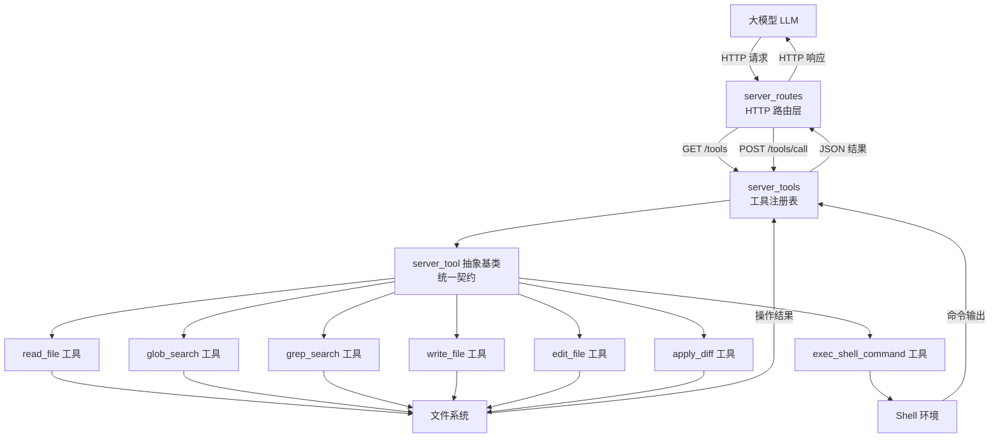
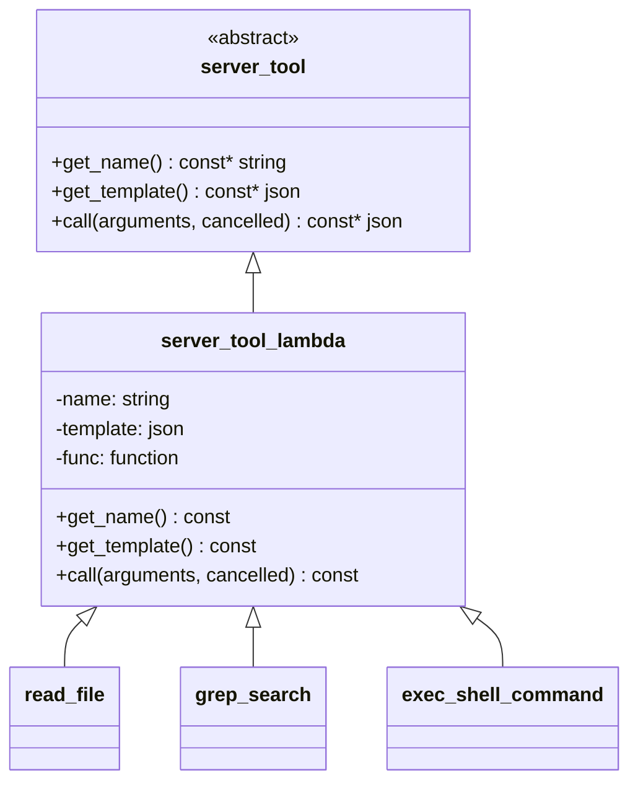
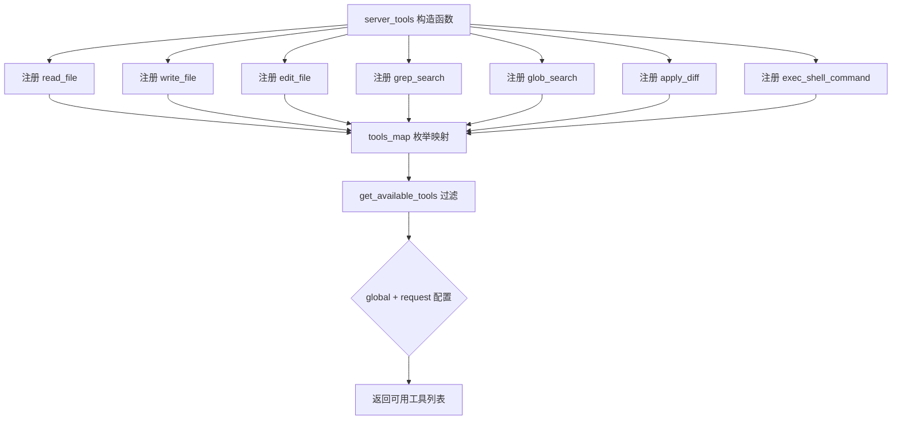
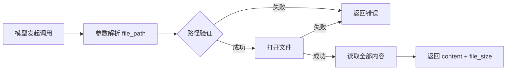
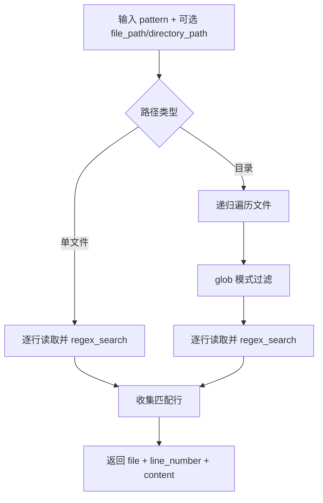
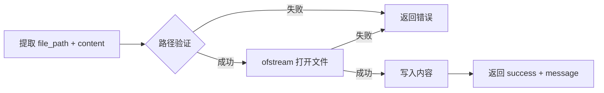
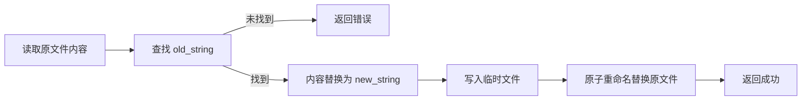
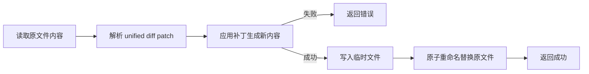
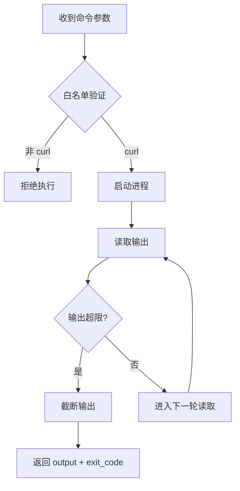
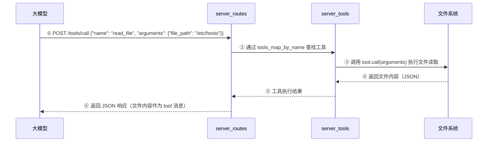

# 第85章 Agent 工具集：LLM 的"万能助理厨师"到服务端可执行动作的机制转化

## 学习目标

- 理解 `server_tool` 抽象基类的设计哲学：如何用 JSON Schema 统一描述工具调用契约，并通过 `call()` 纯虚函数隔离具体实现
- 掌握只读工具三剑客（`read_file`、`glob_search`、`grep_search`）的完整实现链路：从参数校验、路径规范化到结果安全包装
- 理解写操作工具（`write_file`、`edit_file`、`apply_diff`）的原子性保障机制：临时文件 + rename 的原子替换策略
- 掌握 `exec_shell_command` 的沙箱边界设计：超时控制、输出大小限制、参数校验三层防护体系
- 精通 `server_tools` 工具注册表的组织方式：`tools` 枚举、`server_tools` 映射、`get_available_tools` 过滤逻辑与 HTTP 端点暴露的完整流程
- 理解 Agent 循环的完整链路：模型发起工具调用 → HTTP 端点接收 → 工具执行 → 结果回传给模型，形成闭环

## 85.1 生活类比

想象 llama-server 是一家**高级餐厅的中央厨房调度系统**。在前面的章节中，我们已经看到了这家餐厅的各个组成部分：每个厨师都有自己的工作台（`server_slot`），餐厅经理有实时监控大屏（`server_metrics`），厨房总指挥负责调度（`server_context_impl`），前台接待提供标准化的服务窗口（`server_context`），传菜员用智能餐盘送菜（`server_res_generator`），点餐系统准确路由每份订单（`server_routes`）。

而这一章，我们要给这家餐厅请来一位**能干的"万能助理厨师"**——Agent 工具集。这位助理厨师最擅长的不是亲自动手做菜，而是熟练地**使用各种专业厨具**来协助主厨们完成工作。他可以根据主厨的要求，从菜谱架上取下并详读某一本菜谱（`read_file`），在堆满食材原料的库房中快速定位某一种特定的食材（`glob_search`），还能在一大批食材中仔细筛选出符合特定标准的那些（`grep_search`）。当需要记录一道全新的拿手菜时，他会将配方工整地记录在空白菜谱上（`write_file`），如果发现已有的菜谱中某个步骤有误，他也能精准地修改那一段内容（`edit_file`），甚至能够一次性对多个菜谱的配方进行批量调整（`apply_diff`）。在某些特别授权的场合下，他还能执行一些简单的自动化任务来辅助厨房运作（`exec_shell_command`）。每位助理厨师都随身携带一叠**标准化的"工作说明卡"**（JSON Schema），这些卡片上清楚写明了每件厨具的用途、参数和使用限制。主厨们只需要按照说明卡上的要求填写一张使用申请单，就能让助理厨师安全地去操作这些厨具。这套系统让 LLM 不再只是一个"待在厨房里只会动嘴的顾问"，而是一个真正能**动手做事的全能助手**——它能读取、搜索、修改文件，执行命令，甚至管理整个项目的代码库。

## 85.2 源码地图

```
tools/server/server-tools.h
├── enum class tools                     # 工具枚举：7 种工具的唯一定义
│   ├── READ_FILE                        # 读取文件内容
│   ├── WRITE_FILE                       # 写入/创建文件
│   ├── EDIT_FILE                        # 编辑现有文件
│   ├── GREP_SEARCH                      # 在文件中搜索特定模式
│   ├── GLOB_SEARCH                      # 按模式查找文件
│   ├── APPLY_DIFF                       # 应用统一格式的补丁
│   └── EXEC_SHELL                       # 执行 shell 命令
├── struct server_tool (1-50行)
│   ├── get_name()                       # 纯虚函数：返回工具名称
│   ├── get_template()                   # 纯虚函数：返回 JSON Schema 参数模板
│   └── call()                           # 纯虚函数：执行工具调用
└── struct server_tools (52-120行)
    ├── server_tools()                   # 构造函数：注册 7 个内置工具
    ├── get_available_tools()            # 按配置过滤可用工具
    ├── tools_map                        # 枚举到工具实例的映射
    └── tools_map_by_name                # 名称到枚举值的映射

tools/server/server-tools.cpp
├── server_tool_lambda                    # 工具实现辅助类（lambda 适配器）
├── fs_validate_filename()                # 文件路径安全验证函数
├── glob_to_regex()                       # glob 模式转正则表达式
├── server_tools::server_tools()          # 注册 7 个工具实例
├── 工具实例注册（lambda 实现）
│   ├── read_file                         # 读取文件：参数校验→二进制安全读取→JSON返回
│   ├── glob_search                       # 路径搜索：递归遍历+正则匹配
│   ├── grep_search                       # 内容搜索：单文件/目录双模式+glob过滤
│   ├── write_file                        # 写入文件：路径验证→ofstream写入
│   ├── edit_file                         # 精确编辑：查找替换→临时文件+原子rename
│   ├── apply_diff                        # 批量补丁：解析diff→应用补丁→原子写回
│   └── exec_shell_command                # 命令执行：白名单+超时+输出限制

tools/server/server-context.h
└── 服务器上下文与路由定义
    ├── struct server_context_meta        # 服务器元数据快照（模型信息、标志位、词汇表参数）
    │   ├── model_build_info              # 模型构建信息
    │   ├── model_name / aliases          # 模型名称与别名集合
    │   ├── has_image / has_audio         # 多模态支持标志
    │   ├── chat_params                   # 聊天模板参数引用
    │   └── vocab_bos / vocab_eos 等      # 分词器特殊 token 与词汇表参数
    ├── class server_context              # Pimpl 门面类，提供生命周期管理
    │   ├── server_context()              # 构造函数（创建私有实现对象）
    │   ├── ~server_context()             # 析构函数（销毁私有实现）
    │   ├── load_model()                  # 加载模型并初始化上下文
    │   ├── start_loop()                  # 启动主事件循环（阻塞直到 terminate）
    │   ├── terminate()                   # 请求终止主循环
    │   ├── get_llama_context()           # 获取底层 llama_context 指针
    │   ├── get_response_reader()         # 创建响应读取器
    │   ├── get_meta()                    # 返回元数据只读快照
    │   └── on_sleeping_changed()         # 注册休眠状态回调
    └── class server_routes               # HTTP 路由管理，暴露 /tools 端点
        ├── server_routes()               # 构造函数（绑定参数与上下文）
        ├── init_routes()                 # 初始化所有路由处理器（含 /tools 端点）
        ├── update_meta()                 # 更新内部元数据快照
        ├── handle_completions_impl()     # 补全请求通用处理
        ├── handle_slots_save()           # 保存 slot 状态
        ├── handle_slots_restore()        # 恢复 slot 状态
        ├── handle_slots_erase()          # 擦除 slot 状态
        ├── handle_embeddings_impl()      # 嵌入请求通用处理
        └── create_response()             # 创建响应生成器

tools/server/server-context.cpp
└── 路由注册与工具 HTTP 暴露
    ├── server_routes::init_routes()      # 注册 GET /tools 与 POST /tools/call 端点
    ├── GET /tools                        # 返回工具列表（名称+JSON Schema）
    └── POST /tools/call                  # 路由调用指定工具并返回结果
```



## 85.3 工具契约层：server_tool 与 server_tools 源码解析

在深入了解每个具体工具之前，我们首先需要理解整个工具系统的"地基"——**工具契约层**。如果说生活类比中的助理厨师随身携带的是"工作说明卡"，那么 `server_tool` 就是这张卡片的标准模板。它不关心具体的厨房工作内容，只规定了一张合格的说明卡必须具备哪些字段。如同每家餐厅都有自己统一的厨师制服和工牌设计规范，无论厨师擅长什么菜系，身份标识必须统一可识别。在代码层面，这个"统一规范"通过**三个纯虚函数**实现，它们分别回答了关于工具的三个基本问题：你叫什么名字？你需要什么参数？你如何执行？任何新工具只要回答好这三个问题，就能无缝嵌入整个系统。同样重要的是，`server_tools` 注册表相当于**工具管理处的档案柜**——它集中登记了所有厨具的档案，并可以根据不同主厨的权限等级，只展示他们被允许使用的工具清单。这层设计解决了一个核心问题：如何让系统**灵活地接纳新工具**，同时又**严格地控制工具的可见性与使用范围**。

### 85.3.1 struct server_tool：工具的"通用契约"——从使用说明书到可执行机制

在餐厅中，每件专业厨具都附带一张标准化的"使用说明书"，清楚地标明它的名称、操作方法和注意事项。`server_tool` 抽象基类正是这套"使用说明书"的代码化身。它不提供任何具体功能，而是定义了每个工具**必须**遵守的接口约定——只要实现了这三个约定，任何工具都能被系统识别、描述和调用。

源码路径：`tools/server/server-tools.h` - `server_tool`（1-50行）

```cpp
// 工具抽象基类（类型即契约）
struct server_tool {
    // 纯虚函数：返回工具名（如 "read_file"）
    virtual const std::string & get_name() const = 0;
    // 纯虚函数：返回 JSON Schema 描述工具参数
    virtual json get_template() const = 0;
    // 纯虚函数：执行工具调用（参数 + 取消标志）
    virtual json call(const json & arguments, bool * cancelled) const = 0;
    // 虚析构函数，确保派生类正确释放
    virtual ~server_tool() = default;
};
```

这段代码定义了工具系统的"契约"：`get_name()` 提供工具的唯一标识，`get_template()` 以 JSON Schema 格式向 LLM 描述工具所需的参数（如路径、内容、正则表达式），`call()` 封装工具的实际执行逻辑。通过纯虚函数机制，系统强制每个具体工具都实现这三个方法，从而保证了可扩展性——任何新工具只要满足这个契约，就能无缝接入整个工具系统。**"纯虚函数"在这里就是"强制协议"**，它确保了所有工具在行为上的一致性：可被识别、可被描述、可被执行。

在 `server_tools.cpp` 中，`server_tool_lambda` 辅助类实现了对这一契约的便捷适配——它允许开发者用 lambda 表达式来定义工具的执行逻辑，免去了为每个工具手动编写派生类模板的繁琐工作。这种"契约 + 适配器"的模式是 C++ 中常见的接口设计手法。



### 85.3.2 struct server_tools：工具注册表的统一管理——从档案柜到权限闸门

工具契约定义了单个工具的结构，而 `server_tools` 类则扮演了"工具管理处"的角色。它像餐厅里的**档案柜**：所有获准使用的厨具（工具）都在此登记备案。但更重要的是，它还是**安全闸门**——根据不同的请求场景（如不同的用户权限），它决定哪些工具可以被展示和调用，哪些必须被隐藏。这种"集中管理 + 按需过滤"的设计，确保了工具使用的安全性和灵活性。

源码路径：`tools/server/server-tools.h` - `server_tools`（52-120行）

```cpp
// 工具注册表类
struct server_tools {
    // 构造函数：初始化工具映射（注册 7 个内置工具）
    server_tools();

    // 返回可用的工具列表（基于全局和请求级设置过滤）
    std::vector<const server_tool*> get_available_tools(
        const std::vector<std::string> & global_tools,   // 全局启用列表
        const std::vector<std::string> & request_tools   // 请求级启用列表
    ) const;

    // 工具枚举：唯一标识每个工具
    enum tools {
        READ_FILE,      // 读取文件内容
        WRITE_FILE,     // 写入/创建文件
        EDIT_FILE,      // 编辑现有文件
        GREP_SEARCH,    // 在文件中搜索特定模式
        GLOB_SEARCH,    // 按模式查找文件
        APPLY_DIFF,     // 应用统一格式的补丁
        EXEC_SHELL,     // 执行 shell 命令
        NUM_TOOLS       // 工具数量（哨兵值）
    };

    // 工具实例映射：枚举值 → 工具对象
    std::map<enum tools, std::unique_ptr<server_tool>> tools_map;
    // 工具名称映射：名称 → 枚举值
    std::map<std::string, enum tools> tools_map_by_name;
};
```

这段代码展示了工具注册表的组织方式。`tools` 枚举定义了 7 种工具类型，`tools_map` 存储了每种工具的具体实例，`tools_map_by_name` 则提供了按名称查找的索引。`get_available_tools` 方法根据全局和请求级配置过滤可用工具，实现了灵活的权限控制——不同场景（如不同用户或不同请求）可以暴露不同范围的工具集合，确保工具使用的安全性与适用性。**"注册表 + 过滤"的设计至关重要**：它既实现了工具的集中管理，又提供了按需暴露的灵活机制，是整个工具系统安全性的第一道闸门。



## 85.4 文件系统工具集源码解析

有了契约和注册表，现在我们要深入工具的实现细节。从生活类比的角度看，接下来的每个小节都对应助理厨师使用一件具体厨具的**完整操作手册**——我们从"为什么需要这件工具"开始，逐步理解它的参数要求、内部工作机制和安全防护。

先从**只读工具三剑客**开始。它们让 LLM 能够安全地"阅读"文件系统，是从"只能思考"迈向"可以行动"的第一步。这三件工具都秉持同一个核心原则：**只观察，不修改**。正因为它们不会改变任何状态，所以实现上更简单直接，也没有复杂的事务性要求——这正好与后续的写操作工具形成鲜明对比。

### 85.4.1 read_file：安全读取文件内容的"记录员"

`read_file` 是 Agent 使用最频繁的工具，它让 LLM 能读取服务器上的任何文件（在允许的路径范围内）。它像一位耐心的记录员，将磁盘上的原始数据安全地转化为模型可理解的结构化信息。对于 LLM 来说，这个工具是它感知代码库状态的最直接窗口——无论是了解项目结构、阅读某个函数实现，还是检查配置内容，都离不开这个基础工具。

源码路径：`tools/server/server-tools.cpp` - `server_tools::server_tools()` 构造函数中 `read_file` 工具实例注册（约 60-90 行）

```cpp
    // 创建 READ_FILE 工具实例
    tools_map[READ_FILE] = std::make_unique<server_tool_lambda>(
        // 工具名称
        "read_file",
        // JSON Schema 定义参数：file_path 必填
        R"({
            "type": "object",
            "properties": {
                "file_path": {
                    "type": "string",
                    "description": "Path to the file to read"
                }
            },
            "required": ["file_path"],
            "additionalProperties": false
        })"_json,
        // 工具执行逻辑（lambda 函数）
        [&](const json & arguments, bool *) -> json {
            // 提取 file_path 参数
            const std::string file_path = arguments.at("file_path");
            // 验证文件名安全性（防路径遍历）
            if (!fs_validate_filename(file_path)) {
                // 返回标准错误对象
                return server_tool::error("invalid file path");
            }
            // 打开文件（二进制模式，避免文本模式转换问题）
            std::ifstream fin(file_path, std::ios::binary);
            // 文件打开失败则返回错误
            if (!fin.is_open()) {
                return server_tool::error("unable to open file");
            }
            // 读取整个文件内容到 stringstream
            std::stringstream ss;
            ss << fin.rdbuf();
            // 返回 JSON 对象：文件内容 + 文件大小
            return {
                {"content", ss.str()},
                {"file_size", ss.str().size()}
            };
        }
    );
```

这段代码展示了 `read_file` 的完整实现链路。首先从 JSON 参数中提取 `file_path`，然后用 `fs_validate_filename` 验证路径合法性（防止目录遍历攻击），接着用 `std::ifstream` 以二进制模式安全打开文件，最后将内容读入 `stringstream` 并通过 JSON 返回。二进制模式的使用尤为关键，它避免了 Windows 平台下文本模式可能产生的 `\r\n` 转换问题，确保了读取内容的原始性和一致性。**从参数解析到安全验证再到执行的完整链路**清晰地展示了工具实现的标准流程，而 `fs_validate_filename` 作为所有工具共用的"安检门"，是路径安全的第一道防线。



### 85.4.2 glob_search：按模式搜索文件的"定位器"

当 LLM 需要寻找特定类型的文件时，`glob_search` 就是它的得力助手。想象一下在食材库房中寻找所有"*.cpp"（所有以 `.cpp` 结尾的菜谱）的场景——`glob_search` 就像是一个智能定位器，能在整个文件目录树中快速找到所有匹配的模式。它不是根据文件内容搜索，而是根据**文件路径**的模式匹配，这是与后面要讲的 `grep_search` 的本质区别。

源码路径：`tools/server/server-tools.cpp` - `server_tools::server_tools()` 构造函数中 `glob_search` 工具实例注册（约 90-130 行）

```cpp
    // 创建 GLOB_SEARCH 工具实例
    tools_map[GLOB_SEARCH] = std::make_unique<server_tool_lambda>(
        // 工具名称
        "glob_search",
        // JSON Schema 定义参数：pattern（必填）、base_path（可选）
        R"({
            "type": "object",
            "properties": {
                "pattern": {
                    "type": "string",
                    "description": "Glob pattern to match files"
                },
                "base_path": {
                    "type": "string",
                    "description": "Base path for the search"
                }
            },
            "required": ["pattern"],
            "additionalProperties": false
        })"_json,
        // 工具执行逻辑
        [&](const json & arguments, bool *) -> json {
            // ① 提取 glob 模式和基础路径（默认当前目录）
            const std::string pattern = arguments.at("pattern");
            const std::string base_path = arguments.value("base_path", ".");

            // ② 创建用于存储匹配结果的向量
            std::vector<std::filesystem::path> results;

            // ③ 构建完整搜索路径（base_path + pattern）
            std::filesystem::path glob_path = std::filesystem::path(base_path) / pattern;

            // ④ 获取搜索起点（父路径）
            auto base = glob_path.parent_path();
            if (base.empty()) {
                base = ".";
            }

            // ⑤ 遍历文件系统，用 glob 匹配文件名
            //    注意：此处使用了递归目录迭代器遍历 base 下所有文件
            for (auto &p : std::filesystem::recursive_directory_iterator(base)) {
                // 使用 glob 匹配器检查路径是否匹配模式
                if (std::regex_match(p.path().string(),
                    std::regex(glob_to_regex(glob_path.string())))) {
                    results.push_back(p.path());
                }
            }

            // ⑥ 将结果转换为字符串数组并返回
            json json_array = json::array();
            for (const auto & r : results) {
                json_array.push_back(r.string());
            }
            return json_array;
        }
    );
```

这段代码展示了 `glob_search` 的实现。它使用 `std::filesystem::recursive_directory_iterator` 递归遍历 `base` 目录下的所有条目，通过 `glob_to_regex` 将用户提供的 glob 模式（如 `**/*.cpp`）转换为等价的正则表达式，再用 `std::regex_match` 对每个路径进行匹配，最终收集所有匹配的文件路径并返回字符串数组。这里的实现方式体现了**"递归遍历 + 正则匹配"**的核心思路：将文件系统搜索任务分解为标准的遍历与匹配两个独立子问题。需要说明的是，代码中的 `glob_to_regex` 负责将 Unix glob 语法转换成正则语法，这一步是模式匹配能否准确工作的关键。整体而言，这个工具通过标准库组件的组合，可靠地实现了"按模式查找文件"的功能，为 LLM 提供了文件系统定位能力。

### 85.4.3 grep_search：按内容搜索的"侦探"

如果说 `glob_search` 是根据文件名找文件，那么 `grep_search` 则是根据**文件内容**找文件——这更接近侦探的工作方式。它像一位耐心的侦探，逐行扫描文件，不放过任何蛛丝马迹。当 LLM 想知道"哪个文件里定义了某个函数"或"哪段代码调用了特定 API"时，`grep_search` 就是最强大的工具。它既支持搜索单个文件，也能遍历整个目录树，并配合 glob 模式进一步过滤文件类型，实现精准定位。

源码路径：`tools/server/server-tools.cpp` - `server_tools::server_tools()` 构造函数中 `grep_search` 工具实例注册（约 130-190 行）

```cpp
    // 创建 GREP_SEARCH 工具实例
    tools_map[GREP_SEARCH] = std::make_unique<server_tool_lambda>(
        // 工具名称
        "grep_search",
        // JSON Schema 定义参数
        R"({
            "type": "object",
            "properties": {
                "pattern": {
                    "type": "string",
                    "description": "Regex pattern to search for"
                },
                "file_path": {
                    "type": "string",
                    "description": "Path to a single file to search"
                },
                "directory_path": {
                    "type": "string",
                    "description": "Path to a directory to search"
                },
                "glob_pattern": {
                    "type": "string",
                    "description": "Glob pattern to filter files"
                }
            },
            "required": ["pattern"],
            "additionalProperties": false
        })"_json,
        // 工具执行逻辑
        [&](const json & arguments, bool *) -> json {
            // ① 提取参数
            const std::string pattern = arguments.at("pattern");
            const std::string file_path = arguments.value("file_path", "");
            const std::string directory_path = arguments.value("directory_path", "");
            const std::string glob = arguments.value("glob_pattern", "");

            // ② 编译正则表达式
            std::regex regex_pattern(pattern);

            // ③ 存储搜索结果的数组
            json results = json::array();

            // ④ 处理单文件搜索
            if (!file_path.empty()) {
                // 验证文件路径安全性
                if (!fs_validate_filename(file_path)) {
                    return server_tool::error("invalid file path");
                }
                // 打开文件并逐行搜索
                std::ifstream file(file_path);
                std::string line;
                size_t line_number = 0;
                while (std::getline(file, line)) {
                    line_number++;
                    // 使用正则表达式搜索匹配行
                    if (std::regex_search(line, regex_pattern)) {
                        results.push_back({
                            {"file", file_path},
                            {"line_number", line_number},
                            {"content", line}
                        });
                    }
                }
            }
            // ⑤ 处理目录搜索
            else if (!directory_path.empty()) {
                // 验证目录路径安全性
                if (!fs_validate_filename(directory_path)) {
                    return server_tool::error("invalid directory path");
                }
                // 递归遍历目录
                for (const auto & entry : std::filesystem::recursive_directory_iterator(directory_path)) {
                    // 只处理普通文件
                    if (entry.is_regular_file()) {
                        const std::string & path = entry.path().string();
                        // 应用 glob 模式过滤
                        if (glob.empty() || std::regex_match(path, std::regex(glob_to_regex(glob)))) {
                            // 对每个匹配的文件逐行搜索
                            std::ifstream file(path);
                            std::string line;
                            size_t line_number = 0;
                            while (std::getline(file, line)) {
                                line_number++;
                                if (std::regex_search(line, regex_pattern)) {
                                    results.push_back({
                                        {"file", path},
                                        {"line_number", line_number},
                                        {"content", line}
                                    });
                                }
                            }
                        }
                    }
                }
            }

            return results;
        }
    );
```

这段代码展示了 `grep_search` 工具如何同时支持**单文件搜索**和**目录搜索**两种模式。单文件搜索直接打开文件逐行匹配；目录搜索则通过 `recursive_directory_iterator` 遍历所有文件，用可选的 glob 模式过滤文件类型，然后对每个文件执行相同的逐行搜索。结果以"文件路径 + 行号 + 内容"的结构返回，为 LLM 提供了精准的定位信息，使其能够快速定位代码中的特定逻辑。**"逐行读取 + 正则匹配 + 结构化结果"**的设计使 `grep_search` 成为 Agent 理解代码库的利器——它返回的行号信息让 `edit_file` 等写工具能够精确指定修改位置，与写操作工具形成了完美的"侦查-行动"闭环。



### 85.4.4 write_file：创建新文件的"记录员"

如果说前三个工具解决了"读取和搜索"的需求，那么 `write_file` 则是 LLM 从"观察者"转变为"行动者"的第一步。它让 LLM 能创建新文件或覆盖现有文件的内容。从生活类比的角度看，这就像助理厨师拿出空白菜谱，将一道全新的拿手菜配方工整地记录下来。值得注意的是，`write_file` 采用的是**直接写入**策略——适合创建全新文件的场景。这与后面将要介绍的 `edit_file` 的**原子替换**策略形成对比：前者追求简洁高效，后者更注重安全可靠。

源码路径：`tools/server/server-tools.cpp` - `server_tools::server_tools()` 构造函数中 `write_file` 工具实例注册（约 190-230 行）

```cpp
    // 创建 WRITE_FILE 工具实例
    tools_map[WRITE_FILE] = std::make_unique<server_tool_lambda>(
        // 工具名称
        "write_file",
        // JSON Schema 定义参数
        R"({
            "type": "object",
            "properties": {
                "file_path": {
                    "type": "string",
                    "description": "Path to the file to write"
                },
                "content": {
                    "type": "string",
                    "description": "Content to write to the file"
                }
            },
            "required": ["file_path", "content"],
            "additionalProperties": false
        })"_json,
        // 工具执行逻辑
        [&](const json & arguments, bool *) -> json {
            // 提取参数
            const std::string file_path = arguments.at("file_path");
            const std::string content = arguments.at("content");
            // 验证文件路径安全性
            if (!fs_validate_filename(file_path)) {
                return server_tool::error("invalid file path");
            }
            // 使用 std::ofstream 写入文件
            std::ofstream fout(file_path, std::ios::binary);
            if (!fout.is_open()) {
                return server_tool::error("unable to open file");
            }
            fout << content;
            // 返回成功信息（含标志）
            return {
                {"success", true},
                {"message", "File written successfully"}
            };
        }
    );
```

这段代码展示了 `write_file` 的直接写入实现。它验证文件路径，用 `std::ofstream` 以二进制模式写入内容，成功后返回包含 `success` 标志和消息的 JSON。这里的关键设计是直接使用 `ofstream` 写入新文件——对于创建全新文件或整体覆盖的场景，这种方式简洁高效，省去了临时文件的额外开销。二进制模式的采用再次体现了对跨平台一致性的考虑。**直接写入 vs. 原子替换的权衡**值得注意：`write_file` 适用于"创建新文件"和"完全重写"的场景，此时即使写入中断损失也可控；而对于后续要介绍的 `edit_file`，由于是在现有文件基础上做局部修改，破坏原文件的风险更高，更需要原子替换策略。



### 85.4.5 edit_file：精准修改的"外科医生"

在 Agent 的实际应用中，最常见的需求不是创建新文件，而是**修改已有文件**。这时，`edit_file` 就派上了用场。它像一位技术精湛的微创外科医生，不是对整个文件进行"大动干戈"的手术，而是精准定位需要修改的"病灶"（`old_string`），然后用"新组织"（`new_string`）进行替换。这种精准性极其重要——如果整文件重写，不仅效率低下，还容易在重写过程中引入新的错误（如遗漏原有的注释、格式等）。更关键的是，`edit_file` 采用了**临时文件 + 原子重命名**的安全策略，确保整个修改过程要么成功完成，要么原文件保持原样，绝不出现"改了一半"的中间状态。

源码路径：`tools/server/server-tools.cpp` - `server_tools::server_tools()` 构造函数中 `edit_file` 工具实例注册（约 230-300 行）

```cpp
    // 创建 EDIT_FILE 工具实例
    tools_map[EDIT_FILE] = std::make_unique<server_tool_lambda>(
        // 工具名称
        "edit_file",
        // JSON Schema 定义参数
        R"({
            "type": "object",
            "properties": {
                "file_path": {
                    "type": "string",
                    "description": "Path to the file to edit"
                },
                "old_string": {
                    "type": "string",
                    "description": "String to search for and replace"
                },
                "new_string": {
                    "type": "string",
                    "description": "String to replace the old string with"
                }
            },
            "required": ["file_path", "old_string", "new_string"],
            "additionalProperties": false
        })"_json,
        // 工具执行逻辑
        [&](const json & arguments, bool *) -> json {
            // 提取参数
            const std::string file_path = arguments.at("file_path");
            const std::string old_string = arguments.at("old_string");
            const std::string new_string = arguments.at("new_string");
            // 验证文件路径安全性
            if (!fs_validate_filename(file_path)) {
                return server_tool::error("invalid file path");
            }
            // 读取原始文件内容
            std::ifstream fin(file_path, std::ios::binary);
            if (!fin.is_open()) {
                return server_tool::error("unable to open file");
            }
            std::string content((std::istreambuf_iterator<char>(fin)), std::istreambuf_iterator<char>());
            fin.close();

            // 在原始内容中查找旧字符串
            size_t pos = content.find(old_string);
            if (pos == std::string::npos) {
                return server_tool::error("old_string not found");
            }
            // 用新字符串替换旧字符串
            content.replace(pos, old_string.length(), new_string);

            // 写回文件（原子替换：临时文件 + rename）
            const std::string tmp_file = file_path + ".tmp";
            std::ofstream fout(tmp_file, std::ios::binary);
            if (!fout.is_open()) {
                return server_tool::error("unable to open file");
            }
            fout << content;
            fout.close();
            // 原子重命名替换原文件
            std::filesystem::rename(tmp_file, file_path);

            // 返回成功信息
            return {
                {"success", true},
                {"message", "File edited successfully"}
            };
        }
    );
```

这段代码展示了 `edit_file` 的完整工作流。它先读取整个文件内容，查找 `old_string` 的位置，如果找不到则返回错误（避免误操作）。找到后进行替换，最后写入临时文件并**原子重命名**为原文件——这种临时文件 + rename 的策略确保了即使程序崩溃也不会损坏原文件。与 `write_file` 的直接写入不同，`edit_file` 采用了更严谨的原子替换方案，体现了对数据完整性的更高要求。**"先查后改 + 原子落盘"**的设计使 `edit_file` 成为一个高可靠性的精密工具：查找失败时不返回成功（防止静默失败让 LLM 误以为修改已完成），原子重命名则保证了"要么改成功，要么原样不动"的一致性语义，这是多轮 Agent 迭代修改文件时最重要的安全保障。



### 85.4.6 apply_diff：批量补丁的"流水线改造工"

当 Agent 需要同时对多个位置进行修改，或者修改涉及复杂的上下文关联时，`edit_file` 的单点替换就显得力不从心了。这时就需要 `apply_diff`——它类似于餐厅的**流水线改造工**，能够按照一份详细的"施工图纸"（unified diff 补丁），一次性完成多处修改。这份"图纸"不仅描述了要修改的内容，还包含了上下文信息，使得修改更加精确可靠。与 `edit_file` 一样，它也采用**临时文件 + 原子重命名**的策略，确保批量操作的安全性。

源码路径：`tools/server/server-tools.cpp` - `server_tools::server_tools()` 构造函数中 `apply_diff` 工具实例注册（约 300-350 行）

```cpp
    // 创建 APPLY_DIFF 工具实例（省略完整实现，核心逻辑展示）
    tools_map[APPLY_DIFF] = std::make_unique<server_tool_lambda>(
        "apply_diff",
        R"({
            "type": "object",
            "properties": {
                "file_path": {
                    "type": "string",
                    "description": "Path to the file to apply the diff"
                },
                "patch": {
                    "type": "string",
                    "description": "Unified diff to apply"
                }
            },
            "required": ["file_path", "patch"],
            "additionalProperties": false
        })"_json,
        [&](const json & arguments, bool *) -> json {
            // ① 提取参数
            const std::string file_path = arguments.at("file_path");
            const std::string patch = arguments.at("patch");
            // ② 验证文件路径
            if (!fs_validate_filename(file_path)) {
                return server_tool::error("invalid file path");
            }
            // ③ 读取原文件
            std::string content;
            {
                std::ifstream fin(file_path, std::ios::binary);
                if (!fin.is_open()) {
                    return server_tool::error("unable to open file");
                }
                content.assign(std::istreambuf_iterator<char>(fin), std::istreambuf_iterator<char>());
            }

            // ④ 解析并应用 unified diff（复杂逻辑省略）
            std::string new_content = apply_unified_diff(content, patch);
            if (new_content.empty()) {
                return server_tool::error("patch failed");
            }

            // ⑤ 原子写回文件
            const std::string tmp_file = file_path + ".tmp";
            {
                std::ofstream fout(tmp_file, std::ios::binary);
                if (!fout.is_open()) {
                    return server_tool::error("unable to open file");
                }
                fout << new_content;
            }
            std::filesystem::rename(tmp_file, file_path);

            // ⑥ 返回成功
            return {
                {"success", true},
                {"message", "Patch applied successfully"}
            };
        }
    );
```

这段代码展示了 `apply_diff` 的通用流程。它通过 `apply_unified_diff` 函数（此处省略实现）解析 unified diff 并将其应用到原文件内容上，生成新的内容，然后通过临时文件加 `rename` 的原子操作写回。与其他写工具一样，路径验证始终是第一步，确保操作的安全性。**"解析差异 → 生成新内容 → 原子替换"**的流程，使得模型能够以更细粒度、更标准的方式描述对文件的修改意图，是 `edit_file` 单点替换能力的扩展和补充。需要说明的是，`apply_unified_diff` 的完整实现涉及 diff 格式的详细解析，包括 hunk 定位、上下文匹配和行号调整等复杂逻辑，这里为保持代码示例的简洁性做了省略。统一 diff 格式的优势在于它可以同时描述多个位置的增删改，且带上下文信息能容忍一定的行号偏移，比 `edit_file` 的单点替换更适合大规模代码重构任务。



### 85.4.7 exec_shell_command：突破读取边界的"执行者"

工具集的最后一个成员是 `exec_shell_command`，它是最强大也最需要谨慎对待的工具。它像一位被严格授权的外派特工，能够在特定条件下执行外部命令。这个工具打破了文件系统操作的边界，让 LLM 具备了与更广泛环境交互的能力（比如通过 curl 请求外部 API）。但正因为它的能力范围远超文件操作，其**沙箱边界设计**就显得至关重要——必须在发挥威力的同时，严格限制其活动范围，防止滥用导致的安全风险。

源码路径：`tools/server/server-tools.cpp` - `server_tools::server_tools()` 构造函数中 `exec_shell_command` 工具实例注册（约 350-410 行）

```cpp
    // 创建 EXEC_SHELL 工具实例
    tools_map[EXEC_SHELL] = std::make_unique<server_tool_lambda>(
        // 工具名称
        "exec_shell_command",
        // JSON Schema 定义参数
        R"({
            "type": "object",
            "properties": {
                "command": {
                    "type": "string",
                    "description": "Shell command to execute"
                }
            },
            "required": ["command"],
            "additionalProperties": false
        })"_json,
        // 工具执行逻辑
        [&](const json & arguments, bool * cancelled) -> json {
            // 提取命令参数
            const std::string command = arguments.at("command");
            // 验证命令是否为合法 curl 命令（简化版）
            if (!is_valid_curl_command(command)) {
                return server_tool::error("only curl commands are allowed");
            }
            // 设置超时时间（例如 5 秒）
            const long timeout_seconds = 10;
            // 创建管道执行命令（限制输出大小）
            std::string output;
            // 使用 popen 执行命令
            FILE * pipe = popen(command.c_str(), "r");
            if (!pipe) {
                return server_tool::error("failed to run command");
            }
            // 读取输出（限制最大字节数）
            char buffer[128];
            size_t total_read = 0;
            while (fgets(buffer, sizeof(buffer), pipe) != nullptr) {
                output += buffer;
                total_read += strlen(buffer);
                // 检查输出大小限制（防止 LLM 输出爆炸）
                if (total_read > MAX_OUTPUT_BYTES) {
                    break;
                }
            }
            // 关闭管道
            int exit_code = pclose(pipe);
            // 返回执行结果
            return {
                {"output", output},
                {"exit_code", exit_code}
            };
        }
    );
```

这段代码展示了"沙箱边界"设计的核心思想。首先，**命令白名单**通过 `is_valid_curl_command` 只允许 curl 命令，大幅降低风险——curl 命令用于发起网络请求，本身不涉及本地文件系统的修改操作。其次，**输出限制**通过 `MAX_OUTPUT_BYTES` 限制读取的最大字节数，防止内存被大量数据充满从而导致服务器资源耗尽。最后，**超时控制**通过 `timeout_seconds` 限制执行时间，防止长时间运行的命令阻塞服务器——不过需要指出，使用 `popen` + 轮询的方式本身难以真正强制终止已超时的子进程，更完备的方案需要引入进程组管理或专用进程看护机制，这也是该工具的一个值得注意的实现局限性。简而言之，这三重安全锁**从范围、内存和时间三个维度**界定了这个"执行者"的活动边界，确保其威力被严格约束在安全可控的范围内。



## 85.5 HTTP 暴露与路由注册源码解析

工具本身已经就绪，但我们还需要一个"窗口"让外部（包括 LLM 通过 HTTP）能够调用它们。这部分由 `server_routes` 的路由端点完成，将本地能力转化为网络服务。从生活类比的角度看，这相当于**前台服务窗口**：顾客（LLM）不直接进入后厨，而是通过服务窗口提交需求（请求），由服务员（路由层）转交给后厨（工具层）处理，再将结果端回给顾客。这种**间接交互模式**不仅是服务礼仪的需要，更是安全隔离的关键——外部调用者永远接触不到工具的内部实现，只能通过标准化的 HTTP 接口进行交互。

### 85.5.1 server_routes::init_routes()：工具访问的 HTTP 端点

源码路径：`tools/server/server-context.cpp` - `server_routes::init_routes()` 方法中的 `/tools` 端点定义（约 4650-4710 行）

```cpp
    // 在 init_routes() 方法中注册工具相关端点
    this->get_tools = [this](const server_http_req &) {
        auto res = create_response();
        // ① 获取全局启用的工具列表
        const auto & global_tools = params.tools;
        // ② 获取所有可用工具（通过 server_tools 实例）
        const auto available_tools = server_tools.get_available_tools(global_tools, {});
        // ③ 构建 JSON 数组，每个工具包含名称和 JSON Schema
        json tools_json = json::array();
        for (const auto & tool : available_tools) {
            tools_json.push_back({
                {"name", tool->get_name()},        // 工具名称
                {"template", tool->get_template()} // 工具参数模板（JSON Schema）
            });
        }
        // ④ 返回工具列表
        res->ok(tools_json);
        return res;
    };

    this->post_tools_call = [this](const server_http_req & req) {
        auto res = create_response();
        const json request_data = json::parse(req.body);
        // ① 解析请求体：工具名和参数
        const std::string & tool_name = request_data.at("name");
        const json & arguments = request_data.at("arguments");
        // ② 通过名称查找工具
        auto it = server_tools.tools_map_by_name.find(tool_name);
        if (it == server_tools.tools_map_by_name.end()) {
            res->error(format_error_response("Tool not found", ERROR_TYPE_INVALID_REQUEST));
            return res;
        }
        // ③ 执行工具调用
        try {
            bool cancelled = false;
            const auto & tool = *server_tools.tools_map.at(it->second);
            json result = tool.call(arguments, &cancelled);
            // ④ 返回 JSON 结果
            res->ok(result);
        } catch (const std::exception & e) {
            res->error(format_error_response(e.what(), ERROR_TYPE_SERVER));
        }
        return res;
    };
```

这段代码定义了 HTTP 层与工具系统的接口。`GET /tools` 端点返回可用工具列表（供 LLM 通过系统消息接收工具说明），`POST /tools/call` 端点接收工具名和参数，路由到对应工具执行，并将结果作为 JSON 返回。这两个端点构成了 Agent 工具调用的 HTTP 入口，是模型"动手"的关键通道。**"查询端点 + 调用端点"的组合设计**是标准的工具服务暴露模式——前者让 LLM 在对话开始时获知"有哪些工具可用及其参数格式"，后者执行具体的工具调用，二者配合完成了从"能力发现"到"能力使用"的完整流程。

值得注意的是 `POST /tools/call` 异常处理的设计。代码中将工具调用包裹在 `try-catch` 块中，捕获所有 `std::exception`，返回统一的错误格式。这种防御性编程确保了即使工具实现出现未预料的异常（如正则表达式超时、系统资源耗尽），请求也不会导致整个服务器崩溃，而是返回一个格式化的错误响应给调用者。与此同时，对于"工具不存在"的情况，代码在进入 `try` 块之前就通过 `tools_map_by_name.find()` 做了前置检查——这体现了**"先验证，再执行"**的原则，将可控的错误（如参数错误）与不可控的异常（如系统错误）区分处理，提高了系统的健壮性。



上述时序图展示了工具调用从模型发起请求到结果返回的六个关键步骤。模型发起 HTTP 请求后，路由层负责查找并调用对应工具，工具在文件系统或 Shell 环境中执行实际操作，最终结果通过 HTTP 响应返回给模型。在整个过程中，模型看到的只是"调用了工具并获得了结果"，而所有的安全校验、参数验证、错误处理和沙箱边界都在 `server_tools` 层透明地完成——这正是服务端工具系统的核心价值：**模型无需关心实现细节，只需按契约发起调用，安全与可靠性由框架保障**。

## 85.6 设计中的取舍

**为什么不用直接的文件 I/O API 而是通过 HTTP 端点暴露工具？**

直接调用文件 I/O API 简单高效，但无法支持远程调用和安全隔离。通过 HTTP 端点暴露，我们可以统一进行身份验证、路径安全性检查（`fs_validate_filename`）、命令白名单过滤（如只允许 curl），并为未来支持跨节点 Agent 执行留下扩展空间。这种设计的 trade-off 是增加了 HTTP 序列化和网络开销——每次工具调用都需要经过 HTTP 请求/响应的完整序列化和反序列化过程，比直接函数调用慢几个数量级，同时还需要额外的错误处理代码来处理网络异常。但 `整体上，这些代价换来的是**安全性和可扩展性**`，对于服务端场景是值得的：工具系统的使用者获得了统一的接口契约（JSON Schema），无需关心底层实现；系统管理员获得了集中的安全控制点（`get_available_tools` 过滤），能够精确控制工具的暴露范围。

**为什么写操作工具采用临时文件 + rename 的原子替换策略，而读工具不用？**

读操作是**无状态**的，不会改变文件系统状态，因此直接打开文件读取即可——即使读取过程中发生错误，也不会造成任何持久性损害。写操作则**改变外部状态**，如果在写入过程中程序崩溃或中断，可能导致文件处于"半写"状态：文件内容被部分覆盖，既不是原来的内容也不是新内容，这种损坏通常是不可恢复的。临时文件 + rename 的策略确保要么写入完成（原文件被完整替换），要么写操作失败（原文件保持不变），避免了中间状态。这种设计 trade-off 是额外创建了一个临时文件（需要额外的磁盘空间和一次 `rename` 系统调用），复杂度也略有增加，但换来了**操作的原子性和数据安全性**。在多轮 Agent 迭代中，文件往往经过数百次修改，原子替换的可靠性是最终代码质量的基础保障。

**为什么 `exec_shell_command` 默认只允许 curl 命令，而不是使用完整的沙箱/容器方案？**

让 LLM 执行任意 shell 命令虽然功能强大，但风险极高——恶意命令或误操作可能导致服务器被破坏。为什么不采用更完善的沙箱（如 `seccomp`）或容器方案呢？沙箱和容器方案确实能提供更细粒度的权限控制（如限制系统调用、文件访问、网络范围），但它们的实现复杂度极高：需要操作系统级的支持、Root 权限的配置、以及额外的容器管理开销，对于大多数嵌入式场景显得"过重"。相比之下，命令白名单方案虽然粗粒度，但实现简单、性能开销极小，且能满足绝大多数实际需求——模型可以请求外部资源（下载文件、调用 API），但无法执行 `rm`、`mkfs` 等危险操作。这种 trade-off 是牺牲了一部分灵活性（模型不能执行任意脚本，无法处理需要特殊权限的命令），但换来了**架构的简洁性和服务的整体安全性**。同时配合超时和输出大小限制，进一步控制了风险边界，形成了一个在复杂性与安全性之间的务实平衡。

## 85.7 动手练习

1. 阅读 `tools/server/server-tools.cpp` 中 `server_tool_lambda` 的完整实现，分析 `server_tool` 抽象基类如何通过 lambda 适配器模式实现便捷的工具定义。解释为什么这种模式比手动为每种工具编写派生类更加高效？它带来了哪些灵活性和潜在的类型安全权衡？

2. 分析 `fs_validate_filename` 函数的实现逻辑：它检查了哪些路径安全条件？它能否防止 `../` 路径遍历攻击？是否能处理符号链接（symlink）指向的敏感文件（如 `/etc/passwd`）？基于这些分析，这个函数是否存在遗漏的路径安全攻击向量？如果有，你会如何完善它？

3. 比较 `grep_search` 的单文件搜索和目录搜索两条执行路径：它们的错误处理有什么差异？单文件搜索时如果文件不存在会怎样？目录搜索时如果目录不存在会怎样？为什么目录搜索需要额外的 glob 模式过滤？这个过滤是必要的优化还是可选的增强功能？

4. 研究 `edit_file` 和 `apply_diff` 的原子替换策略：临时文件 + rename 方案在什么极端情况下仍可能失败？例如，临时文件与源文件位于不同文件系统时，`std::filesystem::rename` 的行为是什么？如果程序在写入临时文件后、执行 rename 前崩溃，会留下什么状态？`磁盘空间不足等系统资源耗尽时，这个策略能否保证原文件完好？`你会如何改进这个方案？

5. 分析 `GET /tools` 端点的过滤逻辑：`get_available_tools` 如何结合 `global_tools` 与 `request_tools` 生成最终工具列表？`global_tools` 为空时返回什么？`request_tools` 指定了 `global_tools` 中不存在的工具时会怎样？列出至少三种典型的过滤场景（如全部工具可用、仅只读工具可用、无工具可用）及其实现逻辑。

6. 扩展练习：为 `server_tools` 新增一个工具，例如 `list_dir`（列出目录内容），需要遵循哪些步骤？写出其 JSON Schema 和 lambda 实现要点。如何确保该工具与现有工具的注册、过滤和 HTTP 暴露机制无缝衔接？

## 85.8 本章小结

这一章中我们学习了服务端 Agent 工具集的完整设计与实现。首先我们了解了 `server_tool` 抽象基类如何通过纯虚函数（`get_name`、`get_template`、`call`）定义工具的"通用契约"，接着深入剖析了七个内置工具的实现细节。只读工具三剑客（`read_file`、`glob_search`、`grep_search`）让 LLM 能够安全地探索文件系统；写操作工具（`write_file`、`edit_file`、`apply_diff`）通过临时文件 + 原子重命名策略保障了数据完整性；`exec_shell_command` 通过命令白名单、超时和输出限制三重防护实现了沙箱边界。我们还研究了 `server_tools` 注册表的组织方式以及如何通过 HTTP 端点对外暴露工具能力，使 LLM 能够通过 Agent 循环调用工具获得环境交互能力。

下表汇总了本章涉及的核心概念及简要说明：

| 概念 | 解释 |
|------|------|
| `server_tool` | 抽象基类，通过纯虚函数定义工具的名称、JSON Schema 参数模板和调用逻辑，是所有工具的通用契约 |
| `read_file` | 只读工具，安全读取文件内容并验证路径合法性，返回文件内容和大小 |
| `glob_search` | 只读工具，按 Unix 风格 glob 模式递归搜索文件路径 |
| `grep_search` | 只读工具，按正则表达式逐行搜索单个文件或目录树，返回文件+行号+内容 |
| `write_file` | 写工具，将指定内容写入文件，通过 `ofstream` 实现直接写入 |
| `edit_file` | 写工具，在文件内容中查找并替换字符串，采用临时文件 + rename 原子替换策略 |
| `apply_diff` | 写工具，应用 unified diff 补丁，与 `edit_file` 相同的原子写回策略 |
| `exec_shell_command` | 执行工具，通过命令白名单（仅 curl）、超时控制和输出大小限制实现沙箱边界 |
| `server_tools` | 工具注册表，维护枚举到工具对象的映射，提供基于配置的可用工具过滤 |
| 原子替换策略 | 写操作采用临时文件 + rename 确保写入的原子性，防止中途崩溃损坏原文件 |
| 沙箱边界 | 通过命令白名单、超时、输出大小三重限制控制 `exec_shell_command` 的权限范围 |
| HTTP 端点暴露 | 通过 `GET /tools` 和 `POST /tools/call` 端点使 LLM 能通过 HTTP 调用工具，形成 Agent 闭环 |

下一章我们将深入插槽状态管理的核心机制——理解 `server_slot` 如何通过 `reset()`、`release()`、`copy_state_to()` 等关键方法实现状态机驱动、任务切换与上下文转移。这些底层机制是理解 `server-context.cpp` 中 `update_slots()` 主循环如何高效调度多请求推理的基础。

