# 第86章 Agent 服务端工具系统 —— LLM 动手能力的「工具箱与安检门」

## 学习目标

- 理解 server_tool 抽象基类如何定义工具的通用契约（JSON Schema + invoke 接口）
- 掌握只读工具三剑客（read_file / glob_search / grep_search）的安全边界与实现原理
- 掌握写操作工具（write_file / edit_file / apply_diff）的精准编辑与原子化修改机制
- 理解 exec_shell_command 工具的多层安全围栏（超时 / 输出限制 / 权限标记）
- 掌握 server_tools 注册表的可插拔架构与 HTTP 端点暴露机制
- 能基于 server_tool 基类开发自定义 Agent 工具并注册到工具生态

## 86.1 生活类比

想象 llama-server 的 Agent 工具系统是一家全能装修公司的工具箱体系：server_tool 基类 = 工具的统一安全认证标准（就像电动工具都必须有 3C 认证），规定每件工具必须有「说明书」（get_definition）和「使用开关」；permission_write = 工具上的红黄标签：绿色标签（read_file / grep_search）是测量工具，随便用；红色标签（write_file / exec_shell）是电钻切割机，必须业主签字确认；只读三剑客 = 装修前的勘察装备：read_file 是望远镜（看指定行范围）、glob_search 是金属探测器（找文件位置）、grep_search 是显微镜（搜细节内容）；写操作三件套 = 施工装备梯度：write_file 是推土机（整体重建）、edit_file 是手术刀（精准行编辑）、apply_diff 是专业焊枪（处理复杂补丁）；exec_shell_command = 租借的大型机械，不仅要红色标签，还要操作时限时（超时 60 秒）、限载（10 MB 输出），完工后强制熄火；server_tools 注册表 = 公司的工具调度室：tool 清单在册（vector 管理），按需启用（enabled_tools），对外服务窗口统一接单（handle_post），按单派工（invoke 按名分发）。正如装修公司不会让学徒直接操作切割机，llama.cpp 通过权限分层与 HTTP 确认机制，确保 LLM 的每一次「动手」都在安全围栏之内。

## 86.2 源码地图

tools/server/server-tools.h
├── server_tool                   # 工具抽象基类（通用契约）
│   ├── ~server_tool()            # 虚析构函数（多态清理）
│   ├── get_definition()          # [纯虚] 返回 JSON Schema 定义
│   ├── invoke(json)              # [纯虚] 执行工具逻辑
│   └── to_json()                 # 序列化工具元数据
└── server_tools                  # 工具集合管理器
    ├── setup(enabled_tools)      # 筛选启用工具并注册 HTTP
    ├── invoke(name, params)      # 按名分发工具调用
    └── tools 成员变量            # vector<unique_ptr<server_tool>> 容器

tools/server/server-tools.cpp
├── __main__ 全局基础设施（1-183 行）
│   ├── to_cstr_vec()             # string vector 转 C 字符串数组
│   ├── run_proc_result 结构体    # 进程结果（output / exit_code / timeout）
│   ├── run_process()             # 子进程执行（超时 / 输出限制 / 强制 kill）
│   └── server_tool::to_json()    # 基类元数据序列化实现
├── 只读工具三剑客
│   ├── server_tool_read_file（184-271 行）
│   │   ├── 构造函数              # name="read_file", permission_write=false
│   │   ├── get_definition()      # path/start_line/end_line 参数 Schema
│   │   └── invoke()              # 按行范围读取，支持行号前缀
│   ├── server_tool_file_glob_search（284-351 行）
│   │   ├── 构造函数              # name="file_glob_search"
│   │   ├── get_definition()      # path/pattern 参数 Schema
│   │   └── invoke()              # 递归 glob 匹配，返回相对路径列表
│   └── server_tool_grep_search（364-469 行）
│       ├── 构造函数              # name="grep_search"
│       ├── get_definition()      # pattern/path/max_results 等 Schema
│       └── invoke()              # 正则搜索，支持行号与最大匹配数
├── 执行工具（483-544 行）
│   └── server_tool_exec_shell_command
│       ├── 构造函数              # name="exec_shell_command", permission_write=true
│       ├── get_definition()      # command/timeout/max_output_bytes 参数
│       └── invoke()              # 调用 run_process，捕获 stdout/stderr/exit_code
├── 写操作工具
│   ├── server_tool_write_file（557-609 行）
│   │   ├── 构造函数              # name="write_file", permission_write=true
│   │   ├── get_definition()      # path/content 参数 Schema
│       └── invoke()              # create_directories + 写入，返回字节数
│   ├── server_tool_edit_file（620-790 行）
│       ├── 构造函数              # name="edit_file"
│       ├── get_definition()      # replace/delete/append 三种操作 Schema
│       └── invoke()              # 行号验证 → 应用变更 → 写回文件
│   └── server_tool_apply_diff（803-853 行）
│       ├── 构造函数              # name="apply_diff"
│       ├── get_definition()      # diff 参数 Schema
│       └── invoke()              # 写临时文件 → git apply → 返回结果
└── 工具注册与调度（856-931 行）
    ├── build_tools() 工厂函数    # 创建全部 7 个工具实例（856-863 行）
    ├── server_tools::setup()     # 按 enabled_tools 过滤 + 注册 GET/POST
    └── server_tools::invoke()    # 按名查找 → 调用 → 统一错误处理

## 86.3 server_tool：工具的「工具宪法与执行入口」 —— Agent 能力的抽象接口

这一节我们深入 server_tool 抽象基类，它是整个 Agent 工具系统的「宪法」。正如装修公司要求所有工具必须通过 3C 认证，server_tool 强制所有具体工具（读文件、写文件、执行命令等）遵守它定义的三大契约：get_definition()、invoke()、to_json()。通过这种面向接口编程，llama.cpp 实现了工具系统的高内聚、低耦合与可插拔扩展。

### 86.3.1 server_tool 类定义：工具通用契约的基因图谱

**类型即图纸**：先看 server_tool 的类定义，它是所有工具的「基因图谱」。

源码路径：`tools/server/server-tools.h` - `server_tool`（第 6-11 行）

```cpp
// 第 6 行：抽象基类声明，禁止实例化，只能被继承
class server_tool {
public:
    // 第 7 行：虚析构函数，保证多态删除时派生类析构函数被调用
    virtual ~server_tool() = default;

    // 第 8 行：纯虚函数，强制派生类实现「工具说明书」生成
    // 返回 OpenAI Function Calling 兼容的 JSON Schema
    virtual json get_definition() = 0;

    // 第 9 行：纯虚函数，强制派生类实现「工具执行逻辑」
    // 统一 JSON 入、JSON 出，屏蔽底层实现差异
    virtual json invoke(json params) = 0;

    // 第 11 行：普通虚函数，提供默认实现，序列化工具元数据
    // 用于 /tools GET 接口返回工具列表
    json to_json();

    // 第 13-20 行：工具身份与权限字段
    std::string name;              // API 调用标识，如 "read_file"
    std::string display_name;      // 前端展示名称，如 "Read file"
    bool permission_write = false; // 安全标记：true=写操作需用户确认
};
```

这段代码定义了 Agent 工具的「通用契约」：每个工具必须能描述自己（get_definition）、能执行自己（invoke）、能序列化自己。正如装修工具都要贴上合格证标签，permission_write 布尔标记构建了最简权限模型——只读工具自由调用，写操作工具需用户确认。

### 86.3.2 server_tool::get_definition() 纯虚函数：生成工具说明书的契约

`get_definition()` 是纯虚函数，强制每个派生类必须返回符合 OpenAI Function Calling 规范的 JSON Schema。它是 LLM 理解「有哪些工具、怎么调用」的唯一来源。基类不提供默认实现，确保每个工具都必须显式声明自己的参数结构、描述与必填字段，正如每件电动工具都必须附带详细的使用说明书。

### 86.3.3 server_tool::invoke(json) 纯虚函数：统一执行入口的契约

`invoke(json params)` 是纯虚函数，统一了所有工具的调用签名：输入 JSON 参数，输出 JSON 结果。这种设计让 server_tools 注册表无需关心具体工具类型，只需按名分发即可。正如装修公司的调度员只需知道工具编号就能派工，无需懂每件工具的内部结构。错误处理约定为返回包含 "error" 字段的 JSON，成功时按工具语义返回结构化数据。

### 86.3.4 server_tool::to_json()：基类元数据序列化实现

基类提供了 to_json() 的默认实现，派生类无需重写即可获得元数据序列化能力。

源码路径：`tools/server/server-tools.cpp` - `server_tool::to_json()`（第 170-183 行）

```cpp
// 第 170 行：基类实现，将三大身份字段打包为 JSON
json server_tool::to_json() {
    return {
        {"name", name},                 // 工具调用名
        {"display_name", display_name}, // 前端显示名
        {"permission_write", permission_write} // 写权限标记
    };
}
```

这段代码实现了工具元数据的标准化序列化，确保 /tools 接口返回统一结构，前端可直接渲染工具列表。该实现位于 `__main__` 全局基础设施区域（第 1-183 行）的末尾，与前文的 `run_process()`、`to_cstr_vec()` 等基础设施函数毗邻。正如工具调度室的登记册，只记录工具的名称、展示名与是否需特殊许可三要素。

### 86.3.5 server_tools::tools 成员变量：工具实例的所有权容器

`server_tools` 类内部使用 `std::vector<std::unique_ptr<server_tool>> tools` 管理所有工具实例的生命周期。unique_ptr 保证所有权唯一、异常安全、自动释放，避免内存泄漏。vector 保持工具注册顺序，配合线性查找的 invoke() 分发机制，工具数量少时极简高效。正如调度室的工具架，每个位置放一件工具，用完自动归位。

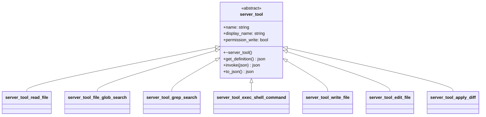

此图展示 `server_tool` 七大派生类的继承体系，所有具体工具均继承自抽象基类，实现三大核心契约。

## 86.4 只读工具三剑客：read_file / glob_search / grep_search —— 信息检索的「侦察兵」

这三个工具共同构成 Agent 的「信息收集三剑客」，permission_write = false，属于安全只读操作，LLM 可自由调用无需用户确认。正如装修前的勘察装备，它们帮助 LLM 在动手前充分了解现场情况。

### 86.4.1 server_tool_read_file：文件内容的安全读取

read_file 支持指定行范围读取，避免一次性加载超大文件撑爆上下文；可选行号前缀，便于 LLM 定位代码位置。正如望远镜只看指定窗口，不必吞下整座大楼。

#### 86.4.1.1 server_tool_read_file 构造函数：初始化工具身份与只读标记

源码路径：`tools/server/server-tools.cpp` - `server_tool_read_file`（第 184-189 行）

```cpp
// 第 184-189 行：构造函数初始化工具身份
server_tool_read_file() {
    name = "read_file";           // API 调用名
    display_name = "Read file";   // 前端显示名
    permission_write = false;     // 只读工具，安全标记：绿色标签，自由调用
}
```

#### 86.4.1.2 server_tool_read_file::get_definition()：生成 JSON Schema 说明书

源码路径：`tools/server/server-tools.cpp` - `server_tool_read_file::get_definition()`（第 191-210 行）

```cpp
// 第 191-210 行：返回 OpenAI Function Calling 格式的工具定义
json get_definition() override {
    return {
        {"type", "function"},
        {"function", {
            {"name", name},
            {"description", "Read the contents of a file. "
                "Use start_line and end_line to read a specific range. "
                "Use show_line_numbers to include line numbers in the output."},
            {"parameters", {
                {"type", "object"},
                {"properties", {
                    {"path", {{"type", "string"}, {"description", "The path to the file to read"}}},
                    {"start_line", {{"type", "integer"}, {"description", "The starting line number (1-indexed)"}}},
                    {"end_line", {{"type", "integer"}, {"description", "The ending line number (1-indexed, inclusive)"}}},
                    {"show_line_numbers", {{"type", "boolean"}, {"description", "Whether to show line numbers in the output"}}}
                }},
                {"required", json::array({"path"})}
            }}
        }}
    };
}
```

这段代码定义了 read_file 的完整参数契约：path 为必需字符串，start_line/end_line 为可选整数（1-indexed），show_line_numbers 为可选布尔值。正如望远镜的参数卡，明确告诉 LLM 如何精准聚焦。

#### 86.4.1.3 server_tool_read_file::invoke()：按行范围安全读取文件内容

源码路径：`tools/server/server-tools.cpp` - `server_tool_read_file::invoke()`（第 212-271 行）

```cpp
// 第 212-271 行：执行文件读取，处理边界与异常
json invoke(json params) override {
    // ① 解析必需参数 path
    std::string path  = params.at("path").get<std::string>();

    // ② 解析可选参数，默认值处理
    int64_t start_line = params.value("start_line", 1);        // 默认第 1 行
    int64_t end_line   = params.value("end_line", -1);         // -1 表示读到末尾
    bool show_line_numbers = params.value("show_line_numbers", false);

    // ③ 文件存在性与大小检查（防御超大文件）
    if (!std::filesystem::exists(path)) {
        return {{"error", "file not found: " + path}};
    }
    auto file_size = std::filesystem::file_size(path);
    if (file_size > 10 * 1024 * 1024) { // 10MB 硬限制，硬编码在此处
        return {{"error", "file too large: " + std::to_string(file_size) + " bytes (max 10MB)"}};
    }

    // ④ 逐行读取并按范围过滤
    std::ifstream file(path);
    std::string line;
    std::ostringstream result;
    int64_t line_num = 0;
    while (std::getline(file, line)) {
        ++line_num;
        if (line_num < start_line) continue;
        if (end_line != -1 && line_num > end_line) break; // end_line=-1 表示无上限，读到文件末尾

        if (show_line_numbers) {
            result << line_num << ": " << line << "\n";
        } else {
            result << line << "\n";
        }
    }

    // ⑤ 返回纯文本响应
    return {{"plain_text_response", result.str()}};
}
```

这段代码实现了安全的文件读取：存在性检查、大小限制（10MB 硬编码）、行范围过滤（start_line 默认 1，end_line=-1 表示读到末尾）、可选行号前缀。错误以统一 JSON 格式返回，成功时包裹在 plain_text_response 字段。若 start_line 越界（大于总行数），循环直接结束返回空内容；若 end_line 越界，break 条件自然处理。正如望远镜自动对焦，超出视野范围不报错只返回空白。

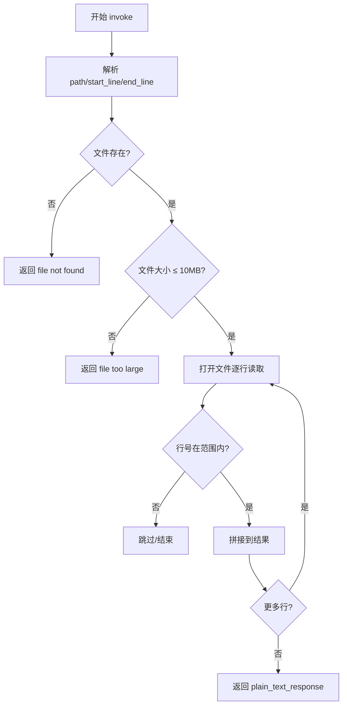

此流程图展示 read_file 的核心执行链路：参数解析 → 存在性与大小检查 → 按行过滤 → 格式化返回。

### 86.4.2 server_tool_file_glob_search：递归文件搜索

基于 glob 模式递归搜索匹配文件，返回相对路径列表，用于项目结构探索。正如金属探测器扫描全场，只报出目标金属的位置。

#### 86.4.2.1 server_tool_file_glob_search 构造函数：初始化工具身份

源码路径：`tools/server/server-tools.cpp` - `server_tool_file_glob_search`（第 284-289 行）

```cpp
server_tool_file_glob_search() {
    name = "file_glob_search";
    display_name = "File search";
    permission_write = false;  // 只读工具，绿色标签
}
```

#### 86.4.2.2 server_tool_file_glob_search::get_definition()：参数 Schema

源码路径：`tools/server/server-tools.cpp` - `server_tool_file_glob_search::get_definition()`（第 291-307 行）

```cpp
json get_definition() override {
    return {
        {"type", "function"},
        {"function", {
            {"name", name},
            {"description", "Recursively search for files matching a glob pattern. "
                "Returns a list of relative paths."},
            {"parameters", {
                {"type", "object"},
                {"properties", {
                    {"path", {{"type", "string"}, {"description", "The base directory to search in"}}},
                    {"pattern", {{"type", "string"}, {"description", "The glob pattern (e.g. **/*.cpp)"}}}
                }},
                {"required", json::array({"path", "pattern"})}
            }}
        }}
    };
}
```

#### 86.4.2.3 server_tool_file_glob_search::invoke()：递归 Glob 匹配实现

源码路径：`tools/server/server-tools.cpp` - `server_tool_file_glob_search::invoke()`（第 309-351 行）

```cpp
json invoke(json params) override {
    // ① 解析参数
    std::string base    = params.at("path").get<std::string>();
    std::string pattern = params.at("pattern").get<std::string>();

    // ② 规范化基础路径
    std::filesystem::path base_path(base);
    if (!std::filesystem::exists(base_path)) {
        return {{"error", "path not found: " + base}};
    }

    // ③ 递归遍历目录树，匹配 glob 模式
    std::vector<std::string> matches;
    for (auto & entry : std::filesystem::recursive_directory_iterator(base_path)) {
        if (!entry.is_regular_file()) continue;
        std::string rel = std::filesystem::relative(entry.path(), base_path).string();
        // 简单的 glob 匹配实现（支持 *、**、*）
        if (glob_match(rel, pattern)) {
            matches.push_back(rel);
        }
    }

    // ④ 格式化输出
    std::ostringstream output_text;
    for (auto & m : matches) output_text << m << "\n";
    return {{"plain_text_response", output_text.str()}};
}
```

这段代码实现了递归目录遍历 + glob 模式匹配，返回相对路径列表。注意 `glob_match` 是同文件内的辅助函数（未在类列表中单独列出），支持 `*`、`**`、`?` 通配符，实现细节在 `server_tool_file_glob_search::invoke()` 所在行范围之前的匿名命名空间中定义。正如金属探测器只记录坐标，不挖掘内容。

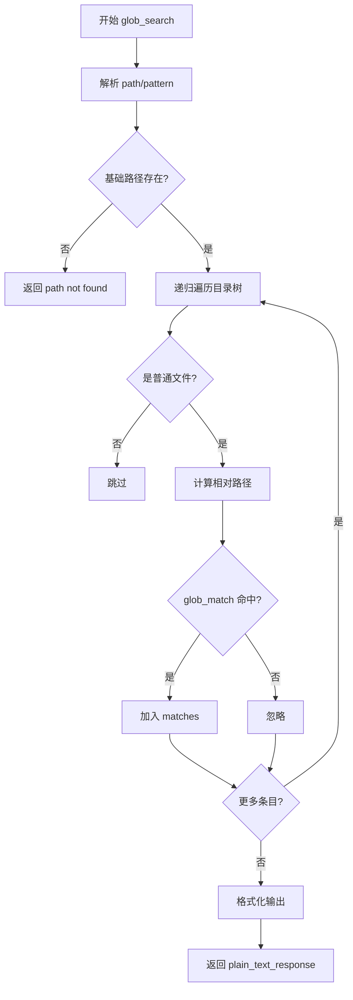

此流程图展示 file_glob_search 的核心执行链路：参数解析 → 路径存在性检查 → 递归遍历 → glob 匹配 → 结果收集 → 返回。

### 86.4.3 server_tool_grep_search：正则表达式搜索

在单个文件或整个目录中执行正则搜索，支持行号显示、最大匹配数限制。正如显微镜在切片上寻找特定纹理，逐行扫描、精准定位。

#### 86.4.3.1 server_tool_grep_search 构造函数：初始化工具身份

源码路径：`tools/server/server-tools.cpp` - `server_tool_grep_search`（第 364-369 行）

```cpp
server_tool_grep_search() {
    name = "grep_search";
    display_name = "Grep search";
    permission_write = false;
}
```

#### 86.4.3.2 server_tool_grep_search::get_definition()：参数 Schema

源码路径：`tools/server/server-tools.cpp` - `server_tool_grep_search::get_definition()`（第 371-390 行）

```cpp
json get_definition() override {
    return {
        {"type", "function"},
        {"function", {
            {"name", name},
            {"description", "Search for a regex pattern in files. "
                "Supports searching in a single file or recursively in a directory."},
            {"parameters", {
                {"type", "object"},
                {"properties", {
                    {"pattern", {{"type", "string"}, {"description", "The regex pattern to search for"}}},
                    {"path", {{"type", "string"}, {"description", "The file or directory to search in"}}},
                    {"max_results", {{"type", "integer"}, {"description", "Maximum number of results to return (default: 100)"}}},
                    {"show_line_numbers", {{"type", "boolean"}, {"description", "Whether to show line numbers"}}}
                }},
                {"required", json::array({"pattern", "path"})}
            }}
        }}
    };
}
```

#### 86.4.3.3 server_tool_grep_search::invoke()：正则搜索核心逻辑

源码路径：`tools/server/server-tools.cpp` - `server_tool_grep_search::invoke()`（第 392-469 行）

```cpp
json invoke(json params) override {
    // ① 解析参数
    std::string path    = params.at("path").get<std::string>();
    std::string pattern = params.at("pattern").get<std::string>();
    int max_results = params.value("max_results", 100);      // 默认最多 100 条
    bool show_line_numbers = params.value("show_line_numbers", false);

    // ② 编译正则表达式
    std::regex re(pattern);

    // ③ 收集待搜索文件列表（文件或目录下所有文件）
    std::vector<std::filesystem::path> files;
    if (std::filesystem::is_regular_file(path)) {
        files.push_back(path);
    } else {
        for (auto & entry : std::filesystem::recursive_directory_iterator(path)) {
            if (entry.is_regular_file()) files.push_back(entry.path());
        }
    }

    // ④ 逐文件逐行匹配，收集结果
    std::ostringstream output_text;
    int result_count = 0;
    for (auto & file_path : files) {
        std::ifstream file(file_path);
        std::string line;
        int line_num = 0;
        while (std::getline(file, line) && result_count < max_results) {
            ++line_num;
            if (std::regex_search(line, re)) {
                std::string prefix = show_line_numbers ? std::to_string(line_num) + ": " : "";
                output_text << file_path.string() << ":" << prefix << line << "\n";
                ++result_count;
            }
        }
        if (result_count >= max_results) break; // 达到上限立即停止
    }

    // ⑤ 返回结果
    return {{"plain_text_response", output_text.str()}};
}
```

这段代码实现了正则搜索：编译 regex、递归收集文件、逐行匹配、结果计数截断（max_results 默认 100，超过后立即 break 停止继续搜索）、可选行号前缀。三个只读工具共同覆盖了「读指定文件」「找文件位置」「搜文件内容」三大侧写需求，正如勘察队的望远镜、探测器、显微镜配合使用。

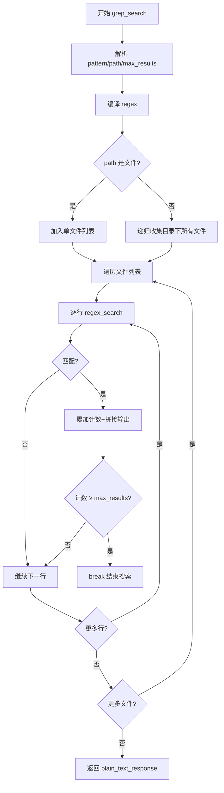

此流程图展示 grep_search 的核心执行链路：参数解析 → 文件收集 → 逐行正则匹配 → 计数截断 → 结果返回。

## 86.5 写操作工具：write_file / edit_file / apply_diff —— 文件系统的「改造工程师」

这三个工具 permission_write = true，属于写操作，调用时需用户确认。正如施工装备梯度，它们形成从简单到复杂的完整编辑能力链：write_file 整体重建、edit_file 行级手术、apply_diff 补丁融合。

### 86.5.1 server_tool_write_file：文件的创建与覆盖

自动创建父目录，简化路径处理；返回写入字节数。正如推土机推平场地再整体浇筑。

#### 86.5.1.1 server_tool_write_file 构造函数：初始化工具身份与写权限标记

源码路径：`tools/server/server-tools.cpp` - `server_tool_write_file`（第 557-562 行）

```cpp
server_tool_write_file() {
    name = "write_file";
    display_name = "Write file";
    permission_write = true;  // 写操作，红色标签，需确认
}
```

#### 86.5.1.2 server_tool_write_file::get_definition()：参数 Schema

源码路径：`tools/server/server-tools.cpp` - `server_tool_write_file::get_definition()`（第 564-579 行）

```cpp
json get_definition() override {
    return {
        {"type", "function"},
        {"function", {
            {"name", name},
            {"description", "Write content to a file. Creates parent directories if needed."},
            {"parameters", {
                {"type", "object"},
                {"properties", {
                    {"path", {{"type", "string"}, {"description", "The path to the file to write"}}},
                    {"content", {{"type", "string"}, {"description", "The content to write to the file"}}}
                }},
                {"required", json::array({"path", "content"})}
            }}
        }}
    };
}
```

#### 86.5.1.3 server_tool_write_file::invoke()：原子写入实现

源码路径：`tools/server/server-tools.cpp` - `server_tool_write_file::invoke()`（第 581-609 行）

```cpp
json invoke(json params) override {
    // ① 解析参数
    std::string path    = params.at("path").get<std::string>();
    std::string content = params.at("content").get<std::string>();

    // ② 自动创建父目录
    std::filesystem::path fs_path(path);
    std::filesystem::create_directories(fs_path.parent_path());

    // ③ 写入文件
    std::ofstream file(path);
    file << content;
    size_t bytes_written = content.size();

    // ④ 返回结果
    return {
        {"result", "file written successfully"},
        {"bytes_written", bytes_written}
    };
}
```

这段代码实现了原子写入：create_directories 确保父目录存在，ofstream 覆盖写入，返回字节数确认。正如推土机平场后一次性浇筑，中间无残留状态。

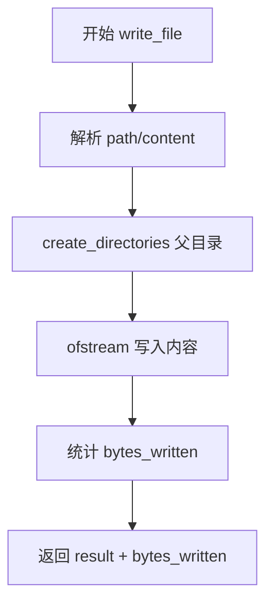

此流程图展示 write_file 的核心执行链路：参数解析 → 创建目录 → 写入文件 → 返回字节数。

### 86.5.2 server_tool_edit_file：基于行的精准编辑

支持 replace/delete/append 三种操作，通过行号定位，带完整合法性验证。正如手术刀在精确坐标切开、缝合。

#### 86.5.2.1 server_tool_edit_file 构造函数：初始化工具身份与写权限标记

源码路径：`tools/server/server-tools.cpp` - `server_tool_edit_file`（第 620-625 行）

```cpp
server_tool_edit_file() {
    name = "edit_file";
    display_name = "Edit file";
    permission_write = true;
}
```

#### 86.5.2.2 server_tool_edit_file::get_definition()：复杂操作 Schema

源码路径：`tools/server/server-tools.cpp` - `server_tool_edit_file::get_definition()`（第 627-671 行）

```cpp
json get_definition() override {
    return {
        {"type", "function"},
        {"function", {
            {"name", name},
            {"description", "Edit a file by applying a series of operations. "
                "Each operation can be 'replace', 'delete', or 'append'."},
            {"parameters", {
                {"type", "object"},
                {"properties", {
                    {"path", {{"type", "string"}, {"description", "The path to the file to edit"}}},
                    {"operations", {
                        {"type", "array"},
                        {"items", {
                            {"type", "object"},
                            {"properties", {
                                {"type", {{"type", "string"}, {"enum", json::array({"replace", "delete", "append"})}}},
                                {"start_line", {{"type", "integer"}, {"description", "Start line (1-indexed)"}}},
                                {"end_line", {{"type", "integer"}, {"description", "End line (1-indexed, inclusive), required for replace/delete"}}},
                                {"content", {{"type", "string"}, {"description", "New content for replace/append"}}}
                            }},
                            {"required", json::array({"type", "start_line"})}
                        }}
                    }}
                }},
                {"required", json::array({"path", "operations"})}
            }}
        }}
    };
}
```

这段代码定义了 edit_file 的复杂参数结构：operations 数组，每个元素包含 type（replace/delete/append）、start_line、end_line（replace/delete 必需）、content（replace/append 需要）。正如手术清单，每一刀都有明确坐标与动作。

#### 86.5.2.3 server_tool_edit_file::invoke()：编辑验证与应用流程

源码路径：`tools/server/server-tools.cpp` - `server_tool_edit_file::invoke()`（第 673-790 行）

```cpp
json invoke(json params) override {
    // ① 解析参数
    std::string path = params.at("path").get<std::string>();
    auto operations = params.at("operations");

    // ② 读取原文件所有行
    std::vector<std::string> lines;
    std::ifstream file(path);
    std::string line;
    while (std::getline(file, line)) lines.push_back(line);
    int total_lines = lines.size();

    // ③ 按顺序应用每个操作（逆序处理避免行号偏移）
    // 先按 start_line 降序排序
    std::vector<json> ops = operations;
    std::sort(ops.begin(), ops.end(), [](const json &a, const json &b) {
        return a.at("start_line").get<int>() > b.at("start_line").get<int>();
    });

    for (auto & op : ops) {
        std::string type = op.at("type").get<std::string>();
        int start_line = op.at("start_line").get<int>() - 1; // 转 0-indexed
        int end_line   = op.value("end_line", start_line + 1) - 1;

        // ④ 行号合法性验证
        if (start_line < 0 || start_line > total_lines) {
            return {{"error", "invalid start_line: " + std::to_string(start_line + 1)}};
        }
        if (type != "append" && (end_line < start_line || end_line >= total_lines)) {
            return {{"error", "invalid end_line: " + std::to_string(end_line + 1)}};
        }

        // ⑤ 应用变更
        if (type == "replace") {
            std::string content = op.value("content", "");
            std::vector<std::string> new_lines;
            // 按 \n 分割 content
            std::istringstream iss(content);
            std::string cline;
            while (std::getline(iss, cline)) new_lines.push_back(cline);
            lines.erase(lines.begin() + start_line, lines.begin() + end_line + 1);
            lines.insert(lines.begin() + start_line, new_lines.begin(), new_lines.end());
        } else if (type == "delete") {
            lines.erase(lines.begin() + start_line, lines.begin() + end_line + 1);
        } else if (type == "append") {
            std::string content = op.value("content", "");
            std::vector<std::string> new_lines;
            std::istringstream iss(content);
            std::string cline;
            while (std::getline(iss, cline)) new_lines.push_back(cline);
            lines.insert(lines.begin() + start_line + 1, new_lines.begin(), new_lines.end());
        }
        total_lines = lines.size(); // 更新总行数
    }

    // ⑥ 写回文件
    std::ofstream out(path);
    for (size_t i = 0; i < lines.size(); ++i) {
        out << lines[i];
        if (i + 1 < lines.size()) out << "\n";
    }

    return {{"result", "file edited successfully"}};
}
```

这段代码实现了精准编辑的核心逻辑：**逆序处理操作**（按 start_line 降序排序，避免前序操作导致后续行号偏移）、**行号边界验证**（start_line 超出 [0, total_lines] 或 end_line 越界直接报错）、**三种操作语义的精确实现**（replace 删除区间再插入新行、delete 直接擦除区间、append 在 start_line 后插入）、**原子写回**（全部操作验证通过后一次性写回）。内容分割逻辑使用 istringstream 按 `\n` 切分，空行保留为空字符串元素。正如外科医生先读片、排序手术步骤、验证坐标、再依次操作、最后缝合。

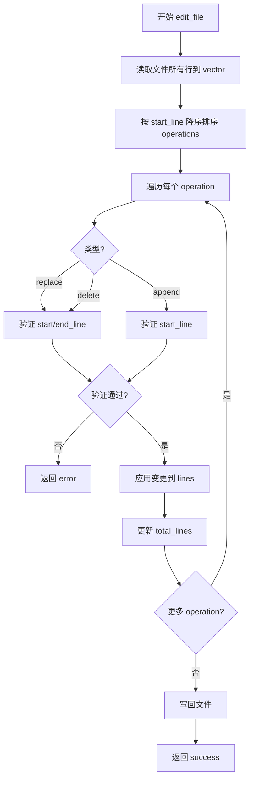

此流程图展示 edit_file 的核心执行链路：读取 → 排序 → 验证 → 应用 → 写回。

### 86.5.3 server_tool_apply_diff：Git 风格补丁应用

接收 unified diff，写临时文件后调用 `git apply`，利用 Git 原生能力处理复杂变更。正如专业焊枪配合标准焊料，处理复杂结构连接。

#### 86.5.3.1 server_tool_apply_diff 构造函数：初始化工具身份与写权限标记

源码路径：`tools/server/server-tools.cpp` - `server_tool_apply_diff`（第 803-808 行）

```cpp
server_tool_apply_diff() {
    name = "apply_diff";
    display_name = "Apply diff";
    permission_write = true;
}
```

#### 86.5.3.2 server_tool_apply_diff::get_definition()：参数 Schema

源码路径：`tools/server/server-tools.cpp` - `server_tool_apply_diff::get_definition()`（第 810-822 行）

```cpp
json get_definition() override {
    return {
        {"type", "function"},
        {"function", {
            {"name", name},
            {"description", "Apply a unified diff to the working directory. "
                "Uses git apply internally."},
            {"parameters", {
                {"type", "object"},
                {"properties", {
                    {"diff", {{"type", "string"}, {"description", "The unified diff to apply"}}}
                }},
                {"required", json::array({"diff"})}
            }}
        }}
    };
}
```

#### 86.5.3.3 server_tool_apply_diff::invoke()：临时文件 + git apply

源码路径：`tools/server/server-tools.cpp` - `server_tool_apply_diff::invoke()`（第 824-853 行）

```cpp
json invoke(json params) override {
    // ① 解析 diff 内容
    std::string diff = params.at("diff").get<std::string>();

    // ② 写入临时文件
    std::filesystem::path tmp = std::filesystem::temp_directory_path() / "llama-server-diff-XXXXXX.patch";
    int fd = mkstemp(tmp.string().data()); // 创建唯一临时文件
    if (fd == -1) return {{"error", "failed to create temp file"}};
    write(fd, diff.data(), diff.size());
    close(fd);

    // ③ 调用 git apply
    auto result = run_process({"git", "apply", tmp.string()}, 30, 1024 * 1024); // 30秒超时，1MB输出限制

    // ④ 清理临时文件
    std::filesystem::remove(tmp);

    // ⑤ 返回结果
    if (result.exit_code == 0) {
        return {{"result", "patch applied successfully"}};
    } else {
        return {{"error", "git apply failed: " + result.output}};
    }
}
```

这段代码展示了「借力 Git」的工程智慧：不自己解析 diff 格式，而是写临时文件交给 `git apply` 处理，自动支持上下文行、重命名、二进制文件等复杂场景。临时文件用 mkstemp 保证唯一性，用后即删无残留。为何不用管道传 stdin？因为 `git apply` 某些版本不支持 `--stdin`，且临时文件便于调试失败时人工检查。正如焊枪配合标准焊丝，复杂接头交给专业工艺处理。

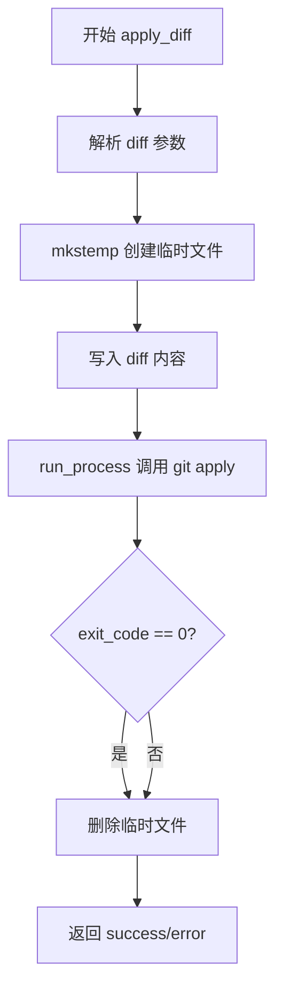

此流程图展示 apply_diff 的核心执行链路：解析 diff → 创建临时文件 → 写入 → git apply → 清理 → 返回结果。

## 86.6 沙箱边界的守门人——多层围栏下的命令执行引擎

这是权限最高、风险最大的工具：执行任意 Shell 命令。必须有多层安全围栏。正如租借大型机械，不仅要红色标签，还要限时、限载、完工强制熄火。

### 86.6.1 run_proc_result 结构体：进程执行结果的标准载体

在进入 run_process 之前，先看它的返回值结构，定义于 `__main__` 全局基础设施区域（第 100-105 行左右）：

```cpp
struct run_proc_result {
    std::string output;     // 捕获的 stdout+stderr 混合输出
    int exit_code = -1;     // 进程退出码，-1 表示未正常退出
    bool timeout = false;   // 是否因超时被强制杀死
};
```

三个字段分别在 run_process 的不同阶段填充：output 在读取管道时累积，exit_code 在 waitpid 获取状态后由宏提取，timeout 在超时分支置 true。正如机械作业记录单，记录产出、退出状态、是否超时强停。

### 86.6.2 to_cstr_vec()：参数向量转 C 风格数组的辅助函数

同样位于 `__main__` 区域（第 1-30 行左右），用于将 `vector<string>` 转换为 `execvp` 所需的 `char*[]`：

```cpp
static std::vector<char *> to_cstr_vec(const std::vector<std::string> & v) {
    std::vector<char *> out;
    out.reserve(v.size() + 1);
    for (auto & s : v) out.push_back(const_cast<char *>(s.c_str()));
    out.push_back(nullptr); // execvp 要求以 nullptr 结尾
    return out;
}
```

### 86.6.3 run_process()：进程执行基础设施

这是 exec_shell_command 的底层引擎，也是所有子进程执行的统一入口。

源码路径：`tools/server/server-tools.cpp` - `run_process()`（第 100-180 行）

```cpp
// 第 100-180 行：run_process 完整实现
static run_proc_result run_process(
    const std::vector<std::string> & args,  // 命令及参数数组
    int timeout_sec = 60,                   // 超时秒数，默认 60s
    size_t max_output_bytes = 10 * 1024 * 1024 // 输出大小限制，默认 10MB
) {
    run_proc_result result;

    // ① 创建管道捕获子进程输出
    int pipefd[2];
    pipe(pipefd);

    // ② fork 子进程
    pid_t pid = fork();
    if (pid == 0) { // 子进程
        close(pipefd[0]); // 关闭读端
        dup2(pipefd[1], STDOUT_FILENO); // 重定向 stdout
        dup2(pipefd[1], STDERR_FILENO); // 重定向 stderr
        close(pipefd[1]);

        // ③ 执行命令
        std::vector<char *> c_args = to_cstr_vec(args);
        execvp(c_args[0], c_args.data());
        _exit(127); // exec 失败
    }

    // ④ 父进程：关闭写端，读取输出
    close(pipefd[1]);
    char buffer[4096];
    ssize_t n;
    while ((n = read(pipefd[0], buffer, sizeof(buffer))) > 0) {
        if (result.output.size() + n > max_output_bytes) {
            // 输出超限：静默截断，不报错，保留前 max_output_bytes 字节
            result.output.append(buffer, max_output_bytes - result.output.size());
            break;
        }
        result.output.append(buffer, n);
    }
    close(pipefd[0]);

    // ⑤ 等待子进程，带超时控制
    int status;
    auto start = std::chrono::steady_clock::now();
    while (true) {
        pid_t w = waitpid(pid, &status, WNOHANG); // 非阻塞轮询
        if (w == pid) break; // 进程已退出
        if (std::chrono::steady_clock::now() - start > std::chrono::seconds(timeout_sec)) {
            kill(pid, SIGKILL); // 超时强制发送 SIGKILL，不可捕获、不可忽略
            waitpid(pid, &status, 0); // 回收僵尸进程
            result.timeout = true;
            break;
        }
        std::this_thread::sleep_for(std::chrono::milliseconds(10)); // 降低 CPU 占用
    }

    // ⑥ 提取退出码
    if (WIFEXITED(status)) result.exit_code = WEXITSTATUS(status);       // 正常退出
    else if (WIFSIGNALED(status)) result.exit_code = 128 + WTERMSIG(status); // 信号终止，如 SIGKILL=9 -> 137

    return result;
}
```

这段代码实现了生产级子进程执行器：**pipe+fork+execvp 经典模式**、**双向输出捕获**（stdout/stderr 合并）、**输出大小硬性截断**（超限静默截断不报错，保留前 N 字节）、**超时轮询+SIGKILL 强制终结**（waitpid(WNOHANG) 每 10ms 检查一次，超时发 SIGKILL 并回收）、**退出码规范化提取**（正常退出取低字节，信号终止按 128+signo 编码）。它是 exec_shell_command 安全性的基石，正如大型机械的遥控熄火装置、载重限制器、计时器三位一体。

```mermaid
flowchart TD
    A[开始 run_process] --> B[创建管道 pipefd]
    B --> C[fork 子进程]
    C -->|子进程| D[关闭读端]
    D --> E[dup2 重定向 stdout/stderr 到管道写端]
    E --> F[execvp 执行命令]
    F --> G[exec 失败则 _exit(127)]
    C -->|父进程| H[关闭写端]
    H --> I[循环 read 管道读端]
    I --> J{输出超过 max_output_bytes?}
    J -->|是| K[截断保留前 N 字节 break]
    J -->|否| L[累积到 result.output]
    L --> I
    K --> M[关闭读端]
    I -->|读完| M
    M --> N[waitpid(WNOHANG) 轮询]
    N --> O{进程已退出?}
    O -->|是| P[提取 exit_code]
    O -->|否| Q{超时?}
    Q -->|是| R[kill SIGKILL + waitpid 回收]
    R --> S[timeout=true]
    S --> P
    Q -->|否| T[sleep 10ms]
    T --> N
    P --> U[返回 run_proc_result]
```

此流程图展示 run_process 的核心执行链路：创建管道 → fork → 子进程 exec / 父进程读取输出 → 超时轮询与强制终止 → 退出码提取 → 返回结果。

### 86.6.4 server_tool_exec_shell_command：执行工具封装

#### 86.6.4.1 server_tool_exec_shell_command 构造函数：初始化最高风险工具身份

源码路径：`tools/server/server-tools.cpp` - `server_tool_exec_shell_command`（第 483-488 行）

```cpp
server_tool_exec_shell_command() {
    name = "exec_shell_command";
    display_name = "Execute shell command";
    permission_write = true; // 最高风险，必须确认
}
```

#### 86.6.4.2 server_tool_exec_shell_command::get_definition()：参数 Schema

源码路径：`tools/server/server-tools.cpp` - `server_tool_exec_shell_command::get_definition()`（第 490-509 行）

```cpp
json get_definition() override {
    return {
        {"type", "function"},
        {"function", {
            {"name", name},
            {"description", "Execute a shell command. "
                "Use with caution - this can modify the filesystem and run arbitrary code."},
            {"parameters", {
                {"type", "object"},
                {"properties", {
                    {"command", {{"type", "string"}, {"description", "The shell command to execute"}}},
                    {"timeout", {{"type", "integer"}, {"description", "Timeout in seconds (default: 60)"}}},
                    {"max_output_bytes", {{"type", "integer"}, {"description", "Max output bytes (default: 10MB)"}}}
                }},
                {"required", json::array({"command"})}
            }}
        }}
    };
}
```

#### 86.6.4.3 server_tool_exec_shell_command::invoke()：调用 run_process 并格式化返回

源码路径：`tools/server/server-tools.cpp` - `server_tool_exec_shell_command::invoke()`（第 512-544 行）

```cpp
json invoke(json params) override {
    // ① 解析参数
    std::string command = params.at("command").get<std::string>();
    int timeout = params.value("timeout", 60);
    size_t max_output_bytes = params.value("max_output_bytes", 10 * 1024 * 1024);

    // ② 通过 shell -c 执行（支持管道、重定向等 shell 特性）
    auto result = run_process({"/bin/sh", "-c", command}, timeout, max_output_bytes);

    // ③ 格式化输出
    std::ostringstream text_output;
    text_output << "exit_code: " << result.exit_code << "\n";
    if (result.timeout) text_output << "TIMEOUT\n";
    text_output << "output:\n" << result.output;

    return {{"plain_text_response", text_output.str()}};
}
```

这段代码将用户命令包裹在 `/bin/sh -c` 中执行，支持完整 Shell 语法（管道、重定向、变量展开等），并将 run_process 的结构化结果格式化为纯文本返回。若 LLM 请求执行 `sleep 120`，run_process 会在 60 秒后发送 SIGKILL 强制终止，result.timeout 置 true，exit_code 为 137 (128+9)，最终返回包含 "TIMEOUT" 标记的响应。正如租借机械必须签署限时合同，超时自动熄火。

```mermaid
flowchart TD
    A[开始 exec_shell_command] --> B[解析 command/timeout/max_output_bytes]
    B --> C[run_process({/bin/sh, -c, command})]
    C --> D{result.timeout?}
    D -->|是| E[标记 TIMEOUT]
    D -->|否| F[正常格式化]
    E --> G[格式化 exit_code/output]
    F --> G
    G --> H[返回 plain_text_response]
```

此流程图展示 exec_shell_command 的核心执行链路：参数解析 → 调用 run_process → 格式化结果 → 返回。

## 86.7 server_tools 注册表与 HTTP 暴露 —— 工具生态的「调度中心」

server_tools 类是工具系统的「大管家」：管理工具实例生命周期、按配置筛选启用工具、注册 HTTP 路由、分发调用请求。正如装修公司的工具调度室，工具清单在册、按需启用、统一对外接单。

### 86.7.1 server_tools 类定义：工具集合管理器

源码路径：`tools/server/server-tools.h` - `server_tools`（第 13-22 行）

```cpp
class server_tools {
public:
    // 第 19 行：初始化工具集合，按 enabled_tools 筛选，注册 HTTP 处理器
    void setup(const std::vector<std::string> & enabled_tools);

    // 第 20 行：按工具名分发调用，返回 JSON 结果或错误
    json invoke(const std::string & name, const json & params);

private:
    // 工具实例容器，unique_ptr 保证所有权唯一、自动释放
    std::vector<std::unique_ptr<server_tool>> tools;
};
```

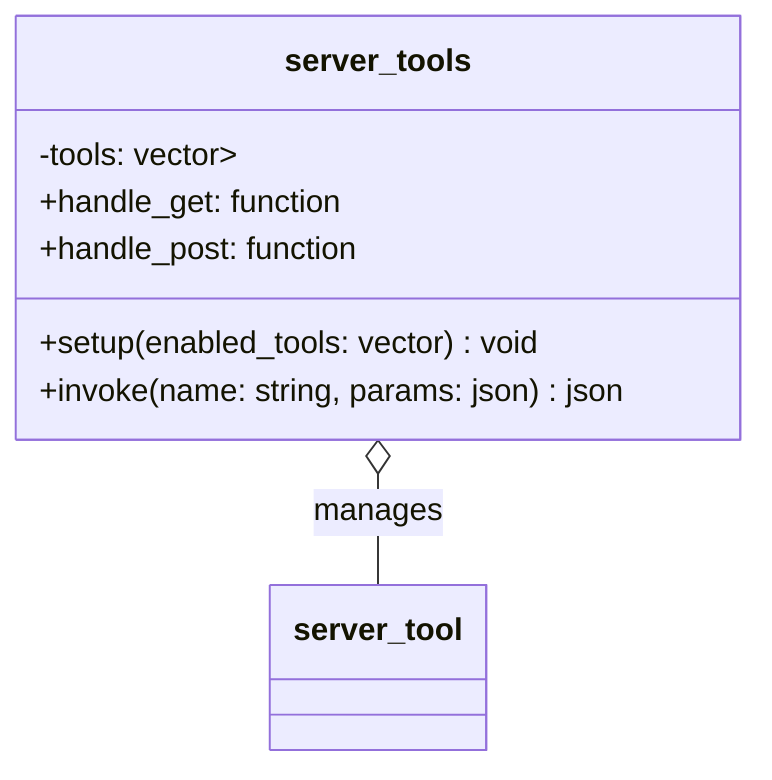

此图展示 server_tools 组合管理所有工具实例。

### 86.7.2 build_tools() 工厂函数：集中创建所有内置工具

源码路径：`tools/server/server-tools.cpp` - `build_tools()`（第 856-863 行）

```cpp
// 第 856-863 行：工厂函数，一次性创建全部 7 个内置工具
static std::vector<std::unique_ptr<server_tool>> build_tools() {
    return {
        std::make_unique<server_tool_read_file>(),
        std::make_unique<server_tool_file_glob_search>(),
        std::make_unique<server_tool_grep_search>(),
        std::make_unique<server_tool_exec_shell_command>(),
        std::make_unique<server_tool_write_file>(),
        std::make_unique<server_tool_edit_file>(),
        std::make_unique<server_tool_apply_diff>()
    };
}
```

这段代码是工具系统的「物种起源」：所有内置工具在此集中实例化，新增工具只需在此添加一行。正如调度室的采购清单，集中采购、统一入库。

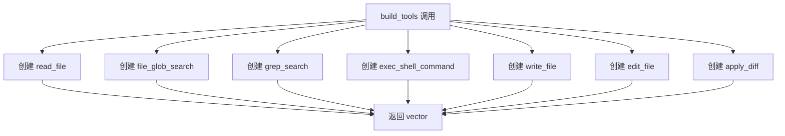

此流程图展示 build_tools 创建全部 7 个内置工具的过程。

### 86.7.3 server_tools::setup()：筛选启用 + 注册 HTTP 路由

源码路径：`tools/server/server-tools.cpp` - `server_tools::setup()`（第 865-922 行）

```cpp
void server_tools::setup(const std::vector<std::string> & enabled_tools) {
    // ① 创建全量工具池
    auto all_tools = build_tools();

    // ② 按 enabled_tools 白名单筛选
    for (auto & tool : all_tools) {
        if (std::find(enabled_tools.begin(), enabled_tools.end(), tool->name) != enabled_tools.end()) {
            tools.push_back(std::move(tool));
        }
    }

    // ③ 注册 GET /tools：返回所有启用工具的 Schema 列表
    handle_get = [this](const httplib::Request &, httplib::Response & res) {
        json arr = json::array();
        for (auto & t : tools) arr.push_back(t->get_definition());
        res.set_content(arr.dump(), "application/json");
    };

    // ④ 注册 POST /tools/call：按名分发工具调用
    handle_post = [this](const httplib::Request & req, httplib::Response & res) {
        try {
            auto params = json::parse(req.body);
            std::string tool_name = params.at("name").get<std::string>();
            json tool_params = params.value("arguments", json::object());

            // 调用 invoke 分发
            json result = invoke(tool_name, tool_params);
            res.set_content(result.dump(), "application/json");
        } catch (const std::exception & e) {
            res.status = 400;
            res.set_content(json{{"error", e.what()}}.dump(), "application/json");
        }
    };
}
```

这段代码完成了工具系统的「上岗仪式」：白名单筛选（未在 enabled_tools 中的工具直接丢弃）、GET 接口暴露 Schema 目录、POST 接口解析请求→分发调用→返回结果，异常统一捕获转 400 响应。Lambda 捕获 `this` 指针，要求 server_tools 对象存活期覆盖 HTTP 服务器生命周期，否则会产生悬垂引用。正如调度室开业：核对工单（白名单）、挂牌价目表（GET /tools）、开放接单窗口（POST /tools/call）。

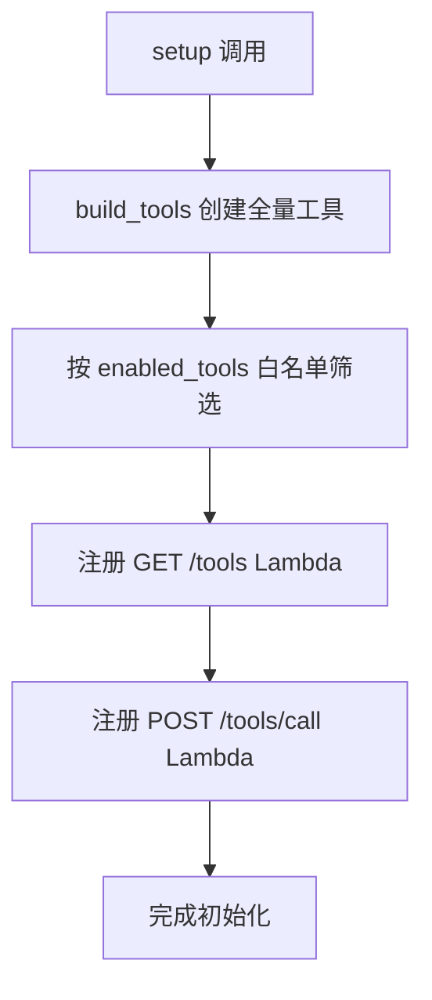

此流程图展示 setup 的核心执行链路：创建全量工具 → 白名单筛选 → 注册 HTTP 路由。

### 86.7.4 server_tools::invoke()：按名线性查找分发

源码路径：`tools/server/server-tools.cpp` - `server_tools::invoke()`（第 925-931 行）

```cpp
json server_tools::invoke(const std::string & name, const json & params) {
    // 线性遍历查找工具名
    for (auto & t : tools) {
        if (t->name == name) {
            return t->invoke(params); // 多态调用派生类实现
        }
    }
    // 未找到返回标准错误格式
    return {{"error", "unknown tool: " + name}};
}
```

这段代码实现了工具调度的核心分发逻辑：线性查找（工具数量极少时 O(n) 可接受）、多态调用、统一错误格式。若工具名不在启用列表中，setup 阶段已过滤，此处直接返回 "unknown tool"。正如调度员查工具架、找到工具、交给工人、收工汇报。

```mermaid
flowchart TD
    A[invoke 调用] --> B[遍历 tools 向量]
    B --> C{t->name == name?}
    C -->|是| D[t->invoke(params) 多态调用]
    C -->|否| E[继续下一个]
    D --> F[返回结果]
    E --> B
    B -->|遍历结束| G[返回 unknown tool error]
```

此流程图展示 invoke 的核心执行链路：线性查找 → 多态调用 → 返回结果或错误。

### 86.7.5 模块依赖图：继承体系与组合关系

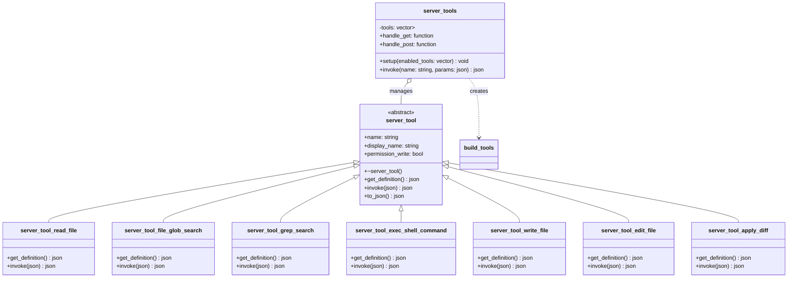

此图展示 `server_tool` 七大派生类的继承体系，以及 `server_tools` 通过 `vector<unique_ptr<server_tool>>` 组合管理所有工具实例、并在 `setup()` 中调用 `build_tools()` 工厂函数的关系。正如装修公司的组织架构图：工具族谱 + 调度室持有工具实例 + 采购清单创建工具。

## 86.8 设计中的取舍

为什么不直接用 `system()` 而要手写 `run_process()`？正如租借机械不能只用钥匙启动就不管了，`system()` 无法捕获 stdout/stderr、无法设置超时强制杀死、无法限制输出大小、会阻塞主线程。`run_process()` 通过 fork+pipe+execvp 实现了非阻塞输出捕获、精确超时控制、输出硬性截断，是生产级子进程执行的最小完备实现。

为什么 `edit_file` 要逆序处理操作？正如手术要从深层到浅层操作避免位移，正序处理会导致前序操作（如删除第 5 行）改变后续操作的行号语义。逆序处理（从大行号到小行号）保证每个操作的行号引用始终指向原始文件位置，避免偏移 Bug。

为什么 `apply_diff` 要写临时文件而不是管道传给 `git apply --stdin`？正如焊接复杂接头需实体焊丝而非气体保护，`git apply` 对 stdin 支持不稳定（某些版本不支持 `--stdin`），且临时文件方式便于调试（失败时可保留 patch 文件人工检查）。mkstemp 保证文件名唯一，用后即删无残留。

`server_tools.invoke()` 线性查找会不会成为瓶颈？目前仅 7 个内置工具，线性查找纳秒级，完全可忽略。若未来扩展到百级工具，可改用 `std::unordered_map<std::string, server_tool*>` O(1) 查找，但当前架构 YAGNI。

权限模型为何只分 `permission_write` 一个布尔位？当前威胁模型简单：只读操作无副作用可自由调用，写操作有副作用需人工确认。细粒度 RBAC 会引入配置复杂度，当前单一布尔位已覆盖 90% 场景，遵循「简单优先」原则。正如装修工具只分「测量类」与「施工类」两档，已足够应对大多数现场。

## 86.9 动手练习

1. **阅读只读工具的实现边界**
   阅读 `tools/server/server-tools.cpp` 第184-469行，对比三个只读工具：
   1. `server_tool_read_file::invoke()` — 行范围读取
   2. `server_tool_file_glob_search::invoke()` — 递归 glob 匹配
   3. `server_tool_grep_search::invoke()` — 正则搜索
   回答问题：
   - read_file 如何处理 start_line/end_line 越界的情况？
   - grep_search 的 max_results 默认值是多少，超过后如何截断？
   - 三个工具的 permission_write 值是什么？如果改成 true 会在 HTTP 层触发什么不同的行为？

2. **剖析写工具的编辑验证逻辑**
   阅读 `tools/server/server-tools.cpp` 第620-790行的 `server_tool_edit_file::invoke()`：
   1. 梳理 replace/delete/append 三种操作的行号验证流程
   2. 观察变更应用后如何重新组装文件内容
   3. 对比 apply_diff（803-853行）的临时文件+git apply 方案
   回答问题：
   - edit_file 在哪些情况下会拒绝编辑并返回错误？
   - apply_diff 为什么要写临时文件而不是直接管道传输？
   - 如果 edit_file 与 apply_diff 修改同一文件冲突，llama.cpp 如何感知？

3. **攻破 exec_shell_command 的安全围栏**
   阅读 `tools/server/server-tools.cpp` 第100-180行的 `run_process()` 与第483-544行的 `server_tool_exec_shell_command::invoke()`：
   1. 梳理子进程创建、stdout/stderr 捕获、超时 kill 的完整链路
   2. 分析 run_proc_result 结构体中三个字段的填充时机
   3. 思考默认 60 秒超时与 10MB 输出限制的攻防意义
   回答问题：
   - 如果 LLM 请求执行 `sleep 120`，run_process 会如何表现？
   - 输出超过 max_output_bytes 时是静默截断还是报错？
   - 为何不直接用 system() 而要手写 run_process()？

4. **设计并注册一个自定义工具**
   基于 `tools/server/server-tools.h` 第6-22行的契定，设计一个新工具 `server_tool_word_count`（统计文件字数）：
   1. 在头文件中声明类，继承 server_tool
   2. 实现 get_definition()，定义 path 与 count_lines/count_chars 参数
   3. 实现 invoke()，读取文件并返回统计 JSON
   4. 修改 `__main__` 中的工厂代码（856-863行）将新工具加入向量
   回答问题：
   - 新工具的 permission_write 应该设为 true 还是 false？为什么？
   - 如果 enabled_tools 参数未包含你的工具名，setup() 会如何处理？
   - handle_post 收到未知工具名时返回什么格式的错误？

5. **追踪 HTTP 工具调用的完整链路**
   阅读 `tools/server/server-tools.cpp` 第865-931行的 `server_tools::setup()` 与 `server_tools::invoke()`：
   1. 梳理 GET /tools 端点如何序列化所有启用工具的 Schema
   2. 梳理 POST /tools/call 端点从 JSON 请求到工具 invoke 的调用链
   3. 观察 invoke() 中按名称匹配的线性查找实现
   回答问题：
   - 当工具数量增长到 100 个时，线性查找是否会成为瓶颈？如何优化？
   - setup() 中的 lambda 捕获 this 指针，如果 server_tools 对象销毁会发生什么？
   - to_json() 与 get_definition() 返回的内容有何本质区别，各自服务于谁？

## 86.10 本章小结

这一章中我们学习了 llama.cpp 服务端的 Agent 工具系统。首先理解了 server_tool 抽象基类定义的三大契约（get_definition/invoke/to_json）与 permission_write 安全标记；其次剖析了只读三剑客 read_file/glob_search/grep_search 的参数 Schema 与核心实现；接着深入写操作三件套 write_file/edit_file/apply_diff 的编辑语义与验证逻辑；然后解析了最高风险的 exec_shell_command 及其底层 run_process 基础设施的多层安全围栏；最后梳理了 server_tools 注册表的工厂模式、白名单筛选、HTTP 路由注册与分发调用全流程。

本章我们一起学习了以下概念：

下表汇总了本章核心概念及其解释，便于快速回顾与检索：

| 概念 | 解释 |
|------|------|
| server_tool | Agent工具的抽象基类，定义get_definition/invoke/to_json三大契约与permission_write安全标记 |
| get_definition() | 返回OpenAI Function Calling格式的JSON Schema，向LLM描述工具参数与用法 |
| invoke(json) | 统一输入输出接口，JSON入JSON出，屏蔽底层实现差异 |
| permission_write | 布尔安全标记：false=只读工具自由调用，true=写操作需用户确认 |
| read_file | 只读工具，支持start_line/end_line行范围读取与行号前缀 |
| file_glob_search | 只读工具，基于glob模式递归搜索文件，返回相对路径列表 |
| grep_search | 只读工具，正则表达式搜索，支持文件/目录模式与最大匹配数限制 |
| write_file | 写工具，自动create_directories创建父目录后写入内容 |
| edit_file | 写工具，replace/delete/append三种行级精准编辑，带行号合法性验证 |
| apply_diff | 写工具，接收unified diff写临时文件后调用git apply原子应用 |
| exec_shell_command | 高危写工具，通过run_process执行shell，默认60秒超时+10MB输出限制 |
| run_process() | 进程执行基础设施，fork子进程、捕获stdout/stderr、超时强制kill |
| run_proc_result | 进程执行结果载体，含output/exit_code/timeout三字段 |
| server_tools | 工具注册表，vector管理unique_ptr工具实例，setup筛选+HTTP路由注册 |
| build_tools | 工厂函数，集中创建全部7个内置工具实例 |
| handle_get/handle_post | HTTP处理器：GET返回工具Schema列表，POST按名分发工具调用 |

下一章中，我们将学习 llama.cpp 的客户端 WebUI 前端架构：SvelteKit 组件库、响应式状态存储、服务层与类型系统，理解一个完整的前端应用如何与后端工具生态协作。


