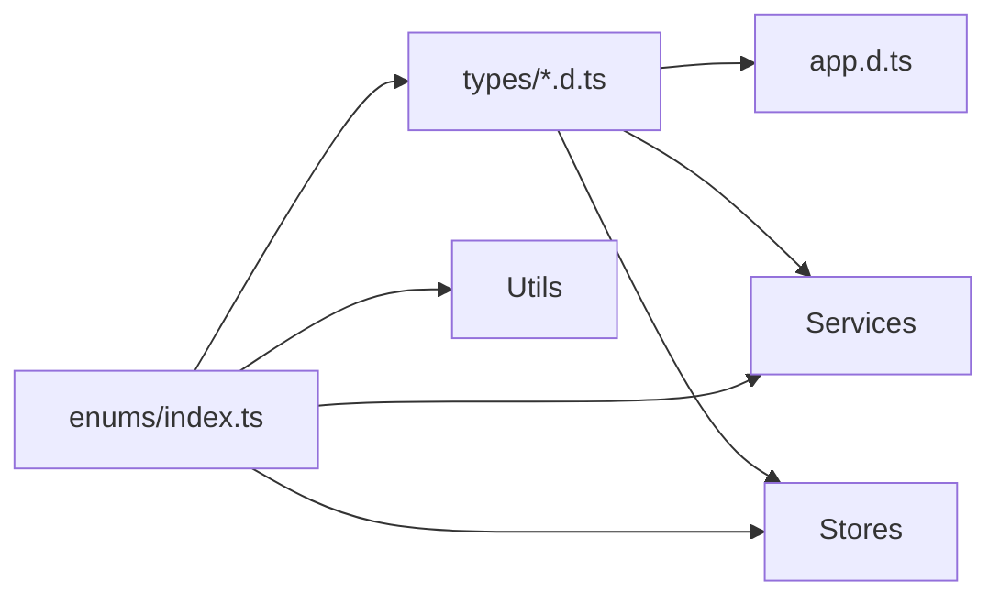
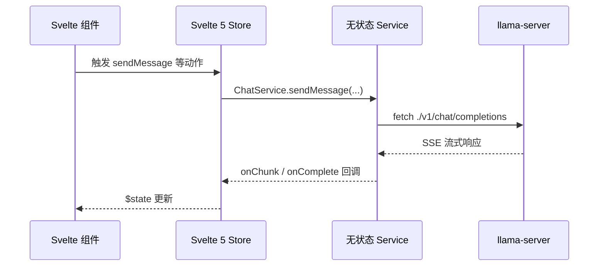
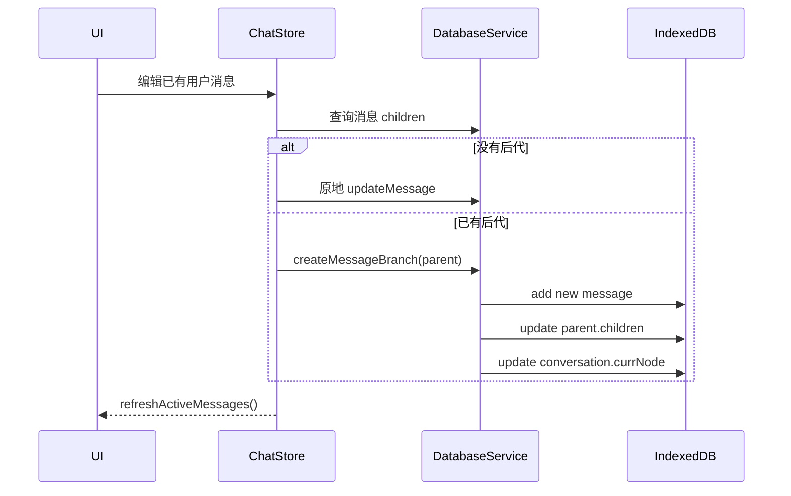
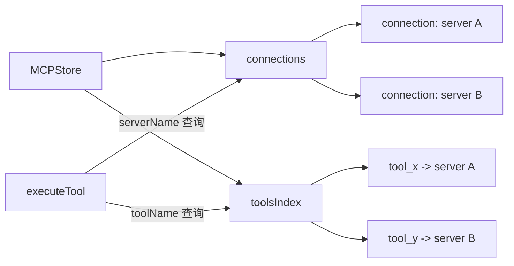
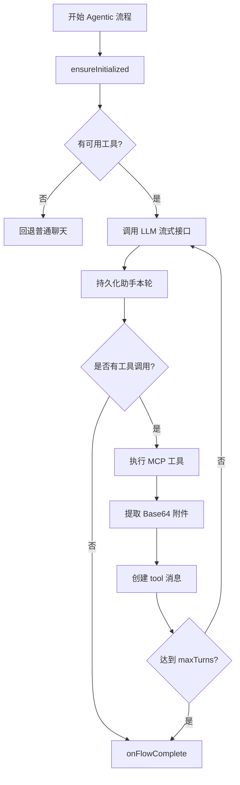
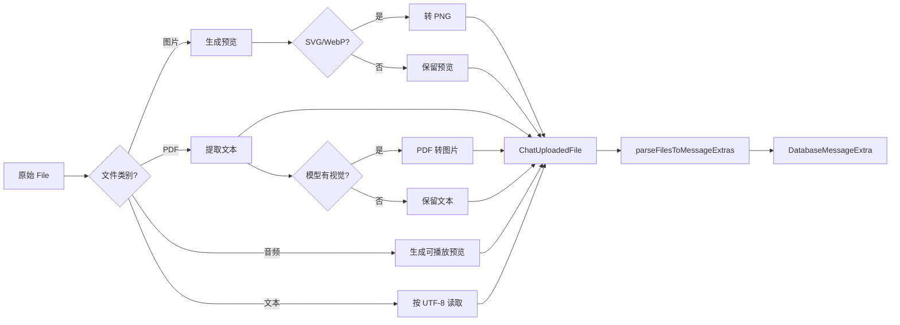
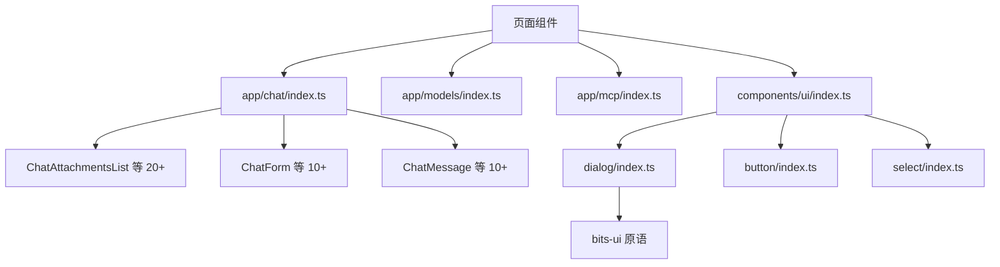

# 第87章 WebUI 源码解析 —— 驯服虚拟机场：llama-server 的前端工程

## 学习目标

- 理解 WebUI 的 SvelteKit、Vite、Storybook 与 ESLint 工程基座
- 掌握 TypeScript 全局类型、枚举、API 类型与数据库 Schema 构成的类型契约体系
- 理解服务层的无状态设计，以及 ChatService 如何适配 OpenAI 兼容接口与 SSE 流式响应
- 掌握 Svelte 5 Runes 驱动的 SettingsStore、ServerStore、ModelsStore、ConversationsStore 与 ChatStore
- 理解 Dexie/IndexedDB 如何持久化会话、消息树、分支和附件
- 掌握 MCPService 与 MCPStore 的连接生命周期、工具索引、自动重连和资源管理
- 理解 AgenticStore 如何编排 LLM 与 MCP 工具的多轮循环
- 掌握文件类型检测、PDF/音频处理、Markdown/LaTeX 管线、TTL 缓存与 URI 模板展开
- 理解 Barrel Export、bits-ui 原语封装、Context API 和无障碍组件组织方式

## 87.1 生活类比：WebUI 是一座 "智能机场塔台"

把 WebUI 想象成一座繁忙的智能机场。SvelteKit 与 Vite 是机场的基础设施：跑道、航站楼和调度系统决定飞机如何进出；TypeScript 类型与枚举是机场的统一通信标准，确保塔台、地勤和机组对"航班状态""货物类型""目的地"有一致理解。Store 是塔台控制台，`SettingsStore` 管理机场运行规则，`ServerStore` 监控主机场服务器，`ModelsStore` 管理可用的"飞机机队"，`ConversationsStore` 保存航班记录，`ChatStore` 则负责调度一架具体的对话航班。Service 是地勤与通信部门，`ChatService` 负责与推理服务器通信，`DatabaseService` 负责把航班日志写入本地数据库，`MCPService` 负责连接外部工具机场。MCP 工具就像外部机场的跑道、气象站和货运仓库，AgenticStore 则像智能塔台：它让模型先提出行动，再调用工具，拿到结果后继续决策。Markdown、LaTeX、文件处理和缓存工具则是机场的专用设备：负责清理货物、识别格式、生成预览、缓存常用信息，并把最终结果安全地交给乘客。这个比喻将贯穿全章，帮助我们在每个源码解析单元中都找到对应的机场意象。

## 87.2 源码地图：从工程基座到业务航线

```text
tools/server/webui/
├── .storybook/
│   ├── main.ts
│   ├── preview.ts
│   ├── ModeWatcherDecorator.svelte
│   └── TooltipProviderDecorator.svelte
├── svelte.config.js
├── vite.config.ts
├── eslint.config.js
├── playwright.config.ts
├── src/
│   ├── app.d.ts                     # 全局类型提升与 Window 扩展
│   ├── lib/
│   │   ├── enums/
│   │   │   ├── agentic.ts            # 工具调用与 Agentic 展示区块枚举
│   │   │   ├── attachment.ts         # 附件类型枚举
│   │   │   ├── chat.ts               # 聊天角色、内容类型、推理格式等枚举
│   │   │   ├── files.ts              # 文件类型、MIME、扩展名与特殊类型枚举
│   │   │   ├── index.ts              # 枚举统一出口
│   │   │   ├── mcp.ts                # MCP 连接阶段、日志级别、传输类型等枚举
│   │   │   ├── model.ts              # 模型模态枚举
│   │   │   ├── server.ts             # 服务器角色与模型状态枚举
│   │   │   ├── settings.ts           # 参数来源、同步类型与设置字段类型枚举
│   │   │   ├── ui.ts                 # 颜色模式、URL 协议、MCP Prompt 变体等枚举
│   │   │   └── keyboard.ts           # 键盘按键枚举
│   │   ├── types/
│   │   │   ├── agentic.d.ts          # Agentic 编排配置、消息联合类型与回调接口
│   │   │   ├── api.d.ts              # API 请求/响应/消息/属性/模型类型
│   │   │   ├── chat.d.ts             # 聊天消息、附件、流式回调与统计类型
│   │   │   ├── database.d.ts         # 对话、消息、附件与导出类型
│   │   │   ├── index.ts              # 类型统一出口
│   │   │   ├── mcp.d.ts              # MCP 连接、能力、资源、订阅与健康检查类型
│   │   │   └── settings.d.ts         # 设置值、字段配置、参数同步类型
│   │   ├── constants/
│   │   │   ├── agentic.ts            # Agentic 配置、标记与迁移正则常量
│   │   │   ├── api-endpoints.ts      # API 路径与 CORS 代理端点
│   │   │   ├── attachment-labels.ts  # 附件标签常量
│   │   │   ├── auto-scroll.ts        # 自动滚动间隔与阈值
│   │   │   ├── binary-detection.ts   # 二进制检测默认选项
│   │   │   ├── cache.ts              # 缓存 TTL 与条目数限制
│   │   │   ├── chat-form.ts          # 聊天表单初始大小与触发前缀
│   │   │   ├── code-blocks.ts        # 代码块 CSS 类名常量
│   │   │   ├── code.ts               # 语言匹配与 HTML 转义正则
│   │   │   ├── context-keys.ts       # Context API 键名常量
│   │   │   ├── css-classes.ts        # 常用 CSS 类常量
│   │   │   ├── favicon.ts            # Google favicon 服务常量
│   │   │   ├── floating-ui-constraints.ts # 浮动元素边距与偏移
│   │   │   ├── formatters.ts         # 时间与数字格式化常量
│   │   │   ├── icons.ts              # 文件类型与模态图标映射
│   │   │   ├── key-value-pairs.ts    # 键值对长度与安全正则
│   │   │   ├── latex-protection.ts   # LaTeX 保护正则常量
│   │   │   ├── literal-html.ts       # 原始 HTML 转文本常量
│   │   │   ├── localstorage-keys.ts  # localStorage 键名常量
│   │   │   ├── markdown.ts           # 图片错误处理 DOM 选择器
│   │   │   ├── max-bundle-size.ts    # 构建产物大小限制
│   │   │   ├── mcp-form.ts           # MCP 表单占位符与最小输入长度
│   │   │   ├── mcp-resource.ts       # 资源类型扩展名与 URI 正则
│   │   │   ├── mcp.ts                # MCP 协议版本、重连与超时常量
│   │   │   ├── message-export.ts     # 导出文件名净化常量
│   │   │   ├── model-id.ts           # 模型 ID 解析分隔符与正则
│   │   │   ├── precision.ts          # 浮点精度乘数与小数位数
│   │   │   ├── processing-info.ts    # 处理信息超时与统计单位
│   │   │   ├── settings-config.ts    # 设置默认值与描述信息
│   │   │   ├── settings-fields.ts    # 数字字段与正整数校验列表
│   │   │   ├── settings-keys.ts      # 设置键名常量对象
│   │   │   ├── settings-sections.ts  # 设置面板分区标题
│   │   │   ├── tooltip-config.ts     # Tooltip 延迟时长
│   │   │   ├── ui.ts                 # 分叉树深度与系统消息占位符
│   │   │   ├── uri-template.ts       # URI 模板表达式正则与操作符
│   │   │   └── viewport.ts           # 移动端断点常量
│   │   ├── services/
│   │   │   ├── chat.service.ts       # OpenAI 兼容请求与 SSE
│   │   │   ├── database.service.ts   # Dexie/IndexedDB
│   │   │   ├── index.ts              # 服务层统一出口
│   │   │   ├── mcp.service.ts        # MCP SDK 通信
│   │   │   ├── models.service.ts     # 模型 API 与 ID 解析
│   │   │   ├── parameter-sync.service.ts # 参数同步
│   │   │   └── props.service.ts      # /props 接口
│   │   ├── stores/
│   │   │   ├── agentic.svelte.ts     # Agentic 多轮循环编排
│   │   │   ├── chat.svelte.ts        # 聊天流式与消息操作
│   │   │   ├── conversations.svelte.ts # 会话与消息树管理
│   │   │   ├── mcp-resources.svelte.ts # MCP 资源缓存与订阅
│   │   │   ├── mcp.svelte.ts         # MCP 连接池与工具索引
│   │   │   ├── models.svelte.ts      # 模型列表与能力
│   │   │   ├── persisted.svelte.ts   # localStorage 持久化辅助
│   │   │   ├── server.svelte.ts      # 服务器属性与角色
│   │   │   └── settings.svelte.ts    # 设置与主题
│   │   ├── contexts/
│   │   │   ├── chat-actions.context.ts  # 聊天操作 Context
│   │   │   ├── chat-settings-dialog.context.ts # 设置对话框 Context
│   │   │   ├── index.ts                 # Context 统一出口
│   │   │   └── message-edit.context.ts  # 消息编辑 Context
│   │   ├── components/
│   │   │   ├── app/
│   │   │   │   ├── actions/index.ts   # 操作类小组件
│   │   │   │   ├── badges/index.ts    # 徽章组件
│   │   │   │   ├── chat/index.ts      # 聊天组件（20+ 个）
│   │   │   │   ├── content/index.ts   # Markdown/代码/可折叠内容
│   │   │   │   ├── dialogs/index.ts   # 对话框组件（16 个）
│   │   │   │   ├── forms/index.ts     # 表单输入组件
│   │   │   │   ├── mcp/index.ts       # MCP 服务器与资源组件
│   │   │   │   ├── misc/index.ts      # 杂项组件
│   │   │   │   ├── models/index.ts    # 模型选择与展示组件
│   │   │   │   ├── navigation/index.ts # 下拉菜单导航组件
│   │   │   │   └── server/index.ts    # 服务器状态组件
│   │   │   └── ui/
│   │   │       ├── alert/index.ts
│   │   │       ├── alert-dialog/index.ts
│   │   │       ├── badge/index.ts
│   │   │       ├── button/index.ts
│   │   │       ├── card/index.ts
│   │   │       ├── checkbox/index.ts
│   │   │       ├── collapsible/index.ts
│   │   │       ├── dialog/index.ts
│   │   │       ├── dropdown-menu/index.ts
│   │   │       ├── label/index.ts
│   │   │       ├── popover/index.ts
│   │   │       ├── scroll-area/index.ts
│   │   │       ├── select/index.ts
│   │   │       ├── separator/index.ts
│   │   │       ├── sheet/index.ts
│   │   │       ├── sidebar/index.ts
│   │   │       ├── skeleton/index.ts
│   │   │       ├── switch/index.ts
│   │   │       ├── table/index.ts
│   │   │       ├── textarea/index.ts
│   │   │       ├── tooltip/index.ts
│   │   │       └── utils.ts           # cn() 工具函数
│   │   ├── markdown/
│   │   │   ├── enhance-code-blocks.ts
│   │   │   ├── enhance-links.ts
│   │   │   ├── literal-html.ts
│   │   │   ├── rehype-rtl-support.ts
│   │   │   ├── resolve-attachment-images.ts
│   │   │   └── table-html-restorer.ts
│   │   ├── actions/
│   │   │   └── fade-in-view.svelte.ts
│   │   ├── hooks/
│   │   │   ├── is-mobile.svelte.ts
│   │   │   ├── use-auto-scroll.svelte.ts
│   │   │   └── use-processing-state.svelte.ts
│   │   └── utils/
│   │       ├── abort.ts
│   │       ├── agentic.ts
│   │       ├── api-fetch.ts
│   │       ├── api-headers.ts
│   │       ├── api-key-validation.ts
│   │       ├── attachment-display.ts
│   │       ├── attachment-type.ts
│   │       ├── audio-recording.ts
│   │       ├── branching.ts
│   │       ├── browser-only.ts
│   │       ├── cache-ttl.ts
│   │       ├── clipboard.ts
│   │       ├── code.ts
│   │       ├── config-helpers.ts
│   │       ├── conversation-utils.ts
│   │       ├── convert-files-to-extra.ts
│   │       ├── cors-proxy.ts
│   │       ├── data-url.ts
│   │       ├── debounce.ts
│   │       ├── favicon.ts
│   │       ├── file-type.ts
│   │       ├── formatters.ts
│   │       ├── headers.ts
│   │       ├── image-error-fallback.ts
│   │       ├── is-ime-composing.ts
│   │       ├── latex-protection.ts
│   │       ├── legacy-migration.ts
│   │       ├── mcp.ts
│   │       ├── modality-file-validation.ts
│   │       ├── model-names.ts
│   │       ├── pdf-processing.ts
│   │       ├── portal-to-body.ts
│   │       ├── precision.ts
│   │       ├── process-uploaded-files.ts
│   │       ├── sanitize.ts
│   │       ├── svg-to-png.ts
│   │       ├── syntax-highlight-language.ts
│   │       ├── text-files.ts
│   │       ├── text.ts
│   │       ├── uri-template.ts
│   │       ├── uuid.ts
│   │       └── webp-to-png.ts
│   └── routes/
│       ├── +page.ts
│       └── chat/[id]/+page.ts
```

## 87.3 WebUI 工程基座 —— 打造前端的"现代化流水线车间"

### 87.3.1 核心概念

工程基座决定源码如何被编译、测试和部署。该项目不是一个独立运行的传统 SPA，而是要嵌入 llama-server 的静态目录，因此构建配置必须满足三个条件：资源路径可相对定位、路由不依赖服务器重写、构建产物能够被后端直接引用。与此同时，Storybook 提供组件展示与交互验证环境，ESLint 负责约束 Svelte、TypeScript 与 Storybook 文件的质量。在机场类比中，这一单元关注的是跑道和调度规则：如果跑道编号不统一，飞机即使制造完成也无法安全起降。

### 87.3.2 `svelte.config.js`：hash 路由与静态适配器配置

源码路径：`tools/server/webui/svelte.config.js` - `__main__`（1-27行）

```javascript
import { mdsvex } from 'mdsvex'; // 启用 Markdown/SVEX 预处理
import adapter from '@sveltejs/adapter-static'; // 将应用构建为静态站点
import { vitePreprocess } from '@sveltejs/vite-plugin-svelte'; // 启用 Vite 预处理

/** @type {import('@sveltejs/kit').Config} */ // 为配置对象提供类型提示
const config = { // 创建 SvelteKit 配置对象
  preprocess: [vitePreprocess(), mdsvex()], // 同时处理 Svelte 与 SVEX 文件
  kit: { // SvelteKit 核心配置
    paths: { // 路径配置
      relative: true // 使用相对资源路径，支持嵌入任意子目录
    },
    router: { type: 'hash' }, // 使用 #/chat/id 路由，不依赖服务器重写
    adapter: adapter({ // 配置静态适配器
      pages: '../public', // 页面输出到后端 public 目录
      assets: '../public', // 静态资源也输出到该目录
      fallback: 'index.html', // 单页应用回退页面
      precompress: false, // 不额外生成压缩文件
      strict: true // 严格检查静态路由
    }),
    output: { // 输出策略
      bundleStrategy: 'single' // 尽量生成单一 bundle
    },
    alias: { // 项目路径别名
      $styles: 'src/styles' // 统一引用样式目录
    }
  },
  extensions: ['.svelte', '.svx'] // 识别 Svelte 与 SVEX 文件
};

export default config; // 导出给 SvelteKit 使用
```

这段代码将 WebUI 配置为相对路径、hash 路由和静态输出模式。SvelteKit 是 Svelte 官方提供的应用框架，`svelte.config.js` 是它的核心配置文件。配置中，`adapter-static` 将页面与资源直接写入 `../public`，让 llama-server 可以像提供普通静态文件一样提供 WebUI；浏览器只根据 `#` 后的片段切换页面，服务器无需理解前端路由，就像机场的行李分拣系统只需将行李运到指定传送带，而不需要知道航班的目的地详情。

### 87.3.3 `llamaCppBuildPlugin()`：整理最终航站楼资源

源码路径：`tools/server/webui/vite.config.ts` - `llamaCppBuildPlugin()`（33-116行）

```typescript
function llamaCppBuildPlugin() { // 创建自定义 Vite 插件
  return { // 返回插件对象
    name: 'llamacpp:build', // 注册插件名称
    apply: 'build' as const, // 只在生产构建（build）阶段启用，不用于开发服务器（serve）
    closeBundle() { // 等待 Rollup/Vite bundle 完成后执行
      setTimeout(() => { // 延迟执行，等待 adapter 写完静态文件
        try { // 捕获后处理过程中的异常
          const indexPath = resolve('../public/index.html'); // 定位最终 HTML
          if (!existsSync(indexPath)) { // 如果 HTML 不存在
            return; // 直接结束
          }
          let content = readFileSync(indexPath, 'utf-8'); // 读取 HTML 内容

          const faviconPath = resolve('static/favicon.svg'); // 定位 favicon
          if (existsSync(faviconPath)) { // 检查 favicon 是否存在
            const faviconContent = readFileSync(faviconPath, 'utf-8'); // 读取 SVG
            const faviconBase64 = Buffer.from(faviconContent).toString('base64'); // 转 Base64
            const faviconDataUrl = `data:image/svg+xml;base64,${faviconBase64}`; // 生成 Data URL
            content = content.replace( // 替换外链 favicon
              /href="[^"]*favicon\.svg"/g,
              `href="${faviconDataUrl}"`
            );
            console.log('✓ Inlined favicon.svg as base64 data URL'); // 输出日志
          }

          content = content.replace(/\r/g, ''); // 统一换行符
          content = GUIDE_FOR_FRONTEND + '\n' + content; // 注入前端使用指南

          content = content.replace( // 将带 hash 的 JS 引用改成固定路径
            /\/_app\/immutable\/bundle\.[^"]+\.js/g,
            './bundle.js'
          );
          content = content.replace( // 将带 hash 的 CSS 引用改成固定路径
            /\/_app\/immutable\/assets\/bundle\.[^"]+\.css/g,
            './bundle.css'
          );

          writeFileSync(indexPath, content, 'utf-8'); // 写回 HTML
          console.log('✓ Updated index.html'); // 输出处理完成日志

          const immutableDir = resolve('../public/_app/immutable'); // JS bundle 目录
          const bundleDir = resolve('../public/_app/immutable/assets'); // CSS bundle 目录

          if (existsSync(immutableDir)) { // 检查 JS 目录
            const jsFiles = readdirSync(immutableDir) // 读取目录文件
              .filter((f) => f.match(/^bundle\..+\.js$/)); // 找到 hash JS
            if (jsFiles.length > 0) { // 如果找到文件
              copyFileSync( // 复制为固定名称
                resolve(immutableDir, jsFiles[0]),
                resolve('../public/bundle.js')
              );
              console.log(`✓ Copied ${jsFiles[0]} -> bundle.js`); // 输出复制日志
            }
          }

          if (existsSync(bundleDir)) { // 检查 CSS 目录
            const cssFiles = readdirSync(bundleDir) // 读取目录文件
              .filter((f) => f.match(/^bundle\..+\.css$/)); // 找到 hash CSS
            if (cssFiles.length > 0) { // 如果找到文件
              copyFileSync( // 复制为固定名称
                resolve(bundleDir, cssFiles[0]),
                resolve('../public/bundle.css')
              );
              console.log(`✓ Copied ${cssFiles[0]} -> bundle.css`); // 输出复制日志
            }
          }
        } catch (error) { // 捕获文件操作或解析错误
          console.error('Failed to update index.html:', error); // 输出错误
        }
      }, 100); // 延迟 100ms，避免与 adapter 写入竞争
    }
  };
}
```

这段代码是自定义 Vite 插件的核心，扮演着航站楼"行李分拣"的角色。`llamaCppBuildPlugin()` 在构建完成后执行一系列"收尾"加工：等待静态适配器写盘，将 favicon 内嵌为 base64 Data URL 以省去外链请求，把带有 hash 的 JavaScript 与 CSS 文件复制为固定的 `bundle.js` 与 `bundle.css` 并改写 HTML 中的引用路径，最后统一换行符并注入前端使用指南。这种"延迟 + 复制"的策略是为嵌入式部署环境简化后端引用路径而设计的，它也带来了每次构建需额外处理一次产物的代价。

### 87.3.4 `.storybook/main.ts`：Storybook 入口配置与 Vite 权限

源码路径：`tools/server/webui/.storybook/main.ts` - `__main__`（1-25行）

```typescript
import type { StorybookConfig } from '@storybook/sveltekit'; // 导入 Storybook 配置类型
import { dirname, resolve } from 'path'; // 导入路径工具
import { fileURLToPath } from 'url'; // 将模块 URL 转成本地路径

const __dirname = dirname(fileURLToPath(import.meta.url)); // 获取当前配置目录

const config: StorybookConfig = { // 创建 Storybook 配置
  stories: [ // 指定故事文件范围
    '../tests/stories/**/*.mdx', // 加载 MDX 故事
    '../tests/stories/**/*.stories.@(js|ts|svelte)' // 加载 TS/JS/Svelte 故事
  ],
  addons: [ // 注册扩展插件
    '@storybook/addon-svelte-csf', // 支持 Svelte CSF
    '@chromatic-com/storybook', // 视觉回归能力
    '@storybook/addon-vitest', // Vitest 集成
    '@storybook/addon-a11y', // 无障碍检测
    '@storybook/addon-docs' // 文档展示
  ],
  framework: '@storybook/sveltekit', // 使用 SvelteKit 框架
  viteFinal: async (config) => { // 修改 Storybook 的 Vite 配置
    config.server = config.server || {}; // 确保 server 配置存在
    config.server.fs = config.server.fs || {}; // 确保文件系统配置存在
    config.server.fs.allow = [ // 放行测试目录
      ...(config.server.fs.allow || []),
      resolve(__dirname, '../tests')
    ];
    return config; // 返回修改后的配置
  }
};

export default config; // 导出配置
```

这段代码配置 Storybook 的入口，包括故事文件目录、插件列表与框架选择。它通过 `viteFinal` 回调放宽文件系统访问权限，使 Storybook 能够加载位于项目 `tests` 目录下的资源，就像为飞行模拟器开放更多飞行场地一样。

### 87.3.5 `.storybook/preview.ts`：全局预览装饰器

源码路径：`tools/server/webui/.storybook/preview.ts` - `__main__`（1-41行）

```typescript
import type { Preview } from '@storybook/sveltekit'; // 导入 Preview 类型
import '../src/app.css'; // 加载全局样式
import ModeWatcherDecorator from './ModeWatcherDecorator.svelte'; // 导入主题装饰器
import TooltipProviderDecorator from './TooltipProviderDecorator.svelte'; // 导入 Tooltip 装饰器

const preview: Preview = { // 创建全局预览配置
  parameters: { // 配置故事参数
    controls: { // 配置 Controls 自动识别
      matchers: { // 根据字段名匹配控件
        color: /(background|color)$/i, // 识别颜色字段
        date: /Date$/i // 识别日期字段
      }
    },
    backgrounds: { disabled: true }, // 禁用背景切换，保持主题一致
    a11y: { test: 'todo' } // 将无障碍检查标记为待处理
  },
  decorators: [ // 为所有故事注入上下文
    (story) => ({ // 第一层装饰器
      Component: ModeWatcherDecorator, // 提供主题监听
      props: { children: story } // 将故事作为子内容
    }),
    (story) => ({ // 第二层装饰器
      Component: TooltipProviderDecorator, // 提供 Tooltip Provider
      props: { children: story } // 将故事作为子内容
    })
  ]
};

export default preview; // 导出配置
```

这段代码定义 Storybook 的全局预览行为，包括控件匹配、背景禁用和无障碍检查策略。它为所有故事统一注入主题监听与 Tooltip Provider 装饰器，保证每个组件故事的展示环境一致，就像机场所有登机口都统一安装相同的安检设备一样。

### 87.3.6 `playwright.config.ts`：E2E 测试配置

源码路径：`tools/server/webui/playwright.config.ts` - `__main__`（1-12行）

```typescript
import { defineConfig } from '@playwright/test'; // 导入 Playwright 配置函数

export default defineConfig({ // 导出全局测试配置
  webServer: { // 测试前启动本地服务器
    command: 'npm run build && http-server ../public -p 8181', // 先构建再静态服务
    port: 8181, // 指定服务端口
    timeout: 120000, // 允许构建与启动最多两分钟
    reuseExistingServer: false // 不复用已有服务
  },
  testDir: 'tests/e2e' // E2E 测试目录
});
```

这段代码定义 Playwright 端到端测试的运行环境。它要求测试前先执行一次真实构建，再通过 `http-server` 在 8181 端口托管 `../public` 静态目录，从而模拟 llama-server 提供 WebUI 的真实场景，确保测试覆盖的是"飞机从真实跑道起飞"的完整流程。

### 87.3.7 `eslint.config.js`：ESLint Flat Config

源码路径：`tools/server/webui/eslint.config.js` - `__main__`（1-45行）

```javascript
// For more info, see https://github.com/storybookjs/eslint-plugin-storybook#configuration-flat-config-format
import storybook from 'eslint-plugin-storybook'; // Storybook 的 ESLint 规则

import prettier from 'eslint-config-prettier'; // 关闭与 Prettier 冲突的规则
import { includeIgnoreFile } from '@eslint/compat'; // 支持 .gitignore
import js from '@eslint/js'; // JavaScript 推荐的规则集
import svelte from 'eslint-plugin-svelte'; // Svelte 专用规则
import globals from 'globals'; // 提供浏览器与 Node 的全局变量
import { fileURLToPath } from 'node:url'; // 转换 URL 为路径
import ts from 'typescript-eslint'; // TypeScript 推荐的规则集
import svelteConfig from './svelte.config.js'; // 导入 Svelte 配置

const gitignorePath = fileURLToPath(new URL('./.gitignore', import.meta.url)); // 定位忽略文件

export default ts.config( // 使用 typescript-eslint 的配置组合函数
  includeIgnoreFile(gitignorePath), // 忽略 .gitignore 中的文件
  js.configs.recommended, // 启用 JS 推荐规则
  ...ts.configs.recommended, // 启用 TS 推荐规则
  ...svelte.configs.recommended, // 启用 Svelte 推荐规则
  prettier, // 关闭与 Prettier 冲突的规则
  ...svelte.configs.prettier, // Svelte 的 Prettier 兼容规则
  {
    languageOptions: { // 语言选项
      globals: { ...globals.browser, ...globals.node } // 同时提供浏览器与 Node 全局变量
    },
    rules: { // 自定义规则
      // typescript-eslint strongly recommend that you do not use the no-undef lint rule on TypeScript projects.
      // see: https://typescript-eslint.io/troubleshooting/faqs/eslint/#i-get-errors-from-the-no-undef-rule-about-global-variables-not-being-defined-even-though-there-are-no-typescript-errors
      'no-undef': 'off', // 关闭 no-undef，避免 TS 项目误报
      'svelte/no-at-html-tags': 'off', // 允许使用 {@html}
      // This app uses hash-based routing (#/) where resolve() from $app/paths does not apply
      'svelte/no-navigation-without-resolve': 'off' // 关闭导航检查
    }
  },
  {
    files: ['**/*.svelte', '**/*.svelte.ts', '**/*.svelte.js'], // 针对 Svelte 文件
    languageOptions: { // 语言选项
      parserOptions: { // 解析器选项
        projectService: true, // 启用 TS 项目服务
        extraFileExtensions: ['.svelte'], // 允许解析 .svelte
        parser: ts.parser, // 使用 TS 解析器
        svelteConfig // 传入 Svelte 配置
      }
    }
  },
  {
    // Exclude Storybook files from main ESLint rules
    ignores: ['.storybook/**/*'] // 忽略 Storybook 目录
  },
  storybook.configs['flat/recommended'] // 启用 Storybook 推荐规则
);
```

这段代码配置 ESLint 的语言规则与插件组合。它通过 Flat Config 将 JavaScript、TypeScript、Svelte 与 Storybook 的规则集统一编排，并针对项目特性关闭了 `no-undef`、`svelte/no-at-html-tags` 与 `svelte/no-navigation-without-resolve` 这三项与 hash 路由及嵌入式部署不兼容的规则，同时将 `.storybook` 目录排除在主要 lint 范围之外。

### 87.3.8 设计取舍

**问题：为什么 `llamaCppBuildPlugin()` 使用延迟 100 毫秒，而不是直接在 `closeBundle()` 中读文件？**

回答：`closeBundle()` 表示 Rollup 生命周期接近结束，并不总能保证 SvelteKit adapter 的异步文件写入已经完全结束。延迟可以降低文件竞争概率，但它不是严格的同步屏障，这属于构建复杂度与可靠性之间的折中；更严格的实现应使用明确的异步写入完成信号或改写 adapter 集成方式。

**问题：为什么选择 hash 路由而不是 browser 路由，且采用静态部署而不是 SSR？**

回答：WebUI 需要嵌入 llama-server 的静态目录，无法依赖服务器重写规则。hash 路由将路由状态保存在 URL `#` 片段之后，服务器无需任何额外配置即可工作；静态部署则避免了 Node.js 服务端渲染的运行时依赖。代价是丢失了服务端渲染的 SEO 与首屏性能优势，但这是嵌入式部署场景下"简单可靠"与"性能优化"之间的 trade-off。

**问题：为什么把 hash bundle 复制为固定名称？**

回答：后端静态服务或 HTML 模板只需要稳定引用 `./bundle.js` 与 `./bundle.css`，不必了解每次构建生成的新 hash。代价是缓存指纹能力下降，构建流程也增加了一次复制后处理，这体现了"嵌入式部署简单性"与"基于 hash 的缓存优化"之间的 trade-off。

## 87.4 类型契约与枚举体系 —— 统一塔台、机组与地勤的"通信语言"

### 87.4.1 核心概念

类型体系是前端各层之间的契约。API 类型描述服务器能提供什么，数据库类型描述本地能保存什么，聊天类型描述 UI 如何展示什么，MCP 与 Agentic 类型则描述外部工具和多轮编排如何协作。枚举将容易拼写错误的字符串集中为有限集合，避免同一状态在不同模块出现不一致写法。这一层的价值就像机场无线电协议：塔台说一个术语，所有岗位都知道它代表同一状态，从而避免歧义和误解。

### 87.4.2 `app.d.ts`：提升共享类型到全局

源码路径：`tools/server/webui/src/app.d.ts` - `__main__`（1-90行）

```typescript
import type { // 导入共享类型
  ApiChatCompletionRequest, // 聊天请求
  ApiChatCompletionResponse, // 聊天响应
  ApiChatCompletionStreamChunk, // 流式响应片段
  ApiChatMessageData, // API 消息
  ApiErrorResponse, // API 错误
  ChatUploadedFile, // 上传文件
  DatabaseConversation, // 数据库会话
  DatabaseMessage, // 数据库消息
  DatabaseMessageExtra, // 数据库附件
  ModelModality, // 模型能力
  ModelOption, // 模型选项
  SettingsChatServiceOptions, // ChatService 配置
  SettingsConfigValue, // 设置值
  SettingsFieldConfig, // 设置字段
  SettingsConfigType // 设置配置
} from '$lib/types'; // 从统一类型出口导入

import { ServerRole, ServerModelStatus, ModelModality } from '$lib/enums'; // 导入枚举

declare global { // 扩展全局作用域
  export { // 将共享类型重新导出
    ApiChatCompletionRequest, // 暴露 API 请求类型
    ApiChatCompletionResponse, // 暴露 API 响应类型
    ApiChatCompletionStreamChunk, // 暴露流式片段类型
    ApiChatMessageData, // 暴露消息类型
    ApiErrorResponse, // 暴露错误类型
    ChatUploadedFile, // 暴露上传文件类型
    DatabaseConversation, // 暴露会话类型
    DatabaseMessage, // 暴露消息类型
    DatabaseMessageExtra, // 暴露附件类型
    ModelModality, // 暴露模型能力类型
    ModelOption, // 暴露模型选项
    SettingsChatServiceOptions, // 暴露服务选项
    SettingsConfigValue, // 暴露设置值
    SettingsFieldConfig, // 暴露字段配置
    SettingsConfigType, // 暴露设置配置
    ServerRole, // 暴露服务器角色
    ServerModelStatus // 暴露模型状态
  };
}

declare global { // 第二个独立的全局声明块，用于扩展浏览器全局对象
  interface Window { // 扩展 Window 类型
    idxThemeStyle?: number; // 主题样式计数器
    idxCodeBlock?: number; // 代码块 ID 计数器
  }
}
```

这段代码是 SvelteKit 项目的全局类型声明文件。它通过两个独立的 `declare global` 块，将 API、聊天、数据库、模型和设置类型集中提升为全局可用，并为 `Window` 对象增加 `idxThemeStyle` 与 `idxCodeBlock` 两个项目专用属性，让组件、服务和 Markdown 插件共享同一套类型边界，减少重复导入与隐式 `any`。

### 87.4.3 `ToolCallType` 与 `AgenticSectionType`：协议状态的枚举化

源码路径：`tools/server/webui/src/lib/enums/agentic.ts` - `ToolCallType`、`AgenticSectionType`（1-19行）

```typescript
export enum ToolCallType { // 定义工具调用类型枚举
  FUNCTION = 'function' // 与 OpenAI Function Calling 协议对齐
}

export enum AgenticSectionType { // 定义 Agentic 展示区块
  TEXT = 'text', // 普通文本
  TOOL_CALL = 'tool_call', // 已完成的工具调用
  TOOL_CALL_PENDING = 'tool_call_pending', // 等待工具结果
  TOOL_CALL_STREAMING = 'tool_call_streaming', // 工具调用仍在流式接收
  REASONING = 'reasoning', // 推理内容
  REASONING_PENDING = 'reasoning_pending' // 等待推理内容
}
```

这段代码定义了 Agentic 功能需要的两个枚举。`ToolCallType.FUNCTION` 对齐 OpenAI Function Calling 协议，确保工具调用类型与后端识别一致；`AgenticSectionType` 则用六个值描述一次 Agentic 展示中出现的所有区块状态，让 UI 可以根据类型渲染不同的内容样式。

### 87.4.4 `ChatMessageStatsView`、`ReasoningFormat`、`MessageRole`、`MessageType`、`ContentPartType`、`ErrorDialogType`：聊天相关枚举

源码路径：`tools/server/webui/src/lib/enums/chat.ts` - `ChatMessageStatsView`、`ReasoningFormat`、`MessageRole`、`MessageType`、`ContentPartType`、`ErrorDialogType`（1-80行）

```typescript
export enum MessageRole { // 定义消息角色
  SYSTEM = 'system', // 系统消息
  USER = 'user', // 用户消息
  ASSISTANT = 'assistant', // 助手消息
  TOOL = 'tool' // 工具结果消息
}

export enum MessageType { // 定义消息内容类型
  TEXT = 'text', // 文本消息
  ROOT = 'root' // 隐藏根节点
}

export enum ContentPartType { // 定义多模态内容片段
  TEXT = 'text', // 文本片段
  IMAGE_URL = 'image_url', // 图片 URL
  INPUT_AUDIO = 'input_audio' // 音频输入
}

export enum ReasoningFormat { // 定义推理格式
  NONE = 'none', // 不处理推理
  DEEPSEEK = 'deepseek' // DeepSeek 风格推理
}

export enum ErrorDialogType { // 定义错误对话框类型
  SERVER = 'server', // 服务端错误
  TIMEOUT = 'timeout' // 超时错误
}
```

这段代码定义了聊天模块的六个核心枚举。`MessageRole` 区分系统、用户、助手和工具结果；`MessageType` 区分普通文本与隐藏根节点；`ContentPartType` 描述多模态内容片段；`ReasoningFormat` 决定推理内容的解析方式；`ErrorDialogType` 区分服务端错误与超时错误。这些枚举为 UI、Store、Service 与索引数据库的跨层协作提供了稳定且一致的状态协议。

### 87.4.5 `MCPService` 连接状态相关枚举

源码路径：`tools/server/webui/src/lib/enums/mcp.ts` - `MCPConnectionPhase`、`MCPLogLevel`、`MCPTransportType`、`HealthCheckStatus`、`MCPContentType`、`JsonSchemaType`、`MCPRefType`（1-105行）

```typescript
export enum MCPConnectionPhase { // MCP 连接生命周期阶段
  IDLE = 'idle', // 空闲
  TRANSPORT_CREATING = 'transport_creating', // 创建传输
  CONNECTING = 'connecting', // 连接中
  INITIALIZING = 'initializing', // 初始化
  READY = 'ready', // 就绪
  ERROR = 'error', // 出错
  DISCONNECTED = 'disconnected' // 已断开
}

export enum MCPLogLevel { // 连接日志级别
  INFO = 'info', // 信息
  WARN = 'warn', // 警告
  ERROR = 'error' // 错误
}

export enum MCPTransportType { // 传输类型
  WEBSOCKET = 'websocket', // WebSocket
  STREAMABLE_HTTP = 'streamable_http', // Streamable HTTP
  SSE = 'sse' // Server-Sent Events
}

export enum HealthCheckStatus { // 健康检查状态
  IDLE = 'idle', // 未执行
  CONNECTING = 'connecting', // 连接中
  SUCCESS = 'success', // 成功
  ERROR = 'error' // 失败
}

export enum MCPContentType { // 工具结果内容类型
  TEXT = 'text', // 文本
  IMAGE = 'image' // 图片
}

export enum JsonSchemaType { // JSON Schema 类型
  OBJECT = 'object', // 对象
  STRING = 'string', // 字符串
  // ... 其余类型
}

export enum MCPRefType { // 补全引用类型
  PROMPT = 'prompt', // 提示词
  RESOURCE = 'resource' // 资源
}
```

这段代码定义了 MCP 模块的七个枚举。`MCPConnectionPhase` 描述连接生命周期的七个阶段，`MCPLogLevel` 区分日志严重程度，`MCPTransportType` 标识三种传输协议，`HealthCheckStatus` 表示健康检查的四种状态，`MCPContentType` 区分工具结果的文本与图片，`JsonSchemaType` 对应 JSON Schema 的标准类型，`MCPRefType` 则用于补全请求中区分提示词与资源。

### 87.4.6 `AgenticConfig`、`AgenticMessage`、`AgenticSession`、`AgenticFlowCallbacks`：Agentic 类型契约

源码路径：`tools/server/webui/src/lib/types/agentic.d.ts` - `AgenticConfig`、`AgenticMessage`、`AgenticSession`、`AgenticFlowCallbacks`（1-135行）

```typescript
export interface AgenticConfig { // 定义 Agentic 配置
  enabled: boolean; // 是否启用
  maxTurns: number; // 最大轮次
  maxToolPreviewLines: number; // 工具结果预览行数
}

export type AgenticToolCallPayload = { // 定义工具调用载荷
  id: string; // 工具调用 ID
  type: ToolCallType.FUNCTION; // 工具类型
  function: { // 函数描述
    name: string; // 工具名称
    arguments: string; // JSON 参数字符串
  };
};

export type AgenticMessage = // 定义 Agentic 消息联合类型
  | { // 系统或用户消息分支
      role: MessageRole.SYSTEM | MessageRole.USER; // 限定角色
      content: string | ApiChatMessageContentPart[]; // 支持文本或多模态
    }
  | { // 助手消息分支
      role: MessageRole.ASSISTANT; // 限定为助手
      content?: string | ApiChatMessageContentPart[]; // 内容可为空
      tool_calls?: AgenticToolCallPayload[]; // 可选工具调用
    }
  | { // 工具消息分支
      role: MessageRole.TOOL; // 限定为工具结果
      tool_call_id: string; // 关联调用 ID
      content: string | ApiChatMessageContentPart[]; // 工具结果
    };

export interface AgenticSession { // 定义单会话运行状态
  isRunning: boolean; // 是否运行中
  currentTurn: number; // 当前轮次
  totalToolCalls: number; // 工具调用总数
  lastError: Error | null; // 最近错误
  streamingToolCall: { name: string; arguments: string } | null; // 流式工具调用
}

export interface AgenticFlowCallbacks { // 定义流程回调契约
  onChunk?: (chunk: string) => void; // 文本增量
  onReasoningChunk?: (chunk: string) => void; // 推理增量
  onToolCallsStreaming?: (toolCalls: ApiChatCompletionToolCall[]) => void; // 工具增量
  onAttachments?: (messageId: string, extras: DatabaseMessageExtra[]) => void; // 附件
  onAssistantTurnComplete?: (...) => Promise<void>; // 单轮完成
  createToolResultMessage?: (...) => Promise<DatabaseMessage>; // 创建工具消息
  createAssistantMessage?: () => Promise<DatabaseMessage>; // 创建助手消息
  onFlowComplete?: (timings?: ChatMessageTimings) => void; // 全流程完成
  onError?: (error: Error) => void; // 错误
  onTimings?: (...) => void; // 性能统计
  onTurnComplete?: (timings: ChatMessageTimings) => void; // 中间轮次完成
}
```

这段代码定义了 Agentic 编排所需的全部类型契约。`AgenticConfig` 控制循环的启用状态与轮次上限；`AgenticMessage` 通过角色区分系统、用户、助手和工具消息，保证每种消息只携带与角色匹配的字段；`AgenticSession` 保存每个会话的运行快照；`AgenticFlowCallbacks` 则定义了流式增量、单轮完成、工具执行、附件和全流程完成等全部回调签名。

### 87.4.7 模块依赖图



### 87.4.8 设计取舍

**问题：为什么项目同时使用类型别名、接口和枚举，而不是全部使用字符串联合类型？**

回答：接口适合表达可扩展对象结构，类型别名适合联合类型和组合类型，枚举适合跨模块复用并提供稳定命名。枚举的运行时产物会增加少量代码体积，但换来了更清晰的协议语义，这是可读性、运行时可用性与 bundle 体积之间的 trade-off。

## 87.5 服务层与 API 协议 —— 塔台与外部机场的"无状态通信中心"

### 87.5.1 核心概念

Service 层负责通信、转换和持久化，但不直接持有页面状态。它接收参数，调用外部 API，解析结果，再通过返回值或回调把事件交给 Store。这样的无状态设计让服务易于测试、复用和替换，也避免网络逻辑散落在组件中。在本节中，我们将重点阐述标准 API 请求封装、服务器属性读取、模型管理、参数同步，以及 ChatService 的 OpenAI 兼容协议和 SSE 流式响应等内容。

### 87.5.2 服务调用链



### 87.5.3 `apiFetch()`：统一封装浏览器 fetch 请求

源码路径：`tools/server/webui/src/lib/utils/api-fetch.ts` - `apiFetch()`（49-73行）

```typescript
export async function apiFetch<T>( // 定义泛型 GET 请求函数
  path: string, // 接口路径
  options: ApiFetchOptions = {} // 请求选项
): Promise<T> { // 返回解析后的泛型数据
  const { authOnly = false, headers: customHeaders, ...fetchOptions } = options; // 拆分选项
  const baseHeaders = authOnly ? getAuthHeaders() : getJsonHeaders(); // 选择认证或 JSON 头
  const headers = { ...baseHeaders, ...customHeaders }; // 合并自定义头

  const url = // 计算最终 URL
    path.startsWith(UrlProtocol.HTTP) || path.startsWith(UrlProtocol.HTTPS)
      ? path // 绝对 URL 直接使用
      : `${base}${path}`; // 相对路径拼接应用基础路径

  const response = await fetch(url, { // 发起请求
    ...fetchOptions, // 合并 fetch 参数
    headers // 写入请求头
  });

  if (!response.ok) { // 判断 HTTP 是否成功
    const errorMessage = await parseErrorMessage(response); // 解析错误
    throw new Error(errorMessage); // 抛出统一错误
  }

  return response.json() as Promise<T>; // 解析 JSON 并返回
}
```

这段代码是整个服务层网络请求的核心封装。`apiFetch()` 统一处理了 URL 前缀拼接、JSON/认证请求头的选择、自定义头合并以及 HTTP 错误解析，使得调用方只需关注路径和返回类型。同时它在请求失败时抛出统一结构的 Error，让上层 Store 能够一致地处理错误并展示给用户。

#### 87.5.3.1 `getAuthHeaders()` 与 `getJsonHeaders()`：生成请求认证头

源码路径：`tools/server/webui/src/lib/utils/api-headers.ts` - `getAuthHeaders()`、`getJsonHeaders()`（8-21行）

```typescript
export function getAuthHeaders(): Record<string, string> { // 生成认证头
  const currentConfig = config(); // 读取当前设置
  const apiKey = currentConfig.apiKey?.toString().trim(); // 清理 API Key
  return apiKey ? { Authorization: `Bearer ${apiKey}` } : {}; // 有 Key 才添加 Bearer
}

export function getJsonHeaders(): Record<string, string> { // 生成 JSON 请求头
  return { // 返回头部对象
    'Content-Type': 'application/json', // 声明 JSON
    ...getAuthHeaders() // 合并认证头
  };
}
```

这段代码负责生成请求头。`getAuthHeaders()` 从全局设置中读取 API Key，仅在配置非空时生成 Bearer 认证头；`getJsonHeaders()` 则在 JSON 请求头的基础上合并认证信息。这两个函数被 `apiFetch()` 与聊天请求等模块复用，保证所有对外请求携带一致的认证与内容类型。

### 87.5.4 `PropsService.fetch()`：获取服务器属性

源码路径：`tools/server/webui/src/lib/services/props.service.ts` - `PropsService.fetch()`、`fetchForModel()`（18-46行）

```typescript
static async fetch(autoload = false): Promise<ApiLlamaCppServerProps> { // 获取全局属性
  const params: Record<string, string> = {}; // 创建查询参数
  if (!autoload) { // 默认不自动加载模型
    params.autoload = 'false'; // 显式关闭自动加载
  }
  return apiFetchWithParams<ApiLlamaCppServerProps>( // 请求 /props
    './props',
    params,
    { authOnly: true } // 使用认证头
  );
}

static async fetchForModel( // 获取指定模型属性
  modelId: string, // 模型 ID
  autoload = false // 是否自动加载
): Promise<ApiLlamaCppServerProps> {
  const params: Record<string, string> = { model: modelId }; // 写入模型参数
  if (!autoload) { // 默认关闭自动加载
    params.autoload = 'false'; // 避免意外加载模型
  }
  return apiFetchWithParams<ApiLlamaCppServerProps>('./props', params, {
    authOnly: true // 使用认证头
  });
}
```

这段代码是 `PropsService` 的核心方法，负责与 llama-server 的 `/props` 端点交互。`fetch()` 获取服务器全局属性，`fetchForModel()` 在 ROUTER 模式下按需获取指定模型的属性。两者的关键设计是默认将 `autoload` 显式设为 `false`，从而避免前端在仅查询属性时意外触发模型加载。

### 87.5.5 `ServerStore.fetch()`：管理服务器信息请求

源码路径：`tools/server/webui/src/lib/stores/server.svelte.ts` - `ServerStore.fetch()`（64-85行）

```typescript
async fetch(): Promise<void> { // 获取服务器信息
  if (this.fetchPromise) return this.fetchPromise; // 合并并发请求

  this.loading = true; // 标记加载中
  this.error = null; // 清除旧错误

  const fetchPromise = (async () => { // 创建唯一请求
    try {
      const props = await PropsService.fetch(); // 调用服务层
      this.props = props; // 保存属性
      this.error = null; // 清除错误
      this.detectRole(props); // 判断 MODEL/ROUTER
    } catch (error) { // 捕获异常
      this.error = this.getErrorMessage(error); // 转换为用户友好信息
      console.error('Error fetching server properties:', error); // 记录错误
    } finally { // 无论成功失败都执行
      this.loading = false; // 结束加载
      this.fetchPromise = null; // 允许下次请求
    }
  })();

  this.fetchPromise = fetchPromise; // 保存并发请求
  await fetchPromise; // 等待请求完成
}
```

这段代码是服务器状态层的入口。`ServerStore.fetch()` 通过 `fetchPromise` 合并并发请求，避免多个组件同时触发重复的 `/props` 调用；在成功回调中保存服务器属性并调用 `detectRole()` 判断当前是 MODEL 还是 ROUTER 模式，在失败回调中把原始异常转换为用户友好的错误消息。

### 87.5.6 `ModelsService.parseModelId()`：拆分模型 ID 的多个组成部分

源码路径：`tools/server/webui/src/lib/services/models.service.ts` - `ModelsService.parseModelId()`（120-199行）

```typescript
static parseModelId(modelId: string): ParsedModelId { // 解析模型 ID
  const result: ParsedModelId = { // 创建默认结果
    raw: modelId, // 保留原始 ID
    orgName: null, // 组织名
    modelName: null, // 模型名
    params: null, // 参数规模
    activatedParams: null, // 激活参数规模
    quantization: null, // 量化格式
    tags: [] // 额外标签
  };

  const colonIdx = modelId.indexOf(':'); // 查找冒号量化格式
  let modelPath: string; // 保存去除量化后的路径

  if (colonIdx !== -1) { // 存在冒号
    result.quantization = modelId.slice(colonIdx + 1) || null; // 提取量化
    modelPath = modelId.slice(0, colonIdx); // 保留模型路径
  } else {
    modelPath = modelId; // 没有冒号则保留原值
  }

  const slashIdx = modelPath.indexOf('/'); // 查找组织分隔符
  let modelStr: string; // 保存模型主体

  if (slashIdx !== -1) { // 存在组织名
    result.orgName = modelPath.slice(0, slashIdx); // 提取组织
    modelStr = modelPath.slice(slashIdx + 1); // 提取模型
  } else {
    modelStr = modelPath; // 无组织名
  }

  const dotIdx = modelStr.lastIndexOf('.'); // 检查点分隔量化
  if (dotIdx !== -1 && !result.quantization) { // 尚未提取量化
    const afterDot = modelStr.slice(dotIdx + 1); // 获取点后内容
    if (MODEL_QUANTIZATION_SEGMENT_RE.test(afterDot)) { // 判断量化格式
      result.quantization = afterDot; // 保存量化
      modelStr = modelStr.slice(0, dotIdx); // 删除量化后缀
    }
  }

  const segments = modelStr.split('-'); // 按短横线拆分

  const paramsIdx = segments.findIndex((seg) => MODEL_PARAMS_RE.test(seg)); // 查参数规模
  if (paramsIdx !== -1) { // 找到参数规模
    result.params = segments[paramsIdx].toUpperCase(); // 保存参数量
    result.modelName = segments.slice(0, paramsIdx).join('-'); // 前半段是模型名
    result.tags = segments.slice(paramsIdx + 1); // 后半段是标签
  } else {
    result.modelName = segments.join('-') || null; // 没参数时主体为模型名
  }

  return result; // 返回结构化结果
}
```

这段代码把多种模型命名方式统一转换为结构化对象。`ModelsService.parseModelId()` 依次处理冒号分隔的量化、斜杠分隔的组织名、点分隔的量化后缀，以及短横线分隔的参数规模与标签，最终返回包含 `orgName`、`modelName`、`params`、`quantization` 等字段的对象，为模型选择器、参数徽章和分组逻辑提供基础。

### 87.5.7 `ParameterSyncService.extractServerDefaults()`：提取服务器默认参数

源码路径：`tools/server/webui/src/lib/services/parameter-sync.service.ts` - `ParameterSyncService.extractServerDefaults()`（221-257行）

```typescript
static extractServerDefaults( // 提取服务器默认参数
  serverParams: ApiLlamaCppServerProps['default_generation_settings']['params'] | null, // 服务端生成参数
  webuiSettings?: Record<string, string | number | boolean> // 管理端设置
): ParameterRecord {
  const extracted: ParameterRecord = {}; // 创建提取结果

  if (serverParams) { // 服务端参数存在
    for (const param of SYNCABLE_PARAMETERS) { // 遍历可同步参数表
      if (param.canSync && param.serverKey in serverParams) { // 允许同步且键存在
        const value = (serverParams as unknown as Record<string, ParameterValue>)[
          param.serverKey // 读取服务端值
        ];
        if (value !== undefined) { // 值有效
          // Apply precision rounding to avoid JavaScript floating-point issues
          extracted[param.key] = this.roundFloatingPoint(value); // 归一化浮点精度
        }
      }
    }

    // Handle samplers array conversion to string
    if (serverParams.samplers && Array.isArray(serverParams.samplers)) { // samplers 为数组
      extracted.samplers = serverParams.samplers.join(';'); // 转分号分隔字符串
    }
  }

  if (webuiSettings) { // 管理端设置存在
    for (const param of SYNCABLE_PARAMETERS) { // 遍历可同步参数表
      if (param.canSync && param.serverKey in webuiSettings) { // 允许同步且键存在
        const value = webuiSettings[param.serverKey]; // 读取管理端值
        if (value !== undefined) { // 值有效
          extracted[param.key] = this.roundFloatingPoint(value); // 归一化浮点精度
        }
      }
    }
  }

  return extracted; // 返回提取结果
}
```

这段代码从服务器 `/props` 响应中提取可同步的默认参数。`ParameterSyncService.extractServerDefaults()` 遍历 `SYNCABLE_PARAMETERS` 映射表，对服务端生成参数与管理端 WebUI 设置分别提取，将 `samplers` 数组转换为分号分隔字符串，并对所有数值做浮点精度归一化，为后续的合并与差异对比提供统一的数据源。

### 87.5.8 `ChatService.sendMessage()`：发送聊天补全请求

源码路径：`tools/server/webui/src/lib/services/chat.service.ts` - `ChatService.sendMessage()`（41-226行）

```typescript
static async sendMessage( // 发送聊天补全请求
  messages: ApiChatMessageData[] | (DatabaseMessage & { extra?: DatabaseMessageExtra[] })[], // 支持 API 与数据库消息
  options: SettingsChatServiceOptions = {}, // 请求选项
  conversationId?: string, // 可选会话 ID
  signal?: AbortSignal // 可选取消信号
): Promise<string | void> {
  const { stream, onChunk, onComplete, onError, onReasoningChunk, onToolCallChunk, onModel, onTimings, tools, temperature, max_tokens, ... } = options; // 解构回调与参数
  // Normalize messages: convert DB messages to API format, filter empty system messages
  const normalizedMessages: ApiChatMessageData[] = messages.map(...).filter(...); // 转换消息格式
  // Filter out image attachments if model doesn't support vision
  if (options.model && !modelsStore.modelSupportsVision(options.model)) { ... } // 过滤图片附件
  // Build request body with all parameters
  const requestBody: ApiChatCompletionRequest = { ... }; // 构建请求体
  // Set optional parameters (temperature, max_tokens, sampling, penalties, etc.)
  // Send fetch request to ./v1/chat/completions
  const response = await fetch('./v1/chat/completions', { ... }); // 发起请求
  // Handle errors, stream or non-stream response
  if (stream) { await ChatService.handleStreamResponse(...); } else { return ChatService.handleNonStreamResponse(...); } // 分流处理
  // Catch and classify errors (network, timeout, etc.)
}
```

这段代码是聊天请求的总入口。`ChatService.sendMessage()` 负责将数据库消息与 API 消息统一为 OpenAI 兼容格式，并根据模型能力过滤不支持的图片附件；随后构建包含采样参数、惩罚参数、工具定义与推理格式的请求体，通过 `./v1/chat/completions` 端点发送请求。该函数支持流式与非流式两种模式，并将错误按网络、超时和上下文溢出分类返回给上层。

### 87.5.9 `ChatService.handleStreamResponse()`：处理 SSE 流式响应

源码路径：`tools/server/webui/src/lib/services/chat.service.ts` - `ChatService.handleStreamResponse()`（246-441行）

```typescript
private static async handleStreamResponse( // 处理流式响应
  response: Response, // HTTP 响应
  onChunk?: (chunk: string) => void, // 正文增量回调
  onComplete?: (response: string, reasoningContent?: string, timings?: ChatMessageTimings, toolCalls?: string) => void, // 完成回调
  onError?: (error: Error) => void, // 错误回调
  onReasoningChunk?: (chunk: string) => void, // 推理增量回调
  onToolCallChunk?: (chunk: string) => void, // 工具调用增量回调
  onModel?: (model: string) => void, // 模型名回调
  onTimings?: (timings?: ChatMessageTimings, promptProgress?: ChatMessagePromptProgress) => void, // 计时回调
  conversationId?: string, // 可选会话 ID
  abortSignal?: AbortSignal // 可选取消信号
): Promise<void> {
  const reader = response.body?.getReader(); // 获取流式读取器
  // Initialize aggregation state (content, reasoning, toolCalls, timings)
  // Define finalizeOpenToolCallBatch and processToolCallDelta helpers
  // Read stream chunks, parse SSE lines, extract content/reasoning/toolCalls/timings
  // On stream finished, call onComplete with aggregated results
  // Handle errors and release reader lock
}
```

这段代码是 SSE 流式响应的核心处理器。`ChatService.handleStreamResponse()` 通过 `response.body.getReader()` 逐块读取数据，按 `data:` 前缀解析每一行 SSE 事件，并在解析过程中聚合正文、推理内容、工具调用增量与计时统计。它定义了工具调用增量的合并辅助函数，在流结束后调用 `onComplete` 一次性传入聚合后的完整结果；同时处理取消信号与错误释放读取器锁，确保资源安全回收。

### 87.5.10 `ChatService.handleNonStreamResponse()`：处理非流式响应

源码路径：`tools/server/webui/src/lib/services/chat.service.ts` - `ChatService.handleNonStreamResponse()`（456-521行）

```typescript
private static async handleNonStreamResponse( // 处理非流式响应
  response: Response, // HTTP 响应
  onComplete?: (response: string, reasoningContent?: string, timings?: ChatMessageTimings, toolCalls?: string) => void, // 完成回调
  onError?: (error: Error) => void, // 错误回调
  onToolCallChunk?: (chunk: string) => void, // 工具调用增量回调
  onModel?: (model: string) => void // 模型名回调
): Promise<string> {
  const responseText = await response.text(); // 读取完整文本
  const data: ApiChatCompletionResponse = JSON.parse(responseText); // 解析 JSON
  // Extract model name, content, reasoning content, and tool calls
  // Merge and serialize tool calls if present
  // Call onComplete and return content
}
```

这段代码处理非流式（一次性返回）的聊天补全响应。`ChatService.handleNonStreamResponse()` 读取完整响应文本并解析为 `ApiChatCompletionResponse`，随后提取模型名称、正文内容、推理内容与工具调用数组，将工具调用序列化为 JSON 字符串，最后通过 `onComplete` 回调把结果交给调用方并返回正文内容字符串。

### 87.5.11 `ChatService.mergeToolCallDeltas()`：合并流式工具调用增量

源码路径：`tools/server/webui/src/lib/services/chat.service.ts` - `ChatService.mergeToolCallDeltas()`（534-582行）

```typescript
private static mergeToolCallDeltas( // 合并工具调用增量
  existing: ApiChatCompletionToolCall[], // 已有工具调用
  deltas: ApiChatCompletionToolCallDelta[], // 增量数组
  indexOffset = 0 // 索引偏移
): ApiChatCompletionToolCall[] {
  const result = existing.map((call) => ({ ...call, function: call.function ? { ...call.function } : undefined })); // 深拷贝已有调用
  for (const delta of deltas) { // 遍历增量
    // Determine target index, pad array if needed
    // Update id, type, function name and arguments
  }
  return result; // 返回合并结果
}
```

这段代码将在流式响应中分片到达的工具调用增量合并到已有的工具调用数组。`ChatService.mergeToolCallDeltas()` 为每个增量确定目标索引（必要时补充数组长度），然后依次更新 `id`、`type`、函数名与参数，最终返回一个完整合并后的工具调用数组，供 `handleStreamResponse` 在流结束时统一使用。

### 87.5.12 `ChatService.convertDbMessageToApiChatMessageData()`：数据库消息转 API 消息

源码路径：`tools/server/webui/src/lib/services/chat.service.ts` - `ChatService.convertDbMessageToApiChatMessageData()`（605-789行）

```typescript
static convertDbMessageToApiChatMessageData(
  message: DatabaseMessage & { extra?: DatabaseMessageExtra[] } // 数据库消息及附件
): ApiChatMessageData { // 返回 API 消息
  // Handle tool result messages (role: 'tool')
  // Parse tool calls from JSON string
  // Return simple message if no extra attachments
  // Build contentParts array from text content and various attachment types:
  // - images, text files, legacy context, audio, PDFs, MCP prompts, MCP resources
  return { role, content: contentParts, reasoning_content?, tool_calls? }; // 返回结构化消息
}
```

这段代码将数据库消息（含附件）转换为 API 聊天消息格式。`ChatService.convertDbMessageToApiChatMessageData()` 首先处理工具结果消息，将 `toolCalls` 从 JSON 字符串解析为数组；随后根据附件的不同类型（图片、文本文件、旧版上下文、音频、PDF、MCP 提示词、MCP 资源）构建 `contentParts` 数组，最终返回携带 `role`、`content`、可选 `reasoning_content` 与 `tool_calls` 的 API 消息对象。

### 87.5.13 `ChatService.parseErrorResponse()`：解析错误响应

源码路径：`tools/server/webui/src/lib/services/chat.service.ts` - `ChatService.parseErrorResponse()`（803-835行）

```typescript
private static async parseErrorResponse(
  response: Response // HTTP 错误响应
): Promise<Error & { contextInfo?: { n_prompt_tokens: number; n_ctx: number } }> { // 返回带上下文信息的错误
  try {
    const errorData: ApiErrorResponse = JSON.parse(await response.text()); // 解析错误 JSON
    // Create error with message, name (ServerError/HttpError), and context info
  } catch {
    // Return fallback error with status info
  }
}
```

这段代码从 HTTP 错误响应中提取标准化的错误对象。`ChatService.parseErrorResponse()` 尝试解析 JSON 错误体，提取 `error.message` 作为错误消息，根据错误类型设置 `ServerError` 或 `HttpError` 名称，并从错误体中提取 `n_prompt_tokens` 与 `n_ctx` 作为上下文信息；若 JSON 解析失败则回退为仅包含状态码的错误对象。

### 87.5.14 `ChatService.extractModelName()`：提取模型名称

源码路径：`tools/server/webui/src/lib/services/chat.service.ts` - `ChatService.extractModelName()`（851-895行）

```typescript
private static extractModelName(data: unknown): string | undefined {
  // Helper: asRecord, getTrimmedString
  const root = asRecord(data); // 转换为记录
  if (!root) return undefined; // 无效数据
  // 1) Check root level model
  const rootModel = getTrimmedString(root.model); // 读取根级 model
  if (rootModel) return rootModel; // 找到则返回
  // 2) Check choices[0].delta.model then choices[0].message.model
  const firstChoice = Array.isArray(root.choices) ? asRecord(root.choices[0]) : undefined; // 提取首条选择
  if (!firstChoice) return undefined; // 无选择
  const deltaModel = getTrimmedString(asRecord(firstChoice.delta)?.model); // 尝试 delta.model
  if (deltaModel) return deltaModel; // 找到则返回
  const messageModel = getTrimmedString(asRecord(firstChoice.message)?.model); // 尝试 message.model
  if (messageModel) return messageModel; // 找到则返回
  return undefined; // 未找到
}
```

这段代码从聊天补全响应数据中提取模型名称。`ChatService.extractModelName()` 优先检查根级的 `model` 字段，随后依次尝试 `choices[0].delta.model` 与 `choices[0].message.model`，只从标准位置提取，避免从非标准字段猜测模型名。

### 87.5.15 `ChatService.notifyTimings()`：通知计时统计

源码路径：`tools/server/webui/src/lib/services/chat.service.ts` - `ChatService.notifyTimings()`（906-916行）

```typescript
private static notifyTimings(
    timings: ChatMessageTimings | undefined, // 计时数据
    promptProgress: ChatMessagePromptProgress | undefined, // 提示进度
    onTimingsCallback: ((timings?: ChatMessageTimings, promptProgress?: ChatMessagePromptProgress) => void) | undefined // 回调
): void {
  if (!onTimingsCallback || (!timings && !promptProgress)) return; // 无回调或无数据则返回
  onTimingsCallback(timings, promptProgress); // 调用回调
}
```

这段代码是计时回调的集中分发器。`ChatService.notifyTimings()` 仅在存在回调且至少有一项计时数据时调用 `onTimingsCallback`，避免无意义的空回调节点。

### 87.5.16 设计取舍

**问题：为什么 Service 不直接修改 Store，而使用回调？**

回答：回调让 `ChatService` 保持无状态，既可以被 ChatStore 使用，也可以被 AgenticStore、测试代码或其他页面使用。代价是回调数量较多、调用链更难追踪，但换来了高复用和低耦合，这体现了"接口复杂度"与"模块独立性"之间的 trade-off。

## 87.6 Svelte 5 Store 协作 —— 塔台控制台的"响应式调度"

### 87.6.1 核心概念

Svelte 5 Runes 将状态声明、派生值和副作用显式化。`$state` 保存可变响应式数据，`$derived` 根据其他状态计算结果，`$effect` 负责与浏览器 API、定时器或外部系统同步。项目没有把所有状态塞进一个 Store，而是按职责拆分，再通过导出访问器、Context 和回调协作。就像机场塔台有多个专员各司其职，通过共享通信协议协同调度。

### 87.6.2 `SettingsStore.updateConfig()`：更新单条设置并维护用户覆盖

源码路径：`tools/server/webui/src/lib/stores/settings.svelte.ts` - `SettingsStore.updateConfig()`（146-169行）

```typescript
updateConfig<K extends keyof SettingsConfigType>( // 更新单个设置
  key: K, // 设置键
  value: SettingsConfigType[K] // 新值
): void {
  this.config[key] = value; // 先更新响应式配置

  if (ParameterSyncService.canSyncParameter(key as string)) { // 判断是否可同步
    const propsDefaults = this.getServerDefaults(); // 获取服务器默认值
    const propsDefault = propsDefaults[key as string]; // 取当前默认值

    if (propsDefault !== undefined) { // 有服务器默认值
      const normalizedValue = normalizeFloatingPoint(value); // 归一化当前值
      const normalizedDefault = normalizeFloatingPoint(propsDefault); // 归一化默认值

      if (normalizedValue === normalizedDefault) { // 与默认一致
        this.userOverrides.delete(key as string); // 移除覆盖标记
      } else {
        this.userOverrides.add(key as string); // 标记为用户覆盖
      }
    }
  }

  this.saveConfig(); // 持久化配置
}
```

这段代码处理的不仅是"写入一个新值"，还负责维护用户覆盖集合。`SettingsStore.updateConfig()` 在写入新值后，若该参数可与服务器同步，则比较归一化后的新值与服务器默认值：一致时移除覆盖标记，否则标记为自定义覆盖；最后调用 `saveConfig()` 将配置与覆盖集合持久化到 localStorage。就像机场运行规则更新时，系统会区分"哪些是新设定的规则，哪些仍沿用默认值"。

### 87.6.3 `SettingsStore.syncWithServerDefaults()`：与服务器默认值同步

源码路径：`tools/server/webui/src/lib/stores/settings.svelte.ts` - `SettingsStore.syncWithServerDefaults()`（292-320行）

```typescript
syncWithServerDefaults(): void { // 与服务器默认值同步
  const propsDefaults = this.getServerDefaults(); // 获取服务器默认值
  if (Object.keys(propsDefaults).length === 0) return; // 没有默认值则退出

  for (const [key, propsValue] of Object.entries(propsDefaults)) { // 遍历默认值
    const currentValue = getConfigValue(this.config, key); // 读取当前配置
    const normalizedCurrent = normalizeFloatingPoint(currentValue); // 归一化当前值
    const normalizedDefault = normalizeFloatingPoint(propsValue); // 归一化服务端值

    if (normalizedCurrent === normalizedDefault) { // 当前值等于默认值
      this.userOverrides.delete(key); // 清除无意义覆盖
    }
  }

  const webuiSettings = serverStore.webuiSettings; // 获取管理端设置
  if (webuiSettings) { // 管理端设置存在
    for (const [key, value] of Object.entries(webuiSettings)) { // 遍历管理设置
      if (!this.userOverrides.has(key) && value !== undefined) { // 用户未覆盖
        setConfigValue(this.config, key, value); // 写入管理端实际值
      }
    }
  }

  this.saveConfig(); // 持久化同步结果
}
```

这段代码在服务器属性加载后执行三方对齐。`SettingsStore.syncWithServerDefaults()` 首先清除与服务器默认值一致的"伪覆盖"，再为未被用户显式覆盖的字段写入管理端 WebUI 设置的实际值，最后持久化同步结果。这段逻辑保证了本地默认值、服务器默认值与用户覆盖的优先级始终清晰正确。

### 87.6.4 `SettingsStore.resetParameterToServerDefault()`：重置参数到服务器默认值

源码路径：`tools/server/webui/src/lib/stores/settings.svelte.ts` - `SettingsStore.resetParameterToServerDefault()`（264-280行）

```typescript
resetParameterToServerDefault(key: string): void { // 重置参数到默认值
  const serverDefaults = this.getServerDefaults(); // 获取服务器默认值
  const webuiSettings = serverStore.webuiSettings; // 获取管理端设置

  if (webuiSettings && key in webuiSettings) { // 管理端设置包含该键
    // UI setting from admin config: write actual value
    setConfigValue(this.config, key, webuiSettings[key]); // 写入管理端实际值
  } else if (serverDefaults[key] !== undefined) { // 服务器默认值存在
    // sampling param known by server: clear it, let server decide
    setConfigValue(this.config, key, ''); // 清空该参数
  } else if (key in SETTING_CONFIG_DEFAULT) { // 本地默认值存在
    setConfigValue(this.config, key, getConfigValue(SETTING_CONFIG_DEFAULT, key)); // 写入本地默认值
  }

  this.userOverrides.delete(key); // 清除覆盖标记
  this.saveConfig(); // 持久化
}
```

这段代码将指定参数重置为"最近默认值"，其优先级为：管理端设置的实际值优先，其次服务器默认值（通过清空让服务器自行决定），最后本地默认值。`SettingsStore.resetParameterToServerDefault()` 最后删除该键的用户覆盖标记并持久化，供设置 UI 的"重置为默认值"按钮使用。

### 87.6.5 `SettingsStore.forceSyncWithServerDefaults()`：强制同步所有参数

源码路径：`tools/server/webui/src/lib/stores/settings.svelte.ts` - `SettingsStore.forceSyncWithServerDefaults()`（322-344行）

```typescript
forceSyncWithServerDefaults(): void { // 强制同步所有参数
  const propsDefaults = this.getServerDefaults(); // 获取服务器默认值
  const webuiSettings = serverStore.webuiSettings; // 获取管理端设置

  for (const key of ParameterSyncService.getSyncableParameterKeys()) { // 遍历可同步键
    if (webuiSettings && key in webuiSettings) { // 管理端设置包含该键
      // UI setting from admin config: write actual value
      setConfigValue(this.config, key, webuiSettings[key]); // 写入管理端实际值
    } else if (propsDefaults[key] !== undefined) { // 服务器默认值存在
      // sampling param: clear it, let server decide
      setConfigValue(this.config, key, ''); // 清空该参数
    } else if (key in SETTING_CONFIG_DEFAULT) { // 本地默认值存在
      setConfigValue(this.config, key, getConfigValue(SETTING_CONFIG_DEFAULT, key)); // 写入本地默认值
    }

    this.userOverrides.delete(key); // 清除覆盖标记
  }

  this.saveConfig(); // 持久化
}
```

这段代码执行全量强制同步。`SettingsStore.forceSyncWithServerDefaults()` 遍历所有可同步参数键，对每个键按"管理端设置、服务器默认值、本地默认值"的优先级写入，并清除全部覆盖标记后统一持久化，适用于用户点击"全部重置为默认值"的场景。

### 87.6.6 `SettingsStore.getParameterInfo()`：获取参数来源信息

源码路径：`tools/server/webui/src/lib/stores/settings.svelte.ts` - `SettingsStore.getParameterInfo()`（370-381行）

```typescript
getParameterInfo(key: string) { // 获取参数来源信息
  const propsDefaults = this.getServerDefaults(); // 获取服务器默认值
  const currentValue = getConfigValue(this.config, key); // 读取当前值

  return ParameterSyncService.getParameterInfo( // 委托服务层
    key, // 参数键
    currentValue ?? '', // 当前值
    propsDefaults, // 服务器默认值
    this.userOverrides // 用户覆盖集合
  );
}
```

这段代码供设置 UI 查询参数的来源状态。`SettingsStore.getParameterInfo()` 将当前值、服务器默认值与用户覆盖集合交给 `ParameterSyncService.getParameterInfo()`，后者根据是否被用户覆盖来返回 `DEFAULT` 或 `CUSTOM` 来源标记。

### 87.6.7 `SettingsStore.getParameterDiff()`：生成参数差异

源码路径：`tools/server/webui/src/lib/stores/settings.svelte.ts` - `SettingsStore.getParameterDiff()`（383-394行）

```typescript
getParameterDiff() { // 生成参数差异
  const serverDefaults = this.getServerDefaults(); // 获取服务器默认值
  if (Object.keys(serverDefaults).length === 0) return {}; // 无默认值则返回空

  const configAsRecord = configToParameterRecord( // 提取配置成记录
    this.config, // 当前配置
    ParameterSyncService.getSyncableParameterKeys() // 可同步键列表
  );

  return ParameterSyncService.createParameterDiff(configAsRecord, serverDefaults); // 委托生成差异
}
```

这段代码生成当前配置与服务器默认值之间的差异。`SettingsStore.getParameterDiff()` 先将可同步键从配置中提取为扁平记录，再将记录交给 `ParameterSyncService.createParameterDiff()` 得到每个参数的当前值、服务器值与是否不同，供调试面板或"重置为默认值"功能使用。

### 87.6.8 `ConversationsStore.loadConversation()`：加载会话与消息树路径

源码路径：`tools/server/webui/src/lib/stores/conversations.svelte.ts` - `ConversationsStore.loadConversation()`（268-294行）

```typescript
async loadConversation(convId: string): Promise<boolean> { // 加载指定会话
  try {
    const conversation = await DatabaseService.getConversation(convId); // 查询会话
    if (!conversation) { // 会话不存在
      return false; // 返回失败
    }
    this.pendingMcpServerOverrides = []; // 清空待生效覆盖
    this.activeConversation = conversation; // 设置激活会话
    if (conversation.currNode) { // 存在当前节点
      const allMessages = await DatabaseService.getConversationMessages(convId); // 读取全部消息
      const filteredMessages = filterByLeafNodeId( // 过滤出根到叶路径
        allMessages, // 全部消息
        conversation.currNode, // 当前叶节点
        false // 不包含根节点
      ) as DatabaseMessage[];
      this.activeMessages = filteredMessages; // 保存路径消息
    } else { // 不存在当前节点
      const messages = await DatabaseService.getConversationMessages(convId); // 读取全部消息
      this.activeMessages = messages; // 直接保存
    }
    return true; // 返回成功
  } catch (error) { // 捕获异常
    console.error('Failed to load conversation:', error); // 记录错误
    return false; // 返回失败
  }
}
```

这段代码在用户打开某个历史会话时负责恢复消息树。`ConversationsStore.loadConversation()` 先查询会话记录，若存在 `currNode` 则使用 `filterByLeafNodeId()` 计算从根节点到当前叶节点的完整路径消息；否则退化为加载全部消息。成功返回 `true`，失败记录错误并返回 `false`。

### 87.6.9 `ConversationsStore.createConversation()`：创建新会话

源码路径：`tools/server/webui/src/lib/stores/conversations.svelte.ts` - `ConversationsStore.createConversation()`（240-261行）

```typescript
async createConversation(name?: string): Promise<string> { // 创建新会话
  const conversationName = name || `Chat ${new Date().toLocaleString()}`; // 默认名称
  const conversation = await DatabaseService.createConversation(conversationName); // 持久化创建
  if (this.pendingMcpServerOverrides.length > 0) { // 有待生效 MCP 覆盖
    // Deep clone to plain objects (Svelte 5 $state uses Proxies which can't be cloned to IndexedDB)
    const plainOverrides = this.pendingMcpServerOverrides.map((o) => ({ // 深克隆为纯对象
      serverId: o.serverId, // 服务器 ID
      enabled: o.enabled // 启用状态
    }));
    conversation.mcpServerOverrides = plainOverrides; // 写入会话
    await DatabaseService.updateConversation(conversation.id, { // 持久化覆盖
      mcpServerOverrides: plainOverrides // 覆盖配置
    });
    this.pendingMcpServerOverrides = []; // 清空待生效覆盖
  }
  this.conversations = [conversation, ...this.conversations]; // 置顶会话
  this.activeConversation = conversation; // 设为激活
  this.activeMessages = []; // 清空消息
  await goto(`#/chat/${conversation.id}`); // 路由跳转
  return conversation.id; // 返回新 ID
}
```

这段代码创建新会话并应用待生效的 MCP 服务器覆盖配置。`ConversationsStore.createConversation()` 的特别之处在于将 `pendingMcpServerOverrides` 深克隆为纯对象（避免 Svelte 5 Proxy 序列化问题）后写入会话，再置顶列表、设为激活并跳转到新会话页面。

### 87.6.10 `ConversationsStore.deleteConversation()`：删除会话与分叉

源码路径：`tools/server/webui/src/lib/stores/conversations.svelte.ts` - `ConversationsStore.deleteConversation()`（310-350行）

```typescript
async deleteConversation(convId: string, options?: { deleteWithForks?: boolean }): Promise<void> { // 删除会话
  try {
    await DatabaseService.deleteConversation(convId, options); // 委托服务层
    if (options?.deleteWithForks) { // 级联删除分叉
      // Collect all descendants recursively
      const idsToRemove = new SvelteSet([convId]); // 收集待删除 ID
      const queue = [convId]; // 初始化队列
      while (queue.length > 0) { // 广度优先遍历
        const parentId = queue.pop()!; // 弹出父 ID
        for (const c of this.conversations) { // 遍历内存会话
          if (c.forkedFromConversationId === parentId && !idsToRemove.has(c.id)) { // 找到子分叉
            idsToRemove.add(c.id); // 加入删除集合
            queue.push(c.id); // 入队
          }
        }
      }
      this.conversations = this.conversations.filter((c) => !idsToRemove.has(c.id)); // 过滤删除
      if (this.activeConversation && idsToRemove.has(this.activeConversation.id)) { // 激活会话被删
        this.clearActiveConversation(); // 清空激活
        await goto(`?new_chat=true#/`); // 跳转新会话
      }
    } else { // 仅删除当前会话
      // Reparent direct children to deleted conv's parent (or promote to top-level)
      const deletedConv = this.conversations.find((c) => c.id === convId); // 查找被删会话
      const newParent = deletedConv?.forkedFromConversationId; // 新父级
      this.conversations = this.conversations // 更新列表
        .filter((c) => c.id !== convId) // 移除被删会话
        .map((c) => // 重挂子分叉
          c.forkedFromConversationId === convId // 直接子分叉
            ? { ...c, forkedFromConversationId: newParent } // 改为指向祖父
            : c // 其余不变
        );
      if (this.activeConversation?.id === convId) { // 激活会话被删
        this.clearActiveConversation(); // 清空激活
        await goto(`?new_chat=true#/`); // 跳转新会话
      }
    }
  } catch (error) { // 捕获异常
    console.error('Failed to delete conversation:', error); // 记录错误
  }
}
```

这段代码支持两种删除模式。`ConversationsStore.deleteConversation()` 在 `deleteWithForks` 为真时通过广度优先遍历收集所有分叉后代并一并删除；否则仅删除当前会话，并将其直接分叉重新挂到被删会话的父级。若删除的是激活会话，则自动跳转到新建会话页。

### 87.6.11 `ConversationsStore.navigateToSibling()`：导航到兄弟分支

源码路径：`tools/server/webui/src/lib/stores/conversations.svelte.ts` - `ConversationsStore.navigateToSibling()`（508-540行）

```typescript
async navigateToSibling(siblingId: string): Promise<void> { // 导航到兄弟分支
  if (!this.activeConversation) return; // 无激活会话
  const allMessages = await DatabaseService.getConversationMessages(this.activeConversation.id); // 读取全部消息
  const rootMessage = allMessages.find((m) => m.type === 'root' && m.parent === null); // 查找根节点
  const currentFirstUserMessage = this.activeMessages.find( // 当前首条用户消息
    (m) => m.role === MessageRole.USER && m.parent === rootMessage?.id
  );
  const currentLeafNodeId = findLeafNode(allMessages, siblingId); // 计算目标叶节点
  await DatabaseService.updateCurrentNode(this.activeConversation.id, currentLeafNodeId); // 更新当前节点
  this.activeConversation = { ...this.activeConversation, currNode: currentLeafNodeId }; // 同步内存状态
  await this.refreshActiveMessages(); // 刷新消息路径
  if (rootMessage && this.activeMessages.length > 0) { // 根节点与消息存在
    const newFirstUserMessage = this.activeMessages.find( // 新路径首条用户消息
      (m) => m.role === MessageRole.USER && m.parent === rootMessage.id
    );
    if ( // 判断首条用户消息是否变化
      newFirstUserMessage && // 新消息存在
      newFirstUserMessage.content.trim() && // 内容非空
      (!currentFirstUserMessage || // 旧消息不存在或
        newFirstUserMessage.id !== currentFirstUserMessage.id || // ID 变化或
        newFirstUserMessage.content.trim() !== currentFirstUserMessage.content.trim()) // 内容变化
    ) {
      await this.updateConversationTitleWithConfirmation( // 标题确认更新
        this.activeConversation.id, // 会话 ID
        newFirstUserMessage.content.trim() // 新标题
      );
    }
  }
}
```

这段代码实现分叉导航。`ConversationsStore.navigateToSibling()` 先计算目标兄弟消息对应的叶节点 ID，更新 `currNode` 后刷新消息路径；随后对比新旧路径的首条用户消息，若内容发生变化则触发标题确认更新流程。

### 87.6.12 `ConversationsStore.setMcpServerOverride()`：设置会话级 MCP 覆盖

源码路径：`tools/server/webui/src/lib/stores/conversations.svelte.ts` - `ConversationsStore.setMcpServerOverride()`（591-632行）

```typescript
async setMcpServerOverride(serverId: string, enabled: boolean | undefined): Promise<void> { // 设置覆盖
  if (!this.activeConversation) { // 无激活会话
    this.setPendingMcpServerOverride(serverId, enabled); // 写入待生效
    return; // 结束
  }
  // Clone to plain objects to avoid Proxy serialization issues with IndexedDB
  const currentOverrides = (this.activeConversation.mcpServerOverrides || []).map( // 深克隆现有覆盖
    (o: McpServerOverride) => ({ // 转纯对象
      serverId: o.serverId, // 服务器 ID
      enabled: o.enabled // 启用状态
    })
  );
  let newOverrides: McpServerOverride[]; // 新覆盖列表
  if (enabled === undefined) { // 移除覆盖
    newOverrides = currentOverrides.filter((o: McpServerOverride) => o.serverId !== serverId); // 过滤移除
  } else { // 设置或更新覆盖
    const existingIndex = currentOverrides.findIndex( // 查找已有
      (o: McpServerOverride) => o.serverId === serverId // 按 ID 匹配
    );
    if (existingIndex >= 0) { // 已存在
      newOverrides = [...currentOverrides]; // 复制数组
      newOverrides[existingIndex] = { serverId, enabled }; // 更新项
    } else { // 不存在
      newOverrides = [...currentOverrides, { serverId, enabled }]; // 追加新项
    }
  }
  await DatabaseService.updateConversation(this.activeConversation.id, { // 持久化覆盖
    mcpServerOverrides: newOverrides.length > 0 ? newOverrides : undefined // 空数组转 undefined
  });
  this.activeConversation = { // 更新内存会话
    ...this.activeConversation, // 展开原对象
    mcpServerOverrides: newOverrides.length > 0 ? newOverrides : undefined // 写入覆盖
  };
  const convIndex = this.conversations.findIndex((c) => c.id === this.activeConversation!.id); // 查找列表索引
  if (convIndex !== -1) { // 找到索引
    this.conversations[convIndex].mcpServerOverrides = // 更新列表项
      newOverrides.length > 0 ? newOverrides : undefined; // 空数组转 undefined
    this.conversations = [...this.conversations]; // 触发响应式更新
  }
}
```

这段代码允许每个会话独立决定启用哪些 MCP 服务器。`ConversationsStore.setMcpServerOverride()` 在无激活会话时将覆盖写入待生效列表；在激活会话时，先深克隆现有覆盖为纯对象，再按 `enabled` 参数更新或移除指定服务器，最后持久化到 IndexedDB 并同步内存状态与会话列表。

### 87.6.13 `ConversationsStore.buildConversationTree()`：构建会话树

源码路径：`tools/server/webui/src/lib/stores/conversations.svelte.ts` - `buildConversationTree()`（895-938行）

```typescript
export function buildConversationTree(convs: DatabaseConversation[]): ConversationTreeItem[] { // 构建会话树
  const childrenByParent = new SvelteMap<string, DatabaseConversation[]>(); // 父到子映射
  const forkIds = new SvelteSet<string>(); // 分叉 ID 集合
  for (const conv of convs) { // 遍历会话
    if (conv.forkedFromConversationId) { // 存在分叉来源
      forkIds.add(conv.id); // 标记为分叉
      const siblings = childrenByParent.get(conv.forkedFromConversationId) || []; // 获取兄弟列表
      siblings.push(conv); // 追加子节点
      childrenByParent.set(conv.forkedFromConversationId, siblings); // 写回映射
    }
  }
  const result: ConversationTreeItem[] = []; // 结果数组
  const visited = new SvelteSet<string>(); // 已访问集合
  function walk(conv: DatabaseConversation, depth: number) { // 递归遍历
    visited.add(conv.id); // 标记访问
    result.push({ conversation: conv, depth }); // 推入结果
    const children = childrenByParent.get(conv.id); // 获取子节点
    if (children) { // 存在子节点
      children.sort((a, b) => b.lastModified - a.lastModified); // 按时间倒序
      for (const child of children) { // 遍历子节点
        walk(child, depth + 1); // 递归深度 +1
      }
    }
  }
  const roots = convs.filter((c) => !forkIds.has(c.id)); // 根节点
  for (const root of roots) { // 遍历根节点
    walk(root, 0); // 从深度 0 开始
  }
  for (const conv of convs) { // 处理孤儿
    if (!visited.has(conv.id)) { // 未访问
      walk(conv, 1); // 以深度 1 追加
    }
  }
  return result; // 返回树形列表
}
```

这段代码将扁平的会话列表转换为带层级的树形结构。`buildConversationTree()` 先按 `forkedFromConversationId` 建立父子映射，再遍历根节点递归生成带 `depth` 的扁平列表；最后将未被访问到的孤儿节点以深度 1 追加到末尾，保证所有会话都能在侧边栏中展示。

### 87.6.14 `ConversationsStore.generateConversationFilename()`：生成导出文件名

源码路径：`tools/server/webui/src/lib/stores/conversations.svelte.ts` - `ConversationsStore.generateConversationFilename()`（730-753行）

```typescript
generateConversationFilename(
  conversation: { id?: string; name?: string },
  msgs?: DatabaseMessage[]
): string {
  const conversationName = (conversation.name ?? '').trim().toLowerCase(); // 净化会话名
  const sanitizedName = conversationName // 清理非法字符
    .replace(NON_ALPHANUMERIC_REGEX, EXPORT_CONV_NONALNUM_REPLACEMENT) // 非字母数字转下划线
    .replace(MULTIPLE_UNDERSCORE_REGEX, '_') // 压缩重复下划线
    .substring(0, EXPORT_CONV_NAME_SUFFIX_MAX_LENGTH); // 截断长度
  // If we have messages, use the timestamp of the newest message
  const referenceDate = msgs?.length // 选择最新消息时间
    ? new Date(Math.max(...msgs.map((m) => m.timestamp)))
    : new Date();
  const iso = referenceDate.toISOString().slice(0, ISO_TIMESTAMP_SLICE_LENGTH); // 截取 ISO 时间
  const formattedDate = iso // 格式化日期
    .replace(ISO_DATE_TIME_SEPARATOR, ISO_DATE_TIME_SEPARATOR_REPLACEMENT) // 替换 T
    .replaceAll(ISO_TIME_SEPARATOR, ISO_TIME_SEPARATOR_REPLACEMENT); // 替换冒号
  const trimmedConvId = conversation.id?.slice(0, EXPORT_CONV_ID_TRIM_LENGTH) ?? ''; // 截取会话 ID
  return `${formattedDate}_conv_${trimmedConvId}_${sanitizedName}.json`; // 拼接文件名
}
```

这段代码生成会话导出文件的文件名。`ConversationsStore.generateConversationFilename()` 将会话名中的非字母数字字符替换为下划线、压缩重复下划线并截断；日期部分优选最新消息的时间戳，替换为文件系统友好的格式；最后拼接会话 ID 前缀生成 `.json` 文件名。

### 87.6.15 `ConversationsStore.downloadConversationFile()`：下载会话文件

源码路径：`tools/server/webui/src/lib/stores/conversations.svelte.ts` - `ConversationsStore.downloadConversationFile()`（760-782行）

```typescript
downloadConversationFile(data: ExportedConversations, filename?: string): void { // 下载会话文件
  // Choose the first conversation or message
  const conversation = // 提取会话
    'conv' in data ? data.conv : Array.isArray(data) ? data[0]?.conv : undefined; // 兼容单/多
  const msgs = // 提取消息
    'messages' in data ? data.messages : Array.isArray(data) ? data[0]?.messages : undefined; // 兼容单/多
  if (!conversation) { // 无会话
    console.error('Invalid data: missing conversation'); // 记录错误
    return; // 结束
  }
  const downloadFilename = filename ?? this.generateConversationFilename(conversation, msgs); // 生成文件名
  const blob = new Blob([JSON.stringify(data, null, 2)], { type: 'application/json' }); // 创建 JSON Blob
  const url = URL.createObjectURL(blob); // 创建临时 URL
  const a = document.createElement('a'); // 创建链接元素
  a.href = url; // 设置链接
  a.download = downloadFilename; // 设置下载名
  document.body.appendChild(a); // 添加到文档
  a.click(); // 触发点击
  document.body.removeChild(a); // 移除元素
  URL.revokeObjectURL(url); // 释放 URL
}
```

这段代码通过浏览器下载能力将导出的会话数据保存为 JSON 文件。`ConversationsStore.downloadConversationFile()` 将 `ExportedConversations` 序列化为带缩进的 JSON，创建 Blob URL 和隐藏锚点触发下载，最后清理 DOM 与 URL 资源。

### 87.6.16 `ConversationsStore.importConversations()`：导入会话文件

源码路径：`tools/server/webui/src/lib/stores/conversations.svelte.ts` - `ConversationsStore.importConversations()`（810-858行）

```typescript
async importConversations(): Promise<DatabaseConversation[]> { // 导入会话文件
  return new Promise((resolve, reject) => { // 返回 Promise
    const input = document.createElement('input'); // 创建文件输入
    input.type = 'file'; // 设置类型
    input.accept = '.json'; // 接受 JSON
    input.onchange = async (e) => { // 文件选择回调
      const file = (e.target as HTMLInputElement)?.files?.[0]; // 获取文件
      if (!file) { // 无文件
        reject(new Error('No file selected')); // 拒绝
        return; // 结束
      }
      try {
        const text = await file.text(); // 读取文本
        const parsedData = JSON.parse(text); // 解析 JSON
        let importedData: ExportedConversations; // 导入数据
        if (Array.isArray(parsedData)) { // 数组格式
          importedData = parsedData; // 直接使用
        } else if ( // 单对象格式
          parsedData &&
          typeof parsedData === 'object' &&
          'conv' in parsedData &&
          'messages' in parsedData
        ) {
          importedData = [parsedData]; // 包装为数组
        } else { // 非法格式
          throw new Error('Invalid file format'); // 抛出错误
        }
        const result = await DatabaseService.importConversations(importedData); // 导入数据库
        toast.success(`Imported ${result.imported} conversation(s), skipped ${result.skipped}`); // 提示成功
        await this.loadConversations(); // 刷新会话列表
        const importedConversations = ( // 提取导入会话
          Array.isArray(importedData) ? importedData : [importedData] // 统一为数组
        ).map((item) => item.conv); // 提取 conv
        resolve(importedConversations); // 返回导入会话
      } catch (err: unknown) { // 捕获异常
        const message = err instanceof Error ? err.message : 'Unknown error'; // 提取消息
        console.error('Failed to import conversations:', err); // 记录错误
        toast.error('Import failed', { description: message }); // 提示失败
        reject(new Error(`Import failed: ${message}`)); // 拒绝
      }
    };
    input.click(); // 触发文件选择
  });
}
```

这段代码通过文件选择器导入 JSON 会话文件。`ConversationsStore.importConversations()` 校验文件格式为单个 `{ conv, messages }` 对象或数组后，调用 `DatabaseService.importConversations()` 批量导入，提示导入/跳过数量，刷新会话列表并返回导入的会话数组。

### 87.6.17 设计取舍

**问题：为什么 Store 之间通过回调和访问器协作，而不是互相直接修改所有字段？**

回答：回调和访问器减少循环依赖，并保留每个 Store 的职责边界。例如 ConversationsStore 只负责消息集合，ChatStore 负责流式状态。代价是跨 Store 调用链较长，但这是"可维护的边界"与"调用简短"之间的 trade-off。

## 87.7 IndexedDB 消息树 —— 把对话保存成"可分叉的航线图"

### 87.7.1 核心概念

对话不是线性数组，而是一棵消息树。每条消息有 `parent` 和 `children`，会话通过 `currNode` 指向当前叶节点。编辑、重新生成和分叉不会覆盖历史，而是创建新的同级节点或新的会话副本。Dexie 将 IndexedDB 封装为类型化表格，并通过事务保证关键关系同时更新。就像机场的航班航线图一样，每一次改签或重新规划都会保留历史路径，而不是抹去旧航线。

### 87.7.2 消息树时序图



### 87.7.3 `LlamacppDatabase.constructor()`：初始化数据库表结构

源码路径：`tools/server/webui/src/lib/services/database.service.ts` - `LlamacppDatabase.constructor()`（9-17行）

```typescript
constructor() { // 初始化数据库
  super('LlamacppWebui'); // 设置数据库名称

  this.version(1).stores({ // 定义数据库版本与表
    conversations: 'id, lastModified, currNode, name', // 会话索引
    messages: 'id, convId, type, role, timestamp, parent, children' // 消息索引
  });
}
```

这段代码定义数据库名称与表结构。`LlamacppDatabase` 继承自 Dexie，在构造函数中声明了数据库 `LlamacppWebui` 与 `conversations`、`messages` 两张表的索引字段。`messages` 表通过 `parent` 与 `children` 字段表达树形结构，为后续的消息分支和路径导航提供数据库层面的查询能力。

### 87.7.4 `DatabaseService.createMessageBranch()`：创建消息分支

源码路径：`tools/server/webui/src/lib/services/database.service.ts` - `DatabaseService.createMessageBranch()`（63-100行）

```typescript
static async createMessageBranch( // 创建消息分支
  message: Omit<DatabaseMessage, 'id'>, // 不含 ID 的消息数据
  parentId: string | null // 父节点 ID
): Promise<DatabaseMessage> {
  return await db.transaction( // 开启读写事务
    'rw',
    [db.conversations, db.messages],
    async () => {
      if (parentId !== null) { // 非根消息需要父节点
        const parentMessage = await db.messages.get(parentId); // 查询父消息
        if (!parentMessage) { // 父节点不存在
          throw new Error(`Parent message ${parentId} not found`); // 阻止脏数据
        }
      }

      const newMessage: DatabaseMessage = { // 创建完整消息
        ...message, // 复制输入字段
        id: uuid(), // 生成唯一 ID
        parent: parentId, // 写入父引用
        toolCalls: message.toolCalls ?? '', // 统一工具调用默认值
        children: [] // 新消息初始无子节点
      };

      await db.messages.add(newMessage); // 先写入新消息

      if (parentId !== null) { // 父节点存在
        const parentMessage = await db.messages.get(parentId); // 再次读取父节点
        if (parentMessage) { // 防御性判断
          await db.messages.update(parentId, { // 更新父节点
            children: [...parentMessage.children, newMessage.id] // 追加子 ID
          });
        }
      }

      await this.updateConversation(message.convId, { // 更新会话
        currNode: newMessage.id // 当前节点指向新消息
      });

      return newMessage; // 返回新节点
    }
  );
}
```

这段代码通过一个数据库事务同时完成"创建子节点、更新父节点 children、更新会话 currNode"三件事。如果任何一步失败，`createMessageBranch()` 所在的事务会整体回滚，避免出现"子消息已经存在但父消息没有引用"或"当前节点指向不存在消息"的断裂关系，就像机场调度系统确保了每次航线变更都同时更新航班与登机口信息。

### 87.7.5 `DatabaseService.createRootMessage()`：创建隐藏根节点

源码路径：`tools/server/webui/src/lib/services/database.service.ts` - `DatabaseService.createRootMessage()`（108-123行）

```typescript
static async createRootMessage(convId: string): Promise<string> { // 创建隐藏根节点
  const rootMessage: DatabaseMessage = { // 构建根消息
    id: uuid(), // 生成 ID
    convId, // 关联会话
    type: 'root', // 标记根类型
    timestamp: Date.now(), // 记录时间
    role: MessageRole.SYSTEM, // 使用系统角色
    content: '', // 根节点无内容
    parent: null, // 根节点没有父节点
    toolCalls: '', // 无工具调用
    children: [] // 初始无子节点
  };

  await db.messages.add(rootMessage); // 写入数据库
  return rootMessage.id; // 返回根 ID
}
```

这段代码为新会话创建隐藏的根节点。`DatabaseService.createRootMessage()` 创建的根消息不参与 UI 展示，但作为整棵消息树的起点，供所有后续消息挂接，就像飞机航线图的基准原点。

### 87.7.6 `DatabaseService.deleteMessageCascading()`：级联删除消息分支

源码路径：`tools/server/webui/src/lib/services/database.service.ts` - `DatabaseService.deleteMessageCascading()`（246-272行）

```typescript
static async deleteMessageCascading( // 级联删除消息分支
  conversationId: string, // 会话 ID
  messageId: string // 要删除的节点
): Promise<string[]> {
  return await db.transaction('rw', db.messages, async () => { // 开启消息事务
    const allMessages = await db.messages // 读取会话全部消息
      .where('convId')
      .equals(conversationId)
      .toArray();

    const descendants = findDescendantMessages(allMessages, messageId); // 查找全部后代
    const allToDelete = [messageId, ...descendants]; // 汇总删除集合

    const message = await db.messages.get(messageId); // 获取目标消息
    if (message && message.parent) { // 有父节点则清理引用
      const parent = await db.messages.get(message.parent); // 查询父消息
      if (parent) { // 父消息存在
        parent.children = parent.children.filter((id) => id !== messageId); // 移除子引用
        await db.messages.put(parent); // 保存父节点
      }
    }

    await db.messages.bulkDelete(allToDelete); // 批量删除整个分支
    return allToDelete; // 返回删除 ID
  });
}
```

这段代码在事务中先收集目标消息的所有后代，再清理父节点的 children 引用，最后批量删除整个分支并返回被删除的 ID 列表。`deleteMessageCascading()` 保证删除操作不会留下指向已不存在节点的引用，如同机场信息系统在取消一段航班时同步清理所有关联订座记录。

### 87.7.7 `filterByLeafNodeId()`：获取根到叶路径

源码路径：`tools/server/webui/src/lib/utils/branching.ts` - `filterByLeafNodeId()`（40-86行）

```typescript
export function filterByLeafNodeId( // 获取根到叶路径
  messages: readonly DatabaseMessage[], // 消息集合
  leafNodeId: string, // 目标叶节点
  includeRoot = false // 是否包含根
): readonly DatabaseMessage[] {
  const nodeMap = new Map<string, DatabaseMessage>(); // 建立 ID 索引
  for (const msg of messages) nodeMap.set(msg.id, msg); // 加速查找

  let startNode = nodeMap.get(leafNodeId); // 查找叶节点
  if (!startNode) { // 叶节点不存在
    startNode = messages.reduce((latest, msg) => // 退化到最新消息
      msg.timestamp > latest.timestamp ? msg : latest
    );
  }

  const result: DatabaseMessage[] = []; // 保存路径
  let currentNode = startNode; // 从叶节点向上
  while (currentNode) { // 沿 parent 回溯
    if (currentNode.type !== 'root' || includeRoot) result.push(currentNode); // 选择节点
    if (currentNode.parent === null) break; // 到达根
    currentNode = nodeMap.get(currentNode.parent); // 继续找父节点
  }

  return result.sort((a, b) => { // 按显示顺序排序
    if (a.role === MessageRole.SYSTEM && b.role !== MessageRole.SYSTEM) return -1; // 系统优先
    if (a.role !== MessageRole.SYSTEM && b.role === MessageRole.SYSTEM) return 1; // 系统优先
    return a.timestamp - b.timestamp; // 其余按时间
  });
}
```

这段代码从指定叶节点开始沿 `parent` 引用向上回溯，返回从根到叶的完整路径消息。若叶节点不存在，`filterByLeafNodeId()` 会退化为取最新时间戳的消息作为起点；返回路径时系统消息排在最前，其余按时间升序排列，以便 UI 正确展示。

### 87.7.8 `DatabaseService.forkConversation()`：创建会话分叉

源码路径：`tools/server/webui/src/lib/services/database.service.ts` - `DatabaseService.forkConversation()`（410-470行）

```typescript
static async forkConversation( // 创建会话分叉
  sourceConvId: string, // 源会话
  atMessageId: string, // 分叉位置
  options: { name: string; includeAttachments: boolean } // 分叉选项
): Promise<DatabaseConversation> {
  return await db.transaction('rw', [db.conversations, db.messages], async () => { // 开启事务
    const sourceConv = await db.conversations.get(sourceConvId); // 查询源会话
    if (!sourceConv) throw new Error(`Source conversation ${sourceConvId} not found`); // 校验源会话

    const allMessages = await db.messages.where('convId').equals(sourceConvId).toArray(); // 读取消息
    const pathMessages = filterByLeafNodeId(allMessages, atMessageId, true) as DatabaseMessage[]; // 获取路径
    if (pathMessages.length === 0) throw new Error(`Could not resolve message path to ${atMessageId}`); // 校验路径

    const idMap = new Map<string, string>(); // 建立旧新 ID 映射
    for (const msg of pathMessages) idMap.set(msg.id, uuid()); // 为每个节点生成新 ID

    const newConvId = uuid(); // 生成新会话 ID
    const clonedMessages = pathMessages.map((msg) => { // 克隆路径消息
      const newId = idMap.get(msg.id)!; // 新 ID
      const newParent = msg.parent ? (idMap.get(msg.parent) ?? null) : null; // 重建父引用
      const newChildren = msg.children // 重建子引用
        .filter((childId) => idMap.has(childId))
        .map((childId) => idMap.get(childId)!);

      return { // 返回克隆消息
        ...msg,
        id: newId,
        convId: newConvId,
        parent: newParent,
        children: newChildren,
        extra: options.includeAttachments ? msg.extra : undefined
      };
    });

    const lastClonedMessage = clonedMessages[clonedMessages.length - 1]; // 获取末节点
    const newConv: DatabaseConversation = { // 创建新会话
      id: newConvId,
      name: options.name,
      lastModified: Date.now(),
      currNode: lastClonedMessage.id,
      forkedFromConversationId: sourceConvId,
      mcpServerOverrides: sourceConv.mcpServerOverrides
    };

    await db.conversations.add(newConv); // 写入新会话
    for (const msg of clonedMessages) await db.messages.add(msg); // 写入克隆消息
    return newConv; // 返回分叉会话
  });
}
```

这段代码通过 ID 映射复制"根到目标消息"的完整路径，并为所有克隆消息重建父子引用。`DatabaseService.forkConversation()` 分叉后的新会话不共享原会话的任何可变节点，从而实现了真正的独立分支，并将源会话的 MCP 覆盖配置一并继承。

### 87.7.9 `findLeafNode()`：查找叶节点

源码路径：`tools/server/webui/src/lib/utils/branching.ts` - `findLeafNode()`（96-112行）

```typescript
export function findLeafNode(messages: readonly DatabaseMessage[], messageId: string): string {
  const nodeMap = new Map<string, DatabaseMessage>(); // 建立 ID 索引

  // Build node map for quick lookups
  for (const msg of messages) { // 遍历消息
    nodeMap.set(msg.id, msg); // 存入索引
  }

  let currentNode: DatabaseMessage | undefined = nodeMap.get(messageId); // 起始节点
  while (currentNode && currentNode.children.length > 0) { // 沿最后一个子节点下降
    // Follow the last child (most recent branch)
    const lastChildId = currentNode.children[currentNode.children.length - 1]; // 取最后子节点
    currentNode = nodeMap.get(lastChildId); // 继续下降
  }

  return currentNode?.id ?? messageId; // 返回叶节点或原 ID
}
```

这段代码沿"最后一个子节点"一直向下遍历，直到到达没有子节点的叶子消息，返回该叶子节点的 ID。`findLeafNode()` 是分叉导航与当前节点更新的基础，保证每次总是跟随最新分支。

### 87.7.10 `findDescendantMessages()`：查找全部后代

源码路径：`tools/server/webui/src/lib/utils/branching.ts` - `findDescendantMessages()`（122-149行）

```typescript
export function findDescendantMessages(
  messages: readonly DatabaseMessage[],
  messageId: string
): string[] {
  const nodeMap = new Map<string, DatabaseMessage>(); // 建立 ID 索引

  // Build node map for quick lookups
  for (const msg of messages) { // 遍历消息
    nodeMap.set(msg.id, msg); // 存入索引
  }

  const descendants: string[] = []; // 后代列表
  const queue: string[] = [messageId]; // 广度优先队列

  while (queue.length > 0) { // 队列非空
    const currentId = queue.shift()!; // 弹出队首
    const currentNode = nodeMap.get(currentId); // 获取节点

    if (currentNode) { // 节点存在
      // Add all children to the queue and descendants list
      for (const childId of currentNode.children) { // 遍历子节点
        descendants.push(childId); // 加入后代列表
        queue.push(childId); // 入队
      }
    }
  }

  return descendants; // 返回后代列表
}
```

这段代码使用广度优先遍历收集给定消息的所有后代 ID。`findDescendantMessages()` 从目标消息的 children 开始逐层向下，用于级联删除整个分支的场景，确保所有子孙节点都被一并清理。

### 87.7.11 `getMessageSiblings()`：获取兄弟节点信息

源码路径：`tools/server/webui/src/lib/utils/branching.ts` - `getMessageSiblings()`（159-210行）

```typescript
export function getMessageSiblings(
  messages: readonly DatabaseMessage[],
  messageId: string
): ChatMessageSiblingInfo | null {
  const nodeMap = new Map<string, DatabaseMessage>(); // 建立 ID 索引

  // Build node map for quick lookups
  for (const msg of messages) { // 遍历消息
    nodeMap.set(msg.id, msg); // 存入索引
  }

  const message = nodeMap.get(messageId); // 查找目标消息
  if (!message) { // 消息不存在
    return null; // 返回 null
  }

  // Handle null parent (root message) case
  if (message.parent === null) { // 无父节点
    // No parent means this is likely a root node with no siblings
    return {
      message, // 返回消息
      siblingIds: [messageId], // 只有自己
      currentIndex: 0, // 索引 0
      totalSiblings: 1 // 总数 1
    };
  }

  const parentNode = nodeMap.get(message.parent); // 查找父节点
  if (!parentNode) { // 父节点不存在
    // Parent not found - treat as single message
    return {
      message, // 返回消息
      siblingIds: [messageId], // 只有自己
      currentIndex: 0, // 索引 0
      totalSiblings: 1 // 总数 1
    };
  }

  // Get all sibling IDs (including self)
  const siblingIds = parentNode.children; // 父节点的 children 数组

  // Convert sibling message IDs to their corresponding leaf node IDs
  // This allows navigation between different conversation branches
  const siblingLeafIds = siblingIds.map((siblingId: string) => findLeafNode(messages, siblingId)); // 转叶节点 ID

  // Find current message's position among siblings
  const currentIndex = siblingIds.indexOf(messageId); // 当前索引

  return {
    message, // 返回消息
    siblingIds: siblingLeafIds, // 兄弟叶节点 ID
    currentIndex, // 当前索引
    totalSiblings: siblingIds.length // 兄弟总数
  };
}
```

这段代码将目标消息的所有兄弟节点转换为叶节点 ID 列表，并返回当前消息的位置信息。`getMessageSiblings()` 的关键处理是将兄弟消息 ID 转换为各自的叶节点 ID，这样用户点击导航时能直接跳到对应分支的最新节点，实现完整的跨分支导航体验。

### 87.7.12 设计取舍

**问题：为什么消息树同时保存 `parent` 和 `children`，而不是只保存一种方向？**

回答：只保存 `parent` 可以减少写入维护，但查找子节点需要扫描全表；只保存 `children` 则不利于向上回溯路径。双向引用让导航、删除和分支展示更快，但每次变更必须维护一致性，因此选择了查询效率换取写入复杂度的 trade-off。

**问题：为什么 `editMessageWithBranching()` 创建同级分支，而 `regenerateMessageWithBranching()` 创建子分支？**

回答：编辑消息代表"同一个上下文位置产生另一种输入"，所以新消息与原消息共享父节点，是同级分支；重新生成助手回复代表"同一个用户输入产生另一种回答"，所以新助手消息挂在原助手的父节点上，成为该输入位置的另一个回答分支。这样可以保留历史路径，同时让用户切换不同候选回答。

## 87.8 MCP 协议与工具执行 —— 连接外部机场的"跨场调度中心"

### 87.8.1 核心概念

MCP 将外部工具、提示词和资源统一为协议对象。`MCPService` 负责单个连接上的协议调用，`MCPStore` 负责多个连接的生命周期、工具索引和 UI 状态。连接表 `connections` 解决"工具实际由哪个客户端连接提供"，工具索引 `toolsIndex` 解决"给定工具名应该路由到哪个服务器"。在机场类比中，MCP 服务器是外部合作机场，`MCPStore` 则像航线调度中心，负责决定哪个工具从哪个外部机场调用。

### 87.8.2 连接与工具索引关系图



### 87.8.3 `MCPService.createTransport()`：创建传输对象

源码路径：`tools/server/webui/src/lib/services/mcp.service.ts` - `MCPService.createTransport()`（78-163行）

```typescript
static createTransport(config: MCPServerConfig): { // 创建传输对象
  transport: Transport; // 返回 MCP Transport
  type: MCPTransportType; // 返回传输类型
} {
  const type = config.transport; // 读取配置中的传输类型
  const transport = createTransportByType(config); // 按类型创建 SDK 传输
  return { transport, type }; // 返回传输与类型
}
```

这段代码根据服务器配置中的 `transport` 字段创建对应的 MCP SDK 传输对象，并同时返回传输类型。`MCPService.createTransport()` 将底层的 WebSocket、Streamable HTTP 或 SSE 传输差异隔离在 Service 内部，使上层 Store 只需关心连接与调用。

### 87.8.4 `MCPService.connect()`：创建 MCP 客户端并建立连接

源码路径：`tools/server/webui/src/lib/services/mcp.service.ts` - `MCPService.connect()`（188-379行）

```typescript
static async connect( // 连接单个 MCP 服务器
  serverName: string, // 服务器名称
  serverConfig: MCPServerConfig, // 服务器配置
  clientInfo?: Implementation, // 客户端信息
  capabilities?: ClientCapabilities, // 客户端能力
  onPhase?: MCPPhaseCallback, // 阶段回调
  listChangedHandlers?: ListChangedHandlers // 列表变更回调
): Promise<MCPConnection> {
  onPhase?.(MCPConnectionPhase.TRANSPORT_CREATING, // 通知创建传输
    this.createLog(MCPConnectionPhase.TRANSPORT_CREATING, 'Creating transport')); // 写日志

  const { transport, type } = this.createTransport(serverConfig); // 创建 Transport
  const client = new Client(clientInfo ?? DEFAULT_MCP_CONFIG.clientInfo, { // 创建 SDK Client
    capabilities: capabilities ?? DEFAULT_MCP_CONFIG.capabilities
  });

  await client.connect(transport); // 执行握手连接
  const tools = await this.listTools({ client, transport } as MCPConnection); // 获取工具列表
  const prompts = await this.listPrompts({ client, transport } as MCPConnection); // 获取提示列表

  return { // 返回连接对象
    serverName, // 服务器名称
    client, // SDK 客户端
    transport, // 传输对象
    transportType: type, // 传输类型
    tools, // 工具列表
    prompts, // 提示列表
    serverCapabilities: client.getServerCapabilities(), // 服务器能力
    clientCapabilities: capabilities // 客户端能力
  } as MCPConnection;
}
```

这段代码完成一次完整的 MCP 握手。`MCPService.connect()` 依次创建传输、初始化 SDK Client、执行握手连接、列出服务器工具与提示，最后返回包含客户端、传输、工具列表与能力信息的连接对象。它在建立连接后立即获取一次工具与提示列表，使上层 Store 无需额外请求便能构建工具索引。

### 87.8.5 `MCPService.disconnect()`：断开连接

源码路径：`tools/server/webui/src/lib/services/mcp.service.ts` - `MCPService.disconnect()`（381-397行）

```typescript
static async disconnect(connection: MCPConnection): Promise<void> { // 断开连接
  console.log(`[MCPService][${connection.serverName}] Disconnecting...`); // 记录日志
  try {
    if (connection.transport.onclose) { // 清除关闭回调
      connection.transport.onclose = undefined; // 避免自动重连
    }
    await connection.client.close(); // 执行 SDK 关闭
  } catch (error) { // 捕获异常
    console.warn(...); // 记录警告
  }
}
```

这段代码负责断开 MCP 连接。`MCPService.disconnect()` 先将传输对象的 `onclose` 回调置空，避免在主动断开时触发自动重连逻辑，再执行 SDK `client.close()`；即使关闭过程出现异常也会以警告记录，而不是向上抛出。

### 87.8.6 `MCPService.callTool()`：调用 MCP 工具

源码路径：`tools/server/webui/src/lib/services/mcp.service.ts` - `MCPService.callTool()`（463-506行）

```typescript
static async callTool( // 调用 MCP 工具
  connection: MCPConnection, // 目标连接
  params: ToolCallParams, // 工具参数
  signal?: AbortSignal // 取消信号
): Promise<ToolExecutionResult> {
  throwIfAborted(signal); // 请求前检查取消
  try {
    const result = await connection.client.callTool( // 调用 SDK
      { name: params.name, arguments: params.arguments },
      { signal }
    );
    return { // 标准化结果
      content: this.formatToolResult(result as ToolCallResult), // 格式化内容
      isError: (result as ToolCallResult).isError ?? false // 保存错误标记
    };
  } catch (error) {
    throw error; // 交给 Store 处理重连或上层错误
  }
}
```

这段代码在调用前检查取消信号，随后通过 SDK 客户端调用指定工具，并将原始返回格式化为统一的 `ToolExecutionResult`。`MCPService.callTool()` 的错误处理采取"抛出而非吞掉"的策略，由 MCPStore 决定是否重连重试或向上层报告。

### 87.8.7 `MCPService.formatToolResult()`：格式化工具结果

源码路径：`tools/server/webui/src/lib/services/mcp.service.ts` - `MCPService.formatToolResult()`（508-556行）

```typescript
private static formatToolResult(result: ToolCallResult): string { // 格式化工具结果
  const content = result.content; // 读取内容数组
  if (!Array.isArray(content)) return ''; // 非数组返回空
  return content // 遍历内容
    .map((item) => this.formatSingleContent(item)) // 转成字符串
    .filter(Boolean) // 去除空结果
    .join('\n'); // 用换行拼接
}
```

这段代码将 MCP 工具返回的内容数组逐项转换为字符串并合并为一段文本。`MCPService.formatToolResult()` 依赖 `formatSingleContent` 完成具体转换：文本片段直接保留，图片片段转为 data URL，其他未知类型回退为 JSON 序列化。统一后的文本可以方便地存入数据库消息或展示在聊天流中。

### 87.8.8 `MCPService.formatSingleContent()`：格式化单个内容项

源码路径：`tools/server/webui/src/lib/services/mcp.service.ts` - `MCPService.formatSingleContent()`（523-556行）

```typescript
private static formatSingleContent(content: ToolResultContentItem): string { // 格式化单个内容
  if (content.type === MCPContentType.TEXT && content.text) { // 文本类型
    return content.text; // 返回文本
  }
  if (content.type === MCPContentType.IMAGE && content.data) { // 图片类型
    return createBase64DataUrl(...); // 转 data URL
  }
  // ... 其他类型
  return JSON.stringify(content); // 回退 JSON 序列化
}
```

这段代码负责单个内容项的格式化。`MCPService.formatSingleContent()` 根据 `type` 字段区分文本与图片，图片内容使用 `createBase64DataUrl()` 转为 data URL，未知内容类型则回退为 JSON 序列化，保证结果永远可读。

### 87.8.9 `MCPService.listResources()` 与 `listAllResources()`：资源分页列表

源码路径：`tools/server/webui/src/lib/services/mcp.service.ts` - `MCPService.listResources()`、`listAllResources()`（580-625行）

```typescript
static async listResources(...) // 列表资源
  const result = await connection.client.listResources(...); // 调用 SDK
  return { resources: ..., nextCursor: ... }; // 返回资源与游标
}

static async listAllResources(...) // 列出全部资源
  do {
    const result = await this.listResources(...); // 获取一页
    allResources.push(...result.resources); // 累积资源
    cursor = result.nextCursor; // 更新游标
  } while (cursor); // 继续拉取
  return allResources; // 返回全部资源
}
```

这两段代码实现 MCP 资源的分页获取与自动合并。`MCPService.listResources()` 调用 SDK 返回单页资源与 `nextCursor`；`listAllResources()` 循环拉取所有分页直到没有游标，最终返回完整资源列表。

### 87.8.10 `MCPService.readResource()`：读取资源内容

源码路径：`tools/server/webui/src/lib/services/mcp.service.ts` - `MCPService.readResource()`（674-696行）

```typescript
static async readResource(...)... // 读取资源
```

这段代码通过连接调用 SDK 的 `readResource` 方法读取指定 URI 的资源内容，返回 `ReadResourceResult`（含 `contents` 数组），调用方负责将资源信息与内容关联缓存。

### 87.8.11 `MCPService.subscribeResource()` 与 `unsubscribeResource()`：订阅与取消订阅

源码路径：`tools/server/webui/src/lib/services/mcp.service.ts` - `MCPService.subscribeResource()`、`unsubscribeResource()`（698-742行）

```typescript
static async subscribeResource(...)... // 订阅资源
static async unsubscribeResource(...)... // 取消订阅
```

这两段代码通过 SDK 的 `subscribeResource` 与 `unsubscribeResource` 方法管理资源更新订阅。订阅后服务器会在资源内容变化时推送通知，`MCPResourceStore` 据此使缓存失效并刷新最近更新时间。

### 87.8.12 `MCPService.supportsResources()` 与 `supportsResourceSubscriptions()`：能力判定

源码路径：`tools/server/webui/src/lib/services/mcp.service.ts` - `MCPService.supportsResources()`、`supportsResourceSubscriptions()`（744-764行）

```typescript
static supportsResources(connection: MCPConnection): boolean { // 是否支持资源
  return connection.serverCapabilities?.resources !== undefined; // 检查能力
}

static supportsResourceSubscriptions(connection: MCPConnection): boolean { // 是否支持订阅
  return !!connection.serverCapabilities?.resources?.subscribe; // 检查订阅能力
}
```

这两段代码基于服务器能力对象判断是否支持资源与资源订阅。`MCPService.supportsResources()` 只需检查 `resources` 字段存在；`supportsResourceSubscriptions()` 进一步检查 `subscribe` 标志，供 UI 决定是否显示订阅入口。

### 87.8.13 设计取舍

**问题：为什么 MCPStore 采用"连接池 + 工具索引"，而不是每次执行工具都重新连接？**

回答：长连接可以降低握手开销，并支持服务器主动推送列表变更、资源更新和断开事件。代价是需要处理过期会话、断线重连和连接清理，但这是低延迟与连接管理复杂度之间的 trade-off。

## 87.9 Agentic 循环 —— 智能塔台的"观察—行动—再观察"循环

### 87.9.1 核心概念

Agentic 流程不是一次请求，而是一个循环：

1. 把当前消息和工具定义发送给 LLM；
2. 接收文本或工具调用；
3. 如果没有工具调用，流程结束；
4. 如果有工具调用，执行 MCP 工具；
5. 把工具结果作为消息加入上下文；
6. 创建下一条助手消息并继续，直到模型结束、达到轮次上限或发生错误。

AgenticStore 同时承担两项职责：用 `_sessions` 按会话保存运行状态，用回调把流式正文、推理、工具调用和计时交给 ChatStore。就像智能塔台在每一轮"观察—行动—再观察"中不断调整航班路径，直到安全降落。

### 87.9.2 Agentic 循环流程图



### 87.9.3 `createDefaultSession()`：创建默认会话状态

源码路径：`tools/server/webui/src/lib/stores/agentic.svelte.ts` - `createDefaultSession()`（74-82行）

```typescript
function createDefaultSession(): AgenticSession { // 创建默认会话状态
  return {
    isRunning: false, // 初始未运行
    currentTurn: 0, // 初始轮次为 0
    totalToolCalls: 0, // 初始工具调用数为 0
    lastError: null, // 没有错误
    streamingToolCall: null // 没有流式工具调用
  };
}
```

这段代码返回 Agentic 会话的初始状态，包含运行标志、轮次计数、工具调用计数、错误和流式工具调用字段。`createDefaultSession()` 作为 `_sessions` 中不存在会话时的默认回退值，保证上层代码查询时不会遇到未定义。

### 87.9.4 `toAgenticMessages()`：将 API 消息转换为内部 Agentic 消息

源码路径：`tools/server/webui/src/lib/stores/agentic.svelte.ts` - `toAgenticMessages()`（84-110行）

```typescript
function toAgenticMessages(messages: ApiChatMessageData[]): AgenticMessage[] { // 转内部消息
  return messages.map((message) => { // 遍历消息
    if ( // 判断带工具调用的助手消息
      message.role === MessageRole.ASSISTANT &&
      message.tool_calls &&
      message.tool_calls.length > 0
    ) {
      return { // 构造助手 Agentic 消息
        role: MessageRole.ASSISTANT, // 固定助手角色
        content: message.content, // 保留正文
        tool_calls: message.tool_calls.map((call, index) => ({ // 转工具调用
          id: call.id ?? `call_${index}`, // 补默认 ID
          type: ToolCallType.FUNCTION, // 固定函数类型
          function: { // 函数信息
            name: call.function?.name ?? '', // 工具名称
            arguments: call.function?.arguments ?? '' // 参数字符串
          }
        }))
      } satisfies AgenticMessage;
    }

    if (message.role === MessageRole.TOOL && message.tool_call_id) { // 工具结果
      return { // 构造工具消息
        role: MessageRole.TOOL, // 工具角色
        tool_call_id: message.tool_call_id, // 关联调用
        content: typeof message.content === 'string' ? message.content : '' // 统一为字符串
      } satisfies AgenticMessage;
    }

    return { // 普通消息
      role: message.role as MessageRole.SYSTEM | MessageRole.USER, // 限定角色
      content: message.content // 保留内容
    } satisfies AgenticMessage;
  });
}
```

这段代码负责把 API 消息数组转换为 Agentic 循环使用的内部消息联合类型。`toAgenticMessages()` 为缺少 ID 的工具调用补默认值，把工具结果统一为字符串，并确保系统/用户消息携带合法角色。

### 87.9.5 `AgenticStore.runAgenticFlow()`：运行 Agentic 流程入口

源码路径：`tools/server/webui/src/lib/stores/agentic.svelte.ts` - `AgenticStore.runAgenticFlow()`（191-253行）

```typescript
async runAgenticFlow(params: AgenticFlowParams): Promise<AgenticFlowResult> { // 运行 Agentic 流程
  const { conversationId, messages, options = {}, callbacks, signal, perChatOverrides } = params; // 解构参数

  const agenticConfig = this.getConfig(config(), perChatOverrides); // 计算配置
  if (!agenticConfig.enabled) return { handled: false }; // 未启用则回退普通聊天

  const initialized = await mcpStore.ensureInitialized(perChatOverrides); // 确保 MCP 已连接
  if (!initialized) return { handled: false }; // 初始化失败则回退

  const tools = mcpStore.getToolDefinitionsForLLM(); // 获取工具定义
  if (tools.length === 0) return { handled: false }; // 没工具则回退

  const normalizedMessages = messages // 规范化消息
    .map((msg) => 'id' in msg // 判断数据库消息
      ? ChatService.convertDbMessageToApiChatMessageData(msg as DatabaseMessage)
      : msg as ApiChatMessageData
    )
    .filter((msg) => { // 过滤空系统消息
      if (msg.role === MessageRole.SYSTEM) {
        const content = typeof msg.content === 'string' ? msg.content : '';
        return content.trim().length > 0;
      }
      return true;
    });

  this.updateSession(conversationId, { // 初始化会话状态
    isRunning: true, // 标记运行
    currentTurn: 0, // 重置轮次
    totalToolCalls: 0, // 重置调用数
    lastError: null // 清除错误
  });

  mcpStore.acquireConnection(); // 增加活跃流程引用

  try {
    await this.executeAgenticLoop({ // 进入核心循环
      conversationId,
      messages: normalizedMessages,
      options,
      tools,
      agenticConfig,
      callbacks,
      signal
    });
    return { handled: true }; // 表示已处理
  } catch (error) {
    const normalizedError = error instanceof Error ? error : new Error(String(error)); // 规范错误
    this.updateSession(conversationId, { lastError: normalizedError }); // 保存错误
    callbacks.onError?.(normalizedError); // 通知上层
    return { handled: true, error: normalizedError }; // 返回错误结果
  } finally {
    this.updateSession(conversationId, { isRunning: false }); // 清除运行态
    await mcpStore.releaseConnection().catch(console.warn); // 释放流程引用
  }
}
```

这段代码是 Agentic 流程的入口。`AgenticStore.runAgenticFlow()` 先计算配置并确保 MCP 已初始化，再检查工具可用性；随后规范化消息、初始化会话状态、增加 MCP 引用并进入核心循环。无论循环是正常结束还是抛出异常，`finally` 块都会清除运行态并释放 MCP 连接引用。

### 87.9.6 `AgenticStore.executeAgenticLoop()`：执行多轮 LLM-工具循环

源码路径：`tools/server/webui/src/lib/stores/agentic.svelte.ts` - `AgenticStore.executeAgenticLoop()`（255-571行）

```typescript
private async executeAgenticLoop(params: { // 定义核心循环
  conversationId: string; // 会话 ID
  messages: ApiChatMessageData[]; // 当前消息
  options: AgenticFlowOptions; // API 选项
  tools: ReturnType<typeof mcpStore.getToolDefinitionsForLLM>; // 工具定义
  agenticConfig: AgenticConfig; // Agentic 配置
  callbacks: AgenticFlowCallbacks; // 上层回调
  signal?: AbortSignal; // 取消信号
}): Promise<void> {
  let currentMessages = toAgenticMessages(params.messages); // 转内部消息
  let currentAssistantMessage: DatabaseMessage | undefined; // 当前助手消息

  for (let turn = 0; turn < params.agenticConfig.maxTurns; turn++) { // 轮次循环
    this.updateSession(params.conversationId, { currentTurn: turn + 1 }); // 更新轮次

    const timings = await new Promise<ChatMessageTimings | undefined>((resolve, reject) => { // 等待一轮完成
      ChatService.sendMessage(currentMessages, { // 调用 LLM
        ...params.options, // 合并参数
        stream: true, // 强制流式
        tools: params.tools, // 提供工具
        onChunk: params.callbacks.onChunk, // 转发正文
        onReasoningChunk: params.callbacks.onReasoningChunk, // 转发推理
        onToolCallChunk: params.callbacks.onToolCallsStreaming, // 转发工具增量
        onTimings: params.callbacks.onTimings, // 转发统计
        onComplete: (content, reasoning, turnTimings, toolCalls) => { // 一轮完成
          resolve(turnTimings); // 保存统计
        },
        onError: reject // 传递错误
      });
    });

    const assistantTurn = buildAssistantTurn(...); // 汇总本轮助手结果
    await params.callbacks.onAssistantTurnComplete?.( // 持久化当前轮
      assistantTurn.content,
      assistantTurn.reasoningContent,
      timings,
      assistantTurn.toolCalls
    );

    if (!assistantTurn.toolCalls?.length) { // 没有工具调用
      params.callbacks.onFlowComplete?.(timings); // 整个流程完成
      return; // 退出循环
    }

    const toolResults = []; // 保存工具结果
    for (const toolCall of assistantTurn.toolCalls) { // 遍历工具调用
      this.updateSession(params.conversationId, { // 更新调用数与展示状态
        totalToolCalls: this.getSession(params.conversationId).totalToolCalls + 1,
        streamingToolCall: {
          name: toolCall.function.name,
          arguments: toolCall.function.arguments
        }
      });

      const result = await mcpStore.executeTool(toolCall, params.signal); // 执行 MCP
      const extracted = this.extractBase64Attachments(result.content); // 提取图片附件
      const toolMessage = await params.callbacks.createToolResultMessage?.( // 创建工具消息
        toolCall.id,
        extracted.cleanedResult,
        extracted.attachments
      );

      toolResults.push({ // 加入下一轮上下文
        role: MessageRole.TOOL,
        tool_call_id: toolCall.id,
        content: extracted.cleanedResult
      });

      params.callbacks.onAttachments?.(toolMessage.id, extracted.attachments); // 通知附件
    }

    currentMessages = [ // 拼装下一轮消息
      ...currentMessages,
      assistantTurn,
      ...toolResults
    ];

    params.callbacks.onTurnComplete?.( // 通知中间轮次完成
      this.buildFinalTimings(undefined, { ... })
    );
  }

  params.callbacks.onFlowComplete?.(); // 达到轮次上限后结束
}
```

这段代码是 Agentic 的核心循环骨架。`AgenticStore.executeAgenticLoop()` 每轮先调用 LLM 流式接口并等待 `onComplete`，随后将助手消息持久化；若本轮包含工具调用，则逐个执行 MCP 工具、提取附件、创建工具消息并加入下一轮上下文，最后调用 `onTurnComplete`。当模型不再返回工具调用、达到 `maxTurns` 上限或发生错误时，循环终止并触发 `onFlowComplete`。

### 87.9.7 `AgenticStore.extractBase64Attachments()`：提取工具返回的 Base64 图片附件

源码路径：`tools/server/webui/src/lib/stores/agentic.svelte.ts` - `AgenticStore.extractBase64Attachments()`（597-637行）

```typescript
private extractBase64Attachments(result: string): { // 提取工具图片
  cleanedResult: string; // 清理后的文本
  attachments: DatabaseMessageExtra[]; // 附件列表
} {
  if (!result.trim()) return { cleanedResult: result, attachments: [] }; // 空结果直接返回

  const lines = result.split(NEWLINE_SEPARATOR); // 按行处理
  const attachments: DatabaseMessageExtra[] = []; // 创建附件数组
  let attachmentIndex = 0; // 初始化序号

  const cleanedLines = lines.map((line) => { // 遍历结果行
    const trimmedLine = line.trim(); // 删除首尾空白
    const match = trimmedLine.match(DATA_URI_BASE64_REGEX); // 匹配 data URI
    if (!match) return line; // 非图片行原样保留

    const mimeType = match[1].toLowerCase(); // 提取 MIME
    const base64Data = match[2]; // 提取 Base64 数据
    if (!base64Data) return line; // 无数据则保留

    attachmentIndex += 1; // 增加序号
    const name = this.buildAttachmentName(mimeType, attachmentIndex); // 生成文件名

    if (mimeType.startsWith(MimeTypePrefix.IMAGE)) { // 判断是否图片
      attachments.push({ // 保存图片附件
        type: AttachmentType.IMAGE,
        name,
        base64Url: trimmedLine
      });

      return `[Attachment saved: ${name}]`; // 用占位符替换原始长字符串
    }

    return line; // 非图片数据不转换
  });

  return { // 返回文本与附件
    cleanedResult: cleanedLines.join(NEWLINE_SEPARATOR), // 清理后的工具结果
    attachments // 图片附件列表
  };
}
```

这段代码扫描工具返回的每一行，识别形如 `data:image/png;base64,...` 的图片 data URI，将其保存为数据库附件并在原文本中留下 `[Attachment saved: ...]` 占位符。`AgenticStore.extractBase64Attachments()` 后渲染层可通过 `parseToolResultWithImages()` 按占位符名称找回图片，实现图文混合展示。

### 87.9.8 `AgenticStore.buildFinalTimings()`：合并最终计时

源码路径：`tools/server/webui/src/lib/stores/agentic.svelte.ts` - `AgenticStore.buildFinalTimings()`（573-586行）

```typescript
private buildFinalTimings( // 构建最终计时
  capturedTimings: ChatMessageTimings | undefined, // LLM 原始计时
  agenticTimings: ChatMessageAgenticTimings // Agentic 聚合计时
): ChatMessageTimings | undefined {
  if (agenticTimings.toolCallsCount === 0) return capturedTimings; // 无工具调用返回原始
  return { // 合并计时
    predicted_n: capturedTimings?.predicted_n, // 预测 token 数
    predicted_ms: capturedTimings?.predicted_ms, // 预测耗时
    prompt_n: capturedTimings?.prompt_n, // 提示 token 数
    prompt_ms: capturedTimings?.prompt_ms, // 提示耗时
    cache_n: capturedTimings?.cache_n, // 缓存 token 数
    agentic: agenticTimings // 附加 Agentic 统计
  };
}
```

这段代码将 LLM 原始计时与 Agentic 聚合计时合成为最终计时对象。`AgenticStore.buildFinalTimings()` 在无工具调用时直接返回原始计时，否则在原始计时上附加 `agentic` 字段，包含轮次、工具调用次数、工具耗时与逐轮统计，供 ChatMessageTimings 展示。

### 87.9.9 `AgenticStore.normalizeToolCalls()`：规范化工具调用列表

源码路径：`tools/server/webui/src/lib/stores/agentic.svelte.ts` - `AgenticStore.normalizeToolCalls()`（588-595行）

```typescript
private normalizeToolCalls(toolCalls: ApiChatCompletionToolCall[]): AgenticToolCallList { // 规范化工具调用
  if (!toolCalls) return []; // 空数组返回
  return toolCalls.map((call, index) => ({ // 遍历调用
    id: call?.id ?? `tool_${index}`, // 补默认 ID
    type: (call?.type as ToolCallType.FUNCTION) ?? ToolCallType.FUNCTION, // 固定函数类型
    function: { name: call?.function?.name ?? '', arguments: call?.function?.arguments ?? '' } // 函数信息
  }));
}
```

这段代码将原始 API 工具调用对象规范化为带默认 `id`/`type`/空参数的 `AgenticToolCallList`，避免后续处理遇到缺失字段。

### 87.9.10 `AgenticStore.buildAttachmentName()`：生成附件文件名

源码路径：`tools/server/webui/src/lib/stores/agentic.svelte.ts` - `AgenticStore.buildAttachmentName()`（639-643行）

```typescript
private buildAttachmentName(mimeType: string, index: number): string {
  const extension = IMAGE_MIME_TO_EXTENSION[mimeType] ?? DEFAULT_IMAGE_EXTENSION; // 选择扩展名

  return `${MCP_ATTACHMENT_NAME_PREFIX}-${Date.now()}-${index}.${extension}`; // 生成文件名
}
```

这段代码根据 MIME 类型生成带时间戳与序号的附件文件名。`AgenticStore.buildAttachmentName()` 使用 `IMAGE_MIME_TO_EXTENSION` 映射扩展名，未知类型回退为 `img`，最终生成 `mcp-attachment-1730000000000-1.png` 格式的文件名。

### 87.9.11 设计取舍

**问题：为什么 AgenticStore 不把所有轮次合并成一条助手消息？**

回答：每轮助手消息和工具消息都单独持久化，可以准确展示"模型思考—工具调用—工具结果—再次回答"的过程，也便于恢复和调试。代价是消息树节点更多、持久化次数增加，这是可观察性与存储复杂度之间的 trade-off。

## 87.10 文件、多媒体与 Markdown 管线 —— "货物安检与包装中心"

### 87.10.1 核心概念

文件输入并非简单的 `FileReader`：系统需要识别 MIME 与扩展名，判断模型是否支持视觉/音频，将 PDF 转换为文本或图片，将 SVG/WebP 规范化为 PNG，并把最终结果转换为数据库附件。Markdown 管线则通过 AST 处理代码块、链接、RTL 文本、表格 HTML、附件图片和 LaTeX，避免直接拼接 HTML 带来的安全与结构问题。在机场类比中，这里是货物安检与包装中心：不同货物走不同通道，最终统一打包成可托运的包裹。

### 87.10.2 文件处理管线流程图



### 87.10.3 `getFileTypeCategory()`：根据 MIME 分类文件类型

源码路径：`tools/server/webui/src/lib/utils/file-type.ts` - `getFileTypeCategory()`（17-80行）

```typescript
export function getFileTypeCategory(mimeType: string): FileTypeCategory | null { // 根据 MIME 分类
  switch (mimeType) { // 匹配 MIME
    case MimeTypeImage.JPEG: // JPEG
    case MimeTypeImage.PNG: // PNG
    case MimeTypeImage.GIF: // GIF
    case MimeTypeImage.WEBP: // WebP
    case MimeTypeImage.SVG: // SVG
      return FileTypeCategory.IMAGE; // 统一为图片

    case MimeTypeAudio.MP3: // MP3
    case MimeTypeAudio.WAV: // WAV
    case MimeTypeAudio.WEBM: // WebM
      return FileTypeCategory.AUDIO; // 统一为音频

    case MimeTypeApplication.PDF: // PDF
      return FileTypeCategory.PDF; // 归为 PDF

    default: // 其他文本 MIME
      return FileTypeCategory.TEXT; // 文本类型
  }
}
```

这段代码将 MIME 类型映射为图片、音频、PDF、文本四大类。`getFileTypeCategory()` 是文件上传与模型能力判断的起点，被 `processFilesToChatUploaded()`、`parseFilesToMessageExtras()` 和 `filterFilesByModalities()` 等多个模块复用。

### 87.10.4 `filterFilesByModalities()`：按模型能力过滤文件

源码路径：`tools/server/webui/src/lib/utils/modality-file-validation.ts` - `filterFilesByModalities()`（89-147行）

```typescript
export function filterFilesByModalities( // 按模型能力过滤文件
  files: File[], // 待过滤文件
  capabilities: ModalityCapabilities // 模型能力
) {
  const supportedFiles: File[] = []; // 支持列表
  const unsupportedFiles: File[] = []; // 不支持列表
  const modalityReasons: Record<string, string> = {}; // 失败原因

  for (const file of files) { // 遍历文件
    const category = getFileTypeCategory(file.type); // 识别文件类别
    let isSupported = true; // 默认支持
    let reason = ''; // 默认无原因

    if (category === FileTypeCategory.IMAGE && !capabilities.hasVision) { // 图片但无视觉
      isSupported = false; // 标记不支持
      reason = 'Images require a vision-capable model'; // 记录原因
    }

    if (category === FileTypeCategory.AUDIO && !capabilities.hasAudio) { // 音频但无音频能力
      isSupported = false; // 标记不支持
      reason = 'Audio files require an audio-capable model'; // 记录原因
    }

    if (isSupported) { // 支持文件
      supportedFiles.push(file); // 加入支持列表
    } else {
      unsupportedFiles.push(file); // 加入不支持列表
      modalityReasons[file.name] = reason; // 保存原因
    }
  }

  return { supportedFiles, unsupportedFiles, modalityReasons }; // 返回过滤结果
}
```

这段代码根据当前模型的视觉与音频能力过滤待上传文件。图片需要 `hasVision`，音频需要 `hasAudio`，文本与 PDF 始终支持；不支持的文件连同原因一并返回，便于 UI 展示错误提示。

### 87.10.5 `processFilesToChatUploaded()`：处理上传文件生成预览或文本

源码路径：`tools/server/webui/src/lib/utils/process-uploaded-files.ts` - `processFilesToChatUploaded()`（54-128行）

```typescript
export async function processFilesToChatUploaded( // 处理上传文件
  files: File[], // 原始文件
  activeModelId?: string // 当前模型
): Promise<ChatUploadedFile[]> {
  const results: ChatUploadedFile[] = []; // 创建结果数组

  for (const file of files) { // 逐个处理
    const id = Date.now().toString() + Math.random().toString(36).substr(2, 9); // 生成前端 ID
    const base: ChatUploadedFile = { // 创建基础记录
      id, // 文件 ID
      name: file.name, // 文件名
      size: file.size, // 大小
      type: file.type, // MIME
      file // 原始 File
    };

    try {
      if (getFileTypeCategory(file.type) === FileTypeCategory.IMAGE) { // 图片
        let preview = await readFileAsDataURL(file); // 生成预览
        if (isSvgMimeType(file.type)) { // SVG
          preview = await svgBase64UrlToPngDataURL(preview); // 转 PNG
        } else if (isWebpMimeType(file.type)) { // WebP
          preview = await webpBase64UrlToPngDataURL(preview); // 转 PNG
        }
        results.push({ ...base, preview }); // 保存预览
      } else if (getFileTypeCategory(file.type) === FileTypeCategory.PDF) { // PDF
        const textContent = await convertPDFToText(file); // 提取文本
        results.push({ ...base, textContent }); // 保存文本
      } else if (getFileTypeCategory(file.type) === FileTypeCategory.AUDIO) { // 音频
        const preview = await readFileAsDataURL(file); // 生成音频 Data URL
        results.push({ ...base, preview }); // 保存预览
      } else { // 其他类型
        const textContent = await readFileAsUTF8(file); // 按 UTF-8 读取
        results.push({ ...base, textContent }); // 保存文本
      }
    } catch (error) { // 处理失败
      console.error('Error processing file', file.name, error); // 记录错误
      results.push(base); // 至少保留基础信息
    }
  }

  return results; // 返回上传对象
}
```

这段代码在文件进入聊天表单时立即生成统一的 `ChatUploadedFile` 对象：图片生成预览（SVG/WebP 转为 PNG），PDF 提取文本，音频生成可播放的 data URL 预览，其余类型按 UTF-8 读取为文本。这样可以在用户发送前就展示文件缩略图或内容摘要。

### 87.10.6 `parseFilesToMessageExtras()`：转换为数据库附件

源码路径：`tools/server/webui/src/lib/utils/convert-files-to-extra.ts` - `parseFilesToMessageExtras()`（28-185行）

```typescript
export async function parseFilesToMessageExtras( // 转数据库附件
  files: ChatUploadedFile[], // 上传对象
  activeModelId?: string // 当前模型
): Promise<FileProcessingResult> {
  const extras: DatabaseMessageExtra[] = []; // 附件结果
  const emptyFiles: string[] = []; // 空文件列表

  for (const file of files) { // 遍历上传对象
    if (file.type === SpecialFileType.MCP_PROMPT && file.mcpPrompt) { // MCP Prompt
      extras.push({ // 转 Prompt 附件
        type: AttachmentType.MCP_PROMPT,
        name: file.name,
        serverName: file.mcpPrompt.serverName,
        promptName: file.mcpPrompt.promptName,
        content: file.textContent ?? '',
        arguments: file.mcpPrompt.arguments
      });
      continue; // 进入下一个文件
    }

    const category = getFileTypeCategory(file.type); // 获取类别

    if (category === FileTypeCategory.IMAGE && file.preview) { // 图片
      extras.push({ // 保存图片 Base64
        type: AttachmentType.IMAGE,
        name: file.name,
        base64Url: file.preview
      });
    } else if (category === FileTypeCategory.AUDIO) { // 音频
      const base64Data = await readFileAsBase64(file.file); // 读取 Base64
      extras.push({ // 保存音频
        type: AttachmentType.AUDIO,
        name: file.name,
        base64Data,
        mimeType: file.type
      });
    } else if (category === FileTypeCategory.PDF) { // PDF
      const content = file.textContent ?? await convertPDFToText(file.file); // 读取文本
      extras.push({ // 保存 PDF
        type: AttachmentType.PDF,
        name: file.name,
        content,
        processedAsImages: false,
        base64Data: await readFileAsBase64(file.file)
      });
    } else { // 文本或未知文件
      const content = file.textContent ?? await readFileAsText(file.file); // 读取文本
      if (content.trim() === '') { // 空文件
        emptyFiles.push(file.name); // 记录空文件
      } else if (isLikelyTextFile(content)) { // 启发式判断文本
        extras.push({ // 保存文本附件
          type: AttachmentType.TEXT,
          name: file.name,
          content
        });
      }
    }
  }

  return { extras, emptyFiles }; // 返回处理结果
}
```

这段代码在发送消息时把上传对象转换为可持久化的数据库附件：图片保存 Base64、音频保存 Base64 与 MIME、PDF 保存文本与原始数据、文本附件通过 `isLikelyTextFile()` 启发式判断是否为二进制；同时收集空文件列表，供上层 UI 提示用户。

### 87.10.7 `convertPDFToText()`：PDF 文本提取

源码路径：`tools/server/webui/src/lib/utils/pdf-processing.ts` - `convertPDFToText()`（51-129行）

```typescript
export async function convertPDFToText(file: File): Promise<string> { // PDF 转文本
  if (!browser) throw new Error('PDF processing is only available in the browser'); // SSR 禁止

  const buffer = await getFileAsBuffer(file); // 读取二进制
  const pdf = await pdfjs.getDocument(buffer).promise; // 加载 PDF
  const textContentPromises: Promise<TextContent>[] = []; // 创建页面任务

  for (let i = 1; i <= pdf.numPages; i++) { // 遍历页面
    textContentPromises.push( // 加入异步任务
      pdf.getPage(i).then((page) => page.getTextContent()) // 提取页面文本
    );
  }

  const textContents = await Promise.all(textContentPromises); // 并行等待
  return textContents // 合并页面内容
    .flatMap((content) => content.items.map((item) => item.str ?? '')) // 提取字符串
    .join('\n'); // 用换行拼接
}
```

这段代码基于 PDF.js 将 PDF 文档逐页提取为文本。`convertPDFToText()` 并行读取所有页面后拼接为纯文本字符串；由于依赖浏览器 API，该函数在 SSR 环境下会主动抛出异常，确保只在客户端被调用。

### 87.10.8 `processFilesToChatUploaded()` 中的 PDF 提示逻辑

源码路径：`tools/server/webui/src/lib/utils/process-uploaded-files.ts` - `processFilesToChatUploaded()` PDF 分支（54-128行）

```typescript
        // Show suggestion toast if vision model is available but PDF as image is disabled
        const hasVisionSupport = activeModelId
          ? modelsStore.modelSupportsVision(activeModelId)
          : false;
        const currentConfig = settingsStore.config;
        if (hasVisionSupport && !currentConfig.pdfAsImage) {
          toast.info(`You can enable parsing PDF as images with vision models.`, { // 提示用户启用
            duration: 8000,
            action: {
              label: 'Enable PDF as Images',
              onClick: () => {
                settingsStore.updateConfig('pdfAsImage', true); // 一键启用
                toast.success('PDF parsing as images enabled!', { // 提示成功
                  duration: 3000
                });
              }
            }
          });
        }
```

这段代码在用户选择 PDF 文件且当前模型支持视觉但 `pdfAsImage` 未被启用时，弹出 toast 通知并提供"Enable PDF as Images"快捷操作按钮。按钮点击直接更新设置，实现一键切换到 PDF 图片解析模式。

### 87.10.9 `rehypeEnhanceCodeBlocks()`：为代码块添加头部与操作按钮

源码路径：`tools/server/webui/src/lib/markdown/enhance-code-blocks.ts` - `rehypeEnhanceCodeBlocks()`（146-176行）

```typescript
export const rehypeEnhanceCodeBlocks: Plugin<[], Root> = () => { // 定义 Rehype 插件
  return (tree: Root) => { // 返回 AST 转换器
    visit(tree, 'element', (node: Element, index, parent) => { // 遍历元素节点
      if (node.tagName !== 'pre' || !parent || index === undefined) return; // 只处理 pre

      const codeElement = node.children.find( // 查找 code 子节点
        (child): child is Element => child.type === 'element' && child.tagName === 'code'
      );
      if (!codeElement) return; // 没有 code 则跳过

      const language = extractLanguage(codeElement); // 提取语言
      const codeId = generateCodeId(); // 生成代码块 ID
      codeElement.properties = { // 写入代码 ID
        ...codeElement.properties,
        'data-code-id': codeId
      };

      const header = createHeader(language, codeId); // 创建语言与按钮头部
      const wrapper = createWrapper(header, node); // 创建包裹容器
      (parent.children as ElementContent[])[index] = wrapper; // 用 wrapper 替换 pre
    });
  };
};
```

这段代码是 Markdown 渲染管线中的核心增强插件。`rehypeEnhanceCodeBlocks()` 遍历 HAST 树，为每个 `<pre><code>` 代码块添加语言标签、复制按钮（以及 HTML 代码块的预览按钮）和唯一 ID。由于直接操作 AST，插件可以安全地插入复杂结构，而无需重新解析 HTML 字符串。

### 87.10.10 `rehypeEnhanceLinks()`：为链接添加安全属性

源码路径：`tools/server/webui/src/lib/markdown/enhance-links.ts` - `rehypeEnhanceLinks()`（17-33行）

```typescript
export const rehypeEnhanceLinks: Plugin<[], Root> = () => { // 定义链接插件
  return (tree: Root) => { // 返回转换器
    visit(tree, 'element', (node: Element) => { // 遍历元素
      if (node.tagName !== 'a') return; // 只处理链接

      const props = node.properties ?? {}; // 读取属性
      if (!props.href) return; // 无 href 跳过

      props.target = '_blank'; // 新窗口打开
      props.rel = 'noopener noreferrer'; // 防止 tabnabbing
      node.properties = props; // 写回属性
    });
  };
};
```

这段代码为 Markdown 中的所有链接统一添加 `target="_blank"` 与 `rel="noopener noreferrer"`，既保证外部链接在新标签页打开，又防止反向标签页劫持。

### 87.10.11 `rehypeResolveAttachmentImages()`：将附件图片名替换为 Base64 URL

源码路径：`tools/server/webui/src/lib/markdown/resolve-attachment-images.ts` - `rehypeResolveAttachmentImages()`（8-36行）

```typescript
export function rehypeResolveAttachmentImages( // 定义附件图片插件
  options: { attachments?: DatabaseMessageExtra[] } // 接收附件
) {
  return (tree: HastRoot) => { // 返回 AST 转换器
    visit(tree, 'element', (node) => { // 遍历节点
      if (node.tagName !== 'img' || !node.properties?.src) return; // 只处理图片

      const src = String(node.properties.src); // 读取图片源
      if (src.startsWith('data:') || src.startsWith('http')) return; // 跳过已完整 URL

      const attachment = options.attachments?.find( // 查找同名附件
        (a) => a.type === AttachmentType.IMAGE && a.name === src
      );

      if (attachment?.base64Url) { // 找到 Base64
        node.properties.src = attachment.base64Url; // 替换图片源
      }
    });
  };
}
```

这段代码在渲染 Markdown 时，将只包含文件名（如 `mcp-attachment-xxx.png`）的图片源替换为数据库附件中对应的 Base64 data URL，从而让附件图片能够在聊天消息中正确显示。

### 87.10.12 `remarkLiteralHtml()`：将原始 HTML 转换为安全文本

源码路径：`tools/server/webui/src/lib/markdown/literal-html.ts` - `remarkLiteralHtml()`（60-117行）

```typescript
export const remarkLiteralHtml: Plugin<[], Root> = () => { // 定义 Remark 插件
  return (tree) => { // 返回 MDAST 转换器
    visit(tree, 'html', (node, index, parent) => { // 遍历原始 HTML
      if (!parent || typeof index !== 'number') return; // 无父节点则跳过

      const replacement = createLiteralChildren(node.value); // 将 HTML 转文本节点
      if (!PHRASE_PARENTS.has(parent.type as string)) { // 块级父节点
        const paragraph = { // 创建普通段落
          type: 'paragraph',
          children: replacement,
          data: { literalHtml: true }
        };
        (parent.children as Content[]).splice(index, 1, paragraph); // 替换节点
      } else {
        (parent.children as PhrasingContent[]).splice( // 短语父节点直接替换
          index,
          1,
          ...replacement
        );
      }
    });
  };
};
```

这段代码将 Markdown 中的原始 HTML 片段转换为纯文本节点并保留缩进，避免拼接 HTML 导致 XSS 风险。`remarkLiteralHtml()` 对块级父节点中的原始 HTML 包装成独立段落，短语父节点中则直接替换为转义文本与换行节点。

### 87.10.13 `maskInlineLaTeX()`：保护行内公式并跳过货币金额

源码路径：`tools/server/webui/src/lib/utils/latex-protection.ts` - `maskInlineLaTeX()`（23-95行）

```typescript
export function maskInlineLaTeX( // 保护行内公式
  content: string, // 输入文本
  latexExpressions: string[] // 保存公式列表
): string {
  if (!content.includes('$')) return content; // 没有美元符号则原样返回

  return content.split('\n').map((line) => { // 逐行处理
    let processedLine = ''; // 创建处理结果
    let currentPosition = 0; // 当前扫描位置

    while (currentPosition < line.length) { // 扫描整行
      const openDollarIndex = line.indexOf('$', currentPosition); // 找开美元符号
      if (openDollarIndex === -1) { // 没有更多美元符号
        processedLine += line.slice(currentPosition); // 追加剩余文本
        break; // 结束本行
      }

      const closeDollarIndex = line.indexOf('$', openDollarIndex + 1); // 找闭美元符号
      if (closeDollarIndex === -1) { // 没有闭符号
        processedLine += line.slice(currentPosition); // 保留原文本
        break; // 结束本行
      }

      const charBeforeOpen = openDollarIndex > 0 ? line[openDollarIndex - 1] : ''; // 开符号前字符
      const charAfterOpen = line[openDollarIndex + 1]; // 开符号后字符
      const charBeforeClose = line[closeDollarIndex - 1]; // 闭符号前字符
      const charAfterClose = line[closeDollarIndex + 1]; // 闭符号后字符

      let shouldSkipAsNonLatex = closeDollarIndex === openDollarIndex + 1; // 空内容跳过

      if (/[A-Za-z0-9_$-]/.test(charBeforeOpen)) { // 前方像标识符或金额
        shouldSkipAsNonLatex = true; // 不当作公式
      }

      if (/[0-9]/.test(charAfterOpen) && // 首字符为数字
          (/[A-Za-z0-9_$-]/.test(charAfterClose) || charBeforeClose === ' ')) { // 后方像金额
        shouldSkipAsNonLatex = true; // 跳过货币金额
      }

      if (shouldSkipAsNonLatex) { // 判定为普通美元符号
        processedLine += line.slice(currentPosition, openDollarIndex + 1); // 保留开符号
        currentPosition = openDollarIndex + 1; // 从下一个位置继续
        continue; // 继续扫描
      }

      const latexContent = line.slice(openDollarIndex, closeDollarIndex + 1); // 提取公式
      latexExpressions.push(latexContent); // 保存原公式
      processedLine += `<<LATEX_${latexExpressions.length - 1}>>`; // 写入占位符
      currentPosition = closeDollarIndex + 1; // 跳过公式
    }

    return processedLine; // 返回处理后的行
  }).join('\n'); // 恢复换行
}
```

这段代码通过扫描行内成对美元符号，将 `$E=mc^2$` 这类 LaTeX 公式替换为索引占位符，同时用启发式规则跳过 `$5.99` 这类货币金额和代码中的标识符场景。它保护的是"看起来像公式"的内容，避免后续 Markdown 解析误伤普通美元符号。

### 87.10.14 `preprocessLaTeX()`：处理 Markdown 中的 LaTeX 公式

源码路径：`tools/server/webui/src/lib/utils/latex-protection.ts` - `preprocessLaTeX()`（126-260行）

```typescript
export function preprocessLaTeX(content: string): string { // 预处理 LaTeX
  const blockquoteMarkers = new Map<number, string>(); // 保存引用标记
  const lines = content.split('\n'); // 拆分文本

  content = lines.map((line, index) => { // 处理引用
    const match = line.match(/^(>\s*)/); // 查找引用前缀
    if (match) blockquoteMarkers.set(index, match[1]); // 保存前缀
    return match ? line.slice(match[1].length) : line; // 暂时移除前缀
  }).join('\n'); // 重新拼接

  const codeBlocks: string[] = []; // 保存代码块
  content = content.replace(CODE_BLOCK_REGEXP, (match) => { // 保护代码块
    codeBlocks.push(match); // 保存原始代码
    return `<<CODE_BLOCK_${codeBlocks.length - 1}>>`; // 写入占位符
  });

  const latexExpressions: string[] = []; // 保存 LaTeX
  content = content.replace( // 处理方括号公式
    /([\S].*?)\\\[([\s\S]*?)\\\](.*)/g,
    (match, group1, group2, group3) => {
      const hasSuffix = /\S/.test(group3); // 判断公式后是否有内容
      latexExpressions.push(hasSuffix ? `\\(${group2.trim()}\\)` : `\\[${group2}\\]`); // 统一格式
      const index = latexExpressions.length - 1; // 记录索引
      return `${group1}\n<<LATEX_${index}>>\n${group3}`; // 写入公式占位符
    }
  );

  content = content.replace( // 保护已有公式
    /(\$\$[\s\S]*?\$\$|(?<!\\)\\\[[\s\S]*?\\\]|(?<!\\)\\\(.*?\\\))/g,
    (match) => {
      latexExpressions.push(match); // 保存公式
      return `<<LATEX_${latexExpressions.length - 1}>>`; // 替换占位符
    }
  );

  content = maskInlineLaTeX(content, latexExpressions); // 保护行内公式
  content = content.replace(/\$(?=\d)/g, '\\$'); // 转义货币美元符号

  content = content.replace(/<<LATEX_(\d+)>>/g, (_, index) => { // 恢复公式
    let expr = latexExpressions[parseInt(index)]; // 读取原公式
    const match = expr.match(LATEX_LINEBREAK_REGEXP); // 检查跨行公式
    if (match) { // 规范展示公式换行
      const formula = match[1]; // 提取公式内容
      expr = `$$\n${formula}\n$$`; // 将 $$ 放到独立行
    }
    return expr; // 返回公式
  });

  content = escapeBrackets(content); // 转换括号公式
  if (doEscapeMhchem) content = escapeMhchem(content); // 转换 mhchem

  content = content // 转换未保护括号公式
    .replace(/(?<!\\)\\\((.+?)\\\)/g, '$$$1$') // 圆括号转行内
    .replace(/(?<!\\)\\\[([\s\S]*?)\\\]/g, (_, value) => `$$${value}$$`); // 方括号转展示

  content = content.replace(/<<CODE_BLOCK_(\d+)>>/g, (_, index) => { // 恢复代码块
    return codeBlocks[parseInt(index)]; // 返回原代码块
  });

  if (blockquoteMarkers.size > 0) { // 恢复引用标记
    const finalLines = content.split('\n'); // 拆分结果
    content = finalLines.map((line, index) => { // 按原行恢复
      return blockquoteMarkers.get(index) ? blockquoteMarkers.get(index) + line : line;
    }).join('\n');
  }

  return content; // 返回最终内容
}
```

这段代码是 LaTeX 保护流水线的总入口，它必须按严格顺序执行：先移除引用标记和保护代码块，再保护已有公式与行内公式，之后才能转义货币美元符号；恢复公式后再执行括号与 mhchem 转换，最后恢复代码块和引用标记。若提前恢复代码块，后续正则可能把代码中的 `$` 或 `\(` 当成公式。

### 87.10.15 `formatMessageForClipboard()`：格式化剪贴板内容

源码路径：`tools/server/webui/src/lib/utils/clipboard.ts` - `formatMessageForClipboard()`、`parseClipboardContent()`（103-241行）

```typescript
export function formatMessageForClipboard( // 格式化剪贴板
  content: string, // 消息正文
  extras?: DatabaseMessageExtra[], // 附件
  asPlainText = false // 是否纯文本
): string {
  const textAttachments = extras?.filter((extra) => // 筛选文本附件
    extra.type === AttachmentType.TEXT ||
    extra.type === AttachmentType.LEGACY_CONTEXT ||
    extra.type === AttachmentType.MCP_PROMPT ||
    extra.type === AttachmentType.MCP_RESOURCE
  ) ?? [];

  if (textAttachments.length === 0) return content; // 无附件直接返回
  if (asPlainText) { // 纯文本模式
    return [content, ...textAttachments.map((att) => att.content)].join('\n\n'); // 拼接内容
  }

  const clipboardAttachments = textAttachments.map((att) => ({ // 构造可序列化附件
    type: att.type, // 附件类型
    name: att.name, // 附件名
    content: att.content // 附件内容
  }));

  return `${JSON.stringify(content)}\n${JSON.stringify(clipboardAttachments, null, 2)}`; // 序列化
}
```

这段代码将消息正文与文本类附件转换为剪贴板内容。`formatMessageForClipboard()` 在纯文本模式下直接拼接正文与附件内容；结构化模式则输出"JSON 正文 + JSON 附件数组"的可逆格式，方便粘贴时通过 `parseClipboardContent()` 还原附件。

### 87.10.16 `parseClipboardContent()`：解析剪贴板内容

源码路径：`tools/server/webui/src/lib/utils/clipboard.ts` - `parseClipboardContent()`（165-241行）

```typescript
export function parseClipboardContent(clipboardText: string): ParsedClipboardContent { // 解析剪贴板
  const defaultResult: ParsedClipboardContent = { // 创建默认结果
    message: clipboardText, // 原始文本作为消息
    textAttachments: [], // 无附件
    mcpPromptAttachments: [] // 无 MCP Prompt
  };

  if (!clipboardText.startsWith('"')) { // 不是 JSON 开头
    return defaultResult; // 按纯文本处理
  }

  try {
    let stringEndIndex = -1; // 字符串结束位置
    let escaped = false; // 转义标志

    for (let i = 1; i < clipboardText.length; i++) { // 手动扫描 JSON 字符串
      const char = clipboardText[i]; // 读取字符

      if (escaped) { // 处于转义状态
        escaped = false; // 清除标志
        continue; // 继续
      }

      if (char === '\\') { // 遇到反斜杠
        escaped = true; // 标记转义
        continue; // 继续
      }

      if (char === '"') { // 遇到结束引号
        stringEndIndex = i; // 记录位置
        break; // 结束扫描
      }
    }

    if (stringEndIndex === -1) { // 未找到结束引号
      return defaultResult; // 返回默认
    }

    const jsonStringPart = clipboardText.substring(0, stringEndIndex + 1); // 提取 JSON 字符串
    const remainingPart = clipboardText.substring(stringEndIndex + 1).trim(); // 提取剩余部分

    const message = JSON.parse(jsonStringPart) as string; // 解析消息

    if (!remainingPart || !remainingPart.startsWith('[')) { // 无附件部分
      return {
        message, // 返回消息
        textAttachments: [], // 无附件
        mcpPromptAttachments: [] // 无 Prompt
      };
    }

    const attachments = JSON.parse(remainingPart) as unknown[]; // 解析附件数组

    const validTextAttachments: ClipboardTextAttachment[] = []; // 有效文本附件
    const validMcpPromptAttachments: ClipboardMcpPromptAttachment[] = []; // 有效 MCP Prompt

    for (const att of attachments) { // 遍历附件
      if (isValidMcpPromptAttachment(att)) { // 校验 MCP Prompt
        validMcpPromptAttachments.push({ // 加入列表
          type: AttachmentType.MCP_PROMPT, // 类型
          name: att.name, // 名称
          serverName: att.serverName, // 服务器名
          promptName: att.promptName, // 提示名
          content: att.content, // 内容
          arguments: att.arguments // 参数
        });
      } else if (isValidTextAttachment(att)) { // 校验文本附件
        validTextAttachments.push({ // 加入列表
          type: AttachmentType.TEXT, // 类型
          name: att.name, // 名称
          content: att.content // 内容
        });
      }
    }

    return {
      message, // 返回消息
      textAttachments: validTextAttachments, // 文本附件
      mcpPromptAttachments: validMcpPromptAttachments // MCP Prompt
    };
  } catch { // 解析失败
    return defaultResult; // 返回默认
  }
}
```

这段代码是 `formatMessageForClipboard()` 的逆操作。`parseClipboardContent()` 手动扫描第一个 JSON 字符串的结束引号，将消息与附件数组分离，再通过类型守卫逐一校验附件结构，最终返回剥离了附件后的纯消息与有效附件列表。

### 87.10.17 `TTLCache.get()`、`set()`、`prune()`：管理带过期时间的缓存

源码路径：`tools/server/webui/src/lib/utils/cache-ttl.ts` - `TTLCache.get()`、`set()`、`prune()`（50-81、133-145行）

```typescript
get(key: K): V | null { // 读取缓存
  const entry = this.cache.get(key); // 查询条目
  if (!entry) return null; // 没有条目
  if (Date.now() > entry.expiresAt) { // 判断是否过期
    this.delete(key); // 删除过期条目
    return null; // 返回未命中
  }
  entry.lastAccessed = Date.now(); // 更新访问时间
  return entry.value; // 返回缓存值
}

set(key: K, value: V, customTtlMs?: number): void { // 写入缓存
  if (this.cache.size >= this.maxEntries && !this.cache.has(key)) { // 达到容量
    this.evictOldest(); // 淘汰最久未访问项
  }

  const now = Date.now(); // 当前时间
  const ttl = customTtlMs ?? this.ttlMs; // 选择 TTL
  this.cache.set(key, { // 保存条目
    value, // 缓存值
    expiresAt: now + ttl, // 过期时间
    lastAccessed: now // 最近访问时间
  });
}

prune(): number { // 主动清理
  const now = Date.now(); // 获取当前时间
  let pruned = 0; // 初始化计数

  for (const [key, entry] of this.cache) { // 遍历缓存
    if (now > entry.expiresAt) { // 找过期项
      this.delete(key); // 删除
      pruned++; // 增加计数
    }
  }

  return pruned; // 返回清理数量
}
```

这段代码实现了 TTL 过期、容量上限与 LRU 风格淘汰能力。`TTLCache.get()` 在读取时惰性删除过期条目并刷新最近访问时间，`set()` 在容量满时逐出最久未访问项，`prune()` 则允许周期性主动清理。MCP 资源缓存、模型属性缓存和非活跃会话状态都依赖类似的生命周期控制，避免浏览器页面长时间运行导致内存膨胀。

### 87.10.18 设计取舍

**问题：为什么 Markdown 处理采用 AST 插件，而不是正则替换 HTML 字符串？**

回答：AST 可以区分标签、属性、文本和嵌套关系，能够安全地处理代码块、链接、表格和图片。代价是需要理解 MDAST/HAST 类型和遍历 API，但这是结构正确性与实现简单性之间的 trade-off。

**问题：为什么文件识别同时检查 MIME 类型和扩展名？**

回答：浏览器提供的 MIME 可能为空或错误，扩展名可以作为回退；只看扩展名又容易被伪造或误判。因此项目采用 MIME 优先、扩展名回退的策略，这是兼容性与严格安全判断之间的 trade-off。

## 87.11 组件库、Barrel Export 与无障碍封装 —— 统一航站楼"值机柜台"

### 87.11.1 核心概念

Barrel Export 通过 `index.ts` 聚合模块，形成稳定的公共 API。业务组件可以从 `app/chat`、`app/mcp` 等入口导入，不必知道内部文件组织；基础 UI 则在 bits-ui 原语上封装统一命名、样式和无障碍行为。在机场类比中，这里是统一的值机柜台：所有乘客（开发者）只需要去对应柜台（Barrel 入口）办理业务，而无需了解机场背后的复杂通道（内部文件结构）。

### 87.11.2 Barrel Export 组件依赖图



### 87.11.3 `app/chat/index.ts`：统一导出聊天业务组件

源码路径：`tools/server/webui/src/lib/components/app/chat/index.ts` - `__main__`（1-288行）

```typescript
export { default as ChatAttachmentsList } from './ChatAttachments/ChatAttachmentsList.svelte'; // 附件列表
export { default as ChatAttachmentMcpPrompt } from './ChatAttachments/ChatAttachmentMcpPrompt.svelte'; // MCP Prompt 附件
export { default as ChatAttachmentMcpResource } from './ChatAttachments/ChatAttachmentMcpResource.svelte'; // MCP 资源附件
export { default as ChatAttachmentPreview } from './ChatAttachments/ChatAttachmentPreview.svelte'; // 附件预览
export { default as ChatAttachmentMcpResources } from './ChatAttachments/ChatAttachmentMcpResources.svelte'; // MCP 资源列表
export { default as ChatAttachmentThumbnailFile } from './ChatAttachments/ChatAttachmentThumbnailFile.svelte'; // 文件缩略图
export { default as ChatAttachmentThumbnailImage } from './ChatAttachments/ChatAttachmentThumbnailImage.svelte'; // 图片缩略图
export { default as ChatAttachmentsViewAll } from './ChatAttachments/ChatAttachmentsViewAll.svelte'; // 查看全部附件
export { default as ChatForm } from './ChatForm/ChatForm.svelte'; // 聊天表单
export { default as ChatFormActionAttachmentsDropdown } from './ChatForm/ChatFormActions/ChatFormActionAttachmentsDropdown.svelte'; // 附件下拉
export { default as ChatFormActionAttachmentsSheet } from './ChatForm/ChatFormActions/ChatFormActionAttachmentsSheet.svelte'; // 附件面板
export { default as ChatFormActionRecord } from './ChatForm/ChatFormActions/ChatFormActionRecord.svelte'; // 录音按钮
export { default as ChatFormActions } from './ChatForm/ChatFormActions/ChatFormActions.svelte'; // 表单操作区
export { default as ChatFormActionSubmit } from './ChatForm/ChatFormActions/ChatFormActionSubmit.svelte'; // 提交按钮
export { default as ChatFormFileInputInvisible } from './ChatForm/ChatFormFileInputInvisible.svelte'; // 隐藏文件输入
export { default as ChatFormHelperText } from './ChatForm/ChatFormHelperText.svelte'; // 辅助文本
export { default as ChatFormTextarea } from './ChatForm/ChatFormTextarea.svelte'; // 输入框
export { default as ChatFormPromptPicker } from './ChatForm/ChatFormPromptPicker/ChatFormPromptPicker.svelte'; // Prompt 选择器
export { default as ChatFormPromptPickerArgumentForm } from './ChatForm/ChatFormPromptPicker/ChatFormPromptPickerArgumentForm.svelte'; // 参数表单
export { default as ChatFormPromptPickerArgumentInput } from './ChatForm/ChatFormPromptPicker/ChatFormPromptPickerArgumentInput.svelte'; // 参数输入
export { default as ChatFormPickerPopover } from './ChatForm/ChatFormPickerPopover.svelte'; // 选择器弹层
export { default as ChatFormPickerList } from './ChatForm/ChatFormPicker/ChatFormPickerList.svelte'; // 选择列表
export { default as ChatFormPickerListItem } from './ChatForm/ChatFormPicker/ChatFormPickerListItem.svelte'; // 选择列表项
export { default as ChatFormPickerItemHeader } from './ChatForm/ChatFormPicker/ChatFormPickerItemHeader.svelte'; // 列表项头部
export { default as ChatFormPickerListItemSkeleton } from './ChatForm/ChatFormPicker/ChatFormPickerListItemSkeleton.svelte'; // 列表项骨架
export { default as ChatFormResourcePicker } from './ChatForm/ChatFormResourcePicker/ChatFormResourcePicker.svelte'; // 资源选择器
export { default as ChatMessages } from './ChatMessages/ChatMessages.svelte'; // 消息列表
export { default as ChatMessage } from './ChatMessages/ChatMessage.svelte'; // 单条消息
export { default as ChatMessageAgenticContent } from './ChatMessages/ChatMessageAgenticContent.svelte'; // Agentic 内容
export { default as ChatMessageActions } from './ChatMessages/ChatMessageActions.svelte'; // 消息操作
export { default as ChatMessageBranchingControls } from './ChatMessages/ChatMessageBranchingControls.svelte'; // 分支控制
export { default as ChatMessageStatistics } from './ChatMessages/ChatMessageStatistics.svelte'; // 消息统计
export { default as ChatMessageMcpPrompt } from './ChatMessages/ChatMessageMcpPrompt.svelte'; // MCP Prompt 消息
export { default as ChatMessageMcpPromptContent } from './ChatMessages/ChatMessageMcpPromptContent.svelte'; // Prompt 内容
export { default as ChatMessageSystem } from './ChatMessages/ChatMessageSystem.svelte'; // 系统消息
export { default as ChatMessageUser } from './ChatMessages/ChatMessageUser.svelte'; // 用户消息
export { default as ChatMessageAssistant } from './ChatMessages/ChatMessageAssistant.svelte'; // 助手消息
export { default as ChatMessageEditForm } from './ChatMessages/ChatMessageEditForm.svelte'; // 编辑表单
export { default as ChatScreen } from './ChatScreen/ChatScreen.svelte'; // 聊天容器
export { default as ChatScreenDragOverlay } from './ChatScreen/ChatScreenDragOverlay.svelte'; // 拖拽遮罩
export { default as ChatScreenForm } from './ChatScreen/ChatScreenForm.svelte'; // 屏幕表单
export { default as ChatScreenHeader } from './ChatScreen/ChatScreenHeader.svelte'; // 屏幕头部
export { default as ChatScreenProcessingInfo } from './ChatScreen/ChatScreenProcessingInfo.svelte'; // 处理信息
export { default as ChatSettings } from './ChatSettings/ChatSettings.svelte'; // 设置面板
export { default as ChatSettingsFooter } from './ChatSettings/ChatSettingsFooter.svelte'; // 设置底部
export { default as ChatSettingsFields } from './ChatSettings/ChatSettingsFields.svelte'; // 设置字段
export { default as ChatSettingsImportExportTab } from './ChatSettings/ChatSettingsImportExportTab.svelte'; // 导入导出
export { default as ChatSettingsParameterSourceIndicator } from './ChatSettings/ChatSettingsParameterSourceIndicator.svelte'; // 参数来源指示
export { default as ChatSidebar } from './ChatSidebar/ChatSidebar.svelte'; // 侧边栏
export { default as ChatSidebarActions } from './ChatSidebar/ChatSidebarActions.svelte'; // 侧边栏操作
export { default as ChatSidebarConversationItem } from './ChatSidebar/ChatSidebarConversationItem.svelte'; // 会话项
export { default as ChatSidebarSearch } from './ChatSidebar/ChatSidebarSearch.svelte'; // 搜索框
```

这段代码是聊天模块的 Barrel Export 入口，将附件、表单、消息、容器、设置和侧边栏等 50+ 个 Svelte 组件聚合为一个稳定的公共 API。`app/chat/index.ts` 使页面和父组件只需从 `$lib/components/app/chat` 导入，而不必关心具体文件路径，就像乘客只需去"值机柜台"办理业务，而不需要了解机场内部的所有通道。

### 87.11.4 `dialog/index.ts`：封装无障碍 Dialog 组件

源码路径：`tools/server/webui/src/lib/components/ui/dialog/index.ts` - `__main__`（1-35行）

```typescript
import { Dialog as DialogPrimitive } from 'bits-ui'; // 导入无障碍 Dialog 原语
import Title from './dialog-title.svelte'; // 导入标题
import Footer from './dialog-footer.svelte'; // 导入底部
import Header from './dialog-header.svelte'; // 导入头部
import Overlay from './dialog-overlay.svelte'; // 导入遮罩
import Content from './dialog-content.svelte'; // 导入内容
import Description from './dialog-description.svelte'; // 导入描述
import Trigger from './dialog-trigger.svelte'; // 导入触发器
import Close from './dialog-close.svelte'; // 导入关闭按钮

const Root = DialogPrimitive.Root; // 暴露根组件
const Portal = DialogPrimitive.Portal; // 暴露 Portal

export { // 同时导出短名与前缀名
  Root, // Root
  Title, // Title
  Portal, // Portal
  Footer, // Footer
  Header, // Header
  Trigger, // Trigger
  Overlay, // Overlay
  Content, // Content
  Description, // Description
  Close, // Close
  Root as Dialog, // Dialog
  Title as DialogTitle, // DialogTitle
  Portal as DialogPortal, // DialogPortal
  Content as DialogContent, // DialogContent
  Trigger as DialogTrigger, // DialogTrigger
  Close as DialogClose // DialogClose
};
```

这段代码在 bits-ui 的无障碍 Dialog 原语之上，导入了本地自定义的标题、内容、遮罩、触发器和关闭按钮等 Svelte 组件，再以短名与前缀名两种方式统一导出。这样既保留了 bits-ui 提供的焦点管理、ARIA 语义和键盘导航能力，又通过本地封装实现了项目统一的视觉风格。

### 87.11.5 `button/index.ts`：封装按钮组件与变体

源码路径：`tools/server/webui/src/lib/components/ui/button/index.ts` - `__main__`（1-16行）

```typescript
import Root, { // 导入按钮根组件
  type ButtonProps, // 导入属性类型
  type ButtonSize, // 导入尺寸类型
  type ButtonVariant, // 导入变体类型
  buttonVariants // 导入样式变体函数
} from './button.svelte';

export { // 统一导出
  Root, // 原始根组件
  type ButtonProps as Props, // Props 别名
  Root as Button, // Button 别名
  buttonVariants, // 样式变体
  type ButtonSize, // 尺寸类型
  type ButtonVariant // 变体类型
};
```

这段代码将按钮根组件、属性类型、尺寸类型、变体类型和样式变体函数统一导出。`button/index.ts` 同时提供 `Button` 与 `Props` 别名，方便外部使用语义化名称，内部组合则使用短名 `Root`。

### 87.11.6 `cn()`：合并 Tailwind 样式冲突

源码路径：`tools/server/webui/src/lib/components/ui/utils.ts` - `cn()`（5-7行）

```typescript
export function cn(...inputs: ClassValue[]) { // 接收多个类名输入
  return twMerge(clsx(inputs)); // 先条件拼接，再合并 Tailwind 冲突
}
```

这段代码是 UI 组件库的基础工具。`cn()` 先用 `clsx` 处理条件类名，再用 `tailwind-merge` 合并冲突的 Tailwind 类，确保动态传入的样式能够正确覆盖默认样式。

### 87.11.7 设计取舍

**问题：为什么同一个组件同时导出 `Root` 和 `Button`、`Dialog` 等别名？**

回答：短名适合组件内部组合，带前缀名更适合跨模块使用，能减少 `Root`、`Content` 等通用名称冲突。代价是公共 API 名称增多，需要维护别名一致性，这是易用性与 API 简洁性之间的 trade-off。

## 87.12 动手练习

1. 阅读 `tools/server/webui/vite.config.ts` 中的 `llamaCppBuildPlugin()` 函数（第33-116行）：
   1. 解释 `closeBundle()` 与 `setTimeout(..., 100)` 配合解决了什么问题，以及它为什么不是严格的构建同步机制。
   2. 为什么需要将带 hash 的 bundle 复制为固定的 `bundle.js` 与 `bundle.css`？这样做对缓存有什么影响？
   3. 分析 favicon 内嵌、指南注入和 bundle 固定命名的执行顺序，如果顺序颠倒会发生什么？

2. 阅读 `tools/server/webui/src/lib/stores/settings.svelte.ts` 的 `updateConfig()`、`syncWithServerDefaults()` 与 `resetParameterToServerDefault()` 方法：
   1. 解释 `userOverrides` 集合的作用，以及归一化比较如何避免浮点精度问题。
   2. `syncWithServerDefaults()` 在服务器属性加载后执行的三方对齐分别是什么？
   3. 分析 `resetParameterToServerDefault()` 中管理端、服务器默认值与本地默认值的优先级。

3. 阅读 `tools/server/webui/src/lib/services/database.service.ts` 的 `createMessageBranch()`、`deleteMessageCascading()` 与 `forkConversation()` 方法：
   1. 解释 `createMessageBranch()` 如何在单个事务中保证新消息、父节点 children 和会话 currNode 的一致性。
   2. `deleteMessageCascading()` 如何通过 `findDescendantMessages()` 收集所有后代？
   3. `forkConversation()` 如何通过 ID 映射重建父子引用？为什么需要深克隆 `mcpServerOverrides`？

4. 阅读 `tools/server/webui/src/lib/stores/mcp.svelte.ts` 的 `ensureInitialized()`、`autoReconnect()` 与 `executeTool()` 方法：
   1. 绘制 `ensureInitialized()` 到 `executeTool()` 的调用链，说明 `connections` 与 `toolsIndex` 的协同关系。
   2. 分析 `autoReconnect()` 的指数退避、单次超时、并发重连保护和延迟断开处理。
   3. 解释 `executeTool()` 在遇到会话过期错误（HTTP 404）时如何重连并重试。

5. 阅读 `tools/server/webui/src/lib/stores/agentic.svelte.ts` 的 `runAgenticFlow()` 与 `executeAgenticLoop()` 方法：
   1. 解释"观察—行动—再观察"循环的完整流程，并说明 `onAssistantTurnComplete`、`onTurnComplete` 与 `onFlowComplete` 的分工。
   2. `extractBase64Attachments()` 如何识别并提取工具返回的图片，为什么使用 `[Attachment saved: ...]` 占位符？
   3. `buildFinalTimings()` 在什么情况下附加 Agentic 统计信息？

6. 阅读 `tools/server/webui/src/lib/utils/uri-template.ts`、`latex-protection.ts` 与 `cache-ttl.ts`：
   1. 解析 `TEMPLATE_EXPRESSION_REGEX` 如何匹配 `{var}`、`{+var}`、`{/segments}`、`{?query}`。
   2. 说明 `maskInlineLaTeX()` 如何区分 `$E=mc^2$` 与 `$5.99`，以及 `preprocessLaTeX()` 为什么必须先保护代码块再处理公式。
   3. 对比 `TTLCache` 与 `ReactiveTTLMap` 的适用场景，并解释 `prune()` 如何主动清理过期条目。

## 87.13 设计中的取舍

**问题：为什么项目将业务逻辑拆成 Services、Stores、Utils 和 Components 多层，而不是集中在页面组件中？**

回答：分层让通信、状态、算法和展示各自拥有清晰职责，能够分别测试和替换。代价是调用链更长，开发者需要理解更多模块边界，这是可维护性与初始学习成本之间的 trade-off。

**问题：为什么系统同时使用 IndexedDB、localStorage 和内存缓存？**

回答：IndexedDB 适合结构化会话和消息持久化，localStorage 适合小型设置和用户偏好，内存缓存适合高频、短生命周期数据。多种存储介质增加了同步和失效管理复杂度，但能让不同数据使用最匹配的生命周期，这是数据容量、访问速度与持久化能力之间的 trade-off。

**问题：为什么 Agentic、MCP 和普通聊天共用 ChatService？**

回答：ChatService 统一处理 OpenAI 兼容协议、SSE、错误和附件转换，AgenticStore 只负责循环编排，MCPStore 只负责工具协议。这样可以避免重复实现网络层，但也要求回调契约较为复杂，这是代码复用与接口复杂度之间的 trade-off。

**问题：为什么文件识别同时检查 MIME 类型与扩展名，而不是只依赖其中一种？**

回答：浏览器提供的 MIME 可能为空或错误，扩展名可以作为回退；只看扩展名又容易被伪造或误判。因此项目采用 MIME 优先、扩展名回退的策略，这是兼容性与严格安全判断之间的 trade-off。

**问题：为什么 MCP 采用"连接池 + 工具索引"而不是每次工具执行都重新连接？**

回答：长连接可以降低握手开销，并支持服务器主动推送列表变更、资源更新和断开事件。代价是需要处理过期会话、断线重连和连接清理，但这是低延迟与连接管理复杂度之间的 trade-off。

## 87.14 本章小结

这一章中，我们从"智能机场塔台系统"的类比出发，重新梳理了 WebUI 的完整源码结构。首先，我们解析了工程基座：SvelteKit、adapter-static、hash 路由、Vite 后处理插件、Storybook、ESLint 与 Playwright 共同构建了可嵌入、可测试、可维护的前端流水线；其次，我们分析了 `app.d.ts`、API/聊天/数据库/MCP/Agentic 类型以及枚举体系，它们构成了跨模块的类型契约，保证塔台、机组和地勤使用同一套通信语言；接着，我们深入了无状态 Service 层，理解了 `PropsService`、`ModelsService`、`ParameterSyncService` 与 `ChatService` 如何分别负责服务器属性读取、模型管理、参数同步以及 OpenAI 兼容请求与 SSE 流式响应；然后，我们学习了 Svelte 5 Runes 驱动的 SettingsStore、ServerStore、ModelsStore、ConversationsStore、ChatStore、MCPResourceStore 与 AgenticStore，看到 IndexedDB 消息树如何通过 `parent`、`children` 与 `currNode` 表达分支与持久化；最后，我们了解了文件类型检测、多模态文件处理、PDF/音频转换、Markdown AST 插件、LaTeX 保护、URI 模板、TTL 缓存、剪贴板与 Barrel Export 组件体系。

为了便于回顾，我们把这章的重要概念整理如下表格：

| 概念 | 解释 |
|------|------|
| WebUI 工程基座 | SvelteKit、Vite、Storybook、ESLint 与 Playwright 共同构成构建、开发和测试流水线 |
| hash 路由与静态适配器 | 让 WebUI 无需服务器重写即可嵌入 llama-server 的静态目录 |
| Vite 构建后处理 | 通过 `closeBundle()` 完成 favicon 内嵌、指南注入、bundle 固定命名和后端集成 |
| 类型契约与枚举体系 | 通过全局类型、API 类型、数据库 Schema、MCP/Agentic 类型和枚举统一跨层协议 |
| 服务层无状态设计 | Service 负责请求、转换和协议通信，Store 负责响应式状态与业务编排 |
| OpenAI 兼容 API | 使用统一消息、工具定义和生成参数与 llama-server 通信 |
| SSE 流式响应 | 通过 `ReadableStream`、缓冲区和 `data:` 行逐步解析正文、推理、工具和计时 |
| Svelte 5 Runes | 使用 `$state`、`$derived` 和 `$effect` 驱动可预测的响应式状态 |
| IndexedDB 消息树 | 通过 `parent`、`children` 和 `currNode` 持久化对话分支 |
| 消息树结构 | 支持编辑同级分支、重新生成回答分支、兄弟导航和会话 fork |
| 参数同步 | 维护服务器默认值、管理端设置和用户覆盖之间的优先级 |
| MCP 连接池 | `connections Map` 保存服务器连接，支持长连接和生命周期管理 |
| MCP 工具索引 | `toolsIndex Map` 将工具名路由到具体 MCP 服务器 |
| MCP 自动重连 | 采用指数退避、超时和并发保护恢复断开的会话 |
| MCP 资源缓存 | 使用 TTL、容量上限、订阅状态和失效通知管理资源内容 |
| Agentic 循环 | 反复执行 LLM 输出、工具调用、工具结果注入和下一轮生成 |
| Agentic 回调契约 | 区分流式增量、单轮完成、中间轮次统计和全流程完成 |
| 多模态文件处理管线 | 根据图片、PDF、音频和文本类型生成预览、Base64 或文本附件 |
| PDF/音频处理 | PDF 可转文本或页面图片，录音可通过 MediaRecorder 和 WAV 编码处理 |
| Markdown AST 管线 | 在 MDAST/HAST 层安全增强代码块、链接、图片、表格和 RTL 文本 |
| LaTeX 保护 | 通过占位符和启发式规则避免代码与货币金额被误解析 |
| URI 模板引擎 | 支持 RFC 6570 风格变量提取、展开、编码和资源 URI 规范化 |
| TTL 缓存 | 自动过期、容量限制、主动清理和 LRU 风格淘汰短生命周期数据 |
| Barrel Export | 通过统一入口聚合业务组件、MCP 组件和基础 UI 组件 |
| bits-ui 封装 | 在无障碍原语之上统一样式、命名和项目级公共 API |

下一章中，我们将学习 llama-server 服务端测试体系，重点分析 `ServerProcess`、`ServerPreset`、HTTP/流式请求以及 Chat、LoRA、推测解码、多模态和 Embedding 等测试如何验证推理引擎的可靠性，同时探讨服务端测试环境搭建、并发与清理策略以及单元、集成和端到端测试的协作方式。

