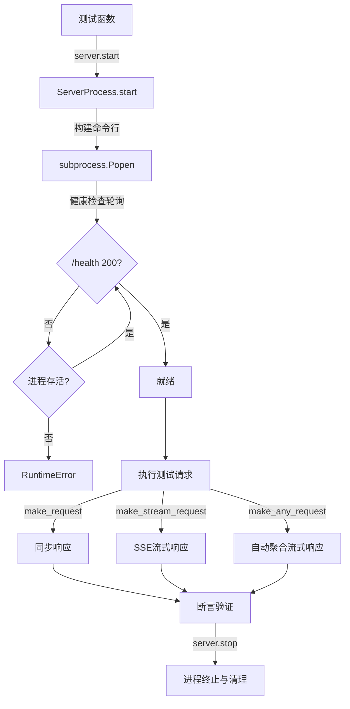
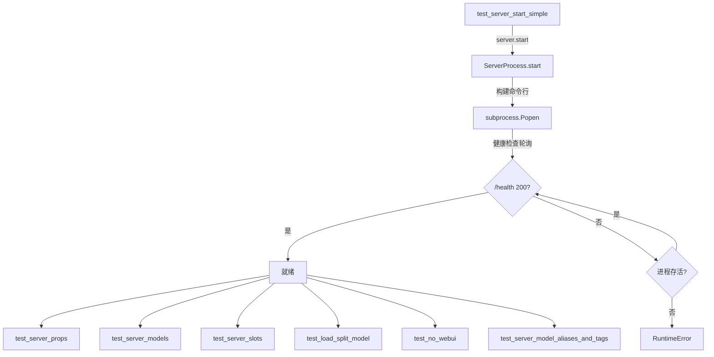
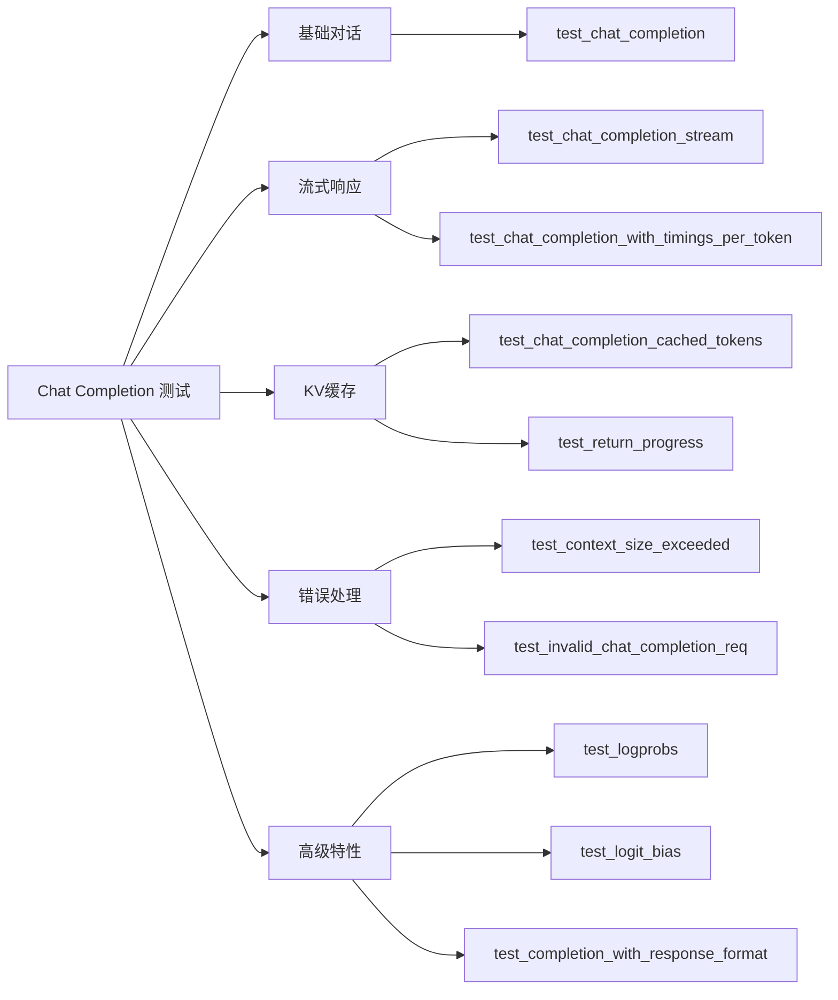
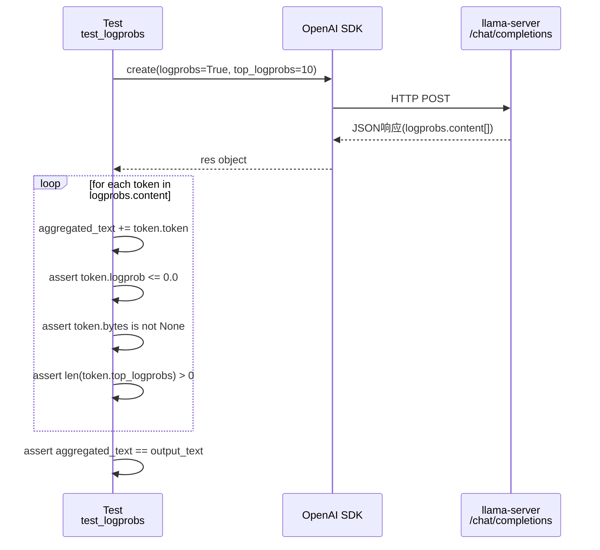
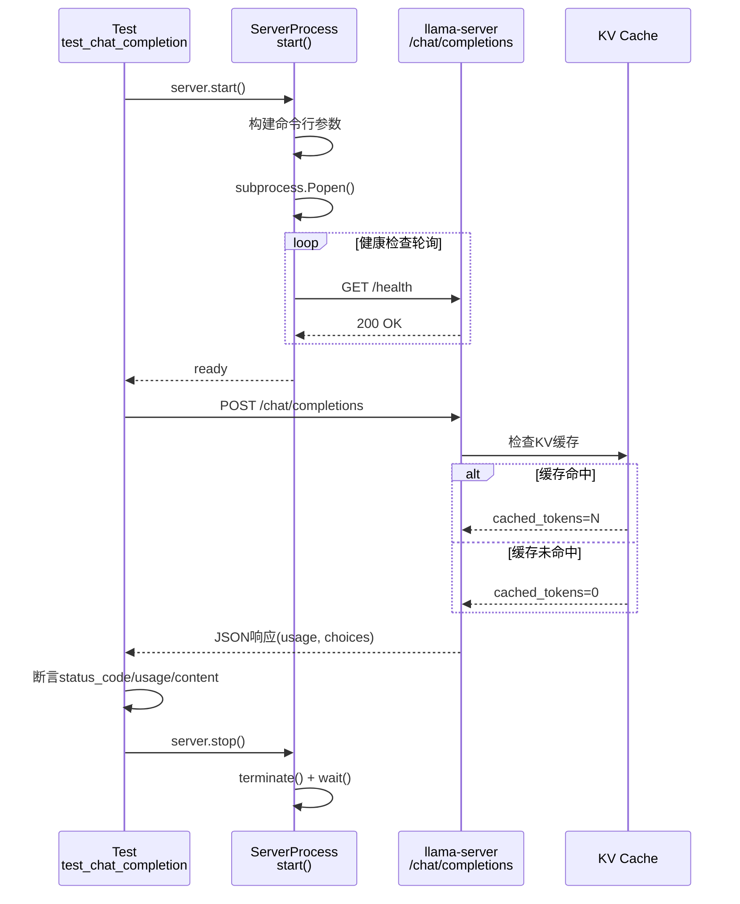
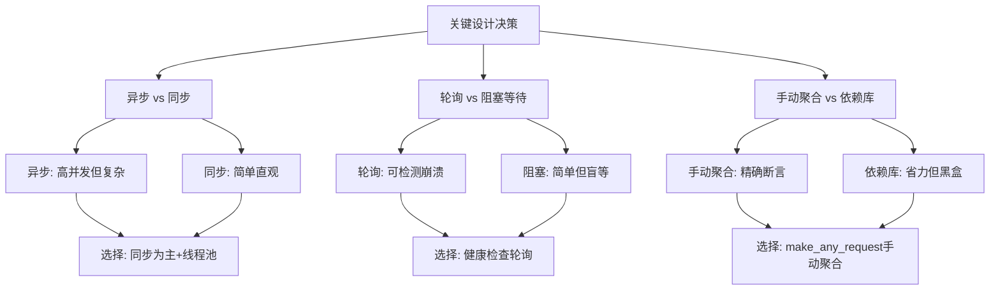

# 第89章 测试体系 —— 像运营机场一样验证服务器稳定性

## 学习目标

- 掌握基于 pytest 的服务器进程生命周期管理（ServerProcess 启停与健康检查轮询）
- 理解 ServerPreset 工厂模式提供的多模型测试预设（tinyllama2、bert_bge_small、tinygemma3 等）
- 精通 HTTP 请求封装策略：同步 make_request、流式 make_stream_request 及自动聚合流式响应的 make_any_request
- 验证基础服务端点：health 健康检查、props 元数据、models 列表、slots 槽位监控及 WebUI 开关
- 掌握 Chat Completion 与 Legacy Completion 的全场景测试，包括流式增量、缓存命中、logprobs、上下文超限及多模态输入
- 精通 Anthropic Messages API 与 OpenAI Responses API 的协议兼容性验证，涵盖工具调用、视觉输入与思考块（Thinking）
- 验证高级特性：推测解码一致性、LoRA 动态缩放、KV 缓存保存/恢复、上下文位移及睡眠唤醒机制
- 构建服务治理测试体系：Router LRU 淘汰、CORS 代理、API 密钥认证与静态资源访问控制

## 89.1 生活类比：llama-server 测试体系是一座机场塔台调度中心

想象 llama-server 的测试体系是一座大型机场的塔台调度中心。每一次测试运行，都像是一架航班从起飞到降落的全流程追踪。

在这个调度中心里，ServerProcess 是塔台值班员，负责指挥飞机（服务器进程）起飞（start）、降落（stop）和地面联络（make_request）。当飞机起飞前，塔台会检查跑道状态（健康检查循环），确保一切就绪后才允许放行。而 ServerPreset 是航班时刻表模板，预定义了不同机型（tinyllama2、bert_bge_small、tinygemma3）的停靠 gate（端口）和载客量（n_slots），让调度员可以“一键切换”不同航班类型。同时，conftest.py 的 fixture 担任地勤保障组的角色，确保每班航班起降后跑道清理干净（stop_server_after_each_test），且每日首班前完成所有机型预热（do_something）。此外，KV 缓存与槽位测试负责验证登机口分配策略，确认同一登机口能否快速衔接下一航班（save/restore），以及长时间空闲的登机口是否被释放（kv keep only active）。进一步地，推测解码与 LoRA 测试用于验证双机长协作（草稿模型+主模型）和个性化涂装服务（LoRA 风格切换）是否能并行运行且不干扰其他航班。最后，协议兼容性测试则是对多语言翻译官的考核，确保塔台能同时听懂英语（OpenAI）、法语（Anthropic）等多种航空术语，并正确转换飞行指令（流式事件序列）。

就像塔台需要确保每架飞机安全、准时、高效地起降，这套测试体系确保 llama-server 在各种复杂场景下都能稳定、准确地提供服务。

## 89.2 源码地图

```
tools/server/tests/
├── 测试基础设施
│   ├── conftest.py
│   │   ├── stop_server_after_each_test()     # 每个测试后自动清理服务器进程
│   │   └── do_something()                    # 测试会话开始时预加载所有预设
│   └── utils.py
│       ├── class ServerProcess               # 服务器进程管理类
│       │   ├── __init__()                    # 从环境变量读取配置(GPU/端口/调试)
│       │   ├── start()                       # 构建命令行参数、启动子进程、健康检查轮询
│       │   ├── stop()                        # 终止进程、清理资源
│       │   ├── make_request()                # 同步HTTP请求(GET/POST/OPTIONS)
│       │   ├── make_stream_request()         # SSE流式请求生成器
│       │   └── make_any_request()            # 通用请求封装(自动聚合流式tool_calls)
│       ├── class ServerPreset                # 预设配置工厂
│       │   ├── load_all()                    # 预加载所有预设确保模型缓存
│       │   ├── tinyllama2()                  # 基础文本模型(stories260K)
│       │   ├── bert_bge_small()              # Embedding模型
│       │   ├── bert_bge_small_with_fa()      # 带Flash Attention的Embedding
│       │   ├── tinyllama_infill()            # 代码填充模型
│       │   ├── stories15m_moe()              # MoE模型(用于LoRA/推测解码)
│       │   ├── jina_reranker_tiny()          # 重排序模型
│       │   ├── tinygemma3()                  # 多模态视觉模型
│       │   └── router()                      # 无模型路由模式
│       ├── class ServerError                 # 服务器错误异常类
│       │   └── __init__()                    # 初始化错误状态码和响应体
│       ├── class ServerResponse              # 服务器响应数据结构类
│       ├── parallel_function_calls()         # 多线程并行执行器
│       ├── match_regex()                     # 正则匹配工具
│       ├── download_file()                   # 模型/LoRA文件下载缓存
│       └── is_slow_test_allowed()            # 慢速测试环境变量检查
├── 基础功能测试
│   └── test_basic.py
│       ├── __main__                          # 全局server初始化与fixture
│       ├── test_server_start_simple()        # /health 健康检查
│       ├── test_server_props()               # /props 元数据与默认参数验证
│       ├── test_server_models()              # /models 模型列表与别名
│       ├── test_server_slots()               # /slots 槽位监控开关测试
│       ├── test_load_split_model()           # 分片模型加载测试
│       ├── test_no_webui()                   # --no-webui 404验证
│       └── test_server_model_aliases_and_tags()  # 模型多别名和标签功能
├── Chat Completion 测试
│   └── test_chat_completion.py
│       ├── __main__                          # 全局server初始化与fixture
│       ├── test_chat_completion()            # 基础对话、token计数、finish_reason
│       ├── test_chat_completion_cached_tokens()  # KV缓存命中计数验证
│       ├── test_chat_completion_stream()     # SSE流式增量、ID一致性、usage统计
│       ├── test_chat_completion_with_openai_library() # OpenAI SDK兼容
│       ├── test_chat_template()              # 聊天模板验证
│       ├── test_chat_template_assistant_prefill()  # Assistant预填充测试
│       ├── test_apply_chat_template()        # /apply-template端点验证
│       ├── test_completion_with_response_format()  # response_format参数测试
│       ├── test_completion_with_json_schema() / test_completion_with_grammar()  # 结构化输出
│       ├── test_invalid_chat_completion_req() # 无效请求参数验证(400/500)
│       ├── test_chat_completion_with_timings_per_token()  # 流式时序统计
│       ├── test_logprobs() / test_logprobs_stream()  # token概率与top_logprobs
│       ├── test_logit_bias()                 # 禁止特定词汇生成
│       ├── test_context_size_exceeded()      # 超长prompt 400错误处理
│       ├── test_context_size_exceeded_stream()  # 流式上下文超限
│       ├── test_return_progress()            # 流式进度报告与缓存复用
│       └── test_chat_completions_multiple_choices()   # 多选择测试
├── Legacy Completion 测试
│   └── test_completion.py
│       ├── __main__                          # 全局server初始化与fixture
│       ├── test_completion()                 # 基础补全、timings、truncated标志
│       ├── test_completion_stream()          # 流式stop标志、generation_settings
│       ├── test_completion_stream_vs_non_stream()  # 流式vs非流式一致性
│       ├── test_completion_with_openai_library()  # OpenAI SDK兼容
│       ├── test_completion_stream_with_openai_library()  # 流式SDK兼容
│       ├── test_completion_stream_with_openai_library_stops() # 停止词处理
│       ├── test_consistent_result_same_seed()      # 确定性验证
│       ├── test_different_result_different_seed()  # 不同种子不同结果
│       ├── test_consistent_result_different_batch_size()  # 批处理大小无关性
│       ├── test_cache_vs_nocache_prompt()    # 缓存开关对比(跳过)
│       ├── test_nocache_long_input_prompt()  # 长输入无缓存400错误
│       ├── test_json_prompt_no_mtmd()        # JSON格式无多模态
│       ├── test_json_prompt_mtm_error_when_not_supported()  # 多模态不支持错误
│       ├── test_completion_parallel_slots()        # 多槽位并发与状态检查
│       ├── test_completion_unified()         # 统一KV缓存模式
│       ├── test_completion_prompt_cache()    # 提示词缓存命中/未命中统计
│       ├── test_completion_with_tokens_input()     # token数组/混合输入
│       ├── test_completion_response_fields() # 响应字段过滤
│       ├── test_n_probs() / test_n_probs_stream() / test_n_probs_post_sampling()  # token概率输出
│       ├── test_logit_bias()                 # logit_bias参数测试(token vs 字符串)
│       └── test_cancel_request()             # 请求取消与槽位释放
├── 协议兼容性测试
│   ├── test_compat_anthropic.py
│   │   ├── get_test_image_base64()           # 测试图像Base64获取
│   │   ├── __main__                          # 全局server初始化与fixture
│   │   ├── vision_server()                   # 视觉测试专用fixture
│   │   ├── test_anthropic_messages_basic()   # Messages基础格式验证
│   │   ├── test_anthropic_messages_with_system()      # 系统提示词测试
│   │   ├── test_anthropic_messages_multipart_content() # 多部分内容块
│   │   ├── test_anthropic_messages_conversation()    # 多轮对话
│   │   ├── test_anthropic_messages_streaming()       # 流式事件序列验证
│   │   ├── test_anthropic_count_tokens()             # token计数端点
│   │   ├── test_anthropic_count_tokens_with_system() # 带系统提示计数
│   │   ├── test_anthropic_count_tokens_no_max_tokens()  # 无max_tokens计数
│   │   ├── test_anthropic_tool_use_basic()           # 工具调用块生成
│   │   ├── test_anthropic_tool_result()              # 工具结果处理
│   │   ├── test_anthropic_tool_result_with_text()    # 文本+工具结果混合
│   │   ├── test_anthropic_tool_result_error()        # 工具错误处理
│   │   ├── test_anthropic_tool_streaming()           # 流式工具调用
│   │   ├── test_anthropic_vision_format_accepted()   # 视觉格式验证
│   │   ├── test_anthropic_vision_base64_with_multimodal_model()  # 视觉输入
│   │   ├── test_anthropic_stop_sequences()           # 停止序列参数
│   │   ├── test_anthropic_temperature() / test_anthropic_top_p() / test_anthropic_top_k()  # 采样参数
│   │   ├── test_anthropic_missing_messages()         # 缺少messages错误
│   │   ├── test_anthropic_empty_messages()           # 空messages容错
│   │   ├── test_anthropic_streaming_content_block_indices()  # 内容块索引
│   │   ├── test_anthropic_thinking()                 # 思考参数
│   │   ├── test_anthropic_metadata()                 # 元数据参数
│   │   ├── test_anthropic_vs_openai_different_response_format()  # 协议格式对比
│   │   ├── test_anthropic_thinking_history_in_count_tokens()   # 历史思考计数
│   │   ├── test_anthropic_thinking_history_in_template()       # 历史思考模板
│   │   └── test_anthropic_thinking_with_reasoning_model()        # 思考块签名
│   ├── test_compat_oai_responses.py
│   │   ├── __main__                          # 全局server初始化与fixture
│   │   ├── create_server()                   # 全局server初始化与fixture
│   │   ├── test_responses_with_openai_library()    # Responses API同步测试
│   │   └── test_responses_stream_with_openai_library()  # 流式事件ID一致性
│   └── test_tool_call.py
│       ├── CompletionMode / ToolParameters / ToolFunction / ToolDefinition  # 类型定义
│       ├── do_test_completion_with_required_tool_tiny()   # 强制工具调用验证
│       ├── test_completion_with_required_tool_tiny_fast() # 快速工具调用
│       ├── test_completion_with_required_tool_tiny_slow() # 慢速工具调用
│       ├── test_completion_with_required_tool_real_model()  # 真实模型工具调用
│       ├── do_test_completion_without_tool_call()    # 非工具调用验证
│       ├── test_completion_without_tool_call_fast() / test_completion_without_tool_call_slow()
│       ├── test_weather() / do_test_weather()        # 天气函数调用闭环
│       ├── test_calc_result() / do_test_calc_result() # 工具结果整合测试
│       ├── test_thoughts()                           # 推理内容测试
│       └── test_hello_world() / do_test_hello_world() # Python代码生成工具
├── 高级特性测试
│   ├── test_speculative.py
│   │   ├── create_server() / fixture_create_server() # 带草稿模型配置
│   │   ├── test_with_and_without_draft()           # 推测解码输出一致性
│   │   ├── test_different_draft_min_draft_max()    # 草稿长度参数矩阵
│   │   ├── test_slot_ctx_not_exceeded()            # 上下文不超槽位
│   │   ├── test_with_ctx_shift()                   # 上下文偏移结合测试
│   │   └── test_multi_requests_parallel()          # 多请求并行测试
│   ├── test_lora.py
│   │   ├── __main__                                # 全局server初始化与fixture
│   │   ├── test_lora()                             # LoRA scale 0.0/1.0 风格切换
│   │   ├── test_lora_per_request()                 # 多槽位独立LoRA配置
│   │   └── test_with_big_model()                   # 大模型LoRA测试
│   ├── test_ctx_shift.py
│   │   ├── __main__                                # 全局server初始化与fixture
│   │   ├── test_ctx_shift_enabled()                # 启用后长上下文截断
│   │   ├── test_ctx_shift_disabled_short_prompt()  # 禁用短prompt正常
│   │   ├── test_ctx_shift_disabled_long_prompt()   # 禁用长prompt报错
│   │   └── test_ctx_shift_disabled_stream()        # 禁用流式截断
│   ├── test_slot_save.py
│   │   ├── __main__                                # 全局server初始化与fixture
│   │   ├── test_slot_save_restore()                # KV缓存保存/跨槽位恢复
│   │   └── test_slot_erase()                       # 槽位擦除后全量重算
│   └── test_kv_keep_only_active.py
│       ├── LogReader.__init__() / drain()          # 日志读取辅助类
│       ├── __main__                                # 全局server初始化与fixture
│       ├── test_clear_and_restore()                # 空闲槽位清理与cache-ram恢复
│       └── test_disabled_with_flag()               # --no-clear-idle 验证
├── 多模态与辅助任务测试
│   ├── test_vision_api.py
│   │   ├── get_img_url()                           # 图像URL/Base64获取
│   │   ├── create_server()                         # 全局server初始化与fixture
│   │   ├── test_models_supports_multimodal_capability()  # 能力标记验证
│   │   ├── test_v1_models_supports_multimodal_capability()  # /v1/models能力标记
│   │   ├── test_vision_chat_completion()           # 图像URL/base64多格式输入
│   │   ├── test_vision_completion()                # 多模态补全测试
│   │   └── test_vision_embeddings()                # 图文嵌入确定性验证
│   ├── test_embedding.py
│   │   ├── __main__                                # 全局server初始化与fixture
│   │   ├── create_server()                         # 全局server初始化与fixture
│   │   ├── test_embedding_single()                 # 向量归一化验证
│   │   ├── test_embedding_multiple()               # 多输入嵌入
│   │   ├── test_embedding_multiple_with_fa()       # Flash Attention嵌入
│   │   ├── test_embedding_mixed_input()            # 混合输入测试(str/token/list)
│   │   ├── test_embedding_pooling_mean() / test_embedding_pooling_mean_multiple()  # mean池化
│   │   ├── test_embedding_pooling_none()           # none池化(特殊token维度)
│   │   ├── test_embedding_pooling_none_oai()       # OAI格式不支持none错误
│   │   ├── test_embedding_openai_library_single() / test_embedding_openai_library_multiple()  # SDK兼容
│   │   ├── test_embedding_error_prompt_too_long()  # 超长prompt错误
│   │   ├── test_same_prompt_give_same_result()     # 确定性验证
│   │   ├── test_embedding_usage_single() / test_embedding_usage_multiple()  # token统计
│   │   └── test_embedding_openai_library_base64()  # base64编码解码一致性
│   ├── test_rerank.py
│   │   ├── __main__                                # 全局server初始化与fixture
│   │   ├── create_server()                         # 全局server初始化与fixture
│   │   ├── test_rerank()                           # 相关性排序(index 2最相关)
│   │   ├── test_rerank_tei_format()                # TEI格式兼容
│   │   ├── test_invalid_rerank_req()               # 无效输入400验证
│   │   ├── test_rerank_usage()                     # token计数准确性
│   │   ├── test_rerank_top_n() / test_rerank_tei_top_n()  # top_n参数
│   ├── test_tokenize.py
│   │   ├── __main__                                # 全局server初始化与fixture
│   │   ├── create_server()                         # 全局server初始化与fixture
│   │   ├── test_tokenize_detokenize()              # 文本↔token往返
│   │   ├── test_tokenize_with_bos()                # BOS插入验证
│   │   └── test_tokenize_with_pieces()             # token片段信息测试
│   ├── test_template.py
│   │   ├── __main__                                # 全局server初始化与fixture
│   │   ├── create_server()                         # 全局server初始化与fixture
│   │   ├── test_reasoning()                        # 推理模式模板验证
│   │   ├── test_date_inside_prompt()               # 日期注入验证
│   │   └── test_add_generation_prompt()            # 生成提示符控制
│   └── test_infill.py
│       ├── __main__                                # 全局server初始化与fixture
│       ├── create_server()                         # 全局server初始化与fixture
│       ├── test_infill_without_input_extra()       # FIM代码填充
│       ├── test_infill_with_input_extra()          # 带额外输入的代码填充
│       ├── test_invalid_input_extra_req()          # 无效输入测试
│       └── test_with_qwen_model()                  # Qwen模型填充验证
└── 服务治理测试
    ├── test_router.py
    │   └── __main__                                # 全局fixture、工具函数与LRU/认证测试
    ├── test_proxy.py
    │   └── __main__                                # 全局fixture与代理测试(启用/禁用/自定义端口)
    ├── test_security.py
    │   ├── __main__                                # 全局server初始化与fixture
    │   ├── test_access_static_assets_without_api_key()  # WebUI公开访问
    │   ├── test_access_public_endpoint()           # 公开端点(health/models)
    │   ├── test_incorrect_api_key()                # 认证失败401
    │   ├── test_correct_api_key()                  # 正确密钥访问
    │   ├── test_correct_api_key_anthropic_header() # Anthropic风格Header认证
    │   ├── test_openai_library_correct_api_key()   # OpenAI SDK密钥验证
    │   ├── test_cors_options()                     # CORS预检请求
    │   └── test_local_media_file()                 # 媒体文件路径验证
    └── test_sleep.py
        ├── __main__                                # 全局server初始化与fixture
        ├── create_server()                         # 全局server初始化与fixture
        └── test_server_sleep()                     # 空闲睡眠与唤醒检测
```

## 89.3 生命周期管理 —— ServerProcess 与 ServerPreset 作为测试的产房与托儿所

每个测试都需要一个真实的 llama-server 进程实例，管理其生命周期（启动、就绪检测、终止）是一项重复且容易出错的工程。试想一下，如果每个测试都手动编写 `subprocess.Popen()` 调用、维护端口状态、处理进程崩溃，那么测试套件的代码量将膨胀数倍，且极易出现“忘记清理进程”、“端口被占用”等千奇百怪的问题。ServerProcess 类把这个复杂的流程封装成了几个简洁的方法，让测试代码可以像使用一个高级玩具一样操作真实服务器。它内部处理了所有细节：如何找到可执行文件、如何根据配置动态拼接命令行参数、如何在启动后等待服务器就绪、如何在测试结束后优雅关闭进程。测试作者只需关心“我需要的服务器配置是什么”，而不用关心“如何把这个配置变成正在运行的进程”。正如塔台值班员需要处理好每一架飞机的起飞降落，ServerProcess 在这里扮演着“产房护士”的角色——确保每个测试都能顺利接入一个健康的服务器实例。

ServerPreset 工厂模式更巧妙——它通过 `@staticmethod` 定义了 tinyllama2、bert_bge_small、stories15m_moe 等预设配置，每个预设配置了特定的模型仓库、上下文大小、槽位数等参数，实现了"一键换模型"。这就像机场的航班时刻表模板，只需简单调用即可切换不同的飞机型号。更重要的是，这些预设参数并非随意设定，而是经过精心选择以覆盖不同的测试场景：tinyllama2 使用极小模型确保测试快速执行，bert_bge_small 专用于嵌入服务测试，stories15m_moe 则因为其 MoE 架构适合验证推测解码与 LoRA 功能。`load_all()` 方法会在测试会话开始时预启动所有预设服务器，提前下载模型到缓存，避免测试时网络等待，好比地勤组提前完成所有机型的预热。

### 89.3.1 ServerProcess.__init__() —— 从环境变量读取配置

源码路径：`tools/server/tests/utils.py` - `ServerProcess.__init__()`（108-115行）

```python
def __init__(self):
    # 从环境变量读取GPU层数配置，用于覆盖默认值
    if "N_GPU_LAYERS" in os.environ:
        self.n_gpu_layer = int(os.environ["N_GPU_LAYERS"])
    # 从环境变量读取调试模式标志
    if "DEBUG" in os.environ:
        self.debug = True
    # 从环境变量读取端口配置，用于并行测试
    if "PORT" in os.environ:
        self.server_port = int(os.environ["PORT"])
    # 检查是否使用外部服务器（DEBUG_EXTERNAL模式跳过启停）
    self.external_server = "DEBUG_EXTERNAL" in os.environ
```

这段代码展示了服务器配置的"三级优先级"：代码默认值 < 环境变量覆盖 < 测试中的显式赋值。**external_server** 标志特别有用——当你已经在本地手动启动了一个服务器用于调试时，设置 `DEBUG_EXTERNAL` 环境变量可以让测试直接连接现有实例，跳过启停步骤，大幅加速调试循环。此外，`server_path` 属性用于指定可执行文件路径，而全局集合 `server_instances` 则负责跟踪所有启动过的实例，确保测试结束后能被统一清理，避免进程泄漏。这如同塔台直接使用一条已经就绪的跑道。

### 89.3.2 ServerProcess.start() —— 构建命令行、启动进程、健康检查轮询

源码路径：`tools/server/tests/utils.py` - `ServerProcess.start()`（117-224行）

```python
def start(self, timeout_seconds: int = DEFAULT_HTTP_TIMEOUT) -> None:
    # 如果是外部服务器模式，直接返回（不需要启动）
    if self.external_server:
        print(f"[external_server]: Assuming external server running on {self.server_host}:{self.server_port}")
        return
    # 确定服务器可执行文件路径
    if self.server_path is not None:
        server_path = self.server_path
    elif "LLAMA_SERVER_BIN_PATH" in os.environ:
        server_path = os.environ["LLAMA_SERVER_BIN_PATH"]
    elif os.name == "nt":
        server_path = "../../../build/bin/Release/llama-server.exe"
    else:
        server_path = "../../../build/bin/llama-server"
    # 构建基础命令行参数
    server_args = [
        "--host",        # 监听地址
        self.server_host,
        "--port",        # 端口号
        self.server_port,
        "--temp",        # 温度参数
        self.temperature,
        "--seed",        # 随机种子
        self.seed,
    ]
    # 根据配置逐步追加可选参数
    if self.offline:
        server_args.append("--offline")           # 离线模式
    if self.model_file:
        server_args.extend(["--model", self.model_file])           # 本地模型文件
    if self.model_url:
        server_args.extend(["--model-url", self.model_url])       # 远程模型URL
    if self.model_draft:
        server_args.extend(["--model-draft", self.model_draft])   # 草稿模型
    if self.model_hf_repo:
        server_args.extend(["--hf-repo", self.model_hf_repo])     # HuggingFace仓库
    if self.model_hf_file:
        server_args.extend(["--hf-file", self.model_hf_file])     # HF文件
    if self.models_max is not None:
        server_args.extend(["--models-max", self.models_max])     # 最大模型数
    # ... 数十个可选参数的处理 ...
    # 这些参数覆盖了服务器支持的所有核心功能：批处理大小(--batch-size)、
    # 统一KV缓存(--kv-unified)、槽位监控(--slots)、LoRA适配器(--lora)、
    # 上下文位移(--context-shift)、推测解码(--draft-max/--draft-min)、
    # 推理格式(--reasoning-format)、视觉模型(--mmproj-url)等，
    # 每个参数都对应一个预设属性，测试只需设置属性即可自动附加到命令行。
    if self.n_slots:
        server_args.extend(["--parallel", self.n_slots])           # 并行槽位数
    if self.n_ctx:
        server_args.extend(["--ctx-size", self.n_ctx])             # 上下文大小
    if self.api_key:
        server_args.extend(["--api-key", self.api_key])            # API密钥
    if self.no_webui:
        server_args.append("--no-webui")                           # 禁用WebUI
    if self.jinja:
        server_args.append("--jinja")                              # 启用Jinja模板
    else:
        server_args.append("--no-jinja")                           # 禁用Jinja模板
    if self.chat_template:
        server_args.extend(["--chat-template", self.chat_template]) # 聊天模板
    if self.slot_save_path:
        server_args.extend(["--slot-save-path", self.slot_save_path]) # 槽位保存路径
    if self.sleep_idle_seconds is not None:
        server_args.extend(["--sleep-idle-seconds", self.sleep_idle_seconds]) # 空闲睡眠
    if self.cache_ram is not None:
        server_args.extend(["--cache-ram", self.cache_ram])        # 内存缓存大小
    if self.no_clear_idle:
        server_args.append("--no-clear-idle")                      # 禁用空闲清理
    if self.webui_mcp_proxy:
        server_args.append("--webui-mcp-proxy")                    # 启用MCP代理

    args = [str(arg) for arg in [server_path, *server_args]]
    print(f"tests: starting server with: {' '.join(args)}")

    # Windows下设置创建标志
    flags = 0
    if "nt" == os.name:
        flags |= subprocess.DETACHED_PROCESS       # 分离进程
        flags |= subprocess.CREATE_NEW_PROCESS_GROUP  # 新进程组
        flags |= subprocess.CREATE_NO_WINDOW       # 无窗口

    # 日志输出到文件或标准输出
    if self.log_path:
        self._log = open(self.log_path, "w")
    else:
        self._log = sys.stdout

    # 启动子进程
    self.process = subprocess.Popen(
        [str(arg) for arg in [server_path, *server_args]],
        creationflags=flags,
        stdout=self._log,
        stderr=self._log if self._log != sys.stdout else sys.stdout,
        env={**os.environ, "LLAMA_CACHE": "tmp"} if "LLAMA_CACHE" not in os.environ else None,
    )
    # 记录实例以便清理
    server_instances.add(self)

    print(f"server pid={self.process.pid}, pytest pid={os.getpid()}")

    # 健康检查轮询：等待服务器就绪
    start_time = time.time()
    while time.time() - start_time < timeout_seconds:
        try:
            # 发送健康检查请求
            response = self.make_request("GET", "/health", headers={
                "Authorization": f"Bearer {self.api_key}" if self.api_key else None
            })
            # 返回200表示服务器就绪
            if response.status_code == 200:
                self.ready = True
                return  # server is ready
        except Exception as e:
            pass  # 忽略异常，继续轮询
        # 检查进程是否已经崩溃
        if self.process.poll() is not None:
            raise RuntimeError(f"Server process died with return code {self.process.returncode}")

        print(f"Waiting for server to start...")
        time.sleep(0.5)  # 每0.5秒轮询一次
    # 超时未就绪则抛出异常
    raise TimeoutError(f"Server did not start within {timeout_seconds} seconds")
```

**逐行注释解释**：

这段代码的核心设计在于**参数构建的声明式风格**：不是通过复杂的配置文件，而是将每个测试需要的配置项（模型仓库、上下文大小、槽位数、API密钥等）逐一映射为命令行参数，通过 `if` 判断是否有值再追加。这种方式的优点在于**每个参数都有明确的触发条件和默认值**，测试者只需设置自己关心的属性，其他参数保持默认。整个 `start()` 方法本质上是“配置对象到命令行参数”的翻译器，它消除了手工拼接命令串的繁琐与易错。

健康检查循环使用 `while time.time() - start_time < timeout_seconds` 而不是简单的 sleep，这样可以在等待期间**同时检查进程是否死亡**——如果服务器在启动过程中崩溃（比如模型文件损坏），可以立即抛出 `RuntimeError` 而不是一直傻等。`server_instances.add(self)` 将实例加入全局集合，确保测试后能被 conftest.py 的 fixture 统一清理。

### 89.3.3 ServerProcess.stop() —— 优雅终止与资源清理

源码路径：`tools/server/tests/utils.py` - `ServerProcess.stop()`（226-242行）

```python
def stop(self) -> None:
    # 外部服务器模式不停止
    if self.external_server:
        print("[external_server]: Not stopping external server")
        return
    # 从全局实例集合中移除
    if self in server_instances:
        server_instances.remove(self)
    if self.process:
        print(f"Stopping server with pid={self.process.pid}")
        self.process.terminate()  # 先发送SIGTERM
        try:
            self.process.wait(timeout=5)  # 等待5秒
        except subprocess.TimeoutExpired:
            print(f"Server pid={self.process.pid} did not terminate in time, killing")
            self.process.kill()  # 超时则强制kill
            self.process.wait(timeout=5)
        except Exception as e:
            print(f"Error waiting for server: {e}")
        self.process = None
    # 关闭日志文件句柄
    if hasattr(self, '_log') and self._log != sys.stdout:
        self._log.close()
```

`stop()` 方法采用**分层终止策略**：先发送 SIGTERM 给进程 5 秒的优雅退出时间，如果超时则强制 SIGKILL。`server_instances.remove(self)` 确保每个服务器只被清理一次——这对于测试中可能手动调用 `stop()` 又依赖 fixture 自动清理的场景非常重要。

### 89.3.4 ServerProcess.make_request() —— 同步HTTP请求封装

源码路径：`tools/server/tests/utils.py` - `ServerProcess.make_request()`（244-276行）

```python
def make_request(
    self,
    method: str,
    path: str,
    data: dict | Any | None = None,
    headers: dict | None = None,
    timeout: float | None = None,
) -> ServerResponse:
    # 构建完整的请求URL
    url = f"http://{self.server_host}:{self.server_port}{path}"
    parse_body = False
    # 根据HTTP方法分发到不同的requests函数
    if method == "GET":
        response = requests.get(url, headers=headers, timeout=timeout)
        parse_body = True
    elif method == "POST":
        # POST请求自动JSON序列化data
        response = requests.post(url, headers=headers, json=data, timeout=timeout)
        parse_body = True
    elif method == "OPTIONS":
        # OPTIONS请求通常不会返回JSON响应体，因此parse_body保持为False
        # 它仅用于CORS预检，客户端只关心响应头中是否包含CORS相关字段
        response = requests.options(url, headers=headers, timeout=timeout)
    else:
        raise ValueError(f"Unimplemented method: {method}")
    # 封装为统一的ServerResponse对象
    result = ServerResponse()
    result.headers = dict(response.headers)
    result.status_code = response.status_code
    if parse_body:
        try:
            result.body = response.json()  # 尝试JSON解析
        except JSONDecodeError:
            result.body = response.text   # 失败则返回原始文本
    else:
        result.body = None
    print("Response from server", json.dumps(result.body, indent=2))
    return result
```

这个封装的核心价值在于**统一的数据结构**：测试代码通过 `res.status_code` 和 `res.body` 访问响应，而不需要关心 requests 库的 `response.json()` 可能抛出的异常。JSON 解析失败时自动降级为原始文本，这在测试 WebUI 静态资源（返回HTML）时非常实用。

### 89.3.5 ServerProcess.make_stream_request() —— SSE流式请求封装

源码路径：`tools/server/tests/utils.py` - `ServerProcess.make_stream_request()`（278-295行）

```python
def make_stream_request(
    self,
    method: str,
    path: str,
    data: dict | None = None,
    headers: dict | None = None,
) -> Iterator[dict]:
    url = f"http://{self.server_host}:{self.server_port}{path}"
    if method == "POST":
        # stream=True 让requests保持连接并逐行读取
        response = requests.post(url, headers=headers, json=data, stream=True)
    else:
        raise ValueError(f"Unimplemented method: {method}")
    # 非200状态码直接抛出ServerError
    if response.status_code != 200:
        raise ServerError(response.status_code, response.json())
    # 逐行解析SSE格式的数据
    for line_bytes in response.iter_lines():
        line = line_bytes.decode("utf-8")
        if '[DONE]' in line:
            break  # 流式结束标记
        elif line.startswith('data: '):
            # 提取SSE的data字段并JSON解析
            data = json.loads(line[6:])
            print("Partial response from server", json.dumps(data, indent=2))
            yield data  # 生成器逐块产出数据
```

流式请求使用 Python 生成器模式，测试代码可以像这样消费数据：

```python
for data in server.make_stream_request("POST", "/chat/completions", ...):
    content += data["choices"][0]["delta"]["content"]
```

`iter_lines()` 方法逐行读取 SSE 响应，`data: ` 前缀后的 JSON 被解析为字典。遇到 `[DONE]` 标记时停止迭代。非 200 状态码直接抛出 `ServerError`，让调用方可以通过 `try/except` 捕获错误——这在测试上下文超限时非常有用。

### 89.3.6 ServerProcess.make_any_request() —— 自动聚合流式响应

源码路径：`tools/server/tests/utils.py` - `ServerProcess.make_any_request()`（297-376行）

```python
def make_any_request(
    self,
    method: str,
    path: str,
    data: dict | None = None,
    headers: dict | None = None,
    timeout: float | None = None,
) -> dict:
    # 根据请求体中的stream标志选择处理方式
    stream = data.get('stream', False)
    if stream:
        # 流式处理：逐步聚合各种数据块
        content: list[str] = []              # 收集文本内容
        reasoning_content: list[str] = []    # 收集推理内容
        tool_calls: list[dict] = []          # 收集工具调用
        finish_reason: Optional[str] = None  # 完成原因

        content_parts = 0                    # 计数统计
        reasoning_content_parts = 0
        tool_call_parts = 0
        arguments_parts = 0

        for chunk in self.make_stream_request(method, path, data, headers):
            if chunk['choices']:
                # 确保只有一个choice
                assert len(chunk['choices']) == 1, f'Expected 1 choice, got {len(chunk["choices"])}'
                choice = chunk['choices'][0]
                # 聚合普通文本
                if choice['delta'].get('content') is not None:
                    assert len(choice['delta']['content']) > 0, f'Expected non empty content delta!'
                    content.append(choice['delta']['content'])
                    content_parts += 1
                # 聚合推理内容
                if choice['delta'].get('reasoning_content') is not None:
                    assert len(choice['delta']['reasoning_content']) > 0, f'Expected non empty reasoning_content delta!'
                    reasoning_content.append(choice['delta']['reasoning_content'])
                    reasoning_content_parts += 1
                # 记录完成原因
                if choice['delta'].get('finish_reason') is not None:
                    finish_reason = choice['delta']['finish_reason']
                # 聚合工具调用（处理分片的JSON参数）
                for tc in choice['delta'].get('tool_calls', []):
                    if 'function' not in tc:
                        raise ValueError(f"Expected function type, got {tc['type']}")
                    if tc['index'] >= len(tool_calls):
                        # 新工具调用的开始，初始化占位对象
                        assert 'id' in tc
                        assert tc.get('type') == 'function'
                        assert 'function' in tc and 'name' in tc['function'] and len(tc['function']['name']) > 0, \
                            f"Expected function call with name, got {tc.get('function')}"
                        tool_calls.append(dict(
                            id="",
                            type="function",
                            function=dict(
                                name="",
                                arguments="",
                            )
                        ))
                    # 增量更新已有工具调用的字段
                    tool_call = tool_calls[tc['index']]
                    if tc.get('id') is not None:
                        tool_call['id'] = tc['id']
                    fct = tc['function']
                    assert 'id' not in fct, f"Function call should not have id: {fct}"
                    if fct.get('name') is not None:
                        # 流式名称可能分片，需要拼接
                        tool_call['function']['name'] = tool_call['function'].get('name', '') + fct['name']
                    if fct.get('arguments') is not None:
                        # 流式参数也是分片的JSON字符串，需要拼接
                        tool_call['function']['arguments'] += fct['arguments']
                        arguments_parts += 1
                    tool_call_parts += 1
            else:
                # 最后一个chunk（include_usage=True时）包含usage和timings
                assert 'usage' in chunk, f"Expected finish_reason in chunk: {chunk}"
                assert 'timings' in chunk, f"Expected finish_reason in chunk: {chunk}"
        print(f'Streamed response had {content_parts} content parts, {reasoning_content_parts} reasoning_content parts, {tool_call_parts} tool call parts incl. {arguments_parts} arguments parts')
        # 聚合为统一的响应结构
        result = dict(
            choices=[
                dict(
                    index=0,
                    finish_reason=finish_reason,
                    message=dict(
                        role='assistant',
                        content=''.join(content) if content else None,
                        reasoning_content=''.join(reasoning_content) if reasoning_content else None,
                        tool_calls=tool_calls if tool_calls else None,
                    ),
                )
            ],
        )
        print("Final response from server", json.dumps(result, indent=2))
        return result
    else:
        # 非流式：直接发送同步请求
        response = self.make_request(method, path, data, headers, timeout=timeout)
        assert response.status_code == 200, f"Server returned error: {response.status_code}"
        return response.body
```

`make_any_request` 是测试套件中最强大的请求封装。它的设计目标是**让测试代码用统一的方式处理流式和非流式响应**——对于流式响应，自动将分散在各 SSE chunk 中的文本、推理内容、工具调用聚合为标准的响应结构。对于工具调用，还专门处理了分片 JSON 参数的拼接：当工具名称（如 `get_` + `weather`）和参数（如 `{"loc` + `ation": "Paris"}`）被流式分片时，会通过字符串拼接还原完整的内容。

这个设计的巧妙之处在于**语义等价**：调用方不需要关心响应是流式还是非流式，获取到的都是 `{"choices": [{"message": {"content": ..., "tool_calls": ...}}]}` 格式的字典。

### 89.3.7 ServerPreset 系列 —— 预设配置工厂

源码路径：`tools/server/tests/utils.py` - `ServerPreset.load_all()` 与 `ServerPreset.tinyllama2()`（381-401行）

```python
def load_all() -> None:
    """ Load all server presets to ensure model files are cached. """
    # 遍历ServerPreset类的所有静态方法（排除load_all自身）
    servers: List[ServerProcess] = [
        method()
        for name, method in ServerPreset.__dict__.items()
        if callable(method) and name != "load_all"
    ]
    # 逐个启动并停止，触发模型下载和缓存
    for server in servers:
        server.offline = False  # 允许网络下载
        server.start()          # 启动时自动下载模型
        server.stop()           # 下载完成后立即停止

def tinyllama2() -> ServerProcess:
    server = ServerProcess()                        # 创建空白服务器实例
    server.offline = True                           # 默认离线模式，使用已缓存模型
    server.model_hf_repo = "ggml-org/test-model-stories260K"  # HuggingFace仓库
    server.model_hf_file = None                     # 自动选择仓库默认文件
    server.model_alias = "tinyllama-2"              # 模型别名
    server.n_ctx = 512                              # 总上下文大小
    server.n_batch = 32                             # 批处理大小
    server.n_slots = 2                              # 槽位数
    server.n_predict = 64                           # 默认预测token数
    server.seed = 42                                # 固定随机种子
    return server
```

ServerPreset 的 `load_all()` 方法通过**反射**遍历所有静态方法，启动并停止每个预设对应的服务器实例，确保模型文件提前下载到本地缓存。`tinyllama2()` 预设配置了 `offline = True` 表示默认离线（模型已缓存），但 `load_all()` 会临时设置为 `False` 以触发下载。所有预设都配置了固定的 `seed = 42` 来保证测试的确定性。每个预设中的参数都经过精心选择：`n_ctx = 512`、`n_slots = 2` 的组合使得每个槽位的上下文恰好为 256，便于验证上下文限制相关逻辑；`n_predict = 64` 控制生成长度以避免测试耗时过长。

### 89.3.8 conftest.py —— 测试隔离与预加载

源码路径：`tools/server/tests/conftest.py` - `stop_server_after_each_test()` 与 `do_something()`（1-18行）

```python
@pytest.fixture(autouse=True)
def stop_server_after_each_test():
    # 每个测试前不做任何事
    yield
    # 测试后停止所有服务器实例
    instances = set(
        server_instances
    )  # 复制集合防止迭代时修改
    for server in instances:
        server.stop()

@pytest.fixture(scope="module", autouse=True)
def do_something():
    # 每个测试模块运行前加载所有预设
    ServerPreset.load_all()
```

`stop_server_after_each_test` 使用 `autouse=True` 自动应用于所有测试，`yield` 之前的代码在测试前执行，之后的代码在测试后执行。复制集合的操作防止了迭代过程中修改集合导致的 `RuntimeError`。`do_something` 使用 `scope="module"` 确保每个测试模块只预加载一次预设。

### 89.3.9 ServerError 与其他辅助函数 —— 错误处理与并发执行

源码路径：`tools/server/tests/utils.py` - `ServerError.__init__()`（32-36行）、`parallel_function_calls()`（500-529行）、`match_regex()`（531-537行）、`download_file()`（539-552行）、`is_slow_test_allowed()`（554-555行）

```python
class ServerError(Exception):
    def __init__(self, code, body):
        self.code = code   # 错误状态码
        self.body = body   # 错误响应体

# 此外，download_file() 负责从 URL 下载模型/LoRA 文件到本地缓存目录，
# 若文件已存在则直接返回路径，避免重复下载；
# is_slow_test_allowed() 通过检查 SLOW_TESTS 环境变量，
# 决定是否运行需要大量计算资源的慢速测试。

def parallel_function_calls(function_list: List[Tuple[Callable[..., Any], Tuple[Any, ...]]]) -> List[Any]:
    """Run multiple functions in parallel and return results in the same order as calls."""
    results = [None] * len(function_list)  # 预分配结果列表
    exceptions = []

    def worker(index, func, args):
        try:
            result = func(*args)
            results[index] = result
        except Exception as e:
            exceptions.append((index, str(e)))

    with ThreadPoolExecutor() as executor:
        futures = []
        for i, (func, args) in enumerate(function_list):
            future = executor.submit(worker, i, func, args)
            futures.append(future)
        # 等待所有任务完成
        for future in as_completed(futures):
            pass

    if exceptions:
        print("Exceptions occurred:")
        for index, error in exceptions:
            print(f"Function at index {index}: {error}")
    return results

def match_regex(regex: str, text: str) -> bool:
    return (
        re.compile(
            regex, flags=RegexFlag.IGNORECASE | RegexFlag.MULTILINE | RegexFlag.DOTALL
        ).search(text)
        is not None
    )
```

`parallel_function_calls` 是测试中的**并发工具箱**：它接受 `(函数, 参数元组)` 列表，用 `ThreadPoolExecutor` 并行执行，并通过预分配的 `results` 列表保证结果顺序与输入顺序一致。`ServerError` 存储错误状态码和响应体，`match_regex` 则使用 `IGNORECASE | MULTILINE | DOTALL` 标志进行宽松的正则匹配——DOTALL 让 `.` 能匹配换行符，这在匹配多行生成文本时很关键。

### 89.3.10 设计取舍分析

**问：为什么 ServerProcess 使用声明式参数构建而非外部配置文件？**

答：原因在于测试的场景千变万化，每个测试可能需要不同的组合（如 test_server_slots 需要在同一测试中切换 server_slots 开关）。将参数直接映射到命令行参数的方式允许测试代码**在运行时动态修改**任意属性，而配置文件则需要在测试前重新加载。此外，将所有选项集中在 `start()` 方法中统一处理，也让调试时只需查看构建出的命令字符串即可确认参数是否正确。trade-off 在于每次启动服务器都需要重新构建完整的命令行参数，但在测试环境中启动频率不高，这个开销完全可以忽略。

**问：为什么 ServerPreset 使用静态方法而非实例方法？**

答：ServerPreset 不是用一个类来管理配置，而是通过 `@staticmethod` 定义工厂方法。这样设计的原因在于**配置是纯粹的函数变换**——输入是 `ServerProcess()` 实例，输出是配置好的实例。静态方法的形式让 `load_all()` 可以方便地通过反射（`ServerPreset.__dict__.items()`）遍历所有预设并逐个启动。如果改为实例方法，`load_all()` 内的反射逻辑会变得更复杂且不符合工厂模式的直觉。trade-off 是静态方法无法继承和多态，但测试预设本身不需要这些特性。

### 89.3.11 ServerProcess 运行流程架构图



## 89.4 基础服务探测 —— 像体检报告一样验证核心端点

基础服务探测是每个测试套件的"第一道防线"。如果服务器无法启动、健康检查失败，后续所有测试都无从谈起。test_basic.py 模块验证了服务器最核心的七个基础端点行为，如同为服务器做一次全面的体检，每一项检查（健康检查、元数据、模型列表、槽位监控等）都对应着体检报告中的一个指标，确保每个基础部件都工作正常。

下表对这些测试进行了概览，每一项都是体检报告中的关键指标：

| 测试函数 | 验证内容 | 关键断言 |
|---------|---------|---------|
| test_server_start_simple | 服务器启动与健康检查 | `/health` 返回 200 |
| test_server_props | 服务器属性与默认参数 | model_path、total_slots、n_ctx、seed |
| test_server_models | 模型列表 | 恰好一个模型，id 为 model_alias |
| test_server_slots | 槽位监控开关 | 禁用返回 501，启用返回 200 且槽位信息正确 |
| test_load_split_model | 分片模型加载 | 分片模型生成内容匹配正则（如 `(little|girl)+`） |
| test_no_webui | WebUI 开关 | 默认 200，--no-webui 返回 404 |
| test_server_model_aliases_and_tags | 多别名与标签 | aliases/tags 集合正确，id 派生逻辑正确（从`std::set`按字母序取第一个别名） |

每一项体检结果都需要符合标准值（assert）才算合格，正如航班起飞前必须通过所有例行检查。下面我们逐一解读各项检查的详细流程。

### 89.4.1 test_server_start_simple() —— 健康检查验证

源码路径：`tools/server/tests/unit/test_basic.py` - `test_server_start_simple()`（16-20行）

```python
def test_server_start_simple():
    global server
    server.start()   # 启动服务器并等待就绪
    res = server.make_request("GET", "/health")  # 健康检查
    assert res.status_code == 200  # 必须返回200
```

这个测试只有四行代码，但背后经历了 ServerProcess.start() 的完整流程：构建命令行参数、启动子进程、健康检查轮询等待就绪。它实际上是所有其他测试的"隐式前置条件"——如果服务器启动失败，这个测试会直接失败并给出清晰的错误信息（如 `Server process died with return code 1`）。这就像体检时最基础的生命体征测量——体温、脉搏、血压，如果这些都无法获取，后续所有项目都无法开展。

### 89.4.2 test_server_props() —— 服务器元数据验证

源码路径：`tools/server/tests/unit/test_basic.py` - `test_server_props()`（22-33行）

```python
def test_server_props():
    global server
    server.start()
    res = server.make_request("GET", "/props")
    assert res.status_code == 200
    # 模型路径必须是.gguf文件
    assert ".gguf" in res.body["model_path"]
    # 槽位总数与配置一致
    assert res.body["total_slots"] == server.n_slots
    default_val = res.body["default_generation_settings"]
    assert server.n_ctx is not None and server.n_slots is not None
    # 每个槽位的上下文大小 = 总上下文 / 槽位数
    assert default_val["n_ctx"] == server.n_ctx / server.n_slots
    # 默认种子与配置一致
    assert default_val["params"]["seed"] == server.seed
```

/props 端点返回服务器的运行配置元数据，这相当于体检报告中的“基础信息”栏目，记录了服务器的型号、配置等关键参数。这个测试特别验证了 `n_ctx / n_slots` 的计算——当有 2 个槽位且总上下文为 512 时，每个槽位获得 256 的上下文。这种单一槽位上下文的配置对大模型推理至关重要，因为它决定了单个请求能处理的最大 prompt 长度。

### 89.4.3 test_server_models() —— 模型列表验证

源码路径：`tools/server/tests/unit/test_basic.py` - `test_server_models()`（35-42行）

```python
def test_server_models():
    global server
    server.start()
    res = server.make_request("GET", "/models")
    assert res.status_code == 200
    # 列表必须恰好包含一个模型
    assert len(res.body["data"]) == 1
    # 模型ID必须与配置的别名一致
    assert res.body["data"][0]["id"] == server.model_alias
```

`/models` 端点返回当前加载的模型列表。此测试确保模型 ID 正确映射到预设的别名 `tinyllama-2`，验证了服务器对模型别名的解析与注册逻辑。

### 89.4.4 test_server_slots() —— 槽位监控开关验证

源码路径：`tools/server/tests/unit/test_basic.py` - `test_server_slots()`（44-63行）

```python
def test_server_slots():
    global server

    # 禁用槽位监控时，/slots 应返回501
    server.server_slots = False
    server.start()
    res = server.make_request("GET", "/slots")
    assert res.status_code == 501  # ERROR_TYPE_NOT_SUPPORTED
    assert "error" in res.body
    server.stop()

    # 启用槽位监控时，/slots 返回2个槽位信息
    server.server_slots = True
    server.n_slots = 2
    server.start()
    res = server.make_request("GET", "/slots")
    assert res.status_code == 200
    assert len(res.body) == server.n_slots  # 2个槽位
    assert server.n_ctx is not None and server.n_slots is not None
    assert res.body[0]["n_ctx"] == server.n_ctx / server.n_slots
    assert "params" not in res.body[0]  # 槽位信息不包含params
```

这个测试展示了 ServerProcess 的**灵活性**：同一个测试中先禁用槽位监控启动服务器验证 501 错误，然后停止服务器，重新启用槽位监控再次启动。`server.stop()` 和 `server.start()` 在同一测试函数内的配合，让测试能够验证同一服务器实例在不同配置下的行为差异。

### 89.4.5 test_load_split_model() —— 分片模型加载验证

源码路径：`tools/server/tests/unit/test_basic.py` - `test_load_split_model()`（65-79行）

```python
def test_load_split_model():
    global server
    server.offline = False
    server.model_hf_repo = "ggml-org/models"
    server.model_hf_file = "tinyllamas/split/stories15M-q8_0-00001-of-00003.gguf"
    server.model_alias = "tinyllama-split"
    server.start()
    res = server.make_request("POST", "/completion", data={
        "n_predict": 16,
        "prompt": "Hello",
        "temperature": 0.0,
    })
    assert res.status_code == 200
    assert match_regex("(little|girl)+", res.body["content"])
```

此测试验证服务器能够正确加载被拆分到多个 `.gguf` 文件中的模型。它通过指定仓库 `ggml-org/models` 和文件路径 `tinyllamas/split/stories15M-q8_0-00001-of-00003.gguf` 来触发分片模型加载，随后发送一个简单的补全请求，并断言生成内容与预期正则匹配。这测试了服务器对分片模型的管理和推理能力。

### 89.4.6 test_no_webui() —— WebUI 开关验证

源码路径：`tools/server/tests/unit/test_basic.py` - `test_no_webui()`（81-96行）

```python
def test_no_webui():
    global server
    # 默认：webui 已启用
    server.start()
    url = f"http://{server.server_host}:{server.server_port}"
    res = requests.get(url)
    assert res.status_code == 200
    assert "<!doctype html>" in res.text
    server.stop()

    # 设置 --no-webui 后
    server.no_webui = True
    server.start()
    res = requests.get(url)
    assert res.status_code == 404
```

该测试验证 WebUI 的默认启用与禁用行为。默认情况下，直接访问服务器根路径应返回 HTML 页面（断言包含 `<!doctype html>`）。当设置 `no_webui = True` 后，根路径应返回 404 错误，表明 WebUI 已被成功禁用。

### 89.4.7 test_server_model_aliases_and_tags() —— 多别名与标签验证

源码路径：`tools/server/tests/unit/test_basic.py` - `test_server_model_aliases_and_tags()`（98-112行）

```python
def test_server_model_aliases_and_tags():
    global server
    server.model_alias = "tinyllama-2,fim,code"
    server.model_tags = "chat,fim,small"
    server.start()
    res = server.make_request("GET", "/models")
    assert res.status_code == 200
    assert len(res.body["data"]) == 1
    model = res.body["data"][0]
    # aliases 字段必须包含所有别名
    assert set(model["aliases"]) == {"tinyllama-2", "fim", "code"}
    # tags 字段必须包含所有标签
    assert set(model["tags"]) == {"chat", "fim", "small"}
    # id 从第一个别名派生（std::set 按字母序排列）
    assert model["id"] == "code"
```

此测试验证了服务器对模型多别名与标签的支持。当为模型配置多个别名（用逗号分隔）和多个标签时，`/models` 返回的模型信息中，`aliases` 与 `tags` 字段应分别包含全部配置值。此外，模型 `id` 按字母序从 `aliases` 集合的第一个元素派生（例如，`tinyllama-2`, `fim`, `code` 三个别名的字母序第一个为 `code`）。这验证了服务器内部的 `std::set` 排序行为及其对外暴露的一致性。

### 89.4.8 基础探测流程架构图



### 89.4.9 设计取舍分析

**问：为什么基础 /health 测试不与其他测试合并？**

答：既然 `test_server_props` 等测试已经在验证服务器的多个属性，为什么 `test_server_start_simple` 还要单独存在？答案在于**最短失败路径**的设计哲学——如果服务器连启动和基础健康检查都无法通过，那么任何其他测试的失败原因都将难以排查。将健康检查独立成最简测试，可以让 CI/CD 在服务器出现问题时**第一时间**报告最根本的错误，而不是在几十个测试中都看到相同的启动失败信息。这种“层次化隔离”的模式（先验证最基础功能，再逐层深入）是整个测试套件组织的基础原则。

## 89.5 Chat Completion 全场景覆盖 —— 对话补全的压力测试场

Chat Completion 是 llama-server 最核心的 API，对应 OpenAI 的 `/chat/completions` 接口。test_chat_completion.py 提供了从基础对话到高级特性的全覆盖测试，覆盖了流式/非流式、不同模板、不同响应格式、错误处理、缓存机制等**20 多个测试场景**。

这个测试模块之所以重要，是因为它验证了 llama-server 与 OpenAI API 的兼容性——任何使用 OpenAI Python SDK 的客户端都应该能无缝切换到 llama-server。

### 89.5.1 Chat Completion 测试用例分类架构图



### 89.5.2 test_chat_completion() —— 基础对话验证

源码路径：`tools/server/tests/unit/test_chat_completion.py` - `test_chat_completion()`（12-40行）

```python
def test_chat_completion(model, system_prompt, user_prompt, max_tokens, re_content, n_prompt, n_predicted, finish_reason, jinja, chat_template):
    global server
    server.jinja = jinja                       # 设置Jinja模板开关
    server.chat_template = chat_template       # 设置聊天模板
    server.start()
    res = server.make_request("POST", "/chat/completions", data={
        "model": model,                        # 请求模型名称
        "max_tokens": max_tokens,              # 最大生成token数
        "messages": [
            {"role": "system", "content": system_prompt},   # 系统提示词
            {"role": "user", "content": user_prompt},       # 用户消息
        ],
    })
    assert res.status_code == 200
    assert "cmpl" in res.body["id"]  # 完成ID格式必须包含"cmpl"
    assert res.body["system_fingerprint"].startswith("b")  # 系统指纹以"b"开头
    assert res.body["usage"]["prompt_tokens"] == n_prompt  # 输入token数精确匹配
    assert res.body["usage"]["completion_tokens"] == n_predicted  # 输出token数精确匹配
    choice = res.body["choices"][0]
    assert "assistant" == choice["message"]["role"]  # 角色必须是assistant
    assert match_regex(re_content, choice["message"]["content"]), f'Expected {re_content}, got {choice["message"]["content"]}'
    assert choice["finish_reason"] == finish_reason  # 完成原因
```

这个测试通过 `@pytest.mark.parametrize` 覆盖了多种组合。

### 89.5.3 parametrize 数据组合

源码路径：`tools/server/tests/unit/test_chat_completion.py` - `test_chat_completion()`（12-40行）的 `@pytest.mark.parametrize` 数据部分

```python
# 参数化数据定义：每个元组依次对应
# (model, system_prompt, user_prompt, max_tokens, re_content, n_prompt, n_predicted, finish_reason, jinja, chat_template)
(None, "Book", "What is the best book", 8, "(Suddenly)+", 77, 8, "length", True, None),
(None, "", "Explain the theory of relativity", 32, "(programmer|ordinary|potato|spicy|kitchen)+", 47, 32, "stop", True, None),
("2longctx:2ki", "You are a test.", "Hi, I am a test", 9, "(and)+", 24, 9, "stop", True, None),
```

让我们逐一解析这些关键组合：

- **第一个用例** `(None, "Book", "What is the best book", 8, "(Suddenly)+", 77, 8, "length", True, None)`：使用默认模型和 llama3 模板，期望生成 8 个 token 后因达到 `max_tokens` 限制而停止（`finish_reason = "length"`）。77 个 prompt token 包含系统提示词 "Book" 与用户消息的组合。这个用例验证了长度限制行为。

- **第二个用例** `(None, "", "Explain the theory of relativity", 32, "(programmer|ordinary|potato|spicy|kitchen)+", 47, 32, "stop", True, None)`：空系统提示词，期望生成 32 个 token 后因自然结束（`finish_reason = "stop"`）。由于 stories260K 模型很小，生成内容会在预设的童话词汇中循环，因此正则表达式允许任意一个词汇的重复。这个用例验证了模型在无上下文约束下的自然生成。

- **第三个用例** `("2longctx:2ki", "You are a test.", "Hi, I am a test", 9, "(and)+", 24, 9, "stop", True, None)`：使用"2longctx:2ki"模型变体测试长上下文场景，验证模型别名派生逻辑（`id = "code"`）和不同上下文大小下的行为。这个用例覆盖了模型多别名与上下文配置的组合。

这三个用例覆盖了三种截然不同的场景：长度限制结束、自然结束、以及长上下文模型变体，确保基础对话功能在不同配置下的健壮性。

### 89.5.4 test_chat_completion_cached_tokens() —— KV缓存命中率验证

源码路径：`tools/server/tests/unit/test_chat_completion.py` - `test_chat_completion_cached_tokens()`（42-59行）

```python
def test_chat_completion_cached_tokens():
    global server
    server.n_slots = 1  # 单槽位确保缓存可命中
    server.start()
    seq = [
        ("1 2 3 4 5 6", 77, 0),    # 第一次，无缓存
        ("1 2 3 4 5 6", 77, 76),   # 完全相同，全量缓存
        ("1 2 3 4 5 9", 77, 51),   # 部分相同
        ("1 2 3 9 9 9", 77, 47),   # 更少相同
    ]
    for user_prompt, n_prompt, n_cache in seq:
        res = server.make_request("POST", "/chat/completions", data={
            "max_tokens": 8,
            "messages": [
                {"role": "system", "content": "Test"},
                {"role": "user", "content": user_prompt},
            ],
        })
        assert res.body["usage"]["prompt_tokens"] == n_prompt
        assert res.body["usage"]["prompt_tokens_details"]["cached_tokens"] == n_cache
```

这个测试**精确验证了 KV 缓存命中机制**：第一次请求处理了 77 个 token（无缓存），第二次相同 prompt 全部命中（76 个缓存），第三次改变最后一个数字时只有 51 个缓存命中（前 51 个 token 被复用），第四次只保留更少的前缀。这些数值不是随意设定的，而是根据 tokenizer 的实际切分精确计算出来的。例如，`("1 2 3 4 5 6")` 的 token 序列长度为 77，第二次请求完全复用后，仅需处理第一个 token（即新添加的系统提示符），因此 `cached_tokens = 76`。这种精确到单个 token 的断言确保了缓存逻辑的正确性。

### 89.5.5 test_chat_completion_stream() —— 流式响应验证

源码路径：`tools/server/tests/unit/test_chat_completion.py` - `test_chat_completion_stream()`（61-95行）

```python
def test_chat_completion_stream(system_prompt, user_prompt, max_tokens, re_content, n_prompt, n_predicted, finish_reason):
    global server
    server.model_alias = "llama-test-model"  # 自定义模型别名
    server.start()
    res = server.make_stream_request("POST", "/chat/completions", data={
        "max_tokens": max_tokens,
        "messages": [
            {"role": "system", "content": system_prompt},
            {"role": "user", "content": user_prompt},
        ],
        "stream": True,  # 启用流式响应
    })
    content = ""       # 累积生成内容
    last_cmpl_id = None  # 追踪完成ID
    for i, data in enumerate(res):
        if data["choices"]:
            choice = data["choices"][0]
            if i == 0:
                # 第一个chunk只有role，没有content
                assert choice["delta"]["content"] is None
                assert choice["delta"]["role"] == "assistant"
            else:
                assert "role" not in choice["delta"]  # 后续chunk无role字段
            assert data["system_fingerprint"].startswith("b")
            assert data["model"] == "llama-test-model"  # 模型名正确
            if last_cmpl_id is None:
                last_cmpl_id = data["id"]
            # 所有事件必须使用相同的completion id
            assert last_cmpl_id == data["id"]
            if choice["finish_reason"] in ["stop", "length"]:
                # 最后一个chunk：检查内容完整性和finish_reason
                assert "content" not in choice["delta"]
                assert match_regex(re_content, content)
                assert choice["finish_reason"] == finish_reason
            else:
                # 中间chunk：累积内容
                assert choice["finish_reason"] is None
                content += choice["delta"]["content"] or ''
        else:
            # 无choices的chunk（通常是最后一个）包含usage统计
            assert data["usage"]["prompt_tokens"] == n_prompt
            assert data["usage"]["completion_tokens"] == n_predicted
```

流式测试验证了 SSE 协议的**事件顺序和格式**：第一个事件只有 `role: assistant` 没有 `content`，中间事件只有 `content` 没有 `role`，最后一个事件有 `finish_reason` 但没有 `content`。所有事件共享同一个 `id`，确保客户端可以可靠地追踪同一响应的多个事件。最后，`usage` 字段只出现在无 `choices` 的事件中（`include_usage` 的默认行为）。这个模式类似于塔台持续接收飞行器的位置更新，最后在降落（finish_reason）时汇总全程数据。

### 89.5.6 test_chat_completion_with_timings_per_token() —— 流式时序统计验证

源码路径：`tools/server/tests/unit/test_chat_completion.py` - `test_chat_completion_with_timings_per_token()`（228-253行）

```python
def test_chat_completion_with_timings_per_token():
    global server
    server.start()
    res = server.make_stream_request("POST", "/chat/completions", data={
        "max_tokens": 10,
        "messages": [{"role": "user", "content": "test"}],
        "stream": True,
        "stream_options": {"include_usage": True},
        "timings_per_token": True,
    })
    stats_received = False
    for i, data in enumerate(res):
        if i == 0:
            # 第一个事件不应包含时序统计
            assert data["choices"][0]["delta"]["content"] is None
            assert data["choices"][0]["delta"]["role"] == "assistant"
            assert "timings" not in data, f'First event should not have timings: {data}'
        else:
            if data["choices"]:
                assert "role" not in data["choices"][0]["delta"]
            else:
                # 最后一个事件（无choices）应包含时序统计
                assert "timings" in data
                assert "prompt_per_second" in data["timings"]
                assert "predicted_per_second" in data["timings"]
                assert "predicted_n" in data["timings"]
                assert data["timings"]["predicted_n"] <= 10
                stats_received = True
    assert stats_received
```

此测试验证 `timings_per_token` 选项在流式响应中的作用。通过 `stream_options: {"include_usage": True}` 和 `timings_per_token: True`，服务器会在最后一个事件（无 `choices`）中返回每个 token 的处理时序统计（如 `prompt_per_second`、`predicted_per_second`、`predicted_n`）。测试确保第一个事件不包含 `timings`，而最后一个事件必须包含这些统计信息，并且 `predicted_n` 不超过设置的 `max_tokens`。

### 89.5.7 test_logprobs() 与 test_logprobs_stream() —— token概率输出验证

源码路径：`tools/server/tests/unit/test_chat_completion.py` - `test_logprobs()`（255-281行）与 `test_logprobs_stream()`（283-318行）

```python
def test_logprobs():
    global server
    server.start()
    client = OpenAI(api_key="dummy", base_url=f"http://{server.server_host}:{server.server_port}/v1")
    res = client.chat.completions.create(
        model="gpt-3.5-turbo-instruct",
        temperature=0.0,
        messages=[
            {"role": "system", "content": "Book"},
            {"role": "user", "content": "What is the best book"},
        ],
        max_tokens=5,
        logprobs=True,       # 启用logprobs
        top_logprobs=10,     # 返回top 10
    )
    output_text = res.choices[0].message.content
    aggregated_text = ''
    assert res.choices[0].logprobs is not None
    assert res.choices[0].logprobs.content is not None
    for token in res.choices[0].logprobs.content:
        aggregated_text += token.token  # 拼接token验证与输出文本一致
        assert token.logprob <= 0.0      # 对数概率必须<=0
        assert token.bytes is not None   # 字节信息必须存在
        assert len(token.top_logprobs) > 0  # top_logprobs非空
    assert aggregated_text == output_text  # 拼接的token与输出完全一致
```

logprobs 测试通过 OpenAI SDK 验证了 token 级概率输出的正确性。关键断言包括：**对数概率必须小于等于 0**（概率 <= 1），**拼接的 token 与输出文本完全一致**（确保 tokenizer 不会丢词），以及 top_logprobs 非空（确实计算了候选 token）。

```python
def test_logprobs_stream():
    global server
    server.start()
    client = OpenAI(api_key="dummy", base_url=f"http://{server.server_host}:{server.server_port}/v1")
    res = client.chat.completions.create(
        model="gpt-3.5-turbo-instruct",
        temperature=0.0,
        messages=[
            {"role": "system", "content": "Book"},
            {"role": "user", "content": "What is the best book"},
        ],
        max_tokens=5,
        logprobs=True,
        top_logprobs=10,
        stream=True,  # 流式模式
    )
    output_text = ''
    aggregated_text = ''
    for i, data in enumerate(res):
        if data.choices:
            choice = data.choices[0]
            if i == 0:
                # 第一个事件只有role，没有content
                assert choice.delta.content is None
                assert choice.delta.role == "assistant"
            else:
                assert choice.delta.role is None
                if choice.finish_reason is None:
                    if choice.delta.content:
                        output_text += choice.delta.content
                    assert choice.logprobs is not None
                    assert choice.logprobs.content is not None
                    for token in choice.logprobs.content:
                        aggregated_text += token.token
                        assert token.logprob <= 0.0
                        assert token.bytes is not None
                        assert token.top_logprobs is not None
                        assert len(token.top_logprobs) > 0
    assert aggregated_text == output_text
```

`test_logprobs_stream` 验证了流式场景下的同样行为：每个非首个事件都携带 `logprobs` 信息，通过逐 token 累积 `aggregated_text` 并与累积的 `output_text` 对比，确保流式 logprobs 的正确性。

### 89.5.8 logprobs 验证流程时序图



### 89.5.9 test_chat_completions_multiple_choices() —— 多选择与缓存复用验证

源码路径：`tools/server/tests/unit/test_chat_completion.py` - `test_chat_completions_multiple_choices()`（436-455行）

```python
def test_chat_completions_multiple_choices():
    global server
    server.start()
    # 连续两次发送相同请求，验证缓存可跨请求复用
    for _ in range(2):
        res = server.make_request("POST", "/chat/completions", data={
            "max_tokens": 8,
            "n": 2,  # 请求2个不同的生成结果
            "messages": [
                {"role": "system", "content": "Book"},
                {"role": "user", "content": "What is the best book"},
            ],
            # 强制使用同一个槽位，验证调度器不会死锁
            "id_slot": 0,
        })
        assert res.status_code == 200
        assert len(res.body["choices"]) == 2  # 恰好2个choice
        for choice in res.body["choices"]:
            assert "assistant" == choice["message"]["role"]
            assert choice["finish_reason"] == "length"
```

这个测试的核心目的是验证**多 choice 请求的缓存复用**和**槽位调度器**的稳定性。`n: 2` 表示希望服务器生成两个不同的候选回复，当连续两次请求使用同一个槽位（`id_slot: 0`）时，缓存应该被复用而不会导致调度器死锁。

### 89.5.10 测试时序图：Chat Completion 请求流程



### 89.5.11 补充：其他关键测试函数

除了上述核心函数外，test_chat_completion.py 还包含许多重要的测试场景，这里简要介绍几个：

**test_chat_template()（117-130行）**：设置 `chat_template = "llama3"` 并启用 `debug = True`，通过响应中的 `__verbose.prompt` 字段验证 llama3 聊天模板生成的 prompt 是否包含正确的特殊标记序列。

**test_apply_chat_template()（150-162行）**：调用 `/apply-template` 端点，使用 `command-r` 模板，验证服务端独立的模板渲染端点能正确生成包含系统提示符与用户消息的完整 prompt。

**test_context_size_exceeded()（347-362行）**：发送 100 个用户消息副本使 prompt 远超上下文大小，预期返回 400 错误且 `error.type == "exceed_context_size_error"`，同时验证 `n_prompt_tokens` 和 `n_ctx` 字段的正确性。

**test_return_progress（387-434行）**：参数化测试验证流式响应中的 `return_progress` 选项。通过设置不同 `n_batch` 大小，检查 `prompt_progress` 事件中的 `processed`、`cache`、`total` 字段单调递增，且在缓存复用场景下 `cache` 大于 0，最后 `processed` 必须等于 `total`。

**test_logit_bias()（320-345行）**：通过 `/tokenize` 端点获取要禁止的词汇的 token ID 列表，构建 `logit_bias` 字典（值为 -100），然后验证生成的文本中不包含这些被禁止的词汇。

## 89.6 设计中的取舍 —— 关键工程决策的权衡分析

在深入源码之后，我们需要站在设计者的角度思考几个关键的工程决策。这些决策往往没有绝对的对错，而是在特定约束条件下的最优选择。下面通过几个核心问题来分析其中的 trade-off。

### 89.6.1 关键设计决策对比图



### 89.6.2 问题一：为什么不使用异步 pytest 插件？

**问：为什么不使用异步 pytest 插件？这种设计的 trade-off 是什么？**

答：项目采用了 ThreadPoolExecutor 实现并行请求，而不是使用 pytest-asyncio 或任何异步HTTP库。Python 的 asyncio 生态虽然成熟，但对于测试场景来说引入了额外的复杂度：异步HTTP客户端需要专门的事件循环管理，且与线程池的兼容性不佳。ThreadPoolExecutor 方案简单可靠，且测试目标本身就是验证服务器的并发处理能力——线程发起同步请求比协程更接近真实客户端的行为模式。trade-off 在于放弃了 asyncio 的高并发性能，但测试场景通常不会达到需要协程级别的并发量。

### 89.6.3 问题二：为什么 health 检查用轮询而不是阻塞等待？

**问：为什么 health 检查用轮询而不是阻塞等待？这种设计的 trade-off 是什么？**

答：ServerProcess.start() 中采用了 0.5 秒间隔的轮询，而非阻塞式等待端口。核心原因是**需要在等待期间同时监控进程状态**：如果服务器在启动过程中崩溃（如模型文件损坏），轮询循环可以在每次迭代中通过 `self.process.poll()` 检测到并立即抛出 `RuntimeError`，而不是无限期等待。阻塞式的 `wait_for_port` 无法在处理超时前报告这种异常情况。trade-off 是轮询会引入最多 0.5 秒的额外延迟，但对于服务器启动（通常需要数秒）来说完全可以接受。

### 89.6.4 问题三：为什么 make_any_request 要手动聚合流式而非依赖 SSE 库？

**问：为什么 `make_any_request` 要手动聚合流式而非依赖 `httpx` 等库的 SSE 功能？这种设计的 trade-off 是什么？**

答：由于 llama-server 在流式响应中返回的 SSE 格式并非标准 `data: [DONE]` 结束，还包含了 `include_usage` 选项下的额外 `usage` 字段 chunk，以及工具调用的分片 arguments 需要跨 chunk 拼接——这些场景超出了通用 SSE 客户端库的默认处理能力。手动聚合可以在测试过程中逐步验证每个 chunk 的结构（如 `assert len(chunk['choices']) == 1`），在开发阶段更容易发现服务器行为的异常。trade-off 是需要自己维护聚合逻辑，但换来的是更精确的断言能力，以及对于流式工具调用的分片连接策略的完全掌控。

### 89.6.5 问题四：为什么 ServerPreset 采用静态方法而非类的实例方法？

**问：为什么 ServerPreset 采用静态方法而非类的实例方法？这种设计的 trade-off 是什么？**

答：ServerPreset 不是用一个类来管理配置，而是通过 `@staticmethod` 定义工厂方法。这样设计的原因在于**配置是纯粹的函数变换**——输入是 `ServerProcess()` 实例，输出是配置好的实例。静态方法的形式让 `load_all()` 可以方便地通过反射（`ServerPreset.__dict__.items()`）遍历所有预设并逐个启动。如果改为实例方法，`load_all()` 内的反射逻辑会变得更复杂且不符合工厂模式的直觉。trade-off 是静态方法无法继承和多态，但测试预设本身不需要这些特性。

### 89.6.6 问题五：为什么基础 /health 测试不与其他测试合并？

**问：基础服务探测中为什么 /health 测试不与其他测试合并？这种设计的 trade-off 是什么？**

答：在 88.4 中我们提到，`test_server_start_simple` 独立存在的价值在于提供**最短失败路径**。如果服务器发生启动故障（如端口被占用、模型加载失败），只运行 `pytest test_basic.py::test_server_start_simple` 可以最快地确认问题是否出在服务器本身。这种“层次化隔离”模式避免了把所有测试都变成“启动失败”的重复报错。trade-off 是会增加一个简短的测试用例，但换来的是更清晰的故障排查路径。

## 89.7 动手练习

1. **服务器生命周期与请求封装探索**：阅读 `tools/server/tests/utils.py` 第 117-224 行的 `ServerProcess.start()` 方法，深入理解命令行参数动态构建、健康检查循环逻辑、`server_instances` 集合的测试隔离角色，以及进程崩溃时的异常检测机制，并思考 Unix Socket 支持和 `LLAMA_SERVER_BIN_PATH` 环境变量的应用场景。

2. **KV 缓存与槽位状态验证**：阅读 `tools/server/tests/unit/test_chat_completion.py` 第 42-59 行的 `test_chat_completion_cached_tokens()` 和 `tools/server/tests/unit/test_slot_save.py` 第 15-64 行的 `test_slot_save_restore()`，分析 `cached_tokens` 字段的断言逻辑，设计非 4 倍数前缀长度的缓存对齐测试用例，并思考 `cache_prompt: True` 在服务端内部触发的机制。

3. **推测解码与 LoRA 联合测试**：阅读 `tools/server/tests/unit/test_speculative.py` 和 `tools/server/tests/unit/test_lora.py`，创建同时启用草稿模型和 LoRA 适配器的测试函数，验证推测解码模式下 LoRA 缩放因子（0.0 vs 1.0）对输出风格的影响，并使用 `parallel_function_calls` 测试多槽位并发兼容性。

4. **Anthropic 工具调用与思考块流式验证**：阅读 `tools/server/tests/unit/test_compat_anthropic.py` 第 131-190 行（流式事件）和第 290-331 行（工具结果），实现工具调用的流式全周期测试、`is_error: true` 错误分支验证，以及 `signature_delta` 事件的生成机制分析。

5. **并发槽位与睡眠唤醒机制**：阅读 `tools/server/tests/unit/test_completion.py` 第 321-366 行的 `test_completion_parallel_slots` 和 `tools/server/tests/unit/test_sleep.py` 第 11-31 行的 `test_server_sleep`，设计 `n_slots=2` 时的 3 请求排队/503 测试、睡眠唤醒机制验证，并分析 `check_slots_status` 函数中 `time.sleep(0.1)` 的竞态条件风险。

6. **Router LRU 与 API 认证**：阅读 `tools/server/tests/unit/test_router.py` 第 98-128 行的 `test_router_models_max_evicts_lru`，实现 `models_max=2` 下的快速交替加载顺序验证、加载中断回滚测试，以及 `X-Api-Key` 与 `Authorization: Bearer` 头部的优先级冲突测试。

7. **历史思考块的多轮对话与计数**：阅读 `tools/server/tests/unit/test_compat_anthropic.py` 第 760-878 行，构建包含 thinking、tool_use 和文本三种内容类型的多轮对话测试，验证 `/v1/messages/count_tokens` 和 `/apply-template` 对历史思考内容的正确处理，并设计空思考块的边界情况。

8. **视觉输入与协议一致性**：阅读 `tools/server/tests/unit/test_vision_api.py` 和 `test_compat_anthropic.py` 的视觉测试，创建 OpenAI 与 Anthropic 格式的图像理解一致性测试、批量嵌入确定性测试、损坏数据错误处理，以及多模态请求的 KV 缓存清理行为对比验证。

## 89.8 本章小结

这一章中我们系统地探索了 llama-server 的整套 Python 测试体系，从最底层的服务器进程管理到最顶层的协议兼容性验证。首先我们认识了 `ServerProcess` 类和 `ServerPreset` 工厂模式，理解了如何通过环境变量、命令行参数构建和健康检查轮询来管理真实服务器进程的生命周期；其次我们分析了 `make_request`、`make_stream_request`、`make_any_request` 三种 HTTP 请求封装策略，掌握了同步、流式和自动聚合三种请求的处理模式；接着我们深入了 `conftest.py` 的测试隔离机制，理解了 `autouse` fixture 和模块级预加载的设计哲学；然后我们逐一剖析了基础端点测试（test_basic.py）、Chat Completion 全场景测试（test_chat_completion.py）、Legacy Completion 深度测试（test_completion.py）、Anthropic 协议兼容性测试（test_compat_anthropic.py）、工具调用测试（test_tool_call.py）、推测解码与 LoRA 测试、KV 缓存管理测试、多模态视觉测试、嵌入/Rerank/分词/模板/填充等辅助任务测试，以及 Router、安全、代理、睡眠等服务治理测试。我们讨论了这些测试背后的关键设计取舍，理解了为什么选择同步请求而非异步、为什么使用轮询而非阻塞、以及为什么手动聚合流式响应——每个决策都服务于测试的可靠性、可读性与可维护性。

本章我们一起学习了以下概念：

| 概念 | 解释 |
|------|------|
| ServerProcess | 服务器进程生命周期管理器，封装从启动命令构建、健康检查轮询到进程终止的完整流程 |
| ServerPreset | 静态工厂方法集，提供tinyllama2、bert_bge_small等预配置模型测试环境 |
| make_request / make_stream_request / make_any_request | HTTP客户端封装，支持同步JSON响应、SSE流式数据解析，以及自动聚合流式tool_calls的通用请求 |
| conftest.py | pytest配置层，通过autouse fixture实现测试隔离与预设预加载 |
| test_basic.py | 基础端点验证：/health健康检查、/props元数据、/models列表、/slots监控 |
| test_chat_completion.py | Chat API全场景覆盖：流式增量、token计数、缓存命中、logprobs、上下文超限、response_format |
| test_completion.py | Legacy补全接口深度测试：种子确定性、并行槽位、提示词缓存、多格式输入、OpenAI SDK兼容 |
| test_compat_anthropic.py | Anthropic Messages API兼容性：工具调用、视觉输入、思考块、流式事件序列、采样参数 |
| test_compat_oai_responses.py | OpenAI Responses API验证：响应ID格式、流式事件顺序、输出文本一致性 |
| test_tool_call.py | 工具调用闭环测试：强制工具选择、天气函数参数验证、计算结果整合、真实模型验证 |
| test_speculative.py | 推测解码验证：草稿模型输出一致性、draft_min/max参数矩阵、上下文限制 |
| test_lora.py | LoRA适配器动态控制：scale 0.0/1.0风格切换、多请求独立LoRA配置 |
| test_ctx_shift.py | 上下文位移：长对话截断继续生成 vs 禁用时报错处理、短/长prompt差异 |
| test_slot_save.py | KV缓存持久化：槽位状态保存/跨槽位恢复、缓存命中token数验证 |
| test_kv_keep_only_active.py | 空闲槽位清理：新槽位启动时清理旧KV、cache-ram恢复机制、日志标记验证 |
| test_vision_api.py | 多模态视觉验证：图像URL/base64输入、多模态嵌入确定性、能力标记 |
| test_embedding.py | 嵌入服务测试：向量归一化、base64编码解码、多输入批量处理、池化策略、错误处理 |
| test_rerank.py | Rerank排序验证：相关性得分排序、token计数、top_n参数、无效输入处理 |
| test_tokenize.py | 分词测试：文本↔token往返、BOS特殊token、片段信息 |
| test_template.py | 聊天模板测试：推理模式、日期注入、生成提示符控制 |
| test_infill.py | 代码填充测试：FIM模式、额外输入验证、错误处理、多模型兼容 |
| test_router.py | 模型路由治理：LRU淘汰策略、手动加载/卸载、API密钥认证 |
| test_proxy.py | CORS代理：外部请求转发、内部API代理、启用/禁用切换 |
| test_security.py | 服务安全：静态资源公开访问、错误/正确API密钥处理、CORS配置、Anthropic Header认证 |
| test_sleep.py | 服务器睡眠唤醒：空闲超时检测、is_sleeping状态验证 |

感谢你读到了这里，恭喜你，你已经完成了对 llama-server 测试体系的全面探索。通过这一章的学习，你不仅掌握了测试基础设施的设计哲学，更理解了如何构建一套覆盖全面、隔离良好、可并行执行的服务器测试套件。这些模式可以直接应用到任何需要进程级集成测试的项目中。

