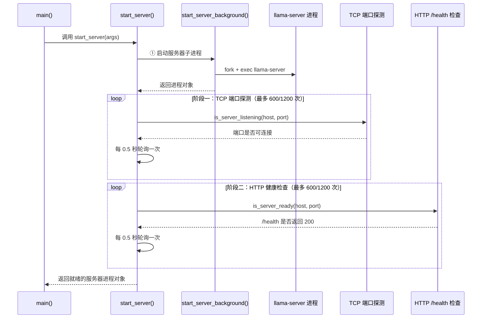
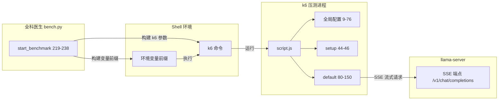

# 第90章 基准测试编排器 —— “全科医生”与“快递员”的协奏曲：从启动到报告的完整流程

在上一章中，我们从 `llama-server` 的“心脏”出发，完成了对 GGML 张量运算的探索，理解了这座推理工厂的核心动力。现在，让我们把视线从单个零件移向整条流水线，思考一个核心问题：如何证明这座工厂稳定、高效、可交付？本章聚焦于 `tools/server/bench` 目录下的两份核心文档，它们是所有性能论断的“数据之源”。打个比方，`bench.py` 是一位严谨的“全科医生”，它不仅负责评估引擎的整体健康，还亲自开方抓药、跟踪康复全过程；而 `script.js` 则是一位忠于职守的“快递员”，每一件“数据包裹”（SSE 事件）从签收到派送，都被它毫厘不差地记录在案。通过对这两位“角色”工作流的一次完整走查，你将学会如何为自己的推理引擎建立一套科学、可复现的“出厂质检”体系。


## 90.1 生活类比

想象一下，你正在管理一支专业的赛车整备车队。每一辆赛车（llama.cpp 推理引擎）交付客户前，都必须经过一套严格的“出厂质检流程”，以确保其性能与可靠性。这套流程的运作，离不开两位核心成员：

- **全科医生（bench.py）**：这位医生负责赛车的“全身检查”与“康复方案”。他不仅会**初诊**（解析参数并勾勒出检验项目清单），还会**敲门询问**（在赛车驶入工位后，确认其已具备接收检查的基本条件），直至确认**各项生命体征平稳**（短暂预热后正式进入工作状态）。在整个检查过程中，他全程记录“心率”（推理速度）与“血压”（资源利用率），最后将这些数据整理成一份可追溯的“健康档案”（输出到 CI 环境变量）。

- **快递员（script.js）**：这位快递员负责为医生提供精准的“数据包裹”。每跑完一圈测试，他都会回到待检区**取件**（从数据集选取一个对话样本），并驾车**出发**（通过 SSE 协议发送请求）。在派送过程中，他会精确记录从**按下喇叭**（请求发出）到**客户开门**（收到首个 token）的响应时间，同时清点包裹内每一件物品（token 数量）。若因“包裹超重”（达到 `max_tokens` 值）而派送失败，他会如实上报“派送失败原因”，确保医生对赛车性能的评估毫无偏差。

这两位角色的协作为我们构建了一个完整的质检闭环：医生制定检查标准与流程，快递员提供精准的原始数据。当我们理解了他们各自的工作方式，就能真正读懂如何科学地评测一套推理引擎的极限性能。


## 90.2 源码地图

```
tools/server/bench/bench.py            # 全科医生：基准测试总控编排器
├── __main__()                         # 全局入口：调用 main() 启动基准测试（282-283行）
├── main()                             # 总控编排：参数解析→服务器启动→k6 压测→Prometheus 采集→GitHub env 输出（28-217行）
│   ├── start_server()                 # 双阶段就绪探测：先 TCP 端口侦听再 HTTP /health 健康检查（240-260行）
│   │   ├── start_server_background()  # 创建 llama-server 子进程，双线程分流 stdout/stderr 日志（262-279行）
│   │   ├── is_server_listening()      # TCP 端口探测：socket.connect_ex 判定监听状态（281-287行）
│   │   └── is_server_ready()          # HTTP 健康检查：GET /health → 200 判定就绪（289-292行）
│   ├── start_benchmark()              # 执行 k6 压测并注入 SERVER_BENCH_* 环境变量（219-238行）
│   └── escape_metric_name()           # 指标名规范化：非字母数字→下划线，仅保留大写（294-295行）

tools/server/bench/script.js           # 快递员：k6 压测执行脚本
├── __main__（全局配置）               # 环境变量解析 + SharedArray 数据集预处理 + Trend/Counter/Rate 指标创建 + options 阈值配置（9-76行）
├── setup()                            # 输出基准测试配置信息到控制台（44-46行）
└── default()                          # k6 主测试函数：SSE 流式请求 + 事件回调指标采集 + 性能指标计算（80-150行）
```

> **注意**：在 `script.js` 的层级结构中，`setup()` 与 `default()` 作为独立的初始化与执行函数，与全局配置子块呈现**并列关系**。全局配置子块主要负责定义环境变量、预加载数据集并实例化各类指标对象，而 `setup()` 仅作为生命周期钩子输出配置信息，`default()` 则作为主测试逻辑循环执行。


## 90.3 示例程序全貌 —— 两款“仪表盘”的协同工作

在深入代码细节之前，让我们先通过下表俯瞰 `bench.py` 中每个函数的功能范畴与核心职责。这张表就像全科医生工作台上的“档案卡”，为后续章节的深入解析提供整体框架。每个函数都对应质检流程中的一个独立工序，它们通过明确的调用关系串联成完整的测试流水线。

| 函数名 | 功能范畴 | 核心能力 | 质检工序类比 |
|---|---|---|---|
| `main()` | 总控编排 | 全流程调度：参数解析→启动服务器→k6 压测→采集指标→生成图表→输出 env 变量 | 全科医生在“初诊→复诊→出报告”中的总调度台 |
| `start_server()` | 服务器生命周期 | 双阶段就绪检测：TCP 端口探测 + HTTP 健康检查，带超时断言 | 医生确认“引擎已点火且生命体征平稳” |
| `start_server_background()` | 子进程管理 | 创建 llama-server 子进程，双线程分流 stdout/stderr 日志 | 赛车驶入工位，连接好数据线 |
| `is_server_listening()` | 网络探测 | TCP socket 连接检查，判定端口是否可连接 | 按响门铃，确认“引擎已点火” |
| `is_server_ready()` | 健康检查 | HTTP GET /health，判定 200 状态码 | 读取仪表盘，确认“各项指标无异常” |
| `start_benchmark()` | 压测驱动 | 启动 k6 进程，注入 `SERVER_BENCH_*` 环境变量，检查返回码 | 下令“开始跑标准测试圈” |
| `escape_metric_name()` | 数据规范化 | 指标名转大写、非字母数字转下划线，适配 env 变量命名 | 将赛道数据整理为标准格式的“健康档案” |

下表呈现了 `script.js` 中各个代码单元在数据采集层面的职责分工，将“快递员”的派遣过程拆解为三个相互衔接的环节：

| 代码单元 | 功能范畴 | 核心能力 | 快递员工序类比 |
|---|---|---|---|
| 全局配置（`__main__` 9-76行） | 参数环境定义 | 解析环境变量、加载数据集、创建指标对象、配置阈值 | 快递员检查运单、装载货物 |
| `setup()`（44-46行） | 配置输出 | 将测试关键参数打印到控制台，便于日志追溯 | 出发前向调度中心报告出车计划 |
| `default()`（80-150行） | 单次迭代主逻辑 | 构造请求、SSE 监听、指标计算与上报 | 快递员完成从取件到签收的全过程 |


## 90.4 全局入口与总控编排 —— main() 调度 20+ 参数的测试流水线

现在，让我们走进全科医生的“问诊室”，主控台上最醒目的就是那份被标记为“总调度方案”的操作面板——`main()` 函数。它如同全科医生的诊疗总纲，指挥着从初诊到康复方案制定的每一个环节。从接收患者的“自述”（命令行参数）开始，到最终出具“健康报告”（输出验收结果），`main()` 将整个质检流程紧密串联成一个闭环。

### 90.4.1 `main()` — 调度 20+ 参数的**测试流水线**

源码路径：`tools/server/bench/bench.py` - `main()`（28-217行）

```python
def main(args_in: list[str] | None = None) -> None:
    # ① 阶段一：构建参数解析器，定义 20+ 个命令行参数
    parser = argparse.ArgumentParser(description="Start server benchmark scenario")
    parser.add_argument("--name", type=str, help="Bench name", required=True)               # 测试批次名称
    parser.add_argument("--runner-label", type=str, help="Runner label", required=True)     # 运行器标签
    parser.add_argument("--branch", type=str, help="Branch name", default="detached")       # 代码分支（默认 detached）
    parser.add_argument("--commit", type=str, help="Commit name", default="dirty")          # Commit 哈希（默认 dirty）
    parser.add_argument("--host", type=str, help="Server listen host", default="0.0.0.0")   # 监听主机
    parser.add_argument("--port", type=int, help="Server listen host", default="8080")      # 监听端口
    parser.add_argument("--model-path-prefix", type=str, help="Prefix where to store the model files", default="models")  # 模型存储前缀
    parser.add_argument("--n-prompts", type=int,
                        help="SERVER_BENCH_N_PROMPTS: total prompts to randomly select in the benchmark", required=True)  # 提示词总数
    parser.add_argument("--max-prompt-tokens", type=int,
                        help="SERVER_BENCH_MAX_PROMPT_TOKENS: maximum prompt tokens to filter out in the dataset",
                        required=True)                                                     # 数据集过滤：最大 prompt token 数
    parser.add_argument("--max-tokens", type=int,
                        help="SERVER_BENCH_MAX_CONTEXT: maximum context size of the completions request to filter out in the dataset: prompt + predicted tokens",
                        required=True)                                                     # 数据集过滤：最大上下文（prompt + 生成）
    parser.add_argument("--hf-repo", type=str, help="Hugging Face model repository", required=True)  # HF 模型仓库
    parser.add_argument("--hf-file", type=str, help="Hugging Face model file", required=True)        # HF 模型文件名
    parser.add_argument("-ngl", "--n-gpu-layers", type=int, help="layers to the GPU for computation", required=True)  # GPU 卸载层数
    parser.add_argument("--ctx-size", type=int, help="Set the size of the prompt context", required=True)  # 上下文大小
    parser.add_argument("--parallel", type=int, help="Set the number of slots for process requests", required=True)  # 并行槽位数
    parser.add_argument("--batch-size", type=int, help="Set the batch size for prompt processing", required=True)   # 批处理大小
    parser.add_argument("--ubatch-size", type=int, help="physical maximum batch size", required=True)               # 物理最大批大小
    parser.add_argument("--scenario", type=str, help="Scenario to run", required=True)     # 压测场景（script.js 路径）
    parser.add_argument("--duration", type=str, help="Bench scenario", required=True)      # 压测时长
    args = parser.parse_args(args_in)   # 解析命令行参数

    # ② 记录测试启动时间：供 Prometheus 查询使用
    start_time = time.time()

    # ③ 阶段二：启动服务器（双阶段就绪检测），失败则打印堆栈并退出
    try:
        server_process = start_server(args)
    except Exception:
        print("bench: server start error :")
        traceback.print_exc(file=sys.stdout)
        sys.exit(1)

    iterations = 0   # 成功完成的迭代次数
    data = {}        # k6 指标数据容器
    try:
        # ④ 阶段三：执行 k6 压测（同步阻塞，等待 k6 退出）
        start_benchmark(args)

        # ⑤ 阶段四：解析 k6 结果，将指标值写入 GitHub Actions 环境变量文件
        with open("results.github.env", 'w') as github_env:
            with open('k6-results.json', 'r') as bench_results:
                data = json.load(bench_results)
                for metric_name in data['metrics']:              # 遍历所有指标名
                    for metric_metric in data['metrics'][metric_name]:  # 遍历指标的所有统计量
                        value = data['metrics'][metric_name][metric_metric]
                        if isinstance(value, float) or isinstance(value, int):
                            value = round(value, 2)             # 数值保留两位小数
                            data['metrics'][metric_name][metric_metric] = value
                            # ⑥ 指标名规范化后写入 env 文件
                            github_env.write(
                                f"{escape_metric_name(metric_name)}_{escape_metric_name(metric_metric)}={value}\n")
                # ⑦ 读取成功完成的迭代次数
                iterations = data['root_group']['checks']['success completion']['passes']
    except Exception:
        # ⑧ 压测或解析失败：打印堆栈但不退出，继续执行服务器终止逻辑
        print("bench: error :")
        traceback.print_exc(file=sys.stdout)

    # ⑨ 阶段五：优雅终止服务器（三阶段策略）
    if server_process:
        try:
            print(f"bench: shutting down server pid={server_process.pid} ...")
            if os.name == 'nt':                      # Windows 使用 CTRL_C_EVENT
                interrupt = signal.CTRL_C_EVENT
            else:                                    # Unix 使用 SIGINT
                interrupt = signal.SIGINT
            server_process.send_signal(interrupt)    # 第一步：发送中断信号
            server_process.wait(0.5)                 # 第二步：等待 500ms
        except subprocess.TimeoutExpired:
            print(f"server still alive after 500ms, force-killing pid={server_process.pid} ...")
            server_process.kill()                    # 第三步：强制终止
            server_process.wait()
        # ⑩ 等待端口完全释放：避免残留端口影响后续测试
        while is_server_listening(args.host, args.port):
            time.sleep(0.1)

    # ⑪ 阶段六：生成图表标题与坐标轴标签
    title = (f"llama.cpp {args.name} on {args.runner_label}\n "
             f"duration={args.duration} {iterations} iterations")
    xlabel = (f"{args.hf_repo}/{args.hf_file}\n"
              f"parallel={args.parallel} ctx-size={args.ctx_size} ngl={args.n_gpu_layers} "
              f"batch-size={args.batch_size} ubatch-size={args.ubatch_size} "
              f"pp={args.max_prompt_tokens} pp+tg={args.max_tokens}\n"
              f"branch={args.branch} commit={args.commit}")
    end_time = time.time()

    # ⑫ 阶段七：Prometheus 指标采集与绘图
    prometheus_metrics = {}
    if is_server_listening("0.0.0.0", 9090):
        metrics = ['prompt_tokens_seconds', 'predicted_tokens_seconds',
                   'kv_cache_usage_ratio', 'requests_processing', 'requests_deferred']
        for metric in metrics:
            # ⑬ 查询范围数据：start_time 到 end_time，每 2 秒一个采样点
            resp = requests.get(f"http://localhost:9090/api/v1/query_range",
                                params={'query': 'llamacpp:' + metric, 'start': start_time, 'end': end_time, 'step': 2})
            with open(f"{metric}.json", 'w') as metric_json:
                metric_json.write(resp.text)
            if resp.status_code != 200:
                print(f"bench: unable to extract prometheus metric {metric}: {resp.text}")
            else:
                metric_data = resp.json()
                values = metric_data['data']['result'][0]['values']
                timestamps, metric_values = zip(*values)                  # 分离时间戳与值
                prometheus_metrics[metric] = [float(value) for value in metric_values]
                timestamps_dt = [str(datetime.fromtimestamp(int(ts))) for ts in timestamps]

                # ⑭ 生成 JPG 折线图
                plt.figure(figsize=(16, 10), dpi=80)                    # 16:10 画布，80 DPI
                plt.plot(timestamps_dt, metric_values, label=metric)    # 绘制时间序列折线
                plt.xticks(rotation=0, fontsize=14, horizontalalignment='center', alpha=.7)  # 横轴刻度样式
                plt.yticks(fontsize=12, alpha=.7)                       # 纵轴刻度样式
                plt.title(title, fontsize=14, wrap=True)                # 图表标题（自动换行）
                plt.grid(axis='both', alpha=.3)                         # 半透明网格
                plt.ylabel(f"llamacpp:{metric}", fontsize=22)           # 纵轴标签
                plt.xlabel(xlabel, fontsize=14, wrap=True)              # 横轴标签（自动换行）
                plt.gca().xaxis.set_major_locator(matplotlib.dates.MinuteLocator())          # 分钟级主刻度
                plt.gca().xaxis.set_major_formatter(matplotlib.dates.DateFormatter("%Y-%m-%d %H:%M:%S"))  # 时间格式化
                plt.gcf().autofmt_xdate()                               # 自动旋转日期标签
                for spine in ["top", "right"]:
                    plt.gca().spines[spine].set_alpha(0.0)             # 隐藏上、右边框
                for spine in ["bottom", "left"]:
                    plt.gca().spines[spine].set_alpha(0.3)             # 淡化下、左边框
                plt.savefig(f'{metric}.jpg', dpi=60)                    # 保存低分辨率 JPG
                plt.close()                                             # 关闭图像句柄，释放内存

                # ⑮ 生成 Mermaid 图表（GitHub Markdown 可渲染的 xychart-beta 格式）
                with open(f"{metric}.mermaid", 'w') as mermaid_f:
                    mermaid = (
                    f"""---
config:
    xyChart:
        titleFontSize: 12
        width: 900
        height: 600
    themeVariables:
        xyChart:
            titleColor: "#000000"
---
xychart-beta
    title "{title}"
    y-axis "llamacpp:{metric}"
    x-axis "llamacpp:{metric}" {int(min(timestamps))} --> {int(max(timestamps))}
    line [{', '.join([str(round(float(value), 2)) for value in metric_values])}]
                    """)
                    mermaid_f.write(mermaid)

    # ⑯ 封装核心结果 JSON：整合 k6 指标与 Prometheus 平均值
    bench_results = {
        "i": iterations,
        "req": {
            "p95": round(data['metrics']["http_req_duration"]["p(95)"], 2),
            "avg": round(data['metrics']["http_req_duration"]["avg"], 2),
        },
        "pp": {
            "p95": round(data['metrics']["llamacpp_prompt_processing_second"]["p(95)"], 2),
            "avg": round(data['metrics']["llamacpp_prompt_processing_second"]["avg"], 2),
            "0": round(mean(prometheus_metrics['prompt_tokens_seconds']), 2) if 'prompt_tokens_seconds' in prometheus_metrics else 0,
        },
        "tg": {
            "p95": round(data['metrics']["llamacpp_tokens_second"]["p(95)"], 2),
            "avg": round(data['metrics']["llamacpp_tokens_second"]["avg"], 2),
            "0": round(mean(prometheus_metrics['predicted_tokens_seconds']), 2) if 'predicted_tokens_seconds' in prometheus_metrics else 0,
        },
    }

    # ⑰ 输出最终结果到 GitHub Actions 环境变量（追加模式）
    with open("results.github.env", 'a') as github_env:
        github_env.write(f"BENCH_RESULTS={json.dumps(bench_results, indent=None, separators=(',', ':') )}\n")
        github_env.write(f"BENCH_ITERATIONS={iterations}\n")
        title = title.replace('\n', ' ')     # 清理标题中的换行符
        xlabel = xlabel.replace('\n', ' ')   # 清理标签中的换行符
        github_env.write(f"BENCH_GRAPH_TITLE={title}\n")
        github_env.write(f"BENCH_GRAPH_XLABEL={xlabel}\n")
```

`main()` 函数包含了上面展示的完整基准测试编排流程。这段代码定义了全科医生的“总诊疗方案”核心骨架。它将测试流程拆解为 **参数解析 → 服务器启动 → k6 压测 → k6 结果解析 → 服务器终止 → Prometheus 采集与绘图 → 结果输出** 七个阶段，每个阶段通过 `try/except` 结构进行异常隔离，确保任一阶段失败都不会导致测试进程彻底崩溃。具体而言，**参数解析**阶段（①）通过 `argparse` 定义了 20 余个参数，覆盖了基准测试所需的全部配置项；**服务器启动**阶段（③）调用 `start_server()` 并捕获异常以安全退出；**k6 压测**阶段（④）通过同步阻塞调用 `start_benchmark()` 等待 k6 退出；**结果解析**阶段（⑤⑥⑦）将 k6 的 JSON 指标转换为 GitHub Actions 可读的环境变量；**服务器终止**阶段（⑨⑩）采用“三阶段终止策略”确保端口完全释放；**Prometheus 采集与绘图**阶段（⑫-⑮）对 5 项关键指标生成 JPG 与 Mermaid 双格式产物；**结果输出**阶段（⑯⑰）将核心指标封装为紧凑的 JSON 对象追加写入 env 文件。

### 90.4.2 `escape_metric_name()` — 指标名的**标准化转换**

源码路径：`tools/server/bench/bench.py` - `escape_metric_name()`（294-295行）

```python
def escape_metric_name(metric_name):
    # ① 将指标名全部转为大写，并将非字母数字字符替换为下划线
    return re.sub('[^A-Z0-9]', '_', metric_name.upper())
```

这段代码是 `main()` 中第 ⑥ 步的辅助函数。它通过 `metric_name.upper()` 先将指标名转为大写（如 `llamacpp_prompt_processing_second` → `LLAMACPP_PROMPT_PROCESSING_SECOND`），然后使用正则表达式 `re.sub('[^A-Z0-9]', '_', ...)` 将所有“非大写字母和数字”的字符（如 `.`、`(`、`-`）替换为下划线。例如 `http_req_duration.p(95)` 会转换为 `HTTP_REQ_DURATION_P_95_`。这样设计的核心目的是：GitHub Actions 的环境变量命名规范只允许字母、数字和下划线，转成大写加下划线后，所有指标都能安全地作为环境变量名被 CI 系统解析，从而确保测试结果能够在 CI 管道中稳定传递。


## 90.5 服务器生命周期管理 —— 先按门铃再全面体检的双阶段就绪检测

上一节我们看到了 `main()` 如何如同全科医生般统筹全局。现在，让我们将镜头对准质检流程中最关键的初诊环节——`start_server()` 函数。它就像医生在患者进入诊室前的“接诊检查”：先按响门铃确认有人在家（TCP 端口监听），再为患者测量体温与血压（HTTP 健康检查）。只有两项检查都通过，患者才被允许进入诊室接受后续深入检查。



### 90.5.1 `start_server()` — 先按门铃再全面体检的**双阶段就绪探测**

源码路径：`tools/server/bench/bench.py` - `start_server()`（240-260行）

```python
def start_server(args):
    # ① 启动 llama-server 子进程，并配置日志分流线程
    server_process = start_server_background(args)

    # ② 初始化轮询计数器，设置最大尝试次数
    attempts = 0
    max_attempts = 600                       # 默认 600 次，即 5 分钟（每次 0.5 秒）
    if 'GITHUB_ACTIONS' in os.environ:
        max_attempts *= 2                    # CI 环境翻倍至 1200 次（10 分钟）

    # ③ 阶段一：TCP 端口监听探测 —— 确认服务器进程已绑定端口
    while not is_server_listening(args.host, args.port):
        attempts += 1
        if attempts > max_attempts:
            assert False, "server not started"   # 超时则断言失败
        print(f"bench:     waiting for server to start ...")
        time.sleep(0.5)                          # 每 0.5 秒轮询一次

    # ④ 重置计数器，进入阶段二
    attempts = 0
    # ⑤ 阶段二：HTTP 健康检查 —— 确认 /health 端点返回 200
    while not is_server_ready(args.host, args.port):
        attempts += 1
        if attempts > max_attempts:
            assert False, "server not ready"     # 超时则断言失败
        print(f"bench:     waiting for server to be ready ...")
        time.sleep(0.5)

    # ⑥ 双阶段通过后返回服务器进程对象
    print("bench: server started and ready.")
    return server_process
```

这段代码实现了服务器启动的“双阶段就绪检测”。它通过**轮询**模式（每 0.5 秒检查一次）依次执行两项检查：先是 TCP 端口可连接检查（按门铃），后是 HTTP `/health` 端点状态码检查（全面体检）。这种方式避免了固定休眠时间导致的“启动延迟”或“启动过早”，使测试逻辑能够精确把握服务器从“启动中”到“可服务”的转换时机。

**为什么需要两个阶段？** TCP 端口可连接只能说明服务器进程已经创建了 socket 并开始监听，但此时模型可能仍在加载中，尚未做好处理请求的准备。如果直接发送测试请求，服务器会返回连接重置或超时。HTTP `/health` 检查则更进一步——只有当模型加载完成、上下文初始化完毕、sampler 链就绪后，`/health` 才会返回 200。因此，双阶段检测就像赛车的“点火确认”（引擎已启动）和“仪表自检”（所有系统正常）之分，两者缺一不可。

**为什么 CI 环境下超时翻倍？** GitHub Actions 实际分配的执行器可能性能较低（CPU 限制、磁盘 IO 慢），导致模型下载或加载耗时显著增加。600 次 × 0.5 秒 = 300 秒（5 分钟）在本地可能足够，但在 CI 环境下考虑到高频加载大模型场景，超时时间翻倍为 600 秒（10 分钟）能有效避免假性失败。

**为什么用 `assert False` 而非 `raise Exception`？** 这是一个务实的选择。在压测场景下，服务器无法启动属于“致命错误”，不期望被上层代码捕获后继续执行。`assert False` 会在该点直接抛出 `AssertionError`，进入 `main()` 第 ③ 步的 `except Exception`（注意 `AssertionError` 继承自 `Exception`）被打印堆栈后安全退出。

### 90.5.2 `start_server_background()` — 子进程创建与**日志分流**

源码路径：`tools/server/bench/bench.py` - `start_server_background()`（262-279行）

```python
def start_server_background(args):
    # ① 确定服务器二进制路径：默认相对路径，可通过环境变量覆盖
    server_path = '../../../build/bin/llama-server'
    if 'LLAMA_SERVER_BIN_PATH' in os.environ:
        server_path = os.environ['LLAMA_SERVER_BIN_PATH']

    # ② 拼接服务器启动参数：主机、端口、模型、GPU 层数等
    server_args = [
        '--host', args.host,
        '--port', args.port,
    ]
    server_args.extend(['--hf-repo', args.hf_repo])
    server_args.extend(['--hf-file', args.hf_file])
    server_args.extend(['--n-gpu-layers', args.n_gpu_layers])
    server_args.extend(['--ctx-size', args.ctx_size])
    server_args.extend(['--parallel', args.parallel])
    server_args.extend(['--batch-size', args.batch_size])
    server_args.extend(['--ubatch-size', args.ubatch_size])
    # ③ 预分配生成上限：设为 max_tokens 的两倍，防止测试中途被截断
    server_args.extend(['--n-predict', args.max_tokens * 2])
    # ④ 开启三个关键特性：连续批处理、Prometheus 指标端点、Flash Attention
    server_args.append('--cont-batching')       # 连续批处理：允许序列随时加入/退出批量解码
    server_args.append('--metrics')             # 开启 /metrics 端点，供 Prometheus 采集
    server_args.append('--flash-attn')          # 启用 Flash Attention 加速注意力计算
    args = [str(arg) for arg in [server_path, *server_args]]

    print(f"bench: starting server with: {' '.join(args)}")
    pkwargs = {
        'stdout': subprocess.PIPE,              # 重定向 stdout 到管道
        'stderr': subprocess.PIPE               # 重定向 stderr 到管道
    }
    # ⑤ 启动子进程：stdout/stderr 重定向到管道，供日志线程读取
    server_process = subprocess.Popen(
        args,
        **pkwargs)

    # ⑥ 定义日志转发函数：逐行读取子进程输出并转发到指定流
    def server_log(in_stream, out_stream):
        for line in iter(in_stream.readline, b''):   # 哨兵模式：读到 EOF 为止
            print(line.decode('utf-8'), end='', file=out_stream)

    # ⑦ 创建两个守护线程分别转发 stdout 和 stderr
    thread_stdout = threading.Thread(target=server_log, args=(server_process.stdout, sys.stdout))
    thread_stdout.start()
    thread_stderr = threading.Thread(target=server_log, args=(server_process.stderr, sys.stderr))
    thread_stderr.start()

    # ⑧ 返回进程对象供上层管理生命周期
    return server_process
```

这段代码实现了 llama-server 子进程的创建与日志分流。它的核心设计是：**不阻塞地在后台启动服务器进程，同时确保服务器的标准输出和错误输出能实时、分通道地转发到主进程的 stdout/stderr**。

**环境变量覆盖机制**：与 `start_benchmark()` 中的 `BENCH_K6_BIN_PATH` 类似，`LLAMA_SERVER_BIN_PATH` 环境变量允许 CI 流水线在预构建的二进制所在目录下运行测试，而不需要依赖 `../../../build/bin/llama-server` 这一相对路径。这种设计确保了测试脚本既能在本地开发环境（默认路径）运行，也能在 CI 环境中（显式提供路径）运行。

**参数设计的考量**：`--n-predict args.max_tokens * 2` 的做法很巧妙——它确保服务器端的最大生成 token 数永远大于客户端请求的 `max_tokens`，避免服务器因达到自身的 `--n-predict` 限制而提前截断生成，导致客户端拿到的 `finish_reason` 为 `'length'` 而非 `'stop'`。三个特性参数中，`--cont-batching` 让服务器能够支持任意数量的序列交错批处理，`--metrics` 是 Prometheus 采集的前提，`--flash-attn` 则显著降低长上下文的显存占用和计算延迟。

**双线程日志分流的必要性**：如果只用一个线程读取 `stdout` 和 `stderr` 两个管道，就必须串行处理可能导致客户端输出被阻塞。使用两个独立线程分别读取可以避免“日志打印阻塞压测主流程”的风险。同时，`iter(in_stream.readline, b'')` 是 Python 中的“哨兵模式”——`readline()` 每次读取一行，直到读到 EOF（返回空字节串 `b''`）为止；这比 `while True: line = readline(); if not line: break` 更简洁，也避免了在循环体内忘记写终止条件的风险。

### 90.5.3 `is_server_listening()` — TCP 端口探测（**按门铃**）

源码路径：`tools/server/bench/bench.py` - `is_server_listening()`（281-287行）

```python
def is_server_listening(server_fqdn, server_port):
    # ① 使用上下文管理器自动关闭 socket
    with closing(socket.socket(socket.AF_INET, socket.SOCK_STREAM)) as sock:
        # ② 尝试建立 TCP 连接，返回错误码（0 表示成功）
        result = sock.connect_ex((server_fqdn, server_port))
        _is_server_listening = result == 0
        if _is_server_listening:
            print(f"server is listening on {server_fqdn}:{server_port}...")
        return _is_server_listening
```

这段代码实现了 TCP 层级的服务器可达性检查。`sock.connect_ex()` 与 `sock.connect()` 的区别在于：`connect()` 在连接失败时会抛出异常，而 `connect_ex()` 则返回一个错误码（`errno`），其中 `0` 表示连接成功。这一设计让代码无需使用 `try/except` 就能精确判断连接状态，非常适合在轮询循环中频繁调用。`closing()` 上下文管理器则确保 socket 对象在函数退出时被正确关闭，避免资源泄漏。

### 90.5.4 `is_server_ready()` — HTTP 健康检查（**全面体检**）

源码路径：`tools/server/bench/bench.py` - `is_server_ready()`（289-292行）

```python
def is_server_ready(server_fqdn, server_port):
    # ① 构造健康检查 URL
    url = f"http://{server_fqdn}:{server_port}/health"
    # ② 发送 GET 请求并判定状态码
    response = requests.get(url)
    return response.status_code == 200
```

这段代码实现了 HTTP 层的就绪检查。与 TCP 探测不同，`/health` 端点需要 llama-server 完成模型加载、上下文初始化等全部前置工作后才返回 200。当模型仍在加载时，`/health` 返回 503（服务不可用）。因此，`is_server_ready()` 是比 `is_server_listening()` 更严格的就绪判据，它确保了压测请求发出时服务器已经具备完全的服务能力，不会因模型未加载完成而返回错误。


## 90.6 k6 压测执行 —— 环境变量注入的传令兵与快递员的“数据派送手册”

当全科医生确认引擎正常后，真正的“赛道测试”开始了。此刻，传令兵（`start_benchmark`）接过了指挥棒——他不需要知道赛车的每一个零部件如何运作，只需将“跑哪条赛道”（`--scenario`）、“跑多久”（`--duration`）等指令精准传递给赛道上的“快递员”（k6 进程），并确保快递员携带正确的“送货单”（环境变量）。这一节我们将深入探究传令兵与快递员之间无缝的协作机制。



### 90.6.1 `start_benchmark()` — 环境变量注入的**传令兵**

源码路径：`tools/server/bench/bench.py` - `start_benchmark()`（219-238行）

```python
def start_benchmark(args):
    # ① 确定 k6 二进制路径：同样支持环境变量覆盖
    k6_path = './k6'
    if 'BENCH_K6_BIN_PATH' in os.environ:
        k6_path = os.environ['BENCH_K6_BIN_PATH']

    # ② 基础 k6 参数：关闭彩色输出与连接复用
    k6_args = [
        'run', args.scenario,               # 指定压测脚本（script.js 路径）
        '--no-color',                       # 禁用彩色输出，便于日志抓取
        '--no-connection-reuse',            # 禁用连接复用，模拟真实网络环境
        '--no-vu-connection-reuse',         # 禁用 VU 级连接复用
    ]

    # ③ 追加核心压测参数：时长、迭代次数、虚拟用户数
    k6_args.extend(['--duration', args.duration])      # 压测时长
    k6_args.extend(['--iterations', args.n_prompts])   # 迭代次数（与数据集大小一致）
    k6_args.extend(['--vus', args.parallel])           # 虚拟用户数（与服务器并行槽位一致）

    # ④ 输出配置：JSON 摘要 + CSV 原始数据
    k6_args.extend(['--summary-export', 'k6-results.json'])  # JSON 格式结果摘要
    k6_args.extend(['--out', 'csv=k6-results.csv'])           # CSV 格式原始数据

    # ⑤ 注入环境变量：这些变量会被 script.js 的 __ENV 读取
    args = f"SERVER_BENCH_N_PROMPTS={args.n_prompts} SERVER_BENCH_MAX_PROMPT_TOKENS={args.max_prompt_tokens} SERVER_BENCH_MAX_CONTEXT={args.max_tokens} "
    args = args + ' '.join([str(arg) for arg in [k6_path, *k6_args]])

    print(f"bench: starting k6 with: {args}")

    # ⑥ 同步执行 k6 进程：等待退出并检查返回码
    k6_completed = subprocess.run(args, shell=True, stdout=sys.stdout, stderr=sys.stderr)
    if k6_completed.returncode != 0:
        raise Exception("bench: unable to run k6")
```

这段代码实现了 k6 压测工具的启动与同步等待，其核心设计在于通过环境变量精准传递测试参数，并确保压测进程的成败可被上层感知。**环境变量注入**（⑤）将 `SERVER_BENCH_N_PROMPTS`、`SERVER_BENCH_MAX_PROMPT_TOKENS`、`SERVER_BENCH_MAX_CONTEXT` 三个变量直接拼接到命令行前缀中，k6 进程启动后，`script.js` 通过 `__ENV` 对象读取这些变量，这种方式避免了修改 `script.js` 源码即可动态调整测试参数。**为什么使用 `shell=True`？** 一方面是为了支持第 ⑤ 步的环境变量前缀语法（`VAR=value command` 是 shell 语法而非系统调用）；另一方面，`args` 已经是一个完整的字符串，使用 `shell=True` 可以直接执行。如果改为数组形式传递参数，则环境变量需要额外通过 `env` 参数传递，且 `--no-color` 等参数可能需要额外转义。**返回码检查**（⑥）确保 k6 压测失败（如服务器崩溃、网络异常）会被显式抛出异常，将控制权交还给 `main()` 的 `except Exception` 分支，而不会被静默忽略。

### 90.6.2 `script.js` 全局配置（`__main__`）— 环境变量解析与**数据集预处理**

源码路径：`tools/server/bench/script.js` - 全局配置（9-76行）

```javascript
// ① 服务器 URL：优先从环境变量读取，默认为本地 8080 端口的 OpenAI 兼容端点
const server_url = __ENV.SERVER_BENCH_URL ? __ENV.SERVER_BENCH_URL : 'http://localhost:8080/v1'

// ② 测试提示词数量：默认为 600/10*8 = 480 个（假设每秒 10 个请求、8 个 VU）
const n_prompt = __ENV.SERVER_BENCH_N_PROMPTS ? parseInt(__ENV.SERVER_BENCH_N_PROMPTS) : 600 / 10 * 8

// ③ 模型别名：默认为 'my-model'
const model = __ENV.SERVER_BENCH_MODEL_ALIAS ? __ENV.SERVER_BENCH_MODEL_ALIAS : 'my-model'

// ④ 数据集路径：默认 ShareGPT 格式 JSON 文件
const dataset_path = __ENV.SERVER_BENCH_DATASET ? __ENV.SERVER_BENCH_DATASET : './ShareGPT_V3_unfiltered_cleaned_split.json'

// ⑤ 生成最大 token 数：默认 512
const max_tokens = __ENV.SERVER_BENCH_MAX_TOKENS ? parseInt(__ENV.SERVER_BENCH_MAX_TOKENS) : 512

// ⑥ 提示词最大 token 数：默认 1024
const n_prompt_tokens = __ENV.SERVER_BENCH_MAX_PROMPT_TOKENS ? parseInt(__ENV.SERVER_BENCH_MAX_PROMPT_TOKENS) : 1024

// ⑦ 槽位上下文大小：默认 2048
const n_ctx_slot = __ENV.SERVER_BENCH_MAX_CONTEXT ? parseInt(__ENV.SERVER_BENCH_MAX_CONTEXT) : 2048

// ⑧ 数据集加载与预处理：使用 SharedArray 实现跨 VU 内存共享
const data = new SharedArray('conversations', function () {
    // ⑨ 简易分词器：按空白与常见标点分割
    const tokenizer = (message) => message.split(/[\s,'".?]/)

    // ⑩ JSON 解析 + 五步过滤流水线
    return JSON.parse(open(dataset_path))
        // ⑪ 过滤掉少于 2 轮对话的样本
        .filter(data => data["conversations"].length >= 2)
        // ⑫ 过滤掉首条消息不是来自 human 的样本
        .filter(data => data["conversations"][0]["from"] === "human")
        // ⑬ 提取 prompt 与 token 计数
        .map(data => {
            return {
                prompt: data["conversations"][0]["value"],
                n_prompt_tokens: tokenizer(data["conversations"][0]["value"]).length,
                n_completion_tokens: tokenizer(data["conversations"][1]["value"]).length,
            }
        })
        // ⑭ 过滤掉过短的序列（不足 4 个 token）
        .filter(conv => conv.n_prompt_tokens >= 4 && conv.n_completion_tokens >= 4)
        // ⑮ 过滤掉过长序列（超出 max_prompt_tokens 或 max_context）
        .filter(conv => conv.n_prompt_tokens <= n_prompt_tokens && conv.n_prompt_tokens + conv.n_completion_tokens <= n_ctx_slot)
        // ⑯ 截取前 n_prompt 条
        .slice(0, n_prompt)
})

// ⑰ 创建 Trend 类型指标：用于记录数值分布
const llamacpp_prompt_tokens = new Trend('llamacpp_prompt_tokens')
const llamacpp_completion_tokens = new Trend('llamacpp_completion_tokens')
const llamacpp_tokens_second = new Trend('llamacpp_tokens_second')
const llamacpp_prompt_processing_second = new Trend('llamacpp_prompt_processing_second')
const llamacpp_emit_first_token_second = new Trend('llamacpp_emit_first_token_second')

// ⑱ 创建 Counter 类型指标：用于累计总数
const llamacpp_prompt_tokens_total_counter = new Counter('llamacpp_prompt_tokens_total_counter')
const llamacpp_completion_tokens_total_counter = new Counter('llamacpp_completion_tokens_total_counter')

// ⑲ 创建 Rate 类型指标：用于记录布尔比例
const llamacpp_completions_truncated_rate = new Rate('llamacpp_completions_truncated_rate')
const llamacpp_completions_stop_rate = new Rate('llamacpp_completions_stop_rate')

// ⑳ 配置 k6 选项：截断率阈值与测试时长
export const options = {
    thresholds: {
        llamacpp_completions_truncated_rate: [
            // 超过 80% 截断率将终止测试
            {threshold: 'rate < 0.8', abortOnFail: true, delayAbortEval: '1m'},
        ],
    },
    duration: '10m',
    vus: 8,
}
```

这段全局配置代码定义了快递员的“运单装载规则”。它的核心逻辑分布在三个维度：**参数读取与默认值**（①-⑦）确保脚本既可独立运行（使用默认参数），又可被 CI 系统精确控制（通过环境变量注入）。**SharedArray 数据集预处理**（⑧-⑯）采用 `SharedArray` 而非普通数组的原因是 k6 中每个虚拟用户（VU）都运行在独立的 JavaScript 实例中，普通数组会导致每个 VU 都复制一份数据集，内存开销巨大。`SharedArray` 让所有 VU 共享同一份内存中的数据集。预处理流水线执行了 5 步过滤/映射操作：对话数过滤、首条消息角色过滤、token 计数映射、短序列过滤、长序列过滤。值得注意的细节是第 ⑨ 步的 `tokenizer` 使用正则 `[\s,'".?]` 分割字符串，这是一个简化的分词方案——它按空白、逗号、单引号、双引号、句号和问号切分文本，虽然无法准确反映真实 tokenizer（如 BPE）的分词结果，但能为数据过滤提供一个足够接近的近似值。如果 tokenizer 过粗（例如过长的 URL 被算作 1 个 token），可能导致部分样本通过过滤但实际生成时超出上下文窗口。**指标类型选择**（⑰-⑲）中，`Trend` 记录了每个样本的独立值，可用于计算 avg/p95/p99 等百分位统计；`Counter` 只做累计，适合统计整个测试期间的总 token 消费量；`Rate` 记录布尔值（true/false）的比例，适合观测截断率。**为什么首 token 时间（TTFB）使用 `Trend` 而不是 `Counter`？** 因为 TTFB 的每一次记录都是独立的耗时值，我们需要分析其整体分布（p99 能反映极端慢请求），而 `Counter` 只保留总和，无法提供分布信息。**阈值配置**（⑳）中 `llamacpp_completions_truncated_rate` 的阈值为 `rate < 0.8`，意味着如果 80% 以上的生成都被截断（`finish_reason == 'length'`），测试将被中止。`abortOnFail: true` 启用自动中止，`delayAbortEval: '1m'` 则给测试 1 分钟宽限期，避免因短暂的网络波动导致的误判。

### 90.6.3 `setup()` — 出发前向调度中心**报告出车计划**

源码路径：`tools/server/bench/script.js` - `setup()`（44-46行）

```javascript
export function setup() {
    // ① 输出本次测试的全部关键配置，便于日志追溯
    console.info(`Benchmark config: server_url=${server_url} n_prompt=${n_prompt} model=${model} dataset_path=${dataset_path} max_tokens=${max_tokens}`)
}
```

`setup()` 是 k6 的生命周期钩子函数，在压测启动前只执行一次。通过在测试开始前打印全部配置参数，CI 日志中即可完整追溯每次测试的环境信息，这对于调试“为什么这次测试结果与上次不同”这类问题至关重要。如果未来增加新的配置项（如 `temperature`），需要同步修改三个位置：`__main__` 中的环境变量读取、`setup()` 的打印输出、`default()` 中的请求体构造。

### 90.6.4 `default()` — 完成从取件到签收的**全程派送**

源码路径：`tools/server/bench/script.js` - `default()`（80-150行）

```javascript
export default function () {
    // ① 从共享数据集中按迭代序号循环选取对话样本
    const conversation = data[exec.scenario.iterationInInstance % data.length]

    // ② 构造 POST 请求体：系统提示 + 用户消息 + 流式配置
    const payload = {
        "messages": [
            {
                "role": "system",
                "content": "You are ChatGPT, an AI assistant.",
            },
            {
                "role": "user",
                "content": conversation.prompt,
            }
        ],
        "model": model,
        "stream": true,
        "stream_options": {
          "include_usage": true,  // 让服务器在事件流末尾附带 usage 统计
        },
        "seed": 42,               // 固定随机种子，保证结果可复现
        "max_tokens": max_tokens,
        "stop": ["<|im_end|>"]    // 自定义停止标记（针对 phi-2 基础模型）
    }

    const params = {method: 'POST', body: JSON.stringify(payload)};

    // ③ 初始化关键计时变量：记录请求发送时间、首 token 时间、token 计数与结束原因
    const startTime = new Date()
    let promptEvalEndTime = null
    let prompt_tokens = 0
    let completions_tokens = 0
    let finish_reason = null

    // ④ 打开 SSE 流式连接：监听事件、错误，处理流式数据
    const res = sse.open(`${server_url}/chat/completions`, params, function (client) {
        client.on('event', function (event) {
            // ⑤ 首次事件触发：记录首 token 到达时间，计算 TTFB 指标
            if (promptEvalEndTime == null) {
                promptEvalEndTime = new Date()
                llamacpp_emit_first_token_second.add((promptEvalEndTime - startTime) / 1.e3)
            }

            // ⑥ 流结束标记：SFINAE 忽略空事件与 [DONE]
            if (event.data === '[DONE]' || event.data === '') {
                return
            }

            // ⑦ 解析 SSE 数据块为 JSON
            let chunk = JSON.parse(event.data)

            // ⑧ 提取完成原因：当 chunk 包含 finish_reason 时记录
            if (chunk.choices && chunk.choices.length > 0) {
                let choice = chunk.choices[0]
                if (choice.finish_reason) {
                    finish_reason = choice.finish_reason
                }
            }

            // ⑨ 提取 usage 统计：在流末尾由 include_usage 触发的特殊 chunk
            if (chunk.usage) {
                prompt_tokens = chunk.usage.prompt_tokens
                llamacpp_prompt_tokens.add(prompt_tokens)
                llamacpp_prompt_tokens_total_counter.add(prompt_tokens)

                completions_tokens = chunk.usage.completion_tokens
                llamacpp_completion_tokens.add(completions_tokens)
                llamacpp_completion_tokens_total_counter.add(completions_tokens)
            }
        })

        // ⑩ 错误处理：打印错误并抛出，中止当前迭代
        client.on('error', function (e) {
            console.log('An unexpected error occurred: ', e.error());
            throw e;
        })
    })

    // ⑪ 检查 HTTP 状态码是否为 200
    check(res, {'success completion': (r) => r.status === 200})

    // ⑫ 计算提示词处理速度（每秒处理 token 数）
    const endTime = new Date()
    const promptEvalTime = promptEvalEndTime - startTime
    if (promptEvalTime > 0) {
        llamacpp_prompt_processing_second.add(prompt_tokens / (promptEvalEndTime - startTime) * 1.e3)
    }

    // ⑬ 计算生成速度（每秒生成 token 数）
    const completion_time = endTime - promptEvalEndTime
    if (completions_tokens > 0 && completion_time > 0) {
        llamacpp_tokens_second.add(completions_tokens / completion_time * 1.e3)
    }

    // ⑭ 记录完成原因：'length'（截断）与 'stop'（正常结束）
    llamacpp_completions_truncated_rate.add(finish_reason === 'length')
    llamacpp_completions_stop_rate.add(finish_reason === 'stop')

    // ⑮ 模拟真实用户阅读延迟，控制请求速率
    sleep(0.3)
}
```

这段代码是快递员“单次派送”的核心执行逻辑，它详细实现了从选取样本到上报指标的全过程，可按时间轴分为三个阶段：**取件与装载阶段**（①-③）从 `SharedArray` 数据集中按 `exec.scenario.iterationInInstance % data.length` 循环选取样本。这种取模方式确保当迭代次数超过数据集大小时，可以循环复用样本，避免“数据集耗尽”导致的测试提前终止。请求体中的 `stream_options.include_usage` 是关键配置——它让 OpenAI 兼容服务器在事件流末尾追加一个包含 `usage` 统计的特殊 chunk，使得客户端无需自行本地计数 token。`seed: 42` 固定随机种子保证了测试结果的可复现性，便于不同提交之间进行公平对比。**上路与实时监听阶段**（④-⑩）通过 `sse.open()` 建立持久连接后，每一次事件回调都遵循“**状态机**”模式：首次事件触发时记录 `promptEvalEndTime` 并计算 TTFB；`[DONE]` 或空数据标志着事件流的结束；`finish_reason` 的出现意味着生成结束；`usage` 块则携带 token 统计。事件回调中的 `promptEvalEndTime` 使用了“仅赋值一次”的模式（`if (promptEvalEndTime == null)`），确保只记录首个 token 到达时间。**派送完成与数据上报阶段**（⑫-⑮）中，`endTime - promptEvalEndTime` 计算出生成阶段的纯耗时，据此推算“每秒生成 token 数”；`promptEvalEndTime - startTime` 则是提示词处理阶段耗时，包含网络传输、排队和 prompt 预填充时间。两个速度计算都带有防御性条件判断（`> 0`），避免除以零或负数。最后的 `sleep(0.3)` 是模拟真实用户阅读响应的自然间隔，防止请求过于密集导致服务器过载或测量失真。`finish_reason === 'length'` 对应截断率指标的 `true`，`finish_reason === 'stop'` 对应正常停止率——这两个 `Rate` 指标共同揭示了模型生成质量的重要一面：如果大量生成被提前截断（达到 `max_tokens` 上限），说明上下文长度或输出长度设置不当，或者模型回答过长。


## 90.7 设计中的取舍

**为什么 k6 的 `--iterations` 直接使用 `args.n_prompts`，而不是独立配置？**

在 script.js 中，`n_prompt` 同时控制了数据集切片数量（`.slice(0, n_prompt)`）与 k6 的迭代次数。这种耦合设计简化了参数体系——用户只需指定一个值，测试的“用例数”与“迭代数”就自动保持一致。但代价是灵活性降低：如果需要“迭代次数大于数据集大小”（循环使用样本）或“单样本多次重复”，就需要额外参数。从实际场景看，基准测试通常追求“每个样本执行一次”的标准化执行，因此这种设计取舍是合理的。

**为什么 `start_server` 使用轮询（polling）而不是阻塞式的就绪通知？**

轮询（每 0.5 秒检查一次）与信号/回调机制相比，实现更简单、调试更直观。服务器启动耗时通常在数十秒到数分钟不等，使用固定休眠 + 轮询不会造成显著延迟——检查间隔 0.5 秒远小于服务器启动的典型耗时。此外，轮询模式天然适配“超时控制”需求（`max_attempts` 配合 `time.sleep` 构成精确的超时语义）。如果采用信号机制，需要依赖 llama-server 在特定阶段主动发出信号，这在子进程模型中实现复杂度更高，且信号丢失时的容错处理也更繁琐。这是典型的“用简洁的轮询模型换取实现确定性”的取舍。

**为什么 `script.js` 采用 SSE 协议而不是普通的 POST+JSON 响应？**

SSE（Server-Sent Events）协议的核心优势在于**流式传输**——服务器可以逐 token 发送生成结果，客户端在首 token 到达时即可开始计时，而无需等待完整响应。这使 TTFB（首 token 时间）和 token 级生成速率成为可能。如果使用普通 HTTP 响应，客户端必须等待整个生成过程结束后才能获取结果，所有“流式性能指标”都将丢失。SSE 的代价是连接管理和事件解析的复杂度——客户端必须处理分帧数据、事件流结束标记等细节。对于需要模拟真实聊天场景的基准测试而言，这一复杂度是完全值得的。

**为什么 `continue_batching`、`flash-attn` 被硬编码为启动参数而不是熔断开关？**

在 `start_server_background()` 中，`--cont-batching`、`--flash-attn` 和 `--metrics` 三个参数被无条件附加。这种“无开关”设计的理由是：这些特性代表了 llama-server 当前的最优实践（连续批处理提升吞吐、Flash Attention 降低显存占用），在基准测试场景中没有理由禁用。硬编码减少了 CI 命令的长度和参数解析的复杂度。潜在代价是无法直接对比“启用与禁用”这些特性的性能差异——如果需要此类对比，可以通过设置 `LLAMA_SERVER_BIN_PATH` 指向不同构建版本来间接实现。


## 90.8 动手练习

1. 阅读 `tools/server/bench/bench.py` 第 240-260 行（`start_server` 函数），回答以下问题：
   - 为什么需要同时检测 `is_server_listening()` 和 `is_server_ready()` 两个阶段？TCP 端口可连接与 HTTP `/health` 返回 200 各代表服务器的什么状态？
   - `max_attempts` 在 CI 环境（`GITHUB_ACTIONS`）为什么翻倍至 1200 次？
   - 如果服务器在 600 次（非 CI）或 1200 次（CI）尝试后仍未就绪，`assert False` 会抛出什么异常？该异常在 `main()` 中如何被处理？

2. 阅读 `tools/server/bench/bench.py` 第 262-279 行（`start_server_background` 函数），完成以下分析：
   - `server_path` 的默认值 `'../../../build/bin/llama-server'` 与 `LLAMA_SERVER_BIN_PATH` 环境变量的覆盖逻辑是什么？这种设计解决了什么部署问题？
   - `server_args` 中 `'--n-predict', args.max_tokens * 2` 的设计意图是什么？为什么要设为最大 token 数的两倍？
   - 为什么使用两个 `threading.Thread` 分别分流 stdout 和 stderr？如果只有一个线程会发生什么？
   - `server_log()` 内的 `iter(in_stream.readline, b'')` 哨兵模式如何工作？

3. 阅读 `tools/server/bench/bench.py` 第 294-295 行，完成以下任务：
   - 理解 `re.sub('[^A-Z0-9]', '_', metric_name.upper())` 的正则表达式含义
   - 分析几个示例转换：`'llamacpp_prompt_processing_second'` → `'LLAMACPP_PROMPT_PROCESSING_SECOND'`，`'http_req_duration'` → `'HTTP_REQ_DURATION'`
   - 思考为什么 GitHub Actions 环境变量需要这种命名规范（只能包含字母、数字和下划线）

4. 阅读 `tools/server/bench/bench.py` 第 93-110 行（`main()` 的 try/finally 块），完成以下分析：
   - 理解服务器终止的三阶段策略：SIGINT（或 Windows `CTRL_C_EVENT`）→ 500ms 超时 → force kill
   - 解释 `os.name == 'nt'` 时为什么选择 `CTRL_C_EVENT` 而不是 `SIGINT`？
   - 分析 `while is_server_listening(args.host, args.port): time.sleep(0.1)` 循环的作用

5. 阅读 `tools/server/bench/bench.py` 第 282-283 行（`__main__`），完成以下思考：
   - 为什么使用 `if __name__ == '__main__': main()` 而不是直接调用 `main()`？
   - 这种设计允许 bench.py 既作为独立脚本运行，又可作为模块被其他 Python 文件导入而不执行 `main()`

6. 阅读 `tools/server/bench/bench.py` 第 219-238 行（`start_benchmark` 函数），完成以下分析：
   - 理解 `k6_path` 的默认值 `'./k6'` 和 `BENCH_K6_BIN_PATH` 环境变量的覆盖逻辑
   - 分析 `k6_args` 的组成：`'run'`、`'--no-color'`、`'--no-connection-reuse'`、`'--no-vu-connection-reuse'`、`'--duration'`、`'--iterations'`、`'--vus'`、`'--summary-export'`、`'--out'` 各自的作用
   - 理解 `SERVER_BENCH_N_PROMPTS`、`SERVER_BENCH_MAX_PROMPT_TOKENS`、`SERVER_BENCH_MAX_CONTEXT` 这三个环境变量如何被注入到 k6 进程，并被 script.js 读取
   - 思考为什么使用 `shell=True` 而不是数组形式传递参数？

7. 阅读 `tools/server/bench/script.js` 第 9-42 行（全局配置），完成以下任务：
   - 理解 `server_url`/`n_prompt`/`model`/`dataset_path`/`max_tokens` 等环境变量如何从 `__ENV` 读取并设置默认值
   - 分析 `SharedArray` 的 dataset 预处理逻辑：每一层 `.filter()`/`.map()` 的作用是什么？
   - 理解 `tokenizer` 函数 `message.split(/[\s,'".?]/)` 的分词逻辑及其局限性
   - 思考为什么使用 `SharedArray` 而不是普通数组？

8. 阅读 `tools/server/bench/script.js` 第 80-150 行（`default` 函数），完成以下分析：
   - 理解 `sse.open()` 的三个参数：URL、params、回调函数
   - 分析 `client.on('event')` 回调中的事件处理：如何识别首个事件、如何解析 `chunk.usage`、如何识别 `[DONE]` 与空事件结束标记
   - 理解 `llamacpp_emit_first_token_second` 指标的记录时机
   - 分析 `finish_reason` 的两种值 `'length'` 和 `'stop'` 如何分别被记录
   - 理解 `sleep(0.3)` 的作用；如果移除该调用会有什么影响？

9. 阅读 `tools/server/bench/script.js` 第 44-76 行，完成以下对比分析：
   - `Trend` 指标与 `Counter` 指标的核心区别是什么？各自适用于什么场景？
   - `Rate` 指标如何工作？`llamacpp_completions_truncated_rate` 统计的是什么？
   - 分析 `options.thresholds` 中 `llamacpp_completions_truncated_rate` 的阈值设置：`rate < 0.8` 且 `abortOnFail: true` 的含义？`delayAbortEval: '1m'` 的作用？

10. 阅读 `tools/server/bench/script.js` 第 44-46 行（`setup` 函数），完成以下思考：
    - `setup()` 是 k6 的生命周期钩子，它的执行时机和普通 k6 迭代有什么不同？
    - 为什么需要在测试开始前打印配置？如果移除会产生什么调试困难？
    - 思考如果添加自定义配置（如 `temperature`），需要在哪些位置同时修改？


## 90.9 本章小结

这一章中，我们与“全科医生”和“快递员”并肩完成了对 llama.cpp 基准测试系统的完整走查，系统地解析了 `tools/server/bench` 目录下两个核心文件的完整逻辑。首先，我们宏观俯瞰了 `bench.py` 与 `script.js` 的模块结构与指标体系，将测试流程拆解为 **参数解析 → 服务器启动 → k6 压测 → Prometheus 采集 → 图表生成 → GitHub env 输出** 六个阶段。其次，我们深入剖析了 `main()` 函数的“总诊疗方案”能力，理解了 `try/except` 异常隔离、优雅终止的三阶段策略和 Prometheus 双格式绘图（JPG + Mermaid）的设计思想。接着，我们学习了 `start_server()` 的“先按门铃再全面体检”式双阶段就绪检测机制，以及轮询模式中 CI 环境超时翻倍的设计考量。进一步地，我们探索了 `start_server_background()` 的子进程管理与双线程日志分流模式，理解了 `iter(in_stream.readline, b'')` 哨兵模式的简洁性。最后，我们跟随快递员的脚步走进了 `script.js` 的 SSE 事件回调世界，掌握了数据集预处理的五步过滤流水线、三类指标（Trend/Counter/Rate）的适用场景、以及从首 token 计时到 `finish_reason` 判定的完整性能遥测链路。

本章我们一起学习了以下概念：

| 概念 | 解释 |
|------|------|
| `main()` | 基准测试总控编排器：解析参数→启动服务器→k6 压测→采集指标→生成图表→输出 GitHub Actions env 变量 |
| 双阶段就绪检测 | `start_server()` 依次执行 TCP 端口探测与 HTTP `/health` 健康检查，确保服务器从“进程启动”到“模型可服务”两个状态都通过验证 |
| 三阶段终止策略 | 发送 SIGINT（或 Windows `CTRL_C_EVENT`）→ 500ms 超时 → force kill，最后轮询确认端口释放 |
| `escape_metric_name()` | 通过 `re.sub('[^A-Z0-9]', '_', metric_name.upper())` 将任意指标名转为合法环境变量名 |
| `SharedArray` | k6 中跨 VU 共享的数据结构，避免每个虚拟用户复制完整数据集导致的内存爆炸 |
| SSE 事件回调 | `client.on('event')` 中监听数据流，区分普通增量、`[DONE]` 结束标记与 `usage` 统计块 |
| Trend/Counter/Rate | 三类 k6 指标：Trend 记录数值分布（耗时/速率），Counter 累计总数（token 消费量），Rate 记录布尔比例（截断率/停止率） |
| 环境变量注入 | `SERVER_BENCH_*` 变量通过 `shell=True` 的命令行前缀注入 k6 进程，由 `__ENV` 对象读取，实现 CI 参数动态化 |
| Prometheus 产物 | 针对 `prompt_tokens_seconds` 等 5 项指标，生成原始 JSON 数据文件、matplotlib 绘制的 JPG 折线图，以及 GitHub Markdown 可渲染的 Mermaid `xychart-beta` 图表文件 |

如果你读到这里了，恭喜你，你已经完成了对 llama.cpp 基准测试系统的深度探索。现在，你已经掌握了如何科学地评估推理引擎的性能边界——从一位合格的“全科医生”到一名精准的“快递员”，你已具备建立完整性能测试体系的能力。这不仅是技术知识的积累，更是一套可复用的方法论：任何复杂的系统，只要将其拆解为清晰的模块与角色，就能构建出可靠的观测与验证机制。

下一章中，我们将深入 `tools/server` 目录下的 Server 会话管理模块，学习 `server-context` 如何为每个客户端请求分配独立的推理上下文，以及 `server-slots` 如何实现多请求的并发调度与排队等待——这将是连接性能基准测试与真实部署环境的关键一环。

