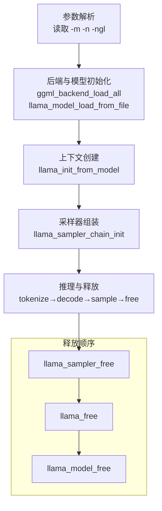
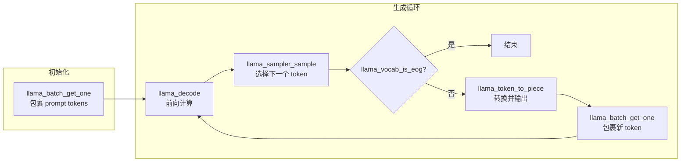
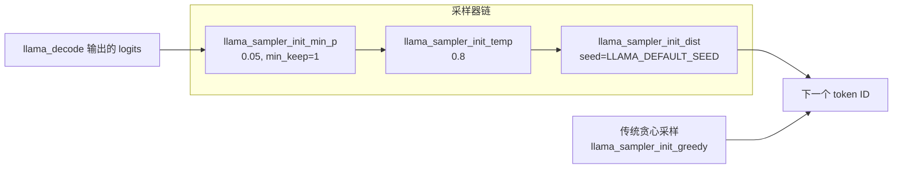
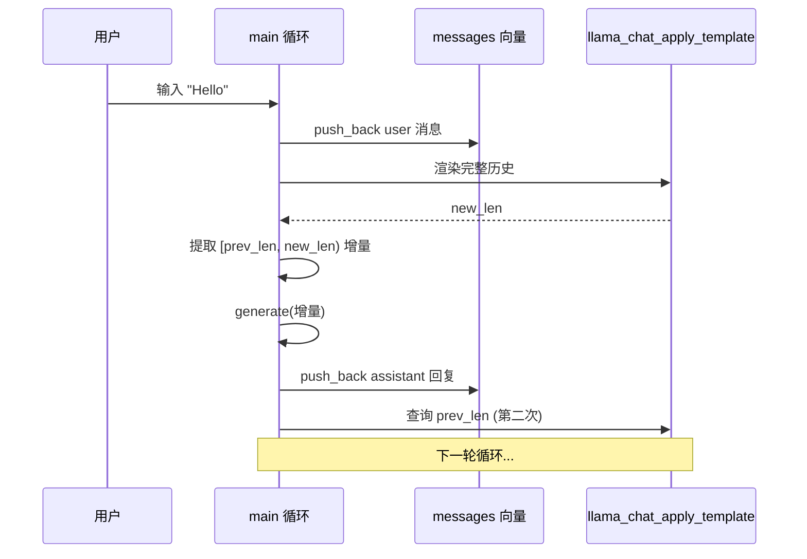
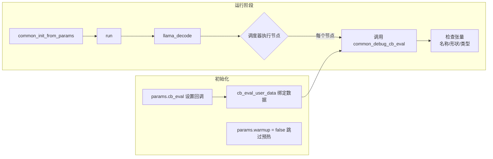
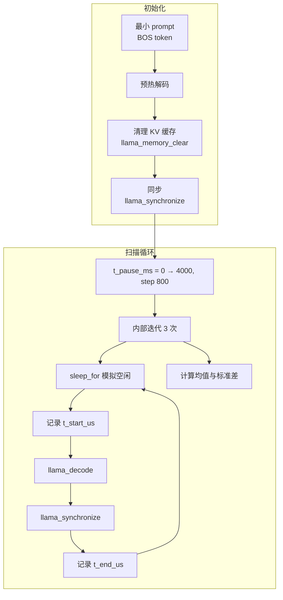
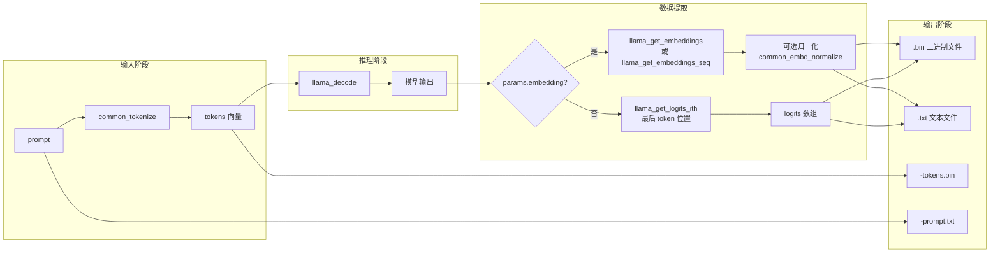

# 第91章 示例程序全景概览 —— 走进大模型推理的“咖啡教学厨房”

## 学习目标

- 建立 llama.cpp 示例程序的统一骨架心智模型：后端初始化 → 模型加载 → 上下文创建 → 推理执行 → 资源释放的完整生命周期，并能在新项目中快速定位这五步
- 理解 simple 示例中两阶段 tokenization 的原理、贪心采样与自回归生成循环的逐 token 驱动机制，以及 encoder-decoder 模型分支的处理方式
- 理解 simple-chat 示例中聊天模板增量渲染的优化思路、消息历史管理的工程细节，以及上下文溢出检测的防御性编程实践
- 掌握 eval-callback 示例中通过 `cb_eval` 挂钩计算图执行过程来观测中间张量的方法，理解回调机制在调试和诊断中的价值
- 理解 idle 示例中 GPU 空闲状态性能测试的设计思路与统计方法，掌握同步计时的必要性
- 掌握 debug 示例中 logits/embeddings 数据的提取、可选归一化与二进制/文本双格式保存的完整流程
- 理解 debug 示例中 `has_pooling` 检测、`print_tokenized_prompt` 调试输出，以及 `print_usage` 模板化用法说明等辅助函数的设计思想
- 能够基于示例骨架开发自定义推理应用，并理解各示例之间的设计取舍

## 91.1 生活类比 —— 从咖啡厨房到推理流水线

想象你走进一家**咖啡店的开放式教学厨房**，整条流水线从点单到出餐都在眼前展开。柜台上的磨豆机、咖啡机、奶泡壶和杯具，就像 llama.cpp 提供的模型、上下文和后端资源。

当你说出“一杯热拿铁”时，店员会把自然语言转换成后厨能执行的指令；这就是 tokenization，把文本转换为模型认识的 token ID 序列。

后厨接到指令后开始工作：磨豆、压粉、萃取、打奶泡、融合、拉花，每一道工序都对应一次 `llama_decode` 前向计算。萃取出的咖啡液还要经过口味判断：保留概率最高的经典口味，对应贪心采样；在多个可接受选项中随机选择，则对应温度、Min-P 或分布采样。

下一杯咖啡的配方还会参考上一杯的反馈。模型也是如此：每轮采样得到的新 token 会作为下一轮解码的输入，这就是自回归生成。

如果在后厨安装监控摄像头，就能观察每道工序的中间状态，这对应 `eval-callback`。想知道咖啡机从休眠状态恢复后第一杯出品需要多久，则可以使用 `idle`。而 `debug` 更像品控实验室，会把 logits、embeddings、token ID 和 prompt 全部记录下来。

## 91.2 源码地图 —— 五个示例的目录指南

```text
README.md
└── 项目总览

examples/simple/simple.cpp
├── print_usage()
└── main()
    ├── 参数解析
    ├── 后端与模型初始化
    ├── 两阶段 tokenization
    ├── 上下文创建
    ├── 采样器组装
    ├── prompt 回显
    ├── encoder-decoder 分支
    ├── 生成循环
    ├── 性能统计
    └── 资源释放

examples/simple-chat/simple-chat.cpp
├── print_usage()
└── main()
    ├── 参数解析与日志过滤
    ├── 模型与上下文初始化
    ├── 采样器链组装
    ├── generate lambda
    ├── 消息历史管理
    ├── 聊天模板渲染
    ├── 交互式输入循环
    └── 资源释放

examples/eval-callback/eval-callback.cpp
├── 文件级依赖
├── run()
└── main()
    ├── 回调注册
    ├── 用户数据绑定
    ├── 跳过预热
    └── 性能打印

examples/idle/idle.cpp
├── print_usage()
└── main()
    ├── 最小 prompt
    ├── 上下文配置
    ├── 预热解码
    ├── 空闲时长扫描
    ├── 同步计时
    └── 均值与标准差统计

examples/debug/debug.cpp
├── print_usage()
├── has_pooling()
├── output_data
├── save_output_data()
├── print_tokenized_prompt()
├── run()
└── main()
```

## 91.3 `main()` —— 生命周期五部曲的舞台总调度

### 91.3.1 `main()` 源码全景 —— 从参数到退出的主干道

源码路径：`examples/simple/simple.cpp` - `main()`（源码第 14—150 行）  
以下代码块中的编号是**代码块内部编号**，不是源文件行号。

```cpp
int main(int argc, char ** argv) {
    std::setlocale(LC_NUMERIC, "C");                          // ① 设置数字格式

    std::string model_path;                                    // ② 模型文件路径
    std::string prompt = "Hello my name is";                   // ③ 默认提示词
    int ngl = 99;                                              // ④ GPU 层数默认值
    int n_predict = 32;                                        // ⑤ 生成 token 数
    int i = 1;

    // ⑥ 参数解析循环
    for (; i < argc; i++) {
        if (strcmp(argv[i], "-m") == 0) {
            if (i + 1 < argc) {
                model_path = argv[++i];
            } else {
                print_usage(argc, argv);
                return 1;
            }
        } else if (strcmp(argv[i], "-n") == 0) {
            if (i + 1 < argc) {
                try {
                    n_predict = std::stoi(argv[++i]);
                } catch (...) {
                    print_usage(argc, argv);
                    return 1;
                }
            } else {
                print_usage(argc, argv);
                return 1;
            }
        } else if (strcmp(argv[i], "-ngl") == 0) {
            if (i + 1 < argc) {
                try {
                    ngl = std::stoi(argv[++i]);
                } catch (...) {
                    print_usage(argc, argv);
                    return 1;
                }
            } else {
                print_usage(argc, argv);
                return 1;
            }
        } else {
            break;
        }
    }

    // ⑦ 模型路径检查
    if (model_path.empty()) {
        print_usage(argc, argv);
        return 1;
    }

    // ⑧ 合并剩余参数为 prompt
    if (i < argc) {
        prompt = argv[i++];
        for (; i < argc; i++) {
            prompt += " ";
            prompt += argv[i];
        }
    }

    // ⑨ 后端加载
    ggml_backend_load_all();

    // ⑩ 模型参数设置
    llama_model_params model_params = llama_model_default_params();
    model_params.n_gpu_layers = ngl;

    // ⑪ 模型加载
    llama_model * model =
        llama_model_load_from_file(model_path.c_str(), model_params);

    if (model == NULL) {
        fprintf(stderr, "%s: error: unable to load model\n", __func__);
        return 1;
    }

    const llama_vocab * vocab = llama_model_get_vocab(model);

    // 这里省略 tokenization、上下文创建、推理和采样代码
    // 具体实现见第 90.4、90.5 节的分析

    // ⑫ 释放资源
    llama_sampler_free(smpl);
    llama_free(ctx);
    llama_model_free(model);

    return 0;
}
```

这段代码展示了 simple 示例的基本资源生命周期。① 设置 `LC_NUMERIC` 为 "C" 可避免不同 locale 下数字格式化差异（如小数点字符变化），保证 `printf` 输出的一致性和可解析性。②~⑤ 定义了核心变量的默认值：`ngl=99` 表示尽可能多地把层加载到 GPU，`n_predict=32` 是默认的生成 token 上限。⑥ 参数解析循环逐项匹配 `-m`、`-n`、`-ngl`，每个分支都检查参数值是否存在，并在缺失或转换失败时调用 `print_usage()` 并退出。⑨ 通过 `ggml_backend_load_all()` 加载后端；⑩ 使用 `llama_model_default_params()` 获取模型参数的默认值，再通过 `model_params.n_gpu_layers = ngl` 覆盖 GPU 层数配置。⑪ 模型通过 `llama_model_load_from_file()` 创建；随后基于模型创建上下文，最后按依赖关系逆序释放采样器、上下文和模型（⑫）。

`llama_model_default_params()` 返回模型参数的默认值，通常包括默认 GPU 层配置、主设备、内存映射和锁页内存等选项；示例只覆盖 `n_gpu_layers`。具体默认值会随 llama.cpp 版本、编译选项和平台变化，不应把默认值硬编码为跨版本契约。

`llama_context_default_params()` 返回上下文参数默认值，包含上下文长度、批大小、线程数、RoPE 配置、是否输出 embeddings 以及性能统计开关等。simple 示例随后会显式设置 `n_ctx`、`n_batch` 和 `no_perf`，因此不依赖这些字段的默认值。

同样，`llama_sampler_chain_default_params()` 返回采样器链的默认参数，例如是否启用采样器性能统计。示例把 `no_perf` 设为 `false`，因此退出前可以打印采样器性能。

完整流程可以概括为：

1. **参数解析**：读取模型路径、预测长度和 GPU 层数，并在参数缺失或转换失败时调用 `print_usage()`。
2. **后端与模型初始化**：加载 GGML 后端，并从 GGUF 文件加载模型。
3. **上下文创建**：为 KV 缓存、计算图和后端执行资源建立上下文。
4. **采样器组装**：创建采样器链并加入贪心采样器。
5. **推理与释放**：执行 tokenization、解码和采样，打印性能统计，然后按逆序释放资源。

simple 示例末尾实际包含性能统计调用：

```cpp
// ⑬ 解码性能统计
printf("\n");

const auto t_main_end = ggml_time_us();

fprintf(stderr,
    "%s: decoded %d tokens in %.2f s, speed: %.2f t/s\n",
    __func__,
    n_decode,
    (t_main_end - t_main_start) / 1000000.0f,
    n_decode / ((t_main_end - t_main_start) / 1000000.0f));

fprintf(stderr, "\n");

// ⑭ 采样器与上下文性能输出
llama_perf_sampler_print(smpl);
llama_perf_context_print(ctx);

fprintf(stderr, "\n");

llama_sampler_free(smpl);
llama_free(ctx);
llama_model_free(model);
```

⑬ 手动计算并打印整体解码速度：用 `t_main_end - t_main_start` 得到总耗时（微秒），再除以 `1000000.0f` 转为秒；`n_decode / 秒数` 即为吞吐率。⑭ `llama_perf_sampler_print()` 输出采样器调用次数和耗时，`llama_perf_context_print()` 输出上下文相关的 prompt 处理、生成速度和阶段耗时。手动测量的总生成速度与这两个统计接口互相补充：前者反映应用层观察到的整体时间，后者提供 llama.cpp 内部阶段的分解信息。

### 91.3.2 `print_usage()` —— 参数错误的恢复性提示

源码路径：`examples/simple/simple.cpp` - `print_usage()`（源码第 8—12 行）

```cpp
static void print_usage(int, char ** argv) {
    printf("\nexample usage:\n");
    printf(
        "\n    %s -m model.gguf [-n n_predict] "
        "[-ngl n_gpu_layers] [prompt]\n",
        argv[0]);
    printf("\n");
}
```

`print_usage()` 用 `argv[0]` 动态填充程序名。simple 的 `main()` 在以下场景调用它：

- `-m`、`-n` 或 `-ngl` 缺少参数值；
- `std::stoi` 转换失败；
- 模型路径为空。

因此，帮助函数不仅用于显式的 `--help` 场景，也承担参数错误后的恢复性提示职责。

### 91.3.3 生命周期架构 —— 五阶段可视化



这个生命周期骨架是所有 llama.cpp 示例程序共用的主干。后续各节将逐一填充其中的细节。

## 91.4 `llama_tokenize()`、`llama_decode()` 与 `llama_sampler_sample()` —— 文本到 token 再到文本的往返旅程

本节是一个源码解析单元，重点分析 simple 示例如何把文本转换为 token，如何执行首轮 prompt 解码，以及如何逐 token 生成输出。

### 91.4.1 `llama_tokenize()` —— 两阶段 tokenization

源码路径：`examples/simple/simple.cpp` - `main()`（源码第 53—75 行）

```cpp
// ① 获取词表指针
const llama_vocab * vocab = llama_model_get_vocab(model);

// ② 第一遍调用：探测所需 token 数
const int n_prompt =
    -llama_tokenize(vocab, prompt.c_str(), prompt.size(),
                    NULL, 0, true, true);

// ③ 按探测结果分配向量
std::vector<llama_token> prompt_tokens(n_prompt);

// ④ 第二遍调用：真正填充 token 数组
if (llama_tokenize(vocab,
                   prompt.c_str(),
                   prompt.size(),
                   prompt_tokens.data(),
                   prompt_tokens.size(),
                   true,
                   true) < 0) {
    fprintf(stderr,
            "%s: error: failed to tokenize the prompt\n",
            __func__);
    return 1;
}
```

第一次调用（②）把输出缓冲区设为 `NULL`、容量设为 `0`，用于探测所需 token 数量。该 API 约定在缓冲区不足时返回负数；在这里，返回值为 `-n`，因此通过一元负号得到实际 token 数 `n_prompt`。

第二次调用（④）传入已分配的 `prompt_tokens` 数组，真正写入 token ID。若返回值仍小于 `0`，说明缓冲区不足或发生了错误。

这种方式避免了反复扩容和拷贝，是 C API 中常见的“两次调用获取长度再填充”模式。值得关注的是，两次调用中 `add_special` 和 `parse_special` 两个布尔参数保持一致（均为 `true`），确保探测阶段和填充阶段使用相同的分词行为。

### 91.4.2 `llama_token_to_piece()` —— 将 token ID 转回文本片段

源码路径：`examples/simple/simple.cpp` - `main()`（源码第 113—127 行）

```cpp
// ① 遍历每个 prompt token
for (auto id : prompt_tokens) {
    char buf[128];

    // ② 转换 token ID 为文本片段
    int n = llama_token_to_piece(
        vocab, id, buf, sizeof(buf), 0, true);

    if (n < 0) {
        fprintf(stderr,
                "%s: error: failed to convert token to piece\n",
                __func__);
        return 1;
    }

    std::string s(buf, n);
    printf("%s", s.c_str());
}
```

`llama_token_to_piece()` 将 token ID 转换为文本片段。最后一个参数在不同 llama.cpp 版本中可能对应特殊 token 的显示或“翻译”行为，具体含义应以当前版本 `llama.h` 中的函数声明和注释为准；不能仅凭参数位置把它固定解释为统一的 `translated` 模式。

一个 token 不一定对应完整单词。BPE 分词可能把一个词拆成多个 token，也可能把多个字节合并成一个 token。因此，这段代码主要用于观察 token 到文本片段的映射，而不是验证字符串逐字节重构。

### 91.4.3 生成循环架构 —— 自回归的节拍器



### 91.4.4 `llama_decode()` 与 `llama_sampler_sample()` —— 逐 token 自回归生成

源码路径：`examples/simple/simple.cpp` - `main()`（源码第 129—168 行）

以下代码补齐了 `batch` 的声明，展示其完整上下文：

```cpp
// ① 构造包含完整 prompt 的批次
llama_batch batch =
    llama_batch_get_one(prompt_tokens.data(), prompt_tokens.size());

const auto t_main_start = ggml_time_us();
int n_decode = 0;
llama_token new_token_id;

// ② 自回归循环：直到生成足够 token 或遇到 EOG
for (int n_pos = 0;
     n_pos + batch.n_tokens < n_prompt + n_predict; ) {
    // ③ 执行一次前向计算
    if (llama_decode(ctx, batch)) {
        fprintf(stderr,
                "%s : failed to eval, return code %d\n",
                __func__, 1);
        return 1;
    }

    n_pos += batch.n_tokens;

    // ④ 从 logits 采样下一个 token
    new_token_id = llama_sampler_sample(smpl, ctx, -1);

    // ⑤ 检查是否遇到结束 token
    if (llama_vocab_is_eog(vocab, new_token_id)) {
        break;
    }

    // ⑥ 转换新 token 为文本并输出
    char buf[128];
    int n = llama_token_to_piece(
        vocab, new_token_id, buf, sizeof(buf), 0, true);

    if (n < 0) {
        fprintf(stderr,
                "%s: error: failed to convert token to piece\n",
                __func__);
        return 1;
    }

    std::string s(buf, n);
    printf("%s", s.c_str());
    fflush(stdout);

    // ⑦ 用新 token 构造下一轮批次
    batch = llama_batch_get_one(&new_token_id, 1);
    n_decode += 1;
}
```

第一次循环（②）的 `batch` 包含完整 prompt；之后每次循环只包含上一次采样出的一个 token（⑦）。`llama_decode()`（③）的返回值通常以 `0` 表示成功、非 `0` 表示失败，因此 simple 直接使用 `if (llama_decode(...))`；simple-chat 则把返回值保存为 `ret`，再显式判断 `ret != 0`。两种写法语义一致，后者更便于记录和输出具体返回码。

`llama_sampler_sample(smpl, ctx, -1)`（④）从最后一个位置读取 logits，并生成下一个 token。`llama_vocab_is_eog()`（⑤）检查是否遇到结束 token。

`fflush(stdout)`（⑥）对命令行流式输出很重要。标准输出通常带有缓冲，`printf()` 返回并不代表字符已经显示在终端上。逐 token 刷新可以降低用户看到新内容的等待时间；代价是频繁系统调用可能降低吞吐。生产应用可以采用小块缓冲策略，在保留流式体验的同时减少刷新次数。

### 91.4.5 `llama_model_has_encoder()` 与 `llama_model_decoder_start_token()` —— 处理 encoder-decoder 模型

源码路径：`examples/simple/simple.cpp` - `main()`（源码第 129—149 行）

```cpp
// ① 构造批次
llama_batch batch =
    llama_batch_get_one(prompt_tokens.data(), prompt_tokens.size());

// ② 判断是否为 encoder-decoder 模型
if (llama_model_has_encoder(model)) {
    // ③ 编码 prompt
    if (llama_encode(ctx, batch)) {
        fprintf(stderr, "%s : failed to eval\n", __func__);
        return 1;
    }

    // ④ 获取 decoder 起始 token
    llama_token decoder_start_token_id =
        llama_model_decoder_start_token(model);

    // ⑤ 回退到 BOS token
    if (decoder_start_token_id == LLAMA_TOKEN_NULL) {
        decoder_start_token_id = llama_vocab_bos(vocab);
    }

    // ⑥ 用起始 token 重新构造批次
    batch = llama_batch_get_one(&decoder_start_token_id, 1);
}
```

`llama_model_has_encoder()`（②）用于判断模型是否存在 encoder。对于 T5、BART 等 encoder-decoder 模型，prompt 先通过 `llama_encode()`（③）编码；decoder 再从起始 token 开始生成。

`llama_model_decoder_start_token()`（④）返回模型元数据中指定的 decoder 起始 token。`LLAMA_TOKEN_NULL`（⑤）表示模型没有提供有效的起始 token，此时示例回退到词表的 BOS token。这个回退策略提升了不同模型之间的兼容性，但不保证适合所有模型；对于特定架构，应优先遵循该架构的官方起始 token 约定。

### 91.4.6 设计取舍 —— 简单并不意味着简陋

simple 示例刻意保持“简单”，但这种简单背后是明确的设计取舍：

**为什么 simple 使用贪心采样，而 simple-chat 使用概率采样？**

simple 的目标是用最短路径展示推理过程。贪心采样始终选择概率最高的 token，结果确定、便于复现和调试。simple-chat 面向交互式对话，需要更自然的多样性，因此使用 Min-P、Temperature 和 Distribution 组合采样。两种方式没有绝对优劣，选择取决于“可复现调试”还是“自然生成”的目标。

**为什么 simple 手动解析参数，而其他示例使用 `common_params_parse`？**

simple 通过手动解析让读者直接看到参数读取、范围判断和异常处理过程，适合作为教学样例。simple-chat、idle 和 debug 使用公共参数解析器，可以共享参数定义、错误处理和帮助机制，更适合功能逐渐扩展的程序。手动解析的代价是代码重复，每个程序都要写类似的循环；`common_params_parse` 的代价是引入额外的抽象层，阅读代码时需要跳转理解参数的默认值和别名规则。

**为什么 simple 没有实现上下文溢出检测？**

simple 通过 `n_ctx = n_prompt + n_predict - 1` 计算上下文长度，从数学上保证 prompt + 生成 token 不会超出上下文。这避免了运行时检测的开销，但要求用户提供的 prompt 不能超过预期长度。simple-chat 面对无限对话可能，必须运行时检测。

## 91.5 `llama_chat_apply_template()` —— 多轮对话的聊天模板渲染器

### 91.5.1 `llama_sampler` —— 组装多样化采样链

源码路径：`examples/simple-chat/simple-chat.cpp` - `main()`（源码第 82—87 行）

```cpp
// ① 初始化采样器链
llama_sampler * smpl =
    llama_sampler_chain_init(
        llama_sampler_chain_default_params());

// ② 添加 Min-P 采样器：过滤低概率候选
llama_sampler_chain_add(
    smpl, llama_sampler_init_min_p(0.05f, 1));

// ③ 添加温度采样器：调整分布形状
llama_sampler_chain_add(
    smpl, llama_sampler_init_temp(0.8f));

// ④ 添加分布采样器：执行随机抽样
llama_sampler_chain_add(
    smpl, llama_sampler_init_dist(LLAMA_DEFAULT_SEED));
```

simple-chat 使用 Min-P、Temperature 和 Distribution 组合采样。Min-P（②）先过滤低概率候选，Temperature（③）调整分布形状，Distribution（④）最后执行随机抽样。

采样器链的执行顺序就是添加顺序，这一点在设计时很重要，改变添加顺序会改变整个采样行为。例如，如果先执行温度调整再过滤 Min-P，与先过滤再调温，效果完全不同。与 simple 的贪心采样相比，这种配置更适合自然、多样的对话回复。

### 91.5.2 采样器链架构 —— 分工协作的三级流水线



### 91.5.3 `generate` —— 封装单轮生成与上下文溢出检查

源码路径：`examples/simple-chat/simple-chat.cpp` - `main()`（源码第 88—137 行）

源码中的 `llama_memory_seq_pos_max()` 和 `llama_get_memory()` 在较新的 llama.cpp 版本中可能被标记为 deprecated。使用旧版本源码时可以按示例理解；面向新版本开发时，应查阅当前 `llama.h` 的 memory API，优先使用新的上下文记忆查询接口或由 `llama_memory` 提供的序列范围查询函数。不要把旧 API 当作长期稳定接口。

源码还使用了 `GGML_ABORT`；该宏通常来自 GGML 相关头文件（如 `ggml.h`，或由项目公共头间接包含）。如果在独立代码中复用，应显式确认包含关系。

```cpp
// ① 定义 lambda，捕获上下文、模型、采样器等
auto generate = [&](const std::string & prompt) {
    std::string response;

    // ② 判断是否为第一轮生成
    const bool is_first =
        llama_memory_seq_pos_max(
            llama_get_memory(ctx), 0) == -1;

    // ③ 两阶段 tokenization（与 simple 类似）
    const int n_prompt_tokens =
        -llama_tokenize(vocab,
                        prompt.c_str(),
                        prompt.size(),
                        NULL,
                        0,
                        is_first,
                        true);

    std::vector<llama_token> prompt_tokens(n_prompt_tokens);

    if (llama_tokenize(vocab,
                       prompt.c_str(),
                       prompt.size(),
                       prompt_tokens.data(),
                       prompt_tokens.size(),
                       is_first,
                       true) < 0) {
        GGML_ABORT("failed to tokenize the prompt\n");
    }

    llama_batch batch =
        llama_batch_get_one(
            prompt_tokens.data(),
            prompt_tokens.size());

    llama_token new_token_id;

    // ④ 自回归生成循环
    while (true) {
        // ⑤ 上下文溢出检测
        int n_ctx = llama_n_ctx(ctx);
        int n_ctx_used =
            llama_memory_seq_pos_max(
                llama_get_memory(ctx), 0) + 1;

        if (n_ctx_used + batch.n_tokens > n_ctx) {
            printf("\033[0m\n");
            fprintf(stderr, "context size exceeded\n");
            exit(0);
        }

        // ⑥ 解码
        int ret = llama_decode(ctx, batch);
        if (ret != 0) {
            GGML_ABORT("failed to decode, ret = %d\n", ret);
        }

        // ⑦ 采样
        new_token_id =
            llama_sampler_sample(smpl, ctx, -1);

        // ⑧ 检查 EOG
        if (llama_vocab_is_eog(vocab, new_token_id)) {
            break;
        }

        // ⑨ 转换并输出
        char buf[256];
        int n = llama_token_to_piece(
            vocab, new_token_id, buf, sizeof(buf), 0, true);

        if (n < 0) {
            GGML_ABORT("failed to convert token to piece\n");
        }

        std::string piece(buf, n);
        printf("%s", piece.c_str());
        fflush(stdout);

        // ⑩ 累积响应
        response += piece;
        batch = llama_batch_get_one(&new_token_id, 1);
    }

    return response;
};
```

这里的 `is_first`（②）用于判断当前是否是第一轮生成：第一轮通常需要添加 BOS，后续增量 prompt 则不再重复添加。

⑤ 的上下文溢出检测是防御性编程的典型例子：`llama_n_ctx(ctx)` 获取上下文总长度，`llama_memory_seq_pos_max(...) + 1` 获取已用位置数，两者比较决定是否还有空间容纳新批次。溢出时直接 `exit(0)` 是简单粗暴的处理方式；更优雅的做法是提示用户、截断历史或使用滑动窗口。

注意，`llama_memory_clear(memory, true)` 中的 `true` 是布尔参数，表示清除 memory 中的序列位置映射/序列内容范围，具体清除语义应以当前版本 API 文档为准。它与 `llama_memory_seq_pos_max()` 的“查询序列最大位置”用途不同：前者改变缓存状态，后者读取缓存状态。

`generate` 中的旧 API 查询只用于两个目的：判断 KV memory 是否为空，以及计算已经使用的上下文位置。现代版本若移除了这两个接口，应使用对应的新 memory/sequence 查询接口实现相同逻辑。

### 91.5.4 聊天渲染架构 —— 增量渲染的时序图

源码路径：`examples/simple-chat/simple-chat.cpp` - `main()`（源码第 138—180 行）



### 91.5.5 `llama_chat_apply_template()` —— 增量渲染聊天历史

源码路径：`examples/simple-chat/simple-chat.cpp` - `main()`（源码第 138—180 行）

```cpp
// ① 初始化消息历史、格式化缓冲区和偏移量
std::vector<llama_chat_message> messages;
std::vector<char> formatted(llama_n_ctx(ctx));
int prev_len = 0;

// ② 交互式输入循环
while (true) {
    printf("\033[32m> \033[0m");

    std::string user;
    std::getline(std::cin, user);

    if (user.empty()) {
        break;
    }

    // ③ 获取聊天模板
    const char * tmpl =
        llama_model_chat_template(model, nullptr);

    // ④ 追加用户消息
    messages.push_back(
        {"user", strdup(user.c_str())});

    // ⑤ 第一次渲染：探测所需长度
    int new_len = llama_chat_apply_template(
        tmpl,
        messages.data(),
        messages.size(),
        true,
        formatted.data(),
        formatted.size());

    // ⑥ 如果缓冲区不足，扩容并重新渲染
    if (new_len > (int) formatted.size()) {
        formatted.resize(new_len);

        new_len = llama_chat_apply_template(
            tmpl,
            messages.data(),
            messages.size(),
            true,
            formatted.data(),
            formatted.size());
    }

    if (new_len < 0) {
        fprintf(stderr,
                "failed to apply the chat template\n");
        return 1;
    }

    // ⑦ 提取新增部分作为 generate 的 prompt
    std::string prompt(
        formatted.begin() + prev_len,
        formatted.begin() + new_len);

    printf("\033[33m");
    std::string response = generate(prompt);
    printf("\n\033[0m");

    // ⑧ 追加助手回复
    messages.push_back(
        {"assistant", strdup(response.c_str())});

    // ⑨ 获取下一次的增量起始位置
    prev_len = llama_chat_apply_template(
        tmpl,
        messages.data(),
        messages.size(),
        false,
        nullptr,
        0);
}
```

`formatted`（①）预分配为 `llama_n_ctx(ctx)` 字节，是一种经验性的初始容量：上下文最多容纳大约 `n_ctx` 个 token，而聊天模板字符串通常需要与 token 数量同量级的字节空间。它不是严格保证，尤其对于 UTF-8 文本、特殊标记或复杂模板，所需字节数可能超过上下文 token 数。

因此，第一次调用后如果 `new_len > formatted.size()`（⑥），代码会扩容并重新渲染。第一次调用只负责发现实际需求；由于原缓冲区不足时不能得到完整模板，扩容后必须再次调用函数，把完整结果真正写入新缓冲区。

随后通过 `prev_len` 和 `new_len`（⑦）只提取新增字符串。KV 缓存已经保留了历史内容，所以无需再次把完整历史作为 prompt 发送。

⑨ 的第二次调用使用 `nullptr, 0` 作为输出缓冲区，根据 API 约定，当缓冲区为 `NULL` 且长度为 0 时，函数返回所需长度（而非负数）。这用于获取下一轮渲染的起始偏移量。

### 91.5.6 `llama_chat_message` —— 管理消息历史与释放资源

源码路径：`examples/simple-chat/simple-chat.cpp` - `main()`（源码第 141—183 行）

```cpp
// ① 消息历史容器
std::vector<llama_chat_message> messages;

// ② 每轮输入
messages.push_back(
    {"user", strdup(user.c_str())});

// ③ 每轮生成结束后
messages.push_back(
    {"assistant", strdup(response.c_str())});

// ④ 退出时释放所有 content
for (auto & msg : messages) {
    free(const_cast<char *>(msg.content));
}

// ⑤ 释放采样器、上下文和模型
llama_sampler_free(smpl);
llama_free(ctx);
llama_model_free(model);
```

`strdup()`（②③）为消息内容分配独立的堆内存，退出时必须使用 `free()`（④）释放。由于 `llama_chat_message::content` 是 `const char *`，示例使用 `const_cast` 传给 `free()`；长期项目中也可以使用 `std::string` 容器或自定义 RAII 包装器，降低手动内存管理风险。

采样器、上下文和模型（⑤）仍然遵循逆序释放原则。

### 91.5.7 设计取舍 —— 聊天示例的工程决策

**为什么 simple-chat 采用增量渲染？**

完整渲染每轮都会重新生成全部历史文本，随着对话变长，tokenization 和输入处理成本持续增加。simple-chat 使用 `prev_len` 截取新增部分，并依靠持续保留的 KV 缓存承载历史状态，从而降低重复处理开销。代价是代码需要严格维护模板长度和缓存状态。

**为什么 simple-chat 使用 `exit(0)` 处理上下文溢出？**

示例程序的主要目标是教学演示。`exit(0)` 虽不优雅，但代码简单且能清晰提示用户发生了什么。生产环境应该实现更智能的策略，如自动截断、滑动窗口或摘要历史。

**为什么 simple-chat 的 `formatted` 初始化为 `n_ctx` 字节？**

这是基于“模板字符串长度与 token 数同量级”的经验假设。它不是数学保证，但避免了大多数情况下的重新分配。真正的保障来自随后的扩容检查。

## 91.6 `common_debug_cb_eval()` 与 `llama_synchronize()` —— 观测计算图与测量空闲性能

本节是一个源码解析单元，分别从空间和时间两个维度观察推理：eval-callback 观察计算节点和中间张量，idle 测量设备空闲后的首次解码延迟。

### 91.6.1 文件级依赖 —— 引入回调示例的头文件

源码路径：`examples/eval-callback/eval-callback.cpp` - 文件开头（源码第 1—10 行）

```cpp
// ① 项目头文件
#include "arg.h"       // 公共参数定义
#include "common.h"    // 参数解析、tokenization 和统一初始化
#include "debug.h"     // base_callback_data 与调试回调
#include "log.h"       // 日志输出
#include "llama.h"     // C API

// ② 标准库头文件
#include <clocale>     // setlocale
#include <string>      // std::string
#include <vector>      // std::vector
```

`llama-cpp.h` 不存在于当前 llama.cpp 项目的对应源码中，因此不应将它列为该示例的依赖。核心依赖是：

- `arg.h`：公共参数定义；
- `common.h`：参数解析、tokenization 和统一初始化；
- `debug.h`：`base_callback_data` 与调试回调；
- `log.h`：日志输出；
- `llama.h`：C API；
- `<clocale>`、`<string>`、`<vector>`：标准库支持。

这些头文件共同提供了“解析参数 → 初始化模型 → 注册回调 → 执行一次解码”的运行环境。

### 91.6.2 `main()` —— 注册计算图评估回调

源码路径：`examples/eval-callback/eval-callback.cpp` - `main()`（源码第 37—72 行）

```cpp
int main(int argc, char ** argv) {
    std::setlocale(LC_NUMERIC, "C");

    // ① 回调数据与参数
    base_callback_data cb_data;
    common_params params;

    common_init();

    // ② 参数解析
    if (!common_params_parse(
            argc, argv, params, LLAMA_EXAMPLE_COMMON)) {
        return 1;
    }

    // ③ 后端初始化
    llama_backend_init();
    llama_numa_init(params.numa);

    // ④ 注册回调
    params.cb_eval = common_debug_cb_eval<false>;
    params.cb_eval_user_data = &cb_data;
    params.warmup = false;

    // ⑤ 统一初始化
    auto llama_init =
        common_init_from_params(params);

    auto * model = llama_init->model();
    auto * ctx   = llama_init->context();

    if (model == nullptr || ctx == nullptr) {
        LOG_ERR("%s : failed to init\n", __func__);
        return 1;
    }

    // ⑥ 打印系统信息
    LOG_INF("\n");
    LOG_INF("%s\n",
            common_params_get_system_info(params).c_str());
    LOG_INF("\n");

    // ⑦ 执行核心逻辑
    bool OK = run(ctx, params);
    if (!OK) {
        return 1;
    }

    // ⑧ 打印性能
    LOG("\n");
    llama_perf_context_print(ctx);

    llama_backend_free();
    return 0;
}
```

`params.cb_eval`（④）保存回调函数，`params.cb_eval_user_data` 保存回调所需的用户数据。计算图执行期间，调度器会在节点处理过程中调用回调，从而允许代码检查张量名称、形状、数据类型或数值。

`params.warmup = false`（④）用于跳过预热，避免预热阶段产生的张量观测结果污染真实推理分析。

`common_init_from_params()`（⑤）把公共初始化步骤集中起来，返回的初始化对象负责模型与上下文的生命周期管理，减少了重复清理代码。

### 91.6.3 回调机制架构 —— 计算图中的观察者模式



### 91.6.4 `run()` —— 执行单次前向计算

源码路径：`examples/eval-callback/eval-callback.cpp` - `run()`（源码第 14—35 行）

```cpp
static bool run(
        llama_context * ctx,
        const common_params & params) {
    // ① 获取模型与词表
    const llama_model * model = llama_get_model(ctx);
    const llama_vocab * vocab =
        llama_model_get_vocab(model);

    // ② 决定是否添加 BOS
    const bool add_bos =
        llama_vocab_get_add_bos(vocab);

    // ③ tokenize
    std::vector<llama_token> tokens =
        common_tokenize(ctx, params.prompt,
                        add_bos, true);

    // ④ 空输入检查
    if (tokens.empty()) {
        LOG_ERR(
            "%s : there are not input tokens to process\n",
            __func__);
        return false;
    }

    // ⑤ 打印 token 数
    LOG_INF("number of input tokens = %zu\n",
            tokens.size());

    // ⑥ 打印每个 token ID
    for (size_t i = 0; i < tokens.size(); ++i) {
        LOG_INF("  %d\n", tokens[i]);
    }

    // ⑦ 解码并触发回调
    if (llama_decode(
            ctx,
            llama_batch_get_one(
                tokens.data(), tokens.size()))) {
        LOG_ERR("%s : failed to eval\n", __func__);
        return false;
    }

    return true;
}
```

`common_tokenize()`（③）封装了 token 数量探测、内存管理和错误检查；`llama_batch_get_one()`（⑦）则把 token 数组包装成单序列批次。真正触发回调的是最后的 `llama_decode()`。

⑤ 和 ④ 的顺序值得注意：先检查空输入再打印 token 数，避免无意义的日志输出。每个 token ID 单独打印（⑥），虽然简单却便于用户在调用回调之前就了解输入情况。

### 91.6.5 `main()` —— 测量 GPU 空闲后的解码延迟

源码路径：`examples/idle/idle.cpp` - `main()`（源码第 19—81 行）

不同版本的 common 参数结构可能使用 `params.model.path`、`params.model` 或其他模型参数访问方式。本文代码对应的源码使用 `params.model.path.c_str()`；移植到其他版本时，应以当前 `common.h` 中 `common_params` 的定义为准。

此外，`std::this_thread::sleep_for()` 需要包含：

```cpp
#include <thread>
#include <chrono>
```

```cpp
// ① 将 common 参数转换为 llama 模型参数
llama_model_params model_params =
    common_model_params_to_llama(params);

// ② 加载模型
llama_model * model =
    llama_model_load_from_file(
        params.model.path.c_str(),
        model_params);

const llama_vocab * vocab =
    llama_model_get_vocab(model);

// ③ 最小 prompt：只包含 BOS token
std::vector<llama_token> prompt_tokens(
    1, llama_vocab_bos(vocab));

// ④ 上下文配置
llama_context_params ctx_params =
    llama_context_default_params();

ctx_params.n_ctx   = 512;
ctx_params.n_batch = 512;
ctx_params.no_perf = false;

// ⑤ 创建上下文
llama_context * ctx =
    llama_init_from_model(model, ctx_params);

llama_batch batch =
    llama_batch_get_one(
        prompt_tokens.data(),
        prompt_tokens.size());

// ⑥ 测试迭代次数
const int n_iters = 3;

// ⑦ 预热解码并清理
llama_decode(ctx, batch);
llama_memory_clear(llama_get_memory(ctx), true);
llama_synchronize(ctx);

// ⑧ 空闲时长扫描
for (int64_t t_pause_ms = 0;
     t_pause_ms <= 4000;
     t_pause_ms += 800) {
    double t_sum_us  = 0.0;
    double t_sum2_us = 0.0;

    // ⑨ 每组空闲时长重复多次
    for (int i = 0; i < n_iters; i++) {
        // ⑩ 模拟空闲
        std::this_thread::sleep_for(
            std::chrono::milliseconds(t_pause_ms));

        // ⑪ 同步计时核心：开始时间
        const int64_t t_start_us =
            llama_time_us();

        // ⑫ 解码
        llama_decode(ctx, batch);
        llama_synchronize(ctx);

        // ⑬ 结束时间
        const int64_t t_end_us =
            llama_time_us();

        const double t_cur_us =
            t_end_us - t_start_us;

        // ⑭ 累加和与平方和
        t_sum_us += t_cur_us;
        t_sum2_us += t_cur_us * t_cur_us;

        // ⑮ 清理 KV 状态
        llama_memory_clear(
            llama_get_memory(ctx), true);
        llama_synchronize(ctx);
    }

    // ⑯ 计算均值
    const double t_avg_us =
        t_sum_us / n_iters;

    // ⑰ 计算标准差
    const double t_dev_us =
        sqrt(
            (t_sum2_us / (n_iters - 1)) -
            (t_avg_us * t_avg_us * n_iters)
            / (n_iters - 1));

    // ⑱ 输出结果
    printf(
        "iters: %4d, pause: %5d ms, "
        "avg decode time: %8.2f +/- %4.2f ms\n",
        n_iters,
        (int) t_pause_ms,
        t_avg_us / 1000,
        t_dev_us / 1000);
}
```

③ 的“最小 prompt”只包含一个 BOS token，这是为了隔离设备唤醒延迟与 token 处理时间。④ 将上下文配置为 512，足够容纳最小 prompt 和少量解码输出。

⑦ 的预热解码确保 GPU 驱动和运行时已经完成初始化，避免第一轮计时包含一次性开销。⑧ 扫描 0 到 4000ms 的空闲时间，每次增加 800ms，覆盖短空闲和长空闲两种场景。

⑪ 到 ⑬ 是同步计时的核心：`llama_time_us()` 获取墙钟时间，`llama_decode()` 提交计算任务，`llama_synchronize()` 确保 GPU 异步计算真正完成，然后再次读取时间。没有 `llama_synchronize()`，计时可能只测到任务提交延迟。

⑰ 的标准差公式是基于样本方差的展开式：

\[
s=\sqrt{\frac{\sum x_i^2-\frac{(\sum x_i)^2}{n}}{n-1}}
\]

源码将其写成了使用平均值和平方和的等价形式，而不是通常所说的逐项“朴素公式”。它仍然是直接累加法，可能存在浮点消减误差；对于少量样本足够使用，但大规模或高精度实验可以改用 Welford 算法。

⑮ 每次实验之后清空 memory 并同步，避免上一轮 KV 状态影响下一次测量。

### 91.6.6 空闲测试架构 —— 时间扫描与统计



### 91.6.7 设计取舍 —— 测量与观测的方法论

**为什么 eval-callback 跳过预热？**

预热同样会执行计算图并触发回调。如果分析张量内容或统计节点耗时，预热数据可能污染结果。设置 `params.warmup = false` 可以让回调直接服务于真实输入。

**为什么 idle 必须同步计时？**

GPU 后端常常异步提交任务。若只测量 `llama_decode()` 调用前后的时间，得到的可能只是任务提交延迟。调用 `llama_synchronize()` 后再读取结束时间，才能覆盖真实计算完成过程。

**为什么 idle 使用 BOS 作为最小 prompt？**

一个 token 的计算时间已经足够触发设备唤醒。使用更长的 prompt 会混入 token 处理时间，使测量失去针对性。但同时也应该注意，某些 GPU 可能对小 batch 有额外调度开销，因此真实应用中的空闲延迟可能需要用代表性 batch 重新测量。

## 91.7 `debug.cpp` —— 模型输出的品控实验室

### 91.7.1 `print_usage()` —— 带模板替换的帮助文本

源码路径：`examples/debug/debug.cpp` - `print_usage()`（源码第 10—24 行）

```cpp
// ① 定义帮助文本模板
static void print_usage(int /*argc*/, char ** argv) {
    const std::string usage_template = R"(
        example usage:

          Print tensors:

          {prog} -m model.gguf -p "Hello my name is" --verbose

          The tensors to be printed can be filtered with --tensor-filter option.

          Save logits/embeddings:

          {prog} -m model.gguf -p "Hello my name is" --save-logits

          Add --embedding to save embeddings)" "\n";

    // ② 去掉原始字符串中的源码缩进
    std::string usage =
        std::regex_replace(
            usage_template,
            std::regex("\\n {8}"),
            "\n");

    // ③ 替换 {prog} 为实际程序名
    usage = std::regex_replace(
        usage,
        std::regex("\\{prog\\}"),
        argv[0]);

    LOG("%s\n", usage.c_str());
}
```

`\\n {8}`（②）匹配的是“换行符后紧接八个空格”。`std::regex_replace` 会在整个字符串中逐处查找该模式，把换行后的固定缩进删除。这样可以去除源码缩进对原始字符串内容造成的多行前导空格；它只处理精确的八个空格，不是任意长度缩进清理器。

随后第二次替换（③）把字面量 `{prog}` 替换为实际程序名。该函数使用原始字符串保存多行帮助文本，避免大量转义。这种模板化方式让帮助文本与程序名解耦，方便代码复用。

### 91.7.2 `has_pooling()` —— 判断 embedding 输出形状

源码路径：`examples/debug/debug.cpp` - `has_pooling()`（源码第 26—34 行）

```cpp
// ① 检查池化类型
static bool has_pooling(llama_context * ctx) {
    switch (llama_pooling_type(ctx)) {
        // ② 无池化或未指定：返回 false
        case LLAMA_POOLING_TYPE_NONE:
        case LLAMA_POOLING_TYPE_UNSPECIFIED:
            return false;
        // ③ 其他情况：返回 true
        default:
            return true;
    }
}
```

`LLAMA_POOLING_TYPE_UNSPECIFIED` 并非所有历史版本都存在。旧版本可能只有 `NONE` 或使用不同的池化枚举定义，因此移植代码时应检查当前 `llama.h`。

没有池化时，通常按 token 获取 embeddings；启用池化后，通常按序列获取一个聚合向量。该判断决定后续调用 `llama_get_embeddings()` 还是 `llama_get_embeddings_seq()`。

### 91.7.3 `output_data` —— 提取、归一化 logits 与 embeddings

源码路径：`examples/debug/debug.cpp` - `output_data::output_data()`（源码第 70—112 行）

`llama_model_n_embd_out(model)` 在部分版本中可能不存在，或使用不同名称表示输出 embedding 维度。实际项目中应以当前版本 API 为准，必要时使用模型元数据或对应的 embedding 维度查询接口。

```cpp
// ① 构造函数参数
output_data(
        llama_context * ctx,
        const llama_model * model,
        const common_params & params) {
    const llama_vocab * vocab =
        llama_model_get_vocab(model);

    const bool add_bos =
        llama_vocab_get_add_bos(vocab);

    // ② tokenize prompt
    tokens = common_tokenize(
        ctx, params.prompt, add_bos);

    prompt = params.prompt;

    // ③ embedding 路径
    if (params.embedding) {
        const int n_embd =
            llama_model_n_embd_out(model);

        // ④ 根据池化决定向量个数
        const bool pooling = has_pooling(ctx);
        const int n_embd_count =
            pooling ? 1 : tokens.size();

        const int n_floats =
            n_embd * n_embd_count;

        // ⑤ 获取原始 embedding 数据
        float * embd_raw =
            pooling
                ? llama_get_embeddings_seq(ctx, 0)
                : llama_get_embeddings(ctx);

        if (embd_raw == nullptr) {
            throw std::runtime_error(
                "failed to get embeddings from the model");
        }

        // ⑥ 设置数据指针和大小
        data_ptr = embd_raw;
        data_size = n_floats;
        type_suffix = "-embeddings";

        // ⑦ 可选归一化
        if (params.embd_normalize >= 0) {
            embd_norm.resize(n_floats);

            // ⑧ 逐序列归一化
            for (int i = 0;
                 i < n_embd_count;
                 i++) {
                common_embd_normalize(
                    embd_raw + i * n_embd,
                    embd_norm.data() + i * n_embd,
                    n_embd,
                    params.embd_normalize);
            }

            // ⑨ 切换到归一化后的数据
            data_ptr = embd_norm.data();
        }
    } else {
        // ⑩ logits 路径
        const float * logits =
            llama_get_logits_ith(
                ctx, tokens.size() - 1);

        const int n_logits =
            llama_vocab_n_tokens(vocab);

        // ⑪ 设置 logits 数据
        data_ptr =
            const_cast<float *>(logits);
        data_size = n_logits;
        type_suffix = "";
    }
}
```

embedding 路径（③）根据 pooling 状态（④）决定向量个数：有池化时只取 1 个序列级向量，无池化时取 `tokens.size()` 个逐 token 向量。⑤ 通过不同的 API 获取原始数据。

`params.embd_normalize`（⑦）的非负值表示启用归一化，`-1` 通常表示不归一化；具体的 `0`、`1`、`2` 分别对应哪种范数或归一化方式，应以当前 common 参数定义为准。归一化结果写入独立的 `embd_norm` 缓冲区（⑧），避免覆盖模型上下文提供的原始数据。

logits 路径（⑩）则读取最后一个 token 位置的词表分数。`const_cast`（⑪）在这里是必要的，因为 C API 返回 `const float *`，而 `output_data` 需要可写的指针。

### 91.7.4 `save_output_data()` —— 以多种格式持久化结果

源码路径：`examples/debug/debug.cpp` - `save_output_data()`（源码第 115—158 行）

`std::filesystem` 属于 C++17 标准库，因此编译该示例至少需要启用 C++17，并链接当前平台所需的标准库组件。

```cpp
static void save_output_data(
        const output_data & output,
        const std::string & model_name,
        const std::string & output_dir) {
    // ① 创建输出目录
    std::filesystem::create_directory(output_dir);

    // ② 构造基础文件名
    auto base_path =
        std::filesystem::path{output_dir} /
        ("llamacpp-" + model_name + output.type_suffix);

    // ③ 保存 logits/embeddings 到二进制文件
    std::filesystem::path bin_path =
        base_path.string() + ".bin";

    std::ofstream bin_file{
        bin_path, std::ios::binary};

    bin_file.write(
        reinterpret_cast<const char *>(
            output.data_ptr),
        output.data_size * sizeof(float));

    // ④ 保存 logits/embeddings 到文本文件
    std::filesystem::path txt_path =
        base_path.string() + ".txt";

    std::ofstream txt_file{txt_path};

    for (int i = 0;
         i < output.data_size;
         i++) {
        txt_file << i
                 << ": "
                 << output.data_ptr[i]
                 << '\n';
    }

    // ⑤ 保存 prompt 到文本文件
    std::filesystem::path prompt_path =
        base_path.string() + "-prompt.txt";

    std::ofstream prompt_file{prompt_path};

    prompt_file << "prompt: "
                << output.prompt << '\n';

    prompt_file << "n_tokens: "
                << output.tokens.size() << '\n';

    // ⑥ 保存 token ID 到二进制文件
    std::filesystem::path tokens_path =
        base_path.string() + "-tokens.bin";

    std::ofstream tokens_file{
        tokens_path, std::ios::binary};

    tokens_file.write(
        reinterpret_cast<const char *>(
            output.tokens.data()),
        output.tokens.size()
        * sizeof(llama_token));
}
```

实际源码还包含文件打开失败检查和日志输出。该函数的功能可以概括为四个输出维度：

- **③ 二进制数据文件**（`.bin`）：精确保存浮点数组，适合 Python 或 NumPy 等程序读取，体积小、读取快；
- **④ 文本数据文件**（`.txt`）：每行一条“索引: 值”，便于人工查看和 shell 分析；
- **⑤ prompt 文件**（`-prompt.txt`）：记录输入文本和 token 数，用于复现实验条件；
- **⑥ token 二进制文件**（`-tokens.bin`）：保存 token ID 序列，便于其他工具直接消费。

这种多格式并存的设计兼顾了机器处理与人工排查的双重需求，是调试工具的理想实践。

### 91.7.5 `print_tokenized_prompt()` —— 打印 token 与文本片段

源码路径：`examples/debug/debug.cpp` - `print_tokenized_prompt()`（源码第 161—177 行）

```cpp
static void print_tokenized_prompt(
        llama_context * ctx,
        const std::vector<llama_token> & tokens,
        const std::string & prompt) {
    const llama_model * model =
        llama_get_model(ctx);

    const llama_vocab * vocab =
        llama_model_get_vocab(model);

    // ① 打印 add_bos 设置
    LOG("Model add_bos: %s\n",
        llama_vocab_get_add_bos(vocab)
            ? "true" : "false");

    // ② 打印原始 prompt
    LOG("Input prompt: \"%s\"\n",
        prompt.c_str());

    // ③ 打印 token 数量
    LOG("Token ids (%zu):\n",
        tokens.size());

    // ④ 逐个转换并打印
    for (auto id : tokens) {
        std::string piece(128, '\0');

        int n = llama_token_to_piece(
            vocab,
            id,
            piece.data(),
            piece.size(),
            0,
            true);

        if (n < 0) {
            LOG_ERR(
                "failed to convert token %d to piece\n",
                id);
            continue;
        }

        piece.resize(n);
        LOG("%s(%d) ",
            piece.c_str(), id);
    }

    LOG("\n");
}
```

① 打印 `add_bos` 设置，帮助用户理解 tokenization 是否添加了 BOS token。② 打印原始输入，③ 打印 token 数量，④ 显示每个 token ID 对应的文本片段。

`piece(128, '\0')`（④）先创建固定 128 字节的缓冲区。对于普通 token 通常足够，但特殊 token、长字节片段或未来 API 行为都可能使返回长度超过 128。更稳妥的实现应在返回“所需容量”的情况下扩容并重新调用，或使用项目提供的动态 token-to-piece 包装函数。

### 91.7.6 `run()` 与 `main()` —— 执行调试流程并管理生命周期

源码路径：`examples/debug/debug.cpp` - `run()`（源码第 180—204 行）与 `main()`（源码第 207—237 行）

`run()` 负责单次 tokenization、解码、token 打印和可选数据保存：

```cpp
// ① 获取模型与词表
static bool run(
        llama_context * ctx,
        const common_params & params) {
    const llama_model * model =
        llama_get_model(ctx);

    const llama_vocab * vocab =
        llama_model_get_vocab(model);

    const bool add_bos =
        llama_vocab_get_add_bos(vocab);

    // ② tokenize
    std::vector<llama_token> tokens =
        common_tokenize(
            ctx, params.prompt, add_bos);

    // ③ 空输入检查
    if (tokens.empty()) {
        LOG_ERR(
            "%s : there are not input tokens to process\n",
            __func__);
        return false;
    }

    // ④ 解码
    if (llama_decode(
            ctx,
            llama_batch_get_one(
                tokens.data(), tokens.size()))) {
        LOG_ERR("%s : failed to eval\n", __func__);
        return false;
    }

    // ⑤ 打印 tokenization 结果
    print_tokenized_prompt(
        ctx, tokens, params.prompt);

    // ⑥ 可选保存 logits/embeddings
    if (params.save_logits) {
        output_data output{
            ctx, model, params};

        std::filesystem::path model_path{
            params.model.path};

        std::string model_name{
            model_path.stem().string()};

        save_output_data(
            output,
            model_name,
            params.logits_output_dir);
    }

    return true;
}
```

`main()` 负责参数解析、后端初始化、回调数据建立、统一初始化以及资源收尾：

```cpp
// ① 参数结构
int main(int argc, char ** argv) {
    common_params params;

    common_init();

    // ② 参数解析（含 print_usage 回调）
    if (!common_params_parse(
            argc, argv, params,
            LLAMA_EXAMPLE_DEBUG,
            print_usage)) {
        return 1;
    }

    // ③ 后端初始化
    llama_backend_init();
    llama_numa_init(params.numa);

    // ④ 回调数据（用于张量过滤）
    base_callback_data cb_data(
        params, params.tensor_filter);

    // ⑤ 统一初始化
    auto llama_init =
        common_init_from_params(params);

    auto * model = llama_init->model();
    auto * ctx   = llama_init->context();

    if (model == nullptr || ctx == nullptr) {
        LOG_ERR("%s : failed to init\n", __func__);
        return 1;
    }

    // ⑥ 打印系统信息
    LOG_INF("\n");
    LOG_INF("%s\n",
            common_params_get_system_info(params).c_str());
    LOG_INF("\n");

    // ⑦ 执行核心逻辑
    if (!run(ctx, params)) {
        return 1;
    }

    // ⑧ 打印性能
    LOG("\n");
    llama_perf_context_print(ctx);

    llama_backend_free();
    return 0;
}
```

`run()` 中 ②③ 的顺序值得注意：`common_tokenize()` 已经封装了 token 数量探测、内存管理和错误检查；空输入检查（③）发生在解码之前，避免对空批次执行解码。

`main()` 的 ② 使用 `common_params_parse` 并传入 `print_usage` 作为参数，这使得 `--help` 和参数错误都能正确显示帮助信息。④ 创建 `base_callback_data` 用于张量过滤，但与 eval-callback 示例不同，这里的回调数据来自 `params.tensor_filter`，说明 debug 示例使用回调来筛选特定的张量进行打印。

### 91.7.7 调试流程架构 —— 数据提取与保存流水线



### 91.7.8 设计取舍 —— 调试工具的实用哲学

**为什么 `print_usage` 使用正则表达式清理缩进？**

原始字符串 `R"(...)"` 保留源码缩进，正则清理可以精确匹配 8 空格前缀。这是一种紧凑的写法，避免了手写拼接多行字符串的繁琐，但正则表达式的性能在程序启动时只运行一次，影响可忽略。

**为什么 `output_data` 内部维护 `embd_norm` 而不是直接覆盖原始数据？**

原始 embedding 数据可能还需要后续使用。将归一化结果写入独立缓冲区可以保留原始数据，同时避免 `data_ptr` 悬空或指向只读内存。

**为什么 `save_output_data` 使用 `std::filesystem`？**

C++17 的 `std::filesystem` 提供跨平台的文件/目录操作，替代了 `mkdir` 或 `CreateDirectory` 等平台相关调用。代价是需要 C++17 编译支持。

## 91.8 设计中的取舍 —— 示例程序的工程智慧

**为什么 simple 使用贪心采样，而 simple-chat 使用概率采样？**

simple 的目标是用最短路径展示推理过程。贪心采样始终选择概率最高的 token，结果确定、便于复现和调试。simple-chat 面向交互式对话，需要更自然的多样性，因此使用 Min-P、Temperature 和 Distribution 组合采样。两种方式没有绝对优劣，选择取决于“可复现调试”还是“自然生成”的目标。如果需要同时追求可复现性和多样性，可以固定随机种子——这也是 simple-chat 使用 `LLAMA_DEFAULT_SEED` 的原因。

**为什么 simple 手动解析参数，而其他示例使用 `common_params_parse`？**

simple 通过手动解析让读者直接看到参数读取、范围判断和异常处理过程，适合作为教学样例。simple-chat、idle 和 debug 使用公共参数解析器，可以共享参数定义、错误处理和帮助机制，更适合功能逐渐扩展的程序。手动解析的代价是每个程序都要重复类似的循环逻辑，并且容易在不同程序中产生不一致的参数行为；`common_params_parse` 的代价是引入额外的抽象层，阅读代码时需要跳转理解参数的默认值和别名规则。simple 作为入门示例，展示完整的手动流程反而更有教学价值。

**为什么 simple-chat 采用增量渲染？**

完整渲染每轮都会重新生成全部历史文本，随着对话变长，tokenization 和输入处理成本持续增加。simple-chat 使用 `prev_len` 截取新增部分，并依靠持续保留的 KV 缓存承载历史状态，从而降低重复处理开销。代价是代码需要严格维护模板长度和缓存状态：如果 `prev_len` 计算错误，后续的增量提取会错位，导致模型接收不完整的上下文。相比之下，完整渲染逻辑简单、不易出错，但性能随对话长度线性恶化。

**为什么 debug 同时保存二进制和文本？**

二进制格式体积小、读取快，适合 Python、NumPy 等工具；文本格式便于人工查看和 shell 分析。两种格式同时提供，可以兼顾机器处理与人工排查。代价是需要维护两套写入逻辑，且文本格式在大数组时会产生较大的磁盘占用。

**为什么 eval-callback 跳过预热？**

预热同样会执行计算图并触发回调。如果分析张量内容或统计节点耗时，预热数据可能污染结果。设置 `params.warmup = false` 可以让回调直接服务于真实输入。但如果用户希望比较预热与冷启动的差异，则应该保留预热阶段的数据。

**为什么 idle 必须同步计时？**

GPU 后端常常异步提交任务。若只测量 `llama_decode()` 调用前后的时间，得到的可能只是任务提交延迟。调用 `llama_synchronize()` 后再读取结束时间，才能覆盖真实计算完成过程。同步的代价是会阻塞 CPU 直到 GPU 完成全部工作，这在实时交互场景中可能降低 CPU 利用率，但在性能测量中是完全必要的。

**为什么资源按逆序释放？**

采样器、上下文、模型和后端之间存在依赖关系。通常先释放 sampler，再释放 context，再释放 model，最后释放 backend，能够避免对象访问已经销毁的底层资源。例如，如果在释放模型之前释放上下文，上下文内部的 KV 缓存引用可能指向已经释放的模型权重。统一遵循逆序释放可以消除这类隐患。

## 91.9 动手练习

1. **修改 simple 示例：支持自定义采样参数**

   增加 `--temp`、`--top-k` 和 `--top-p` 参数，并按候选过滤、温度调整、分布采样的顺序组装 sampler chain。注意，具体 sampler API 和参数语义应以当前版本 `llama.h` 为准。可以设计一个实验组对比贪心与温度=0.8 时的生成差异。

2. **扩展 eval-callback：实现注意力权重观测**

   在回调中根据张量名称和形状筛选注意力相关张量，打印形状、类型和部分元素，并将完整矩阵导出为 CSV。进一步可以增加热力图和注意力熵统计，同时控制回调采样频率，避免观测开销掩盖真实性能。可以对比不同层之间的注意力模式差异。

3. **基于 simple-chat 构建历史持久化工具**

   将 `messages` 序列化为 JSON，在启动时恢复，并增加 `--reset` 和 `--export` 参数。进阶时可结合 KV 状态保存接口实现断点续聊。需要注意，`strdup` 分配的内存需要正确释放，建议改用 RAII 包装器消除内存泄漏风险。

4. **扩展 idle：研究空闲时间与批大小的关系**

   对空闲时长和 batch size 做二维扫描，重复多次测试并输出均值、标准差和 P95。要区分 GPU 唤醒延迟与计算图准备延迟，必须固定模型、后端和编译配置，并设计独立的预热对照组。可尝试不同的 `n_batch` 值（如 1、8、32、128）并分析趋势。

5. **构建 logits 差异分析工具**

   对 baseline 与量化模型执行相同 prompt，比较余弦相似度、NMSE、Top-K 重叠率和 KL 散度，并将结果输出为 JSON。可以使用 `save_output_data` 生成的 `-tokens.bin` 和 `.bin` 文件作为输入，用 Python 脚本做离线的统计分析。

6. **实现逐 token 交互式调试器**

   在 token 打印基础上增加 Top-10 概率、指定层张量检查、动态采样参数和中间结果保存。修改采样配置后通常需要重建 sampler，以确保内部状态与新参数一致。可以考虑添加“暂停/继续”机制，让用户在生成过程中实时查看中间状态。

## 91.10 本章小结

本章从 simple、simple-chat、eval-callback、idle 和 debug 几个示例出发，建立了 llama.cpp 推理应用的统一心智模型：后端初始化、模型加载、上下文创建、推理执行、采样输出和资源释放。

本章我们一起学习了以下概念：

| 概念 | 解释 |
|---|---|
| 示例程序骨架 | 统一遵循初始化、推理、采样、释放的生命周期 |
| 两阶段 tokenization | 先获取所需容量，再填充 token 数组 |
| `llama_decode()` | 执行一次前向计算 |
| `llama_sampler_sample()` | 从 logits 中选择下一个 token |
| `llama_vocab_is_eog()` | 判断是否遇到生成结束 token |
| Encoder-decoder 分支 | 先编码 prompt，再从 decoder 起始 token 生成 |
| 聊天模板增量渲染 | 利用 `prev_len` 和 KV 缓存只处理新增内容 |
| 评估回调 | 在计算图执行节点期间观测中间张量 |
| 同步计时 | 通过 `llama_synchronize()` 等待异步后端完成 |
| 空闲性能测试 | 研究设备空闲时间与首次解码延迟的关系 |
| `output_data` | 统一封装 logits、embeddings、prompt 和 token 数据 |
| embedding pooling | 区分序列级向量与逐 token 向量 |
| embedding 归一化 | 将向量转换到更适合相似度比较的尺度 |
| 多格式保存 | 同时提供二进制、文本、prompt 和 token 文件 |
| 资源释放顺序 | sampler → context → model → backend |

示例程序的价值不只是“能运行”，更在于它们把复杂的推理系统拆成了可以独立理解和修改的实验单元。下一个挑战是深入 llama.cpp 的公共参数系统，看看多个示例如何通过 `common_params` 共享配置和生命周期管理。下一章我们将分析 `common.h` 的核心数据结构和初始化流程。

