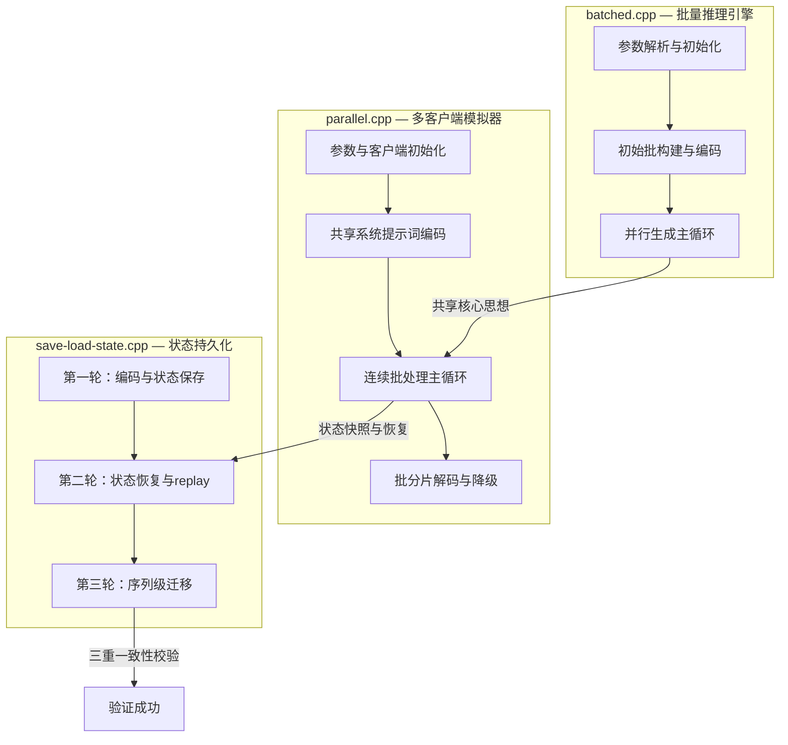
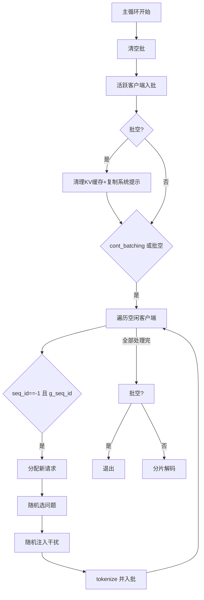
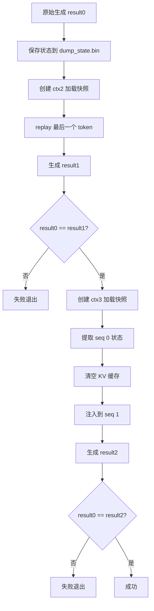

# 第92章 并行推理引擎 —— 多轨列车与虚拟用户风暴的调度艺术

## 学习目标

-   掌握批量推理的核心参数配置：n_kv_req 计算、n_batch 与 n_parallel 的平衡策略
-   理解 llama_batch 结构体的填充机制与 logits 标记策略
-   剖析多序列并行生成的主循环：采样、EOG 检测、批更新
-   掌握 continuous batching 的实现原理：client 状态机与动态槽位分配
-   理解共享系统提示词（is_sp_shared）与 KV 缓存复用（llama_memory_seq_cp）的优化
-   学习批分片视图（batch_view）技术：内存不足时的优雅降级策略
-   掌握推理状态持久化：llama_state_save_file / llama_state_load_file 的使用
-   理解跨上下文序列迁移：llama_state_seq_get_data / llama_state_seq_set_data
-   分析统一 KV 缓存模式（kv_unified）在单并行场景下的内存优化
-   熟悉辅助工具函数：trim、split_string、print_date_time 的日常用途

## 92.1 生活类比

想象 llama.cpp 的批量推理系统是一家大型餐厅的中央厨房。**llama_batch** 是一张可以同时承载多份食材（token）的大托盘；**n_parallel** 决定了同时服务的餐桌数量；**n_kv_req** 则是厨房为所有餐桌预留的餐位总数，确保每桌的菜都有地方放。每张餐桌都有专属的**采样器链**调味师，负责 Top-K → Top-P → Temp 的流水线调味。**i_batch[]** 就像每桌菜在托盘上的座位号，让服务员知道哪道菜该送到哪桌。当客人说“我吃饱了”（EOG 检测），服务员就会撤掉该桌餐具，将其标记为 -1。**continuous batching** 正是餐厅的翻台机制：一桌客人刚走，新客人立刻补上，实现无间断服务。餐厅统一的餐前开胃菜——**共享系统提示词**只需做一次，就能通过 KV 缓存复制分发给所有桌。当托盘太大端不动时，**batch_view 分片**会帮你把菜分成小盘分批上桌。更妙的是，如果厨房需要装修，**状态保存/恢复**功能就像给每桌菜拍照存档，换厨房后可以接着做；**序列级迁移**甚至能将 A 桌的菜品精确复制到 B 桌，连火候都一模一样。就像餐厅经理需要协调点菜、烹饪、上菜、翻台全流程，llama.cpp 的并行推理也需要精确管理批大小、KV 缓存、采样器与序列生命周期。

## 92.2 源码地图

以下是本章涉及的核心文件与函数概览，以树状结构展示其组织关系：

```text
examples/
├── batched/batched.cpp                     # 批量推理启动
│   ├── print_usage()                       # 12-16行，帮助信息
│   └── __main__.main()                     # 18-216行，主入口
│       ├── 参数解析与初始化                # 18-90行
│       ├── 初始批构建与编码                # 93-140行
│       └── 并行生成主循环                  # 149-216行
├── parallel/parallel.cpp                   # 多客户端模拟
│   ├── trim()                              # 21-32行，字符串去空白
│   ├── print_date_time()                   # 105-114行，时间戳打印
│   ├── split_string()                      # 117-126行，文本切分
│   ├── client 结构体                       # 62-69行，客户端状态封装
│   └── __main__.main()                     # 128-292行，主调度
│       ├── 参数与初始化                    # 128-160行
│       ├── 共享系统提示词编码              # 195-210行
│       └── 连续批处理主循环                # 227-340行
└── save-load-state/save-load-state.cpp     # 状态持久化与迁移
    └── __main__.main()                     # 11-238行，三重一致性校验
        ├── 第一轮：编码与状态保存          # 30-79行
        ├── 第二轮：状态恢复与replay        # 81-130行
        └── 第三轮：序列级迁移              # 131-215行
```

为了更直观地展示三个示例文件之间的逻辑关系与数据流转，下图给出了本章核心文件的关系架构图：



从图中可以看出，三个示例共享底层 llama.cpp 库的推理核心，但各自侧重不同：`batched.cpp` 关注单次多序列的并行生成，`parallel.cpp` 在其基础上实现了动态的连续批处理与客户端模拟，而 `save-load-state.cpp` 则提供了对推理状态进行持久化和序列级迁移的能力。接下来的内容将依次深入每个文件的实现细节。

在这一章的三个核心示例中，`batched/batched.cpp` 是最基础的批量推理引擎，它展示了如何利用 `llama_batch` 同时对多个独立序列进行解码和采样。我们首先从它的启动流程开始分析。

## 92.3 批量推理启动 —— 并发引擎的“点火钥匙”

让我们从 `examples/batched/batched.cpp` 开始，理解一个多序列并行生成引擎是如何启动的。这个文件虽然只有两百多行，却浓缩了 llama.cpp 批量推理的全部核心智慧：从 KV 容量预算到采样器配置，从编码器-解码器桥接到“播种”策略，每一步都像发射火箭前的点火检查清单。如果把中央厨房类比延续到这里，这段代码就是大厨在开火前检查每一口汤锅的尺寸和燃气阀门，确保后续所有并行餐桌都能同时开炒。

### 92.3.1 `__main__.print_usage()` 使用说明与主入口

源码路径：`examples/batched/batched.cpp` - `__main__.print_usage()`（12-16行）

```cpp
static void print_usage(int, char ** argv) {
    LOG("\nexample usage:\n");
    LOG("\n    %s -m model.gguf -p \"Hello my name is\" -n 32 -np 4\n", argv[0]);
    LOG("\n");
}
```

这个函数虽然只有短短四行，却是程序的第一道导航。它告诉用户：加载模型（`-m`）、设置提示词（`-p`）、预测长度（`-n`）和并行序列数（`-np`）这四大核心参数应该如何组合。`argv[0]` 动态获取程序名，使得帮助信息在任何环境下都自洽。

这个函数的调用者是 `common_params_parse`。`common_params_parse` 是 llama.cpp 内置的通用参数解析器，它接收五个参数：命令行参数断言数组 `argc/argv`、输出参数结构体 `params`、示例类型标识 `LLAMA_EXAMPLE_BATCHED`，以及一个可选的帮助回调函数 `print_usage`。第三个参数 `LLAMA_EXAMPLE_BATCHED` 是一个枚举标识，告诉解析器当前运行的是哪个示例程序，从而选择不同的默认参数和校验规则——例如，`BATCHED` 示例会强制某些与批量推理相关的参数约束。最后一个参数 `print_usage` 则作为回调函数，当用户传入未知参数或需要显示帮助时被调用。

这段代码定义了程序的“使用说明书”。当用户传入错误的参数时，`common_params_parse` 会调用这个函数打印示例命令，引导用户快速掌握用法。

### 92.3.2 `__main__.main()` 参数解析与 KV 需求计算

源码路径：`examples/batched/batched.cpp` - `__main__.main()`（18-90行）

```cpp
int main(int argc, char ** argv) {
    std::setlocale(LC_NUMERIC, "C");

    common_params params;

    params.prompt = "Hello my name is";
    params.n_predict = 32;

    common_init();

    if (!common_params_parse(argc, argv, params, LLAMA_EXAMPLE_BATCHED, print_usage)) {
        return 1;
    }

    // number of parallel batches
    int n_parallel = params.n_parallel;

    // total length of the sequences including the prompt
    int n_predict = params.n_predict;

    // init LLM

    llama_backend_init();
    llama_numa_init(params.numa);

    // initialize the model

    llama_model_params model_params = common_model_params_to_llama(params);

    llama_model * model = llama_model_load_from_file(params.model.path.c_str(), model_params);

    if (model == NULL) {
        LOG_ERR("%s: error: unable to load model\n" , __func__);
        return 1;
    }

    const llama_vocab * vocab = llama_model_get_vocab(model);

    // tokenize the prompt

    std::vector<llama_token> tokens_list;
    tokens_list = common_tokenize(vocab, params.prompt, true);

    const int n_kv_req = tokens_list.size() + (n_predict - tokens_list.size())*n_parallel;

    // initialize the context

    llama_context_params ctx_params = common_context_params_to_llama(params);

    ctx_params.n_ctx   = n_kv_req;
    ctx_params.n_batch = std::max(n_predict, n_parallel);

    auto sparams = llama_sampler_chain_default_params();
    sparams.no_perf = false;

    std::vector<llama_sampler_seq_config> sampler_configs;

    for (int32_t i = 0; i < n_parallel; ++i) {
        llama_sampler * smpl = llama_sampler_chain_init(sparams);

        llama_sampler_chain_add(smpl, llama_sampler_init_top_k(params.sampling.top_k));
        llama_sampler_chain_add(smpl, llama_sampler_init_top_p(params.sampling.top_p, params.sampling.min_keep));
        llama_sampler_chain_add(smpl, llama_sampler_init_temp (params.sampling.temp));
        llama_sampler_chain_add(smpl, llama_sampler_init_dist (params.sampling.seed));

        sampler_configs.push_back({ i, smpl });
    }

    if (params.sampling.backend_sampling) {
        ctx_params.samplers   = sampler_configs.data();
        ctx_params.n_samplers = sampler_configs.size();
    }

    llama_context * ctx = llama_init_from_model(model, ctx_params);

    if (ctx == NULL) {
        LOG_ERR("%s: error: failed to create the llama_context\n" , __func__);
        return 1;
    }
```

这段代码完成了从参数到上下文的全部初始化。关键在 `n_kv_req` 的计算公式（源码第58行，对应上文第58行）：`tokens_list.size()` 是共享的 prompt 长度（只需存一份），而 `(n_predict - tokens_list.size()) * n_parallel` 则是每条序列各自生成的部分。`ctx_params.n_ctx` 与 `ctx_params.n_batch` 的设置（源码第63-64行，对应上文第63-64行）更是体现了容量规划的智慧：`n_ctx` 恰好等于需求总量不求富余，`n_batch` 取 `max(n_predict, n_parallel)` 而非两者之和，在保证能吃下最大单批的前提下不浪费内存。为每个并行序列创建独立采样器链的过程在源码第71-80行（对应上文第71-80行）：Top-K → Top-P → Temp → Dist 四层流水线各司其职，将确定性参数与随机种子分离。其中 `sparams.no_perf = false` 表示启用性能统计，让后续的 `llama_perf_sampler_print` 能输出采样器的耗时数据。

下表对比了两种 n_batch 策略的取舍：

| 策略 | 内存占用 | 吞吐表现 | 适用场景 |
|------|----------|----------|----------|
| `max(n_predict, n_parallel)` | 较低 | 足够支持最大批次 | 并行数适中（≤32） |
| `n_predict + n_parallel` | 较高 | 单轮可容纳更多 token | 并行数极大（>64） |

### 92.3.3 `__main__.main()` 初始批构建与编码器-解码器桥接

源码路径：`examples/batched/batched.cpp` - `__main__.main()`（93-140行）

```cpp
    const int n_ctx = llama_n_ctx(ctx);

    LOG_INF("\n%s: n_predict = %d, n_ctx = %d, n_batch = %u, n_parallel = %d, n_kv_req = %d\n", __func__, n_predict, n_ctx, ctx_params.n_batch, n_parallel, n_kv_req);

    // make sure the KV cache is big enough to hold all the prompt and generated tokens
    if (n_kv_req > n_ctx) {
        LOG_ERR("%s: error: n_kv_req (%d) > n_ctx, the required KV cache size is not big enough\n", __func__,  n_kv_req);
        LOG_ERR("%s:        either reduce n_parallel or increase n_ctx\n", __func__);
        return 1;
    }

    // print the prompt token-by-token

    LOG("\n");

    for (auto id : tokens_list) {
        LOG("%s", common_token_to_piece(ctx, id).c_str());
    }

    // create a llama_batch
    // we use this object to submit token data for decoding
    llama_batch batch = llama_batch_init(std::max(tokens_list.size(), (size_t) n_parallel), 0, n_parallel);

    std::vector<llama_seq_id> seq_ids(n_parallel, 0);
    for (int32_t i = 0; i < n_parallel; ++i) {
        seq_ids[i] = i;
    }

    // evaluate the initial prompt
    for (size_t i = 0; i < tokens_list.size(); ++i) {
        common_batch_add(batch, tokens_list[i], i, seq_ids, false);
    }
    GGML_ASSERT(batch.n_tokens == (int) tokens_list.size());

    if (llama_model_has_encoder(model)) {
        if (llama_encode(ctx, batch)) {
            LOG_ERR("%s : failed to eval\n", __func__);
            return 1;
        }

        llama_token decoder_start_token_id = llama_model_decoder_start_token(model);
        if (decoder_start_token_id == LLAMA_TOKEN_NULL) {
            decoder_start_token_id = llama_vocab_bos(vocab);
        }

        common_batch_clear(batch);
        common_batch_add(batch, decoder_start_token_id, 0, seq_ids, false);
    }

    // llama_decode will output logits only for the last token of the prompt
    batch.logits[batch.n_tokens - 1] = true;

    if (llama_decode(ctx, batch) != 0) {
        LOG_ERR("%s: llama_decode() failed\n", __func__);
        return 1;
    }
```

这段代码完成了对初始 prompt 的编码与首次解码。`llama_batch_init` 的原型为 `llama_batch llama_batch_init(int32_t n_tokens, int32_t embd, int32_t n_seq_max)`，三个参数的含义分别为：`n_tokens` — 批可容纳的最大 token 数；`embd` — 批可容纳的嵌入向量数（这里设为 0，因为不使用 embedding 输入）；`n_seq_max` — 批可关联的最大序列数（这里设为并行序列数 `n_parallel`）。这里的调用 `llama_batch_init(std::max(tokens_list.size(), (size_t) n_parallel), 0, n_parallel)` 在源码第113行（对应上文第113行）执行，这样既能一次性装下整个 prompt，也能为每条序列预留一个 token 的位置。构建 batch 后，第121-123行（对应上文第121-123行）将所有 prompt token 共享同一个 `seq_ids` 向量（0,1,2,...），且最后一个参数 `false` 表示这一批次的 token 都不需要输出 logits。第142行（对应上文第142行）是整个批处理优化的精髓——只将最后一个 token 的 `logits` 标记为 `true`，因为对于 prompt 编码阶段，我们只需要最后一个位置的输出作为第一条生成 token 的采样依据，中间的 logits 计算纯属浪费。第126-139行（对应上文第126-139行）处理了 Encoder-Decoder 架构的特殊性：先调用 `llama_encode` 处理输入，再用 `decoder_start_token_id` 作为解码器的起始 token 重新构建一个更小的 batch。

**第112-140行**完成了 batch 的初始化与 prompt 编码。**第142行**的 `batch.logits[batch.n_tokens - 1] = true` 看似简单，却直接影响推理速度——在 prompt 很长时能省去大量无用的 logits 计算。而 Encoder-Decoder 分支的存在，让这个示例同时兼容了 T5、FLAN 等非纯 Decoder 架构。

接下来，在 `main` 函数中，编码完初始批后，程序会检查 KV 缓存是否足够：

```cpp
    const int n_ctx = llama_n_ctx(ctx);
    LOG_INF("\n%s: n_predict = %d, n_ctx = %d, n_batch = %u, n_parallel = %d, n_kv_req = %d\n", __func__, n_predict, n_ctx, ctx_params.n_batch, n_parallel, n_kv_req);

    // make sure the KV cache is big enough to hold all the prompt and generated tokens
    if (n_kv_req > n_ctx) {
        LOG_ERR("%s: error: n_kv_req (%d) > n_ctx, the required KV cache size is not big enough\n", __func__,  n_kv_req);
        LOG_ERR("%s:        either reduce n_parallel or increase n_ctx\n", __func__);
        return 1;
    }
```

这里 `n_kv_req > n_ctx` 时程序会报错退出，提示用户要么减少并行数，要么增大 `n_ctx`。这是容量规划的第一道安全阀。

## 92.4 并行生成循环 —— 流水线上的“多轨并行”

初始提示词编码完成后，程序进入最核心的并行生成主循环。这个循环像一个精密的"多轨列车调度系统"：每轮迭代都先清空批处理托盘，为每个活跃序列采样新 token，然后将它们打包送进模型解码。理解这个循环，你就掌握了 llama.cpp 批量推理的"心跳"。从源码地图可以看到，`batched.cpp` 的 91.3 节完成了“参数解析与初始化”与“初始批构建与编码”，而本节将进入“并行生成主循环”。这个循环的顶层流程如下：

```mermaid
graph TD
    A[循环开始] --> B[common_batch_clear 清空批]
    B --> C{遍历每条序列 i}
    C -->|i_batch[i] < 0 序列已结束| F[跳过]
    C -->|序列活跃| D[llama_sampler_sample 采样]
    D --> E{EOG 或达到上限?}
    E -->|是| G[标记 i_batch[i] = -1]
    E -->|否| H[加入批 batch]
    H --> I{还有序列?}
    I -->|是| C
    I -->|否| J{batch.n_tokens == 0?}
    J -->|是| K[退出循环]
    J -->|否| L[llama_decode 解码]
    L --> A
```

### 92.4.1 `__main__.main()` 主循环与批索引追踪

源码路径：`examples/batched/batched.cpp` - `__main__.main()`（149-216行）

```cpp
    if (n_parallel > 1) {
        LOG("\n\n%s: generating %d sequences ...\n", __func__, n_parallel);
    }

    // main loop

    // we will store the parallel decoded sequences in this vector
    std::vector<std::string> streams(n_parallel);

    // remember the batch index of the last token for each parallel sequence
    // we need this to determine which logits to sample from
    std::vector<int32_t> i_batch(n_parallel, batch.n_tokens - 1);

    int n_cur    = batch.n_tokens;
    int n_decode = 0;

    const auto t_main_start = ggml_time_us();

    while (n_cur <= n_predict) {
        // prepare the next batch
        common_batch_clear(batch);

        // sample the next token for each parallel sequence / stream
        for (int32_t i = 0; i < n_parallel; ++i) {
            if (i_batch[i] < 0) {
                // the stream has already finished
                continue;
            }

            const llama_token new_token_id = llama_sampler_sample(sampler_configs[i].sampler, ctx, i_batch[i]);

            // is it an end of generation? -> mark the stream as finished
            if (llama_vocab_is_eog(vocab, new_token_id) || n_cur == n_predict) {
                i_batch[i] = -1;
                LOG("\n");
                if (n_parallel > 1) {
                    LOG_INF("%s: stream %d finished at n_cur = %d", __func__, i, n_cur);
                }

                continue;
            }

            // if there is only one stream, we print immediately to stdout
            if (n_parallel == 1) {
                LOG("%s", common_token_to_piece(ctx, new_token_id).c_str());
            }

            streams[i] += common_token_to_piece(ctx, new_token_id);

            i_batch[i] = batch.n_tokens;

            // push this new token for next evaluation
            common_batch_add(batch, new_token_id, n_cur, { i }, true);

            n_decode += 1;
        }

        // all streams are finished
        if (batch.n_tokens == 0) {
            break;
        }

        n_cur += 1;

        // evaluate the current batch with the transformer model
        if (llama_decode(ctx, batch)) {
            LOG_ERR("%s : failed to eval, return code %d\n", __func__, 1);
            return 1;
        }
    }
```

主循环结束后，程序会打印输出结果和性能统计。这部分代码同样属于 `main` 函数，位于上述循环之后：

```cpp
    if (n_parallel > 1) {
        LOG("\n");

        for (int32_t i = 0; i < n_parallel; ++i) {
            LOG("sequence %d:\n\n%s%s\n\n", i, params.prompt.c_str(), streams[i].c_str());
        }
    }

    const auto t_main_end = ggml_time_us();

    LOG_INF("%s: decoded %d tokens in %.2f s, speed: %.2f t/s\n",
            __func__, n_decode, (t_main_end - t_main_start) / 1000000.0f, n_decode / ((t_main_end - t_main_start) / 1000000.0f));

    LOG("\n");
    llama_perf_sampler_print(sampler_configs[0].sampler);
    llama_perf_context_print(ctx);

    fprintf(stderr, "\n");

    llama_batch_free(batch);

    for (auto & sampler_config : sampler_configs) {
        llama_sampler_free(sampler_config.sampler);
    }

    llama_free(ctx);
    llama_model_free(model);

    llama_backend_free();

    return 0;
}
```

这段代码是整个批量推理引擎的心脏。`while` 循环（源码第167行，对应上文第167行）以 `n_cur`（当前步数）为控制变量，每轮迭代代表生成一步。`common_batch_clear`（源码第169行，对应上文第169行）负责清空上一轮的批数据，为新一轮填充做准备。第173-177行（对应上文第173-177行）跳过已结束的序列（`i_batch[i] < 0`），避免做无用的采样工作。第178行（对应上文第178行）调用 `llama_sampler_sample` 时传入的是 `i_batch[i]`——这是当前序列最后一个 token 在批中的逻辑索引，确保从正确的 logits 位置采样。

第181行（对应上文第181行）的 EOG 检测是全循环的决策中枢：一旦发现采样出的 token 是结束符（`llama_vocab_is_eog`）或已达到最大预测长度，就将该流标记为 `-1` 并跳过。第198行（对应上文第198行）是批索引追踪的精髓：`i_batch[i] = batch.n_tokens`，即在加入新 token **之前**记录它将成为批中第几个位置，这样下一轮就能从这个位置采样。第201行（对应上文第201行）将新 token 加入批中，`seq_id` 只包含当前序列 `{i}`，`logits=true` 表示这个 token 需要产出 logits 供下一轮采样。

所有序列结束后，`batch.n_tokens == 0` 时循环自然结束（源码第207-209行，对应上文第207-209行）。第220-225行（对应上文第220-225行）在并行数大于 1 时逐一打印每条序列的完整输出（prompt + 生成内容）。第228-231行（对应上文第228-231行）计算总解码速度和吞吐量，并调用 `llama_perf_sampler_print` 与 `llama_perf_context_print` 输出采样器和上下文的性能指标。最后第236-248行（对应上文第236-248行）依次释放 batch、采样器和上下文对象，完成资源回收。

## 92.5 工具函数箱 —— 数据处理的“瑞士军刀”

在深入 parallel.cpp 的复杂调度逻辑之前，让我们先认识几个基础工具函数。它们是整个示例的“地基”，虽然简单，却在整个主循环中被反复使用，体现了 llama.cpp 示例代码 “低耦合、高复用” 的设计风格。如果说中央厨房需要刀具、砧板这些基础工具，那么这三个函数就是整个并行调度系统的“基础刀具”，负责清洗（trim）、切配（split）和计时（print_date_time）。

### 92.5.1 `trim()` 字符串去空白

源码路径：`examples/parallel/parallel.cpp` - `trim()`（21-32行）

```cpp
static std::string trim(const std::string & str) {
    size_t start = 0;
    size_t end = str.size();
    while (start < end && isspace(str[start])) {
        start += 1;
    }
    while (end > start && isspace(str[end - 1])) {
        end -= 1;
    }
    return str.substr(start, end - start);
}
```

这个函数只有 11 行，却蕴含了三个精妙设计。使用 `isspace()` 而非 `== ' '`（源码第24行，对应上文第24行），这意味着它能处理空格、制表符、换行符、回车符等所有空白字符。初始化 `start` 和 `end` 两个指针分别指向字符串的首尾（源码第22-23行，对应上文第22-23行），采用**双指针夹逼法**，从两侧同时向中间扫描。通过 `substr` 返回一个新的子串（源码第30行，对应上文第30行），保持原字符串不动。该函数的时间复杂度为 O(n)，其中 n 是字符串长度，因为每个字符最多被访问两次。

这段代码展示了 C++ 字符串处理的高效范式。相比 Python 的 `strip()`，这个手写版本的灵活之处在于可以根据需要扩展条件（比如只去除换行符），而且不依赖外部库。如同厨师用刀削去菜叶的烂边，只保留新鲜的部分。

### 92.5.2 `split_string()` 文本智能切分

源码路径：`examples/parallel/parallel.cpp` - `split_string()`（117-126行）

```cpp
static std::vector<std::string> split_string(const std::string& input, char delimiter) {
    std::vector<std::string> tokens;
    std::istringstream stream(input);
    std::string token;
    while (std::getline(stream, token, delimiter)) {
        tokens.push_back(token);
    }
    return tokens;
}
```

这个函数使用 `std::istringstream` 将输入字符串包装成流对象，然后通过 `std::getline` 按分隔符逐块读取（源码第121行，对应上文第121行）。`getline` 每次调用会消费掉从当前位置到下一个分隔符之间的内容，循环直到流耗尽。

这段代码实现了按分隔符切分字符串的功能。它特别适合处理外部提示词文件——在 `__main__.main()` 中，这个函数被用来将多行提示词按 `\n` 切分成多个独立的 question，然后随机分发给不同的客户端。这种基于流的实现是 C++ 中处理文本分割的经典方式，简洁且不易出错。细心的读者可能会注意到，如果输入包含连续分隔符（如 `"a,,b"`），`getline` 会产生空字符串元素。这在当前场景中是可接受的，因为提示词文件通常不会包含空行。

### 92.5.3 `print_date_time()` 时间戳打印

源码路径：`examples/parallel/parallel.cpp` - `print_date_time()`（105-114行）

```cpp
static void print_date_time() {
    std::time_t current_time = std::time(nullptr);
    std::tm* local_time = std::localtime(&current_time);
    char buffer[80];
    strftime(buffer, sizeof(buffer), "%Y-%m-%d %H:%M:%S", local_time);
    LOG_INF("\n");
    LOG_INF("\033[35mrun parameters as of %s\033[0m\n", buffer);
    LOG_INF("\n");
}
```

这个函数用于在日志中输出当前时间戳。获取当前系统时间（从 epoch 开始的秒数）在源码第106行（对应上文第106行），转换为本地时间结构体在第107行（对应上文第107行），格式化到 80 字节的缓冲区中（格式为 `%Y-%m-%d %H:%M:%S`，如 `2024-01-01 12:00:00`）在第109行（对应上文第109行）。使用 ANSI 转义序列 `\033[35m` 将输出着色为紫色（源码第111行，对应上文第111行），`\033[0m` 重置颜色。

这段代码实现了带颜色格式化的时间戳打印。在程序结束时（`__main__` 第273行附近），会调用这个函数打印最终统计信息的时间基准。ANSI 颜色代码在其他示例中也很常见，如 `\033[31m`（红色）用于错误信息，`\033[32m`（绿色）用于成功信息。

这些工具函数看似简单，却是整个多客户端调度系统的基础设施。当你看到下一节中上百行的主调度循环时，请记住：`trim` 负责清洗最终展示的响应文本，`split_string` 负责将外部提示词文件转化为可随机分配的问题池，而 `print_date_time` 则负责在日志中留下时间戳。离开了这些“小工具”，整个并发模拟程序将失去文本处理的支撑能力。

## 92.6 多客户端模拟 —— 并发世界的“虚拟用户风暴”

`examples/parallel/parallel.cpp` 是本章的重头戏。它模拟了一个服务器与多个并发客户端交互的场景，展示了 continuous batching、共享系统提示词、批分片降级等高级特性。这个文件将前一节的批量推理引擎升级为完整的"虚拟用户风暴"，每个客户端都是一个独立的状态机。

### 92.6.1 `client` 结构与析构函数 —— 客户端状态封装与 RAII 资源管理

源码路径：`examples/parallel/parallel.cpp` - `client` 结构体的析构函数（62-69行）

核心析构函数代码如下：

```cpp
struct client {
    // 完整数据成员如下：
    int id = -1;                    // 客户端唯一标识
    int seq_id = -1;                // 关联的序列 ID，-1 表示空闲
    llama_sampler * smpl = nullptr; // 专属采样器链
    std::string input;              // 用户输入问题
    std::string prompt;             // 完整提示词（含系统提示词和干扰）
    std::string response;           // 模型回复
    int32_t n_past = 0;             // 已处理的 token 数
    int32_t n_prompt = 0;           // 提示词 token 数
    int32_t n_decoded = 0;          // 已生成 token 数
    bool is_prompt = false;         // 是否仍在处理提示词
    bool is_processing = false;     // 是否正在处理
    llama_token sampled;            // 最近采样的 token
    int32_t i_batch = -1;           // 在批中的索引
    int64_t t_start_prompt = 0;     // 开始处理提示词的时间戳
    int64_t t_start_gen = 0;        // 开始生成的时间戳
    // ... (其他统计字段)

    ~client() {
        if (smpl) {
            common_sampler_free(smpl);
        }
    }
};
```

这个结构体的核心是**析构函数**。第64行检查 `smpl` 是否为空，第65行调用 `common_sampler_free` 释放采样器资源。

这段代码定义了客户端对象的生命周期管理。一个完整 client 结构体在析构时自动释放其持有的采样器。这个 RAII（Resource Acquisition Is Initialization）模式确保即使主流程提前退出（如出错 return），也不会发生内存泄漏。数据成员中，`id`（客户端编号）、`seq_id`（关联序列 ID，-1 表示空闲）、`smpl`（专属采样器）、`n_past`（已处理的 token 数）、`n_prompt`（提示词长度）、`n_decoded`（已生成 token 数）、`sampled`（最近采样的 token）、`i_batch`（在批中的索引）以及 `input` / `prompt` / `response` 字符串。`seq_id = -1` 是客户端的“空闲”信号，主循环通过检查它来决定是否为新请求分配槽位。

### 92.6.2 `__main__.main()` 参数与初始化：客户端与采样器就位

源码路径：`examples/parallel/parallel.cpp` - `__main__.main()`（128-160行）

```cpp
int main(int argc, char ** argv) {
    std::setlocale(LC_NUMERIC, "C");
    srand(1234);

    common_params params;
    params.n_predict = 128;
    params.n_junk = 1;

    common_init();

    if (!common_params_parse(argc, argv, params, LLAMA_EXAMPLE_PARALLEL)) {
        return 1;
    }

    const int32_t n_clients = params.n_parallel;
    params.n_parallel += 1;

    const int32_t n_seq = params.n_sequences;
    const bool cont_batching = params.cont_batching;
    const bool is_sp_shared = params.is_pp_shared;
    const int32_t n_junk = std::max(1, params.n_junk);

    const int32_t & sseed = params.sampling.seed;

    llama_backend_init();
    llama_numa_init(params.numa);

    auto llama_init = common_init_from_params(params);
    auto * model = llama_init->model();
    auto * ctx   = llama_init->context();
    auto * mem = llama_get_memory(ctx);
    const llama_vocab * vocab = llama_model_get_vocab(model);

    if (params.prompt.empty()) {
        LOG_INF("\033[32mNo new questions so proceed with build-in defaults.\033[0m\n");
    } else {
        int index = 0;
        LOG_INF("\033[32mNow printing the external prompt file %s\033[0m\n\n", params.prompt_file.c_str());
        std::vector<std::string> prompts = split_string(params.prompt, '\n');
        for (const auto& prompt : prompts) {
            k_prompts.resize(index + 1);
            k_prompts[index] = prompt;
            index++;
            LOG_INF("%3d prompt: %s\n", index, prompt.c_str());
        }
    }

    LOG_INF("\n\n");
    const int n_ctx = llama_n_ctx(ctx);

    if (sseed >= 0) {
        LOG_INF("%s: initializing all samplers with the same RNG seed: %d (use a negative seed to have different seeds)\n", __func__, sseed);
    } else {
        LOG_INF("%s: initializing samplers with different RNG seeds, starting from %d\n", __func__, sseed);
    }

    std::vector<client> clients(n_clients);

    for (size_t i = 0; i < clients.size(); ++i) {
        auto & client = clients[i];
        client.id = i;
        client.smpl = common_sampler_init(model, params.sampling);
        if (sseed < 0) {
            params.sampling.seed--;
        }
    }
```

这段代码完成了主程序的前置工作。`srand(1234)` 固定随机种子（源码第130行，对应上文第130行），确保测试环境可复现——这在模拟并发场景时非常重要，因为 `rand()` 的调用序列随种子固定，每次运行结果一致。第142行（对应上文第142行）将 `n_clients` 设为 `n_parallel`，而第143行（对应上文第143行）将 `params.n_parallel += 1` 多分配一个槽位，这个 `+1` 是为了给共享系统提示词预留序列 ID 0。第147行（对应上文第147行）的 `is_pp_shared`（参数名 `is_pp_shared` 映射到 `params.is_pp_shared`）控制是否启用共享系统提示词模式。

第166行（对应上文第166行）调用 `split_string` 将外部提示词文件按行切分成多个问题，随机分配给客户端。第184-193行（对应上文第184-193行）为每个客户端创建独立采样器，若 `sseed < 0` 则每次递减种子，实现"不同的采样器使用不同的随机种子"。这里 `k_prompts` 是在文件开头定义的全局变量，默认包含几个内置问题；`k_questions` 和 `k_answers` 则是预置的问答对数组，用于生成干扰上下文。

### 92.6.3 `__main__.main()` 共享系统提示词编码与 KV 广播

源码路径：`examples/parallel/parallel.cpp` - `__main__.main()`（195-210行）

```cpp
    std::vector<llama_token> tokens_system;
    tokens_system = common_tokenize(ctx, k_system, true);

    const int32_t n_tokens_system = tokens_system.size();

    llama_seq_id g_seq_id = 0;

    llama_batch batch = llama_batch_init(n_ctx, 0, 1);

    int32_t n_total_prompt = 0;
    int32_t n_total_gen    = 0;
    int32_t n_cache_miss   = 0;

    const auto t_main_start = ggml_time_us();

    LOG_INF("%s: Simulating parallel requests from clients:\n", __func__);
    LOG_INF("%s: n_parallel = %d, n_sequences = %d, cont_batching = %d, system tokens = %d\n", __func__, n_clients, n_seq, cont_batching, n_tokens_system);
    LOG_INF("\n");

    if (is_sp_shared) {
        LOG_INF("%s: Evaluating the system prompt ...\n", __func__);
        for (int32_t i = 0; i < n_tokens_system; ++i) {
            common_batch_add(batch, tokens_system[i], i, { 0 }, false);
        }
        if (llama_decode(ctx, batch) != 0) {
            LOG_ERR("%s: llama_decode() failed\n", __func__);
            return 1;
        }

        for (int32_t i = 1; i <= n_clients; ++i) {
            llama_memory_seq_cp(mem, 0, i, -1, -1);
        }
        LOG_INF("\n");
    }
```

这段代码展示了共享系统提示词（`is_sp_shared`）的实现。将系统提示词的每个 token 编码进序列 0（`{ 0 }`）（源码第217行，对应上文第217行），执行一次 `llama_decode` 完成系统提示词的 KV 计算（源码第219行，对应上文第219行）。关键优化在于：通过 `llama_memory_seq_cp(mem, 0, i, -1, -1)` 将序列 0 的 KV 缓存**复制**到序列 i（`-1, -1` 表示完整范围）（源码第224-226行，对应上文第224-226行），这样所有客户端就能复用系统提示词的 KV 状态，无需重复计算。

这段代码实现了“只编码一次，广播给所有”的共享提示词策略。相比为每个客户端重复编码系统提示词，这种方案在 `n_clients` 较大时能显著节省预处理时间。值得注意的是，`llama_memory_seq_cp` 是深拷贝还是浅拷贝取决于后端实现，但对上层透明。与旧版 `llama_kv_cache_seq_cp` 相比，新版 `llama_memory_seq_cp` 属于更抽象的内存层，它同时管理 KV 缓存和 RNN/SSM 状态（如 Mamba 的循环状态），统一了不同架构的内存操作。

### 92.6.4 `__main__.main()` 连续批处理与槽位分配

源码路径：`examples/parallel/parallel.cpp` - `__main__.main()`（227-296行）

```cpp
    LOG_INF("Processing requests ...\n\n");

    while (true) {
        common_batch_clear(batch);

        for (auto & client : clients) {
            if (client.seq_id == -1) {
                continue;
            }
            client.i_batch = batch.n_tokens;
            common_batch_add(batch, client.sampled, client.n_past++, { client.id + 1 }, true);
            client.n_decoded += 1;
        }

        if (batch.n_tokens == 0) {
            for (int i = 1; i <= n_clients; ++i) {
                llama_memory_seq_rm(mem, i, -1, -1);
                llama_memory_seq_cp(mem, 0, i, -1, -1);
            }
            LOG_INF("%s: clearing the KV cache\n", __func__);
        }

        if (cont_batching || batch.n_tokens == 0) {
            for (auto & client : clients) {
                if (client.seq_id == -1 && g_seq_id < n_seq) {
                    client.seq_id = g_seq_id;
                    client.t_start_prompt = ggml_time_us();
                    client.t_start_gen    = 0;
                    client.input    = k_prompts[rand() % k_prompts.size()];
                    client.response = "";
                    client.n_past = 0;
                    client.prompt = "";

                    if (is_sp_shared) {
                        client.n_past = n_tokens_system;
                    } else {
                        client.prompt += k_system;
                    }

                    const int n_junk_cur = rand() % n_junk;
                    for (int i = 0; i < n_junk_cur; ++i) {
                        const int r = rand() % k_questions.size();
                        client.prompt += "User:\n" + k_questions[r] + "\nAssistant:\n " + k_answers[r] + "\n";
                    }

                    client.prompt += "User:\n" + client.input + "\nAssistant:\n";

                    common_sampler_reset(client.smpl);

                    std::vector<llama_token> tokens_prompt;
                    tokens_prompt = common_tokenize(ctx, client.prompt, false);

                    for (size_t i = 0; i < tokens_prompt.size(); ++i) {
                        common_batch_add(batch, tokens_prompt[i], client.n_past++, { client.id + 1 }, false);
                    }

                    if (batch.n_tokens > 0) {
                        batch.logits[batch.n_tokens - 1] = true;
                    }

                    client.n_prompt  = tokens_prompt.size();
                    client.n_decoded = 0;
                    client.i_batch   = batch.n_tokens - 1;

                    LOG_INF("\033[31mClient %3d, seq %4d, junk = %4d, prompt = %d, started decoding ...\033[0m\n", client.id, client.seq_id, n_junk_cur, client.n_prompt);

                    g_seq_id += 1;
                }
            }
        }
```

这段代码是 continuous batching 的核心。第232-239行（对应上文第232-239行）先将所有活跃客户端（`seq_id != -1`）当前已采样的 token 加入批中。第241-247行（对应上文第241-247行）是个精妙的设计：当批为空时（说明所有客户端都空闲或完成），先清理所有序列的 KV 缓存并重新复制系统提示词，为下一轮新请求做好缓存准备。

第249行（对应上文第249行）的条件是 continuous batching 的关键：`cont_batching || batch.n_tokens == 0`。当启用 `cont_batching` 时，即使批中已有活跃客户端的 token，也会尝试填充新请求；否则只有在批为空时才插入新请求。第251行（对应上文第251行）检查两个条件：客户端空闲（`seq_id == -1`）且总序列数未超限（`g_seq_id < n_seq`）。

第255行（对应上文第255行）随机从 `k_prompts` 中选择一个问题作为用户输入，第260-264行（对应上文第260-264行）根据是否共享系统提示词设置不同的 `n_past` 初始值或 prompt 前缀——共享模式下直接跳过系统提示词编码，非共享模式下则将系统提示词拼接到每个客户端的 prompt。第266-270行（对应上文第266-270行）引入了 `n_junk` 随机干扰机制：随机插入 0 到 n_junk-1 个问答对（来自内置的 `k_questions` 和 `k_answers` 数组），模拟真实场景中的上下文污染。

第283-284行（对应上文第283-284行）只为当前批的最后一个 token 设置 `logits=true`，确保新加入的提示词的最后一个 token 会输出 logits，供后续采样使用。



### 92.6.5 `__main__.main()` 批分片解码与优雅降级

源码路径：`examples/parallel/parallel.cpp` - `__main__.main()`（297-340行）

```cpp
        if (batch.n_tokens == 0) {
            break;
        }

        int32_t n_batch = params.n_batch;
        int32_t i_next = 0;

        for (int32_t i = 0; i < batch.n_tokens; i = i_next) {
            const int32_t n_tokens = std::min(n_batch, batch.n_tokens - i);

            llama_batch batch_view = {
                n_tokens,
                batch.token    + i,
                nullptr,
                batch.pos      + i,
                batch.n_seq_id + i,
                batch.seq_id   + i,
                batch.logits   + i,
            };

            const int ret = llama_decode(ctx, batch_view);

            if (ret != 0) {
                if (n_batch == 1 || ret < 0) {
                    LOG_ERR("%s : failed to decode the batch, n_batch = %d, ret = %d\n", __func__, n_batch, ret);
                    return 1;
                }

                LOG_WRN("%s : failed to decode the batch, retrying with n_batch = %d\n", __func__, n_batch / 2);
                n_cache_miss += 1;
                n_batch /= 2;
                continue;
            }

            LOG_DBG("%s : decoded batch of %d tokens\n", __func__, n_tokens);
            i_next = i + n_tokens;
            n_batch = params.n_batch;
```

这段代码实现了批分片技术。外层循环以 `i_next` 为步进（源码第304行，对应上文第304行），计算当前分片的 token 数（不超过 n_batch）（源码第305行，对应上文第305行）。关键之处在于构造 `batch_view`——这是一个轻量级视图，通过指针偏移（如 `batch.token + i`）实现了**零拷贝分片**（源码第307-315行，对应上文第307-315行），不需要复制任何 token 数据。

尝试用当前分片大小解码（源码第317行，对应上文第317行）；若解码失败，降级机制会触发（源码第319-328行，对应上文第319-328行）：先检查是否已到极限（n_batch == 1）或错误不可恢复（ret < 0），否则将 n_batch 减半后重试。`n_cache_miss` 计数器在源码第207行（对应上文第207行）初始化为 0，并在程序末尾的总结日志（源码第286行附近，对应上文第286行附近）中打印，作为内存压力的度量指标——值越大说明内存越紧张，分片越频繁。

接下来是采样阶段的"地图查找"与序列清理，这部分代码嵌入在循环内部：

```cpp
            for (auto & client : clients) {
                if (client.i_batch < (int) i || client.i_batch >= (int) (i + n_tokens)) {
                    continue;
                }

                const llama_token id = common_sampler_sample(client.smpl, ctx, client.i_batch - i);
                common_sampler_accept(client.smpl, id, true);

                if (client.n_decoded == 1) {
                    client.t_start_gen = ggml_time_us();
                }

                const std::string token_str = common_token_to_piece(ctx, id);
                client.response += token_str;
                client.sampled = id;

                if (client.n_decoded > 2 &&
                    (llama_vocab_is_eog(vocab, id) ||
                     (params.n_predict > 0 && client.n_decoded >= params.n_predict) ||
                     client.response.find("User:") != std::string::npos)) {

                    const size_t pos = client.response.find("User:");
                    if (pos != std::string::npos) {
                        client.response = client.response.substr(0, pos);
                    }

                    llama_memory_seq_rm(mem,    client.id + 1, -1, -1);
                    llama_memory_seq_cp(mem, 0, client.id + 1, -1, -1);

                    const auto t_main_end = ggml_time_us();

                    LOG_INF("\033[31mClient %3d, seq %3d/%3d, prompt %4d t, response %4d t, time %5.2f s, speed %5.2f t/s, cache miss %d \033[0m \n\nInput:    %s\n\n\033[35mResponse: %s\033[0m\n\n",
                            client.id, client.seq_id, n_seq, client.n_prompt, client.n_decoded,
                            (t_main_end - client.t_start_prompt) / 1e6,
                            (double) (client.n_prompt + client.n_decoded) / (t_main_end - client.t_start_prompt) * 1e6,
                            n_cache_miss,
                            ::trim(client.input).c_str(),
                            ::trim(client.response).c_str());

                    n_total_prompt += client.n_prompt;
                    n_total_gen    += client.n_decoded;

                    client.seq_id = -1;
                }

                client.i_batch = -1;
            }
        }
    }
```

采样阶段的“地图查找”（源码第334-337行，对应上文第334-337行）遍历所有客户端，检查其 `i_batch` 是否落在当前分片范围内，只处理命中分片的客户端。通过 `client.i_batch - i` 计算相对索引（源码第339行，对应上文第339行），从正确的 logits 位置采样。

判断序列是否该结束有三种条件（源码第350-353行，对应上文第350-353行）：模型输出了 EOG token、达到预测长度上限、或响应中出现了 `"User:"` 字符串（说明模型开始模拟下一个用户问题）。第356-357行（对应上文第356-357行）在此处截断响应，去掉多余的模拟内容。

槽位复用的精髓在第360-361行（对应上文第360-361行）：先 `llama_memory_seq_rm` 删除该序列的 KV 缓存，再 `llama_memory_seq_cp` 从序列 0 复制共享系统提示词。这一步相当于"翻台"——当前客户结束，新客户重用同一 KV 槽位，同时保证系统提示词始终存在。

将 `client.seq_id` 置为 `-1` 标记为空闲（源码第376行，对应上文第376行），等待下一轮被新请求填充。第363-370行（对应上文第363-370行）在客户端完成时打印详细的性能统计，包括耗时（秒）、速度（t/s）和缓存未命中次数。第279-291行（对应上文第279-291行）在主循环结束后打印总体统计信息：总提示词 token 数、总生成 token 数、平均速度等，并调用 `llama_perf_context_print(ctx)` 输出上下文性能指标。

## 92.7 状态持久化与迁移 —— 推理现场的“精确复刻”

最后一个示例 `examples/save-load-state/save-load-state.cpp` 展示了 llama.cpp 最神妙的特性：推理状态的保存、恢复与序列级迁移。这个程序通过三组对照实验（原始生成、快照恢复、序列迁移），用三重一致性校验证明了状态保存的数学等价性。

### 92.7.1 `__main__.main()` 参数与统一 KV 缓存

源码路径：`examples/save-load-state/save-load-state.cpp` - `__main__.main()`（11-51行）

```cpp
int main(int argc, char ** argv) {
    std::setlocale(LC_NUMERIC, "C");

    common_params params;
    params.prompt = "The quick brown fox";
    params.sampling.seed = 1234;

    const std::string_view state_file = "dump_state.bin";

    common_init();

    if (!common_params_parse(argc, argv, params, LLAMA_EXAMPLE_COMMON)) {
        return 1;
    }

    if (params.n_parallel == 1) {
        printf("%s: n_parallel == 1, enabling unified kv cache\n", __func__);
        params.kv_unified = true;
    }

    if (params.n_predict < 0) {
        params.n_predict = 16;
    }

    auto n_past = 0;
    std::string result0;
    std::string result1;
    std::string result2;

    auto llama_init = common_init_from_params(params);
    auto * model = llama_init->model();
    auto * ctx   = llama_init->context();

    if (model == nullptr || ctx == nullptr) {
        fprintf(stderr, "%s : failed to init\n", __func__);
        return 1;
    }
```

设置固定的 prompt（源码第15行，对应上文第15行）和固定的随机种子 1234（源码第16行，对应上文第16行），这保证了三轮实验的采样器初始状态完全一致——这是后续一致性校验的前提。kv_unified 的自动启用逻辑在源码第26-29行（对应上文第26-29行）：当 `n_parallel == 1` 时自动开启统一 KV 缓存模式，它在单并行场景下能减少内存碎片。

这段代码完成了公共参数的设置和模型加载。`LLAMA_EXAMPLE_COMMON` 是通用的示例类型枚举，用于 `common_params_parse` 选择默认参数规则。

### 92.7.2 `__main__.main()` 第一轮：编码与状态保存

源码路径：`examples/save-load-state/save-load-state.cpp` - `__main__.main()`（52-80行）

```cpp
    auto sparams = llama_sampler_chain_default_params();
    llama_sampler * smpl = llama_sampler_chain_init(sparams);
    llama_sampler_chain_add(smpl, llama_sampler_init_dist(params.sampling.seed));

    auto tokens = common_tokenize(ctx, params.prompt, true);

    const bool save_state = true;

    if (!common_prompt_batch_decode(ctx, tokens, n_past, params.n_batch, state_file, save_state)) {
        return 1;
    }

    printf("\nfirst run: %s", params.prompt.c_str());

    llama_batch batch = llama_batch_init(1, 0, 1);

    for (auto i = 0; i < params.n_predict; i++) {
        auto next_token     = llama_sampler_sample(smpl, ctx, -1);
        auto next_token_str = common_token_to_piece(ctx, next_token);
        printf("%s", next_token_str.c_str());
        result0 += next_token_str;

        common_batch_clear(batch);
        common_batch_add(batch, next_token, n_past, {0}, true);

        if (llama_decode(ctx, batch)) {
            fprintf(stderr, "\n%s : failed to evaluate\n", __func__);
            llama_batch_free(batch);
            return 1;
        }

        n_past += 1;
    }
```

关键的一次调用是 `common_prompt_batch_decode`（源码第56行附近，对应上文第56行附近）：它在编码整个 prompt 后，通过 `state_file` 参数将 KV 缓存和 RNG 状态冻结到 `dump_state.bin` 文件。状态文件是一种二进制格式，包含 KV 缓存数据、采样器 RNG 状态以及相关元数据，用于后续的精确恢复。第64-79行（对应上文第64-79行）是标准的生成循环：从最后一个位置（`-1`）采样，其中 `-1` 特指批中最后一个 logits 位置。将新 token 加入 batch，解码，更新 `n_past`。这里的 `result0` 记录第一轮的完整输出，作为基准。

### 92.7.3 `__main__.main()` 第二轮：状态恢复与 replay

源码路径：`examples/save-load-state/save-load-state.cpp` - `__main__.main()`（81-130行）

```cpp
    printf("\n\n");

    llama_context * ctx2 = llama_init_from_model(model, common_context_params_to_llama(params));
    llama_sampler * smpl2 = llama_sampler_chain_init(sparams);
    llama_sampler_chain_add(smpl2, llama_sampler_init_dist(params.sampling.seed));

    printf("\nsecond run: %s", params.prompt.c_str());

    std::vector<llama_token> unused_sts(tokens.size());
    size_t n_token_count_out = 0;

    if (!llama_state_load_file(ctx2, state_file.data(), unused_sts.data(), unused_sts.size(), &n_token_count_out)) {
        fprintf(stderr, "\n%s : failed to load state\n", __func__);
        return 1;
    }

    fprintf(stderr, "%s : loaded state with %zu tokens\n", __func__, n_token_count_out);
    n_past = n_token_count_out;

    if (!common_replay_last_token(ctx2, tokens.back(), n_past)) {
        return 1;
    }

    ++n_past;

    for (auto i = 0; i < params.n_predict; i++) {
        auto next_token     = llama_sampler_sample(smpl2, ctx2, -1);
        auto next_token_str = common_token_to_piece(ctx2, next_token);
        printf("%s", next_token_str.c_str());
        result1 += next_token_str;

        common_batch_clear(batch);
        common_batch_add(batch, next_token, n_past, {0}, true);

        if (llama_decode(ctx2, batch)) {
            fprintf(stderr, "\n%s : failed to evaluate\n", __func__);
            llama_batch_free(batch);
            return 1;
        }

        n_past += 1;
    }

    printf("\n\n");

    if (result0 != result1) {
        fprintf(stderr, "\n%s : error : the 2 generations are different\n", __func__);
        return 1;
    }
```

创建第二个独立的上下文 `ctx2`（源码第83行附近，对应上文第83行附近），通过 `llama_state_load_file` 将之前保存的 KV 缓存和 RNG 状态加载进来（源码第92行附近，对应上文第92行附近）。`common_replay_last_token` 是必须的步骤（源码第100行附近，对应上文第100行附近）：状态加载后，需要重新解码最后一个 prompt token，确保 logits 输出与保存时的位置对齐。`++n_past`（源码第102行，对应上文第102行）是因为 replay 消耗了一个 token 位置，所以需要递增计数。第一次一致性校验在源码第126行附近（对应上文第126行附近），比较 `result0` 与 `result1` 是否完全相同。

### 92.7.4 `__main__.main()` 第三轮：序列级迁移

源码路径：`examples/save-load-state/save-load-state.cpp` - `__main__.main()`（131-215行）

```cpp
    auto params_ctx3 = common_context_params_to_llama(params);
    params_ctx3.n_seq_max = 2;
    llama_context * ctx3 = llama_init_from_model(model, params_ctx3);

    llama_sampler * smpl3 = llama_sampler_chain_init(sparams);
    llama_sampler_chain_add(smpl3, llama_sampler_init_dist(params.sampling.seed));

    printf("\nsingle seq run: %s", params.prompt.c_str());

    n_token_count_out = 0;

    if (!llama_state_load_file(ctx3, state_file.data(), unused_sts.data(), unused_sts.size(), &n_token_count_out)) {
        fprintf(stderr, "\n%s : failed to load state\n", __func__);
        return 1;
    }

    fprintf(stderr, "%s : loaded state with %zu tokens\n", __func__, n_token_count_out);
    n_past = n_token_count_out;

    if (!common_replay_last_token(ctx3, tokens.back(), n_past)) {
        return 1;
    }

    ++n_past;

    {
        std::vector<uint8_t> seq_store(llama_state_seq_get_size(ctx3, 0));
        const size_t ncopy = llama_state_seq_get_data(ctx3, seq_store.data(), seq_store.size(), 0);
        if (ncopy != seq_store.size()) {
            fprintf(stderr, "\n%s : seq copy data length %zd does not match expected length %zd\n", __func__, ncopy, seq_store.size());
            return 1;
        }
        fprintf(stderr, "%s : seq 0 copied, %zd bytes\n", __func__, ncopy);

        llama_memory_clear(llama_get_memory(ctx3), true);
        fprintf(stderr, "%s : kv cache cleared\n", __func__);

        const size_t nset = llama_state_seq_set_data(ctx3, seq_store.data(), seq_store.size(), 1);
        if (nset != seq_store.size()) {
            fprintf(stderr, "\n%s : seq set data length %zd does not match expected length %zd\n", __func__, nset, seq_store.size());
            return 1;
        }
        fprintf(stderr, "%s : seq 1 restored, %zd bytes\n", __func__, nset);
    }

    for (auto i = 0; i < params.n_predict; i++) {
        auto next_token     = llama_sampler_sample(smpl3, ctx3, -1);
        auto next_token_str = common_token_to_piece(ctx3, next_token);
        printf("%s", next_token_str.c_str());
        result2 += next_token_str;

        common_batch_clear(batch);
        common_batch_add(batch, next_token, n_past, {1}, true);

        if (llama_decode(ctx3, batch)) {
            fprintf(stderr, "\n%s : failed to evaluate\n", __func__);
            llama_batch_free(batch);
            return 1;
        }

        n_past += 1;
    }

    printf("\n");

    llama_sampler_free(smpl);
    llama_sampler_free(smpl2);
    llama_sampler_free(smpl3);
    llama_batch_free(batch);
    llama_free(ctx2);
    llama_free(ctx3);

    if (result0 != result2) {
        fprintf(stderr, "\n%s : error : the seq restore generation is different\n", __func__);
        return 1;
    }

    fprintf(stderr, "\n%s : success\n", __func__);
    return 0;
}
```

关键手术在第157-158行（对应上文第157-158行）：先通过 `llama_state_seq_get_size(ctx3, 0)` 查询序列 0 状态的大小，然后 `llama_state_seq_get_data` 将序列 0 的完整状态（KV + RNG）拷贝到字节缓冲区。`llama_memory_clear` 清空整个 KV 缓存（源码第165行，对应上文第165行）——注意这里传入 `true` 表示完全清空，包括系统提示词。通过 `llama_state_seq_set_data` 将提取的状态注入到序列 1（源码第168行，对应上文第168行）。将生成 token 挂到 `{1}` 序列上（源码第183行，对应上文第183行）。

最终校验在源码第203行（对应上文第203行），比较 `result0` 与 `result2`。这个三重校验（原始 ≡ 快照恢复 ≡ 序列迁移）完整证明了 llama.cpp 状态系统的数学等价性。

### 92.7.5 状态保存与迁移的整体流程



## 92.8 设计中的取舍

**问：为什么不用 `llama_kv_cache_seq_cp` 而用 `llama_memory_seq_cp`？**

答：在 batched.cpp 中，共享系统提示词的那段代码被注释掉了，使用的是旧版 `llama_kv_cache_seq_cp`。而在 parallel.cpp 中，使用了新版 `llama_memory_seq_cp`。这是因为 llama.cpp 引入了更抽象的内存层 `llama_memory_i`，它同时管理 KV 缓存和 RNN/SSM 状态（如 Mamba 的循环状态），统一了不同架构的内存操作。旧接口只适用于 Transformer，新接口则能覆盖更广泛的模型架构。从 `llama_kv_cache_seq_cp` 到 `llama_memory_seq_cp` 的演进，本质上是一次**架构解耦**：前者直接操作 Transformer 的 KV 缓存数据结构，后者则通过统一的内存抽象接口，将序列复制操作扩展到所有带记忆的模型架构。对于读者而言，理解这一演进有助于在阅读旧版代码时快速定位 API 迁移的脉络。

**问：is_sp_shared 模式下，KV 缓存的“复制”到底是深拷贝还是引用计数？**

答：这取决于后端实现。在 CUDA 等 GPU 后端，`llama_memory_seq_cp` 可能采用引用计数或共享内存的机制，即多个序列共享同一份 KV 数据，仅记录元数据；而在 CPU 后端，更可能执行物理拷贝。这种设计的取舍在于：**深层复制**简单可靠，但会占用额外的显存/内存，且复制大段 KV 数据本身有时间成本；**引用计数**节省空间和时间，但需要精心管理生命周期，避免共享数据被意外释放或覆盖。llama.cpp 选择将具体策略隐藏在统一接口之后，让上层调用者无需关心后端差异。这在多客户端场景中尤其重要——当一个客户端完成生成并释放序列槽位时，系统必须确保其它序列仍能正常访问共享的系统提示词 KV 数据。

**问：批分片时为什么用指针偏移而不是拷贝数据？**

答：`batch_view` 通过指针运算（`batch.token + i`）实现零拷贝分片，避免复制整个 batch 数据。这在 `batch` 很大时能节省可观的拷贝开销。但代价是调用者必须确保原始 `batch` 的生命周期覆盖 `batch_view` 的使用范围，这对内存管理提出了更高要求。另一种备选方案是**数据拷贝**（新建 batch 结构并将 token、pos、logits 数组逐项复制），这种方式更安全但更慢，且需要额外的内存分配。还有一种方案是**引用计数 + 共享内存**，即底层数据不复制，仅通过原子计数器跟踪引用数量，但对实现复杂度要求较高。llama.cpp 选择了指针方案，因为解码循环是性能关键路径，零拷贝带来的性能收益远大于悬垂指针风险带来的维护成本。

**问：状态保存为什么需要 replay 最后一个 token？**

答：`llama_state_load_file` 恢复的是 KV 缓存和 RNG 状态，但不恢复最新 logits 缓冲区的状态。`common_replay_last_token` 重新解码最后一个 token，确保 `llama_sampler_sample(ctx, -1)` 能正确读取到该位置的 logits。如果不做这一步，采样将读到未定义数据。这是“恢复后校准”的必要步骤，代价是一次额外的解码调用，换取正确性保证。为什么不直接在保存时同时保存 logits 缓冲区？这需要额外的存储量，并且要精确处理不同后端的布局差异，复杂度较高。权衡之下，重放最后一个 token 是当前更简洁通用的方案。

## 92.9 动手练习

1. 阅读 `examples/batched/batched.cpp` 的 `main` 中参数解析到 `n_kv_req` 计算部分（约第 18-90 行），回答：

   1. 假设 prompt 有 10 个 token，n_predict = 32，n_parallel = 4，计算 n_kv_req 的值并解释其物理含义。
   2. 如果把 n_parallel 改为 128，n_kv_req 会如何变化？这会触发什么错误提示？
   3. 为什么 ctx_params.n_batch 取 max(n_predict, n_parallel) 而不是两者之和？

   动手：修改代码，在启动时打印 n_kv_req 的详细计算公式分解，并验证你的推导。

2. 阅读 `examples/batched/batched.cpp` 的 `main` 中主循环部分（约第 140-200 行），回答：

   1. `i_batch[i] = batch.n_tokens` 这一行的作用是什么？为什么必须用当前批大小作为索引？
   2. 如果某条序列在第 3 轮触发 EOG，后续轮次中 `batch` 的结构会如何变化？
   3. 当所有序列都结束时，为什么 `batch.n_tokens == 0` 能作为退出条件？

   动手：在循环中添加日志，打印每轮 batch.n_tokens 和所有 i_batch 值的变化，观察 n_parallel = 4 时的批填充模式。

3. 阅读 `examples/parallel/parallel.cpp` 的 `__main__` 中 is_sp_shared 与 cont_batching 相关代码，回答：

   1. `is_sp_shared` 模式下，系统提示词是如何被多个客户端共享的？画出 KV 缓存复制的时序图。
   2. `cont_batching = true` 与 `false` 时，新客户端插入的时机有何不同？对吞吐量的影响是什么？
   3. `llama_memory_seq_rm(mem, client.id + 1, -1, -1)` 之后为什么紧跟着 `llama_memory_seq_cp(mem, 0, client.id + 1, -1, -1)`？
   4. `~client()` 析构函数的作用是什么？如果遗漏会导致什么资源泄漏？

   动手：修改代码，关闭 is_sp_shared，对比两种模式下 prompt 处理阶段的总耗时。

4. 阅读 `examples/parallel/parallel.cpp` 的 `__main__` 中 batch_view 分片逻辑，回答：

   1. 为什么 `batch_view` 可以通过简单的指针偏移（`batch.token + i`）实现零拷贝分片？
   2. 当 `llama_decode` 返回非零时，为什么要检查 `n_batch == 1 || ret < 0` 才直接退出？
   3. `n_batch /= 2` 的降级策略在极端情况下（如 n_batch=1 仍失败）会怎样？这种设计有何局限？

   动手：在代码中注入一个模拟内存不足的错误（人为限制可用内存），观察 n_cache_miss 的增长趋势和分片过程。

5. 阅读 `examples/save-load-state/save-load-state.cpp` 全文，回答：

   1. `llama_state_load_file` 恢复了哪些状态？为什么恢复后还需要 `common_replay_last_token`？
   2. 序列迁移时（seq 0 → seq 1），为什么必须先 `llama_memory_clear` 再 `llama_state_seq_set_data`？
   3. 如果 `result0 != result2`，最可能的原因是什么？（提示：考虑 RNG 状态和采样器种子）
   4. `params.kv_unified = true` 在什么条件下自动启用？它对状态保存的格式有何影响？

   动手：修改代码，尝试在恢复状态后使用不同的采样温度（temperature），观察生成结果是否仍然一致，并解释原因。

6. 阅读 `examples/parallel/parallel.cpp` 中的 `trim()`、`split_string()`、`print_date_time()` 函数，回答：

   1. `trim()` 函数的时间复杂度是多少？为什么它使用 `isspace()` 而不是简单的 `== ' '` 判断？
   2. `split_string()` 使用 `std::istringstream` 的优缺点是什么？如果输入包含连续分隔符会怎么样？
   3. `print_date_time()` 中的 `\033[35m` 和 `\033[0m` 是什么？在其他场景还有哪些类似用法？

   动手：编写一个单元测试，验证 `split_string("a,,b", ',')` 的输出是否符合预期，并解释为什么。

## 92.10 本章小结

| 概念 | 解释 |
|------|------|
| n_kv_req | KV 缓存需求总量 = prompt tokens + 生成 tokens × 并行数，决定 n_ctx 下限 |
| n_batch = max(n_predict, n_parallel) | 批处理容量取预测长度与并行数的较大者，平衡内存与吞吐 |
| batch.logits[last] = true | 仅标记最后一个 token 输出 logits，Prompt 编码的优化关键 |
| i_batch[] | 记录每条序列在批中的逻辑索引，-1 表示该流已结束 |
| llama_sampler_sample(ctx, i_batch[i]) | 从指定批索引位置的 logits 中采样下一个 token |
| common_batch_clear / common_batch_add | 批处理的清空与填充原语，主循环的“呼吸节奏” |
| llama_model_has_encoder / llama_encode | 编码器-解码器架构的分离处理，需桥接 decoder_start_token_id |
| client 结构体 | 封装客户端会话状态（seq_id、n_past、采样器构造与析构） |
| is_sp_shared / llama_memory_seq_cp | 系统提示词只编码一次，通过 KV 缓存复制广播给所有序列 |
| cont_batching | 连续批处理：新请求立即填入空闲槽位，无需等待整批完成 |
| n_junk | 随机插入干扰问答对，模拟真实场景的上下文污染 |
| batch_view | llama_decode 失败时动态分片（n_batch /= 2），实现优雅降级 |
| n_cache_miss | 记录批分片重试次数，衡量内存压力指标 |
| llama_memory_seq_rm + seq_cp | 序列结束后清理旧 KV 并恢复共享系统提示词，实现槽位复用 |
| common_prompt_batch_decode(..., state_file, true) | 编码 prompt 并同步保存 KV + RNG 状态到磁盘 |
| llama_state_load_file | 跨上下文加载完整推理状态（KV 缓存 + 采样器状态） |
| common_replay_last_token | 状态恢复后重放最后一个 token，确保 logits 对齐 |
| llama_state_seq_get_data / set_data | 单序列级状态提取与注入，支持跨上下文“手术式”迁移 |
| llama_memory_clear(ctx, true) | 完全清空 KV 缓存，为序列迁移做准备 |
| params.kv_unified | 单并行场景统一 KV 缓存布局，减少内存碎片 |
| result0 == result1 == result2 | 三重一致性校验：原始生成 ≡ 快照恢复 ≡ 序列迁移 |
| trim / split_string | 字符串工具函数，前者去首尾空白，后者按分隔符切分字符串向量 |
| print_date_time | 带颜色格式化的时间戳打印，用于日志追踪 |
| print_usage | 打印程序使用说明与示例命令 |
| __main__.main / __main__.print_usage | examples/batched/batched.cpp 的入口与帮助函数，本章核心解析对象 |

这一章中我们深入剖析了 llama.cpp 的批量推理与并发控制三件套。首先，我们从 `batched.cpp` 学习了批量推理的参数计算与主循环——理解了 `n_kv_req` 的物理含义（KV 需求的精确预算）、`n_batch` 的平衡策略（`max(n_predict, n_parallel)`）、`i_batch[]` 批索引追踪术以及 `batch.logits[last] = true` 的 Prompt 编码优化。其次，我们在 `parallel.cpp` 中见识了连续批处理与共享提示词的完整实现——`client` 结构体的状态机设计、`is_sp_shared` 模式下通过 `llama_memory_seq_cp` 实现系统提示词的一次编码多次复用、`cont_batching` 的动态槽位分配以及 `batch_view` 的优雅降级。最后，我们在 `save-load-state.cpp` 中体验了推理状态的“时间旅行”——通过 `llama_state_save_file` / `llama_state_load_file` 实现跨上下文的完整恢复，通过 `llama_state_seq_get_data` / `llama_state_seq_set_data` 实现序列级手术式迁移，并用三重一致性校验（`result0 == result1 == result2`）验证了状态保存的数学等价性。此外，我们还学习了 `trim`、`split_string`、`print_date_time` 等基础工具函数的设计思路。

值得补充的是，`kv_unified` 模式通过将 KV 缓存组织为更紧凑的单一区块，减少了传统分序列缓存中的碎片化问题；在状态保存时，它采用了更高效的一次性序列化格式，因此生成的 `dump_state.bin` 文件体积可能更小、加载速度更快（根据代码结构推理，未做实验验证）。这也解释了为什么示例在 `n_parallel == 1` 时自动启用该模式——单并行下冗余开销最小，收益最直接。

下一章中，我们将进入嵌入与语义检索的世界，学习如何将文本转化为向量、如何计算相似度、如何构建一个简易的 RAG 检索系统。如果说本章处理的是推理端的吞吐优化，那么下一章将转向表征端的语义理解。从 `examples/embedding/embedding.cpp` 的池化策略到 `examples/retrieval/retrieval.cpp` 的余弦相似度检索，再到 `examples/passkey/passkey.cpp` 的 SelfExtend 上下文扩展，我们将掌握向量世界里的“语义罗盘”。

