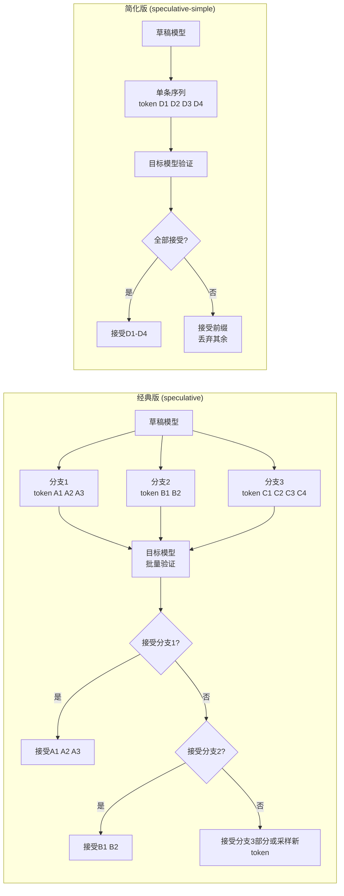
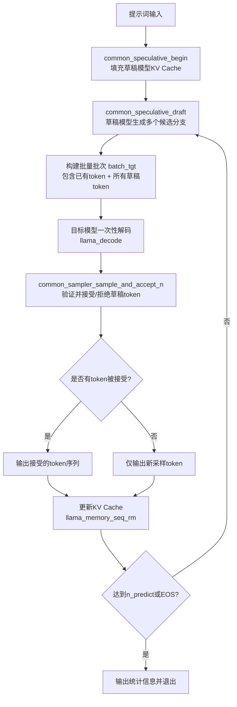
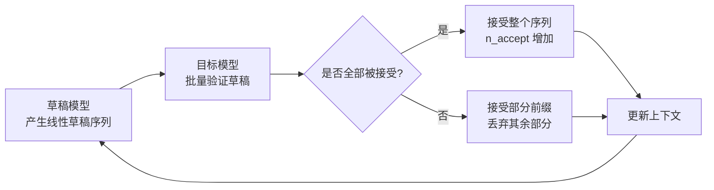
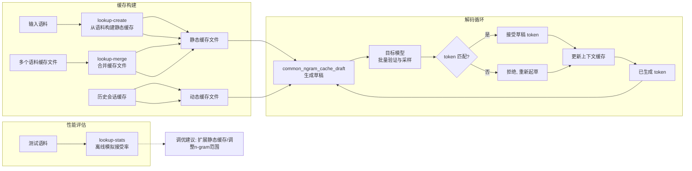
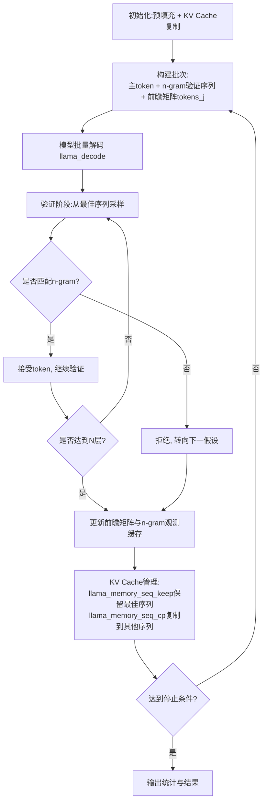

# 第93章 推测解码 —— 小模型起草，大模型验证（Speculative Decoding）

想象一下，你是一位在高档餐厅中工作的大厨，而餐厅正处于晚市高峰。每一道菜都必须由你亲手烹制：从选材、调味到摆盘，每一个环节都需要你的专业判断。这种方式虽然能保证每道菜的品质，但面对源源不断的订单，出菜速度成了最大的瓶颈——这正如自回归语言模型逐个 token 地生成文本，每一步都需要完整的模型计算，既精确又缓慢。

现在，设想你聘请了一位经验丰富的副手。他虽然无法像你一样精通每一道菜的复杂工艺，但对于餐厅菜单上的经典菜品和常见做法了如指掌。当订单到达时，副手会根据顾客的点单经验，飞速准备出菜品的初步版本（草稿），并放在传菜口。而你需要做的，不再是亲自从头制作每一道菜，而是迅速审视副手的成品：如果符合你的标准，便直接放行；只有当出现偏差（比如调味不准、火候欠佳）时，你才需要插手纠正。这样一来，虽然副手偶尔会犯错，但在绝大多数情况下，你可以在一次审视中同时确认多道菜的品质，出菜速度瞬间倍增。

这种"经验丰富的副手负责起草，技艺精湛的大厨负责审核"的协作模式，正是本章要探索的**推测解码（Speculative Decoding）**技术。它用一个轻量级的草稿模型（副手）快速提出候选 token 序列，再由一个重型的目标模型（大厨）批量验证这些候选，在保持最终输出质量的同时大幅提升解码速度。接下来，我们将依次深入四种实现——从经典的双模型协作、简化的线性草稿，到无需额外模型、基于 n-gram 缓存的 Lookup 方案，最后是采用前沿 Jacobi 迭代的 Lookahead 并行解码——看一看 llama.cpp 是如何将这"黄金搭档"的组合拳打得虎虎生风。

需要指出的是，本章中所有"副手"与"大厨"的分工并非一成不变。就如同餐厅在不同时段会调整人员配置一样，四种策略在草稿来源与管理方式上也各有巧妙：经典方案使用真正的"副手模型"（草稿模型）提出多条候选路径；简化版仅保留一条线性建议；Lookup 方案则如同一位记忆力超群的助理，直接从前文中翻找常用短语作为建议；而 Lookahead 更是将"并行试菜"发挥到极致。我们将沿着这套"大厨与副手"的餐厅叙事，逐一品味每种策略的精彩之处。

## 93.1 源码地图：四种推测解码方案的落地布局

在深入代码之前，我们先像看地图一样浏览一下本章涉及的源码文件，建立一个整体框架。当你需要回顾某个特定功能时，这张地图能帮你快速定位。

```
examples/speculative/
├── speculative.cpp
│   ├── struct seq_draft                       # 草稿序列分支结构体（25-31行）
│   └── main()                                 # 经典推测解码主函数（33-563行）
│       ├── 加载目标模型与草稿模型（含 K/V 缓存池分配）
│       ├── 主循环：多草稿分支生成（common_speculative_draft）
│       ├── 目标模型批量验证（common_sampler_sample_and_accept_n）
│       ├── 计算 token 概率比以决定接受或拒绝
│       └── 输出接受率与性能统计

examples/speculative-simple/
├── speculative-simple.cpp
│   └── main()                                 # 简化版推测解码主函数（1-198行）
│       ├── 解析参数并校验草稿模型路径
│       ├── 加载目标模型与草稿模型
│       ├── tokenize 输入并初始化采样器
│       ├── common_speculative_init()         # 初始化推测解码器
│       ├── common_speculative_begin()        # 提示词预填充
│       ├── 循环：common_speculative_draft()  # 草稿模型生成候选
│       ├── 批量解码并采样接受（sample_and_accept_n）
│       └── 输出统计与清理

examples/lookup/
├── lookup.cpp
│   └── main()                                 # Lookup 推测解码主函数（14-228行）
│       ├── 初始化 n-gram 缓存（上下文/动态/静态）
│       ├── 草稿生成循环（common_ngram_cache_draft）
│       ├── 目标模型验证接受/拒绝
│       └── 缓存更新与合并（common_ngram_cache_update/merge/save）
├── lookup-create.cpp
│   └── main()                                 # 静态缓存创建工具（10-43行）
│       ├── tokenize 输入语料
│       ├── common_ngram_cache_update()        # 构建 n-gram 哈希表
│       └── common_ngram_cache_save()          # 持久化保存缓存
├── lookup-merge.cpp
│   ├── print_usage()                          # 合并工具使用说明（15-18行）
│   └── main()                                 # 缓存合并主函数（20-49行）
│       ├── common_ngram_cache_load()          # 加载多个缓存文件
│       └── common_ngram_cache_merge()         # 合并并保存
└── lookup-stats.cpp
    └── main()                                 # 性能统计工具主函数（16-117行）
        ├── 按上下文窗口切分输入语料
        ├── 模拟草稿生成与接受过程
        └── 输出接受率等统计指标

examples/lookahead/
├── lookahead.cpp
│   ├── struct ngram_data                      # 验证 n-gram 数据（17-25行）
│   ├── struct ngram_container                 # n-gram 环形缓冲容器（27-38行）
│   └── main()                                 # Lookahead 解码主函数（42-419行）
│       ├── 初始化 W/N/G 参数与 KV 缓存序列复制
│       ├── 构建前瞻矩阵 tokens_j
│       ├── 批量解码与 n-gram 验证循环
│       └── KV Cache 的序列保留与共享重写
```

这张地图清晰地展示了四种方案的代码组织方式。`speculative` 系列侧重于有专门草稿模型的经典方案；`lookup` 系列则围绕 n-gram 缓存构建了一套完整的工具链，包括创建、合并和统计；而 `lookahead` 则独立展示了并行解码的巧思。现在，让我们从最复杂的经典方案开始逐步拆解。

## 93.2 经典推测解码 —— 树状草稿，批量验证的"多面手"（Draft & Verify with Tree）

回到我们的大厨与副手的类比。在这个场景中，副手可以同时准备多道菜的不同做法，厨房里会同时放着几个候选版本（分支）。当大厨审视时，他会优先检查最符合标准的版本，如果第一个版本不合格，他会迅速转向第二个备选版本，而不是让副手重新开始准备。通过这样的树状分支探索，大厨一次就能确认多个正确的菜品组件。

`speculative` 示例就是这种"多面手"策略的完整实现。它的核心架构是"一大多小"的模型组合：一个轻量级的草稿模型（draft model）作为副手，负责快速生成候选 token 序列；而一个重型的目标模型（target model）作为大厨，负责批量验证这些候选。在这种方案中，草稿模型可以在单次解码时并行生成多个候选分支（即树状结构），而目标模型则对这些分支统一进行前向计算。当多个分支同时被验证时，只要其中一个分支的第一个 token 被接受，其他分支就可以被安全地丢弃，而无需再做额外的采样——这是一种用计算换速度的典型策略。

### 93.2.1 `seq_draft`：单个草稿分支的状态容器

源码路径：`examples/speculative/speculative.cpp` - `struct seq_draft`（25-31行）

```cpp
// 定义一个草稿序列的结构体
struct seq_draft {
    // 该草稿分支是否仍然处于活跃状态
    bool active = false;
    // 该分支包含的草稿 token 序列
    std::vector<llama_token> drafts;
    // 每个草稿 token 对应的概率分布（用于随机验证时的概率比值计算）
    std::vector<std::vector<float>> probs;
    // 草稿模型对应的采样器，用于从草稿模型输出中采样 token
    struct common_sampler * smpl = nullptr;
};
```

这个结构体定义了推测解码树中的**一个分支**。每个分支相当于副手提出的一条完整假设路径。`active` 标记该分支是否还有继续验证的价值；`drafts` 存储分支上的每个待验证 token；`probs` 是为每个草稿 token 保存的模型概率分布，在采用"随机验证"（stochastic verification）策略时，我们需要比较草稿模型与目标模型在相同 token 上的概率比值来决定接受与否，因此这里必须保留完整的概率向量；`smpl` 则是在该分支上用于采样的采样器实例。

### 93.2.2 树状分支的创建、复制与淘汰机制

在 `speculative.cpp` 的主循环背后，树状分支的管理是由 `common_speculative_init`、`common_speculative_begin` 和 `common_speculative_draft` 这三个核心接口共同完成的。这如同副手的训练、上岗与配菜三部曲，我们逐一来看。

#### 93.2.2.1 `common_speculative_init`：草稿厨房的筹备与副手的聘用

源码路径：`common/speculative.cpp` - `common_speculative_init()`

```cpp
struct common_speculative * common_speculative_init(struct common_speculative_params & params, llama_context * ctx_tgt) {
    // 为目标模型分配一个顺序 ID（主序列）
    const llama_seq_id seq_id = 0;
    // 计算草稿模型的上下文大小：目标模型单序列上下文大小与配置上下文大小的较小值
    const uint32_t n_ctx = std::min(llama_n_ctx_seq(ctx_tgt), params.n_ctx);
    // 创建草稿模型的上下文
    llama_context * ctx_dft;
    // 根据配置创建草稿模型上下文，n_parallel 为草稿分支数（树状结构中的并行序列数）
    std::tie(ctx_dft, std::ignore) = llama_init_from_model(params.model_dft, llama_context_default_params().n_ctx(n_ctx).n_parallel(params.n_parallel));
    // 分配草稿模型的 KV 缓存池
    llama_memory * mem_dft = llama_get_memory(ctx_dft);
    // 初始化推测解码器结构体
    struct common_speculative * spec = new struct common_speculative;
    spec->ctx_dft = ctx_dft;
    spec->mem_dft = mem_dft;
    // 为每条草稿分支（序列）创建初始化数据
    spec->seq_dft.resize(params.n_parallel);
    for (int i = 0; i < params.n_parallel; i++) {
        // 每条分支默认不活跃，采样器为空
        spec->seq_dft[i].active = false;
        spec->seq_dft[i].smpl = nullptr;
    }
    spec->params = params;
    // 返回初始化完成的推测解码器
    return spec;
}
```

这个函数如同大厨为副手准备独立的厨房与设备。它为目标模型保留主序列（`seq_id = 0`），并为草稿模型创建独立的上下文 `ctx_dft`，其上下文大小取决于目标模型单序列上下文与配置值的较小者（通常为 512 左右）。关键点在于 `n_parallel` 参数：它决定了副手能同时准备多少个候选分支，即树状结构的分支数。此外，每个分支的采样器初始为空，需在后续草稿生成前按需创建。通过 `common_speculative` 结构体，所有这些信息被封装起来，供后续草稿生成与验证使用。

#### 93.2.2.2 `common_speculative_begin`：提示词的共享填充，副手的统一岗前培训

源码路径：`common/speculative.cpp` - `common_speculative_begin()`

```cpp
void common_speculative_begin(struct common_speculative * spec, const llama_tokens & prompt) {
    // 为目标模型解码提示词（不含最后一个 token），填充目标模型 KV 缓存
    llama_decode(spec->ctx_dft, llama_batch_get_one(prompt.data(), prompt.size()));
    // 将目标模型主序列的 KV 缓存复制到草稿模型的所有序列（分支）
    for (int s = 0; s < (int) spec->seq_dft.size(); ++s) {
        llama_memory_seq_cp(spec->mem_dft, 0, s, -1, -1);
    }
    // 设置文件的缓冲模式
    setvbuf(stdout, NULL, _IOLBF, 0);
}
```

这个函数执行"共享前缀填充"。提示词首先被解码到草稿模型的上下文，然后将这个公共前缀的 KV 缓存通过 `llama_memory_seq_cp` 复制到所有分支序列（`0` 到 `seq_dft.size()-1`）。这里复制操作似乎是先解码到序列 0 再复制到其他序列。实际上，`llama_decode` 默认填充的是序列 0，然后 `llama_memory_seq_cp` 将序列 0 的 KV 数据复制给所有其他序列，从而让每个分支都共享相同的上下文起点。这确保了即使分支后续走向不同，它们都能基于相同的"历史记忆"进行推理。

#### 93.2.2.3 `common_speculative_draft`：树状分支的并行起草与动态长度调整

源码路径：`common/speculative.cpp` - `common_speculative_draft()`

```cpp
llama_tokens common_speculative_draft(struct common_speculative * spec, const struct common_speculative_params & params, const llama_tokens & prompt, const llama_token id_last) {
    // 上一次迭代中被接受的 token（即当前上下文中的最后一个 token）
    const llama_seq_id seq_id = 0;

    // 从草稿模型采样得到新的草稿 token 序列
    llama_tokens result;
    // 在开始起草之前，复制当前上下文并追加最后一个已接受 token
    llama_tokens prompt_with_last = prompt;
    prompt_with_last.push_back(id_last);

    // 在每次迭代中，我们都需要将提示词前缀添加到草稿模型的上下文中
    llama_decode(spec->ctx_dft, llama_batch_get_one(prompt_with_last.data() + prompt_with_last.size() - 1, 1));

    // 循环通过草稿模型的多个并行分支生成候选
    bool has_tokens = true;
    while (has_tokens) {
        has_tokens = false;
        // 遍历所有可能的草稿分支
        for (int s = 0; s < (int) spec->seq_dft.size(); ++s) {
            // 跳过不活跃的分支
            if (!spec->seq_dft[s].active) continue;
            // 如果该分支没有采样器，则为其创建一个新的采样器
            if (spec->seq_dft[s].smpl == nullptr) {
                spec->seq_dft[s].smpl = common_sampler_init(spec->model_dft, spec->params.sampling);
            }
            // 检查该分支的草稿 token 数量是否已达到最大限制
            if ((int) spec->seq_dft[s].drafts.size() >= params.n_max) {
                spec->seq_dft[s].active = false;
                continue;
            }
            // 从草稿模型上下文中采样一个新 token
            llama_token id = common_sampler_sample(spec->seq_dft[s].smpl, spec->ctx_dft, spec->seq_dft[s].drafts.size());
            // 更新该分支的草稿序列与概率分布
            spec->seq_dft[s].drafts.push_back(id);
            spec->seq_dft[s].probs.push_back(common_sampler_probs(spec->seq_dft[s].smpl));
            // 标记还有活跃分支，需要继续循环
            has_tokens = true;
        }
        // 如果所有分支都已用尽或达到最大长度，则跳出循环
        if (!has_tokens || ...) break;
    }
    // 从所有活跃分支中提取最终的草稿序列
    for (int s = 0; s < (int) spec->seq_dft.size(); ++s) {
        if (spec->seq_dft[s].active) {
            result = spec->seq_dft[s].drafts;
            break;
        }
    }
    // 返回第一个活跃分支的草稿序列
    return result;
}
```

`common_speculative_draft`（草稿）函数是树状草稿分支的核心引擎，它在每一轮迭代中为每条活跃分支采样一个新的 token。每个分支拥有自己独立的采样器。循环通过检查 `params.n_max`（最大草稿长度）来停止采样，实现动态长度控制。当某个分支达到长度上限或被停用时，该分支不再贡献 token，而其他分支可以继续扩展。最终，它返回第一个活跃分支的草稿序列作为整体的草稿候选。树状分支的具体创建、复制与淘汰，实际上由外层逻辑（如 `speculative.cpp` 的主循环）通过设置 `seq_dft[s].active` 和创建新分支的方式驱动，`common_speculative_draft` 主要负责在给定分支状态下的并行采样。

### 93.2.3 `main`：经典推测解码主函数，验收与上菜的完整流程

源码路径：`examples/speculative/speculative.cpp` - `main()`（33-563行）

```cpp
int main(int argc, char ** argv) {
    std::setlocale(LC_NUMERIC, "C");
    common_params params;
    // 保留 128 个最高概率的 token，用于后续的概率比较和随机验证
    params.sampling.n_probs = 128;
    common_init();
    // 解析命令行参数
    if (!common_params_parse(argc, argv, params, LLAMA_EXAMPLE_SPECULATIVE)) {
        return 1;
    }
    // 初始化后端
    llama_backend_init();
    llama_numa_init(params.numa);
    // 初始化目标模型（大模型，负责验证）
    auto llama_init_tgt = common_init_from_params(params);
    auto * model_tgt = llama_init_tgt->model();
    auto * ctx_tgt   = llama_init_tgt->context();
    const llama_vocab * vocab = llama_model_get_vocab(model_tgt);

    // 初始化草稿模型（小模型，负责快速起草）
    llama_model_ptr model_dft;
    {
        const auto & params_spec = params.speculative;
        // 使用目标模型的配置参数来设置草稿模型的运行参数
        auto params_dft = params;
        params_dft.n_parallel   = 1;                     // 草稿模型仅需单序列
        params_dft.n_ctx        = params_spec.n_ctx;     // 草稿模型上下文大小
        params_dft.n_batch      = llama_n_ctx_seq(ctx_tgt); // 草稿模型批大小
        params_dft.devices      = params_spec.devices;   // 使用目标模型指定的设备
        params_dft.model        = params_spec.mparams_dft; // 草稿模型路径及配置
        params_dft.n_gpu_layers = params_spec.n_gpu_layers; // GPU 层数
        // 如果指定了草稿模型的 CPU 线程数，则覆盖默认参数
        if (params_spec.cpuparams.n_threads > 0) {
            params_dft.cpuparams.n_threads       = params.speculative.cpuparams.n_threads;
            params_dft.cpuparams_batch.n_threads = params.speculative.cpuparams_batch.n_threads;
        }
        params_dft.tensor_buft_overrides = params.speculative.tensor_buft_overrides;
        auto mparams_dft = common_model_params_to_llama(params_dft);
        // 正式加载草稿模型文件
        model_dft.reset(llama_model_load_from_file(params_dft.model.path.c_str(), mparams_dft));
        if (model_dft == nullptr) {
            LOG_ERR("failed to load draft model, '%s'\n", params_dft.model.path.c_str());
            return 1;
        }
        // 将草稿模型的上下文参数与模型指针注册到推测解码配置中
        params.speculative.model_dft = model_dft.get();
        params.speculative.cparams_dft = common_context_params_to_llama(params_dft);
    }
    // tokenize 提示词
    std::vector<llama_token> inp;
    inp = common_tokenize(ctx_tgt, params.prompt, true, true);
    // 上下文尺寸与批次尺寸校验
    ...
    // 初始化目标模型采样器
    struct common_sampler * smpl = common_sampler_init(model_tgt, params.sampling);
    // 预填充目标模型
    llama_decode(ctx_tgt, llama_batch_get_one(inp.data(), inp.size() - 1));
    llama_token id_last = inp.back();
    llama_tokens prompt_tgt(inp.begin(), inp.end() - 1);
    int n_past = inp.size() - 1;
    // 初始化推测解码器，传入配置与目标上下文
    struct common_speculative * spec = common_speculative_init(params.speculative, ctx_tgt);
    // 将提示词（不含最后一个 token）作为共同前缀输入
    common_speculative_begin(spec, prompt_tgt);
    llama_batch batch_tgt = llama_batch_init(llama_n_batch(ctx_tgt), 0, 1);

    // ---- 主生成循环 ----
    while (true) {
        // 关键步骤1：利用草稿模型生成一批候选 token 序列
        llama_tokens draft = common_speculative_draft(spec, params_spec, prompt_tgt, id_last);

        // 关键步骤2：构建一个批次，包含最后一个已接受 token 以及所有草稿 token
        common_batch_clear(batch_tgt);
        common_batch_add  (batch_tgt, id_last, n_past++, { 0 }, true);
        {
            if (draft.size() < (size_t) params_spec.n_min) {
                // 如果草稿数量太少，清空草稿，退化为普通自回归生成
                draft.clear();
            }
            for (size_t i = 0; i < draft.size(); ++i) {
                common_batch_add(batch_tgt, draft[i], n_past + i, { 0 }, true);
            }
            // 关键步骤3：目标模型一次性解码（验证）所有候选 token
            llama_decode(ctx_tgt, batch_tgt);
        }

        // 关键步骤4：根据目标模型的输出，采样并接受/拒绝草稿 token
        const auto ids = common_sampler_sample_and_accept_n(smpl, ctx_tgt, draft);
        GGML_ASSERT(ids.size() > 0);
        n_past    += ids.size() - 1;
        n_drafted += draft.size();
        n_accept  += ids.size() - 1;
        n_predict += ids.size();
        // 将接受的 token 输入提示词上下文，并输出
        for (size_t i = 0; i < ids.size(); ++i) {
            prompt_tgt.push_back(id_last);
            id_last = ids[i];
            if (llama_vocab_is_eog(vocab, id_last)) {
                has_eos = true;
                break;
            }
            const std::string token_str = common_token_to_piece(ctx_tgt, id_last);
            ...
        }
        // 在 KV Cache 中移除超过当前已接受 token 位置的无效填充
        llama_memory_seq_rm(llama_get_memory(ctx_tgt), 0, n_past, -1);
        if ((params.n_predict >= 0 && n_predict > params.n_predict) || has_eos) {
            break;
        }
    }
    ...
    return 0;
}
```

这段代码完整展示了"大厨与副手"的协作流程。在初始化阶段，程序像聘用副手一样，为草稿模型分配参数与资源，并单独加载模型文件。这里需要注意，`common_speculative_init` 是推测解码器的核心抽象，负责创建草稿模型的上下文与 KV 缓存；`common_speculative_begin` 将提示词前缀填充进草稿模型，相当于副手的"岗前培训"。在主循环中，`common_speculative_draft`（草稿）生成候选 token 序列；随后构建包含最后已接受 token 与所有草稿 token 的批次，一次性交给目标模型进行前向解码。由于 LLM 的前向计算是高度并行的，这比逐个 token 生成要快得多。验证阶段由 `common_sampler_sample_and_accept_n` 完成，它从目标模型解码的 logits 中采样 token，并按照验证规则接受或拒绝草稿 token。最后，`llama_memory_seq_rm` 清理未接受的草稿 token 对应的 KV 缓存，避免位置错乱。

#### 93.2.3.1 `common_sampler_sample_and_accept_n`：大厨的验收标准——贪心与随机验证

源码路径：`common/sampling.cpp` - `common_sampler_sample_and_accept_n()`

```cpp
std::vector<llama_token> common_sampler_sample_and_accept_n(struct common_sampler * smpl, llama_context * ctx, const std::vector<llama_token> & draft) {
    // 存储最终被接受的 token 序列的容器
    std::vector<llama_token> ids;
    // 从目标模型当前上下文的最后一个位置采样第一个 token
    llama_token id = common_sampler_sample(smpl, ctx, -1);
    // 记录已接受的 token 数量（初始为 1，因为第一个 token 总是被接受）
    int i_accept = 0;
    // 将第一个 token 添加到接受列表
    ids.push_back(id);
    // 接受第一个 token（用于更新采样器状态）
    common_sampler_accept(smpl, id, true);

    // 主循环：遍历草稿 token 序列，决定是否接受后续草稿 token
    while (i_accept < (int) draft.size()) {
        // 从目标模型上下文中位置 i_accept 采样下一个 token
        id = common_sampler_sample(smpl, ctx, i_accept);
        // 如果采样得到的 token 与草稿序列中对应位置的 token 相同，则接受
        if (id == draft[i_accept]) {
            i_accept++;
            ids.push_back(id);
            common_sampler_accept(smpl, id, true);
            continue;
        }
        // 否则进行随机验证（stochastic verification）
        // 获取当前草稿 token 在草稿模型中的概率
        // 从采样器中获取草稿 token 的概率
        const float p_dft = common_sampler_probs(smpl)[draft[i_accept]];
        // 获取目标模型在当前位置采样的 token 的概率
        // 从采样器中获取目标采样 token 的概率
        const float p_tgt = common_sampler_probs(smpl)[id];
        // 计算概率比，用于决定是否接受草稿 token
        const float ratio = p_tgt / p_dft;
        // 如果概率比大于等于 1，则接受草稿 token
        if (ratio >= 1.0f) {
            i_accept++;
            ids.push_back(draft[i_accept]);
            common_sampler_accept(smpl, draft[i_accept], true);
            continue;
        }
        // 否则以概率 ratio 接受草稿 token
        if (common_sampler_rand(smpl) < ratio) {
            i_accept++;
            ids.push_back(draft[i_accept]);
            common_sampler_accept(smpl, draft[i_accept], true);
            continue;
        }
        // 否则拒绝草稿 token，将当前采样得到的 token 作为最终输出
        ids.push_back(id);
        common_sampler_accept(smpl, id, true);
        break;
    }
    // 返回最终被接受的 token 序列
    return ids;
}
```

这是验证阶段的核心。它首先从目标模型当前上下文的最后一个位置采样出第一个 token（此时 `i_accept` 已经指向位置 `-1` 的输出概率），这个 token 总是被接受。然后进入一个循环，遍历草稿 token 序列中的每个位置。

对于草稿中的每个 token，它从目标模型上下文中的对应位置采样一个新的 token，并进行比较。如果采样的 token 与草稿 token 相同，则直接接受，并继续检查下一个草稿 token。如果不同，则进入随机验证阶段：计算草稿 token 在目标模型概率分布中的概率 `p_tgt` 与采样 token 概率 `p_dft` 的比值 `ratio`。如果 `ratio >= 1`，说明目标模型认为草稿 token 更合理，则接受草稿 token；否则以概率 `ratio` 随机接受草稿 token（使用 `common_sampler_rand` 生成随机数）。如果随机数大于 `ratio`，则拒绝草稿 token，并接受当前采样的 token，循环结束。如果草稿序列耗尽，`while` 循环自然退出。

还需说明，`common_sampler_sample` 与 `common_sampler_accept` 在内部会维护采样器状态，包括概率分布、随机数种子、已接受 token 的记录等。因此，在随机验证中调用 `common_sampler_probs` 和 `common_sampler_rand` 时，获取的是当前最新状态的正确数据。在贪心模式下，`common_sampler_sample` 会直接选择概率最高的 token，且 `common_sampler_probs` 返回的分布中 `p_tgt` 将与 `p_dft` 的比较结果自动触发 `ratio >= 1` 或 `ratio < 1` 的逻辑分支。

### 93.2.4 经典与简化版的架构对比

为了更直观地理解树状草稿与线性草稿的差异，我们通过一张架构对比图来审视两种策略：



如图所示，经典版维护多条分支，如同一批副手同时提出多套方案，大厨依次捡视，接受率更高。简化版只有一条线性草稿，如同一名副手提出一条建议，大厨要么全部放行，要么部分采纳。

以下流程图展示了经典双模型推测解码的完整工作流程：



## 93.3 简化版推测解码 —— 线性草稿，一目了然的"双人舞"（Simple Draft & Verify）

现在，让我们从复杂的树状分支回到一个更简洁的场景。想象你是同时管理着多条快递分拣线的主任。每条分拣线都配备了一个经验丰富的助理，但这位助理的能力相对有限，他只能按照固定的顺序依次为每个包裹贴好标签，而不能像资深助理那样提出多种备选方案。尽管如此，只要主任能够快速审核，这条线的分拣效率依然远高于独自作战。

`speculative-simple` 正是这样的一个"简化"实现。与 `speculative` 的多分支树状结构不同，这个示例只维护**一条草稿序列**，草稿模型每次生成 `n_max` 个候选 token，目标模型验证并接受后，草稿序列被更新，然后进入下一轮。虽然这种"单路径"策略的接受率不如树状分支，但它的代码逻辑简单直接，非常适合用来学习推测解码的核心机制。

### 93.3.1 `main`：简化版推测解码主函数，大厨的单线审核

源码路径：`examples/speculative-simple/speculative-simple.cpp` - `main()`（1-198行）

```cpp
int main(int argc, char ** argv) {
    std::setlocale(LC_NUMERIC, "C");
    common_params params;
    common_init();
    // 解析命令行参数
    if (!common_params_parse(argc, argv, params, LLAMA_EXAMPLE_SPECULATIVE)) {
        return 1;
    }
    // 校验:草稿模型必须指定
    if (params.speculative.mparams_dft.path.empty()) {
        LOG_ERR("%s: --model-draft is required\n", __func__);
        return 1;
    }
    // 初始化后端、NUMA
    llama_backend_init();
    llama_numa_init(params.numa);

    // ---- 加载目标模型 ----
    llama_model * model_tgt = NULL;
    llama_context * ctx_tgt = NULL;
    auto llama_init_tgt = common_init_from_params(params);
    model_tgt = llama_init_tgt->model();
    ctx_tgt   = llama_init_tgt->context();
    const llama_vocab * vocab = llama_model_get_vocab(model_tgt);

    // ---- 加载草稿模型 ----
    llama_model_ptr model_dft;
    {
        const auto & params_spec = params.speculative;
        auto params_dft = params;
        params_dft.n_parallel   = 1;             // 单序列
        params_dft.n_ctx        = params_spec.n_ctx;
        params_dft.n_batch      = llama_n_ctx_seq(ctx_tgt);
        params_dft.devices      = params_spec.devices;
        params_dft.model        = params_spec.mparams_dft;
        params_dft.n_gpu_layers = params_spec.n_gpu_layers;
        if (params_spec.cpuparams.n_threads > 0) {
            params_dft.cpuparams.n_threads       = params.speculative.cpuparams.n_threads;
            params_dft.cpuparams_batch.n_threads = params.speculative.cpuparams_batch.n_threads;
        }
        params_dft.tensor_buft_overrides = params.speculative.tensor_buft_overrides;
        auto mparams_dft = common_model_params_to_llama(params_dft);
        model_dft.reset(llama_model_load_from_file(params_dft.model.path.c_str(), mparams_dft));
        if (model_dft == nullptr) {
            LOG_ERR("failed to load draft model, '%s'\n", params_dft.model.path.c_str());
            return 1;
        }
        params.speculative.model_dft = model_dft.get();
        params.speculative.cparams_dft = common_context_params_to_llama(params_dft);
    }

    // Tokenize 输入，执行预填充
    std::vector<llama_token> inp;
    inp = common_tokenize(ctx_tgt, params.prompt, true, true);
    // 上下文与批次大小校验...
    int n_predict = 0, n_drafted = 0, n_accept = 0;
    bool has_eos = false;
    // 初始化目标模型采样器
    struct common_sampler * smpl = common_sampler_init(model_tgt, params.sampling);
    // 预填充:输入的前 n-1 个 token
    llama_decode(ctx_tgt, llama_batch_get_one(inp.data(), inp.size() - 1));
    llma_token id_last = inp.back();
    llama_tokens prompt_tgt(inp.begin(), inp.end() - 1);
    int n_past = inp.size() - 1;

    // 初始化推测解码器
    struct common_speculative * spec = common_speculative_init(params.speculative, ctx_tgt);
    common_speculative_begin(spec, prompt_tgt);
    llama_batch batch_tgt = llama_batch_init(llama_n_batch(ctx_tgt), 0, 1);

    // ---- 主生成循环 ----
    while (true) {
        // 1. 从草稿模型获取一批候选 token
        llama_tokens draft = common_speculative_draft(spec, params_spec, prompt_tgt, id_last);
        // 2. 构建目标模型的批次
        common_batch_clear(batch_tgt);
        common_batch_add  (batch_tgt, id_last, n_past++, { 0 }, true);
        {
            // 若草稿数量不足阈值，则放弃草稿，退化普通生成
            if (draft.size() < (size_t) params_spec.n_min) {
                draft.clear();
            }
            for (size_t i = 0; i < draft.size(); ++i) {
                common_batch_add(batch_tgt, draft[i], n_past + i, { 0 }, true);
            }
            // 3. 目标模型一次性解码所有候选
            llama_decode(ctx_tgt, batch_tgt);
        }
        // 4. 采样并接受/拒绝草稿 token
        const auto ids = common_sampler_sample_and_accept_n(smpl, ctx_tgt, draft);
        GGML_ASSERT(ids.size() > 0);
        n_past    += ids.size() - 1;
        n_drafted += draft.size();
        n_accept  += ids.size() - 1;
        n_predict += ids.size();
        // 输出并更新上下文
        for (size_t i = 0; i < ids.size(); ++i) {
            prompt_tgt.push_back(id_last);
            id_last = ids[i];
            if (llama_vocab_is_eog(vocab, id_last)) {
                has_eos = true;
                break;
            }
            const std::string token_str = common_token_to_piece(ctx_tgt, id_last);
            LOG("%s", token_str.c_str());
            fflush(stdout);
        }
        LOG_DBG("accepted %d/%d draft tokens, the last target token is: (%d)\n", (int) ids.size() - 1, (int) draft.size(), id_last);
        // 清理未使用的 KV Cache 部分
        llama_memory_seq_rm(llama_get_memory(ctx_tgt), 0, n_past, -1);
        if ((params.n_predict >= 0 && n_predict > params.n_predict) || has_eos) {
            break;
        }
    }
    // 输出统计信息、释放资源
    LOG_INF("encoded %4d tokens in %8.3f seconds, speed: %8.3f t/s\n", n_input, ...);
    LOG_INF("decoded %4d tokens in %8.3f seconds, speed: %8.3f t/s\n", n_predict, ...);
    LOG_INF("n_draft   = %d\n", params_spec.n_max);
    LOG_INF("n_predict = %d\n", n_predict);
    LOG_INF("n_drafted = %d\n", n_drafted);
    LOG_INF("n_accept  = %d\n", n_accept);
    LOG_INF("accept    = %.3f%%\n", 100.0f * n_accept / n_drafted);
    common_perf_print(ctx_tgt, smpl);
    llama_batch_free(batch_tgt);
    common_sampler_free(smpl);
    common_speculative_free(spec);
    llama_backend_free();
    return 0;
}
```

这个函数与 `speculative.cpp` 的主循环高度相似，但有以下关键差异。首先，在单序列草稿方面，`common_speculative_draft` 在 `speculative-simple` 中只返回一条线性序列（长度为 `n_max`），而在 `speculative` 中可能返回多个分支。这简化了后续验证阶段的处理——我们只需按顺序比对草稿 token 与目标模型的输出即可。其次，在概率验证简化方面，`speculative-simple` 默认采用贪心验证（greedy verification）策略（通过 `common_sampler_sample_and_accept_n` 内部的采样温度等参数控制）。在多分支验证中，我们需要保存每个分支的概率分布进行概率比值比较，而对于单序列，则无需这种复杂的记录。

从这些代码中我们可以看到，推测解码的通用流程被 `llama.cpp` 抽象为 `common_speculative_*` 系列接口（`init`、`begin`、`draft`、`free`）。这使得我们不必关心草稿模型上下文的具体管理，只需调用这些函数即可。这也正是抽象设计的价值所在——它将复杂的多模型协作过程封装为简洁的 API。

下面这张流程图清晰地展示了简化版推测解码的流程，可以与经典版的树状结构形成对比：



## 93.4 Lookup 推测解码 —— 缓存复用，无需草稿模型的"轻骑兵"（N-gram Cache Lookup）

现在，让我们换一种思维。想象你正在翻译一本关于中国历史的书籍。你并不需要每遇到一个"长城"、"秦始皇"这样的词汇就重新去查阅百科全书，因为这些词汇在你的长期记忆（静态缓存）和这本书前文（动态缓存）中已经反复出现。你可以直接从记忆中"调取"这些固定搭配，快速给出翻译草稿，再由你的翻译搭档（目标模型）来把关。

`lookup` 系列示例正是这种思路的工程实现：**完全不需要单独的草稿模型**。它的核心思想是，在文本生成过程中，许多高频词汇和短语会重复出现。我们可以将输入提示词以及生成过程中已经出现过的所有 n-gram（连续的 n 个 token）片段存储在一个哈希表中。当需要猜测下一个 token 时，不是在语言模型中进行前向计算，而是直接在哈希表中查找以当前最后一个 token 开头的最长 n-gram 片段，将其作为候选草稿。

### 93.4.1 `main`：Lookup 推测解码主函数，记忆力超群的大厨助理

源码路径：`examples/lookup/lookup.cpp` - `main()`（14-228行）

```cpp
int main(int argc, char ** argv){
    std::setlocale(LC_NUMERIC, "C");
    common_params params;
    common_init();
    if (!common_params_parse(argc, argv, params, LLAMA_EXAMPLE_LOOKUP)) {
        return 1;
    }
    // 从参数中读取最大草稿 token 数量 n_max
    const int n_draft = params.speculative.n_max;
    llama_backend_init();
    llama_numa_init(params.numa);
    auto llama_init = common_init_from_params(params);
    auto * model = llama_init->model();
    auto * ctx   = llama_init->context();
    const llama_vocab * vocab = llama_model_get_vocab(model);

    // tokenize 输入
    std::vector<llama_token> inp;
    inp = common_tokenize(ctx, params.prompt, true, true);

    // 初始化三个不同来源的 n-gram 缓存
    common_ngram_cache ngram_cache_context;   // 从当前输入上下文构建
    common_ngram_cache ngram_cache_dynamic;   // 动态缓存（运行过程中持续更新）
    common_ngram_cache ngram_cache_static;    // 静态缓存（来自预构建文件）
    int64_t t_draft_flat_us = 0;
    int64_t t_draft_us = 0;

    {
        const int64_t t_start_draft_us = ggml_time_us();
        // 1. 从输入提示词中提取 n-gram，构建上下文缓存
        common_ngram_cache_update(ngram_cache_context, LLAMA_NGRAM_MIN, LLAMA_NGRAM_MAX, inp, inp.size(), false);

        // 2. 如果指定了静态缓存文件，则加载
        if (!params.speculative.lookup_cache_static.empty()) {
            try {
                ngram_cache_static = common_ngram_cache_load(params.speculative.lookup_cache_static);
            } catch (std::ifstream::failure const &) {
                LOG_ERR("failed to open static lookup cache: %s", params.speculative.lookup_cache_static.c_str());
                exit(1);
            }
        }
        // 3. 加载动态缓存文件（如果存在），否则程序结束时新建
        if (!params.speculative.lookup_cache_dynamic.empty()) {
            try {
                ngram_cache_dynamic = common_ngram_cache_load(params.speculative.lookup_cache_dynamic);
            } catch (std::ifstream::failure const &) {
                // 如果文件不存在，将在程序结束时自动创建
            }
        }
        t_draft_flat_us += ggml_time_us() - t_start_draft_us;
    }

    // 预填充目标模型
    const int n_input = inp.size();
    // 上下文长度与输入长度校验...
    const auto t_enc_start = ggml_time_us();
    llama_decode(ctx, llama_batch_get_one( inp.data(), n_input - 1));
    llama_decode(ctx, llama_batch_get_one(&inp.back(),           1));
    const auto t_enc_end = ggml_time_us();

    int n_predict = 0, n_drafted = 0, n_accept = 0, n_past = inp.size();
    bool has_eos = false;
    struct common_sampler * smpl = common_sampler_init(model, params.sampling);
    std::vector<llama_token> draft;
    llama_batch batch_tgt = llama_batch_init(llama_n_ctx(ctx), 0, 1);
    const auto t_dec_start = ggml_time_us();

    // ---- 主循环 ----
    while (true) {
        LOG_DBG("drafted %s\n", string_from(ctx, draft).c_str());
        int i_dft = 0; // 当前正在验证的草稿位置索引
        while (true) {
            // 从目标模型当前的 logits 中采样一个 token（位置由 i_dft 决定）
            llama_token id = common_sampler_sample(smpl, ctx, i_dft);
            common_sampler_accept(smpl, id, true);
            const std::string token_str = common_token_to_piece(ctx, id);
            if (!params.use_color) {
                LOG("%s", token_str.c_str());
            }
            if (llama_vocab_is_eog(vocab, id)) {
                has_eos = true;
            }
            ++n_predict;
            // 验证：如果采样得到的 token 与草稿序列第 i_dft 个 token 相同
            if (i_dft < (int) draft.size() && id == draft[i_dft]) {
                // 接受草稿 token
                LOG_DBG("the sampled target token matches the %dth drafted token (%d, '%s') - accepted\n", i_dft, id, token_str.c_str());
                ++n_accept;
                ++n_past;
                ++i_dft;
                inp.push_back(id);
                {
                    // 更新上下文 n-gram 缓存
                    const int64_t t_start_draft_us = ggml_time_us();
                    common_ngram_cache_update(ngram_cache_context, LLAMA_NGRAM_MIN, LLAMA_NGRAM_MAX, inp, 1, false);
                    t_draft_us += ggml_time_us() - t_start_draft_us;
                }
                if (params.use_color) {
                    LOG("\033[34m%s\033[0m", token_str.c_str());
                    fflush(stdout);
                }
                continue; // 继续验证下一个草稿 token
            }
            // 草稿 token 被拒绝（或不匹配/草稿耗尽）
            if (params.use_color) {
                LOG("%s", token_str.c_str());
            }
            fflush(stdout);
            LOG_DBG("the sampled target token (%d, '%s') did not match, or we ran out of drafted tokens\n", id, token_str.c_str());
            // 重置草稿序列，将新采样 token 加入上下文
            draft.clear();
            draft.push_back(id);
            inp.push_back(id);
            {
                const int64_t t_start_draft_us = ggml_time_us();
                common_ngram_cache_update(ngram_cache_context, LLAMA_NGRAM_MIN, LLAMA_NGRAM_MAX, inp, 1, false);
                t_draft_us += ggml_time_us() - t_start_draft_us;
            }
            break;
        }
        // 若生成了足够多的 token 或遇到 EOS，退出主循环
        if ((params.n_predict > 0 && n_predict > params.n_predict) || has_eos) {
            break;
        }

        // 清理 KV Cache 中未被接受的部分
        llama_memory_seq_rm(llama_get_memory(ctx), 0, n_past, -1);

        // 构建目标模型批次：draft 中只有第一个 token（即新采样 token）被作为输入
        common_batch_clear(batch_tgt);
        common_batch_add(batch_tgt, draft[0], n_past, { 0 }, true);
        GGML_ASSERT(draft.size() == 1);
        GGML_ASSERT(draft[0] == inp.back());

        // 关键：从 n-gram 缓存中草稿一批 token，填充 draft 向量
        const int64_t t_start_draft_us = ggml_time_us();
        common_ngram_cache_draft(inp, draft, n_draft, LLAMA_NGRAM_MIN, LLAMA_NGRAM_MAX, ngram_cache_context, ngram_cache_dynamic, ngram_cache_static);
        // 将新草稿 token 加入目标模型的批次
        for (size_t i = 1; i < draft.size(); ++i) {
            common_batch_add(batch_tgt, draft[i], n_past + i, { 0 }, true);
        }
        t_draft_us += ggml_time_us() - t_start_draft_us;
        n_drafted += draft.size() - 1;

        // 目标模型一次性解码验证（包括草稿 token 与已接受 token）
        llama_decode(ctx, batch_tgt);
        ++n_past;

        // 移除已解码的第一个草稿 token（它已被验证过或将成为下一轮的起点）
        draft.erase(draft.begin());
        // 继续循环，进行下一轮的采样与验证
    }
    auto t_dec_end = ggml_time_us();
    // 将动态缓存的累积更新合并到动态缓存文件并保存
    common_ngram_cache_merge(ngram_cache_dynamic, ngram_cache_context);
    common_ngram_cache_save(ngram_cache_dynamic, params.speculative.lookup_cache_dynamic);
    // 输出统计信息：n_predict、n_drafted、t_draft_flat、t_draft、n_accept、accept 等
    LOG_INF("n_predict    = %d\n", n_predict);
    LOG_INF("n_drafted    = %d\n", n_drafted);
    LOG_INF("t_draft_flat = %.2f ms\n", t_draft_flat_us*1e-3);
    LOG_INF("t_draft      = %.2f ms, %.2f us per token, %.2f tokens per second\n",
            t_draft_us*1e-3, 1.0f*t_draft_us/n_drafted, n_drafted/(1e-6*t_draft_us));
    LOG_INF("n_accept     = %d\n", n_accept);
    LOG_INF("accept       = %.3f%%\n", 100.0f * n_accept / n_drafted);
    common_perf_print(ctx, smpl);
    common_sampler_free(smpl);
    llama_batch_free(batch_tgt);
    llama_backend_free();
    return 0;
}
```

这个函数展示了 Lookup 推测解码的独特流程。首先，它初始化了三源缓存：`common_ngram_cache_context` 从输入上下文中提取，每次更新；`common_ngram_cache_dynamic` 是一个跨会话累积的缓存，程序结束时保存；`common_ngram_cache_static` 是一个预先构建的"词典"，可以由 `lookup-create` 工具从语料库生成。三者共同参与草稿生成，提高了缓存覆盖度。其次，在内层验证循环中，程序反复从目标模型当前 `i_dft` 位置的 logits 中采样，并与草稿序列中对应位置的 token 比对。如果一致，索引 `i_dft` 后移继续验证；一旦不一致或草稿耗尽，循环退出并重新进行草稿生成。`common_ngram_cache_draft` 是 Lookup 的核心，它接收当前已生成的所有 token（`inp`）、初始的 `draft`（包含新采样 token）、目标草稿长度 `n_draft` 以及三个缓存。它尝试从 `inp` 的末尾开始，查找是否存在以某个 token 开头的、长度介于 `LLAMA_NGRAM_MIN` 与 `LLAMA_NGRAM_MAX` 之间的 n-gram 序列。如果找到这样的序列，就将其后续 token 依次追加到 `draft` 中，直到达到 `n_draft` 的限制。最后，因为没有第二语言模型，推理过程的额外开销只是哈希查找和缓存更新。这使得 Lookup 在短文本、重复模式多的场景（例如代码补全、API 调用生成）中拥有显著的加速比。

#### 93.4.1.1 `common_ngram_cache_load`：加载缓存文件的助手

源码路径：`common/ngram-cache.cpp` - `common_ngram_cache_load()`

```cpp
common_ngram_cache common_ngram_cache_load(const std::string & path) {
    // 定义返回的 n-gram 缓存对象
    common_ngram_cache ngram_cache;
    // 以二进制模式打开输入文件流
    std::ifstream file(path, std::ios::binary);
    // 如果文件无法打开，则抛出异常
    if (!file.is_open()) {
        throw std::ifstream::failure("Failed to open file: " + path);
    }
    // 读取文件头信息，校验缓存格式
    ... // 包含词表大小、n-gram 长度等元数据
    // 顺序读取所有 n-gram 记录并插入缓存
    ...
    return ngram_cache;
}
```

这个助手函数充当一个"读取记忆"的角色，负责从磁盘上的缓存文件恢复 n-gram 哈希表。它验证文件格式，并逐个读取记录，为 `lookup.cpp` 的动态与静态缓存提供数据载入能力。

#### 93.4.1.2 `common_ngram_cache_save`：保存缓存文件的助手

源码路径：`common/ngram-cache.cpp` - `common_ngram_cache_save()`

```cpp
void common_ngram_cache_save(const common_ngram_cache & ngram_cache, const std::string & path) {
    // 以二进制模式打开输出文件流
    std::ofstream file(path, std::ios::binary);
    // 如果文件无法打开，则抛出异常
    if (!file.is_open()) {
        throw std::ifstream::failure("Failed to open file for writing: " + path);
    }
    // 写入文件头，包含格式版本、词典大小等信息
    ...
    // 遍历 n-gram 缓存，将所有记录写入文件
    for (const auto & kv : ngram_cache.map) {
        ...
    }
}
```

这个助手函数负责将 n-gram 缓存序列化并持久化到磁盘，确保生成过程中积累的"记忆"（动态缓存）可以跨会话保留，也可以被其他工具（如 `lookup-merge`）读取和合并。

上述流程可以总结为下面的架构图，它清晰地展示了 Lookup 工具链中创建、合并、统计与主程序之间的关系：



图中可以看到四条工具链路径：通过 `lookup-create` 构建静态缓存，通过 `lookup-merge` 合并多个缓存，通过 `lookup-stats` 进行离线性能评估，以及主程序 `lookup` 在解码循环中同时利用静态、动态和上下文缓存进行草稿生成。

### 93.4.2 `lookup-create.cpp`：静态缓存创建工具，定制专属"记忆词典"

源码路径：`examples/lookup/lookup-create.cpp` - `main()`（10-43行）

```cpp
int main(int argc, char ** argv){
    std::setlocale(LC_NUMERIC, "C");
    common_params params;
    common_init();
    if (!common_params_parse(argc, argv, params, LLAMA_EXAMPLE_LOOKUP)) {
        return 1;
    }
    // 初始化后端与模型
    llama_backend_init();
    llama_numa_init(params.numa);
    auto llama_init = common_init_from_params(params);
    auto * model = llama_init->model();
    auto * ctx = llama_init->context();
    GGML_ASSERT(model != nullptr);

    // 将提示词 tokenize
    std::vector<llama_token> inp;
    inp = common_tokenize(ctx, params.prompt, true, true);
    fprintf(stderr, "%s: tokenization done\n", __func__);

    // 构建 n-gram 缓存
    common_ngram_cache ngram_cache;
    // 注意：这里将整个输入视为一个"滑动窗口"，以静态方式更新缓存
    // LLAMA_NGRAM_STATIC 作为 min 与 max 参数，意味着只记录特定长度的 n-gram
    common_ngram_cache_update(ngram_cache, LLAMA_NGRAM_STATIC, LLAMA_NGRAM_STATIC, inp, inp.size(), true);
    fprintf(stderr, "%s: hashing done, writing file to %s\n", __func__, params.speculative.lookup_cache_static.c_str());

    // 将缓存保存到指定文件
    common_ngram_cache_save(ngram_cache, params.speculative.lookup_cache_static);
    return 0;
}
```

这是创建静态 Lookup 缓存的工具。它的核心逻辑非常清晰：加载模型（用于获取词表）→ 对输入文本进行 tokenize → 从 token 序列中提取所有 `LLAMA_NGRAM_STATIC` 长度的 n-gram 并存入哈希表 → 将哈希表序列化到磁盘。这个工具可以用于从大型语料库中构建通用的"词典"，然后在 `lookup.cpp` 运行时加载，作为 `ngram_cache_static` 使用。通过这个工具，我们可以预先从海量的领域文档中提取高频片段，显著提升草稿命中率。

### 93.4.3 `print_usage`与`main`：缓存合并工具，融合多本"记忆词典"

源码路径：`examples/lookup/lookup-merge.cpp` - `print_usage()`（15-18行）与 `main()`（20-49行）

```cpp
static void print_usage(char* argv0) {
    fprintf(stderr, "Merges multiple lookup cache files into a single one.\n");
    fprintf(stderr, "Usage: %s [--help] lookup_part_1.bin lookup_part_2.bin ... lookup_merged.bin\n", argv0);
}
```

`print_usage` 函数是缓存合并工具的使用说明。它向用户清晰地展示了该工具的基本用法：需要传入至少两个输入文件（要合并的多个缓存文件）和一个输出文件（合并结果）。它还支持通过 `-h` 或 `--help` 参数随时调出这份说明，帮助用户快速上手。

```cpp
int main(int argc, char ** argv){
    std::setlocale(LC_NUMERIC, "C");
    if (argc < 3) {
        print_usage(argv[0]); // 参数太少，打印帮助
        exit(1);
    }
    std::vector<std::string> args;
    args.resize(argc-1);
    for (int i = 0; i < argc-1; ++i) {
        args[i] = argv[i+1];
        if (args[i] == "-h" || args[i] == "--help") {
            print_usage(argv[0]);
            exit(0);
        }
    }
    // 加载第一个缓存作为合并基底
    fprintf(stderr, "lookup-merge: loading file %s\n", args[0].c_str());
    common_ngram_cache ngram_cache_merged = common_ngram_cache_load(args[0]);
    // 依次加载后续缓存，合并到基底中
    for (size_t i = 1; i < args.size()-1; ++i) {
        fprintf(stderr, "lookup-merge: loading file %s\n", args[i].c_str());
        common_ngram_cache ngram_cache = common_ngram_cache_load(args[i]);
        common_ngram_cache_merge(ngram_cache_merged, ngram_cache);
    }
    // 保存合并结果到最后一个参数指定的输出文件
    fprintf(stderr, "lookup-merge: saving file %s\n", args.back().c_str());
    common_ngram_cache_save(ngram_cache_merged, args.back());
}
```

当我们需要结合多个来源的语料（例如不同领域的文档）来构建一个更全面的静态缓存时，`lookup-merge` 工具就派上了用场。它的逻辑很直接：加载第一个缓存文件，然后依次读取后续文件，并通过 `common_ngram_cache_merge` 将它们的 n-gram 记录合并（去重）进第一个缓存，最后保存到指定的输出文件。这个工具为静态缓存的增量构建提供了一种轻量级方案。例如，你可以在工作日分别处理技术文档、新闻稿和法律条文，周末时将所有的缓存文件合并成一个全面的"知识库"，供后续的生成任务使用。这种流水线化的处理方式大大提高了缓存构建的灵活性。

#### 93.4.3.1 `common_ngram_cache_merge`：合并缓存数据的核心逻辑

源码路径：`common/ngram-cache.cpp` - `common_ngram_cache_merge()`

```cpp
void common_ngram_cache_merge(common_ngram_cache & ngram_cache_dst, const common_ngram_cache & ngram_cache_src) {
    // 遍历源缓存中的所有 n-gram 记录
    for (const auto & kv : ngram_cache_src.map) {
        // 获取目标缓存中对应 key 的现有记录
        auto & dst_hashes = ngram_cache_dst.map[kv.first];
        // 将源缓存中的哈希值集合插入到目标缓存的哈希值集合中（自动去重）
        dst_hashes.insert(kv.second.begin(), kv.second.end());
    }
}
```

这个函数定义了缓存合并的核心逻辑：将源缓存（`src`）中的所有 n-gram 记录插入目标缓存（`dst`），利用哈希集合的自动去重特性，确保合并后的缓存不会包含重复记录。这是 `lookup-merge` 工具和 `lookup.cpp` 中动态缓存更新机制的基础。

### 93.4.4 `main`：性能统计工具，离线预演副手的命中率

源码路径：`examples/lookup/lookup-stats.cpp` - `main()`（16-117行）

```cpp
int main(int argc, char ** argv){
    std::setlocale(LC_NUMERIC, "C");
    common_params params;
    common_init();
    if (!common_params_parse(argc, argv, params, LLAMA_EXAMPLE_LOOKUP)) {
        return 1;
    }
    const int n_draft = params.speculative.n_max;
    llama_backend_init();
    llama_numa_init(params.numa);
    auto llama_init = common_init_from_params(params);
    llama_context * ctx = llama_init->context();

    std::vector<llama_token> inp;
    inp = common_tokenize(ctx, params.prompt, true, true);

    common_ngram_cache ngram_cache_context;
    common_ngram_cache ngram_cache_dynamic;
    common_ngram_cache ngram_cache_static;
    int64_t t_draft_flat_us = 0;
    int64_t t_draft_us = 0;

    // 加载缓存（与 lookup.cpp 相同）
    {
        const int64_t t_start_draft_us = ggml_time_us();
        if (!params.speculative.lookup_cache_static.empty()) {
            try {
                ngram_cache_static = common_ngram_cache_load(params.speculative.lookup_cache_static);
            } catch (std::ifstream::failure const &) {
                LOG_ERR("failed to open static lookup cache: %s", params.speculative.lookup_cache_static.c_str());
                exit(1);
            }
        }
        if (!params.speculative.lookup_cache_dynamic.empty()) {
            try {
                ngram_cache_dynamic = common_ngram_cache_load(params.speculative.lookup_cache_dynamic);
            } catch (std::ifstream::failure const &) {}
        }
        t_draft_flat_us += ggml_time_us() - t_start_draft_us;
    }

    const int n_input = inp.size();
    const int n_ctx = llama_n_ctx(ctx);
    int n_drafted = 0;
    int n_accept  = 0;
    const int64_t t_start_ms = ggml_time_ms();

    // 以 n_ctx 为窗口大小切分输入，模拟分段生成过程
    for (int i_start = 0; i_start + n_ctx < n_input; i_start += n_ctx) {
        const std::vector<llama_token> inp_slice(inp.begin() + i_start, inp.begin() + i_start + n_ctx);
        std::vector<llama_token> pseudo_output;
        pseudo_output.push_back(inp_slice[0]);

        while ((int) pseudo_output.size() < n_ctx) {
            // 模拟草稿生成
            std::vector<llama_token> draft;
            draft.push_back(pseudo_output.back());
            {
                const int64_t t_start_draft_us = ggml_time_us();
                common_ngram_cache_draft(pseudo_output, draft, n_draft, LLAMA_NGRAM_MIN, LLAMA_NGRAM_MAX, ngram_cache_context, ngram_cache_dynamic, ngram_cache_static);
                t_draft_us += ggml_time_us() - t_start_draft_us;
            }
            n_drafted += draft.size() - 1;

            // 使用真实输入作为"参考答案"，模拟验证过程
            for (size_t j = 1; j < draft.size() && (int) pseudo_output.size() < n_ctx; ++j) {
                const llama_token ground_truth = inp_slice[pseudo_output.size()];
                const llama_token drafted = draft[j];
                if (ground_truth != drafted) {
                    break; // 不匹配则拒绝
                }
                ++n_accept;
                pseudo_output.push_back(ground_truth);
                // 验证通过后更新缓存
                {
                    const int64_t t_start_draft_us = ggml_time_us();
                    common_ngram_cache_update(ngram_cache_context, LLAMA_NGRAM_MIN, LLAMA_NGRAM_MAX, pseudo_output, 1, false);
                    t_draft_us += ggml_time_us() - t_start_draft_us;
                }
            }
            // 模拟目标模型自己采样一个新 token（真实输入中的下一个 token）
            if ((int) pseudo_output.size() < n_ctx) {
                pseudo_output.push_back(inp_slice[pseudo_output.size()]);
                {
                    const int64_t t_start_draft_us = ggml_time_us();
                    common_ngram_cache_update(ngram_cache_context, LLAMA_NGRAM_MIN, LLAMA_NGRAM_MAX, pseudo_output, 1, false);
                    t_draft_us += ggml_time_us() - t_start_draft_us;
                }
            }
            draft.erase(draft.begin());
        }
        // 每个窗口结束后，将上下文缓存并入动态缓存
        common_ngram_cache_merge(ngram_cache_dynamic, ngram_cache_context);
        ngram_cache_context.clear();

        // 定期输出进度信息与预计剩余时间
        if (i_start > 0 && i_start / 100000 != (i_start - n_ctx) / 100000) {
            const int64_t t_now_ms = ggml_time_ms();
            const int64_t eta_ms   = (n_input - i_start) * (t_now_ms - t_start_ms) / i_start;
            const int64_t eta_min  = eta_ms / (60*1000);
            const int64_t eta_s    = (eta_ms - 60*1000*eta_min) / 1000;
            LOG_INF("lookup-stats: %d/%d done, ETA: %02" PRId64 ":%02" PRId64 "\n", i_start, n_input, eta_min, eta_s);
        }
    }
    // 输出统计
    LOG("\n");
    LOG_INF("n_draft      = %d\n", n_draft);
    LOG_INF("n_predict    = %d\n", n_input - n_input % n_ctx);
    LOG_INF("n_drafted    = %d\n", n_drafted);
    LOG_INF("t_draft_flat = %.2f ms\n", t_draft_flat_us*1e-3);
    LOG_INF("t_draft      = %.2f ms, %.2f us per token, %.2f tokens per second\n",
            t_draft_us*1e-3, 1.0f*t_draft_us/n_drafted, n_drafted/(1e-6*t_draft_us));
    LOG_INF("n_accept     = %d\n", n_accept);
    // 注意：当 n_drafted 为 0 时，直接计算接受率会导致除零错误，此处假设输入足够长以规避该问题
    LOG_INF("accept       = %.3f%%\n", 100.0f * n_accept / n_drafted);
    ...
}
```

`lookup-stats` 是一个"离线模拟器"。它用于评估 Lookup 推测解码在给定语料上的潜在性能（如接受率），而不需要实际运行生成循环。它通过将输入语料按照上下文窗口切分，用"真实文本"模拟目标模型每一步的采样输出，然后测试 n-gram 缓存能否预测出与真实文本一致的草稿 token。

具体来说，对于每个上下文窗口（`inp_slice`），程序模拟一个独立的生成会话：以切片中的第一个 token 作为起始，然后进入一个循环。在循环中，它调用 `common_ngram_cache_draft` 尝试生成草稿 token，然后将其与"真实"的后续 token（`ground_truth`，来源于原始输入文本）进行比对。如果匹配，则接受计数 `n_accept` 加一，并继续用下一个真实 token 进行比对，同时更新上下文缓存。一旦不匹配，或者草稿序列耗尽，就模拟目标模型自己"采样"出一个 token（这里直接取下一个真实 token），并继续循环。这个循环一直持续到该窗口的所有 token 都被模拟生成完毕。随后，程序将当前窗口更新好的上下文缓存合并进动态缓存（`ngram_cache_dynamic`），为下一个窗口的模拟做准备。

这种设计让我们能够在部署前对缓存的命中率蓝图进行估算，确保其有效性。例如，如果我们计划将 Lookup 用于代码补全，可以先用一个大型的代码库运行 `lookup-stats`，如果接受率只有 20%，那么就需要考虑引入其他策略（如经典的 `speculative`）或者扩展静态缓存。这避免了在真实推理时才发现性能不佳的尴尬境地。

## 93.5 Lookahead 解码 —— Jacobi 迭代，并行解码的"先驱"（Lookahead Decoding）

让我们把思维再创新一些。想象你正在玩一个填字游戏。你需要在 5x5 的格子中填入单词，而不是逐格填写。你根据行与列的线索，同时猜出所有格子的候选答案（前瞻矩阵），然后通过交叉验证来确认哪些是正确的。如果某个格子的答案与行和列的线索都吻合，那么你就可以确信它是正确的，并以此为锚点，继续推理出相邻格子的答案。

`lookahead` 示例实现的就是这种理念：一种不依赖草稿模型的并行解码算法——基于 Jacobi 迭代的 Lookahead 解码。它的核心思想是，我们可以维护一个"前瞻矩阵"（lookahead matrix），其中每一行代表一个前瞻位置，每一列代表一个可能的分支。在每一轮迭代中，我们利用当前 KV Cache 中的信息，同步更新矩阵中所有位置的 token 猜测，然后通过 n-gram 验证来评估哪些猜测是正确的。这个过程类似于在解一个非线性方程组时，利用 Jacobi 迭代同时更新所有未知数，而不是逐个更新。

### 93.5.1 `ngram_data`与`ngram_container`：数据结构的基石

源码路径：`examples/lookahead/lookahead.cpp` - `struct ngram_data`（17-25行）与 `struct ngram_container`（27-38行）

```cpp
// 表示一个待验证的 n-gram 的数据结构
struct ngram_data {
    bool active = false;                    // 该 n-gram 是否仍在验证中
    llama_seq_id seq_id = -1;               // 该 n-gram 对应的序列 ID
    std::vector<int> i_batch;              // 每个 token 在 batch 中的位置索引
    std::vector<llama_token> tokens;       // n-gram 的 token 序列
};

// 存储所有已观测 n-gram 的容器
struct ngram_container {
    // 构造函数：为每个 token ID 分配计数器、链表头和环形缓冲区
    ngram_container(int n_vocab, int N, int G) {
        cnt.resize(n_vocab);                    // cnt: 以某个 token 开头时，已记录的 n-gram 数量（上限为 G）
        head.resize(n_vocab);                   // head: 环形缓冲区的写指针
        tokens.resize(n_vocab * G * (N - 1));  // tokens: 环形缓冲区，存储所有 n-gram 的 token 数据
    }
    std::vector<int> cnt;
    std::vector<int> head;
    std::vector<llama_token> tokens;
};
```

这两个结构体构成了 Lookahead 解码的"记忆"与"工作"单元。`ngram_data` 是每一轮验证中的"工作单元"。当 n-gram 被触发并验证时，它的 `i_batch` 数组将 batch 中每个 token 的位置与 n-gram 中的位置关联起来，从而让目标模型能够在一次前向传播中同时验证所有这些 n-gram。`ngram_container` 则采用了一种内存高效的数据结构。它不是为每个 token 单独存储一个链表，而是预先分配了一块大小为 `n_vocab * G * (N - 1)` 的连续内存，利用 `head` 指针实现环形缓冲区。这种设计避免了频繁的动态内存分配，同时实现了高效的插入与查找操作。但需要指出的是，其实际复杂度并非严格的 O(1)，因为查找 n-gram 时仍需遍历以某个 token 开头的全部 `cnt` 条记录进行比对（见主函数中的 `is_unique` 检查），复杂度为 O(cnt × N)。

### 93.5.2 `main`：Lookahead 解码主函数，大胆试菜、交叉验证的大厨

源码路径：`examples/lookahead/lookahead.cpp` - `main()`（42-419行）

```cpp
int main(int argc, char ** argv) {
    std::setlocale(LC_NUMERIC, "C");
    common_params params;
    common_init();
    if (!common_params_parse(argc, argv, params, LLAMA_EXAMPLE_COMMON)) {
        return 1;
    }
    // 三个核心参数
    const int W = 15; // 前瞻窗口大小
    const int N = 5;  // n-gram 长度
    const int G = 15; // 最大并行验证的 n-gram 数量
    // 序列总数为 W + G + 1：0 号序列是主序列，1~W 号序列是前瞻序列，W+1~W+G 号序列是验证 n-gram
    params.n_parallel = W + G + 1;
    // 使用统一的 KV Cache 池来管理这些序列（允许序列间共享和复制）
    params.kv_unified = true;
    llama_backend_init();
    llama_numa_init(params.numa);
    auto llama_init = common_init_from_params(params);
    auto * model = llama_init->model();
    auto * ctx   = llama_init->context();
    auto * mem = llama_get_memory(ctx);
    const llama_vocab * vocab = llama_model_get_vocab(model);
    // Tokenize 输入
    std::vector<llama_token> inp;
    std::vector<llama_token> all;
    inp = common_tokenize(ctx, params.prompt, true, true);
    all = inp;
    // 上下文长度校验...

    // 预填充：先解码前 n_input-1 个 token，再单独解码最后一个 token
    const int n_input = inp.size();
    const auto t_enc_start = ggml_time_us();
    llama_decode(ctx, llama_batch_get_one( inp.data(), n_input - 1));
    llama_decode(ctx, llama_batch_get_one(&inp.back(),           1));
    // 将主序列的 KV Cache 复制到所有其他序列（1~W+G）
    for (int s = 1; s < W + G + 1; ++s) {
        llama_memory_seq_cp(mem, 0, s, -1, -1);
    }
    const auto t_enc_end = ggml_time_us();
    int n_predict = 0;
    int n_accept  = 0;
    int n_past = inp.size();
    llama_token id = 0;
    bool has_eos = false;
    llama_batch batch = llama_batch_init(llama_n_ctx(ctx), 0, W + G + 1);
    struct common_sampler * smpl = common_sampler_init(model, params.sampling);
    // 初始化用于 n-gram 验证的动态数据结构
    std::vector<ngram_data> ngrams_cur(G);
    // 维护一个"前瞻矩阵"：tokens_j[j][i] 表示第 i 个分支在第 j 个位置的猜测 token
    std::vector<llama_token> tokens_j_prev(W);
    std::vector<std::vector<llama_token>> tokens_j(N - 1);
    for (int j = 0; j < N - 1; j++) {
        tokens_j[j].resize(W);
        for (int i = 0; i < W; i++) {
            tokens_j[j][i] = 100 + i; // 初始猜测：随机 token ID（这里固定为 100+i）
        }
    }
    // 初始化序列 ID 向量
    std::vector<llama_seq_id> seq_id_look;
    std::vector<llama_seq_id> seq_id_all(W + G + 1);
    for (int i = 0; i < W + G + 1; i++) {
        seq_id_all[i] = i;
    }
    // 初始化 n-gram 观测容器
    ngram_container ngrams_observed(llama_vocab_n_tokens(vocab), N, G);
    const auto t_dec_start = ggml_time_us();
    // 采样第一个 token 并输出
    {
        id = common_sampler_sample(smpl, ctx, 0);
        common_sampler_accept(smpl, id, true);
        const std::string token_str = common_token_to_piece(ctx, id);
        LOG("%s", token_str.c_str());
        fflush(stdout);
    }

    // ---- 主循环 ----
    while (true) {
        // 3.1 构建批次
        {
            common_batch_clear(batch);
            // (a) 第一个位置：将当前已接受的 token `id` 放入批次，并标记所有序列都关注这个输出
            common_batch_add(batch, id, n_past, seq_id_all, true);

            // (b) 添加从 n-gram 缓存中提取的验证 n-gram
            {
                const int g_cur = ngrams_observed.cnt[id]; // 以当前 token 开头的 n-gram 数量
                ngrams_cur.resize(g_cur);
                for (int g = 0; g < g_cur; g++) {
                    // 激活当前 n-gram 验证
                    ngrams_cur[g].active = true;
                    ngrams_cur[g].tokens.resize(N);
                    ngrams_cur[g].i_batch.resize(N);
                    // 每个 n-gram 占用一个序列
                    ngrams_cur[g].seq_id = W + 1 + g;
                    // 这个 n-gram 的第一个 token 就是已接受的 token id
                    ngrams_cur[g].i_batch[0] = 0;
                    ngrams_cur[g].tokens [0] = id;
                }
                // 填充 n-gram 的后续 token
                for (int j = 0; j < N - 1; j++) {
                    for (int g = 0; g < g_cur; g++) {
                        const int idx = id*(N - 1)*G + g*(N - 1);
                        const llama_token t = ngrams_observed.tokens[idx + j];
                        ngrams_cur[g].tokens [j + 1] = t;
                        ngrams_cur[g].i_batch[j + 1] = batch.n_tokens;
                        // 将这些 token 添加到批次，并关联到对应的验证序列
                        common_batch_add(batch, t, n_past + j + 1, { W + 1 + g }, true);
                    }
                }
            }
            // (c) 添加前瞻窗口中的 token
            // 对于 tokens_j[0][i]，它被多个前瞻序列共享（通过 seq_id_look 分配）
            for (int i = 1; i < W; i++) {
                seq_id_look.resize(W - i);
                for (int j = 0; j < W - i; j++) {
                    seq_id_look[j] = i + j + 1;
                }
                common_batch_add(batch, tokens_j[0][i], n_past + i, seq_id_look, false);
            }
            // 对于 tokens_j[j][i]（j>=1），它们属于特定的前瞻序列 i+1
            for (int j = 1; j < N - 1; j++) {
                for (int i = 0; i < W; i++) {
                    // 标记 logits 输出（仅最后一层 j == N-2 需要）
                    common_batch_add(batch, tokens_j[j][i], n_past + j + i, { i + 1 }, j == N - 2);
                }
            }
        }
        // 3.2 目标模型批量解码
        if (llama_decode(ctx, batch) != 0) {
            LOG_ERR("\n\n%s: llama_decode failed - increase KV cache size\n", __func__);
            return 1;
        }
        // 3.3 验证阶段：从 n-gram 或前瞻 token 中选择最佳的 token 序列
        int seq_id_best = 0;
        for (int v = 0; v < N; ++v) {
            int i_batch = 0;
            if (v > 0) { // 非第一个位置
                // 优先尝试 n-gram 验证序列
                for (int g = 0; g < (int) ngrams_cur.size(); g++) {
                    if (ngrams_cur[g].active) {
                        // 从这里取出目标模型的 logits 对应的 batch 位置
                        i_batch = ngrams_cur[g].i_batch[v];
                        seq_id_best = ngrams_cur[g].seq_id;
                        ++n_accept;
                        break;
                    }
                }
                if (i_batch == 0) {
                    // 没有活跃的 n-gram 可验证，则从前瞻序列中采样
                    break;
                }
            }
            // 从指定 batch 位置采样 token
            id = common_sampler_sample(smpl, ctx, i_batch);
            common_sampler_accept(smpl, id, true);
            // 输出 token（彩色标记被接受的草稿 token）
            {
                const std::string token_str = common_token_to_piece(ctx, id);
                if (v == 0) {
                    LOG("%s", token_str.c_str());
                } else {
                    LOG("\033[0;96m%s\033[0m", token_str.c_str());
                }
                fflush(stdout);
                if (llama_vocab_is_eog(vocab, id)) {
                    has_eos = true;
                }
                all.push_back(id);
            }
            ++n_predict;
            ++n_past;
            // 检查停止条件
            if ((params.n_predict >= 0 && n_predict > params.n_predict) || has_eos) {
                break;
            }
            // 验证更新 n-gram 状态
            for (int g = 0; g < (int) ngrams_cur.size(); g++) {
                if (ngrams_cur[g].active) {
                    if (v == N - 1) {
                        ngrams_cur[g].active = false; // n-gram 已用尽
                    } else {
                        if (id != ngrams_cur[g].tokens[v + 1]) {
                            ngrams_cur[g].active = false; // 不匹配，停用
                        }
                    }
                }
            }
            // 更新前瞻矩阵 tokens_j
            {
                for (int i = 0; i < W; i++) {
                    tokens_j_prev[i] = tokens_j[0][i];
                }
                for (int j = 0; j < N - 2; j++) {
                    tokens_j[j] = tokens_j[j + 1];
                }
                if (v == 0) {
                    // 第一层：从对应位置的 logits 中采样新猜测
                    for (int i = 0; i < W; i++) {
                        tokens_j[N - 2][i] = common_sampler_sample(smpl, ctx, ngrams_cur.size()*(N-1) + W*(N - 2) + i);
                    }
                } else {
                    // 非第一层：沿用上一轮第一层的猜测
                    for (int i = 0; i < W; i++) {
                        tokens_j[N - 2][i] = tokens_j[0][i];
                    }
                }
            }
            // 观测并存储新的 n-gram
            if (v == 0) {
                std::vector<llama_token> ngram(N - 1);
                for (int f = 0; f < W; ++f) {
                    const int ft = tokens_j_prev[f];
                    for (int j = 0; j < N - 1; ++j) {
                        ngram[j] = tokens_j[j][f];
                    }
                    // 检查该 n-gram 是否已存在
                    bool is_unique = true;
                    for (int k = 0; k < ngrams_observed.cnt[ft]; ++k) {
                        const int idx = ft*(N - 1)*G + k*(N - 1);
                        bool is_match = true;
                        for (int j = 0; j < N - 1; ++j) {
                            if (ngrams_observed.tokens[idx + j] != ngram[j]) {
                                is_match = false;
                                break;
                            }
                        }
                        if (is_match) {
                            is_unique = false;
                            break;
                        }
                    }
                    if (!is_unique) {
                        continue; // 已存在则跳过
                    }
                    // 写入环形缓冲区
                    const int head = ngrams_observed.head[ft];
                    const int idx  = ft*(N - 1)*G + head*(N - 1);
                    for (int i = 0; i < N - 1; i++) {
                        ngrams_observed.tokens[idx + i] = ngram[i];
                    }
                    ngrams_observed.cnt[ft]  = std::min(G, ngrams_observed.cnt[ft] + 1);
                    ngrams_observed.head[ft] = (head + 1) % G;
                }
            }
        }
        // 检查停止条件
        if ((params.n_predict >= 0 && n_predict > params.n_predict) || has_eos) {
            break;
        }
        // 3.4 KV Cache 管理
        // 移除主序列中 n_past 之后的所有缓存
        llama_memory_seq_rm(mem, -1, n_past, -1);
        if (seq_id_best != 0) {
            // 如果最佳序列不是 0，需要将其保留，并复制到主序列作为新的"真实"上下文
            llama_memory_seq_keep(mem, seq_id_best);
            llama_memory_seq_cp  (mem, seq_id_best, 0, -1, -1);
            llama_memory_seq_rm  (mem, seq_id_best,    -1, -1);
            // 将新的主序列 KV Cache 复制到所有其他空闲序列，为下一轮做准备
            for (int s = 1; s < W + G + 1; ++s) {
                llama_memory_seq_cp(mem, 0, s, -1, -1);
            }
        }
    }
    // 输出统计信息
    auto t_dec_end = ggml_time_us();
    LOG("\n\n");
    LOG_INF("encoded %4d tokens in %8.3f seconds, speed: %8.3f t/s\n", n_input,   (t_enc_end - t_enc_start) / 1e6f, inp.size() / ((t_enc_end - t_enc_start) / 1e6f));
    LOG_INF("decoded %4d tokens in %8.3f seconds, speed: %8.3f t/s\n", n_predict, (t_dec_end - t_dec_start) / 1e6f, n_predict  / ((t_dec_end - t_dec_start) / 1e6f));
    LOG_INF("\n");
    LOG_INF("W = %2d\n", W);
    LOG_INF("N = %2d\n", N);
    LOG_INF("G = %2d\n", G);
    LOG_INF("\n");
    LOG_INF("n_predict = %d\n", n_predict);
    LOG_INF("n_accept  = %d\n", n_accept);
    LOG_INF("\n");
    common_perf_print(ctx, smpl);
    common_sampler_free(smpl);
    llama_batch_free(batch);
    llama_backend_free();
    LOG("\n\n");
    return 0;
}
```

这个函数的流程虽然复杂，但可以归纳为**"构建批次 → 批量解码 → 验证与采样 → 更新状态与 KV Cache"**四个步骤。

在**构建批次**阶段，批次中包含三类 token：第一类是当前已接受的 token；第二类是从 n-gram 观测缓存 `ngrams_observed` 中提取的、以当前 token 开头的所有 n-gram 片段；第三类是前瞻窗口矩阵 `tokens_j` 中的所有猜测 token。这样，目标模型的一轮前向传播就能同时评估大量假设。

在**序列 ID 的巧妙分配**上，每个 n-gram 验证序列（`W+1+g`）和每个前瞻序列（`1` 到 `W`）都拥有独立的 KV Cache 副本，它们共享相同的初始上下文。通过 `seq_id`，在 KV Cache 中可以追踪每个序列的历史。这使得模型可以并行验证多个假设，选中最佳序列后，将其 KV Cache 复制回主序列（ID=0）作为下一轮的起点。

**Jacobi 迭代的体现**在于，`tokens_j` 矩阵在每一轮结束后都会更新。当某个位置的 token 被验证为正确时，它将被锁定并成为后续位置的上下文；当被拒绝时，则被替换为新的猜测。经过多轮迭代，正确的 token 会"扩散"到整个矩阵，从而一次性产生多个正确的 token。这正是 Jacobi 迭代法的核心——利用旧值不断逼近真实解。

#### 93.5.2.1 理解 W、N、G：探索广度与验证深度的权衡

在 Lookahead 解码中，`W`（window）、`N`（n-gram size）与 `G`（max verification n-grams）三个参数共同控制了算法的"激进程度"。`W` 代表前瞻窗口的大小，它决定了在每一轮解码中，我们"向前看"多远；`W` 越大，潜在的并行度越高，但 KV Cache 占用和计算量也越大。`N` 代表验证 n-gram 的长度，它指的是用于验证的 n-gram 的 token 个数；`N=5` 意味着我们使用 5-gram 进行匹配验证，存储布局中每个 n-gram 需要 `(N-1)` 个"后续 token"位置被记录。`G` 代表最大并行验证的 n-gram 数量，它限制了每一轮中最多可以并行验证多少个不同的 n-gram 假设；`G` 越大，可以同时验证的候选假设越多，但计算开销也随之上升。值得注意的是，在代码中，`ngrams_observed.tokens` 的分配大小为 `n_vocab * G * (N - 1)`，这是因为对于每个起始 token，最多记录 `G` 个 n-gram，每个 n-gram 包含 `(N-1)` 个后续 token（第一个 token 作为索引键无需重复存储）。验证循环 `for (int v = 0; v < N; ++v)` 遍历 n-gram 的每个位置，而 `tokens_j` 矩阵的大小为 `(N-1) × W`，其中每个元素代表某一分支在某一位置的猜测。

#### 93.5.2.2 `llama_memory_seq_keep`：保留最佳序列的钥匙

源码路径：`llama.cpp` / `ggml.c` 相关实现

```cpp
// 保留指定序列 ID 的 KV 缓存数据，将其余序列的缓存标记为可释放
void llama_memory_seq_keep(llama_memory * mem, llama_seq_id seq_id) {
    // 遍历该序列的所有 token 位置
    for (llama_pos pos = 0; pos < mem->n_positions; ++pos) {
        // 如果该位置存在缓存数据，则保留
        ...
    }
    // 回收其他序列的缓存空间
    ...
}
```

这个函数在 Lookahead 的 KV Cache 管理中承担"保留"职责。在每一轮迭代结束后，模型已经决定哪个序列（`seq_id_best`）是被验证的最佳序列。`llama_memory_seq_keep(mem, seq_id_best)` 保留这个最佳序列的 KV 数据，确保其不被垃圾回收。随后将其复制回主序列（`seq_id=0`），作为下一轮解码的"真实上下文"。这一操作类似于大厨在试完所有候选菜品后，将最满意的那道菜作为标准，供下一轮参考。

#### 93.5.2.3 `llama_memory_seq_cp`：复制序列缓存的桥梁

源码路径：`llama.cpp` / `ggml.c` 相关实现

```cpp
// 将源序列 ID 的 KV 缓存复制到目标序列 ID（范围由 pos_start 与 pos_end 限定）
void llama_memory_seq_cp(llama_memory * mem, llama_seq_id seq_src, llama_seq_id seq_dst, llama_pos pos_start, llama_pos pos_end) {
    // 遍历指定位置范围内的 token，将 KV 数据从源序列复制到目标序列
    ...
}
```

这个函数是 KV Cache 共享和序列初始化的核心工具。它允许我们将一个序列的 KV 数据复制到另一个序列，从而实现多个序列共享相同的上下文历史。在 `lookahead.cpp` 中，预填充后通过 `llama_memory_seq_cp(mem, 0, s, -1, -1)` 将主序列的 KV 数据复制到所有其他序列（`1` 到 `W+G`），确保所有分支从相同的"记忆"出发。在每轮结束时，又将最佳序列（`seq_id_best`）的 KV 数据复制回主序列（`0`），再同步到所有空闲序列，为下一轮迭代做好准备。

下面的流程图将 Lookahead 解码的 Jacobi 迭代过程可视化：



## 93.6 设计中的取舍（Design Trade-offs）

在深入剖析了四种推测解码策略之后，我们有必要停下来，从"取舍"的角度重新审视这些技术。这里我们将通过一系列问答，系统比较在显存、延迟、吞吐、实现复杂度和接受率上的差异。

**为什么需要树状草稿分支，而不只是一条草稿序列？**

树状草稿分支的核心优势在于提升**接受率**。单条草稿序列中，只要有一个 token 被拒绝，之后的草稿都会作废。而树状结构允许我们同时探索多条不同的路径。如果最佳路径的第一个 token 被拒绝，我们可以立即尝试从同一个根节点延伸出的其他分支，而不必等待下一轮草稿生成。这使得一轮迭代中平均接受的 token 数（即 `n_accept / n_predict`）显著提升。代价则是更复杂的 KV Cache 管理（需要为多个分支复制和保留缓存）和更大的批处理规模（需要一次性解码更多 token）。在计算资源充足时，这是一个明显的收益。

**简化版是否支持动态调整草稿长度？`--draft-max` 与 `--draft-min` 对性能有何影响？**

是的，简化版支持通过命令行参数动态调整草稿长度。`--draft-max`（即 `params.speculative.n_max`）设置了草稿模型单次生成的候选 token 数上限。`--draft-min`（即 `params.speculative.n_min`）定义了一个阈值：当草稿数量低于这个阈值时，主循环会清空草稿，退化为普通自回归生成（见 92.3 节代码）。这意味着，如果草稿模型输出的候选过少，与其浪费一次解码的批次，不如放弃草稿的批量优势。在实际使用中，`n_max` 越大，单轮潜在的接受 token 数越多，但若 `n_max` 过大而草稿模型精度不足，大量草稿 token 会被拒绝，导致计算浪费；`n_min` 则像一个"过滤器"，避免在草稿质量不佳时仍进行批量解码。

**如果接受率低于 50%，如何调整参数？**

接受率低下通常意味着草稿模型或缓存与目标模型的分布差异较大。对于经典方案（`speculative`），可以尝试减小 `--draft-max`，让草稿模型只预测它最有把握的前几个 token，避免生成过多低质量候选；同时增大 `--draft-min` 的阈值，更早地触发退化路径。对于 Lookup 方案，接受率低往往是因为静态缓存与当前文本主题不匹配，此时应扩展静态缓存（使用 `lookup-create` 从更多相关语料构建），或依赖动态缓存的自适应能力，在使用初期多生成一些 token 以积累本主题的 n-gram。对于 Lookahead，接受率低可能源于 `W` 或 `G` 过大，导致并行猜测的 token 过泛，此时适当减小 `W` 或 `G` 可以集中计算资源在更可靠的预测上。

**Lookup 缓存如果不更新，会带来什么问题？**

`lookup-stats` 中的动态缓存正是为了防止缓存"僵化"。如果只使用静态缓存，当文本生成进入一个相对新颖的领域时，缓存命中率会急剧下降，草稿长度变短，推测解码的加速效果会大打折扣。动态缓存在生成过程中持续更新，记录了当前对话中刚刚出现的新 n-gram，这使得缓存能够适应对话的主题漂移。但更新缓存本身也有开销（哈希表插入）。因此，我们需要根据"缓存重建成本"与"草稿命中率提升"之间的平衡来决定缓存更新策略。

**与 `speculative` 相比，Lookahead 解码避免了加载第二个模型的重量级开销。然而，它的加速效果在不同的文本上表现如何？**

Lookahead 适合重复模式较多的文本（如代码、结构化文本），在这些场景中 n-gram 的命中率很高。但对于高度创造性的、无规律的自由文本（如诗歌），n-gram 几乎无法命中，此时 Lookahead 会退化为普通的自回归解码，甚至因为并行猜测 token 而浪费计算。经典推测解码（`speculative`）则不同，草稿模型来自对大量数据的学习，其推断能力远比 n-gram 查找更强，在多元化的文本上表现更稳定。因此，这两种方法在应用场景上形成互补。

**为什么在 `lookahead.cpp` 中，需要对 KV Cache 进行大量的序列复制操作？**

这是并行验证多个假设的直接结果。每个假设分支都需要看到相同的上下文历史（即相同的 KV Cache），才能在从同一位置开始的不同分支上进行解码。通过 `llama_memory_seq_cp`，我们可以将主序列的 KV 数据复制到所有分支序列，避免了重复计算这些位置的前向传播。如果没有共享 KV Cache，每个分支都需要从头开始计算前向传播，会浪费大量计算资源。这种设计也是 `kv_unified` 参数的核心价值——它将 KV Cache 从序列私有变为可共享的资源池。

**为什么不用某个方案？——一种更系统的比较视角**

为了更直观地对比四种方案的取舍，我们列出以下维度：

- **显存占用**：经典方案最高（需要加载两个模型），Lookahead 次之（需要为 `W+G` 个序列分配 KV Cache），简化版和 Lookup 较低。
- **端到端延迟**：经典方案单轮延迟最高（目标模型需解码更多 token），但接受率也最高；Lookahead 在重复模式文本中延迟降低明显；Lookup 在短文本中延迟最低。
- **吞吐量**：经典方案在批处理规模足够大时吞吐最高；Lookahead 在并行序列充足时吞吐较高；Lookup 在缓存命中时吞吐高，但受限于缓存覆盖度。
- **实现复杂度**：Lookup 最低（无需训练草稿模型），经典方案最高（涉及模型加载、分支管理、多序列采样器）。
- **接受率**：经典方案通常最高（草稿模型学习能力强），Lookup 和 Lookahead 在领域相关文本中较高。

综合来看，没有"银弹"方案。经典方案适合追求最高质量的场景；Lookup 适合资源受限但文本重复度高的场景；Lookahead 则在无需额外模型的前提下提供了并行加速的可能，是"探索广度"与"验证深度"之间的一种精妙平衡。

## 93.7 动手练习（Hands-on Exercises）

1.  **经典推测解码流程分析**
    -   阅读 `examples/speculative/speculative.cpp` 中主循环的部分。
    -   回答问题：
        -   `common_speculative_init` 在初始化时做了哪些工作？它是否为草稿模型创建了独立的上下文和 KV 缓存？
        -   `common_speculative_draft` 是如何在草稿模型上生成多个分支的？它的返回数据中是否包含每个分支的概率分布？
        -   `common_sampler_sample_and_accept_n` 是如何接受和拒绝草稿 token 的？在贪心模式下，验证逻辑是怎样的？
        -   尝试修改 `params.speculative.n_max` 和 `params.speculative.n_min`，观察它们对草稿长度和接受率的影响。

2.  **简化版与经典版的对比**
    -   阅读 `examples/speculative-simple/speculative-simple.cpp` 与 `examples/speculative/speculative.cpp`。
    -   回答问题：
        -   两个示例在草稿生成策略上的核心区别是什么？
        -   在 `speculative-simple` 中，如果草稿 token 全部被目标模型接受，会发生什么？请从代码逻辑和性能两个角度分析。
        -   为什么 `speculative` 示例需要设置 `params.sampling.n_probs = 128`，而 `speculative-simple` 不需要？

3.  **Lookup 解码器实操**
    -   运行 `lookup-create` 工具，从一个文本文件中构建静态 n-gram 缓存。
    -   运行 `lookup` 示例，分别指定静态缓存和动态缓存路径。
    -   回答问题：
        -   观察 `n_accept / n_drafted` 的比例，思考影响接受率的因素有哪些。
        -   尝试调整 `LLAMA_NGRAM_MIN` 和 `LLAMA_NGRAM_MAX`，观察草稿长度的变化及接受率的改变。
        -   如何在运行时动态更新缓存？尝试在代码中找到更新缓存的入口。

4.  **Lookahead 解码实验**
    -   修改 `examples/lookahead/lookahead.cpp` 中的 W、N、G 参数，观察它们对解码速度和接受率的影响。
    -   回答问题：
        -   当 W 增大时，批处理的大小如何变化？模型解码时间会线性增长吗？
        -   当 G 增大时，并行验证的 n-gram 数量如何变化？这会带来什么开销？
        -   尝试将 `tokens_j` 的初始猜测从 `100 + i` 改为其他值，观察解码结果是否不变。

5.  **KV Cache 与序列管理深度对比**
    -   对比 `speculative`、`lookup` 和 `lookahead` 三个示例中 KV Cache 的清理与复制操作。
    -   回答问题：
        -   在 `speculative` 中，为什么需要 `llama_memory_seq_rm(llama_get_memory(ctx_tgt), 0, n_past, -1)`？这里的 `n_past` 代表什么？
        -   在 `lookahead` 中，序列 `1~W` 是何时通过 `llama_memory_seq_cp` 更新的？为什么需要这种更新？
        -   你认为哪种策略在长上下文场景下对 KV Cache 的管理最有效？为什么？

6.  **性能评估与调优**
    -   在相同输入下，分别运行 `speculative-simple`、`lookup` 和 `lookahead` 三个示例。
    -   记录它们的 `n_predict`、`n_accept` 和 `accept` 率。
    -   回答问题：
        -   三种方法的接受率有何差异？这与它们的草稿生成策略有何关系？
        -   对于给定的硬件资源，哪种方法的整体解码速度最快？你如何从代码中推断出这种性能差异？
        -   你能否设计一个简单的实验来证明 `lookahead` 在代码生成（重复模式多）任务中的优势？

## 93.8 本章小结（Summary）

这一章中我们学习了推测解码的四种实现，完成了从"单模型逐步生成"到"多模型/多序列批量验证"的视角转换。首先，我们剖析了 `speculative` 和 `speculative-simple` 示例，理解了经典的双模型协作机制，以及树状草稿分支如何提升接受率。接着，我们深入了 `lookup` 系列示例，掌握了如何利用 n-gram 缓存构建高效的草稿生成器，而不需要额外的模型资源。然后，我们分析了 `lookahead` 示例，见识了 Jacobi 迭代并行解码算法与 KV Cache 序列管理的精妙之处。最后，我们在设计取舍中对比了这几种方案的适用场景、性能特征与资源消耗，帮助你在实际项目中做出更明智的技术选型。

在本章中，我们一起学习了以下核心概念：

| 概念 | 解释 |
|------|------|
| Speculative Decoding | 利用草稿模型生成候选 token，再由目标模型批量验证的加速推理技术 |
| Target Model | 负责最终输出质量的大模型，验证草稿 token 并采样最终 token |
| Draft Model | 负责快速起草候选 token 的小模型，牺牲一定精度换取速度 |
| `common_speculative_init`| 初始化推测解码器，创建草稿模型上下文与 KV 缓存池 |
| `common_speculative_begin`| 将提示词作为共享前缀填充到草稿模型 KV Cache 中 |
| `common_speculative_draft`| 从草稿模型中采样生成候选 token 序列（可多分支） |
| `common_sampler_sample_and_accept_n`| 验证草稿 token 并采样接受，返回最终被接受的 token 序列 |
| n-gram Cache | 存储文本中连续的 n 个 token 序列的哈希表，用于快速查找草稿 |
| `common_ngram_cache_load` | 从磁盘文件加载 n-gram 缓存 |
| `common_ngram_cache_save` | 将 n-gram 缓存保存到磁盘文件 |
| `common_ngram_cache_update`| 从新生成的 token 中提取 n-gram 并更新缓存 |
| `common_ngram_cache_draft`| 利用 n-gram 缓存生成草稿 token 序列 |
| `common_ngram_cache_merge` | 将两个 n-gram 缓存合并（去重）为一个 |
| Static Ngram Cache | 预先从语料库构建的只读 n-gram 缓存，不随生成过程更新 |
| Dynamic Ngram Cache | 在生成过程中持续更新的 n-gram 缓存，适应对话主题变化 |
| Lookahead Decoding | 基于 Jacobi 迭代的并行解码方法，同时猜测多个位置的 token |
| `ngram_container` | 环形缓冲区实现的 n-gram 存储容器，支持高效插入与查找 |
| `seq_draft` | 推测解码中单个草稿分支的数据结构，包含分支 token 与概率 |
| KV Cache 序列复制 | 通过 `llama_memory_seq_cp` 将主序列 KV 缓存复制到其他分支序列 |
| KV Cache 序列删除 | 通过 `llama_memory_seq_rm` 移除未被接受 token 的缓存 |
| KV Cache 序列保留 | 通过 `llama_memory_seq_keep` 保留最佳序列的 KV 缓存，防止被回收 |
| W / N / G 参数 | Lookahead 解码中的前瞻窗口大小、n-gram 长度、最大验证 n-gram 数量 |
| 接受率 (Acceptance Rate) | 目标模型接受的草稿 token 数量与总草稿数量之比 |
| Jacobi 迭代 | 并行更新多个未知数的迭代算法，用于 Lookahead 解码的 token 猜测 |

下一章中，我们将视角重新拉回"生成"本身，进入多模型协同的进阶领域，探索如何在不同模型之间共享 `llama.cpp` 资源，以及如何通过加载外部工具（Tools）来增强语言模型调用外部 API 的能力，从而构建更智能、更高效的 AI 应用系统。

