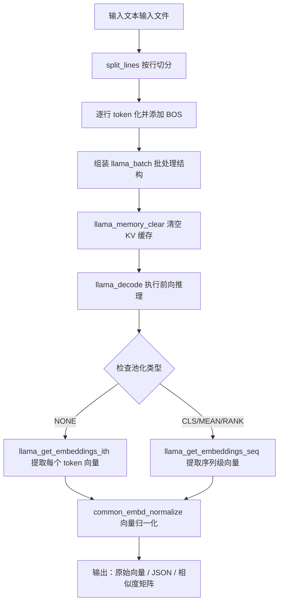
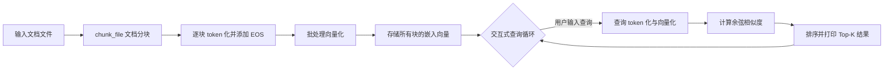
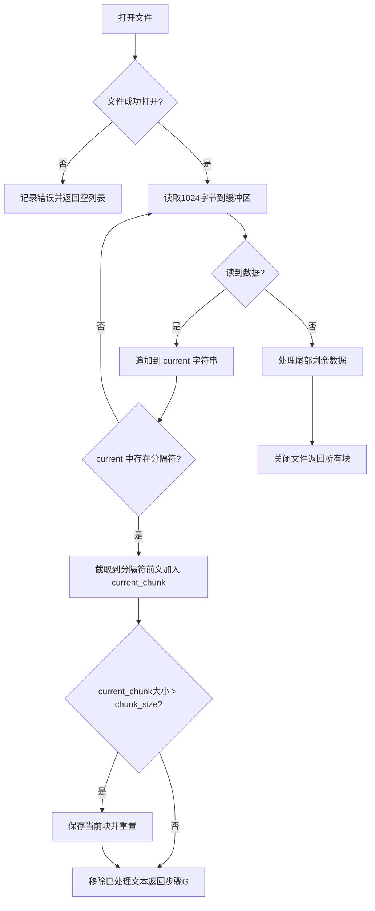
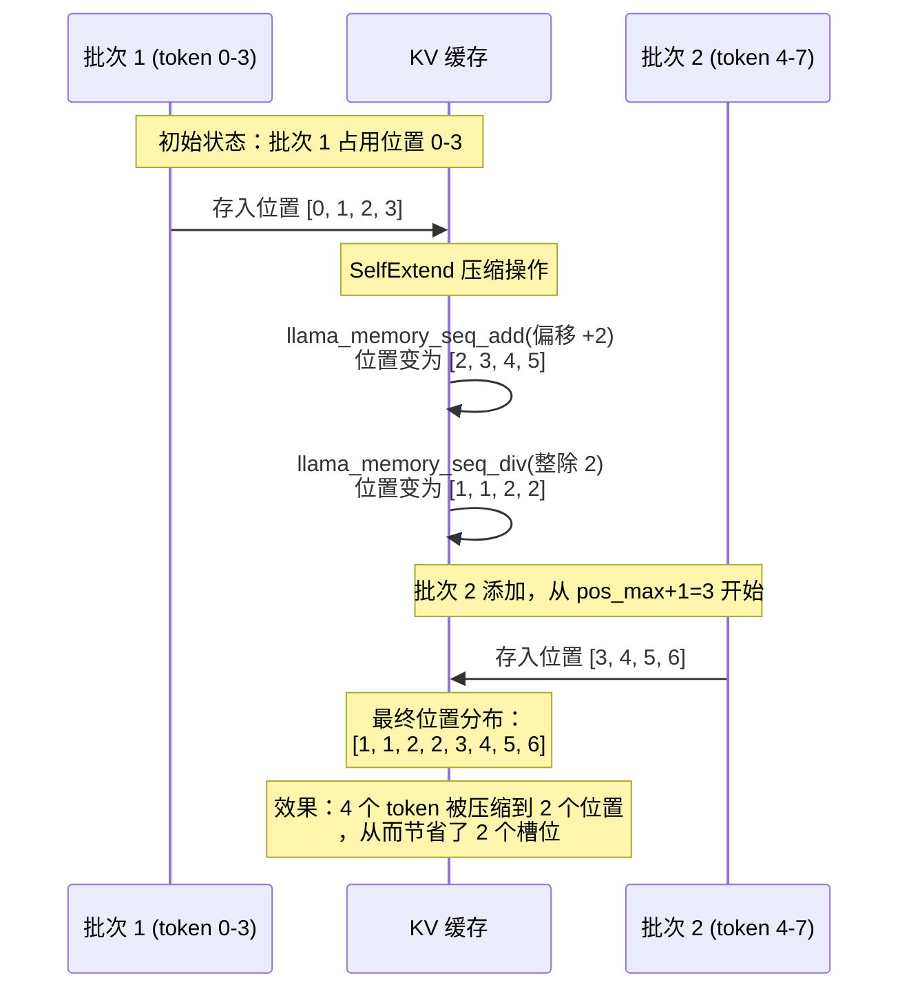

# 第94章 语义理解与检索 —— 嵌入计算、语义检索与上下文扩展的实现原理

在之前的章节中，我们已经深入学习了 llama.cpp 的核心推理引擎、模型加载、内存管理等底层机制。现在，让我们把这些知识串联起来，探索一个真正改变 AI 应用形态的能力——**语义理解与检索**。本章将带你剖析三个极具代表性的示例程序：`embedding.cpp`（文本嵌入计算）、`retrieval.cpp`（语义检索系统）和 `passkey.cpp`（长上下文压力测试），它们共同构成了向量世界的“语义罗盘”。

## 学习目标

- 理解文本嵌入的完整计算流程——从原始文本到向量表示
- 掌握多种池化策略（NONE、RANK、CLS、MEAN）的实现差异与应用场景
- 深入 llama_batch 批处理机制，实现多序列并行嵌入计算
- 掌握向量归一化（L2/L∞）与余弦相似度计算的工程实现
- 理解简易 RAG 系统的骨架：文档分块 → 向量化 → 相似度检索
- 剖析 SelfExtend 技术如何通过位置映射压缩突破上下文长度限制
- 掌握 KV 缓存的动态管理策略：llama_memory_seq_add/div/rm 的协同使用

## 94.1 生活类比

想象 llama.cpp 的嵌入与检索系统是一个**大型图书馆的智能化改造**。在这个图书馆里，`embedding.cpp` 是图书的“语义编码室”，每本书（文本）经过处理，得到一个“语义身份证”（向量），这个身份证用数字精确描述了书籍的主题、风格和内容倾向。而池化策略就是生成身份证时所采用的规则——当我们决定到底是为每一页都生成一个独立的页码标签，还是只摘取目录页的摘要，又或者综合全书内容提炼出一个概括性的关键词列表时，我们实质上是在选择信息的抽象粒度。NONE 策略相当于逐页贴标签，每一页形成一个独立的向量，保真度最高但存储量大；CLS 策略则只关注扉页上那句精心撰写的概括性题词，用首 token 代表全书，简洁却可能忽略细节；MEAN 策略是将全书每页的关键词取一个“平均印象”，得到一个平衡各方观点、不偏不倚的总结性向量，适合表达综合性主题；RANK 策略则有如图书馆员按预设的十大分类法为书籍评级归档，它依据一个训练好的分类器给出一个类别判别向量，这在信息分类和排序任务中尤为高效。

有了“语义身份证”之后，`retrieval.cpp` 就扮演了智能检索台的角色。当你提出一个问题时，系统先把问题也编码成向量，然后在整个图书馆中寻找“最近邻”的书籍段落。这里的**余弦相似度**就是语义距离的量尺，两个向量的夹角越小，说明语义越接近，就像老祖宗说的“物以类聚，人以群分”。而 `passkey.cpp` 则是一场“大海捞针”的极限测试，在 250 条无关新闻中藏入一条密码，看模型能否在“记忆宫殿”中准确定位。

SelfExtend 技术就像一个**聪明的图书管理员**：当书架（上下文）不够长时，他把旧书按“每 n 本合并一格”的方式压缩摆放，让有限的空间容纳更多的知识，同时保证最近的书（位置信息）仍然完整可寻。这种巧妙的折中，让我们在有限的硬件资源下，依然能够处理超长序列。在接下来的 93.3、93.4、93.5 节中，我们将多次回扣这些类比——当看到“语义身份证”的生成细节时，请联想到图书馆的编码室；当看到“智能检索台”的排序逻辑时，请联想到检索台的查询过程；当看到 SelfExtend 的位置压缩时，请联想到管理员那“压缩书架”的整理哲学；当看到 passkey 测试时，请将“记忆宫殿”中的寻宝挑战牢记于心。

## 94.2 源码地图

```
examples/embedding/embedding.cpp
├── 辅助函数
│   ├── split_lines()              # 按分隔符拆分多行文本输入
│   ├── batch_add_seq()            # 将 token 序列填入 llama_batch
│   ├── batch_decode()             # 核心：执行推理 + 提取嵌入 + 归一化
│   └── print_raw_embeddings()     # 格式化输出向量（支持精度控制）
├── __main__ 函数
│   ├── 参数解析与模型加载
│   ├── 分词与批处理组织
│   ├── llama_decode() 推理执行
│   ├── 池化类型分支处理（NONE / RANK / CLS / MEAN）
│   └── 结果输出（原生向量 / JSON / 相似度矩阵）

examples/retrieval/retrieval.cpp
├── 数据结构
│   └── struct chunk               # 文档块：filename/filepos/textdata/tokens/embedding
├── 辅助函数
│   ├── print_usage()              # 打印使用示例与参数说明
│   ├── chunk_file()               # 按分隔符/固定大小智能分块
│   ├── batch_add_seq()            # 将 token 序列填入批量结构
│   └── batch_process()            # 推理 + 提取 + L2 归一化
├── __main__ 函数
│   ├── 参数解析 --chunk-size --chunk-separator
│   ├── 模型加载（强制要求 embedding 模式）
│   ├── 全库文档向量化与内存缓存
│   ├── 交互式查询循环
│   └── common_embd_similarity_cos() 余弦相似度排序

examples/passkey/passkey.cpp
├── print_usage()                  # 使用说明
├── main()                         # 主函数：SelfExtend 上下文扩展与 passkey 提取
│   ├── 合成提示词生成
│   │   ├── prompt_prefix + n_junk 填充文本
│   │   ├── 随机位置 i_pos 插入 passkey
│   │   └── prompt_suffix 收尾
│   ├── SelfExtend 参数计算
│   │   ├── n_ctx = n_ctx_train * n_grp + n_keep
│   │   └── n_batch_grp = n_batch / n_grp
│   ├── KV 缓存填充阶段
│   │   ├── 常规批处理填充
│   │   └── SelfExtend 模式：llama_memory_seq_add() + seq_div()
│   ├── KV 缓存移位阶段
│   │   └── llama_memory_seq_rm() + seq_add() 释放空间
│   └── 贪心采样循环验证 passkey 提取
```

## 94.3 文本嵌入计算——从文本到向量的“转换工厂”

### 94.3.1 流程图：文本嵌入处理管线

在深入代码细节之前，我们先从一个宏观的角度理解 `embedding.cpp` 的完整工作流程。整个处理管线可以形象地比喻为前述图书馆中的“语义编码室”流水线：每本“书”（文本行）进来，经过切分、扫描、编码、归档，最终生成一张标准化的“语义身份证”（向量）。下图展示了从原始文本到最终嵌入向量的处理管线：



这张流程图清晰地展示了嵌入计算的三个核心阶段：**数据准备**（切分与分词）、**批量推理**（一次解码多序列）、**后处理**（提取与归一化）。接下来，我们将逐一剖析每个阶段的具体实现。值得注意的是，这个流程与图书馆编码室的工作流程一一对应：切分对应“拆书”，分词对应“扫描文字”，批量推理对应“批量编码”，后处理对应“统一格式归档”。

### 94.3.2 `llama_batch` 与 `llama_pooling_type`：理解核心数据结构

在深入 `batch_decode()` 之前，我们先理解它的两个关键输入：`llama_batch` 结构和池化类型 `llama_pooling_type`。它们是嵌入计算的“设计图纸”，决定了“语义身份证”的最终格式。

源码路径：`examples/embedding/embedding.cpp` - `llama_batch` 与 `llama_pooling_type`（定义于 `include/llama.h`，第 533-542 行与第 138-144 行）

```cpp
// llama_batch 结构体：批量推理的数据容器（定义于 include/llama.h）
struct llama_batch {
    int32_t n_tokens;                // 批次中的 token 总数
    llama_token  * token;            // token ID 数组
    float        * embd;             // 嵌入输入（可选，与 token 二选一）
    llama_pos    * pos;              // 位置 ID 数组
    llama_seq_id * seq_id;           // 序列 ID 数组
    int8_t       * logits;           // 标志位：是否需要该位置的 logits/嵌入
};

// 池化类型枚举：决定如何从 token 嵌入中提取序列嵌入（定义于 include/llama.h）
enum llama_pooling_type {
    LLAMA_POOLING_TYPE_UNSPECIFIED = -1,  // 未指定
    LLAMA_POOLING_TYPE_NONE = 0,          // 逐 token 返回嵌入
    LLAMA_POOLING_TYPE_MEAN = 1,          // 对所有 token 取平均
    LLAMA_POOLING_TYPE_CLS  = 2,          // 返回首 token（[CLS]）的嵌入
    LLAMA_POOLING_TYPE_LAST = 3,          // 返回最后一个 token 的嵌入
    LLAMA_POOLING_TYPE_RANK = 4           // 返回分类头的输出
};
```

`llama_batch` 是连接用户输入与模型推理的桥梁，它允许我们在一次 `llama_decode` 调用中同时处理多个序列（通过不同的 `seq_id`）或多个 token。而池化类型则是一个“语义压缩策略”的选择器：NONE 模式保留每个 token 的完整信息（主要用于需要细粒度 token 表示的任务），CLS/MEAN 模式则将整个序列压缩为一个固定维度的向量（适用于句子相似度、文档分类等场景）。`batch_decode()` 函数会根据 `llama_pooling_type(ctx)` 的返回值动态调整嵌入的提取方式，这是理解后续代码的关键。

这段代码解说了两个核心数据结构的设计意图：`llama_batch` 如同图书馆编码室里的“传送带”，可以同时运送多本书；而 `llama_pooling_type` 则如同“身份证格式选择器”，决定了每本书最终输出何种形式的语义摘要。

### 94.3.3 `split_lines()`：文本切分的“第一道工序”

在向量化的流水线上，第一道工序就是将原始的文本块拆分成独立的单元（行）。`split_lines()` 函数就是这个简单的切分工具，相当于图书馆中将一堆杂乱的稿件按行分拣到不同工位。

源码路径：`examples/embedding/embedding.cpp` - `split_lines()`（第 11-23 行）

```cpp
// 定义一个静态函数，用于按指定分隔符拆分字符串
static std::vector<std::string> split_lines(const std::string & s, const std::string & separator = "\n") {
    // 存储拆分后的字符串片段
    std::vector<std::string> lines;
    // 从字符串开头开始搜索
    size_t start = 0;
    // 查找第一个分隔符的位置
    size_t end = s.find(separator);

    // 只要还能找到分隔符，就持续循环
    while (end != std::string::npos) {
        // 截取 start 到 end 之间的子串作为一个片段，并添加到结果集
        lines.push_back(s.substr(start, end - start));
        // 更新 start 到分隔符之后的位置，继续搜索
        start = end + separator.length();
        // 从新的起点开始查找下一个分隔符
        end = s.find(separator, start);
    }

    // 处理最后一段：从最后一个分隔符之后到字符串末尾
    lines.push_back(s.substr(start)); // Add the last part

    // 返回拆分后的所有行
    return lines;
}
```

这段代码实现了一个典型的字符串拆分算法。它通过 `std::string::find` 循环查找分隔符，每次找到一个分隔符就截取其之前的子串并加入结果向量，然后移动搜索起点继续查找，最终在循环结束后将剩余的部分也加入结果。这段代码定义了一个高效的文本行切分器，它接受一个长文本字符串和分隔符（默认是换行符），返回一个字符串向量，其中每个元素是一行独立的文本，这为后续将每行文本转化为独立语义向量奠定了基础。这段代码解说了切分算法的三个关键点：一是循环不变量（`start` 始终指向未处理部分的起点）；二是边界处理（最后一段通过循环外的 `push_back` 补齐）；三是分隔符长度感知（`separator.length()` 支持多字符分隔符）。

### 94.3.4 `batch_add_seq()`：序列组装的“传送带”

在将文本行分词后，我们需要将这些 token 序列有序地送入批处理结构。`batch_add_seq()` 就是这个“传送带”，将切分好的“书页”按顺序送入编码工位。

源码路径：`examples/embedding/embedding.cpp` - `batch_add_seq()`（第 25-30 行）

```cpp
// 静态函数：将一组 token 组装为一个序列并添加到批次中
static void batch_add_seq(llama_batch & batch, const std::vector<int32_t> & tokens, llama_seq_id seq_id) {
    // 获取 token 序列的长度
    size_t n_tokens = tokens.size();
    // 遍历序列中的每个 token
    for (size_t i = 0; i < n_tokens; i++) {
        // 将 token 添加到批次中，位置 ID 为 i（序列内部偏移），指定序列 ID，并设置 logits 标志为 true
        common_batch_add(batch, tokens[i], i, { seq_id }, true);
    }
}
```

`batch_add_seq()` 函数的核心逻辑非常简洁：它遍历输入 token 序列，将每个 token 通过 `common_batch_add()` 添加到 `llama_batch` 结构中。关键是三个参数：`i` 作为位置 ID（在同一序列内从 0 递增）、`{ seq_id }` 用于区分不同序列、`true` 表示需要计算该位置的 logits。值得注意的是，它的实现与 retrieval.cpp 中的同名函数几乎一致，但后续主函数会在填完整个序列后，将除最后一个 token 外的 `logits` 标志重置为 `false`，以节省计算量。这段代码解说了一个重要的性能优化思路：虽然这里对所有 token 都设置了 `logits=true`，但调用者会在后续将其中的绝大部分重置为 `false`，这是一种“先全开、再精关”的策略，简化了函数接口的同时保证了灵活性。

### 94.3.5 `batch_decode()`：嵌入计算的“核心流水线”

`batch_decode()` 是整个示例的心脏，它串联起了推理、嵌入提取和归一化三个关键步骤。如果把嵌入计算比作图书馆的“语义编码室”，那么 `batch_decode()` 就是那条最核心的编码流水线，将原始文本最终转化为标准化的“语义身份证”。

源码路径：`examples/embedding/embedding.cpp` - `batch_decode()`（第 32-63 行）

```cpp
// 定义批处理解码函数：执行推理并提取所有序列的嵌入向量
static void batch_decode(llama_context * ctx, llama_batch & batch, float * output, int n_seq, int n_embd_out, int embd_norm) {
    // 从上下文中获取当前模型的池化类型（这是关键的“语义压缩策略”）
    const enum llama_pooling_type pooling_type = llama_pooling_type(ctx);

    // 清除之前的 KV 缓存值（对于嵌入计算，历史上下文是无关紧要的）
    llama_memory_clear(llama_get_memory(ctx), true);

    // 运行模型，执行前向计算
    LOG_INF("%s: n_tokens = %d, n_seq = %d\n", __func__, batch.n_tokens, n_seq);
    if (llama_decode(ctx, batch) < 0) {
        // 如果解码失败，记录错误信息（简化处理，未退出）
        LOG_ERR("%s : failed to process\n", __func__);
    }

    // 遍历批次中的每个 token，提取嵌入
    for (int i = 0; i < batch.n_tokens; i++) {
        // 跳过那些不需要计算 logits 的 token（设计上只对每个序列的最后一个 token 置 true）
        if (!batch.logits[i]) {
            continue;
        }

        // 嵌入向量指针，初始为空
        const float * embd = nullptr;
        // 嵌入对应的位置（可能是 token 索引或序列 ID）
        int embd_pos = 0;

        // 根据池化类型决定嵌入的提取方式
        if (pooling_type == LLAMA_POOLING_TYPE_NONE) {
            // 对于逐 token 池化：获取第 i 个 token 的嵌入
            embd = llama_get_embeddings_ith(ctx, i);
            // 嵌入位置就是 token 在批次中的索引
            embd_pos = i;
            // 断言嵌入不为空（否则触发断言错误）
            GGML_ASSERT(embd != NULL && "failed to get token embeddings");
        } else {
            // 对于序列级池化（CLS/MEAN/RANK）：获取序列的嵌入
            embd = llama_get_embeddings_seq(ctx, batch.seq_id[i][0]);
            // 嵌入位置就是序列 ID
            embd_pos = batch.seq_id[i][0];
            // 断言嵌入不为空（否则触发断言错误）
            GGML_ASSERT(embd != NULL && "failed to get sequence embeddings");
        }

        // 计算输出缓冲区中该嵌入的起始偏移量
        float * out = output + embd_pos * n_embd_out;
        // 将原始嵌入归一化后写入输出缓冲区，norm=0 表示不归一化，1 表示 L2 归一化，2 表示 L∞ 归一化
        common_embd_normalize(embd, out, n_embd_out, embd_norm);
    }
}
```

这段代码是整个嵌入计算的核心流水线。它首先清空 KV 缓存（避免历史 token 干扰），然后执行一次前向传播。关键的分支在于池化类型：如果是 `NONE`（逐 token），则使用 `llama_get_embeddings_ith()` 获取每个 token 的向量；否则（CLS/MEAN/RANK），使用 `llama_get_embeddings_seq()` 获取序列级别的汇总向量。最后，通过 `common_embd_normalize()` 对向量进行归一化，为后续的相似度计算做好准备。这里 `batch.logits[i]` 扮演了“输出开关”的角色——我们只在每个序列的最后一个 token 上设置 `logits=true`，从而只提取该位置的最终状态，巧妙地减少了不必要的计算。

这段代码解说了 `batch_decode()` 的四个设计要点：一是“清空缓存”保证了每个序列的独立性；二是“双入口提取”适配了不同的池化策略；三是“logits 开关”实现了精准的算力分配；四是“原地归一化”避免了额外的内存拷贝。它与图书馆编码流水线的对应关系是：清空缓存如同清理工作台，前向传播如同扫描全书，提取嵌入如同生成身份证照片，归一化如同将照片统一尺寸。

**为什么需要 `llama_memory_clear()`？**

对于嵌入计算，我们每次解码都是独立的，不需要依赖任何历史 token 的 KV 状态（KV 缓存存储了注意力机制中的 Key 和 Value）。如果不清除，上一个批次的状态会污染下一个批次的计算。而文本生成场景则需要保留历史 KV 来避免重复计算，因此不能清除。这是两类任务的本质差异。如同图书馆的编码室，每次编码新书前必须清空工作台，否则上一本书的碎片会混入下一本书的编码结果。

### 94.3.6 `__main__`：全局流程的“指挥中心”

`__main__` 函数将所有的辅助函数组织成一个完整的流水线。由于代码较长，我们将其拆分为三个逻辑片段进行分析。

**片段一：参数解析与模型初始化**

源码路径：`examples/embedding/embedding.cpp` - `__main__`（第 88-140 行）

```cpp
// 主函数入口
int main(int argc, char ** argv) {
    // 设置本地化环境，确保数字格式化使用小数点
    std::setlocale(LC_NUMERIC, "C");

    // 初始化公共参数对象
    common_params params;

    // 执行公共初始化（设置默认日志级别等）
    common_init();

    // 解析命令行参数，如果解析失败则退出
    if (!common_params_parse(argc, argv, params, LLAMA_EXAMPLE_EMBEDDING, print_usage)) {
        return 1;
    }
    // 强制启用嵌入模式
    params.embedding = true;

    // 初始化 llama 后端（这可能涉及设置 BLAS 库等）
    llama_backend_init();
    // 初始化 NUMA 内存管理策略（可选）
    llama_numa_init(params.numa);

    // 根据公共参数初始化模型和上下文
    auto llama_init = common_init_from_params(params);
    // 获取原始模型指针
    auto * model = llama_init->model();
    // 获取原始上下文指针
    auto * ctx   = llama_init->context();

    // 检查模型是否成功加载
    if (model == NULL) {
        LOG_ERR("%s: unable to load model\n", __func__);
        return 1;
    }
    // 获取模型的词汇表
    const llama_vocab * vocab = llama_model_get_vocab(model);

    // 获取模型的训练上下文窗口大小（这是模型能处理的原始 token 数上限）
    const int n_ctx_train = llama_model_n_ctx_train(model);
    // 获取当前上下文的实际窗口大小
    const int n_ctx = llama_n_ctx(ctx);
    // 判断输入的上下文是否超过了模型的训练上限
    if (n_ctx > n_ctx_train) {
        LOG_WRN("%s: warning: model was trained on only %d context tokens (%d specified)\n",
                __func__, n_ctx_train, n_ctx);
    }

    // 获取池化类型（这决定了嵌入的提取策略，是后续逻辑的分支依据）
    const enum llama_pooling_type pooling_type = llama_pooling_type(ctx);
    // 打印当前使用的池化方式
    LOG_INF("pooling_type: %d\n", (int) pooling_type);

    // 打印系统信息（CPU/GPU 能力等）
    LOG_INF("%s\n", common_params_get_system_info(params).c_str());

    // 获取批处理大小和嵌入输出维度
    const uint64_t n_batch = params.n_batch;
    const int n_embd_out = llama_model_n_embd_out(model);
```

这段代码负责程序的初始化工作：解析命令行参数、初始化后端、加载模型与上下文，并获取关键配置信息（池化类型、批大小、嵌入维度）。这些信息将直接指导后续的批处理组装与嵌入提取。这段代码解说了初始化阶段的三个关键决策：一是强制设置 `embedding=true` 确保模型以嵌入模式运行；二是获取池化类型作为后续分支的判断依据；三是提取嵌入维度以正确分配输出缓冲区。

**片段二：批处理组装与推理**

源码路径：`examples/embedding/embedding.cpp` - `__main__`（第 142-190 行）

```cpp
    // 读取输入文件，获取多行文本
    std::vector<std::string> lines = split_lines(params.prompt);
    // 记录总共有多少行文本（每个序列）
    const int n_seq = lines.size();

    // 初始化 llama_batch 结构体，参数：最大 token 数，是否使用嵌入输入，最大序列数
    struct llama_batch batch = llama_batch_init(n_batch, 0, n_seq);

    // 为所有序列的输出分配内存空间 (n_seq * n_embd_out 个 float)
    std::vector<float> output(n_seq * n_embd_out, 0);
    // 获取输出缓冲区的指针
    float * out = output.data();

    // 遍历每一行文本（每个序列）
    for (int k = 0; k < n_seq; k++) {
        // 将文本 token 化（添加 BOS 标记）
        auto inp = common_tokenize(ctx, lines[k], true);
        // 如果 token 化结果超过了批处理大小，则报错并退出
        if (inp.size() > n_batch) {
            LOG_ERR("%s: line %d is too long\n", __func__, k);
            return 1;
        }
        // 将 token 序列添加到批次中，并标记最后一个 token 需要输出 logits
        batch_add_seq(batch, inp, k);
        // 设置最后一个 token 的 logits 标志为 true（只需提取此位置的嵌入）
        batch.logits[batch.n_tokens - 1] = true;
    }

    // 统计批处理中 token 的总数和序列的总数
    LOG_INF("n_tokens = %d, n_seq = %d\n", batch.n_tokens, batch.n_tokens ? batch.n_tokens : n_seq);

    // 调用核心函数执行推理、提取嵌入并归一化
    batch_decode(ctx, batch, out, n_seq, n_embd_out, params.embd_normalize);
```

在这段代码中，我们完成了三个关键步骤：**文本切分**（按行拆分输入）、**批处理组装**（逐行 token 化并打包进 `llama_batch`）和**核心推理**（调用 `batch_decode()` 执行前向传播并提取嵌入）。特别注意 `batch_add_seq()` 之后的 `batch.logits[batch.n_tokens - 1] = true;`，这确保了每个序列只提取最后一个 token 的状态，这是高效利用算力的关键设计。这段代码解说了“一序列一行”的设计哲学：每个输入行被视为独立的语义单元，通过一次推理并行计算所有行的嵌入，并在每个序列仅保留最后一个 token 的 logits，这种“一序列一提取”的模式大幅减少了计算量。

**片段三：结果输出**

源码路径：`examples/embedding/embedding.cpp` - `__main__`（第 192-292 行）

```cpp
    // 定义用于存储句子嵌入的向量
    std::vector<float> sentence_emb(n_embd_out, 0);
    // 根据参数决定输出格式：0 表示原生向量，1 表示 JSON，2 表示相似度矩阵
    if (params.embd_out == 0) {
        // 调用辅助函数打印原始嵌入
        print_raw_embeddings(out, n_seq, n_embd_out, model, pooling_type, params.embd_normalize);
    } else if (params.embd_out == 1) {
        // 以 JSON 格式输出，遍历每个序列的嵌入
        for (int j = 0; j < n_seq; ++j) {
            // 将浮点数组转换为 vector 方便格式化输出
            std::vector<float> emb(out + j * n_embd_out, out + (j + 1) * n_embd_out);
            // 打印 JSON 格式的嵌入向量
            LOG("%s\"%s\": [", (j == 0 ? "" : ", "), lines[j].c_str());
            // 拼接向量元素（短向量完整输出，长向量节省空间）
            for (int i = 0; i < (int) emb.size(); ++i) {
                LOG("%s%.6f", (i == 0 ? "" : ", "), emb[i]);
            }
            LOG("]");
        }
        LOG("\n");
    } else {
        // 计算序列间的余弦相似度矩阵
        for (int i = 0; i < n_seq; i++) {
            LOG("\n");
            // 逐对计算相似度
            for (int j = 0; j < n_seq; j++) {
                // 提取两个序列的嵌入
                auto emb1 = std::vector<float>(out + i * n_embd_out, out + (i + 1) * n_embd_out);
                auto emb2 = std::vector<float>(out + j * n_embd_out, out + (j + 1) * n_embd_out);
                // 计算余弦相似度并打印
                float sim = common_embd_similarity_cos(emb1.data(), emb2.data(), n_embd_out);
                LOG("%8.6f ", sim);
            }
            LOG("\n");
        }
    }
    // 返回成功
    return 0;
}
```

最后，程序根据用户指定的输出格式（`--embd-out` 参数）将嵌入以原始向量、JSON 或相似度矩阵的形式展示给用户。原始向量模式适合后续处理；JSON 模式便于与现代 Web 服务集成；相似度矩阵模式则直观地展示了输入文本之间的语义关联强度，对角线上的值通常接近 1.0（完全相似），非对角线值越低表示语义差异越大。这段代码解说了三种输出模式各自的应用场景：原始向量是“机器可读”的连续内存块；JSON 是“网络可传”的结构化文本；相似度矩阵是“人眼可看”的语义关系网格。

### 94.3.7 `print_raw_embeddings()`：格式化输出的“排版工”

在结果输出阶段，如果用户选择原生向量模式（`--embd-out 0`），`print_raw_embeddings()` 便负责将浮点数组排布成对齐的文本格式，让“语义身份证”以人类可读的方式展示出来。这个函数是连接机器计算结果与人类观察之间的“排版工”。

源码路径：`examples/embedding/embedding.cpp` - `print_raw_embeddings()`（第 66-86 行）

```cpp
// 定义静态函数：以纯文本形式打印所有嵌入向量
static void print_raw_embeddings(const float * emb,
                                 int n_embd_count,
                                 int n_embd,
                                 const llama_model * model,
                                 enum llama_pooling_type pooling_type,
                                 int embd_normalize) {
    // 获取分类头的输出维度（仅用于 RANK 池化）
    const uint32_t n_cls_out = llama_model_n_cls_out(model);
    // 检查是否为 RANK 池化模式
    const bool is_rank = (pooling_type == LLAMA_POOLING_TYPE_RANK);
    // RANK 模式只打印前 n_cls_out 个值（分类得分），其余模式打印完整的 n_embd 个维度
    const int cols = is_rank ? std::min<int>(n_embd, (int) n_cls_out) : n_embd;

    // 遍历每个序列的嵌入向量
    for (int j = 0; j < n_embd_count; ++j) {
        // 遍历当前向量的每个维度
        for (int i = 0; i < cols; ++i) {
            if (embd_normalize == 0) {
                // 未归一化时，使用整数格式打印（%1.0f）
                LOG("%1.0f%s", emb[j * n_embd + i], (i + 1 < cols ? " " : ""));
            } else {
                // 归一化后，使用高精度浮点格式打印（%1.7f）
                LOG("%1.7f%s", emb[j * n_embd + i], (i + 1 < cols ? " " : ""));
            }
        }
        // 完成一个序列的打印后换行
        LOG("\n");
    }
}
```

这段代码解说了 `print_raw_embeddings()` 的三个设计细节：一是通过 `n_cls_out` 和 `is_rank` 判断是否裁剪输出列数，避免 RANK 模式下打印过多的无意义分数；二是根据是否归一化选择不同的精度格式，未归一化值可能很大（如 5.23）而归一化值总在 [-1, 1] 区间，需要保留更多小数位；三是每个序列独占一行，便于人类快速扫描多行嵌入结果。这样，用户就能以文本形式清晰地查看每行文本对应的“语义身份证”各个维度的数值。

此外，`common_embd_normalize()` 对向量进行 L2 归一化（默认），将其缩放为单位长度（模长为 1）。这使得两个向量之间的余弦相似度可以简化为它们的点积，极大简化了计算，并消除了向量长度对相似度的影响，让我们可以纯粹比较向量方向的差异，即语义的差异。

## 94.4 语义检索系统——向量空间的“智能检索台”

如果说 `embedding.cpp` 是一个生成“语义身份证”的工厂，那么 `retrieval.cpp` 就是一个基于这些身份证的智能检索台。它的核心思想是**文档分块 → 向量化 → 查询 → 余弦相似度排序**。这种模式是如今大模型应用中最基础的 RAG（检索增强生成）骨架。

用一个简单的话来说：我们不再需要模型“记住”所有知识，而是先将一个庞大的文档库向量化并存储在内存中，当用户提出问题时，我们只需要将问题和所有文档块进行快速匹配，挑出最相关的一小部分文档，再交给模型去阅读并生成答案。这种方式不仅大大降低了对模型上下文窗口的要求，还能让模型基于最新的、私有的数据回答问题。回顾 93.1 中的“智能检索台”类比，这里的每个文档块就对应书架上的一本“书”，而查询向量就是读者递上的“需求描述”，余弦相似度就是检索台按语义相关性排出的推荐顺序。

### 94.4.1 流程图：文档向量化与交互式查询循环

`retrieval.cpp` 的完整流程可以用下图概括。这个流程与图书馆检索台的运作方式高度一致：书籍预先编目（文档向量化），读者提交查询（用户输入），检索台比对索引进而推荐最相关的书目（相似度排序）。图中上半部分展示了文档入库时的预处理，下半部分展示了实时查询的反馈循环：



这张流程图揭示了检索系统的核心设计思想：**文档的向量化是离线预处理**（对应图书馆的“编目上架”），而查询的向量化是实时计算（对应“读者查询”）。这种分离使得查询阶段的响应速度极快，因为不需要重新扫描全文。

### 94.4.2 `struct chunk`：文档块的“标准集装箱”

在向量检索系统中，文档不是以原始文本进行匹配的，而是被切分成许多“块”（chunk），每个块都可以独立计算相似度。这个结构体就像图书馆中一个个装载着“书页”的标准集装箱，每只箱子上都贴有来源标签和位置信息。

源码路径：`examples/retrieval/retrieval.cpp` - `chunk`（第 21-28 行）

```cpp
// 定义一个数据结构来表示文档中的一个“块”（chunk）
struct chunk {
    // 该块来自哪个文件
    std::string filename;
    // 该块在文件中的偏移位置（用于追溯原文）
    int64_t filepos;
    // 该块的原始文本内容
    std::string textdata;
    // 该块文本的 token 序列
    std::vector<int32_t> tokens;
    // 该块的嵌入向量（推理后填充）
    std::vector<float> embedding;
};
```

这个结构体是检索系统的基础单元，它像一个“标准集装箱”一样，将一段文本及其所有相关的元数据（来源、位置）和派生数据（tokens、embedding）打包在一起。当我们需要构建一个检索索引时，我们首先将文档切割成多个这种“集装箱”，然后逐一为其计算“语义地址”（embedding）。这段代码解说了 `chunk` 的五字段设计哲学：`filename` 和 `filepos` 提供溯源能力（回答“这段内容来自哪里”），`textdata` 保留原始文本（用于追溯原文或最终展示），`tokens` 是中间产物（用于推理后即可清除以节省内存），`embedding` 是最终产品（用于后续检索）。这种“元数据+文本+派生数据”的结构是向量检索系统的通用模式。

### 94.4.3 `print_usage()`：使用说明的“导航员”

源码路径：`examples/retrieval/retrieval.cpp` - `print_usage()`（第 16-19 行）

```cpp
// 辅助函数：打印程序的使用示例
static void print_usage(int, char ** argv) {
    // 输出一个空行分隔
    LOG("\nexample usage:\n");
    // 输出具体的使用示例，指导用户如何运行检索功能
    LOG("\n    %s --model ./models/bge-base-en-v1.5-f16.gguf --top-k 3 --context-file README.md --context-file License --chunk-size 100 --chunk-separator .\n", argv[0]);
    // 输出空行
    LOG("\n");
}
```

这个函数为使用者在参数解析失败时提供了清晰的使用指南。它展示了一个标准的调用范例：加载一个 BERT 嵌入模型（如 `bge-base-en-v1.5`），指定 `--top-k` 控制返回结果数量、`--context-file` 指定检索文档库、`--chunk-size` 控制分块大小、`--chunk-separator` 指定分隔符。用户可以通过复制此命令并替换自己的文件路径快速上手。这段代码解说了该函数的两个作用：一是作为参数解析失败时的“救命稻草”，二是作为新用户的“快速入门向导”，这与图书馆入口处的“使用说明”标牌异曲同工。

### 94.4.4 `chunk_file()`：文档切分的“智能裁纸刀”

`chunk_file()` 函数负责将长文档切分成合理大小的块，是检索系统预处理的第一步。这相当于图书馆中对厚重的书籍进行分册装订——每册既不能太薄（信息不完整），也不能太厚（主题混杂），并且尽量在章节边界（分隔符）处裁切。

源码路径：`examples/retrieval/retrieval.cpp` - `chunk_file()`（第 50-104 行）

```cpp
// 定义切分文件的静态函数
static std::vector<chunk> chunk_file(const std::string & filename, int chunk_size, const std::string & chunk_separator) {
    // 存储所有切分出来的块
    std::vector<chunk> chunks;
    // 打开文件
    std::ifstream f(filename.c_str());

    // 检查文件是否成功打开
    if (!f.is_open()) {
        LOG_ERR("could not open file %s\n", filename.c_str());
        return chunks;
    }

    // 初始化当前正在构建的块
    chunk current_chunk;
    // 缓冲区，每次读取 1024 字节
    char buffer[1024];
    // 记录当前块在原始文件中的起始偏移量
    int64_t filepos = 0;
    // 当前尚未处理的字符串
    std::string current;
    // 循环读取文件直到末尾
    while (f.read(buffer, 1024)) {
        // 将读入的数据追加到 current 字符串中
        current += std::string(buffer, f.gcount());
        // 当在 current 中找到分隔符时，循环切分
        size_t pos;
        while ((pos = current.find(chunk_separator)) != std::string::npos) {
            // 将分隔符（包含分隔符）之前的文本追加到当前块
            current_chunk.textdata += current.substr(0, pos + chunk_separator.size());
            // 如果当前块的大小超过了 chunk_size，则保存该块
            if ((int) current_chunk.textdata.size() > chunk_size) {
                // 记录该块在文件中的位置（此时的 filepos 是块的起点）
                current_chunk.filepos = filepos;
                // 记录文件名
                current_chunk.filename = filename;
                // 将完成的块加入最终结果集
                chunks.push_back(current_chunk);
                // 更新 filepos，指向下一个块的起点
                filepos += (int) current_chunk.textdata.size();
                // 重置 current_chunk，开始构建下一个块
                current_chunk = chunk();
            }
            // 移除已处理的文本，继续处理剩余部分
            current = current.substr(pos + chunk_separator.size());
        }
    }

    // 处理文件尾部的剩余数据，将其追加到最后一个块中
    if (current_chunk.textdata.size() > 0) {
        // 如果还没有任何块，则直接创建一个新块
        if (chunks.empty()) {
            current_chunk.filepos = filepos;
            current_chunk.filename = filename;
            chunks.push_back(current_chunk);
        } else {
            // 否则将剩余数据附加到最后一个块中，防止文本被截断
            chunks.back().textdata += current_chunk.textdata;
        }
    }
    // 关闭文件
    f.close();
    // 返回所有切分好的块
    return chunks;
}
```

`chunk_file()` 函数实现了“寻找分隔符并累积，超过阈值则切分”的策略。它通过一个缓冲区循环读取文件，使用 `find` 定位分隔符（如句号或换行），将分隔符及其之前的文本累积到当前块中。当累积的文本长度超过 `chunk_size` 时，这个块就被“封存”并加入结果列表。最后，文件末尾剩余的数据会被安全地附加到最后一个块中，确保不会有内容丢失。这个函数定义了文档的智能切分逻辑，它巧妙地将“按分隔符切分”与“按长度切分”结合在一起，在保证语义完整性的同时控制了块的大小，为后续的向量化处理准备了合适的输入。这段代码解说了 `chunk_file()` 的三个关键设计：一是“双 while 循环”结构实现了流式处理（外层读文件、内层切分），避免一次性加载整个文件；二是“先累积文本、再在达到阈值时封存”的两阶段策略，保证了切分点尽量在语义边界上；三是尾部数据的“兜底”处理确保了文档末尾的内容不会丢失。

为了更直观地理解 `chunk_file()` 的切分流程，我们可以用下面的流程图来描述其执行逻辑：



### 94.4.5 `batch_add_seq()`：检索系统的“序列组装器”

与 embedding.cpp 类似，retrieval.cpp 也有一个 `batch_add_seq()` 函数，用于将 token 序列填入批处理结构。它相当于检索台录入系统里的“扫码枪”，将每个“集装箱”上的 token 信息逐一录入待处理队列。

源码路径：`examples/retrieval/retrieval.cpp` - `batch_add_seq()`（第 107-111 行）

```cpp
// 静态辅助函数：将一组 token 及其对应的序列 ID 添加到给定的 llama_batch 结构中
static void batch_add_seq(llama_batch & batch, const std::vector<int32_t> & tokens, llama_seq_id seq_id) {
    // 获取 token 序列的长度
    size_t n_tokens = tokens.size();
    // 遍历序列中的每个 token
    for (size_t i = 0; i < n_tokens; i++) {
        // 将 token 添加到批次中，位置 ID 为 i（序列内部偏移），指定序列 ID，并设置 logits 标志为 true
        common_batch_add(batch, tokens[i], i, { seq_id }, true);
    }
}
```

该函数的实现与 embedding.cpp 中的同名函数相似，但其调用方式有所不同——检索的批处理中每个序列代表一个独立的文档块，且都标记 `logits=true`，因为我们需要从每个块中提取最终的嵌入向量。这种“一序列一块”的设计，配合 `llama_n_seq_max(ctx)` 的控制，让程序能够在一次推理中处理多个文档块，显著提升了吞吐量。这段代码解说了该函数的“全量标记”策略：与 embedding 中“先全开再精关”不同，这里每个 token 都需要 `logits=true`，因为文档块的嵌入提取需要在每个序列的最终位置获取完整的向量（由 `batch_process` 内部通过序列级池化实现），不需要像文本生成那样逐 token 采样。

### 94.4.6 `batch_process()`：检索系统的“向量引擎”

`batch_process()` 与 `embedding.cpp` 中的 `batch_decode()` 功能类似，但更专注于检索场景。它强制使用序列级嵌入（即非 NONE 池化），并对提取的向量进行 L2 归一化（`embd_norm=2` 通常表示 L2 归一化）。这相当于检索台服务器中对每个“集装箱”进行统一规格化处理，确保所有“语义身份证”都采用同一种标准格式。

源码路径：`examples/retrieval/retrieval.cpp` - `batch_process()`（第 113-139 行）

```cpp
// 定义一个静态函数，用于处理一个批次
static void batch_process(llama_context * ctx, llama_batch & batch, float * output, int n_seq, int n_embd) {
    // 清除之前的 KV 缓存值（对于嵌入计算，历史状态无关紧要）
    llama_memory_clear(llama_get_memory(ctx), false);

    // 运行模型进行推理
    LOG_INF("%s: n_tokens = %d, n_seq = %d\n", __func__, batch.n_tokens, n_seq);
    // 如果解码失败，打印错误消息
    if (llama_decode(ctx, batch) < 0) {
        LOG_ERR("%s : failed to process\n", __func__);
    }

    // 遍历批次中的所有 token
    for (int i = 0; i < batch.n_tokens; i++) {
        // 跳过那些不需要输出 logits 的 token
        if (!batch.logits[i]) {
            continue;
        }

        // 首先尝试获取序列嵌入（这要求池化类型不是 NONE）
        const float * embd = llama_get_embeddings_seq(ctx, batch.seq_id[i][0]);
        // 如果序列嵌入获取失败，则回退到获取 token 嵌入
        if (embd == NULL) {
            embd = llama_get_embeddings_ith(ctx, i);
            // 如果两种方式都失败，打印错误信息并跳过
            if (embd == NULL) {
                LOG_ERR("%s: failed to get embeddings for token %d\n", __func__, i);
                continue;
            }
        }

        // 根据序列 ID 计算输出缓冲区的偏移
        float * out = output + batch.seq_id[i][0] * n_embd;
        // 使用 L2 归一化将嵌入写入输出缓冲区（2 代表 L2 归一化）
        common_embd_normalize(embd, out, n_embd, 2);
    }
}
```

`batch_process()` 实现了一个至关重要的功能：它将 `llama_batch` 中混合的序列同时进行推理，并为每个序列提取一个归一化的嵌入向量。与 embedding 示例不同，这里的 L2 归一化是强制性的（`embd_norm=2`），这使得后续的余弦相似度计算可以直接简化为点积运算。它的“双保险”逻辑（先尝试序列嵌入，失败则回退到 token 嵌入）增加了程序的健壮性，确保即使遇到不支持序列池化的模型也能尽量给出结果。这段代码解说了 `batch_process()` 的“双保险设计”原因：某些模型可能未配置序列池化（`pooling_type` 为 NONE），此时 `llama_get_embeddings_seq()` 会返回 NULL，通过回退到 `llama_get_embeddings_ith()` 至少能提供一个 token 粒度的向量作为替代，尽管精度可能下降，但总比完全失败更好。

### 94.4.7 `__main__`：交互式检索的“主控台”

`__main__` 函数是检索系统的编排者，它组织整个流程：加载文档、向量化、启动查询循环。由于代码较长，我们将其拆分为四个逻辑片段进行分析。

**片段一：参数解析与文档分块**

源码路径：`examples/retrieval/retrieval.cpp` - `__main__`（第 119-155 行）

```cpp
// 主函数
int main(int argc, char ** argv) {
    // 设置本地化环境，确保数字格式化使用小数点
    std::setlocale(LC_NUMERIC, "C");
    // 初始化公共参数对象
    common_params params;
    // 执行公共初始化（设置默认日志级别等）
    common_init();
    // 解析命令行参数，如果解析失败则退出
    if (!common_params_parse(argc, argv, params, LLAMA_EXAMPLE_RETRIEVAL, print_usage)) {
        return 1;
    }

    // 对于 BERT 模型，批大小必须等于微批大小
    params.n_ubatch = params.n_batch;
    // 强制启用嵌入模式
    params.embedding = true;

    // 校验 chunk_size 参数，必须为正数
    if (params.chunk_size <= 0) {
        LOG_ERR("chunk_size must be positive\n");
        return 1;
    }
    // 校验 context_files 参数，至少要指定一个文件
    if (params.context_files.empty()) {
        LOG_ERR("context_files must be specified\n");
        return 1;
    }

    // 打印正在处理的文件列表
    LOG_INF("processing files:\n");
    for (auto & context_file : params.context_files) {
        LOG_INF("%s\n", context_file.c_str());
    }

    // 存储所有文档块的容器
    std::vector<chunk> chunks;
    // 遍历所有输入文件，将每个文件切分成块后合并
    for (auto & context_file : params.context_files) {
        // 调用 chunk_file() 将文件切分为块
        std::vector<chunk> file_chunk = chunk_file(context_file, params.chunk_size, params.chunk_separator);
        // 将当前文件的所有块合并到总容器中
        chunks.insert(chunks.end(), file_chunk.begin(), file_chunk.end());
    }
    // 打印切的块总数
    LOG_INF("Number of chunks: %zu\n", chunks.size());
```

这段代码的主要任务是**参数校验与文档预处理**。它确保用户正确配置了检索系统的基本参数，并将输入的每个文件通过 `chunk_file()` 切分成独立块，合并到统一的 `chunks` 容器中。这段代码解说了三个前置条件的必要性：一是强制 `n_ubatch = n_batch` 是因为 BERT 类模型的特殊性；二是 `embedding = true` 确保模型输出的是嵌入而非 logits；三是 `chunk_size > 0` 和至少一个 `context_file` 的校验避免了后续运行时的潜在崩溃。

**片段二：模型加载与文档 token 化**

源码路径：`examples/retrieval/retrieval.cpp` - `__main__`（第 157-224 行）

```cpp
    // 初始化后端（BLAS 等）
    llama_backend_init();
    // 初始化 NUMA 内存管理策略（可选）
    llama_numa_init(params.numa);

    // 从公共参数初始化模型和上下文
    auto llama_init = common_init_from_params(params);
    // 获取模型指针
    auto * model = llama_init->model();
    // 获取上下文指针
    auto * ctx   = llama_init->context();

    // 检查模型是否加载成功
    if (model == NULL) {
        LOG_ERR("%s: unable to load model\n", __func__);
        return 1;
    }

    // 获取词汇表
    const llama_vocab * vocab = llama_model_get_vocab(model);

    // 获取模型的训练上下文大小
    const int n_ctx_train = llama_model_n_ctx_train(model);
    // 获取当前上下文大小
    const int n_ctx = llama_n_ctx(ctx);

    // 获取池化类型，并检查是否为 NONE（不允许）
    const enum llama_pooling_type pooling_type = llama_pooling_type(ctx);
    if (pooling_type == LLAMA_POOLING_TYPE_NONE) {
        LOG_ERR("%s: pooling type NONE not supported\n", __func__);
        return 1;
    }

    // 比较当前上下文与训练上下文的大小
    if (n_ctx > n_ctx_train) {
        LOG_WRN("%s: warning: model was trained on only %d context tokens (%d specified)\n",
                __func__, n_ctx_train, n_ctx);
    }

    // 打印系统信息
    LOG_INF("%s\n", common_params_get_system_info(params).c_str());

    // 获取最大批大小，并断言批大小必须大于等于上下文大小（对于 BERT 模型）
    const uint64_t n_batch = params.n_batch;
    GGML_ASSERT(params.n_batch >= params.n_ctx);

    // 对所有文档块进行 token 化并进行长度检查
    for (auto & chunk : chunks) {
        // 将文本 token 化（添加 BOS 标记）
        auto inp = common_tokenize(ctx, chunk.textdata, true, false);
        // 如果块的长度超过批大小，则报错，提示用户增加批大小
        if (inp.size() > n_batch) {
            LOG_ERR("%s: chunk size (%lld) exceeds batch size (%lld), increase batch size and re-run\n",
                    __func__, (long long int) inp.size(), (long long int) n_batch);
            return 1;
        }
        // 添加 EOS 标记（如果存在且未添加过）
        if (llama_vocab_eos(vocab) >= 0 && (inp.empty() || inp.back() != llama_vocab_eos(vocab))) {
            inp.push_back(llama_vocab_eos(vocab));
        }
        // 将 token 序列存入块结构
        chunk.tokens = inp;
    }
```

这段代码的核心是**模型加载与文档 token 化**。它强制要求池化类型不能是 NONE（因为我们需要序列级的语义表示），并将每个文档块进行 token 化处理，同时添加 EOS 标记确保序列边界清晰。这段代码解说了检索场景对池化类型的严格要求：`NONE` 池化无法提供块级别的摘要向量，而 `CLS` 或 `MEAN` 池化能将块内的多个 token 压缩为一个固定维度的语义“指纹”，这是后续相似度比较的基础。`GGML_ASSERT` 则确保了 BERT 模型对批处理的要求得到满足。

**片段三：批量向量化所有文档块**

源码路径：`examples/retrieval/retrieval.cpp` - `__main__`（第 226-281 行）

```cpp
    // 初始化批处理结构，注意：llama_batch_init 的第二个参数用于嵌入输入，这里设为 0（使用 token 输入）
    const int n_chunks = chunks.size();
    struct llama_batch batch = llama_batch_init(n_batch, 0, 1);

    // 分配嵌入输出缓冲区
    const int n_embd_out = llama_model_n_embd_out(model);
    std::vector<float> embeddings(n_chunks * n_embd_out, 0);
    float * emb = embeddings.data();

    // 分批处理所有块：p 是已处理的块数，s 是当前批次的块数
    unsigned int p = 0;
    unsigned int s = 0;
    for (int k = 0; k < n_chunks; k++) {
        // 获取当前块的 token 序列
        auto & inp = chunks[k].tokens;
        const uint64_t n_toks = inp.size();

        // 如果当前批次已满（token 数或序列数达到上限），则先处理该批次
        if (batch.n_tokens + n_toks > n_batch || s >= llama_n_seq_max(ctx)) {
            // 指向输出缓冲区中当前批次的起始位置
            float * out = emb + p * n_embd_out;
            // 处理当前批次，生成嵌入
            batch_process(ctx, batch, out, s, n_embd_out);
            // 清空批次，为下一个批次做准备
            common_batch_clear(batch);
            // 更新已处理的块数
            p += s;
            // 重置当前批次的块数
            s = 0;
        }

        // 将当前块（序列）添加到批次中
        batch_add_seq(batch, inp, s);
        // 增加当前批次的序列计数
        s += 1;
    }

    // 处理最后剩余的批次
    float * out = emb + p * n_embd_out;
    batch_process(ctx, batch, out, s, n_embd_out);

    // 将嵌入向量从连续缓冲区复制回各个 chunk 结构，并释放 token 以节省内存
    for (int i = 0; i < n_chunks; i++) {
        chunks[i].embedding = std::vector<float>(emb + i * n_embd_out, emb + (i + 1) * n_embd_out);
        chunks[i].tokens.clear();
    }
```

这段代码实现了**文档库的批量向量化**。它巧妙地将所有文档块按批次处理，每次处理的批次需要满足两个约束：token 总数不超过 `n_batch`，序列数不超过 `llama_n_seq_max(ctx)`。这种动态分批策略既保证了内存安全，又最大化利用了批处理的计算效率。向量化完成后，token 数据被清除以节省内存，只保留嵌入向量用于后续检索。这段代码解说了“动态分批”的调度策略：通过维护两个游标 `p`（已处理块数）和 `s`（当前批次块数），在满足容量约束的前提下尽可能多地填充批次，避免碎片化处理带来的性能损失；同时，向量化后立即清除 `tokens` 体现了“内存即资源”的工程理念。

**片段四：交互式查询循环**

源码路径：`examples/retrieval/retrieval.cpp` - `__main__`（第 283-343 行）

```cpp
    // 初始化查询批次
    struct llama_batch query_batch = llama_batch_init(n_batch, 0, 1);

    // 进入交互式查询循环
    std::string query;
    while (true) {
        // 提示用户输入查询
        LOG("Enter query: ");
        // 读取一行用户输入
        std::getline(std::cin, query);
        // 对查询进行 token 化
        std::vector<int32_t> query_tokens = common_tokenize(ctx, query, true);

        // 将查询作为序列 0 添加到批次中
        batch_add_seq(query_batch, query_tokens, 0);

        // 为查询向量分配空间
        std::vector<float> query_emb(n_embd_out, 0);
        // 处理查询批次，得到查询向量
        batch_process(ctx, query_batch, query_emb.data(), 1, n_embd_out);

        // 清空查询批次，为下一轮查询做准备
        common_batch_clear(query_batch);

        // 计算查询与所有文档块的余弦相似度
        {
            // 用于存储相似度结果的容器
            std::vector<std::pair<int, float>> similarities;
            for (int i = 0; i < n_chunks; i++) {
                // 计算余弦相似度
                float sim = common_embd_similarity_cos(chunks[i].embedding.data(), query_emb.data(), n_embd_out);
                // 记录块索引和相似度
                similarities.push_back(std::make_pair(i, sim));
            }

            // 按照相似度从高到低排序
            std::sort(similarities.begin(), similarities.end(), [](const std::pair<int, float> & a, const std::pair<int, float> & b) {
                return a.second > b.second;
            });

            // 打印 top-k 个最相似的块
            LOG("Top %d similar chunks:\n", params.sampling.top_k);
            for (int i = 0; i < std::min(params.sampling.top_k, (int) chunks.size()); i++) {
                // 打印块的文件名、位置、相似度分数和文本内容
                LOG("filename: %s\n", chunks[similarities[i].first].filename.c_str());
                LOG("filepos: %lld\n", (long long int) chunks[similarities[i].first].filepos);
                LOG("similarity: %f\n", similarities[i].second);
                LOG("textdata:\n%s\n", chunks[similarities[i].first].textdata.c_str());
                // 分隔线用于视觉区分不同的结果
                LOG("--------------------\n");
            }
        }
    }
    // 打印性能统计数据（通常不可达）
    llama_perf_context_print(ctx);

    // 释放资源
    llama_batch_free(query_batch);
    llama_backend_free();
}
```

`__main__` 函数的最后一部分是**交互式查询循环**。每当用户输入一个查询，系统就将它 token 化并编码成向量，然后计算其与所有文档块嵌入的余弦相似度，排序后返回 top-k 结果。这个设计的巧妙之处在于，文档库的向量化在程序启动时一次性完成，查询时只需对查询进行单次推理，然后在大规模向量中执行线性扫描和排序，从而实现亚毫秒级的响应。这段代码解说了查询循环的“无限等待”模式：使用 `while(true)` 持续监听用户输入，每次迭代独立处理一个查询（向量化+相似度计算+排序+输出），随后自动进入下一轮等待，这种设计让程序可以持续服务多轮用户查询。回顾 93.1 的“智能检索台”类比，这里每个循环对应一次完整的检索台服务过程：接收需求、编码需求、比对索引、返回推荐。

**多文件合并与动态索引**

注意到 `chunks` 向量是所有文件、所有块的混合。这是因为检索系统并不关心文档来自哪个文件，它只在乎“谁的向量与查询最接近”。当一个文档块被“命中”时，其 `filename` 和 `filepos` 字段可以精确地追溯到原文的具体位置，这对于引用或回显原文非常重要。

## 94.5 Passkey 长上下文压力测试——记忆宫殿的“极限挑战”

前两个示例关注如何将文本转化为向量并进行检索，而 `passkey.cpp` 则专注于一个更具挑战性的问题：**如何让模型在远超其训练时的上下文长度下仍然能准确提取信息**。它是一个压力测试，在 250 条无法帮助推理的无用句子中隐藏了一个关键的数字（passkey），要求模型能够突破其原始上下文窗口的限制，将这个数字找出来。这正如前文 93.1 中的“记忆宫殿”类比——书架被压缩以容纳更多书籍，但关键的“宝藏信息”必须仍然能被准确定位。

这个示例的关键在于引入了 **SelfExtend** 技术。想象一下，如果模型只能“看到” 4096 个 token，而我们想让它处理 8192 个 token 的上下文，该怎么办？一个朴素的想法是直接截断前面的一部分，但这样就丢失了信息。SelfExtend 提供了一种更优雅的方式：它将远距离的位置信息进行“分组压缩”，让模型在保证近处信息依然精确的同时，也能模糊地感知到更远处的信息。

### 94.5.1 `print_usage()`：使用说明的“引导牌”

源码路径：`examples/passkey/passkey.cpp` - `print_usage()`（第 10-14 行）

```cpp
// 静态函数：打印程序的使用示例
static void print_usage(int, char ** argv) {
    // 输出一个空行分隔
    LOG("\nexample usage:\n");
    // 输出具体的使用示例，指导用户如何运行 passkey 测试
    LOG("\n    %s -m model.gguf --junk 250 --pos 90 --keep 32 --grp-attn-n 2 [--seed 1234]\n", argv[0]);
    // 输出空行
    LOG("\n");
}
```

这个简单的函数为使用者展示了如何配置 key 测试的核心参数：`--junk` 控制无关句子的数量、`--pos` 指定 passkey 的插入位置、`--keep` 设置保留的注意力锚点 token 数、`--grp-attn-n` 设置 SelfExtend 的分组大小。通过调整这些参数，用户可以在不同难度级别下评估模型的上下文记忆能力。这段代码解说了 `print_usage` 在压力测试中的特殊作用：由于 passkey 测试的参数组合繁多（垃圾文本数、插入位置、分组大小等），一份清晰的使用示例能帮助用户快速理解各参数的作用，从而设计出适合自己的极限测试方案。

### 94.5.2 `llama_memory_seq_add()`、`llama_memory_seq_div()` 与 `llama_memory_seq_rm()`：KV 缓存位置调整的基石

SelfExtend 技术落地的关键是 KV 缓存操作函数。它们是调整 KV 缓存中位置 ID 的“魔法棒”，如同图书馆管理员用来“压缩书架”的工具。我们不需要逐行阅读它们的实现（那属于内存模块的范畴），但必须理解它们的用途。

源码路径：`include/llama.h` - `llama_memory_seq_add()` 与 `llama_memory_seq_div()`（第 601-610 行）

```cpp
// 将 sequence_id 指定的某个位置区间的所有 token 的位置 ID 整体添加一个偏移量 offset
// 参数 mem: KV 缓存管理器
// 参数 seq_id: 目标序列 ID
// 参数 p0: 起始位置（包含）
// 参数 p1: 结束位置（不包含）
// 参数 offset: 偏移量（正数右移，负数左移）
void llama_memory_seq_add(llama_memory * mem, llama_seq_id seq_id, llama_pos p0, llama_pos p1, llama_pos offset);

// 将 sequence_id 指定的某个位置区间的所有 token 的位置 ID 进行除法压缩（整除）
// 参数 mem: KV 缓存管理器
// 参数 seq_id: 目标序列 ID
// 参数 p0: 起始位置（包含）
// 参数 p1: 结束位置（不包含）
// 参数 d: 压缩除数（即分组大小 n_grp）
void llama_memory_seq_div(llama_memory * mem, llama_seq_id seq_id, llama_pos p0, llama_pos p1, int d);
```

这两个函数是 SelfExtend 实现的基础工具。`seq_add` 可以将一段位置整体“平移”，而 `seq_div` 可以将一段位置整体“压缩”。在 passkey 示例中，它先将上一批次的 KV 缓存位置向右平移（`seq_add`），然后将前面被平移到中间位置的部分进行整除（`seq_div`），实现“将旧的状态压缩存放”的目的。

我们还需要提到第三个函数 `llama_memory_seq_rm()`，它负责删除指定区间内的 KV 状态。如果说 `seq_add` 和 `seq_div` 是“压缩书架”的工具，那么 `seq_rm` 就是“清理书架”的工具——它从书架中抽走不需要的旧书（中间段的 KV 状态），为后续的新内容腾出空间。我们在 93.5.5 节中会详细看到这三个函数在具体流程中的协同配合。

为什么 `seq_div` 中的除数必须是 `n_grp`？这与 SelfExtend 的“分组”思想直接相关。回顾 93.1 中“聪明的图书管理员”的类比：管理员把旧书按“每 n 本合并一格”的方式压缩摆放。这里的“n”就是 `n_grp`，即分组大小。`seq_div` 的数学作用是：将区间 `[p0, p1)` 内的位置 `pos` 映射到 `pos / d`。当 `d = n_grp` 时，原本需要 `n_grp` 个连续槽位的位置被压缩到了 1 个槽位。这就是为什么 `n_ctx = n_ctx_train * n_grp + n_keep`——模型可以处理 `n_grp` 倍于训练上下文的序列长度，但 KV 缓存物理上只需 `n_ctx_train` 个槽位（每个分组占用一个槽位）。如果除数小于 `n_grp`，压缩不彻底，KV 缓存会溢出；如果除数大于 `n_grp`，则位置分辨率损失过大，模型难以区分不同的 token。因此，除数必须是 `n_grp`，这是 SelfExtend 设计的精妙平衡点。

这段代码解说了这三个函数的本质作用：`seq_add` 是实现“滑动窗口”的平移工具，`seq_div` 是实现 SelfExtend 的压缩工具，`seq_rm` 是实现缓存清理的删除工具。`seq_add` 保持相对位置关系不变，只是整体移动；`seq_div` 改变相对位置关系，将多个相邻位置合并为一个，使得 KV 缓存能够“容纳”超出其物理容量的逻辑长度；`seq_rm` 则彻底移除不再需要的 KV 状态。这种“先平移、再压缩、必要时删除”的操作组合是 SelfExtend 的关键步骤——先腾出空间，再压缩存储，最后清理无用内容。就像图书管理员先将旧书推到书架深处，再将它们按“合订本”的方式重新排列，最后丢弃完全过时的书籍，从而腾出空位放置新书。

我们可以通过一个 Mermaid 时序图来理解 SelfExtend 的 KV 缓存位置操作，以 `n_grp = 2` 为例，两个批次（每批次 4 个 token）的处理流程如下：



这张图清晰地展示了 SelfExtend 的“压缩”本质：通过将旧批次的位置 ID 除以 `n_grp`，原本需要 4 个位置的空间现在只占用 2 个位置，从而腾出空间给新 token。这种设计的精妙之处在于，虽然远距离 token 的位置信息变得模糊（多个 token 共享一个位置），但最近的信息依然保持精确。

### 94.5.3 `main()`：合成提示词与 passkey 构造

首先，构造包含 passkey 的模板提示词：将 `prompt_prefix` 作为固定锚点，`prompt_suffix` 作为查询引导，中间填充大量无关文本并在随机位置插入 passkey。这一步相当于在“记忆宫殿”中埋下宝藏——将关键信息巧妙地隐藏在大量无关的干扰文本中。

源码路径：`examples/passkey/passkey.cpp` - `main()`（第 16-63 行）

```cpp
// 主函数
int main(int argc, char ** argv) {
    // 设置环境为 C 本地化（确保数字格式化使用小数点）
    std::setlocale(LC_NUMERIC, "C");

    // 初始化公共参数对象
    common_params params;
    // 默认的无关句子数量
    params.n_junk = 250;
    // 默认保留的 token 数（用于注意力汇聚的锚点）
    params.n_keep = 32;
    // 默认的 passkey 位置，-1 表示随机
    params.i_pos  = -1;

    // 执行公共初始化（设置默认日志级别等）
    common_init();

    // 解析命令行参数，如果解析失败则退出
    if (!common_params_parse(argc, argv, params, LLAMA_EXAMPLE_PASSKEY, print_usage)) {
        return 1;
    }

    // 从参数中提取关键配置
    int n_junk = params.n_junk;
    int n_keep = params.n_keep;
    int n_grp  = params.grp_attn_n;
    // 如果未指定位置，则在垃圾文本中随机选择一个位置
    int i_pos  = params.i_pos;
    if (i_pos == -1) {
        i_pos = rand() % n_junk;
    }

    // 构造提示词模板的前缀和后缀
    const std::string prompt_prefix = "There is an important info hidden inside a lot of irrelevant text. Find it and memorize them. I will quiz you about the important information there.";
    const std::string prompt_suffix = " What is the pass key? The pass key is";

    // 生成垃圾文本和 passkey
    params.prompt = prompt_prefix;
    // 生成一个 1 到 50000 之间的随机数作为 passkey
    const int passkey = rand() % 50000 + 1;
    for (int i = 0; i < n_junk; i++) {
        // 在指定位置（i_pos）插入 passkey 信息
        if (i % n_junk == i_pos) {
            params.prompt += " The pass key is " + std::to_string(passkey) + ". Remember it. " + std::to_string(passkey) + " is the pass key.";
        }
        // 添加无用的填充文本
        params.prompt += " The grass is green. The sky is blue. The sun is yellow. Here we go. There and back again.";
    }
    // 添加后缀，引导模型输出
    params.prompt += prompt_suffix;
```

这段代码构造提示词的核心技巧在于：将 `prompt_prefix` 作为固定锚点放置在开头，`prompt_suffix` 作为查询引导放置在末尾，中间则填充 `n_junk` 段无聊的重复文本。在其中的 `i_pos` 位置，程序插入一段包含 passkey 的特殊文本。这种设计模仿了现实场景中的“噪声干扰”——模型必须突破大量无关信息的干扰，准确找到那个关键数据。这段代码解说了 prompt 构造的三个层面：结构上采用“前缀-噪声-后缀”的三明治布局（前缀提示任务目标，噪声制造干扰，后缀引导输出格式）；内容上前缀明确提出“寻找隐藏信息”的指令，后缀以不完整句子结尾（“The pass key is”）暗示模型续写答案；参数上允许用户通过 `--junk`、`--pos` 控制噪声规模和密码位置，从而精确调节测试难度。

### 94.5.4 `main()`：模型加载与上下文初始化

接下来是模型和上下文的初始化，其中最关键的是通过 SelfExtend 扩展上下文窗口大小。这相当于为“记忆宫殿”扩建出更大的空间，同时巧妙地设计书架的排列方式。

源码路径：`examples/passkey/passkey.cpp` - `main()`（第 65-110 行）

```cpp
    // 初始化 llama 后端
    llama_backend_init();
    // 初始化 NUMA 内存管理
    llama_numa_init(params.numa);

    // 将公共模型参数转换为 llama 模型参数
    llama_model_params model_params = common_model_params_to_llama(params);
    // 从文件加载模型
    llama_model * model = llama_model_load_from_file(params.model.path.c_str(), model_params);
    if (model == NULL) {
        LOG_ERR("%s: unable to load model\n" , __func__);
        return 1;
    }

    // 获取词汇表
    const llama_vocab * vocab = llama_model_get_vocab(model);

    // 将公共上下文参数转换为 llama 上下文参数
    llama_context_params ctx_params = common_context_params_to_llama(params);
    // 核心：通过 SelfExtend 扩展上下文窗口大小
    ctx_params.n_ctx = llama_model_n_ctx_train(model)*n_grp + n_keep;
    // 断言：批次大小必须能被 n_grp 整除（保证分组操作的边界正确）
    GGML_ASSERT(ctx_params.n_batch % n_grp == 0 && "n_batch must be divisible by n_grp");

    // 初始化上下文
    llama_context * ctx = llama_init_from_model(model, ctx_params);
    if (ctx == NULL) {
        LOG_ERR("%s: failed to create the llama_context\n" , __func__);
        return 1;
    }

    // 初始化采样器链，并使用贪心算法（确定性输出）
    auto sparams = llama_sampler_chain_default_params();
    llama_sampler * smpl = llama_sampler_chain_init(sparams);
    llama_sampler_chain_add(smpl, llama_sampler_init_greedy());

    // 对完整提示词进行 token 化
    std::vector<llama_token> tokens_list;
    tokens_list = common_tokenize(ctx, params.prompt, true);

    // 对前缀进行 token 化，作为 KV cache 中的固定锚点（sink）
    const int n_tokens_prefix = common_tokenize(ctx, prompt_prefix, true).size();
    const int n_tokens_all = tokens_list.size();

    // 为模型生成预留 16 个 token 的空间（足够输出 passkey）
    const int n_predict = 16;

    // 计算总长度（提示词 + 生成）
    const int n_len = n_tokens_all + n_predict;
    // 计算有效的上下文长度（减去保留的锚点）
    const int n_ctx       = llama_n_ctx(ctx) - n_keep;
    // 计算 KV 缓存总需求
    const int n_kv_req    = llama_n_ctx(ctx);
    // 获取批次大小
    const int n_batch     = ctx_params.n_batch;
    // 计算分组后的批次大小
    const int n_batch_grp = ctx_params.n_batch/n_grp;

    // 打印关键配置信息
    LOG_INF("\n%s: n_len = %d, n_ctx = %d, n_kv_req = %d, n_grp = %d, n_batch = %d, n_junk = %d, i_pos = %d\n", __func__, n_len, n_ctx, n_kv_req, n_grp, n_batch, n_junk, i_pos);

    // 打印前缀和提示词的 token 数量
    LOG_INF("\n");
    LOG_INF("prefix tokens: %d\n", n_tokens_prefix);
    LOG_INF("prompt tokens: %d\n", n_tokens_all);
```

这段代码的 `ctx_params.n_ctx = llama_model_n_ctx_train(model) * n_grp + n_keep` 是整个 SelfExtend 技术的关键公式。它将模型的上下文窗口扩展了 `n_grp` 倍，再加上 `n_keep` 个注意力汇聚 token。这种扩展并非简单地分配更多 KV 缓存，而是通过后续的位置压缩策略，让有限的 KV 槽位能够容纳更长的序列。值得注意的是 `GGML_ASSERT` 确保 `n_batch` 能被 `n_grp` 整除，这保证了每个批次的边界都能对齐到分组边界。这段代码解说了上下文扩展公式 `n_ctx = n_ctx_train * n_grp + n_keep` 的构成逻辑：`n_ctx_train * n_grp` 是核心可压缩区，其中每 `n_grp` 个位置最终可被压缩到 1 个槽位（物理上只需 `n_ctx_train` 个槽位）；`n_keep` 是不可压缩的锚点区，始终保留原始精确位置。如此设计使得 KV 缓存物理容量只需 `n_ctx_train + n_keep` 个槽位，却可支持逻辑长度为 `n_ctx_train * n_grp + n_keep` 的序列。

### 94.5.5 `llama_memory_seq_add/div/rm`：KV 缓存管理操作解析

为了深入理解 SelfExtend 在 KV 缓存管理中的具体操作，我们摘录了主流程中最关键的三段代码，并配以图示说明。

**阶段一：KV 缓存填充（SelfExtend 激活）**

源码路径：`examples/passkey/passkey.cpp` - `main()`（第 111-150 行）

```cpp
    // 初始化批次（大小为 n_batch，不使用嵌入输入，支持 1 个序列）
    llama_batch batch = llama_batch_init(params.n_batch, 0, 1);
    // n_past 记录已处理的 token 数（也是下一个位置 ID）
    int n_past = 0;
    // 获取内存对象（KV 缓存管理器）
    auto * mem = llama_get_memory(ctx);

    // 第一阶段：填充 KV 缓存（使用 SelfExtend 压缩）
    for (int i = 0; i < n_ctx; i += n_batch) {
        // 关键步骤：从第二批开始，对上一批次执行位置压缩（SelfExtend）
        if (i > 0 && n_grp > 1) {
            // 计算这是第几个批次（从 0 开始）
            const int ib = i/n_batch - 1;
            // 计算需要平移的偏移量
            const int bd = n_batch_grp*(n_grp - 1);
            // 将上一批次的 KV 状态整体向右平移 bd 个位置，为压缩腾出空间
            llama_memory_seq_add(mem, 0, n_past - n_batch,         n_past,         ib*bd);
            // 将平移后的状态进行压缩（位置除以 n_grp），实现 "分组合并"
            llama_memory_seq_div(mem, 0, n_past - n_batch + ib*bd, n_past + ib*bd, n_grp);
            // 更新已处理的位置（压缩后位置最大值+1）
            n_past = llama_memory_seq_pos_max(mem, 0) + 1;
        }
        // 清空批次，准备添加新的 token
        common_batch_clear(batch);
        // 将下一个批次的 token 添加到批次中，位置 ID 从 n_past 开始连续分配
        for (int j = 0; j < n_batch && i + j < n_tokens_all; j++) {
            // 使用 logits=false，因为此阶段我们不需要输出
            common_batch_add(batch, tokens_list[i + j], n_past++, { 0 }, false);
        }
        // 如果是最后一个批次，则设置最后一个 token 的 logits 标志为 true，以便获取输出
        if (i + n_batch >= n_tokens_all) {
            batch.logits[batch.n_tokens - 1] = true;
        }
        // 执行模型推理
        if (llama_decode(ctx, batch) != 0) {
            LOG_INF("%s: llama_decode() failed\n", __func__);
            return 1;
        }
        // 打印处理进度
        LOG_INF("%s: processed: [%6d, %6d)\n", __func__, i, std::min(i + n_batch, n_tokens_all));
        // 如果已经处理完所有 token，则跳出循环
        if (i + n_batch >= n_tokens_all) {
            break;
        }
    }
```

这是 SelfExtend 的核心实现。每处理完一个批次，它就对 KV 缓存中的上一批次进行两步操作：先用 `llama_memory_seq_add` 将整个区间（从 `n_past - n_batch` 到 `n_past`）向右平移 `ib*bd` 个位置，再用 `llama_memory_seq_div` 将平移后的区间除以 `n_grp`，实现位置压缩。这一步操作的数学意义是：原始位置 `p` 被映射到 `p / n_grp`，从而将 `n_grp` 个连续位置合并为 1 个位置。

为什么要用 `ib*bd` 作为偏移量？这是因为在第 `ib` 个批次处理完成后，经过压缩，每个批次实际净增的位置数是 `n_batch_grp`（而非 `n_batch`）。因此，第 `ib` 个批次的起点位置应当在开头（0）基础上累积 `ib * n_batch_grp` 个位置。然而，KV 缓存中的实际位置 ID 是按 `n_batch` 递增的。两者之差恰好是 `ib * (n_batch - n_batch_grp) = ib * n_batch_grp * (n_grp - 1) = ib * bd`。这个偏移量确保压缩后的位置区间不会与后续未压缩的位置冲突，为后续的压缩操作预留了正确的空间。

这段代码解说了 SelfExtend 压缩的两步操作逻辑：第 1 步“平移”的目的是避免压缩后的位置与尚未压缩的后续位置发生重叠（`bd = n_batch_grp * (n_grp - 1)` 恰好是压缩后腾出的空间大小）；第 2 步“整除”将每个分组内的 `n_grp` 个位置映射到同一个槽位，实现空间的等比压缩。值得注意的是，这种压缩是有损的——多个 token 共享同一位置 ID，但这种方式优于直接截断，因为它至少保留了所有 token 的语义信息，只是位置精度降低了。直观理解：如同“压缩书架”上每两本书捆成一捆，虽然轴线位置变得模糊，但所有书的内容依然可查。

**阶段二：KV 缓存移位（空间释放）**

源码路径：`examples/passkey/passkey.cpp` - `main()`（第 151-177 行）

```cpp
    // 第二阶段：如果提示词的总长度超过扩展后的上下文，则需要丢弃中间的 KV 缓存来腾出空间
    for (int i = n_ctx; i < n_tokens_all; i += n_batch) {
        const int n_discard = n_batch;
        LOG_INF("%s: shifting KV cache with %d\n", __func__, n_discard);
        // 移除从 n_keep 开始的 n_discard 个 token 的 KV 状态
        llama_memory_seq_rm (mem, 0, n_keep            , n_keep + n_discard);
        // 将其余的状态向左平移，覆盖被移除的区域
        llama_memory_seq_add(mem, 0, n_keep + n_discard, n_ctx,  -n_discard);
        // 更新已处理的位置
        n_past = llama_memory_seq_pos_max(mem, 0) + 1;
        // 清空批次并添加新的 token
        common_batch_clear(batch);
        for (int j = 0; j < n_batch && i + j < n_tokens_all; j++) {
            // 位置 ID 从 n_past 开始继续分配
            common_batch_add(batch, tokens_list[i + j], n_past++, { 0 }, false);
        }
        // 设置最后一个 token 的输出标志
        if (i + n_batch >= n_tokens_all) {
            batch.logits[batch.n_tokens - 1] = true;
        }
        // 执行推理
        if (llama_decode(ctx, batch) != 0) {
            LOG_ERR("%s: llama_decode() failed\n", __func__);
            return 1;
        }
        // 打印处理进度
        LOG_INF("%s: processed: [%6d, %6d)\n", __func__, i, std::min(i + n_batch, n_tokens_all));
    }
```

当提示词的长度超过了扩展后的上下文 `n_ctx` 时，程序进入“滑动窗口”模式。它通过 `llama_memory_seq_rm` 移除中间的 `n_discard` 个 token 的 KV 状态，然后用 `llama_memory_seq_add` 将后续状态左移填补空缺。这种策略保证了前 `n_keep` 个锚点 token 永远不会被移除，从而为模型提供了稳定的全局信息源。

这段代码解说了“滑动窗口”与“锚点保留”的协同机制：`seq_rm` 负责删除中间段（相当于从书架上抽掉中间的旧书），`seq_add` 负责将后续的书籍整体左移填补空位，而 `n_keep` 指定的前 32 个 token 如同书架上的“基石”——永远不被动用。这种设计保证了模型始终有一个稳定的“注意力锚点”，无论上下文如何滑动，模型都能从这些锚点获取全局信息。被移除的中间段是相对不重要的内容（如大段干扰文本），而最新的 token 和最早的锚点都得到保留。

**阶段三：生成阶段的空间准备与贪心采样**

源码路径：`examples/passkey/passkey.cpp` - `main()`（第 178-213 行）

```cpp
    // 第三阶段：为生成答案腾出空间
    {
        // 为了生成答案，需要从 KV 缓存中丢弃一些状态
        const int n_discard = n_past - n_ctx + n_predict;
        if (n_discard > 0) {
            LOG_INF("%s: shifting KV cache with %d to free space for the answer\n", __func__, n_discard);
            // 移除中间段，保留前 n_keep 个锚点 token
            llama_memory_seq_rm (mem, 0, n_keep            , n_keep + n_discard);
            // 将剩余状态左移
            llama_memory_seq_add(mem, 0, n_keep + n_discard, n_ctx,  -n_discard);
            // 更新已处理的位置
            n_past = llama_memory_seq_pos_max(mem, 0) + 1;
        }
    }

    // 打印 passkey 和其插入位置的元信息
    LOG_INF("\n");
    LOG_INF("%s: passkey = %d, inserted at position %d / %d (token pos: ~%d)\n", __func__, passkey, i_pos, n_junk, (i_pos * n_tokens_all) / n_junk);
    LOG_INF("\n");

    // 第四阶段：生成循环（贪心采样）
    int n_cur    = n_tokens_all;
    int n_decode = 0;

    // 打印提示词的后缀，模拟继续生成
    LOG_INF("%s", prompt_suffix.c_str());

    // 记录生成开始时间
    const auto t_main_start = ggml_time_us();

    // 循环生成 token，直到达到目标长度或遇到 EOS
    while (n_cur <= n_len) {
        // 采样下一个 token（从最后一个 logits 位置）
        {
            // 使用贪心采样器获取最高概率的 token
            const llama_token new_token_id = llama_sampler_sample(smpl, ctx, batch.n_tokens - 1);

            // 如果到达生成结束标记，则停止
            if (llama_vocab_is_eog(vocab, new_token_id) || n_cur == n_len) {
                LOG("\n");
                break;
            }

            // 打印生成的 token 片段（流式输出）
            LOG("%s", common_token_to_piece(ctx, new_token_id).c_str());
            n_decode += 1;

            // 准备下一批次：清空后添加新生成的 token
            common_batch_clear(batch);
            // 将新 token 添加到批次中，并标记需要输出 logits
            common_batch_add(batch, new_token_id, n_past++, { 0 }, true);
        }

        // 更新已生成的 token 数
        n_cur += 1;

        // 执行模型推理（生成新 token）
        if (llama_decode(ctx, batch)) {
            LOG_ERR("%s : failed to eval, return code %d\n", __func__, 1);
            return 1;
        }
    }
```

第三阶段为生成答案腾出 KV 空间，再次执行“移除中间段+左移”的操作。第四阶段则进入标准的贪心采样循环。这里选择贪心算法的原因是**确定性输出**——通过固定 `seed` 并使用最高概率 token，我们可以复现实验结果，从而准确评估模型在不同上下文长度下的真实记忆能力，排除采样随机性的干扰。这段代码解说了生成阶段的“逐 token 循环”机制：每轮迭代只做三件事——采样（`llama_sampler_sample`）、拼装（`common_token_to_piece`）、解码（`llama_decode`）。其中 `batch.n_tokens - 1` 是当前批次中最后一个 token 的位置，也就是模型输出的 logits 所在位置；新生成的 token 会被立即放入下一轮批次中，形成自回归循环，直到遇到 EOS（结束标记）或达到预设长度上限。这种“边生成边释放”的循环结构保证了即使上下文极长，也能高效地流式输出答案。

**补充说明：SelfExtend 的数学推导**

给你一个简单的例子。假设 `n_grp=2`，`n_keep=32`，初始上下文 `n_ctx_train=4096`。经过 SelfExtend 扩展后，我们可以处理约 `4096*2=8192` 个 token。在填充过程中，当处理完第一个批次后（包含位置 0~511），程序会将这些 KV 状态的位置除以 2，变成 0~255。然后新一批的 token 会从位置 256 开始。这样，模型虽然只能容纳 8192 个 KV 槽位，但通过位置压缩，也能“模糊地”感知到 16000 个 token 的信息。

**补充说明：为什么 `n_keep` 很关键？**

`n_keep` 指定的前 N 个 token 被称为“注意力汇聚点”（sink）。在滑动窗口机制中，即使中间的 KV 被移除，模型仍然可以通过注意力机制从这些固定的汇聚点获取全局信息。因此，`n_keep` 的 token 永远不被压缩或丢弃，保证了模型的稳定性。passkey 示例设置为 32，这意味着提示词的前 32 个 token 的角色和位置永久不变。

## 94.6 设计中的取舍

为什么不用“保留历史状态”方案（即保留全部上下文）来处理 embedding 任务？因为 embedding 计算是“无状态”的，每段文本的嵌入应该独立于其他文本，清空 KV 缓存保证了这一点，并避免了显存被历史数据占用。为什么不用“清空缓存”方案（即每次解码前清空历史）来处理 passkey 测试？因为 passkey 测试的核心目标恰恰是“评估模型对长上下文的记忆能力”，所以我们必须让它保留所有历史信息（尤其是 KV 缓存），否则测试就失去了意义。这是两种任务目标导向的结果。

为什么不用“固定大小分块”方案（即无论内容如何，一律按固定 token 数切分）来替代 `--chunk-size` 控制块大小？这涉及到语义完整性与噪声之间的平衡。如果块太小（如 32 tokens），可能恰好把一个完整的句子从中间切断，导致语义不完整。而如果块太大（如 1024 tokens），则一个块中可能包含多个主题，导致嵌入表示被“平均化”，无法体现具体的语义焦点。通过调整 `chunk_size`，使用者可以根据具体的文档类型和查询粒度，找到一个最佳平衡点。这个参数赋予用户对检索精度的直接控制权。

为什么不用“直接截断”方案（即只保留最近的 N 个 token）来替代 SelfExtend 的“压缩”方案？对于长上下文，最简单的方案是“截断”——只保留最近的 N 个 token。但这样做会丢失远端的信息，而远端的信息往往是问题的关键。SelfExtend 的“压缩”方案则是一种更优的取舍：它既保留了所有 token 的信息（尽管远端信息因位置压缩而变得相对模糊），又避免了显存溢出。这是一种“用精度换长度”的策略，在长文本信息提取任务中，能够保留信息的总体价值通常远大于位置精度的损失。

## 94.7 动手练习

- 运行 embedding 示例，使用相同输入文本，分别指定：
  1. `--pooling none`  2. `--pooling cls`  3. `--pooling mean`
  观察并回答：
  - 三种池化方式输出的向量维度有何差异？
  - 对于句子『The quick brown fox』，CLS 和 MEAN 池化生成的向量在语义上有何不同倾向？
  - NONE 池化模式下，每个 token 输出一个向量，这些向量之间有什么关联性？
  进阶：修改代码，在 `batch_decode()` 中打印每个 token 的原始嵌入值，观察哪个 token 对 CLS 池化贡献最大。

- 基于 retrieval 示例，完成以下任务：
  1. 准备一个多主题文档（如混合技术文档、小说、新闻），用 `chunk_file()` 切分
  2. 分别测试 `chunk_size=64`、`chunk_size=256`、`chunk_size=512` 对检索结果的影响
  3. 实现一个简易的「混合检索」：同时使用余弦相似度和关键词重叠率（BM25 简化版）
  思考问题：
  - 分块过小会导致什么问题？（语义不完整）
  - 分块过大会导致什么问题？（噪声干扰、 Embedding 稀释）
  - 为什么在检索前进行 L2 归一化后，余弦相似度可以简化为点积？
  提示：修改 `batch_process()` 中的 `embd_norm` 参数，观察不归一化时的相似度分布差异。

- 深入 passkey.cpp 的 `main()` 函数，分析 SelfExtend 实现：
  1. 推导位置映射公式：给定 `n_grp=2`，原始位置 `pos=100`，压缩后的位置是多少？
  2. 画图表示 selfExtend 模式下，KV 缓存中位置 ID 的分布变化（前段、中段、末端）
  3. 修改代码：将 `n_grp` 从 2 改为 4，观察 `n_ctx` 的变化公式如何调整
  4. 验证实验：固定 `n_junk=250`，逐步增加 `i_pos`（passkey 位置），记录模型成功提取的最大距离
  思考问题：
  - SelfExtend 为什么要把最近的 `n_keep` 个 token 保留完整位置？
  - `seq_div(mem, 0, start, end, n_grp)` 中的除法操作对注意力分数计算有何影响？
  - 如果 `n_grp` 过大，会出现什么精度问题？（位置分辨率损失）
  - passkey.cpp 的 `main()` 与其他示例的 `__main__` 宏有何本质区别？

- 对比 embedding 和 retrieval 两个示例的批处理实现：
  1. 在 `batch_decode()` 和 `batch_process()` 中添加时间戳，统计：
     - 纯推理时间（`llama_decode`）
     - 嵌入提取时间
     - 归一化时间
  2. 调整 `n_batch` 参数（如 512 → 2048），观察吞吐量变化曲线
  3. 分析 memory clear 的开销：注释掉 `llama_memory_clear()`，观察结果误差与性能变化
  思考问题：
  - 为什么嵌入场景需要清空 KV 缓存，而文本生成不需要？
  - 当 `n_seq`（序列数）远大于 `n_batch`（批大小）时，如何设计流水线避免内存溢出？
  - `common_batch_add()` 中的 position ID 为什么必须是连续的？如果不连续会发生什么？

## 94.8 本章小结

这一章中我们学习了 llama.cpp 中三个极具代表性的示例程序，它们构成了一个完整的“语义理解”工具箱。首先，我们深入 `embedding.cpp` 的流水线，掌握了从文本到向量的完整转换流程，重点辨析了 `llama_pooling_type` 中 NONE、CLS、MEAN 等池化策略的实现差异与应用场景，理解了 `llama_get_embeddings_ith/seq` 两个嵌入提取入口的区别以及 L2/L∞ 归一化的重要性。接着，我们剖析了 `retrieval.cpp` 这个简易 RAG 系统骨架，理解了 `chunk_file()` 的文档切分策略、批处理向量化的高效组织方式，以及基于 `common_embd_similarity_cos()` 的余弦相似度检索流程。然后，我们走进了 `passkey.cpp` 的长上下文压力测试，见证了 SelfExtend 技术如何通过 `llama_memory_seq_add`/`seq_div`/`seq_rm` 这三个 KV 缓存操作函数，巧妙地将模型的有效上下文窗口扩展了 `n_grp` 倍。最后，我们利用贪心采样确定性输出，验证了模型在“记忆宫殿”中准确提取 passkey 的能力。

本章我们一起学习了以下概念：

| 概念 | 解释 |
|------|------|
| llama_pooling_type | 池化类型决定嵌入提取方式，NONE=逐token / CLS=取首token / MEAN=平均 / RANK=分类头 |
| llama_get_embeddings_ith/seq | 嵌入提取双入口：ith 用于 NONE 池化，seq 用于 CLS/MEAN/RANK 序列级池化 |
| common_embd_normalize | L2/L∞ 向量归一化，消除量纲影响，适配余弦相似度计算 |
| llama_batch / common_batch_add | 批处理核心结构，支持多序列并行推理，通过 seq_id 区分不同序列 |
| llama_memory_clear | 嵌入场景无需历史状态，每次解码前清空 KV 缓存避免干扰 |
| struct chunk | 文档块结构体，包含 filename/filepos/textdata/tokens/embedding 五个字段，是检索系统的基础单元 |
| chunk_file | 文档分块策略：按分隔符（如句号）智能切分，保留文件偏移元数据 |
| common_embd_similarity_cos | 余弦相似度计算：dot(a,b) / (\|a\|\*\|b\|)，值域 [-1,1]，越大越相似 |
| SelfExtend / n_grp | 位置压缩技术：pos_in_group = pos / n_grp，突破训练时上下文限制 |
| llama_memory_seq_add / seq_div / seq_rm | KV 缓存位置动态调整：add 平移位置，div 等比压缩，rm 删除区间，三者协同实现 SelfExtend 与滑动窗口 |
| llama_memory_seq_rm / n_keep | 缓存清理策略：保留前 n_keep 个 token（注意力汇聚点），移除中间段释放空间 |
| RAG 骨架 | 检索增强生成的最简实现：文档向量化预计算 + 查询时余弦相似度匹配 |
| 贪心采样 llama_sampler_init_greedy | passkey 测试使用确定性解码，排除采样随机性，专注验证上下文记忆能力 |
| main() vs __main__ | passkey.cpp 使用标准 main() 函数作为入口，区别于其他示例的 __main__ 命名约定 |
| print_raw_embeddings | 原生嵌入向量的文本格式化输出，支持 RANK 模式的列裁剪与精度控制 |

下一章中，我们将了解到 GGUF 文件与模型转换生态，学习如何创建、读取、校验 GGUF 文件，如何将其他格式（如 llama2.c）转换为 GGUF，以及如何利用哈希机制验证模型完整性。这将是连接模型训练与推理部署的关键一环。

