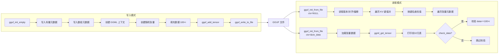
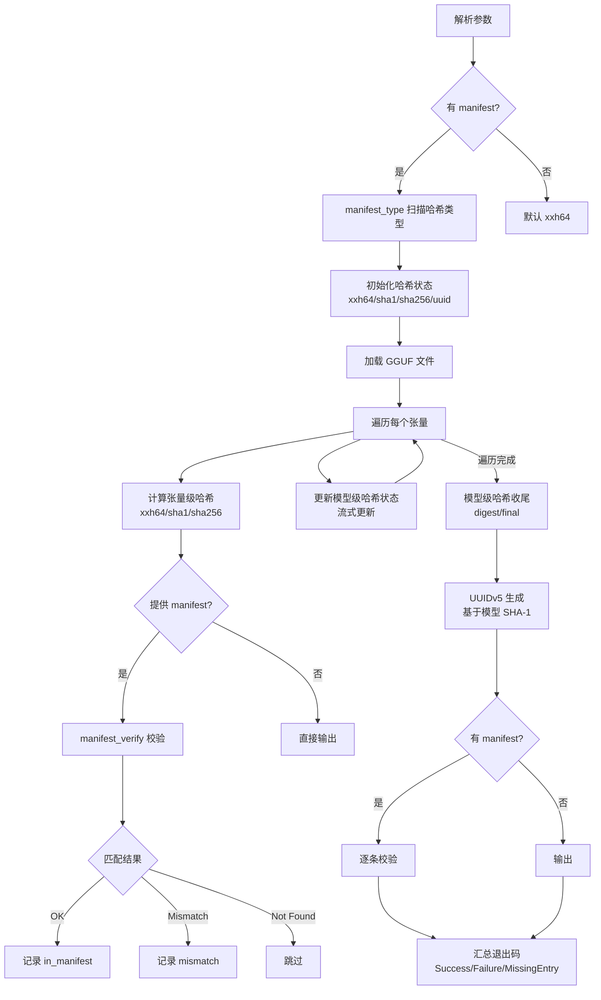
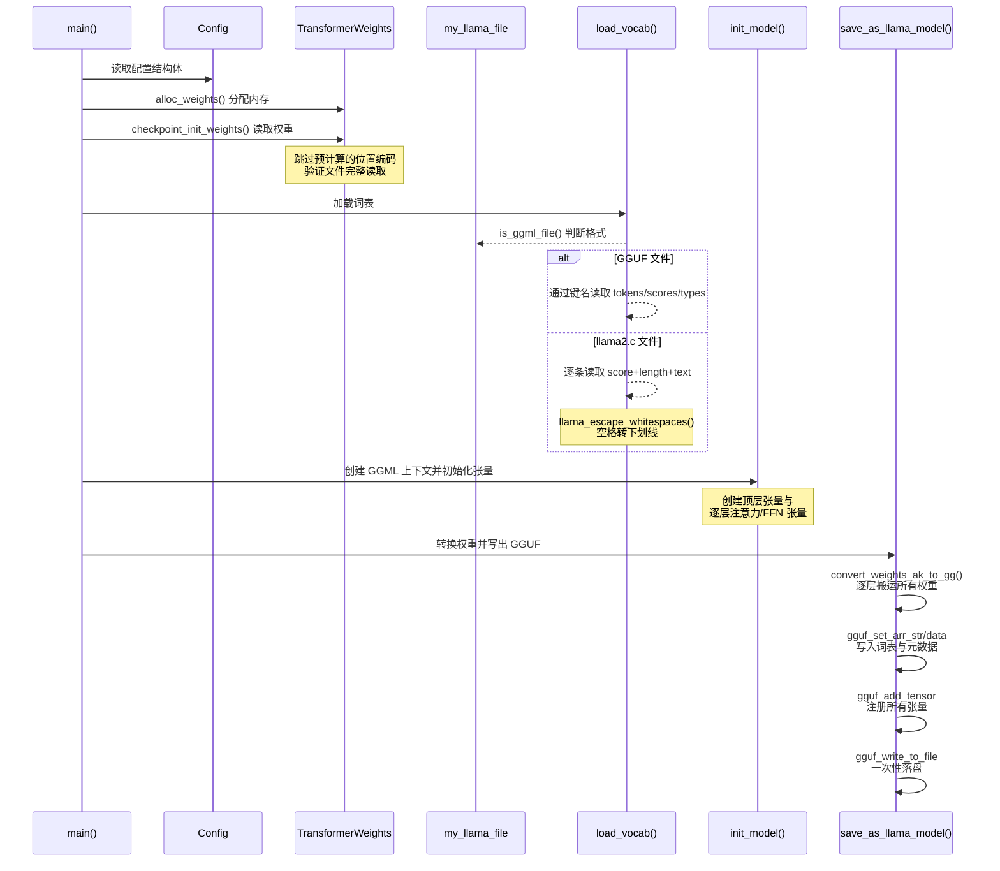

# 第95章 模型文件工具链 —— 集装箱工厂的质检与精炼流水线

## 学习目标

- 掌握 GGUF 文件的写入流程，包括元数据、张量信息与数据的写入方式
- 理解 GGUF 的两种读取模式：仅读取元数据与同时加载张量数据
- 掌握 gguf-hash 工具如何实现张量级与模型级哈希校验
- 理解 xxh64、SHA-1、SHA-256 与 UUIDv5 在模型完整性校验中的作用
- 了解 SHA-1、SHA-256、XXH3 的流式哈希实现思路
- 掌握 XXH32/XXH64 经典哈希的流式状态管理与规范化表示转换
- 理解 XXH3 按输入长度分派的短/中/长路径及 SIMD 多后端实现
- 掌握 llama2.c checkpoint 到 GGUF 的转换流程与权重重排方式
- 理解 GGUF 词表双源加载与 SentencePiece 空白转义策略
- 了解 deprecation-warning 与 gen-docs 工具在项目生态中的辅助作用

## 95.1 生活类比：从集装箱与质检工厂看模型文件工具链

在深入本章源码之前，让我们先建立一幅完整的意象图，它将贯穿整个章节，帮助你把抽象的系统调用与具体的工程概念联系起来。请注意，这一章的核心不是模型推理本身，而是围绕模型文件建立一套“可写、可读、可校验、可迁移、可维护”的基础工具链。为了便于你理解，我们将这套工具链比喻为一座“集装箱与质检工厂”。

GGUF 文件是一个标准集装箱，箱体本身是二进制格式，箱门上的箱单（元数据）记录了货物的品名、数量、规格等信息，而箱子内部的货物本体就是张量数据。`gguf.cpp` 就是工厂里的装箱与拆箱演练场，它演示了如何填写箱单（写入元数据）、把货物码放整齐（创建张量并填充数据）、最后封箱（写盘为 GGUF 文件），同时也演示了两种拆箱方式——只看箱单（只读元数据模式）和完整卸货（完整加载模式）。你可以根据实际需求选择只看箱单快速浏览货物内容，还是将全部货物搬到仓库里准备使用。

gguf-hash 是工厂的指纹识别中心，它的职责是给每个集装箱和每件货物（张量）采集指纹，用于身份验证和完整性检查。它可以整箱验证（模型级哈希，对整个文件计算哈希），也可以逐件验证（张量级哈希，对每个张量分别计算哈希）。`manifest` 文件则是官方发布的验收单，上面记录了每种货物应有的指纹，指纹识别中心的任务就是把实际采集的指纹与验收单上的记录进行逐一比对，确认货物是否被调包或损坏。指纹识别中心配备了三种不同风格的指纹机器：xxh64 速度极快但安全性较低，适合日常快速自检；SHA-256 安全性最高但计算较慢，适合官方发布时的权威校验；SHA-1 则介于两者之间，用于兼容旧系统。此外，指纹识别中心还能为每一箱货物生成一个全球唯一的身份证号码（UUIDv5），方便在公共网络上进行标识和追踪。

这些指纹机器内部都有各自独特的流水线结构。`XXH32/XXH64` 经典哈希是一套可以逐批投入的指纹采集器，支持 `createState/reset/update/digest` 四步流程，这意味着你可以把数据分成任意大小的批次，源源不断地送入采集器，最终得到一个与一次投入所有数据完全相同的指纹。而 `XXH3` 则是一套更先进的高速流水线，它像赛车一样拥有多种不同型号的引擎（AVX512、AVX2、SSE2、NEON、VSX、SVE），会根据当前硬件平台自动选择性能最优的引擎来加速计算。`XXH3_mix2Accs` 和 `XXH3_mergeAccs` 则是这套流水线的总装车间，负责把 8 条独立子流水线的半成品最终合并为一件完整的成品指纹。

另一侧的 **llama2.c 转 GGUF 转换器** 是一座矿石精炼炉，它的输入是 llama2.c 格式的原始模型文件（可以看作刚从矿山开采出来的原始矿石），输出则是标准化的 GGUF 格式模型（精炼后的成品）。在这个过程中，需要经历多个工序：先读取矿石的配置单（模型结构参数），然后按固定的顺序开采出每一块矿石（权重数据），接着进行塑形（在 GGML 上下文中创建对应的张量骨架），最后按照目标格式的布局重新归类与标准化（将线性权重数组搬运到多维 GGML 张量中）。与此同时，词表加载（`load_vocab`）就像把一本翻译字典录入系统，既要录入每个词，也要录入每个词对应的分数和类型，并确保格式与下游工具兼容。

最后，在工厂的日常运营中，还有两个辅助角色。**deprecation-warning** 是贴在旧窗口上的迁址告示牌，提醒前来办事的用户去新窗口，避免他们在不知不觉中使用已淘汰的旧命令。**gen-docs** 则是一位自动编写说明书的文员，它能够根据代码中的参数定义自动生成格式统一的 Markdown 文档，并嵌入到 README 中，确保文档与代码始终保持同步。

本章将沿着“集装箱——质检——精炼——维护”这条流水线，逐一剖析每台设备（源码文件）的内部构造与工作原理。

## 95.2 源码地图

```
examples/gguf/gguf.cpp
├── to_string()                 # 模板工具：任意类型转字符串
├── gguf_ex_write()             # 创建并写入 GGUF 示例文件
│   ├── 写入基础元数据          # uint8/int8/f32/bool/string
│   ├── 写入数组元数据          # int16/float32/string arrays
│   └── 写入 10 个随机张量      # F32 tensor + 数据填充
├── gguf_ex_read_0()            # 只读元数据模式
│   ├── 读取版本/对齐/数据偏移  # version/alignment/data_offset
│   ├── 遍历 KV                 # 顺序枚举全部键值对
│   └── 读取张量信息            # 名称、大小、偏移，不加载数据
├── gguf_ex_read_1()            # 完整读取模式
│   ├── 创建 GGML 数据上下文    # ctx_data
│   ├── 按名称获取张量          # ggml_get_tensor
│   └── 可选数据校验            # 验证 data == 100 + i
└── __main__                    # 模式分发：r/w + 是否检查数据

examples/gguf-hash/gguf-hash.cpp
├── hash_params                 # 哈希参数结构
├── manifest_check_params       # manifest 可识别哈希类型
├── hash_manifest_result_to_str() # 校验结果字符串化
├── hash_exit_code_to_str()     # 退出码字符串化
├── hash_print_usage()          # 打印帮助信息
├── hash_params_parse_ex()      # 严格解析命令行参数
├── hash_params_parse()         # 参数解析异常包装
├── manifest_type()             # 扫描 manifest 中的哈希类型
├── manifest_verify()           # 对清单执行逐条校验
├── generate_uuidv5()           # 由 SHA-1 摘要生成 UUIDv5
├── gguf_hash()                 # 核心哈希与校验主流程
│   ├── 张量级哈希              # per-tensor xxh64/sha1/sha256
│   └── 模型级哈希              # whole-model streaming hash
└── __main__                    # 程序入口与整体流程控制

examples/gguf-hash/deps/rotate-bits/rotate-bits.h
└── 位旋转宏                   # ROTL8/16/32/64, ROTR8/16/32/64

examples/gguf-hash/deps/sha1/sha1.c
├── SHA1Transform()             # 512-bit block 压缩函数，80 轮
├── SHA1Init()                  # 初始化 SHA-1 状态
├── SHA1Update()                # 流式更新输入
├── SHA1Final()                 # 输出 20 字节摘要
└── SHA1()                      # 一次性计算封装

examples/gguf-hash/deps/sha1/sha1.h
├── SHA1_CTX                    # SHA-1 上下文结构体
└── SHA-1 API 声明              # Init/Update/Final/Transform/SHA1

examples/gguf-hash/deps/sha256/sha256.c
├── sha256_init()               # 初始化 8 个 32-bit 状态常量
├── sha256_transform()          # 64 轮压缩核心
├── sha256_write_byte_block()   # 64 字节块打包为 16 个 u32
├── sha256_update()             # 流式更新
├── sha256_final()              # 填充 + 输出 32 字节摘要
└── sha256_hash()               # 一次性计算封装

examples/gguf-hash/deps/sha256/sha256.h
├── sha256_t                    # SHA-256 上下文结构体
└── SHA-256 API 声明            # init/update/final/hash

examples/gguf-hash/deps/xxhash/xxhash.h
├── XXH32 API                   # 经典32位：XXH32/createState/reset/update/digest/canonical
├── XXH64 API                   # 经典64位：XXH64/createState/reset/update/digest/canonical
├── XXH3 API                    # 64bit/128bit：withSeed/withSecret/withSecretandSeed
├── XXH3 长度分派               # 0-16B / 17-128B / 129-240B / 长输入四条路径
├── XXH3_hashLong_internal_loop() # 长输入分块条纹处理
├── XXH3_mix2Accs()             # 双累加器与 secret 混合折叠
├── XXH3_mergeAccs()            # 合并累加器生成最终值
├── XXH3 SIMD 后端              # AVX512/AVX2/SSE2/NEON/VSX/SVE accumulate+scramble
├── XXH3 流式状态管理           # createState/reset/update/digest/copyState
├── XXH3 secret 生成            # generateSecret/generateSecret_fromSeed/initCustomSecret
├── XXH128 工具函数             # isEqual/cmp/canonicalFromHash/hashFromCanonical/combine16
├── 位操作与内存工具            # readLE32/64, swap32/64, memcpy, alignedMalloc/Free
└── 平台向量原语                # vld1q_u64/vmlal_low/high_u32/vec_revb/vec_loadu/vec_mulo/mule

examples/convert-llama2c-to-ggml/convert-llama2c-to-ggml.cpp
├── Config                      # llama2.c 模型配置
├── TransformerWeights          # llama2.c 权重结构
├── alloc_weights()             # 根据配置分配权重内存
├── checkpoint_init_weights()   # 按 llama2.c 布局读取权重
├── print_sample_weights()      # 打印权重抽查值
├── my_llama_hparams            # GGML 风格 llama 超参数
│   └── operator!=              # memcmp 比较超参数对象
├── my_llama_layer              # 单层 Transformer 张量集合
├── my_llama_model              # 模型整体结构
├── my_llama_file               # 跨平台文件读取封装
│   ├── my_llama_file()         # 打开并预读文件大小
│   ├── tell()                  # 当前偏移
│   ├── seek()                  # 文件定位
│   ├── read_raw()              # 原始字节读取
│   ├── read_u32()              # 读取 uint32
│   ├── read_f32()              # 读取 float
│   ├── read_string()           # 读取定长字符串
│   └── ~my_llama_file()        # 自动关闭文件
├── init_model()                # 创建 GGML 张量并命名
├── print_params()              # 打印超参数
├── print_tensor_info()         # 打印张量维度信息
├── get_f32_2d()/get_i32_2d()   # 依据步长读写矩阵元素
├── print_row()/print_matrix()  # 打印概率张量行与完整矩阵
├── is_ggml_file()              # 判断是否为 GGUF 文件
├── llama_escape_whitespaces()  # 空格转为 SentencePiece 下划线
├── load_vocab()                # GGUF / llama2.c 双源词表加载
├── convert_weights_ak_to_gg()  # 一维数组按索引映射填充到 GGML 张量
├── save_as_llama_model()       # 写出 GGUF 模型文件
├── get_default_train_params()  # 默认参数
├── print_usage()               # 帮助信息
├── params_parse()              # 命令行解析
├── basename()                  # 从路径提取文件名
└── __main__                    # 读取模型、装配、转换并保存

examples/deprecation-warning/deprecation-warning.cpp
└── __main__                    # 从 argv[0] 推导替代命令并退出失败

examples/gen-docs/gen-docs.cpp
├── md_file                     # Markdown 文件与示例类型配置
├── write_table_header()        # 写 Markdown 表头
├── write_table_entry()         # 写单条参数表格
├── write_table()               # 批量写参数表
├── write_help()                # 生成完整帮助块
└── main()                      # 批量替换 README 中的帮助区块
```

## 95.3 GGUF 读写示例 —— 集装箱的“装箱与拆箱演练”

**为什么需要 `gguf_ex_write`？** 它演示了如何从零创建一个 GGUF 文件，就像学习如何打包一个标准集装箱。通过这个示例，你可以掌握 GGUF 文件格式的完整写入流程：从基础标量元数据（uint8/int8/float32/bool/string）到数组元数据（int16 数组、float32 数组、字符串数组），再到创建随机维度的 F32 张量并填充数据后写入文件。随后，`gguf_ex_read_0` 和 `gguf_ex_read_1` 展示了 GGUF 的两种读取模式：`gguf_ex_read_0` 只加载元数据而不加载张量数据，适合快速浏览文件内容；`gguf_ex_read_1` 则同时创建 GGML 上下文并加载张量数据，适合实际推理前的完整加载。

在开始之前，需要说明的是，本节代码块中使用的 `gguf_init_empty`、`gguf_set_val_u8`、`gguf_init_from_file`、`gguf_write_to_file` 等 GGUF API 均由 llama.cpp 项目中的 `gguf.h`/`gguf.cpp` 提供，底层依赖于 `ggml.h` 中的 GGML 上下文与张量数据结构。示例代码通过包含这些头文件来获得函数声明。

`to_string()` 模板工具是一个通用模板函数，用 stringstream 将任意类型值转为字符串。它在 `gguf_ex_write` 中为张量生成序号化名称（tensor_0、tensor_1、...），展示了 C++ 模板在实际代码中的简洁应用。

### 95.3.1 `to_string()`：通用类型转字符串工具

源码路径：`examples/gguf/gguf.cpp` - `to_string()`（16-21行）

```cpp
// 模板函数：接受任意类型 T 的值
template <typename T>
static std::string to_string(const T & val) {
    // 创建字符串流对象
    std::stringstream ss;
    // 将值插入字符串流
    ss << val;
    // 返回流的字符串表示
    return ss.str();
}
```

这段代码定义了一个泛型字符串转换函数，利用 `std::stringstream` 的流插入运算符，将任意可流式输出的类型转换为字符串。它避免了 C 风格的 `snprintf` 带来的类型不安全问题，是 C++ 中类型安全的通用转换工具。

### 95.3.2 `gguf_ex_write()`：从零创建 GGUF 文件的完整流程

源码路径：`examples/gguf/gguf.cpp` - `gguf_ex_write()`（23-93行）

```cpp
// 写入 GGUF 文件的主函数，接受文件名作为参数
static bool gguf_ex_write(const std::string & fname) {
    // ① 创建一个空的 GGUF 写入上下文
    struct gguf_context * ctx = gguf_init_empty();

    // ② 写入各种基础标量元数据
    gguf_set_val_u8  (ctx, "some.parameter.uint8",    0x12);
    gguf_set_val_i8  (ctx, "some.parameter.int8",    -0x13);
    gguf_set_val_u16 (ctx, "some.parameter.uint16",   0x1234);
    gguf_set_val_i16 (ctx, "some.parameter.int16",   -0x1235);
    gguf_set_val_u32 (ctx, "some.parameter.uint32",   0x12345678);
    gguf_set_val_i32 (ctx, "some.parameter.int32",   -0x12345679);
    gguf_set_val_f32 (ctx, "some.parameter.float32",  0.123456789f);
    gguf_set_val_u64 (ctx, "some.parameter.uint64",   0x123456789abcdef0ull);
    gguf_set_val_i64 (ctx, "some.parameter.int64",   -0x123456789abcdef1ll);
    gguf_set_val_f64 (ctx, "some.parameter.float64",  0.1234567890123456789);
    gguf_set_val_bool(ctx, "some.parameter.bool",     true);
    gguf_set_val_str (ctx, "some.parameter.string",   "hello world");

    // ③ 写入数组类型元数据
    gguf_set_arr_data(ctx, "some.parameter.arr.i16", GGUF_TYPE_INT16,   std::vector<int16_t>{ 1, 2, 3, 4, }.data(), 4);
    gguf_set_arr_data(ctx, "some.parameter.arr.f32", GGUF_TYPE_FLOAT32, std::vector<float>{ 3.145f, 2.718f, 1.414f, }.data(), 3);
    gguf_set_arr_str (ctx, "some.parameter.arr.str",                    std::vector<const char *>{ "hello", "world", "!" }.data(), 3);

    // ④ 配置 GGML 初始化参数
    struct ggml_init_params params = {
        /*.mem_size   =*/ 128ull*1024ull*1024ull,
        /*.mem_buffer =*/ NULL,
        /*.no_alloc   =*/ false,
    };

    // ⑤ 创建 GGML 数据上下文
    struct ggml_context * ctx_data = ggml_init(params);

    // ⑥ 创建 10 个随机张量
    const int n_tensors = 10;
    for (int i = 0; i < n_tensors; ++i) {
        const std::string name = "tensor_" + to_string(i);  // 用模板工具生成名称
        int64_t ne[GGML_MAX_DIMS] = { 1 };                   // 维度数组
        int32_t n_dims = rand() % GGML_MAX_DIMS + 1;         // 随机维度数 1-4
        for (int j = 0; j < n_dims; ++j) {                    // 随机各维大小
            ne[j] = rand() % 10 + 1;
        }
        struct ggml_tensor * cur = ggml_new_tensor(ctx_data, GGML_TYPE_F32, n_dims, ne);
        ggml_set_name(cur, name.c_str());                    // 设置张量名称
        {                                                    // 填充数据：100 + i
            float * data = (float *) cur->data;
            for (int j = 0; j < ggml_nelements(cur); ++j) {
                data[j] = 100 + i;
            }
        }
        gguf_add_tensor(ctx, cur);                           // ⑦ 注册张量到 GGUF
    }

    // ⑧ 一次性写入文件（无对齐，按元数据区+张量数据区顺序写盘）
    gguf_write_to_file(ctx, fname.c_str(), false);

    printf("%s: wrote file '%s'\n", __func__, fname.c_str());

    // ⑨ 清理资源
    ggml_free(ctx_data);
    gguf_free(ctx);
    return true;
}
```

这段代码完整演示了 GGUF 文件的写入流程：先创建空的 GGUF 上下文，通过 `gguf_set_val_*` 系列函数写入标量元数据，通过 `gguf_set_arr_data` 和 `gguf_set_arr_str` 写入数组元数据；然后在 GGML 上下文中创建随机维度的张量并填充数据，通过 `gguf_add_tensor` 注册张量，最后通过 `gguf_write_to_file` 一次写盘。整个流程就像打包一个集装箱：先写箱单（元数据），再装货物（张量数据），最后封箱（写盘）。`gguf_write_to_file` 的第三个参数为 `false`，表示写入时不启用额外的数据对齐，文件布局按“元数据区 + 张量数据区”的顺序依次写出：函数内部首先序列化文件头、元数据键值对和所有张量信息，随后将所有张量的原始数据按注册顺序连续写入文件的数据区。

### 95.3.3 `gguf_ex_read_0()`：只读元数据模式

源码路径：`examples/gguf/gguf.cpp` - `gguf_ex_read_0()`（96-160行）

```cpp
// 只读元数据模式，不加载张量数据
static bool gguf_ex_read_0(const std::string & fname) {
    // ① 配置：ctx=NULL 表示只加载元数据
    struct gguf_init_params params = {
        /*.no_alloc = */ false,
        /*.ctx      = */ NULL,
    };

    // ② 从文件加载 GGUF 上下文（仅元数据）
    struct gguf_context * ctx = gguf_init_from_file(fname.c_str(), params);

    // ③ 读取文件级元信息
    printf("%s: version:      %d\n", __func__, gguf_get_version(ctx));        // 文件格式版本号
    printf("%s: alignment:   %zu\n", __func__, gguf_get_alignment(ctx));      // 数据对齐字节数
    printf("%s: data offset: %zu\n", __func__, gguf_get_data_offset(ctx));    // 张量数据区在文件中的起始偏移

    // ④ 遍历所有键值对
    {
        const int n_kv = gguf_get_n_kv(ctx);
        printf("%s: n_kv: %d\n", __func__, n_kv);
        for (int i = 0; i < n_kv; ++i) {
            const char * key = gguf_get_key(ctx, i);
            printf("%s: kv[%d]: key = %s\n", __func__, i, key);
        }
    }

    // ⑤ 按键名查找特定字符串值
    {
        const char * findkey = "some.parameter.string";
        const int keyidx = gguf_find_key(ctx, findkey);
        if (keyidx == -1) {
            printf("%s: find key: %s not found.\n", __func__, findkey);
        } else {
            const char * key_value = gguf_get_val_str(ctx, keyidx);
            printf("%s: find key: %s found, kv[%d] value = %s\n", __func__, findkey, keyidx, key_value);
        }
    }

    // ⑥ 遍历张量信息（不加载数据）
    {
        const int n_tensors = gguf_get_n_tensors(ctx);
        printf("%s: n_tensors: %d\n", __func__, n_tensors);
        for (int i = 0; i < n_tensors; ++i) {
            const char * name   = gguf_get_tensor_name  (ctx, i);
            const size_t size   = gguf_get_tensor_size  (ctx, i);
            const size_t offset = gguf_get_tensor_offset(ctx, i);
            printf("%s: tensor[%d]: name = %s, size = %zu, offset = %zu\n", __func__, i, name, size, offset);
        }
    }

    // ⑦ 释放 GGUF 上下文
    gguf_free(ctx);
    return true;
}
```

这段代码演示了 GGUF 的只读元数据模式。通过 `gguf_init_from_file` 并在参数中设置 `ctx=NULL`，可以仅加载文件的元数据部分而不触及张量数据。这种模式非常适合快速浏览文件内容、检查元数据键值对和张量信息，就像只读取集装箱的箱单而不拆箱查看货物。在读取文件级元信息时，`version` 表示 GGUF 格式的版本号，`alignment` 表示数据对齐的字节数，`data offset` 表示张量数据区在文件中的起始字节偏移。

### 95.3.4 `gguf_ex_read_1()`：完整加载模式与数据校验

源码路径：`examples/gguf/gguf.cpp` - `gguf_ex_read_1()`（163-270行）

```cpp
// 完整加载模式，同时加载元数据和张量数据
static bool gguf_ex_read_1(const std::string & fname, bool check_data) {
    struct ggml_context * ctx_data = NULL;              // ① 用于存储张量数据的 GGML 上下文

    // ② 配置：ctx = &ctx_data 表示同时创建 GGML 上下文
    struct gguf_init_params params = {
        /*.no_alloc = */ false,
        /*.ctx      = */ &ctx_data,
    };

    // ③ 加载 GGUF 文件（含张量数据）
    struct gguf_context * ctx = gguf_init_from_file(fname.c_str(), params);

    // ④ 读取文件级元信息
    printf("%s: version:      %d\n", __func__, gguf_get_version(ctx));
    printf("%s: alignment:   %zu\n", __func__, gguf_get_alignment(ctx));
    printf("%s: data offset: %zu\n", __func__, gguf_get_data_offset(ctx));

    // ⑤ 遍历张量信息（含类型和元素数）
    {
        const int n_tensors = gguf_get_n_tensors(ctx);
        printf("%s: n_tensors: %d\n", __func__, n_tensors);
        for (int i = 0; i < n_tensors; ++i) {
            const char * name   = gguf_get_tensor_name  (ctx, i);
            const size_t size   = gguf_get_tensor_size  (ctx, i);
            const size_t offset = gguf_get_tensor_offset(ctx, i);
            const auto   type   = gguf_get_tensor_type  (ctx, i);
            const char * type_name  = ggml_type_name(type);
            const size_t type_size  = ggml_type_size(type);
            const size_t n_elements = size / type_size;
            printf("%s: tensor[%d]: name = %s, size = %zu, offset = %zu, type = %s, n_elts = %zu\n",
                __func__, i, name, size, offset, type_name, n_elements);
        }
    }

    // ⑥ 按名称获取张量并校验数据
    {
        const int n_tensors = gguf_get_n_tensors(ctx);
        for (int i = 0; i < n_tensors; ++i) {
            const char * name = gguf_get_tensor_name(ctx, i);
            struct ggml_tensor * cur = ggml_get_tensor(ctx_data, name);  // 按名称取回张量
            printf("%s: tensor[%d]: n_dims = %d, ne = (%d, %d, %d, %d), name = %s, data = %p\n",
                __func__, i, ggml_n_dims(cur), int(cur->ne[0]), int(cur->ne[1]), int(cur->ne[2]), int(cur->ne[3]), cur->name, cur->data);

            // 打印前 10 个元素
            // MIN(10, ...) 宏用于防止张量元素不足 10 个时越界访问
            const float * data = (const float *) cur->data;
            printf("%s data[:10] : ", name);
            for (int j = 0; j < MIN(10, ggml_nelements(cur)); ++j) {
                printf("%f ", data[j]);
            }
            printf("\n\n");

            // ⑦ 可选的数据一致性校验
            if (check_data) {
                const float * data = (const float *) cur->data;
                for (int j = 0; j < ggml_nelements(cur); ++j) {
                    if (data[j] != 100 + i) {       // 验证写入时的预期值
                        fprintf(stderr, "%s: tensor[%d], data[%d]: found %f, expected %f\n",
                            __func__, i, j, data[j], float(100 + i));
                        gguf_free(ctx);
                        return false;
                    }
                }
            }
        }
    }

    // ⑧ 输出 GGML 上下文内存大小并清理
    printf("%s: ctx_data size: %zu\n", __func__, ggml_get_mem_size(ctx_data));
    ggml_free(ctx_data);
    gguf_free(ctx);
    return true;
}
```

这段代码演示了 GGUF 的完整加载模式。通过在 `gguf_init_params` 中传入 `&ctx_data`，同时加载元数据和张量数据到 GGML 上下文。`ggml_get_tensor` 可以按名称查找张量。在打印前 10 个元素时，`MIN(10, ggml_nelements(cur))` 宏用于在张量元素总数不足 10 个时防止越界读取。`check_data` 参数控制是否执行数据一致性校验，验证读出的数据是否与写入时的预期值（100+i）一致，确保文件读写循环的正确性。

### 95.3.5 `__main__`：模式分发与入口控制

源码路径：`examples/gguf/gguf.cpp` - `__main__`（272-305行）

```cpp
// 程序入口，解析命令行参数并分发到对应模式
int main(int argc, char ** argv) {
    // ① 设置区域设置为 C，避免浮点格式差异
    std::setlocale(LC_NUMERIC, "C");

    // ② 检查参数数量
    if (argc < 3) {
        printf("usage: %s data.gguf r|w [n]\n", argv[0]);
        printf("r: read data.gguf file\n");
        printf("w: write data.gguf file\n");
        printf("n: no check of tensor data\n");
        return -1;
    }
    // ③ 第三个参数存在时关闭数据校验
    bool check_data = true;
    if (argc == 4) {
        check_data = false;
    }

    // ④ 固定随机种子，确保张量可复现
    srand(123456);

    // ⑤ 解析文件名和模式
    const std::string fname(argv[1]);
    const std::string mode (argv[2]);
    // 该断言确保 mode 参数必须是 "r" 或 "w"，否则程序立即终止并输出错误信息
    GGML_ASSERT((mode == "r" || mode == "w") && "mode must be r or w");

    // ⑥ 根据模式分发
    if (mode == "w") {
        GGML_ASSERT(gguf_ex_write(fname) && "failed to write gguf file");
    } else if (mode == "r") {
        // 读取模式同时执行两种读取
        GGML_ASSERT(gguf_ex_read_0(fname) && "failed to read gguf file");
        GGML_ASSERT(gguf_ex_read_1(fname, check_data) && "failed to read gguf file");
    }
    return 0;
}
```

这段代码是演示程序的控制入口。它解析命令行参数（文件名、读写模式、是否校验数据），通过 `srand(123456)` 固定随机种子保证张量创建的可复现性，然后根据模式调用写入或读取函数。`GGML_ASSERT((mode == "r" || mode == "w") && "mode must be r or w")` 这一断言用于在开发阶段强制检查 `mode` 参数必须是 `"r"` 或 `"w"` 之一，如果传入其他值则程序立即终止，从而避免用无效模式调用后续函数。读取模式下会同时执行只读元数据和完整加载两种模式，展示 GGUF 的两种读取能力。

### 95.3.6 数据流与时序

下图展示了 gguf.cpp 示例程序的完整数据流，从写入模式到两种读取模式的转换：



这个流程图清晰地展示了写入模式如何生成 GGUF 文件，以及两种读取模式如何从同一文件中获取信息。写入模式的关键在于 `gguf_init_empty` 创建空上下文后，按元数据 → 张量的顺序逐步填充；读取模式则通过是否传入 `ctx_data` 来区分只读元数据和完整加载。整个流程展示了 GGUF 格式“写入一次，多种读取方式”的设计理念。

## 95.4 GGUF 哈希校验工具 —— 模型完整性的“指纹鉴定师”

**多算法哈希体系**：gguf-hash 支持 xxh64（极速非加密哈希）、SHA-1、SHA-256 三种哈希算法，每种算法都有独立的流式状态管理（`XXH64_state_t`、`SHA1_CTX`、`sha256_t`）。此外，还基于 SHA-1 实现 UUIDv5 生成，为模型提供全局唯一标识符。

**双层哈希策略**：张量层哈希对 GGUF 中每个张量单独计算哈希，支持 `--no-layer` 跳过；模型整体哈希对所有张量数据流式更新，计算整个模型的单一哈希值。张量层命名规则为 `文件名:张量名`，确保跨文件唯一性。

**Manifest 校验机制**：`manifest_type` 扫描清单文件自动识别包含的哈希类型；`manifest_verify` 逐行匹配哈希类型和张量名，返回 Ok/Mismatch/NotFound；退出码设计覆盖 Success/Failure/Mismatch/MissingEntry/UnknownHash/FileError 六种状态。

### 95.4.1 `hash_manifest_result_to_str()` 与 `hash_exit_code_to_str()`：枚举到可读字符串的映射

源码路径：`examples/gguf-hash/gguf-hash.cpp` - `hash_manifest_result_to_str()`（79-87行）与 `hash_exit_code_to_str()`（89-99行）

```cpp
// ① 校验结果枚举 → 可读字符串
static char const * hash_manifest_result_to_str(hash_manifest_result_t value) {
    switch (value) {
        case HASH_MANIFEST_NOT_FOUND: return "Not Found";   // 清单中未找到匹配项
        case HASH_MANIFEST_MISMATCH: return "Mismatch";     // 哈希值不匹配
        case HASH_MANIFEST_OK: return "Ok";                 // 校验通过
    }
    return "?";
}

// ② 退出码枚举 → 可读字符串
static char const * hash_exit_code_to_str(hash_exit_code_t value) {
    switch (value) {
        case HASH_EXIT_SUCCESS: return "Success";                       // 成功
        case HASH_EXIT_FAILURE: return "Failure";                       // 通用失败
        case HASH_EXIT_MISMATCH: return "Mismatch";                     // 哈希不匹配
        case HASH_EXIT_MANIFEST_MISSING_ENTRY: return "Manifest Missing Entry";  // 缺少条目
        case HASH_EXIT_MANIFEST_UNKNOWN_HASH: return "Manifest Unknown Hash";    // 未知哈希类型
        case HASH_EXIT_MANIFEST_FILE_ERROR: return "Manifest File Error";        // 文件错误
    }
    return "?";
}
```

这两个函数将内部的枚举类型映射为人类可读的字符串，方便用户查看校验结果。`hash_manifest_result_to_str` 覆盖清单校验的三种结果状态，而 `hash_exit_code_to_str` 覆盖整个程序的六种退出状态，是工具输出的关键部分。

### 95.4.2 `hash_print_usage()` 与 `hash_params_parse()`：参数解析的异常安全包装

源码路径：`examples/gguf-hash/gguf-hash.cpp` - `hash_print_usage()`（101-116行）、`hash_params_parse_ex()`（118-157行）、`hash_params_parse()`（159-170行）

```cpp
// ① 打印命令行帮助信息
static void hash_print_usage(const char * executable) {
    const hash_params default_params;
    printf("\n");
    printf("usage: %s [options] GGUF_IN\n", executable);
    printf("\n");
    printf("Hash a GGUF file");
    printf("\n");
    printf("options:\n");
    printf("  -h, --help              show this help message and exit\n");
    printf("      --xxh64             use xxh64 hash\n");
    printf("      --sha1              use sha1 hash\n");
    printf("      --sha256            use sha256 hash\n");
    printf("      --all               use all hash\n");
    printf("      --no-layer          exclude per layer hash\n");
    printf("      --uuid              generate UUIDv5 ID\n");
    printf("  -c, --check <manifest>  verify against a manifest\n");
    printf("\n");
}

// ② 严格参数解析，遇到非法参数抛出异常
static void hash_params_parse_ex(int argc, const char ** argv, hash_params & params) {
    std::string arg;
    bool invalid_param = false;
    const std::string arg_prefix = "--";
    int arg_idx = 1;
    // 遍历所有以 -- 开头的选项
    for (; arg_idx < argc && strncmp(argv[arg_idx], "--", 2) == 0; arg_idx++) {
        arg = argv[arg_idx];
        if (arg.compare(0, arg_prefix.size(), arg_prefix) == 0) {
            std::replace(arg.begin(), arg.end(), '_', '-');   // 下划线转连字符
        }
        bool arg_found = false;
        if (arg == "-h" || arg == "--help") { hash_print_usage(argv[0]); exit(0); }
        if (arg == "--xxh64") { arg_found = true; params.xxh64 = true; }
        if (arg == "--sha1") { arg_found = true; params.sha1 = true; }
        if (arg == "--uuid") { arg_found = true; params.uuid = true; }
        if (arg == "--sha256") { arg_found = true; params.sha256 = true; }
        // --all 启用所有三种哈希算法（xxh64、sha1、sha256），但不包括 --uuid，
        // 因为 UUID 是独立生成的标识符，而非哈希算法。
        if (arg == "--all") { arg_found = true; params.sha256 = true; params.sha1 = true; params.xxh64 = true; }
        if (arg == "--no-layer") { arg_found = true; params.no_layer = true; }
        if (arg == "-c" || arg == "--check") {   // 该选项需要额外参数
            if (++arg_idx >= argc) { invalid_param = true; break; }
            arg_found = true;
            params.manifest_file = argv[arg_idx];
        }
        if (!arg_found) { throw std::invalid_argument("error: unknown argument: " + arg); }
    }
    if (invalid_param) { throw std::invalid_argument("error: invalid parameter for argument:" + arg); }
    if (argc - arg_idx < 1) { throw std::invalid_argument("error: bad arguments"); }
    params.input = argv[arg_idx++];   // 最后一个是输入文件
}

// ③ 异常安全包装：捕获异常，打印错误和帮助后退出
static bool hash_params_parse(int argc, const char ** argv, hash_params & params) {
    bool result = true;
    try {
        hash_params_parse_ex(argc, argv, params);
    }
    catch (const std::invalid_argument & ex) {
        fprintf(stderr, "%s\n", ex.what());
        hash_print_usage(argv[0]);
        exit(EXIT_FAILURE);
    }
    return result;
}
```

这三段代码构成了完整的参数解析体系：`hash_print_usage` 提供用户友好的帮助信息；`hash_params_parse_ex` 是严格解析器，遇到任何非法参数就抛出 `invalid_argument` 异常；`hash_params_parse` 作为异常安全包装，捕获异常、打印错误信息和帮助后统一以失败码退出。这种分层设计将解析逻辑与错误处理分离，使代码更清晰易维护。注意 `--all` 选项的行为：它启用 xxh64、sha1、sha256 三种哈希算法，但不启用 `--uuid`，因为 UUID 是一个独立的标识符选项，需要用户显式指定。

### 95.4.3 `manifest_type()` 与 `manifest_verify()`：清单识别与逐条校验

源码路径：`examples/gguf-hash/gguf-hash.cpp` - `manifest_type()`（172-188行）与 `manifest_verify()`（190-209行）

```cpp
// ① 扫描 manifest 文件，识别其中包含的哈希类型
static bool manifest_type(const std::string & manifest_file, manifest_check_params & manifest_check) {
    if (manifest_file.empty()) { return false; }
    std::ifstream file(manifest_file);
    if (!file.is_open()) { return false; }
    std::string manifest_entry_line;
    while (getline(file, manifest_entry_line)) {   // 逐行读取
        std::istringstream line_stream(manifest_entry_line);
        std::string file_hash_type;
        if (line_stream >> file_hash_type) {       // 提取行首的哈希类型名
            if (file_hash_type == HASH_TYPE_SHA256_STR) { manifest_check.sha256 = true; }
            else if (file_hash_type == HASH_TYPE_SHA1_STR) { manifest_check.sha1 = true; }
            else if (file_hash_type == HASH_TYPE_XXH64_STR) { manifest_check.xxh64 = true; }
            else if (file_hash_type == HASH_TYPE_UUID_STR) { manifest_check.uuid = true; }
        }
    }
    return true;
}

// ② 在 manifest 中逐条匹配并校验指定哈希
static hash_manifest_result_t manifest_verify(const std::string& manifest_file, const std::string& hash_type_str, const std::string& hash_str, const std::string& tensor_name) {
    if (manifest_file.empty()) { return HASH_MANIFEST_NOT_FOUND; }
    std::ifstream file(manifest_file);
    if (!file.is_open()) { return HASH_MANIFEST_NOT_FOUND; }
    std::string manifest_entry_line;
    while (getline(file, manifest_entry_line)) {
        std::istringstream line_stream(manifest_entry_line);
        std::string file_hash_type;
        std::string file_hash;
        std::string file_tensor_name;
        // 每行格式：hash_type hash tensor_name
        if (line_stream >> file_hash_type >> file_hash >> file_tensor_name) {
            if (file_hash_type != hash_type_str) { continue; }    // 类型不匹配则跳过
            if (file_tensor_name != tensor_name) { continue; }    // 名称不匹配则跳过
            return (file_hash == hash_str) ? HASH_MANIFEST_OK : HASH_MANIFEST_MISMATCH;  // 比较哈希值
        }
    }
    return HASH_MANIFEST_NOT_FOUND;
}
```

这两段代码实现了清单文件的解析和校验。`manifest_type` 通过读取每行的第一个字段来识别清单包含哪些哈希类型，用于后续的参数默认值设置。`manifest_verify` 则逐行匹配哈希类型和张量名，最终比较哈希值是否一致，返回 OK、Mismatch 或 Not Found 三种结果。

### 95.4.4 `generate_uuidv5()`：基于 SHA-1 的 UUIDv5 生成

源码路径：`examples/gguf-hash/gguf-hash.cpp` - `generate_uuidv5()`（211-217行）

```cpp
// 由 SHA-1 摘要生成 UUIDv5
static void generate_uuidv5(const unsigned char sha1_digest[20], unsigned char uuid[16]) {
    // ① 取 SHA-1 摘要的前 16 字节作为 UUID 主体
    for (int i = 0; i < 16; i++) { uuid[i] = sha1_digest[i]; }
    // ② 设置版本位为 5（以 0101 开头）
    uuid[ 6] &= ~(0xF << 4);      // 清除第 6 字节的高 4 位
    uuid[ 6] |= (5 << 4);         // 设置为版本 5
    // ③ 设置变体位为 RFC 4122（以 10 开头）
    uuid[ 8] &= ~(0xc << 4);      // 清除第 8 字节的高 2 位
    uuid[ 8] |= (0x8 << 4);       // 设置为变体
}
```

这段代码将一个 20 字节的 SHA-1 摘要转换为符合 RFC 9562（前身 RFC 4122）规范的 UUIDv5。关键在于对第 6 字节设置版本位 0101（版本 5）和第 8 字节设置变体位 10（RFC 4122 变体），确保生成的 UUID 在全球范围内具有唯一性和标准兼容性。

### 95.4.5 `gguf_hash()`：核心哈希与校验主流程

源码路径：`examples/gguf-hash/gguf-hash.cpp` - `gguf_hash()`（219-420行）

```cpp
// 核心函数：加载 GGUF 文件，计算双层哈希，可选地校验 manifest
static hash_exit_code_t gguf_hash(const hash_params & hash_params) {
    const std::string & fname = hash_params.input;      // ① 输入文件路径

    // ② 初始化各类哈希状态
    XXH64_state_t* xxh64_model_hash_state = NULL;
    if (hash_params.xxh64) {
        xxh64_model_hash_state = XXH64_createState();
        if (xxh64_model_hash_state==NULL) { abort(); }
        XXH64_hash_t const seed = 0;
        if (XXH64_reset(xxh64_model_hash_state, seed) == XXH_ERROR) { abort(); }
    }
    SHA1_CTX sha1_model_hash_ctx;
    if (hash_params.sha1) { SHA1Init(&sha1_model_hash_ctx); }
    sha256_t sha256_model_hash_ctx;
    if (hash_params.sha256) { sha256_init(&sha256_model_hash_ctx); }
    SHA1_CTX sha1_for_uuid_ctx;
    if (hash_params.uuid) {   // UUID 需要单独的 SHA-1 上下文
        unsigned char const uuidv5_namespace[] = {UUID_NAMESPACE_LLAMA_CPP_HEX};  // 固定命名空间
        SHA1Init(&sha1_for_uuid_ctx);
        SHA1Update( &sha1_for_uuid_ctx, (unsigned char const *)uuidv5_namespace, sizeof(uuidv5_namespace));
    }

    // ③ 加载 GGUF 文件（含张量数据）
    struct ggml_context * ctx_data = NULL;
    struct gguf_init_params params = { false, &ctx_data };
    struct gguf_context * ctx = gguf_init_from_file(fname.c_str(), params);
    const int n_tensors = gguf_get_n_tensors(ctx);

    // ④ 记录状态标志
    bool tensor_layer_in_manifest = false;
    bool model_in_manifest = false;
    bool tensor_layer_has_mismatch = false;
    bool model_has_mismatch = false;

    // ⑤ 外层循环：遍历每个张量
    for (int i = 0; i < n_tensors; ++i) {
        const char * name = gguf_get_tensor_name(ctx, i);
        struct ggml_tensor * cur = ggml_get_tensor(ctx_data, name);
        auto n_bytes = ggml_nbytes(cur);
        auto *raw_data = cur->data;
        const std::string tensor_layer_name = fname + ":" + name;   // 张量层命名：文件名:张量名

        // xxh64 路径
        if (hash_params.xxh64) {
            if (!hash_params.no_layer) {   // ① 张量级 xxh64
                XXH64_hash_t hash = XXH64(raw_data, n_bytes, 0);
                char hex_result[17];
                for (int offset = 0; offset < 8; offset++) {   // 转为 16 位十六进制
                    unsigned int shift_bits_by = (8 * (8 - offset - 1));
                    snprintf(hex_result + (2*offset), sizeof(hex_result) - (2*offset), "%02x",
                             (unsigned char) (hash >> shift_bits_by)&0xff);
                }
                if (hash_params.manifest_is_usable) {   // 有 manifest 时校验
                    hash_manifest_result_t verify_result = manifest_verify(hash_params.manifest_file, HASH_TYPE_XXH64_STR, hex_result, tensor_layer_name);
                    switch (verify_result) {
                        case HASH_MANIFEST_MISMATCH: tensor_layer_in_manifest = true; tensor_layer_has_mismatch = true; break;
                        case HASH_MANIFEST_OK: tensor_layer_in_manifest = true; break;
                        case HASH_MANIFEST_NOT_FOUND: break;
                    }
                    printf("%-8s  %-s  %s  -  %s\n", HASH_TYPE_XXH64_STR, hex_result, tensor_layer_name.c_str(), hash_manifest_result_to_str(verify_result));
                } else {
                    printf("%-8s  %-s  %s\n", HASH_TYPE_XXH64_STR, hex_result, tensor_layer_name.c_str());
                }
            }
            // ② 同时更新模型级流式哈希状态
            if (XXH64_update(xxh64_model_hash_state, raw_data, n_bytes) == XXH_ERROR) abort();
        }
        // sha1 路径
        if (hash_params.sha1) {
            if (!hash_params.no_layer) {   // ① 张量级 sha1
                char result[21];
                SHA1( result, (const char *)raw_data, n_bytes);
                char hex_result[41] = {0};
                for (int  offset = 0; offset < 20; offset++) {
                    snprintf( ( hex_result + (2*offset)), sizeof(hex_result) - (2*offset), "%02x", result[offset]&0xff);
                }
                if (hash_params.manifest_is_usable) {
                    hash_manifest_result_t verify_result = manifest_verify(hash_params.manifest_file, HASH_TYPE_SHA1_STR, hex_result, tensor_layer_name);
                    switch (verify_result) {
                        case HASH_MANIFEST_MISMATCH: tensor_layer_in_manifest = true; tensor_layer_has_mismatch = true; break;
                        case HASH_MANIFEST_OK: tensor_layer_in_manifest = true; break;
                        case HASH_MANIFEST_NOT_FOUND: break;
                    }
                    printf("%-8s  %-s  %s  -  %s\n", HASH_TYPE_SHA1_STR, hex_result, tensor_layer_name.c_str(), hash_manifest_result_to_str(verify_result));
                } else {
                    printf("%-8s  %-s  %s\n", HASH_TYPE_SHA1_STR, hex_result, tensor_layer_name.c_str());
                }
            }
            // ② 同时更新模型级流式哈希状态
            SHA1Update( &sha1_model_hash_ctx, (unsigned char const *)raw_data, n_bytes);
        }
        // sha256 路径
        if (hash_params.sha256) {
            if (!hash_params.no_layer) {   // ① 张量级 sha256
                unsigned char result[SHA256_DIGEST_SIZE];
                sha256_hash((unsigned char*) result, (const unsigned char *)raw_data, n_bytes);
                char hex_result[SHA256_DIGEST_SIZE * 2 + 1] = {0};
                for (int  offset = 0; offset < SHA256_DIGEST_SIZE; offset++) {
                    snprintf( ( hex_result + (2*offset)), sizeof(hex_result) - (2*offset), "%02x", result[offset]&0xff);
                }
                if (hash_params.manifest_is_usable) {
                    hash_manifest_result_t verify_result = manifest_verify(hash_params.manifest_file, HASH_TYPE_SHA256_STR, hex_result, tensor_layer_name);
                    switch (verify_result) {
                        case HASH_MANIFEST_MISMATCH: tensor_layer_in_manifest = true; tensor_layer_has_mismatch = true; break;
                        case HASH_MANIFEST_OK: tensor_layer_in_manifest = true; break;
                        case HASH_MANIFEST_NOT_FOUND: break;
                    }
                    printf("%-8s  %-s  %s  -  %s\n", HASH_TYPE_SHA256_STR, hex_result, tensor_layer_name.c_str(), hash_manifest_result_to_str(verify_result));
                } else {
                    printf("%-8s  %-s  %s\n", HASH_TYPE_SHA256_STR, hex_result, tensor_layer_name.c_str());
                }
            }
            // ② 同时更新模型级流式哈希状态
            sha256_update( &sha256_model_hash_ctx, (unsigned char const *)raw_data, n_bytes);
        }

        // UUID 路径：更新 SHA-1 状态
        if (hash_params.uuid) {
            SHA1Update( &sha1_for_uuid_ctx, (unsigned char const *)raw_data, n_bytes);
        }
    }

    // ⑥ 模型级哈希收尾（以 xxh64 为例，sha1/sha256 类似）
    if (hash_params.xxh64) {
        XXH64_hash_t const hash = XXH64_digest(xxh64_model_hash_state);
        char hex_result[17];
        for (int offset = 0; offset < 8; offset++) {
            unsigned int shift_bits_by = (8 * (8 - offset - 1));
            snprintf(hex_result + (2*offset), sizeof(hex_result) - (2*offset), "%02x",
                     (unsigned char) (hash >> shift_bits_by)&0xff);
        }
        if (hash_params.manifest_is_usable) {
            hash_manifest_result_t verify_result = manifest_verify(hash_params.manifest_file, HASH_TYPE_XXH64_STR, hex_result, fname);
            switch (verify_result) {
                case HASH_MANIFEST_MISMATCH: model_in_manifest = true; model_has_mismatch = true; break;
                case HASH_MANIFEST_OK: model_in_manifest = true; break;
                case HASH_MANIFEST_NOT_FOUND: break;
            }
            printf("%-8s  %-s  %s  -  %s\n", HASH_TYPE_XXH64_STR, hex_result, fname.c_str(), hash_manifest_result_to_str(verify_result));
        } else {
            printf("%-8s  %-s  %s\n", HASH_TYPE_XXH64_STR, hex_result, fname.c_str());
        }
    }
    // sha1 模型级收尾
    if (hash_params.sha1) {
        unsigned char result[21];
        SHA1Final(result, &sha1_model_hash_ctx);
        char hex_result[41];
        for (int  offset = 0; offset < 20; offset++) {
            snprintf( ( hex_result + (2*offset)), sizeof(hex_result) - (2*offset), "%02x", result[offset]&0xff);
        }
        if (hash_params.manifest_is_usable) {
            hash_manifest_result_t verify_result = manifest_verify(hash_params.manifest_file, HASH_TYPE_SHA1_STR, hex_result, fname);
            switch (verify_result) {
                case HASH_MANIFEST_MISMATCH: model_in_manifest = true; model_has_mismatch = true; break;
                case HASH_MANIFEST_OK: model_in_manifest = true; break;
                case HASH_MANIFEST_NOT_FOUND: break;
            }
            printf("%-8s  %-s  %s  -  %s\n", HASH_TYPE_SHA1_STR, hex_result, fname.c_str(), hash_manifest_result_to_str(verify_result));
        } else {
            printf("%-8s  %-s  %s\n", HASH_TYPE_SHA1_STR, hex_result, fname.c_str());
        }
    }
    // sha256 模型级收尾
    if (hash_params.sha256) {
        unsigned char result[SHA256_DIGEST_SIZE];
        sha256_final( &sha256_model_hash_ctx,  result);
        char hex_result[SHA256_DIGEST_SIZE * 2 + 1] = {0};
        for (int  offset = 0; offset < SHA256_DIGEST_SIZE; offset++) {
            snprintf( ( hex_result + (2*offset)), sizeof(hex_result) - (2*offset), "%02x", result[offset]&0xff);
        }
        if (hash_params.manifest_is_usable) {
            hash_manifest_result_t verify_result = manifest_verify(hash_params.manifest_file, HASH_TYPE_SHA256_STR, hex_result, fname);
            switch (verify_result) {
                case HASH_MANIFEST_MISMATCH: model_in_manifest = true; model_has_mismatch = true; break;
                case HASH_MANIFEST_OK: model_in_manifest = true; break;
                case HASH_MANIFEST_NOT_FOUND: break;
            }
            printf("%-8s  %-s  %s  -  %s\n", HASH_TYPE_SHA256_STR, hex_result, fname.c_str(), hash_manifest_result_to_str(verify_result));
        } else {
            printf("%-8s  %-s  %s\n", HASH_TYPE_SHA256_STR, hex_result, fname.c_str());
        }
    }

    // UUID 生成（基于模型级 SHA-1 摘要）
    if (hash_params.uuid) {
        unsigned char result[21];
        SHA1Final(result, &sha1_for_uuid_ctx);
        unsigned char uuid[16];
        generate_uuidv5(result, uuid);
        char string_buffer[37] = {0};
        snprintf(string_buffer, sizeof(string_buffer),
                 "%02x%02x%02x%02x-%02x%02x-%02x%02x-%02x%02x-%02x%02x%02x%02x%02x%02x",
                 uuid[0], uuid[1], uuid[2], uuid[3], uuid[4], uuid[5], uuid[6], uuid[7],
                 uuid[8], uuid[9], uuid[10], uuid[11], uuid[12], uuid[13], uuid[14], uuid[15]);
        if (hash_params.manifest_is_usable) {
            // 注意：UUID 校验时使用 HASH_TYPE_UUID_STR 而非 HASH_TYPE_SHA256_STR
            hash_manifest_result_t verify_result = manifest_verify(hash_params.manifest_file, HASH_TYPE_UUID_STR, string_buffer, fname);
            switch (verify_result) {
                case HASH_MANIFEST_NOT_FOUND: break;
                case HASH_MANIFEST_MISMATCH: model_in_manifest = true; model_has_mismatch = true; break;
                case HASH_MANIFEST_OK: model_in_manifest = true; break;
            }
            printf("%-8s  %-s  %s  -  %s\n", HASH_TYPE_UUID_STR, string_buffer, fname.c_str(), hash_manifest_result_to_str(verify_result));
        } else {
            printf("%-8s  %-s  %s\n", HASH_TYPE_UUID_STR, string_buffer, fname.c_str());
        }
    }

    // ⑦ 清理资源并返回退出码
    ggml_free(ctx_data);
    gguf_free(ctx);
    if (hash_params.manifest_is_usable) {
        if (!model_in_manifest) {
            if (!tensor_layer_in_manifest) { return HASH_EXIT_MANIFEST_MISSING_ENTRY; }
            if (tensor_layer_has_mismatch) { return HASH_EXIT_FAILURE; }
            return HASH_EXIT_SUCCESS;
        }
        if (tensor_layer_in_manifest && tensor_layer_has_mismatch) { return HASH_EXIT_FAILURE; }
        if (model_has_mismatch) { return HASH_EXIT_FAILURE; }
        return HASH_EXIT_SUCCESS;
    }
    return HASH_EXIT_SUCCESS;
}
```

这段代码是 gguf-hash 工具的核心，实现了完整的双层哈希策略。外层循环遍历每个张量，计算张量级哈希（`XXH64`、`SHA1`、`sha256`），同时通过流式更新（`XXH64_update`、`SHA1Update`、`sha256_update`）累积模型级哈希状态。内层处理则在每个张量哈希计算后，如果提供了 manifest，就调用 `manifest_verify` 进行逐条对照。UUID 则基于模型级 SHA-1 摘要生成。整个流程展示了如何安全地计算哈希、优雅地处理 manifest 校验，并通过退出码传达校验结果。

**张量级哈希与模型级哈希的分工**：张量级哈希是对每个张量的原始数据单独计算哈希值，命名格式为 `文件名:张量名`，用于精确定位模型中的哪一个张量发生了损坏或改变。模型级哈希是对模型中所有张量数据按顺序进行流式更新后计算出的单一哈希值，命名格式为 `文件名`，用于快速判断整个模型文件是否与原始版本一致。退出码的汇总逻辑为：如果 manifest 中不存在模型条目，则检查是否存在张量层条目，如果也不存在则返回 `HASH_EXIT_MANIFEST_MISSING_ENTRY`；如果存在但有不匹配则返回 `HASH_EXIT_FAILURE`；否则返回 `HASH_EXIT_SUCCESS`。如果模型条目存在但不匹配，则直接返回 `HASH_EXIT_FAILURE`。

### 95.4.6 双层哈希与 Manifest 校验流程图

下图展示了 gguf-hash 的核心执行流程：



这张流程图清晰地展示了 gguf-hash 的双层哈希策略：外层循环计算每个张量的哈希，内层流式更新模型级哈希状态。manifest 校验在张量级和模型级都会执行，最终的退出码由所有校验结果综合决定。这种设计让用户既可以检查单个张量是否损坏，也可以验证整个模型的完整性。

## 95.5 哈希算法依赖库 —— 密码学工具箱中的“三剑客与极速新贵”

本小节将深入 `examples/gguf-hash/deps/` 目录下的哈希算法依赖库，它们构成了 gguf-hash 工具的“密码学工具箱”。这个工具箱里有四位成员：**位旋转宏**（rotate-bits.h）是工具箱的“基础扳手”，为所有哈希算法提供位级操作原语；**SHA-1**（sha1.c/sha1.h）是经典的 80 轮循环压缩实现的“老工匠”，输出 20 字节摘要；**SHA-256**（sha256.c/sha256.h）是更安全的 64 轮压缩实现的“精进者”，输出 32 字节摘要；**xxHash**（xxhash.h）则是追求极致速度的“极速新贵”，提供 XXH32/XXH64/XXH3 三代算法家族。下面我们逐一了解它们的实现细节。

位旋转宏（rotate-bits.h）提供了跨平台的位旋转操作，在 MSVC 环境使用 `_rotl/_rotr/_rotl64/_rotr64` 内置函数，在其他平台通过 `(v << n) | (v >> (32-n))` 位运算宏实现，并提供 8/16/32/64 位无符号整数的左右旋转宏，为哈希算法中的位混洗提供基础原语。

SHA-1（sha1.c/sha1.h）是经典的 MD 结构哈希，其核心 `SHA1Transform` 对 512 位数据块执行 80 轮压缩操作，使用循环展开宏 R0-R79 优化性能。`SHA1Init/SHA1Update/SHA1Final` 三段式流式接口支持增量计算，`SHA1()` 便捷函数完成一次性哈希计算封装。`sha1.h` 提供 `SHA1_CTX` 上下文结构体与全部函数声明。

SHA-256（sha256.c/sha256.h）是更安全的派生算法，其 8 个 32 位初始状态常量取自自然对数平方根的小数部分。`sha256_init` 初始化 8 个状态寄存器，`sha256_update` 流式更新，缓冲区满时触发 `sha256_write_byte_block` 打包压缩。支持 `_SHA256_UNROLL` 和 `_SHA256_UNROLL2` 两种宏展开优化策略。`sha256_hash` 一次性封装简化调用。

xxhash.h 是极速非加密哈希的巨兽，单文件包含 XXH32/XXH64/XXH3-64/XXH3-128 四族算法，XXH3 根据输入长度分派四条路径，SIMD 向量化支持 AVX512/AVX2/SSE2/NEON/VSX/SVE 六种后端自动选择，流式 API 的 `XXH3_state_t` 包含累加器、缓冲区、secret 等完整状态。

需要说明的是，本小节聚焦于 rotate-bits.h、sha1.c/sha1.h、sha256.c/sha256.h 的完整实现；xxhash.h 的内容非常庞大，将在第 96.6、96.7、96.8、96.9 小节中深入展开。对于 SHA-1 的压缩轮宏（R0-R79）的具体展开形式，以及 SHA-256 的 64 轮操作宏（`R(i)`、`RX_8`）的详细定义，由于它们属于展开实现的内部细节，正文不再逐行罗列，但会在下文中给出每个宏对应的逻辑函数与常量。

### 95.5.1 `rotate-bits.h`：跨平台位旋转宏

源码路径：`examples/gguf-hash/deps/rotate-bits/rotate-bits.h`（2-39行）

```c
// ① 头文件保护
#ifndef __ROTATE_DEFS_H
#define __ROTATE_DEFS_H

// ② MSVC 平台使用内置旋转函数
#ifdef _MSC_VER
#include <stdlib.h>
#define ROTL32(v, n) _rotl((v), (n))        // 32 位左旋
#define ROTL64(v, n) _rotl64((v), (n))      // 64 位左旋
#define ROTR32(v, n) _rotr((v), (n))        // 32 位右旋
#define ROTR64(v, n) _rotr64((v), (n))      // 64 位右旋
#else
// ③ 非 MSVC 平台使用位运算宏
#include <stdint.h>
#define U8V(v) ((uint8_t)(v) & 0xFFU)       // 8 位掩码
#define U16V(v) ((uint16_t)(v) & 0xFFFFU)   // 16 位掩码
#define U32V(v) ((uint32_t)(v) & 0xFFFFFFFFU)  // 32 位掩码
#define U64V(v) ((uint64_t)(v) & 0xFFFFFFFFFFFFFFFFU)  // 64 位掩码

// 左移 n 位后与右移 (32-n) 位做或运算
#define ROTL32(v, n) \
  (U32V((uint32_t)(v) << (n)) | ((uint32_t)(v) >> (32 - (n))))
#define ROTL64(v, n) \
  (U64V((uint64_t)(v) << (n)) | ((uint64_t)(v) >> (64 - (n))))

// 右旋可以通过左旋互补位实现
#define ROTR32(v, n) ROTL32(v, 32 - (n))
#define ROTR64(v, n) ROTL64(v, 64 - (n))
#endif

// ④ 8 位和 16 位旋转宏
#define ROTL8(v, n) \
  (U8V((uint8_t)(v) << (n)) | ((uint8_t)(v) >> (8 - (n))))
#define ROTL16(v, n) \
  (U16V((uint16_t)(v) << (n)) | ((uint16_t)(v) >> (16 - (n))))
#define ROTR8(v, n) ROTL8(v, 8 - (n))
#define ROTR16(v, n) ROTL16(v, 16 - (n))

#endif
```

这段代码定义了完整的位旋转宏家族。在 MSVC 上利用编译器的内置函数获得最佳性能，在其他平台通过移位和或运算手动实现。特别注意 `ROTR32(v, n)` 等价于 `ROTL32(v, 32-n)` 的数学等价性，简化了宏数量。这些宏是 SHA-1、SHA-256 和 XXH 系列哈希算法中的核心操作原语。

### 95.5.2 `SHA1Transform()`：SHA-1 核心 80 轮压缩

源码路径：`examples/gguf-hash/deps/sha1/sha1.c` - `SHA1Transform()`（45-139行）

```c
// SHA-1 核心压缩函数，处理单个 512 位数据块
void SHA1Transform(uint32_t state[5], const unsigned char buffer[64]) {
    uint32_t a, b, c, d, e;
    // ① 使用联合体将字节数组转换为 16 个 32 位字
    typedef union {
        unsigned char c[64];
        uint32_t l[16];
    } CHAR64LONG16;
    CHAR64LONG16 block[1];
    memcpy(block, buffer, 64);   // 复制数据到块

    // ② 加载 5 个状态寄存器
    a = state[0];
    b = state[1];
    c = state[2];
    d = state[3];
    e = state[4];

    // ③ 执行 80 轮压缩（循环展开）
    // R0 宏对应第 0-19 轮，使用函数 f(t,B,C,D) = (B & C) | ((~B) & D) 和常量 K1 = 0x5A827999
    // R1 宏对应第 20-39 轮，使用函数 f(t,B,C,D) = B ^ C ^ D 和常量 K2 = 0x6ED9EBA1
    // R2 宏对应第 40-59 轮，使用函数 f(t,B,C,D) = (B & C) | (B & D) | (C & D) 和常量 K3 = 0x8F1BBCDC
    // R3 宏对应第 60-79 轮，使用函数 f(t,B,C,D) = B ^ C ^ D 和常量 K4 = 0xCA62C1D6
    // 每个宏的通用形式为：
    //   #define R(v,w,x,y,z,i) \
    //       z += ((w & (x ^ y)) ^ y) + block->l[i] + K + ROTL32(v,5); \
    //       w = ROTL32(w, 30);
    R0(a, b, c, d, e, 0);    // 第 0 轮
    R0(a, b, c, d, e, 1);    // 第 1 轮
    // ... 依此类推，R0 宏重复展开至第 19 轮（R0(a,b,c,d,e,19)）
    // R1 宏对应第 20-39 轮，R2 对应第 40-59 轮，R3 对应第 60-79 轮

    // ④ 更新状态值
    state[0] += a;
    state[1] += b;
    state[2] += c;
    state[3] += d;
    state[4] += e;

    // ⑤ 清理敏感数据
    a = b = c = d = e = 0;
    memset(block, '\0', sizeof(block));
}
```

这段代码是 SHA-1 算法的核心压缩函数。它接收 5 个状态字和一个 64 字节数据块，通过 80 轮混合操作（四组不同的逻辑函数 F 和常量 K），将块的信息混合到状态中。循环展开宏 R0-R79 避免了循环控制开销，提升性能。最终状态值经过累加更新，完成对单个块的处理。这是 SHA-1 中最关键的计算密集部分。

### 95.5.3 `SHA1Init()` 与 `SHA1Update()`：状态初始化与流式更新

源码路径：`examples/gguf-hash/deps/sha1/sha1.c` - `SHA1Init()`（148-161行）与 `SHA1Update()`（170-193行）

```c
// ① 初始化 SHA-1 上下文，设置 5 个初始状态常量和计数器
void SHA1Init(SHA1_CTX * context) {
    context->state[0] = 0x67452301;
    context->state[1] = 0xEFCDAB89;
    context->state[2] = 0x98BADCFE;
    context->state[3] = 0x10325476;
    context->state[4] = 0xC3D2E1F0;
    context->count[0] = context->count[1] = 0;
}

// ② 流式更新：处理输入数据，维护缓冲区，满 64 字节触发压缩
void SHA1Update(SHA1_CTX * context, const unsigned char *data, uint32_t len) {
    uint32_t i, j;
    j = context->count[0];
    if ((context->count[0] += len << 3) < j)          // 累计位数，处理溢出
        context->count[1]++;
    context->count[1] += (len >> 29);
    j = (j >> 3) & 63;                                // 当前缓冲区位置（0-63）
    if ((j + len) > 63) {
        memcpy(&context->buffer[j], data, (i = 64 - j));   // 填满当前缓冲区
        SHA1Transform(context->state, context->buffer);    // 压缩
        for (; i + 63 < len; i += 64)                     // 中间完整块直接压缩
            SHA1Transform(context->state, &data[i]);
        j = 0;
    } else {
        i = 0;
    }
    memcpy(&context->buffer[j], &data[i], len - i);        // 尾部暂存
}
```

`SHA1Init` 用五个初始常量（取自十六进制平方根的小数部分）设置状态，清零计数器。`SHA1Update` 实现了经典的流式更新逻辑：先填充缓冲区，满 64 字节就调用 `SHA1Transform` 压缩；如果有多个完整块，直接对每个块调用 `SHA1Transform`；最后将尾部不足 64 字节的数据暂存到缓冲区。

### 95.5.4 `SHA1Final()` 与 `SHA1()`：收尾与一次性封装

源码路径：`examples/gguf-hash/deps/sha1/sha1.c` - `SHA1Final()`（199-229行）与 `SHA1()`（231-241行）

```c
// ① 完成 SHA-1 计算：填充 + 长度编码 + 最终压缩 + 输出摘要
void SHA1Final(unsigned char digest[20], SHA1_CTX * context) {
    unsigned i;
    unsigned char finalcount[8];
    unsigned char c;
    // 将 64 位总位数按大端序拆为 8 字节
    for (i = 0; i < 8; i++) {
        finalcount[i] = (unsigned char) ((context->count[(i >= 4 ? 0 : 1)] >> ((3 - (i & 3)) * 8)) & 255);
    }
    c = 0200;                                     // ① 追加 0x80 填充起始位
    SHA1Update(context, &c, 1);
    while ((context->count[0] & 504) != 448) {    // ② 填充零到 448 位（56 字节）
        c = 0000;
        SHA1Update(context, &c, 1);
    }
    SHA1Update(context, finalcount, 8);           // ③ 追加 64 位长度
    for (i = 0; i < 20; i++) {                    // ④ 输出 20 字节摘要（大端序）
        digest[i] = (unsigned char)
            ((context->state[i >> 2] >> ((3 - (i & 3)) * 8)) & 255);
    }
    memset(context, '\0', sizeof(*context));      // ⑤ 清理上下文
    memset(&finalcount, '\0', sizeof(finalcount));
}

// ② 一次性 SHA-1 封装
void SHA1(char *hash_out, const char *str, uint32_t len) {
    SHA1_CTX ctx;
    unsigned int ii;
    SHA1Init(&ctx);
    for (ii=0; ii<len; ii+=1)                     // 逐字节更新（简单但较慢）
        SHA1Update(&ctx, (const unsigned char*)str + ii, 1);
    SHA1Final((unsigned char *)hash_out, &ctx);
}
```

`SHA1Final` 按照 MD 结构哈希的标准流程收尾：追加 `0x80`、填充零到 56 字节位置（`while ((context->count[0] & 504) != 448)` 检查当前位数是否已达到 448 位，即 56 字节；如果未达到则持续填充零字节）、追加 64 位原始长度、最终压缩、按大端序输出 20 字节摘要。`SHA1` 是一次性计算的便捷封装，内部通过循环逐字节调用 `SHA1Update` 完成全部更新。

### 95.5.5 `sha256_init()`：SHA-256 状态初始化

源码路径：`examples/gguf-hash/deps/sha256/sha256.c` - `sha256_init()`（22-35行）

```c
// 初始化 SHA-256 上下文，设置 8 个初始状态常量和计数器
void sha256_init(sha256_t *p) {
    p->state[0] = 0x6a09e667;
    p->state[1] = 0xbb67ae85;
    p->state[2] = 0x3c6ef372;
    p->state[3] = 0xa54ff53a;
    p->state[4] = 0x510e527f;
    p->state[5] = 0x9b05688c;
    p->state[6] = 0x1f83d9ab;
    p->state[7] = 0x5be0cd19;
    p->count = 0;
}
```

`sha256_init` 设置 SHA-256 的 8 个 32 位初始状态常量（取自自然对数平方根的小数部分）并清零计数器。与 SHA-1 的 5 个状态字相比，SHA-256 使用 8 个状态字，这是两者在算法结构上的关键差异。

### 95.5.6 `sha256_transform()`：64 轮压缩核心与宏展开优化

源码路径：`examples/gguf-hash/deps/sha256/sha256.c` - `sha256_transform()`（88-134行）

```c
// SHA-256 核心变换，对 512 位数据块执行 64 轮压缩
static void sha256_transform(uint32_t *state, const uint32_t *data) {
    uint32_t W[16] = {0};
    unsigned j;
    #ifdef _SHA256_UNROLL2
    uint32_t a,b,c,d,e,f,g,h;   // 使用局部变量而非数组，减少索引开销
    a = state[0];
    // ... (b,c,d,e,f,g,h 同理)
    #else
    uint32_t T[8];              // 使用数组保存 8 个状态值
    for (j = 0; j < 8; j++)
        T[j] = state[j];
    #endif

    for (j = 0; j < 64; j += 16) {
        #if defined(_SHA256_UNROLL) || defined(_SHA256_UNROLL2)
        RX_8(0); RX_8(8);       // 内层循环展开为 8 轮宏调用
        #else
        unsigned i;
        for (i = 0; i < 16; i++) { R(i); }   // 默认：内层 4 次，每次 16 轮
        #endif
    }

    #ifdef _SHA256_UNROLL2
    state[0] += a;              // 更新状态
    // ... (state[1..7] 同理)
    #else
    for (j = 0; j < 8; j++)
        state[j] += T[j];
    #endif
}
```

这段代码展示了 `sha256_transform` 的两种宏展开优化策略。默认情况下，函数通过两层循环（外层 4 次，内层 16 次）完成 64 轮计算，每轮调用 `R(i)` 宏。`R(i)` 宏首先将 `W[i]` 更新为 `W[i-16] + s0(W[i-15]) + W[i-7] + s1(W[i-2])`，然后执行一步压缩操作。当定义了 `_SHA256_UNROLL` 宏时，内层循环被替换为 `RX_8(0); RX_8(8);` 两次宏调用，每次展开 8 轮操作，减少循环控制开销。当定义了 `_SHA256_UNROLL2` 宏时，不仅内层循环展开，状态变量也被直接存储在局部变量中（而非数组 `T[8]`），进一步减少了数组索引操作，提高了性能。

### 95.5.7 `sha256_write_byte_block()` 与 `sha256_update()`：字节块到字的转换与流式更新

源码路径：`examples/gguf-hash/deps/sha256/sha256.c` - `sha256_write_byte_block()`（143-154行）与 `sha256_update()`（169-183行）

```c
// ① 将缓冲区中的 64 字节数据打包为 16 个 32 位字并触发压缩
static void sha256_write_byte_block(sha256_t *p) {
    uint32_t data32[16];          // ① 16 个 32 位字数组
    unsigned i;
    // ② 逐字节大端序组装为 32 位字
    for (i = 0; i < 16; i++)
        data32[i] =
            ((uint32_t)(p->buffer[i * 4    ]) << 24) +   // 最高字节
            ((uint32_t)(p->buffer[i * 4 + 1]) << 16) +   // 次高字节
            ((uint32_t)(p->buffer[i * 4 + 2]) <<  8) +   // 次低字节
            ((uint32_t)(p->buffer[i * 4 + 3]));          // 最低字节
    // ③ 调用压缩核心
    sha256_transform(p->state, data32);
}

// ② 流式更新：逐字节写入缓冲区，满 64 字节触发压缩
void sha256_update(sha256_t *p, const unsigned char *data, size_t size) {
    uint32_t curBufferPos = (uint32_t)p->count & 0x3F;   // 当前缓冲区位置（0-63）
    while (size > 0) {
        p->buffer[curBufferPos++] = *data++;              // 复制一个字节
        p->count++;                                       // 更新总计数
        size--;
        if (curBufferPos == 64) {                         // 缓冲区满了
            curBufferPos = 0;                             // 重置位置
            sha256_write_byte_block(p);                   // 打包压缩
        }
    }
}
```

`sha256_write_byte_block` 是 SHA-256 流水线中的关键中间步骤。它将缓冲区的 64 个字节按大端序打包成 16 个 32 位字，然后调用 `sha256_transform` 执行 64 轮压缩。`sha256_update` 实现了简单的逐字节流式更新：每当缓冲区累计达 64 字节时触发压缩。这种"字节收集 → 字打包 → 压缩"的模式是 SHA-256 流式处理的基础，确保无论输入如何分块，最终都能按 512 位块正确压缩。

### 95.5.8 `sha256_final()` 与 `sha256_hash()`：收尾填充与一次性封装

源码路径：`examples/gguf-hash/deps/sha256/sha256.c` - `sha256_final()`（187-210行）与 `sha256_hash()`（160-165行）

```c
// ① 收尾：填充 + 长度编码 + 最终压缩 + 输出摘要
void sha256_final(sha256_t *p, unsigned char *digest) {
    uint64_t lenInBits = (p->count << 3);                 // 总位数（字节数 × 8）
    uint32_t curBufferPos = (uint32_t)p->count & 0x3F;    // 当前缓冲区位置
    unsigned i;
    p->buffer[curBufferPos++] = 0x80;                     // ① 追加 0x80 填充起始位
    while (curBufferPos != (64 - 8)) {                    // ② 填充到 64-8=56 字节位置
        curBufferPos &= 0x3F;                             // 处理绕过边界：若已到达 64，则回绕到 0
        if (curBufferPos == 0)
            sha256_write_byte_block(p);                   // 缓冲区已满，先压缩当前块再继续填充
        p->buffer[curBufferPos++] = 0;
    }
    for (i = 0; i < 8; i++) {                             // ③ 追加 64 位长度（大端序）
        p->buffer[curBufferPos++] = (unsigned char)(lenInBits >> 56);
        lenInBits <<= 8;
    }
    sha256_write_byte_block(p);                           // ④ 最终压缩

    for (i = 0; i < 8; i++) {                             // ⑤ 输出 32 字节摘要（大端序）
        *digest++ = (unsigned char)(p->state[i] >> 24);
        *digest++ = (unsigned char)(p->state[i] >> 16);
        *digest++ = (unsigned char)(p->state[i] >> 8);
        *digest++ = (unsigned char)(p->state[i]);
    }
    sha256_init(p);                                       // ⑥ 重置上下文以便复用
}

// ② 一次性 SHA-256 封装
void sha256_hash(unsigned char *buf, const unsigned char *data, size_t size) {
    sha256_t hash;
    sha256_init(&hash);
    sha256_update(&hash, data, size);
    sha256_final(&hash, buf);
}
```

`sha256_final` 完成复杂的收尾流程：追加 `0x80` 填充起始位，填充零到 56 字节位置（注意：如果 `curBufferPos` 已经超过 56，说明当前缓冲区不足以容纳 8 字节长度信息，此时需要先把当前缓冲区填满并压缩，然后在新缓冲区中继续填充零，直到到达 56 字节位置），追加 64 位原始长度信息，执行最后一次压缩，最后按大端序输出 32 字节摘要。收尾后重置上下文，方便下一轮哈希计算。`sha256_hash` 是一次性计算的便捷封装，内部依次调用 init、update、final 三个步骤。

### 95.5.9 SHA-1 与 SHA-256 对比

下表总结了 SHA-1 与 SHA-256 在实现上的关键差异：

| 特征 | SHA-1 | SHA-256 |
|------|-------|---------|
| 摘要长度 | 20 字节 | 32 字节 |
| 压缩轮数 | 80 轮 | 64 轮 |
| 状态寄存器 | 5 个 32 位 | 8 个 32 位 |
| 初始常量来源 | 平方根小数 | 平方根与立方根小数 |
| 数据块大小 | 512 位 | 512 位 |
| 填充方式 | 0x80 + 零 + 64 位长度 | 0x80 + 零 + 64 位长度 |
| 性能优化 | 循环展开宏 R0-R79 | `_SHA256_UNROLL`/`_SHA256_UNROLL2` 宏 |

从表中可以看出，SHA-256 在安全强度上显著强于 SHA-1（SHA-1 已被证实存在碰撞攻击），但计算开销也更高。gguf-hash 同时提供两者，让用户在安全性与性能之间灵活取舍。

## 95.6 XXH32/XXH64 经典哈希 —— 流式状态管理的“双子星”

本小节深入 xxhash 库中的经典哈希算法 XXH32 与 XXH64。它们像一对“双子星”，共享相同的算法结构（4 个累加器、流式生命周期、规范表示），但分别面向 32 位和 64 位平台优化。我们将依次分析它们的流式状态生命周期管理（createState → reset → update → digest → freeState/copyState）与规范化表示转换（canonicalFromHash/hashFromCanonical）。

`XXH32()` 与 `XXH64()` 是经典算法的非流式一次性接口，它们直接计算输入数据的 32/64 位哈希值，内部根据对齐检查和强制对齐标志选择最优路径。

流式状态生命周期管理由 `XXH32_createState()` / `XXH64_createState()` 分配状态对象开始，`XXH32_reset()` / `XXH64_reset()` 用种子初始化 4 个累加器，`XXH32_update()` / `XXH64_update()` 流式消费输入，缓冲不满 16/32 字节时暂存不处理，`XXH32_digest()` / `XXH64_digest()` 合并累加器并处理尾部字节，输出最终哈希，`freeState` 释放内存，`copyState` 通过 memcpy 复制状态。

规范化表示（Canonical）转换由 `canonicalFromHash` 把哈希值转为大端序规范表示，`hashFromCanonical` 从大端序还原，解决跨平台存储和传输时的字节序兼容问题。

### 95.6.1 `XXH32_createState()` 与 `XXH32_reset()`：状态分配与初始化

源码路径：`examples/gguf-hash/deps/xxhash/xxhash.h` - `XXH32_createState()`（459-466行）与 `XXH32_reset()`（495-510行）

```c
// ① 分配 XXH32 状态对象
XXH_PUBLIC_API XXH32_state_t* XXH32_createState(void) {
    return (XXH32_state_t*)XXH_malloc(sizeof(XXH32_state_t));  // 使用 XXH_malloc 分配内存
}

// ② 重置 XXH32 状态，用种子初始化 4 个累加器
XXH_PUBLIC_API XXH_errorcode XXH32_reset(XXH32_state_t* statePtr, XXH32_hash_t seed) {
    XXH_ASSERT(statePtr != NULL);
    memset(statePtr, 0, sizeof(*statePtr));                       // 清零所有字段
    statePtr->v[0] = seed + XXH_PRIME32_1 + XXH_PRIME32_2;       // 四个累加器初始值
    statePtr->v[1] = seed + XXH_PRIME32_2;
    statePtr->v[2] = seed + 0;
    statePtr->v[3] = seed - XXH_PRIME32_1;
    return XXH_OK;
}
```

这两个函数构成了 XXH32 流式哈希的起点。`XXH32_createState` 使用 `XXH_malloc` 分配状态对象，确保与内部内存管理一致。`XXH32_reset` 完全清零状态后，用种子结合五个质数常量初始化 4 个累加器。累加器的设计是 xxHash 算法可并行处理 16 字节块的关键数据结构。

### 95.6.2 `XXH32_update()`：流式数据消费与缓冲管理

源码路径：`examples/gguf-hash/deps/xxhash/xxhash.h` - `XXH32_update()`（512-528行）

```c
XXH_PUBLIC_API XXH_errorcode XXH32_update(XXH32_state_t* state, const void* input, size_t len) {
    if (input==NULL) {                        // ① 空指针保护
        XXH_ASSERT(len == 0);
        return XXH_OK;
    }
    {   const xxh_u8* p = (const xxh_u8*)input;
        const xxh_u8* const bEnd = p + len;
        state->total_len_32 += (XXH32_hash_t)len;         // ② 累计总长度
        // ③ 标记是否进入"大输入"模式：当前批长度>=16 或累计总长度>=16
        // 该标志决定 digest 阶段采用累加器合并还是简单种子初始化路径
        state->large_len |= (XXH32_hash_t)((len>=16) | (state->total_len_32>=16));
        if (state->memsize + len < 16)  {                 // ④ 缓冲区加新数据仍不足 16 字节
            XXH_memcpy((xxh_u8*)(state->mem32) + state->memsize, input, len);
            state->memsize += (XXH32_hash_t)len;          // 暂存，不处理
            return XXH_OK;
        }
        if (state->memsize) {                             // ⑤ 已有部分缓冲数据
            XXH_memcpy((xxh_u8*)(state->mem32) + state->memsize, input, 16-state->memsize);
            {   const xxh_u32* p32 = state->mem32;
                // 处理缓冲的 16 字节
                state->v[0] = XXH32_round(state->v[0], XXH_readLE32(p32)); p32++;
                state->v[1] = XXH32_round(state->v[1], XXH_readLE32(p32)); p32++;
                state->v[2] = XXH32_round(state->v[2], XXH_readLE32(p32)); p32++;
                state->v[3] = XXH32_round(state->v[3], XXH_readLE32(p32));
            }
            p += 16-state->memsize;
            state->memsize = 0;
        }
        if (p <= bEnd-16) {                               // ⑥ 有足够数据，主循环
            const xxh_u8* const limit = bEnd - 16;
            do {
                // 每轮处理 16 字节，4 个通道各 4 字节
                state->v[0] = XXH32_round(state->v[0], XXH_readLE32(p)); p+=4;
                state->v[1] = XXH32_round(state->v[1], XXH_readLE32(p)); p+=4;
                state->v[2] = XXH32_round(state->v[2], XXH_readLE32(p)); p+=4;
                state->v[3] = XXH32_round(state->v[3], XXH_readLE32(p)); p+=4;
            } while (p<=limit);
        }
        if (p < bEnd) {                                   // ⑦ 尾部不足 16 字节，暂存
            XXH_memcpy(state->mem32, p, (size_t)(bEnd-p));
            state->memsize = (unsigned)(bEnd-p);
        }
    }
    return XXH_OK;
}
```

`XXH32_update` 是流式哈希的数据入口。它首先处理缓冲区中的残留数据（不足 16 字节的部分），然后通过主循环每轮消费 16 字节并更新 4 个累加器，最后将不足 16 字节的尾部暂存到缓冲区。`state->large_len` 位标志的设置逻辑是 `(len>=16) | (state->total_len_32>=16)`，它表示只要当前批次长度达到 16 字节或累计总长度达到 16 字节，就标记为"大输入"模式。这个标志在 `XXH32_digest()` 中决定使用累加器合并路径还是简单的种子初始化路径。这种设计确保了输出与一次性哈希完全一致，同时支持任意长度的增量更新，是流式 API 的核心价值所在。

### 95.6.3 `XXH32_digest()` 与 `XXH32_canonicalFromHash()`：摘要生成与规范表示

源码路径：`examples/gguf-hash/deps/xxhash/xxhash.h` - `XXH32_digest()`（530-543行）与 `XXH32_canonicalFromHash()`（558-568行）

```c
// ① 生成最终 32 位哈希值
XXH_PUBLIC_API XXH32_hash_t XXH32_digest(const XXH32_state_t* state) {
    xxh_u32 h32;
    if (state->large_len) {                       // ① 输入超过 16 字节
        h32 = XXH_rotl32(state->v[0], 1)          // 合并 4 个累加器
            + XXH_rotl32(state->v[1], 7)
            + XXH_rotl32(state->v[2], 12)
            + XXH_rotl32(state->v[3], 18);
    } else {                                      // ② 短输入使用种子 + 质数
        h32 = state->v[2] /* == seed */ + XXH_PRIME32_5;
    }
    h32 += state->total_len_32;                   // ③ 加入总长度
    // ④ 处理尾部 0-15 字节并执行最终雪崩
    // XXH_aligned 表示缓冲区 state->mem32 在状态结构内部已对齐，
    // 因为结构体成员的对齐通常保证了 mem32 的起始地址至少是 4 字节对齐的。
    return XXH32_finalize(h32, (const xxh_u8*)state->mem32, state->memsize, XXH_aligned);
}

// ② 哈希值转为大端序规范表示
XXH_PUBLIC_API void XXH32_canonicalFromHash(XXH32_canonical_t* dst, XXH32_hash_t hash) {
    XXH_STATIC_ASSERT(sizeof(XXH32_canonical_t) == sizeof(XXH32_hash_t));
    if (XXH_CPU_LITTLE_ENDIAN) hash = XXH_swap32(hash);  // 小端平台先交换字节序
    XXH_memcpy(dst, &hash, sizeof(*dst));                // 直接复制到大端序表示
}
```

`XXH32_digest` 完成流式哈希的收尾：合并 4 个累加器（每个不同旋转量），加入总长度，处理尾部字节并执行最终雪崩混合。`XXH_aligned` 参数表示 `state->mem32` 缓冲区在状态结构内部已经是对齐的，因为结构体成员的对齐保证了 `mem32` 的起始地址至少是 4 字节对齐的，因此可以直接使用对齐读取路径。`canonicalFromHash` 解决了跨平台字节序兼容问题——哈希值以固定的大端序（规范表示）存储，确保在不同字节序平台间可移植。补充说明：哈希值在内部计算时使用本机字节序，而规范表示固定使用大端序，因此 `hashFromCanonical` 在反向转换时需要根据平台字节序决定是否交换。

### 95.6.4 `XXH32_freeState()` 与 `XXH32_copyState()`：资源管理与状态复制

源码路径：`examples/gguf-hash/deps/xxhash/xxhash.h` - `XXH32_freeState()`（468-478行）与 `XXH32_copyState()`（480-493行）

```c
// ① 释放 XXH32 状态对象
XXH_PUBLIC_API XXH_errorcode XXH32_freeState(XXH32_state_t* statePtr) {
    XXH_free(statePtr);          // 释放内存
    return XXH_OK;
}

// ② 复制 XXH32 状态
XXH_PUBLIC_API void XXH32_copyState(XXH32_state_t* dstState, const XXH32_state_t* srcState) {
    XXH_memcpy(dstState, srcState, sizeof(*dstState));   // 直接用 memcpy 复制
}
```

`XXH32_freeState` 通过 `XXH_free` 释放状态对象，与 `XXH_malloc` 对称。`XXH32_copyState` 使用 `XXH_memcpy` 完整复制状态结构，这要求 `XXH32_state_t` 是普通可复制类型。与 XXH3 不同，XXH32 的状态结构比较简单，内部只包含累加器、缓冲区、计数器和标志位，因此浅复制即可。

### 95.6.5 `XXH64_update()`：64 位版本的流式数据消费

源码路径：`examples/gguf-hash/deps/xxhash/xxhash.h` - `XXH64_update()`（754-770行）

```c
XXH_PUBLIC_API XXH_errorcode XXH64_update (XXH_NOESCAPE XXH64_state_t* state, XXH_NOESCAPE const void* input, size_t len)
{
    if (input==NULL) {
        XXH_ASSERT(len == 0);
        return XXH_OK;
    }
    {   const xxh_u8* p = (const xxh_u8*)input;
        const xxh_u8* const bEnd = p + len;
        state->total_len += len;                              // ① 累计总长度
        if (state->memsize + len < 32) {                     // ② 缓冲加新数据不足 32 字节
            XXH_memcpy(((xxh_u8*)state->mem64) + state->memsize, input, len);
            state->memsize += (xxh_u32)len;                  // 暂存，不处理
            return XXH_OK;
        }
        if (state->memsize) {                                // ③ 已有部分缓冲数据
            XXH_memcpy(((xxh_u8*)state->mem64) + state->memsize, input, 32-state->memsize);
            state->v[0] = XXH64_round(state->v[0], XXH_readLE64(state->mem64+0));
            state->v[1] = XXH64_round(state->v[1], XXH_readLE64(state->mem64+1));
            state->v[2] = XXH64_round(state->v[2], XXH_readLE64(state->mem64+2));
            state->v[3] = XXH64_round(state->v[3], XXH_readLE64(state->mem64+3));
            p += 32 - state->memsize;
            state->memsize = 0;
        }
        if (p+32 <= bEnd) {                                  // ④ 主循环：每轮消费 32 字节
            const xxh_u8* const limit = bEnd - 32;
            do {
                state->v[0] = XXH64_round(state->v[0], XXH_readLE64(p)); p+=8;
                state->v[1] = XXH64_round(state->v[1], XXH_readLE64(p)); p+=8;
                state->v[2] = XXH64_round(state->v[2], XXH_readLE64(p)); p+=8;
                state->v[3] = XXH64_round(state->v[3], XXH_readLE64(p)); p+=8;
            } while (p<=limit);
        }
        if (p < bEnd) {                                      // ⑤ 尾部不足 32 字节，暂存
            XXH_memcpy(state->mem64, p, (size_t)(bEnd-p));
            state->memsize = (unsigned)(bEnd-p);
        }
    }
    return XXH_OK;
}
```

`XXH64_update` 与 `XXH32_update` 结构对称，但处理的数据块大小为 32 字节（4 个 64 位通道）。`XXH64_digest` 的流程也与 `XXH32_digest` 类似：在 `total_len >= 32` 时合并 4 个累加器并执行 `mergeRound`，短输入时用种子加质数初始化，最后调用 `XXH64_finalize` 处理尾部并执行雪崩。需要注意的是，XXH64 的状态结构使用 `total_len`（64 位）而非 `total_len_32`，并且没有 `large_len` 标志，长度判断直接在 `XXH64_digest` 中通过 `state->total_len >= 32` 完成。

### 95.6.6 `XXH64_canonicalFromHash()` 与 `XXH64_hashFromCanonical()`：64 位规范表示转换

源码路径：`examples/gguf-hash/deps/xxhash/xxhash.h` - `XXH64_canonicalFromHash()`（800-810行）与 `XXH64_hashFromCanonical()`（812-821行）

```c
// ① 64 位哈希值转为大端序规范表示
XXH_PUBLIC_API void XXH64_canonicalFromHash(XXH64_canonical_t* dst, XXH64_hash_t hash) {
    XXH_STATIC_ASSERT(sizeof(XXH64_canonical_t) == sizeof(XXH64_hash_t));
    if (XXH_CPU_LITTLE_ENDIAN) hash = XXH_swap64(hash);   // 小端平台先交换字节序
    XXH_memcpy(dst, &hash, sizeof(*dst));
}

// ② 从大端序规范表示还原 64 位哈希值
XXH_PUBLIC_API XXH64_hash_t XXH64_hashFromCanonical(const XXH64_canonical_t* src) {
    return XXH_readBE64(src);    // 按大端读取并转换为本机字节序
}
```

`XXH64_canonicalFromHash` 与 32 位版本逻辑相同，只是使用 64 位交换函数。`XXH64_hashFromCanonical` 通过 `XXH_readBE64` 读取大端序数据并在本机字节序不一致时自动交换。这两个函数共同保证了哈希值在不同平台间的可移植表示。

### 95.6.7 XXH32 与 XXH64 对比

下表总结了 XXH32 与 XXH64 在实现上的关键差异：

| 特征 | XXH32 | XXH64 |
|------|-------|-------|
| 哈希宽度 | 32 位 | 64 位 |
| 累加器数量 | 4 个 32 位 | 4 个 64 位 |
| 块大小 | 16 字节 | 32 字节 |
| 质数常量 | 5 个 32 位质数 | 5 个 64 位质数 |
| 合并方式 | 4 个累加器旋转后相加 | 4 个累加器旋转相加后 mergeRound |
| 一次性哈希函数 | `XXH32()` | `XXH64()` |
| 流式状态创建 | `XXH32_createState()` | `XXH64_createState()` |

XXH64 处理更大的数据块（32 字节 vs 16 字节），使用 64 位质数，在 64 位平台上性能更强。两者都遵循相同的流式生命周期管理（createState → reset → update → digest → freeState），这使得使用它们的代码结构非常相似。

## 95.7 XXH3 内核与 SIMD 多后端 —— 极速哈希的“六引擎赛车”

本小节深入 XXH3 的即时哈希（single-shot）核心，重点分析按输入长度分派的四条路径、长输入的条纹处理循环、累加器合并机制，以及六种 SIMD 后端的向量化实现。

XXH3 的长度分派策略由 `XXH3_64bits_internal()` 实现，它按输入长度精确分派：0-16 字节走 `XXH3_len_0to16_64b`、17-128 字节走 `XXH3_len_17to128_64b`、129-240 字节走 `XXH3_len_129to240_64b`、超长走 hashLong 路径。短输入路径进一步细分（1-3、4-8、9-16 字节），每个子路径使用不同的混合策略。`XXH_STRIPE_LEN` 是 XXH3 处理条纹的标准长度，固定为 64 字节；`XXH_SECRET_CONSUME_RATE` 是每处理一个条纹时 secret 指针前进的字节数，通常为 8 字节。这两个常量共同决定了长输入循环中每个块包含的条纹数量。

长输入条纹处理由 `XXH3_hashLong_internal_loop()` 执行，它按块和条纹循环处理长输入，周期性扰乱累加器。`XXH3_mergeAccs()` 合并 8 个累加器通道并执行最终雪崩，内部调用 `XXH3_mix2Accs()` 逐对处理。`XXH3_mix2Accs()` 将两个累加器通道与 secret 异或后通过 128 位乘法折叠为单个 64 位值。

SIMD 六路并行加速由每种 SIMD 后端各自提供对应的 `accumulate_512` 和 `scrambleAcc` 函数组成，覆盖 AVX512/AVX2/SSE2/NEON/VSX/SVE 六种硬件指令集。

### 95.7.1 `XXH3_len_0to16_64b()` 与 `XXH3_mix16B()`：短输入优化与 16 字节混合

源码路径：`examples/gguf-hash/deps/xxhash/xxhash.h` - `XXH3_len_0to16_64b()`（4646-4654行）与 `XXH3_mix16B()`（4685-4694行）

```c
// ① 0-16 字节输入分派器
XXH_FORCE_INLINE XXH_PUREF XXH64_hash_t
XXH3_len_0to16_64b(const xxh_u8* input, size_t len, const xxh_u8* secret, XXH64_hash_t seed) {
    XXH_ASSERT(len <= 16);
    {   if (XXH_likely(len >  8)) return XXH3_len_9to16_64b(input, len, secret, seed);  // 9-16 字节
        if (XXH_likely(len >= 4)) return XXH3_len_4to8_64b(input, len, secret, seed);    // 4-8 字节
        if (len) return XXH3_len_1to3_64b(input, len, secret, seed);                     // 1-3 字节
        return XXH64_avalanche(seed ^ (XXH_readLE64(secret+56) ^ XXH_readLE64(secret+64)));  // 0 字节
    }
}

// ② 16 字节混合：输入与 secret 通过 128 位乘法折叠
XXH_FORCE_INLINE xxh_u64 XXH3_mix16B(const xxh_u8* XXH_RESTRICT input,
                                     const xxh_u8* XXH_RESTRICT secret, xxh_u64 seed64) {
    {   xxh_u64 const input_lo = XXH_readLE64(input);            // 低 8 字节
        xxh_u64 const input_hi = XXH_readLE64(input+8);          // 高 8 字节
        return XXH3_mul128_fold64(                               // 128 位乘法 + 异或折叠
            input_lo ^ (XXH_readLE64(secret)   + seed64),        // 低 8 字节与 secret 混合
            input_hi ^ (XXH_readLE64(secret+8) - seed64)         // 高 8 字节与 secret 混合
        );
    }
}
```

`XXH3_len_0to16_64b` 根据输入长度在四个子路径之间分派。`XXH3_mix16B` 是 XXH3 的核心混合原语：将 16 字节输入拆分为高低两个 64 位部分，分别与 secret 加/减种子后，通过 `XXH3_mul128_fold64` 执行 128 位乘法并将高低 64 位异或折叠为 64 位输出。这种"乘法折叠"是现代非密码哈希的核心技术，一次操作就能充分混合输入位。

### 95.7.2 `XXH3_len_17to128_64b()` 与 `XXH3_len_129to240_64b()`：中长输入的层级混合

源码路径：`examples/gguf-hash/deps/xxhash/xxhash.h` - `XXH3_len_17to128_64b()`（4700-4724行）与 `XXH3_len_129to240_64b()`（4730-4757行）

```c
// ① 17-128 字节输入
// 采用 Mum-hash 变体：根据长度分层执行 1-4 次 16 字节混合
//   acc += XXH3_mix16B(input+... , secret+..., seed)
// 核心代码逻辑：
//   xxh_u64 acc = len * XXH_PRIME64_1;              // 初始累加器包含长度
//   if (len > 32) {                                 // 分层混合
//       if (len > 64) {
//           if (len > 96) { /* 混合第 4 组 */ }
//           /* 混合第 3 组 */
//       }
//       /* 混合第 2 组 */
//   }
//   /* 混合第 1 组（始终执行） */
//   return XXH3_avalanche(acc);                     // 雪崩

// ② 129-240 字节输入
// 代码核心逻辑：
//   xxh_u64 acc = len * XXH_PRIME64_1;
//   xxh_u64 acc_end;
//   for (i=0; i<8; i++) { acc += XXH3_mix16B(input+16*i, secret+16*i, seed); }  // 前 8 组
//   acc_end = XXH3_mix16B(input+len-16, secret+XXH3_SECRET_SIZE_MIN-XXH3_MIDSIZE_LASTOFFSET, seed);  // 尾部
//   acc = XXH3_avalanche(acc);                       // 雪崩
//   for (i=8; i<nbRounds; i++) { acc_end += XXH3_mix16B(input+16*i, secret+16*(i-8)+XXH3_MIDSIZE_STARTOFFSET, seed); }  // 剩余组
//   return XXH3_avalanche(acc + acc_end);
```

`XXH3_len_17to128_64b` 根据长度分层决定需要混合的组数：输入越长，混合的组数越多，每组通过 `XXH3_mix16B` 混合输入的一对头尾 16 字节块与 secret。`XXH3_len_129to240_64b` 则先混合前 8 组（覆盖输入的前 128 字节），再独立处理尾部，最后将两部分雪崩后相加。两种策略都在保证哈希质量的同时最大化性能。

### 95.7.3 `XXH3_hashLong_internal_loop()`：长输入条纹处理

源码路径：`examples/gguf-hash/deps/xxhash/xxhash.h` - `XXH3_hashLong_internal_loop()`（5868-5902行）

```c
// 长输入处理核心循环
XXH_FORCE_INLINE void
XXH3_hashLong_internal_loop(xxh_u64* XXH_RESTRICT acc,
                      const xxh_u8* XXH_RESTRICT input, size_t len,
                      const xxh_u8* XXH_RESTRICT secret, size_t secretSize,
                      XXH3_f_accumulate f_acc,
                      XXH3_f_scrambleAcc f_scramble) {
    // ① 计算每个块包含的条纹数
    // XXH_STRIPE_LEN 是条纹长度（64 字节），XXH_SECRET_CONSUME_RATE 是每个条纹消耗的 secret 字节数（8 字节）
    size_t const nbStripesPerBlock = (secretSize - XXH_STRIPE_LEN) / XXH_SECRET_CONSUME_RATE;
    // ② 每个块的总长度
    size_t const block_len = XXH_STRIPE_LEN * nbStripesPerBlock;
    // ③ 块数计算（向上取整）
    size_t const nb_blocks = (len - 1) / block_len;
    size_t n;
    // ④ 处理完整块
    for (n = 0; n < nb_blocks; n++) {
        f_acc(acc, input + n*block_len, secret, nbStripesPerBlock);  // 累加块内所有条纹
        f_scramble(acc, secret + secretSize - XXH_STRIPE_LEN);       // 块末尾扰乱累加器
    }
    // ⑤ 处理最后一个不完整块
    {
        size_t const nbStripes = ((len - 1) - (block_len * nb_blocks)) / XXH_STRIPE_LEN;
        f_acc(acc, input + nb_blocks*block_len, secret, nbStripes);
        {   // ⑥ 特殊处理最后一条条纹，偏移 7 字节以增加多样性
            const xxh_u8* const p = input + len - XXH_STRIPE_LEN;
            XXH3_accumulate_512(acc, p, secret + secretSize - XXH_STRIPE_LEN - 7);
        }
    }
}
```

`XXH3_hashLong_internal_loop` 是长输入的处理核心。它将输入划分为若干块（每个块包含固定数量的条纹），对每个块先执行条纹累加，然后在块末尾对累加器进行扰乱（scramble），增加混合强度。最后一个不完整块单独处理，最后一条条纹使用偏移 7 字节的 secret 位置，确保输入尾部也能充分混合。这个函数通过函数指针参数（`f_acc`/`f_scramble`）支持不同的 SIMD 后端实现。`XXH_SECRET_CONSUME_RATE` 表示每处理一个条纹时 secret 指针前进的字节数，而 `XXH_STRIPE_LEN` 是每个条纹的字节长度（64 字节），两者共同决定了 secret 的消耗速率和块内条纹数量。

### 95.7.4 `XXH3_mix2Accs()` 与 `XXH3_mergeAccs()`：累加器合并

源码路径：`examples/gguf-hash/deps/xxhash/xxhash.h` - `XXH3_mix2Accs()`（5904-5911行）与 `XXH3_mergeAccs()`（5913-5942行）

```c
// ① 混合两个累加器通道与 secret，折叠为 64 位
XXH_FORCE_INLINE xxh_u64
XXH3_mix2Accs(const xxh_u64* XXH_RESTRICT acc, const xxh_u8* XXH_RESTRICT secret) {
    return XXH3_mul128_fold64(
               acc[0] ^ XXH_readLE64(secret),      // 第一个累加器与 secret 异或
               acc[1] ^ XXH_readLE64(secret+8));   // 第二个累加器与 secret 异或
}

// ② 合并全部 8 个累加器并执行最终雪崩
static XXH64_hash_t
XXH3_mergeAccs(const xxh_u64* XXH_RESTRICT acc, const xxh_u8* XXH_RESTRICT secret, xxh_u64 start) {
    xxh_u64 result64 = start;                     // ① 起始值（通常是长度 × 质数）
    size_t i = 0;
    for (i = 0; i < 4; i++) {                     // ② 四轮，每轮混合两个累加器
        result64 += XXH3_mix2Accs(acc+2*i, secret + 16*i);
    }
    return XXH3_avalanche(result64);              // ③ 最终雪崩混合
}
```

`XXH3_mix2Accs` 是合并的基本原语，将两个累加器与 secret 异或后通过 128 位乘法折叠。`XXH3_mergeAccs` 则遍历 8 个累加器，通过 4 轮 `XXH3_mix2Accs` 将它们合并到一个起始值上，最后执行 `XXH3_avalanche` 雪崩混合。这种"总装车间"的设计确保了每个累加器通道的输入都能影响最终输出的每一位。

### 95.7.5 `XXH3_accumulate_512_avx512()`：AVX512 加速的实现

源码路径：`examples/gguf-hash/deps/xxhash/xxhash.h` - `XXH3_accumulate_512_avx512()`（4953-4974行）

```c
// AVX512 版本的 512 字节条纹累加
XXH_FORCE_INLINE XXH_TARGET_AVX512 void
XXH3_accumulate_512_avx512(void* XXH_RESTRICT acc,
                     const void* XXH_RESTRICT input,
                     const void* XXH_RESTRICT secret) {
    __m512i* const xacc = (__m512i *) acc;
    XXH_ASSERT((((size_t)acc) & 63) == 0);        // ① 检查 64 字节对齐
    XXH_STATIC_ASSERT(XXH_STRIPE_LEN == sizeof(__m512i));  // 512 位 = 64 字节

    {
        __m512i const data_vec    = _mm512_loadu_si512   (input);   // ② 加载 512 位输入
        __m512i const key_vec     = _mm512_loadu_si512   (secret);  // ③ 加载 512 位密钥
        __m512i const data_key    = _mm512_xor_si512     (data_vec, key_vec);  // ④ 异或
        __m512i const data_key_lo = _mm512_srli_epi64 (data_key, 32);          // ⑤ 高 32 位
        __m512i const product     = _mm512_mul_epu32     (data_key, data_key_lo);  // ⑥ 32 位乘法
        __m512i const data_swap = _mm512_shuffle_epi32(data_vec, (_MM_PERM_ENUM)_MM_SHUFFLE(1, 0, 3, 2));  // ⑦ 交换 32 位对
        __m512i const sum       = _mm512_add_epi64(*xacc, data_swap);   // ⑧ 累加器加交换后输入
        *xacc = _mm512_add_epi64(product, sum);                         // ⑨ 乘积与和相加
    }
}
```

这段代码展示了 AVX512 如何用一个 512 位指令完成原本需要 8 个 64 位通道的标量操作。核心流程：加载 512 位输入和密钥 → 异或 → 提取高 32 位 → 32 位乘法 → 输入 32 位交换 → 累加器加和 → 最终累加。一次 `_mm512_mul_epu32` 指令同时执行 8 个独立的 32 位乘法，实现了 8 倍的数据并行度。

### 95.7.6 `XXH3_scrambleAcc_avx512()`：AVX512 累加器扰乱

源码路径：`examples/gguf-hash/deps/xxhash/xxhash.h` - `XXH3_scrambleAcc_avx512()`（5019-5033行）

```c
// AVX512 版本的累加器扰乱
XXH_FORCE_INLINE XXH_TARGET_AVX512 void
XXH3_scrambleAcc_avx512(void* XXH_RESTRICT acc, const void* XXH_RESTRICT secret)
{
    XXH_ASSERT((((size_t)acc) & 63) == 0);
    XXH_STATIC_ASSERT(XXH_STRIPE_LEN == sizeof(__m512i));
    {   __m512i* const xacc = (__m512i*) acc;
        const __m512i prime32 = _mm512_set1_epi32((int)XXH_PRIME32_1);

        __m512i const acc_vec     = *xacc;
        __m512i const shifted     = _mm512_srli_epi64    (acc_vec, 47);   // 右移 47 位
        __m512i const key_vec     = _mm512_loadu_si512   (secret);
        // 使用 ternarylogic 实现 (acc ^ shifted) ^ key 的三路异或
        __m512i const data_key    = _mm512_ternarylogic_epi32(key_vec, acc_vec, shifted, 0x96);

        __m512i const data_key_hi = _mm512_srli_epi64 (data_key, 32);
        __m512i const prod_lo     = _mm512_mul_epu32     (data_key, prime32);       // 低 32 位乘法
        __m512i const prod_hi     = _mm512_mul_epu32     (data_key_hi, prime32);    // 高 32 位乘法
        *xacc = _mm512_add_epi64(prod_lo, _mm512_slli_epi64(prod_hi, 32));          // 组合回 64 位
    }
}
```

`XXH3_scrambleAcc_avx512` 是块末尾的扰乱操作，使用 AVX512 的 `ternarylogic` 指令在一个操作中完成三次异或。核心流程：acc 右移 47 位 → 与原始 acc 和密钥三路异或 → 分别对低 32 位和高 32 位执行乘法 → 组合回 64 位并写回。

### 95.7.7 `XXH3_accumulate_512_avx2()` 与 `XXH3_accumulate_512_sse2()`：x86 家族的中坚力量

源码路径：`examples/gguf-hash/deps/xxhash/xxhash.h` - `XXH3_accumulate_512_avx2()`（5083-5101行）与 `XXH3_accumulate_512_sse2()`（5169-5187行）

```c
// AVX2 版本的 512 字节条纹累加
XXH_FORCE_INLINE XXH_TARGET_AVX2 void
XXH3_accumulate_512_avx2( void* XXH_RESTRICT acc,
                    const void* XXH_RESTRICT input,
                    const void* XXH_RESTRICT secret)
{
    XXH_ASSERT((((size_t)acc) & 31) == 0);
    {   __m256i* const xacc    =       (__m256i *) acc;
        const         __m256i* const xinput  = (const __m256i *) input;
        const         __m256i* const xsecret = (const __m256i *) secret;

        size_t i;
        for (i=0; i < XXH_STRIPE_LEN/sizeof(__m256i); i++) {   // 每轮处理 32 字节，共 2 轮
            __m256i const data_vec    = _mm256_loadu_si256    (xinput+i);
            __m256i const key_vec     = _mm256_loadu_si256   (xsecret+i);
            __m256i const data_key    = _mm256_xor_si256     (data_vec, key_vec);
            __m256i const data_key_lo = _mm256_srli_epi64 (data_key, 32);
            __m256i const product     = _mm256_mul_epu32     (data_key, data_key_lo);
            __m256i const data_swap = _mm256_shuffle_epi32(data_vec, _MM_SHUFFLE(1, 0, 3, 2));
            __m256i const sum       = _mm256_add_epi64(xacc[i], data_swap);
            xacc[i] = _mm256_add_epi64(product, sum);
    }   }
}

// SSE2 版本的 512 字节条纹累加
XXH_FORCE_INLINE XXH_TARGET_SSE2 void
XXH3_accumulate_512_sse2( void* XXH_RESTRICT acc,
                    const void* XXH_RESTRICT input,
                    const void* XXH_RESTRICT secret)
{
    XXH_ASSERT((((size_t)acc) & 15) == 0);
    {   __m128i* const xacc    =       (__m128i *) acc;
        const         __m128i* const xinput  = (const __m128i *) input;
        const         __m128i* const xsecret = (const __m128i *) secret;

        size_t i;
        for (i=0; i < XXH_STRIPE_LEN/sizeof(__m128i); i++) {   // 每轮处理 16 字节，共 4 轮
            __m128i const data_vec    = _mm_loadu_si128   (xinput+i);
            __m128i const key_vec     = _mm_loadu_si128   (xsecret+i);
            __m128i const data_key    = _mm_xor_si128     (data_vec, key_vec);
            // SSE2 没有 srli_epi64 与 mul_epu32 的组合指令，需要用 shuffle 提取高 32 位
            __m128i const data_key_lo = _mm_shuffle_epi32 (data_key, _MM_SHUFFLE(0, 3, 0, 1));
            __m128i const product     = _mm_mul_epu32     (data_key, data_key_lo);
            __m128i const data_swap = _mm_shuffle_epi32(data_vec, _MM_SHUFFLE(1,0,3,2));
            __m128i const sum       = _mm_add_epi64(xacc[i], data_swap);
            xacc[i] = _mm_add_epi64(product, sum);
    }   }
}
```

AVX2 版本一次加载 256 位数据，每轮处理 32 字节（4 个 64 位通道），一个 512 位条纹需要 2 轮循环。SSE2 版本一次加载 128 位数据，每轮处理 16 字节（2 个 64 位通道），一个 512 位条纹需要 4 轮循环。SSE2 版本因为没有直接的 `srli_epi64` 指令，使用 `_mm_shuffle_epi32(data_key, _MM_SHUFFLE(0, 3, 0, 1))` 来提取高 32 位。两者的算法逻辑与 AVX512 完全相同，只是数据并行度不同。

### 95.7.8 `XXH3_accumulate_512_neon()`：NEON 向量化的实现

源码路径：`examples/gguf-hash/deps/xxhash/xxhash.h` - `XXH3_accumulate_512_neon()`（5292-5338行）

```c
XXH_FORCE_INLINE void
XXH3_accumulate_512_neon( void* XXH_RESTRICT acc,
                    const void* XXH_RESTRICT input,
                    const void* XXH_RESTRICT secret) {
    XXH_ASSERT((((size_t)acc) & 15) == 0);
    XXH_STATIC_ASSERT(XXH3_NEON_LANES > 0 && XXH3_NEON_LANES <= XXH_ACC_NB && XXH3_NEON_LANES % 2 == 0);
    {   xxh_aliasing_uint64x2_t* const xacc = (xxh_aliasing_uint64x2_t*) acc;
        uint8_t const* xinput = (const uint8_t *) input;
        uint8_t const* xsecret  = (const uint8_t *) secret;
        size_t i;
        // ① 超出 NEON 通道数的通道使用标量回退
        for (i = XXH3_NEON_LANES; i < XXH_ACC_NB; i++) {
            XXH3_scalarRound(acc, input, secret, i);
        }
        // ② 两通道主循环
        i = 0;
        for (; i+1 < XXH3_NEON_LANES / 2; i+=2) {
            uint64x2_t data_vec_1 = XXH_vld1q_u64(xinput  + (i * 16));   // 加载输入 1
            uint64x2_t data_vec_2 = XXH_vld1q_u64(xinput  + ((i+1) * 16)); // 加载输入 2
            uint64x2_t key_vec_1  = XXH_vld1q_u64(xsecret + (i * 16));    // 加载密钥 1
            uint64x2_t key_vec_2  = XXH_vld1q_u64(xsecret + ((i+1) * 16)); // 加载密钥 2
            uint64x2_t data_swap_1 = vextq_u64(data_vec_1, data_vec_1, 1); // 交换 64 位对
            uint64x2_t data_swap_2 = vextq_u64(data_vec_2, data_vec_2, 1);
            uint64x2_t data_key_1 = veorq_u64(data_vec_1, key_vec_1);      // 异或
            uint64x2_t data_key_2 = veorq_u64(data_vec_2, key_vec_2);
            uint32x4x2_t unzipped = vuzpq_u32(                              // 分离高低 32 位
                vreinterpretq_u32_u64(data_key_1),
                vreinterpretq_u32_u64(data_key_2)
            );
            uint32x4_t data_key_lo = unzipped.val[0];   // 低 32 位通道
            uint32x4_t data_key_hi = unzipped.val[1];   // 高 32 位通道
            uint64x2_t sum_1 = XXH_vmlal_low_u32(data_swap_1, data_key_lo, data_key_hi);   // 乘加低通道
            uint64x2_t sum_2 = XXH_vmlal_high_u32(data_swap_2, data_key_lo, data_key_hi);  // 乘加高通道
            xacc[i]   = vaddq_u64(xacc[i], sum_1);      // 更新累加器
            xacc[i+1] = vaddq_u64(xacc[i+1], sum_2);
        }
        // ③ 单通道尾部
        for (; i < XXH3_NEON_LANES / 2; i++) {
            uint64x2_t data_vec = XXH_vld1q_u64(xinput  + (i * 16));
            uint64x2_t key_vec  = XXH_vld1q_u64(xsecret + (i * 16));
            uint64x2_t data_swap = vextq_u64(data_vec, data_vec, 1);
            uint64x2_t data_key = veorq_u64(data_vec, key_vec);
            uint32x2_t data_key_lo = vmovn_u64(data_key);       // 压缩到低 32 位
            uint32x2_t data_key_hi = vshrn_n_u64(data_key, 32); // 提取高 32 位
            uint64x2_t sum = vmlal_u32(data_swap, data_key_lo, data_key_hi);
            xacc[i] = vaddq_u64 (xacc[i], sum);
        }
    }
}
```

NEON 实现展示了 ARM 平台上如何利用 128 位向量指令加速哈希计算。关键的向量原语 `XXH_vmlal_low_u32` 和 `XXH_vmlal_high_u32` 在 AArch64 上使用 `umlal` 内联汇编指令实现 32 位乘加融合。与 AVX512 的一次处理整个 64 字节条纹不同，NEON 版本需要循环多个通道，但原理相同：每通道执行异或 → 提取高低 32 位 → 乘加 → 累加。

### 95.7.9 `XXH3_accumulate_512_vsx()`：PowerPC VSX 的实现

源码路径：`examples/gguf-hash/deps/xxhash/xxhash.h` - `XXH3_accumulate_512_vsx()`（5400-5420行）

```c
// PowerPC VSX 版本的条纹累加
XXH_FORCE_INLINE void
XXH3_accumulate_512_vsx(  void* XXH_RESTRICT acc,
                    const void* XXH_RESTRICT input,
                    const void* XXH_RESTRICT secret) {
    xxh_aliasing_u64x2* const xacc = (xxh_aliasing_u64x2*) acc;
    xxh_u8 const* const xinput   = (xxh_u8 const*) input;
    xxh_u8 const* const xsecret  = (xxh_u8 const*) secret;
    xxh_u64x2 const v32 = { 32, 32 };   // 32 位移位向量
    size_t i;
    for (i = 0; i < XXH_STRIPE_LEN / sizeof(xxh_u64x2); i++) {
        xxh_u64x2 const data_vec = XXH_vec_loadu(xinput + 16*i);     // 非对齐加载输入
        xxh_u64x2 const key_vec  = XXH_vec_loadu(xsecret + 16*i);    // 非对齐加载密钥
        xxh_u64x2 const data_key = data_vec ^ key_vec;               // 异或
        xxh_u32x4 const shuffled = (xxh_u32x4)vec_rl(data_key, v32); // 旋转 32 位
        xxh_u64x2 const product  = XXH_vec_mulo((xxh_u32x4)data_key, shuffled);  // 奇数通道乘法
        xxh_u64x2 acc_vec        = xacc[i];
        acc_vec += product;
        // 交换高低 64 位后累加（POWER 架构中的 64 位交换操作，
        // s390x 使用 vec_permi，其他 POWER 平台使用 vec_xxpermdi）
        #ifdef __s390x__
        acc_vec += vec_permi(data_vec, data_vec, 2);   // s390 使用 permi
        #else
        acc_vec += vec_xxpermdi(data_vec, data_vec, 2);  // POWER 使用 xxpermdi
        #endif
        xacc[i] = acc_vec;
    }
}
```

VSX 实现在 PowerPC 和 s390x 平台上运行。`XXH_vec_loadu` 处理非对齐加载并适配大端序，`XXH_vec_mulo` 执行向量奇通道乘法（通过内联汇编 vmulouw）。`vec_xxpermdi(data_vec, data_vec, 2)` 实现了 64 位交换，这是 POWER 架构下的通用操作，s390x 平台则使用 `vec_permi` 指令。VSX 版本还通过条件编译适配了 s390x 和 POWER 的指令差异。

### 95.7.10 `XXH3_accumulate_512_sve()`：ARM SVE 可伸缩向量实现

源码路径：`examples/gguf-hash/deps/xxhash/xxhash.h` - `XXH3_accumulate_512_sve()`（5451-5482行）

```c
// ARM SVE 版本的条纹累加，根据硬件支持的向量宽度分三种情况
XXH_FORCE_INLINE void
XXH3_accumulate_512_sve( void* XXH_RESTRICT acc,
                   const void* XXH_RESTRICT input,
                   const void* XXH_RESTRICT secret)
{
    uint64_t *xacc = (uint64_t *)acc;
    const uint64_t *xinput = (const uint64_t *)(const void *)input;
    const uint64_t *xsecret = (const uint64_t *)(const void *)secret;
    svuint64_t kSwap = sveor_n_u64_z(svptrue_b64(), svindex_u64(0, 1), 1);
    uint64_t element_count = svcntd();   // 查询硬件支持的 64 位通道数

    if (element_count >= 8) {
        // ① 向量宽度 >= 512 位，一次处理全部 8 个累加器
        svbool_t mask = svptrue_pat_b64(SV_VL8);
        svuint64_t vacc = svld1_u64(mask, xacc);
        ACCRND(vacc, 0);
        svst1_u64(mask, xacc, vacc);
    } else if (element_count == 2) {
        // ② 向量宽度 = 128 位，分 4 组处理 8 个累加器
        svbool_t mask = svptrue_pat_b64(SV_VL2);
        svuint64_t acc0 = svld1_u64(mask, xacc + 0);
        svuint64_t acc1 = svld1_u64(mask, xacc + 2);
        svuint64_t acc2 = svld1_u64(mask, xacc + 4);
        svuint64_t acc3 = svld1_u64(mask, xacc + 6);
        ACCRND(acc0, 0);
        ACCRND(acc1, 2);
        ACCRND(acc2, 4);
        ACCRND(acc3, 6);
        svst1_u64(mask, xacc + 0, acc0);
        svst1_u64(mask, xacc + 2, acc1);
        svst1_u64(mask, xacc + 4, acc2);
        svst1_u64(mask, xacc + 6, acc3);
    } else {
        // ③ 向量宽度 = 256 位，分 2 组处理 8 个累加器
        svbool_t mask = svptrue_pat_b64(SV_VL4);
        svuint64_t acc0 = svld1_u64(mask, xacc + 0);
        svuint64_t acc1 = svld1_u64(mask, xacc + 4);
        ACCRND(acc0, 0);
        ACCRND(acc1, 4);
        svst1_u64(mask, xacc + 0, acc0);
        svst1_u64(mask, xacc + 4, acc1);
    }
}
```

SVE（Scalable Vector Extension）是 ARMv8-A 架构的可伸缩向量指令集。与固定宽度的 SIMD 不同，SVE 的向量宽度由硬件决定，软件通过 `svcntd()` 在运行时查询。SVE 版本根据查询到的向量宽度分三种路径处理：向量宽度 >= 512 位时一次处理全部 8 个累加器；向量宽度为 256 位时分 2 组；向量宽度为 128 位时分 4 组。`ACCRND` 宏封装了一次累加-循环更新操作，`kSwap` 向量用于实现累加器通道交换。

### 95.7.11 `XXH3_scalarRound()` 与 `XXH3_scalarScrambleRound()`：标量回退路径

源码路径：`examples/gguf-hash/deps/xxhash/xxhash.h` - `XXH3_scalarRound()`（5701-5719行）与 `XXH3_scalarScrambleRound()`（5751-5772行）

```c
// ① 标量路径：处理 XXH3 累加器中的一个数据通道
XXH_FORCE_INLINE void
XXH3_scalarRound(void* XXH_RESTRICT acc,
                 void const* XXH_RESTRICT input,
                 void const* XXH_RESTRICT secret,
                 size_t lane)
{
    xxh_u64* xacc = (xxh_u64*) acc;
    xxh_u8 const* xinput  = (xxh_u8 const*) input;
    xxh_u8 const* xsecret = (xxh_u8 const*) secret;
    XXH_ASSERT(lane < XXH_ACC_NB);
    XXH_ASSERT(((size_t)acc & (XXH_ACC_ALIGN-1)) == 0);
    {
        xxh_u64 const data_val = XXH_readLE64(xinput + lane * 8);               // 读取当前通道的 8 字节输入
        xxh_u64 const data_key = data_val ^ XXH_readLE64(xsecret + lane * 8);   // 与密钥异或
        xacc[lane ^ 1] += data_val;                     // ① 交换通道：将原始输入累加到相邻通道
        xacc[lane] = XXH_mult32to64_add64(data_key, data_key >> 32, xacc[lane]);  // ② 32 位乘加融合
    }
}

// ② 标量扰乱路径：处理单个累加器通道的异或移位、secret 混合和乘法
XXH_FORCE_INLINE void
XXH3_scalarScrambleRound(void* XXH_RESTRICT acc,
                         void const* XXH_RESTRICT secret,
                         size_t lane)
{
    xxh_u64* const xacc = (xxh_u64*) acc;
    const xxh_u8* const xsecret = (const xxh_u8*) secret;
    XXH_ASSERT((((size_t)acc) & (XXH_ACC_ALIGN-1)) == 0);
    XXH_ASSERT(lane < XXH_ACC_NB);
    {
        xxh_u64 const key64 = XXH_readLE64(xsecret + lane * 8);
        xxh_u64 acc64 = xacc[lane];
        acc64 = XXH_xorshift64(acc64, 47);              // 右移 47 位后异或
        acc64 ^= key64;                                 // 与密钥异或
        acc64 *= XXH_PRIME32_1;                         // 乘以素数
        xacc[lane] = acc64;
    }
}
```

`XXH3_scalarRound` 是标量回退路径的单通道累加操作，被 `XXH3_accumulate_512_scalar` 循环调用 8 次。它首先将输入与密钥异或，然后将原始输入累加到相邻通道（`lane ^ 1`），最后通过 `XXH_mult32to64_add64` 执行 32 位乘加融合。`XXH3_scalarScrambleRound` 是标量扰乱路径的单通道操作，执行"右移 47 位异或 → 与密钥异或 → 乘以素数"三步操作。

### 95.7.12 `XXH3_mult32to64_add64()`：AArch64 的内联汇编优化

源码路径：`examples/gguf-hash/deps/xxhash/xxhash.h` - `XXH_mult32to64_add64()`（5558-5564行）

```c
// AArch64 使用 UMADDL 内联汇编实现 32 位乘加融合
XXH_FORCE_INLINE xxh_u64
XXH_mult32to64_add64(xxh_u64 lhs, xxh_u64 rhs, xxh_u64 acc) {
    xxh_u64 ret;
    // UMADDL: 将两个 32 位值相乘并加到 64 位累加值
    __asm__("umaddl %x0, %w1, %w2, %x3" : "=r" (ret) : "r" (lhs), "r" (rhs), "r" (acc));
    return ret;
}

// 非 ARM 平台的通用实现
XXH_FORCE_INLINE xxh_u64
XXH_mult32to64_add64(xxh_u64 lhs, xxh_u64 rhs, xxh_u64 acc) {
    return XXH_mult32to64((xxh_u32)lhs, (xxh_u32)rhs) + acc;   // 先乘法，再加法
}
```

`XXH_mult32to64_add64` 是 XXH3 标量累加路径中的性能关键函数。在 AArch64 平台上，它使用 `umaddl` 内联汇编指令将乘法和加法融合为单条指令，避免了两次独立操作的开销。在非 ARM 平台回退到通用实现：先执行 32 位乘法，再加到累加值。这种"平台专用 + 通用回退"的模式在 xxhash 库中随处可见。

### 95.7.13 `XXH3_accumulate_512_scalar()` 与 `XXH3_scrambleAcc_scalar()`：标量回退的完整实现

源码路径：`examples/gguf-hash/deps/xxhash/xxhash.h` - `XXH3_accumulate_512_scalar()`（5727-5742行）与 `XXH3_scrambleAcc_scalar()`（5779-5786行）

```c
// ① 标量回退路径：遍历 8 个累加器通道逐个执行 XXH3_scalarRound
XXH_FORCE_INLINE void
XXH3_accumulate_512_scalar(void* XXH_RESTRICT acc,
                     const void* XXH_RESTRICT input,
                     const void* XXH_RESTRICT secret)
{
    size_t i;
    for (i=0; i < XXH_ACC_NB; i++) {   // XXH_ACC_NB 是累加器通道数，固定为 8
        XXH3_scalarRound(acc, input, secret, i);   // 逐通道累加
    }
}

// ② 标量扰乱路径：遍历 8 个累加器通道逐个执行 XXH3_scalarScrambleRound
XXH_FORCE_INLINE void
XXH3_scrambleAcc_scalar(void* XXH_RESTRICT acc, const void* XXH_RESTRICT secret)
{
    size_t i;
    for (i=0; i < XXH_ACC_NB; i++) {   // XXH_ACC_NB 是累加器通道数，固定为 8
        XXH3_scalarScrambleRound(acc, secret, i);   // 逐通道扰乱
    }
}
```

`XXH3_accumulate_512_scalar` 和 `XXH3_scrambleAcc_scalar` 是标量回退路径的完整实现，当编译平台不支持任何 SIMD 指令集时使用。它们分别遍历全部 8 个累加器通道，逐个调用 `XXH3_scalarRound` 和 `XXH3_scalarScrambleRound` 完成累加与扰乱操作。虽然性能不如 SIMD 版本，但保证了 XXH3 算法在任意平台上的正确性和可移植性。

### 95.7.14 六种 SIMD 后端对比

下表总结了六种 SIMD 后端的指令集特征：

| 特性 | AVX512 | AVX2 | SSE2 | NEON | VSX | SVE |
|------|--------|------|------|------|-----|-----|
| 平台 | Intel/AMD x86 | x86 | x86/AMD64 | ARM | POWER/s390 | ARMv8-SVE |
| 向量宽度 | 512 位 | 256 位 | 128 位 | 128 位 | 128 位 | 可伸缩 |
| 乘法指令 | `_mm512_mul_epu32` | `_mm256_mul_epu32` | `_mm_mul_epu32` | `vmlal_u32` | `vmulouw` | 未使用 |
| 字节交换 | `_mm512_shuffle_epi32` | `_mm256_shuffle_epi32` | `_mm_shuffle_epi32` | `vextq_u64` | `vec_xxpermdi` | `svxor` |
| 一部处理 | 8 通道 | 4 通道 | 2 通道 | 2 通道 | 2 通道 | 可伸缩 |

每种后端都实现了相同的算法逻辑，但针对目标平台的指令集做了优化。AVX512 单指令处理 8 个 64 位通道，AVX2 处理 4 个，SSE2/NEON/VSX 处理 2 个。SVE 使用可伸缩向量，根据硬件能力自动调整。这种 "一个算法，多引擎执行" 的设计是 xxhash 库高性能的关键。

## 95.8 XXH3 流式状态与 Secret 生成 —— 哈希工厂的“流水线控制室”

本小节将视角从 XXH3 的即时哈希转向流式哈希状态管理，并深入 secret 生成机制。流式状态管理是 XXH3 支持增量哈希的关键，而 secret 生成则为带种子的哈希提供了高质量的密钥材料。

流式状态生命周期由 `XXH3_createState()` 通过 `XXH_alignedMalloc` 分配 64 字节对齐的状态对象开始，`XXH3_freeState()` 释放对齐内存，`XXH3_copyState()` 通过 memcpy 完整复制状态。

状态重置有四种变体：`XXH3_reset_internal()` 内部统一重置，清零缓冲区、初始化 8 个累加器、设置 seed/secret/条纹参数；`XXH3_64bits_reset()` 使用默认 secret、无种子；`XXH3_64bits_reset_withSeed()` 使用种子，seed==0 时等同默认；`XXH3_64bits_reset_withSecret()` 使用调用方提供的 secret，校验最小尺寸；`XXH3_64bits_reset_withSecretandSeed()` 同时使用两者。

流式更新与摘要由 `XXH3_consumeStripes()` 消费条纹，`XXH3_update()` 管理缓冲区，`XXH3_digest_long()` 在不修改原始状态的前提下生成临时累加器并处理尾部。

### 95.8.1 `XXH3_reset_internal()`：统一重置与状态初始化

源码路径：`examples/gguf-hash/deps/xxhash/xxhash.h` - `XXH3_reset_internal()`（6214-6240行）

```c
// XXH3 流式状态的内部统一重置
static void
XXH3_reset_internal(XXH3_state_t* statePtr,
                    XXH64_hash_t seed,
                    const void* secret, size_t secretSize) {
    // ① 清零缓冲区和相关字段（bufferedSize 到 nbStripesPerBlock）
    memset((char*)statePtr + offsetof(XXH3_state_t, bufferedSize), 0,
           offsetof(XXH3_state_t, nbStripesPerBlock) - offsetof(XXH3_state_t, bufferedSize));
    // ② 初始化 8 个累加器，使用不同质数常量
    statePtr->acc[0] = XXH_PRIME32_3;
    statePtr->acc[1] = XXH_PRIME64_1;
    statePtr->acc[2] = XXH_PRIME64_2;
    statePtr->acc[3] = XXH_PRIME64_3;
    statePtr->acc[4] = XXH_PRIME64_4;
    statePtr->acc[5] = XXH_PRIME32_2;
    statePtr->acc[6] = XXH_PRIME64_5;
    statePtr->acc[7] = XXH_PRIME32_1;
    // ③ 设置种子和 secret 参数
    statePtr->seed = seed;
    statePtr->useSeed = (seed != 0);                       // seed==0 时等同无种子
    statePtr->extSecret = (const unsigned char*)secret;    // 外部 secret 指针
    statePtr->secretLimit = secretSize - XXH_STRIPE_LEN;   // secret 可用上限
    statePtr->nbStripesPerBlock = statePtr->secretLimit / XXH_SECRET_CONSUME_RATE;  // 块内条纹数
}
```

`XXH3_reset_internal` 是 XXH3 流式状态的关键重置函数。它清空缓冲区，用 8 个不同的质数常量初始化累加器，然后设置种子、secret 指针、secret 可用范围和块内条纹数等关键参数。这个统一的内部函数被四种重置变体共享，体现了代码复用设计。

### 95.8.2 `XXH3_64bits_reset_withSeed()` 与 `XXH3_64bits_reset_withSecret()`：四种重置变体

源码路径：`examples/gguf-hash/deps/xxhash/xxhash.h` - `XXH3_64bits_reset_withSeed()`（6267-6277行）与 `XXH3_64bits_reset_withSecret()`（6254-6263行）

```c
// ① 带种子重置
XXH_PUBLIC_API XXH_errorcode
XXH3_64bits_reset_withSeed(XXH_NOESCAPE XXH3_state_t* statePtr, XXH64_hash_t seed) {
    if (statePtr == NULL) return XXH_ERROR;
    if (seed==0) return XXH3_64bits_reset(statePtr);                 // seed==0 走默认路径
    if ((seed != statePtr->seed) || (statePtr->extSecret != NULL))  // 种子变化或之前有 secret
        XXH3_initCustomSecret(statePtr->customSecret, seed);        // 生成自定义 secret
    XXH3_reset_internal(statePtr, seed, NULL, XXH_SECRET_DEFAULT_SIZE);
    return XXH_OK;
}

// ② 带外部 secret 重置
XXH_PUBLIC_API XXH_errorcode
XXH3_64bits_reset_withSecret(XXH_NOESCAPE XXH3_state_t* statePtr, XXH_NOESCAPE const void* secret, size_t secretSize) {
    if (statePtr == NULL) return XXH_ERROR;
    XXH3_reset_internal(statePtr, 0, secret, secretSize);            // 先统一重置
    if (secret == NULL) return XXH_ERROR;                            // 校验 secret 非空
    if (secretSize < XXH3_SECRET_SIZE_MIN) return XXH_ERROR;         // 校验最小尺寸
    return XXH_OK;
}
```

带种子重置时，如果种子非零且与当前不同，会调用 `XXH3_initCustomSecret` 生成定制的 secret。带 secret 重置则直接使用外部提供的 secret，同时校验非空和最小尺寸。两种变体最终都调用 `XXH3_reset_internal` 完成通用初始化，差异仅在于 seed/secret 的处理方式不同。

### 95.8.3 `XXH3_64bits_reset_withSecretandSeed()`：同时使用种子与 Secret 的重置

源码路径：`examples/gguf-hash/deps/xxhash/xxhash.h` - `XXH3_64bits_reset_withSecretandSeed()`（6281-6291行）

```c
// 同时使用外部 secret 和 seed 重置流式状态
XXH_PUBLIC_API XXH_errorcode
XXH3_64bits_reset_withSecretandSeed(XXH_NOESCAPE XXH3_state_t* statePtr, XXH_NOESCAPE const void* secret, size_t secretSize, XXH64_hash_t seed64)
{
    if (statePtr == NULL) return XXH_ERROR;          // ① 状态指针空校验
    if (secret == NULL) return XXH_ERROR;            // ② secret 指针空校验
    if (secretSize < XXH3_SECRET_SIZE_MIN) return XXH_ERROR;   // ③ secret 最小尺寸校验
    XXH3_reset_internal(statePtr, seed64, secret, secretSize);  // ④ 统一重置（seed 和 secret 同时生效）
    statePtr->useSeed = 1;                           // ⑤ 强制标记使用 seed（使得短输入路径也走带种子分支）
    return XXH_OK;
}
```

`XXH3_64bits_reset_withSecretandSeed` 是四种重置变体中最灵活的一种，它允许流式哈希同时使用自定义 secret 和 64 位种子。函数首先校验状态指针、secret 指针和 secret 的最小尺寸，然后调用 `XXH3_reset_internal` 完成统一初始化（此时 seed 和 secret 都参与状态设置），最后强制将 `useSeed` 置为 1。这意味着即使 seed64 为 0，短输入路径也会走带种子的分支，确保 secret 和 seed 的组合语义保持一致。

### 95.8.4 `XXH3_consumeStripes()`：条纹消费与块边界处理

源码路径：`examples/gguf-hash/deps/xxhash/xxhash.h` - `XXH3_consumeStripes()`（6314-6352行）

```c
// 消费输入的条纹数据，返回新的输入位置
XXH_FORCE_INLINE const xxh_u8 *
XXH3_consumeStripes(xxh_u64* XXH_RESTRICT acc,
                    size_t* XXH_RESTRICT nbStripesSoFarPtr, size_t nbStripesPerBlock,
                    const xxh_u8* XXH_RESTRICT input, size_t nbStripes,
                    const xxh_u8* XXH_RESTRICT secret, size_t secretLimit,
                    XXH3_f_accumulate f_acc,
                    XXH3_f_scrambleAcc f_scramble) {
    // ① 本次起始 secret 位置由已消费条纹数决定
    const xxh_u8* initialSecret = secret + *nbStripesSoFarPtr * XXH_SECRET_CONSUME_RATE;
    // ② 如果剩余条纹足以完成当前块
    if (nbStripes >= (nbStripesPerBlock - *nbStripesSoFarPtr)) {
        size_t nbStripesThisIter = nbStripesPerBlock - *nbStripesSoFarPtr;
        do {
            f_acc(acc, input, initialSecret, nbStripesThisIter);       // 累加块内条纹
            f_scramble(acc, secret + secretLimit);                     // 块末尾扰乱
            input += nbStripesThisIter * XXH_STRIPE_LEN;               // 前进输入指针
            nbStripes -= nbStripesThisIter;
            nbStripesThisIter = nbStripesPerBlock;                     // 后续迭代处理完整块
            initialSecret = secret;                                    // secret 重新开始
        } while (nbStripes >= nbStripesPerBlock);
        *nbStripesSoFarPtr = 0;                                        // 重置块内位置
    }
    // ③ 处理剩余不足一块的条纹
    if (nbStripes > 0) {
        f_acc(acc, input, initialSecret, nbStripes);
        input += nbStripes * XXH_STRIPE_LEN;
        *nbStripesSoFarPtr += nbStripes;                               // 记录块内进度
    }
    return input;                                                      // 返回新的输入位置
}
```

`XXH3_consumeStripes` 是流式状态中处理条纹消费的核心循环。它管理块内进度（`nbStripesSoFarPtr`），当足够消费完成一个块时，执行整块的累加 → 扰乱 → 前进循环；剩余不足一块的条纹则单独累加，并将进度记录在块内计数器中。这个函数设计精巧，通过指针参数返回新位置，同时更新块内进度状态。

### 95.8.5 `XXH3_update()`：流式更新主逻辑

源码路径：`examples/gguf-hash/deps/xxhash/xxhash.h` - `XXH3_update()`（6361-6435行）

```c
// 通用流式更新函数，管理内部缓冲区
XXH_FORCE_INLINE XXH_errorcode
XXH3_update(XXH3_state_t* XXH_RESTRICT const state,
            const xxh_u8* XXH_RESTRICT input, size_t len,
            XXH3_f_accumulate f_acc,
            XXH3_f_scrambleAcc f_scramble) {
    if (input==NULL) {                         // ① 空指针保护
        XXH_ASSERT(len == 0);
        return XXH_OK;
    }
    XXH_ASSERT(state != NULL);
    state->totalLen += len;                    // ② 更新总长度
    // ③ 如果新数据加上已有缓冲仍不超过内部缓冲区大小
    if (len <= XXH3_INTERNALBUFFER_SIZE - state->bufferedSize) {
        XXH_memcpy(state->buffer + state->bufferedSize, input, len);   // 直接暂存
        state->bufferedSize += (XXH32_hash_t)len;
        return XXH_OK;
    }
    // ④ 缓冲区有残留数据，先填满并处理一次
    if (state->bufferedSize) {
        size_t const loadSize = XXH3_INTERNALBUFFER_SIZE - state->bufferedSize;
        XXH_memcpy(state->buffer + state->bufferedSize, input, loadSize);  // 填满缓冲
        input += loadSize;
        XXH3_consumeStripes(...);              // 消费缓冲中的条纹
        state->bufferedSize = 0;               // 清空缓冲
    }
    // ⑤ 处理中间的大块数据（超过内部缓冲区大小）
    if (bEnd - input > XXH3_INTERNALBUFFER_SIZE) {
        input = XXH3_consumeStripes(...);      // 直接消费
    }
    // ⑥ 尾部不足缓冲区大小的数据暂存
    XXH_memcpy(state->buffer, input, (size_t)(bEnd-input));
    state->bufferedSize = (XXH32_hash_t)(bEnd-input);
    return XXH_OK;
}
```

`XXH3_update` 管理流式输入的缓冲区逻辑。它先将小量数据暂存到内部缓冲区；当缓冲区满时，消费缓冲中的条纹并清空缓冲；然后处理中间的大块输入；最后将尾部暂存。通过这个分层处理，无论调用方如何分块传入数据，流式哈希结果都与一次性哈希完全一致。

### 95.8.6 `XXH3_64bits_update()`：公开的 64 位流式更新接口

源码路径：`examples/gguf-hash/deps/xxhash/xxhash.h` - `XXH3_64bits_update()`（6439-6444行）

```c
// 向 XXH3 64 位流式状态追加输入数据
XXH_PUBLIC_API XXH_errorcode
XXH3_64bits_update(XXH_NOESCAPE XXH3_state_t* state, XXH_NOESCAPE const void* input, size_t len)
{
    return XXH3_update(state, (const xxh_u8*)input, len,
                       XXH3_accumulate, XXH3_scrambleAcc);   // 使用平台选择的累加和扰乱函数
}
```

`XXH3_64bits_update` 是公开的 64 位流式更新接口，它直接将参数转发给内部的通用 `XXH3_update` 函数，同时传入平台选择的累加函数（`XXH3_accumulate`）和扰乱函数（`XXH3_scrambleAcc`），这些函数根据编译时的平台定义自动选择最优的 SIMD 后端或标量回退实现。

### 95.8.7 `XXH3_digest_long()`：流式长输入收尾

源码路径：`examples/gguf-hash/deps/xxhash/xxhash.h` - `XXH3_digest_long()`（6448-6481行）

```c
// 在不修改原始状态的前提下处理流式哈希剩余长输入并生成临时累加器
XXH_FORCE_INLINE void
XXH3_digest_long(XXH64_hash_t* acc,
                  const XXH3_state_t* state,
                  const unsigned char* secret)
{
    // ① 复制原始累加器到临时数组，避免修改原始状态
    XXH_memcpy(acc, state->acc, sizeof(state->acc));
    // ② 如果缓冲区已满一个条纹，直接消费缓冲区中的满条纹
    if (state->bufferedSize >= XXH_STRIPE_LEN) {
        size_t const nbStripes = (state->bufferedSize - 1) / XXH_STRIPE_LEN;   // 计算可消费的条纹数
        size_t nbStripesSoFar = state->nbStripesSoFar;                          // 当前块内进度
        XXH3_consumeStripes(...);                                               // 消费缓冲区中的条纹
        lastStripePtr = state->buffer + state->bufferedSize - XXH_STRIPE_LEN;   // 指向最后一条条纹
    } else {
        // ③ 缓冲区不足一个条纹，复制到本地并补零
        XXH_memcpy(lastStripe, ...);
        lastStripePtr = lastStripe;
    }
    // ④ 处理最后一条条纹（使用位于 secret 末尾附近的偏移，确保尾部充分混合）
    XXH3_accumulate_512(acc, lastStripePtr, secret + state->secretLimit - XXH_SECRET_LASTACC_START);
}
```

`XXH3_digest_long` 是流式长输入收尾的核心函数。它首先将原始累加器复制到临时数组，确保不修改原始状态；然后根据缓冲区的剩余数据量，要么直接消费缓冲区中完整的条纹，要么将不足一个条纹的尾部数据复制到本地并补零；最后使用位于 secret 末尾附近偏移的密钥处理最后一条条纹，确保输入尾部也能充分混合。

### 95.8.8 `XXH3_64bits_digest()`：流式摘要生成

源码路径：`examples/gguf-hash/deps/xxhash/xxhash.h` - `XXH3_64bits_digest()`（6485-6501行）

```c
// 完成 XXH3 64 位流式哈希并返回最终摘要
XXH_PUBLIC_API XXH64_hash_t XXH3_64bits_digest(XXH_NOESCAPE const XXH3_state_t* state)
{
    const unsigned char* const secret = (state->extSecret == NULL) ? state->customSecret : state->extSecret;
    // ① 长输入路径：用临时累加器
    if (state->totalLen > XXH3_MIDSIZE_MAX) {
        XXH_ALIGN(XXH_ACC_ALIGN) XXH64_hash_t acc[XXH_ACC_NB];
        XXH3_digest_long(acc, state, secret);    // 不修改原始状态，生成临时累加器
        return XXH3_mergeAccs(acc, secret + XXH_SECRET_MERGEACCS_START,
                              (xxh_u64)state->totalLen * XXH_PRIME64_1);
    }
    // ② 短输入路径：直接从缓冲区调用一次性哈希
    if (state->useSeed)
        return XXH3_64bits_withSeed(state->buffer, (size_t)state->totalLen, state->seed);
    return XXH3_64bits_withSecret(state->buffer, (size_t)state->totalLen,
                                  secret, state->secretLimit + XXH_STRIPE_LEN);
}
```

`XXH3_64bits_digest` 展示了长输入和短输入的两条收尾路径。长输入使用 `XXH3_digest_long` 生成临时累加器（不修改原始状态），然后通过 `XXH3_mergeAccs` 合并。短输入则直接从缓冲区调用对应的一次性哈希函数，因为短输入的缓冲区已经保存了全部输入数据。

### 95.8.9 `XXH3_generateSecret()`：基于种子的高熵 Secret 生成

源码路径：`examples/gguf-hash/deps/xxhash/xxhash.h` - `XXH3_generateSecret()`（7091-7132行）

```c
// 根据自定义种子生成满足 XXH3 要求的高熵 secret
XXH_PUBLIC_API XXH_errorcode
XXH3_generateSecret(void* secretBuffer, size_t secretSize, const void* customSeed, size_t customSeedSize) {
    // ① 参数校验
    if (secretBuffer == NULL) return XXH_ERROR;
    if (secretSize < XXH3_SECRET_SIZE_MIN) return XXH_ERROR;
    // ② 种子为空时使用默认 secret 作为种子
    if (customSeedSize == 0) {
        customSeed = XXH3_kSecret;
        customSeedSize = XXH_SECRET_DEFAULT_SIZE;
    }
    if (customSeed == NULL) return XXH_ERROR;
    // ③ 用种子填充 secret 缓冲
    {
        size_t pos = 0;
        while (pos < secretSize) {
            size_t const toCopy = XXH_MIN((secretSize - pos), customSeedSize);
            memcpy((char*)secretBuffer + pos, customSeed, toCopy);
            pos += toCopy;
        }
    }
    // ④ 使用 XXH128 多轮哈希扰动 secret 内容
    {
        size_t const nbSeg16 = secretSize / 16;
        size_t n;
        XXH128_canonical_t scrambler;
        // 先用种子生成一个初始扰乱值（XXH128 是带种子的 128 位哈希函数）
        XXH128_canonicalFromHash(&scrambler, XXH128(customSeed, customSeedSize, 0));
        for (n = 0; n < nbSeg16; n++) {
            // 每个 16 字节段用不同的种子值 n 进行哈希
            XXH128_hash_t const h128 = XXH128(&scrambler, sizeof(scrambler), n);
            XXH3_combine16((char*)secretBuffer + n*16, h128);   // 异或合并
        }
        // ⑤ 最后一段也处理
        XXH3_combine16((char*)secretBuffer + secretSize - 16, XXH128_hashFromCanonical(&scrambler));
    }
    return XXH_OK;
}
```

`XXH3_generateSecret` 展示了如何从用户提供的种子生成高熵密钥材料。它先填充 secret 缓冲，然后通过多轮 XXH128 哈希（每轮使用不同的种子值）生成紊乱值并异或合并到 secret 中。`XXH128` 是 xxhash 库公开的 128 位哈希 API，内部调用 `XXH3_128bits_withSeed`。这种方法确保最终的 secret 即使来自低质量种子，也具有足够的熵分布，保证 XXH3 的哈希质量。

### 95.8.10 `XXH3_initCustomSecret_*()`：种子到 Secret 的定制化转换

源码路径：`examples/gguf-hash/deps/xxhash/xxhash.h` - `XXH3_initCustomSecret_scalar()`（5788-5835行）、`XXH3_initCustomSecret_avx512()`（5037-5054行）、`XXH3_initCustomSecret_avx2()`（5129-5149行）、`XXH3_initCustomSecret_sse2()`（5240-5257行）

```c
// ① 标量版本：逐 16 字节段处理
XXH_FORCE_INLINE void
XXH3_initCustomSecret_scalar(void* XXH_RESTRICT customSecret, xxh_u64 seed64)
{
    const xxh_u8* kSecretPtr = XXH3_kSecret;
    XXH_STATIC_ASSERT((XXH_SECRET_DEFAULT_SIZE & 15) == 0);
    {
        int const nbRounds = XXH_SECRET_DEFAULT_SIZE / 16;
        int i;
        for (i=0; i < nbRounds; i++) {
            xxh_u64 lo = XXH_readLE64(kSecretPtr + 16*i) + seed64;   // 低 8 字节加种子
            xxh_u64 hi = XXH_readLE64(kSecretPtr + 16*i + 8) - seed64; // 高 8 字节减种子
            XXH_writeLE64((xxh_u8*)customSecret + 16*i, lo);         // 写回低 8 字节
            XXH_writeLE64((xxh_u8*)customSecret + 16*i + 8, hi);     // 写回高 8 字节
        }
    }
}

// ② AVX512 版本：一次性处理 64 字节（512 位）
XXH_FORCE_INLINE XXH_TARGET_AVX512 void
XXH3_initCustomSecret_avx512(void* XXH_RESTRICT customSecret, xxh_u64 seed64)
{
    XXH_STATIC_ASSERT((XXH_SECRET_DEFAULT_SIZE & 63) == 0);
    XXH_STATIC_ASSERT(XXH_SEC_ALIGN == 64);
    XXH_ASSERT(((size_t)customSecret & 63) == 0);
    (void)(&XXH_writeLE64);
    {   int const nbRounds = XXH_SECRET_DEFAULT_SIZE / sizeof(__m512i);
        __m512i const seed_pos = _mm512_set1_epi64((xxh_i64)seed64);
        // 使用掩码将奇偶 64 位通道分别设置为 seed 和 0-seed
        __m512i const seed     = _mm512_mask_sub_epi64(seed_pos, 0xAA, _mm512_set1_epi8(0), seed_pos);

        const __m512i* const src  = (const __m512i*) ((const void*) XXH3_kSecret);
              __m512i* const dest = (      __m512i*) customSecret;
        int i;
        XXH_ASSERT(((size_t)src & 63) == 0);
        XXH_ASSERT(((size_t)dest & 63) == 0);
        for (i=0; i < nbRounds; ++i) {
            dest[i] = _mm512_add_epi64(_mm512_load_si512(src + i), seed);
    }   }
}
```

`XXH3_initCustomSecret_scalar` 是标量版本的实现，逐 16 字节段处理：低 8 字节加种子、高 8 字节减种子。AVX512 版本则用 `_mm512_mask_sub_epi64` 指令构造奇偶通道分别包含 `seed` 和 `0-seed` 的向量，然后一次性对 64 字节的默认 secret 加上该向量。AVX2 版本使用 `_mm256_set_epi64x` 构造交替正负种子的 256 位向量，手工展开 6 个 32 字节块的加法。SSE2 版本使用 `_mm_set_epi64x` 构造 128 位种子向量，循环处理 8 个 16 字节块。三种 SIMD 版本的核心思想相同：将默认 secret 的每个 64 位通道交替加减种子。

## 95.9 XXH128 哈希与工具函数 —— 128 位世界的“精密仪器”

本小节聚焦 XXH3 的 128 位输出变体以及 xxhash 库中的核心工具函数。128 位哈希在结构上与 64 位版本对称，但每个分支内部需要同时生成两个 64 位值，并处理它们之间的交叉混合。工具函数则提供了乘法和异或移位等基础原语。

128 位长度分派与 64 位版本对称：`XXH3_128bits_internal()` 按长度分派到对应路径。`XXH3_len_0to16_128b()` 细分 1-3B（`XXH3_len_1to3_128b`）、4-8B（`XXH3_len_4to8_128b`）、9-16B（`XXH3_len_9to16_128b`）；`XXH3_len_17to128_128b()` 通过 `XXH128_mix32B()` 逐块混合；`XXH3_len_129to240_128b()` 两轮混合 + 雪崩。

128 位长输入处理由 `XXH3_hashLong_128b_internal()` 完成，它使用与 64 位版本相同的条纹循环但有两个合并路径（低 64 位和高 64 位使用不同的 secret 偏移）。`XXH3_hashLong_128b_default()` 使用内置 secret，`XXH3_hashLong_128b_withSecret()` 使用自定义 secret。

### 95.9.1 `XXH3_len_0to16_128b()` 与 `XXH3_len_9to16_128b()`：短输入迷宫

源码路径：`examples/gguf-hash/deps/xxhash/xxhash.h` - `XXH3_len_0to16_128b()`（6667-6685行）与 `XXH3_len_9to16_128b()`（6606-6665行）

```c
// ① 0-16 字节输入的 128 位分派器
XXH_FORCE_INLINE XXH_PUREF XXH128_hash_t
XXH3_len_0to16_128b(const xxh_u8* input, size_t len, const xxh_u8* secret, XXH64_hash_t seed) {
    XXH_ASSERT(len <= 16);
    if (len > 8) return XXH3_len_9to16_128b(input, len, secret, seed);   // 9-16 字节
    if (len >= 4) return XXH3_len_4to8_128b(input, len, secret, seed);   // 4-8 字节
    if (len) return XXH3_len_1to3_128b(input, len, secret, seed);        // 1-3 字节
    {   // 0 字节：直接用种子与 secret 混合
        XXH128_hash_t h128;
        xxh_u64 const bitflipl = XXH_readLE64(secret+64) ^ XXH_readLE64(secret+72);
        xxh_u64 const bitfliph = XXH_readLE64(secret+80) ^ XXH_readLE64(secret+88);
        h128.low64 = XXH64_avalanche(seed ^ bitflipl);
        h128.high64 = XXH64_avalanche(seed ^ bitfliph);
        return h128;
    }
}

// ② 9-16 字节输入的 128 位哈希
XXH_FORCE_INLINE XXH_PUREF XXH128_hash_t
XXH3_len_9to16_128b(const xxh_u8* input, size_t len, const xxh_u8* secret, XXH64_hash_t seed) {
    XXH_ASSERT(input != NULL);
    XXH_ASSERT(secret != NULL);
    XXH_ASSERT(9 <= len && len <= 16);
    {
        xxh_u64 const bitflipl = (XXH_readLE64(secret+32) ^ XXH_readLE64(secret+40)) - seed;
        xxh_u64 const bitfliph = (XXH_readLE64(secret+48) ^ XXH_readLE64(secret+56)) + seed;
        xxh_u64 const input_lo = XXH_readLE64(input);
        xxh_u64 input_hi = XXH_readLE64(input + len - 8);
        XXH128_hash_t m128 = XXH_mult64to128(input_lo ^ input_hi ^ bitflipl, XXH_PRIME64_1);
        m128.low64 += (xxh_u64)(len - 1) << 54;                    // 融入长度信息
        input_hi ^= bitfliph;
        if (sizeof(void *) < sizeof(xxh_u64)) {                    // 32 位平台路径
            m128.high64 += (input_hi & 0xFFFFFFFF00000000ULL) + XXH_mult32to64((xxh_u32)input_hi, XXH_PRIME32_2);
        } else {                                                   // 64 位平台路径
            m128.high64 += input_hi + XXH_mult32to64((xxh_u32)input_hi, XXH_PRIME32_2 - 1);
        }
        m128.low64 ^= XXH_swap64(m128.high64);                     // 高低交换混合
        {
            XXH128_hash_t h128 = XXH_mult64to128(m128.low64, XXH_PRIME64_2);
            h128.high64 += m128.high64 * XXH_PRIME64_2;
            h128.low64 = XXH3_avalanche(h128.low64);               // 雪崩
            h128.high64 = XXH3_avalanche(h128.high64);
            return h128;
        }
    }
}
```

128 位版本的短输入处理与 64 位版本在结构上对称，但每个分支内部需要同时生成低 64 位和高 64 位两个哈希值。`XXH3_len_9to16_128b` 展示了核心的混合逻辑：融合输入头和尾、加入长度、通过 64→128 位乘法扩展、高低交换互混、双重雪崩。注意 `XXH_mult64to128` 生成 128 位乘积后分别处理高低部分，这是 128 位哈希与 64 位版本的本质区别。

### 95.9.2 `XXH3_len_17to128_128b()`：中等长度输入的混合

源码路径：`examples/gguf-hash/deps/xxhash/xxhash.h` - `XXH3_len_17to128_128b()`（6701-6740行）

```c
// 17-128 字节输入的 128 位哈希
XXH_FORCE_INLINE XXH_PUREF XXH128_hash_t
XXH3_len_17to128_128b(const xxh_u8* input, size_t len, const xxh_u8* secret, size_t secretSize, XXH64_hash_t seed) {
    XXH_ASSERT(secretSize >= XXH3_SECRET_SIZE_MIN);
    XXH_ASSERT(16 < len && len <= 128);
    {
        XXH128_hash_t acc;
        acc.low64 = len * XXH_PRIME64_1;       // ① 初始累加器包含长度信息
        acc.high64 = 0;
        // ② 按长度分层混合：96<len≤128 多处理一组，64<len≤96 再处理一组，32<len≤64 再处理一组
        if (len > 32) {
            if (len > 64) {
                if (len > 96) acc = XXH128_mix32B(acc, input+48, input+len-64, secret+96, seed);
                acc = XXH128_mix32B(acc, input+32, input+len-48, secret+64, seed);
            }
            acc = XXH128_mix32B(acc, input+16, input+len-32, secret+32, seed);
        }
        acc = XXH128_mix32B(acc, input, input+len-16, secret, seed);   // ③ 始终执行的基础混合
        {
            XXH128_hash_t h128;
            h128.low64 = acc.low64 + acc.high64;                       // ④ 高低部分相加
            h128.high64 = (acc.low64 * XXH_PRIME64_1) + (acc.high64 * XXH_PRIME64_4) + ((len - seed) * XXH_PRIME64_2);
            h128.low64 = XXH3_avalanche(h128.low64);                   // ⑤ 雪崩
            h128.high64 = (XXH64_hash_t)0 - XXH3_avalanche(h128.high64);  // 取负增加多样性
            return h128;
        }
    }
}
```

`XXH3_len_17to128_128b` 展示了中等长度输入的处理策略：根据长度分层判断需要混合的组数（越长的输入混合越多组），每组通过 `XXH128_mix32B` 混合输入的头尾 16 字节与 secret。最终生成时，高 64 位通过取负进一步增加与低 64 位的差异。这种"分层混搭"设计在保持哈希质量的同时最大化了性能。

### 95.9.3 `XXH3_len_129to240_128b()`：较长输入的 128 位哈希

源码路径：`examples/gguf-hash/deps/xxhash/xxhash.h` - `XXH3_len_129to240_128b()`（6742-6790行）

```c
// 计算长度为 129 到中等长度上限输入的 XXH3 128 位哈希值
XXH_NO_INLINE XXH_PUREF XXH128_hash_t
XXH3_len_129to240_128b(const xxh_u8* input, size_t len, const xxh_u8* secret, size_t secretSize, XXH64_hash_t seed)
{
    XXH_ASSERT(secretSize >= XXH3_SECRET_SIZE_MIN);
    XXH_ASSERT(128 < len && len <= XXH3_MIDSIZE_MAX);
    {
        XXH128_hash_t acc;
        unsigned i;
        acc.low64 = len * XXH_PRIME64_1;                    // ① 初始累加器包含长度信息
        acc.high64 = 0;
        // ② 第一轮：处理输入的前 128 字节（32 字节一组，共 4 组）
        for (i = 32; i < 160; i += 32) {
            acc = XXH128_mix32B(acc, input+i-32, input+i-16, secret+i-32, seed);
        }
        // ③ 中间雪崩，混合已累积的状态
        acc.low64 = XXH3_avalanche(acc.low64);
        acc.high64 = XXH3_avalanche(acc.high64);
        // ④ 第二轮：处理剩余字节（使用不同的 secret 偏移）
        for (i = 160; i <= len; i += 32) {
            acc = XXH128_mix32B(acc, input+i-32, input+i-16, secret+XXH3_MIDSIZE_STARTOFFSET+i-160, seed);
        }
        // ⑤ 处理最后 16 字节尾部
        acc = XXH128_mix32B(acc, input+len-16, input+len-32, secret+XXH3_SECRET_SIZE_MIN-XXH3_MIDSIZE_LASTOFFSET-16, (XXH64_hash_t)0-seed);
        {
            // ⑥ 最终混合：低 64 位相加，高 64 位使用不同质数和 seed
            XXH128_hash_t h128;
            h128.low64 = acc.low64 + acc.high64;
            h128.high64 = (acc.low64 * XXH_PRIME64_1) + (acc.high64 * XXH_PRIME64_4) + ((len - seed) * XXH_PRIME64_2);
            h128.low64 = XXH3_avalanche(h128.low64);
            h128.high64 = (XXH64_hash_t)0 - XXH3_avalanche(h128.high64);   // 取负增加多样性
            return h128;
        }
    }
}
```

`XXH3_len_129to240_128b` 是中等长度输入的最长路径。它分两轮处理输入：第一轮覆盖前 128 字节（4 组 32 字节混合），中间执行一次雪崩混合以扩散已经累积的状态，第二轮处理剩余字节（使用不同的 secret 偏移），最后单独处理尾部 16 字节。最终混合阶段与 `XXH3_len_17to128_128b` 相同，低 64 位和高 64 位使用不同的组合方式生成，确保两个 64 位哈希值充分差异化。

### 95.9.4 `XXH3_hashLong_128b_internal()`：128 位长输入的合并

源码路径：`examples/gguf-hash/deps/xxhash/xxhash.h` - `XXH3_hashLong_128b_internal()`（6792-6812行）

```c
// 使用累积和扰乱函数处理长输入，并将累积器合并为最终 128 位哈希
XXH_FORCE_INLINE XXH128_hash_t
XXH3_hashLong_128b_internal(const void* input, size_t len, const xxh_u8* secret, size_t secretSize,
                            XXH3_f_accumulate f_acc, XXH3_f_scrambleAcc f_scramble) {
    XXH_ALIGN(XXH_ACC_ALIGN) xxh_u64 acc[XXH_ACC_NB] = XXH3_INIT_ACC;
    XXH3_hashLong_internal_loop(acc, (const xxh_u8*)input, len, secret, secretSize, f_acc, f_scramble);
    XXH_STATIC_ASSERT(sizeof(acc) == 64);
    XXH_ASSERT(secretSize >= sizeof(acc) + XXH_SECRET_MERGEACCS_START);
    {
        XXH128_hash_t h128;
        // ① 低 64 位：使用 mergeAccs 合并
        h128.low64 = XXH3_mergeAccs(acc, secret + XXH_SECRET_MERGEACCS_START, (xxh_u64)len * XXH_PRIME64_1);
        // ② 高 64 位：使用不同的 secret 偏移，不同起始值
        h128.high64 = XXH3_mergeAccs(acc, secret + secretSize - sizeof(acc) - XXH_SECRET_MERGEACCS_START, ~((xxh_u64)len * XXH_PRIME64_2));
        return h128;
    }
}
```

`XXH3_hashLong_128b_internal` 使用与 64 位版本相同的条纹循环处理长输入，但合并阶段有两个路径：低 64 位使用靠近 secret 开头的偏移（`XXH_SECRET_MERGEACCS_START`），高 64 位使用靠近 secret 末尾的偏移，起始值也不同（一个取长度乘以质数，另一个取反）。这种双路径设计确保两个 64 位哈希值充分差异化。

### 95.9.5 `XXH3_hashLong_128b_default()` 与 `XXH3_hashLong_128b_withSecret()`：两种长输入哈希变体

源码路径：`examples/gguf-hash/deps/xxhash/xxhash.h` - `XXH3_hashLong_128b_default()`（6818-6825行）与 `XXH3_hashLong_128b_withSecret()`（6832-6839行）

```c
// ① 使用内置 secret 和默认累积策略计算长输入的 128 位哈希
XXH_NO_INLINE XXH_PUREF XXH128_hash_t
XXH3_hashLong_128b_default(const void* input, size_t len, XXH64_hash_t seed64, const void* secret, size_t secretLen)
{
    (void)seed64; (void)secret; (void)secretLen;   // 忽略外部 secret 参数，使用内置默认 secret
    return XXH3_hashLong_128b_internal(input, len, XXH3_kSecret, sizeof(XXH3_kSecret), XXH3_accumulate, XXH3_scrambleAcc);
}

// ② 使用调用方提供的自定义 secret 计算长输入的 128 位哈希
XXH3_WITH_SECRET_INLINE XXH128_hash_t
XXH3_hashLong_128b_withSecret(const void* input, size_t len, XXH64_hash_t seed64, const void* secret, size_t secretLen)
{
    (void)seed64;   // 忽略种子参数，仅使用自定义 secret
    return XXH3_hashLong_128b_internal(input, len, (const xxh_u8*)secret, secretLen, XXH3_accumulate, XXH3_scrambleAcc);
}
```

`XXH3_hashLong_128b_default` 忽略外部传入的 secret 和种子，直接使用内置的 `XXH3_kSecret` 默认 secret，并通过平台选择的累加和扰乱函数处理长输入。`XXH3_hashLong_128b_withSecret` 则使用调用方提供的自定义 secret，忽略种子参数。两者最终都调用 `XXH3_hashLong_128b_internal` 完成实际的哈希计算。

### 95.9.6 `XXH3_128bits_internal()` 与 `XXH3_128bits()`：分派与公开入口

源码路径：`examples/gguf-hash/deps/xxhash/xxhash.h` - `XXH3_128bits_internal()`（6878-6892行）与 `XXH3_128bits()`（6897-6901行）

```c
// ① 根据输入长度选择短输入、中等输入或长输入的 XXH3 128 位哈希实现
XXH_FORCE_INLINE XXH128_hash_t
XXH3_128bits_internal(const void* input, size_t len, XXH64_hash_t seed64, const void* secret, size_t secretLen, XXH3_hashLong128_f f_hl128)
{
    XXH_ASSERT(secretLen >= XXH3_SECRET_SIZE_MIN);
    if (len <= 16) return XXH3_len_0to16_128b((const xxh_u8*)input, len, (const xxh_u8*)secret, seed64);         // 0-16 字节
    if (len <= 128) return XXH3_len_17to128_128b((const xxh_u8*)input, len, (const xxh_u8*)secret, secretLen, seed64);  // 17-128 字节
    if (len <= XXH3_MIDSIZE_MAX) return XXH3_len_129to240_128b((const xxh_u8*)input, len, (const xxh_u8*)secret, secretLen, seed64);  // 129-240 字节
    return f_hl128(input, len, seed64, secret, secretLen);   // 长输入委托给具体实现
}

// ② 使用内置 secret 计算输入的无种子 XXH3 128 位哈希
XXH_PUBLIC_API XXH128_hash_t XXH3_128bits(const void* input, size_t len)
{
    return XXH3_128bits_internal(input, len, 0, XXH3_kSecret, sizeof(XXH3_kSecret), XXH3_hashLong_128b_default);
}
```

`XXH3_128bits_internal` 是 128 位哈希的分派中枢，根据输入长度选择对应的专用实现：0-16 字节走短路径，17-128 字节走中等路径，129-240 字节走较长路径，超过 240 字节委托给长输入哈希函数（通过函数指针 `f_hl128` 传入）。`XXH3_128bits` 是公开的 128 位一次性哈希入口，使用内置默认 secret 和种子 0。

### 95.9.7 `XXH3_128bits_withSeed()` 与 `XXH3_128bits_withSecret()`：带种子与自定义 Secret 的公开接口

源码路径：`examples/gguf-hash/deps/xxhash/xxhash.h` - `XXH3_128bits_withSeed()`（6914-6919行）与 `XXH3_128bits_withSecret()`（6905-6910行）

```c
// ① 使用给定种子和内置 secret 计算输入的 XXH3 128 位哈希
XXH_PUBLIC_API XXH128_hash_t
XXH3_128bits_withSeed(const void* input, size_t len, XXH64_hash_t seed)
{
    return XXH3_128bits_internal(input, len, seed, XXH3_kSecret, sizeof(XXH3_kSecret), XXH3_hashLong_128b_withSeed);
}

// ② 使用自定义 secret 计算输入的 XXH3 128 位哈希
XXH_PUBLIC_API XXH128_hash_t
XXH3_128bits_withSecret(const void* input, size_t len, const void* secret, size_t secretSize)
{
    return XXH3_128bits_internal(input, len, 0, (const xxh_u8*)secret, secretSize, XXH3_hashLong_128b_withSecret);
}
```

`XXH3_128bits_withSeed` 使用内置默认 secret 和调用方提供的种子，长输入路径由 `XXH3_hashLong_128b_withSeed` 处理（内部根据种子生成定制的 secret）。`XXH3_128bits_withSecret` 则使用调用方提供的自定义 secret，忽略种子参数，长输入路径由 `XXH3_hashLong_128b_withSecret` 处理。

### 95.9.8 `XXH3_128bits_digest()`：流式收尾两种路径

源码路径：`examples/gguf-hash/deps/xxhash/xxhash.h` - `XXH3_128bits_digest()`（6990-7014行）

```c
// 完成 128 位流式哈希
XXH_PUBLIC_API XXH128_hash_t
XXH3_128bits_digest(const XXH3_state_t* state) {
    const unsigned char* const secret = (state->extSecret == NULL) ? state->customSecret : state->extSecret;
    // ① 长输入路径：用临时累加器
    if (state->totalLen > XXH3_MIDSIZE_MAX) {
        XXH_ALIGN(XXH_ACC_ALIGN) XXH64_hash_t acc[XXH_ACC_NB];
        XXH3_digest_long(acc, state, secret);    // 不修改原始状态，生成临时累加器
        {
            XXH128_hash_t h128;
            // ② 低 64 位：使用 mergeAccs 合并
            h128.low64 = XXH3_mergeAccs(acc, secret + XXH_SECRET_MERGEACCS_START, (xxh_u64)state->totalLen * XXH_PRIME64_1);
            // ③ 高 64 位：使用不同的 secret 偏移，不同起始值
            h128.high64 = XXH3_mergeAccs(acc, secret + state->secretLimit + XXH_STRIPE_LEN - sizeof(acc) - XXH_SECRET_MERGEACCS_START, ~((xxh_u64)state->totalLen * XXH_PRIME64_2));
            return h128;
        }
    }
    // ④ 短输入路径：直接从缓冲区调用一次性哈希
    if (state->useSeed)
        return XXH3_128bits_withSeed(state->buffer, (size_t)state->totalLen, state->seed);
    return XXH3_128bits_withSecret(state->buffer, (size_t)state->totalLen, secret, state->secretLimit + XXH_STRIPE_LEN);
}
```

`XXH3_128bits_digest` 展示了长输入和短输入的两条收尾路径。长输入使用 `XXH3_digest_long` 生成临时累加器，然后对低 64 位和高 64 位分别使用不同的 secret 偏移和起始值进行合并，确保两个 64 位哈希充分差异化。短输入则直接从缓冲区调用对应的一次性哈希函数，因为短输入的缓冲区已经保存了全部输入数据。

### 95.9.9 `XXH128_cmp()` 与 `XXH3_combine16()`：哈希值操作原语

源码路径：`examples/gguf-hash/deps/xxhash/xxhash.h` - `XXH128_cmp()`（7037-7045行）与 `XXH3_combine16()`（7083-7088行）

```c
// ① 128 位哈希值的排序比较，适合 qsort/bsearch
XXH_PUBLIC_API int
XXH128_cmp(const void* h128_1, const void* h128_2) {
    XXH128_hash_t const h1 = *(const XXH128_hash_t*)h128_1;
    XXH128_hash_t const h2 = *(const XXH128_hash_t*)h128_2;
    int const hcmp = (h1.high64 > h2.high64) - (h2.high64 > h1.high64);  // ① 先比较高 64 位
    if (hcmp) return hcmp;
    return (h1.low64 > h2.low64) - (h2.low64 > h1.low64);                 // ② 再比较低 64 位
}

// ② 将 128 位哈希合并到 16 字节区域（异或）
XXH_FORCE_INLINE void
XXH3_combine16(void* dst, XXH128_hash_t h128) {
    XXH_writeLE64(dst, XXH_readLE64(dst) ^ h128.low64);       // 低 64 位异或合并
    XXH_writeLE64((char*)dst+8, XXH_readLE64((char*)dst+8) ^ h128.high64);  // 高 64 位异或合并
}
```

`XXH128_cmp` 为 128 位哈希值提供了确定性的大小比较，先比高 64 位再比低 64 位，完美兼容 `qsort` 和 `bsearch`。`XXH3_combine16` 则是 secret 生成中的关键合并操作，将 128 位哈希值的低高部分分别异或到目标区域的 16 字节中，用于在哈希生成过程中逐步扰动 secret。

### 95.9.10 `XXH_mult64to128()` 与 `XXH3_mul128_fold64()`：64 到 128 位乘法的多路径实现

源码路径：`examples/gguf-hash/deps/xxhash/xxhash.h` - `XXH_mult64to128()`（4423-4475行）与 `XXH3_mul128_fold64()`（4491-4496行）

```c
// ① 64->128 位乘法，使用编译器内置或可移植方法
static XXH128_hash_t
XXH_mult64to128(xxh_u64 lhs, xxh_u64 rhs)
{
    // GCC/Clang 路径：使用 __uint128_t 扩展类型
    __uint128_t const product = (__uint128_t)lhs * (__uint128_t)rhs;
    XXH128_hash_t r128;
    r128.low64  = (xxh_u64)(product);
    r128.high64 = (xxh_u64)(product >> 64);
    return r128;
}

// ② 128 位乘法后异或折叠为 64 位
static xxh_u64
XXH3_mul128_fold64(xxh_u64 lhs, xxh_u64 rhs)
{
    XXH128_hash_t product = XXH_mult64to128(lhs, rhs);
    return product.low64 ^ product.high64;
}
```

`XXH_mult64to128` 是 XXH3 中频繁使用的核心原语。在 GCC/Clang 等支持 `__uint128_t` 的编译器中直接使用扩展类型完成 64×64→128 位乘法；在 MSVC x64 上使用 `_umul128` 内置函数；在 ARM64 上使用 `__umulh` 提取高 64 位；在没有这些的平台则用多路 32 位乘法组合。`XXH3_mul128_fold64` 将 128 位乘积的高低 64 位异或折叠，生成一个充分混合的 64 位值。

### 95.9.11 `XXH_xorshift64()` 与 `XXH3_avalanche()`：移位混合与雪崩

源码路径：`examples/gguf-hash/deps/xxhash/xxhash.h` - `XXH_xorshift64()`（4501-4505行）与 `XXH3_avalanche()`（4513-4519行）、`XXH3_rrmxmx()`（4527-4535行）

```c
// ① 异或移位操作
XXH_FORCE_INLINE XXH_CONSTF xxh_u64 XXH_xorshift64(xxh_u64 v64, int shift) {
    XXH_ASSERT(0 <= shift && shift < 64);
    return v64 ^ (v64 >> shift);
}

// ② 快速雪崩混合
#define PRIME_MX1 0x165667919E3779F9ULL
#define PRIME_MX2 0x9FB21C651E98DF25ULL

static XXH64_hash_t XXH3_avalanche(xxh_u64 h64) {
    h64 = XXH_xorshift64(h64, 37);
    h64 *= PRIME_MX1;
    h64 = XXH_xorshift64(h64, 32);
    return h64;
}

// ③ 更强的雪崩混合（Pelle Evensen 的 rrmxmx 灵感）
static XXH64_hash_t XXH3_rrmxmx(xxh_u64 h64, xxh_u64 len) {
    h64 ^= XXH_rotl64(h64, 49) ^ XXH_rotl64(h64, 24);
    h64 *= PRIME_MX2;
    h64 ^= (h64 >> 35) + len;
    h64 *= PRIME_MX2;
    return XXH_xorshift64(h64, 28);
}
```

`XXH_xorshift64` 是简单的异或移位混合。`XXH3_avalanche` 是快速雪崩混合，适合输入位已经部分混合的场景，通过两次异或移位和一次乘法打乱输出位分布。`XXH3_rrmxmx` 是更强的雪崩混合，适合输入尚未充分混合的场景（如 4-8 字节短输入），使用旋转、乘法和位移的复杂组合，确保即使微小输入变化也能引起输出的大幅改变。

### 95.9.12 哈希算法选择指南

下表总结了 gguf-hash 中提供的四种哈希/标识算法的对比：

| 特性 | xxh64 | SHA-1 | SHA-256 | UUIDv5 |
|------|-------|-------|---------|--------|
| 输出大小 | 8 字节 | 20 字节 | 32 字节 | 16 字节 |
| 速度 | 极快（GB/s 级） | 中等 | 较慢 | 基于 SHA-1 |
| 安全性 | 非加密（不可用于认证） | 已被攻破 | 安全 | 依赖 SHA-1 |
| 用途 | 快速完整性检查 | 兼容旧系统 | 安全校验 | 全局唯一标识 |
| gguf-hash 选项 | `--xxh64` | `--sha1` | `--sha256` | `--uuid` |

xxh64 追求极速，适合本地快速验证；SHA-256 提供最高安全性，适合发布校验；SHA-1 作为折中；UUIDv5 为模型提供稳定且全球唯一的标识符。gguf-hash 通过 manifest 机制支持同时使用多种哈希进行交叉验证。

## 95.10 llama2.c 文件解析与权重加载 —— “原始矿石”的开采与初检

本小节开始进入 llama2.c 到 GGUF 转换器（`examples/convert-llama2c-to-ggml/convert-llama2c-to-ggml.cpp`）的源码解析。该转换器像一个“矿石精炼炉”，将 llama2.c 格式的原始模型文件转换为 GGUF 格式的标准模型。本节集中分析读取阶段：配置解析、权重分配、checkpoint 读取、跨平台文件封装，以及 GGML 模型骨架的搭建。

llama2.c 文件格式解析由 `Config` 结构体完成，它读取 dim、hidden_dim、n_layers、n_heads、n_kv_heads、vocab_size、seq_len 等基础配置。`alloc_weights` 根据配置分配所有权重内存，处理共享输出权重（vocab_size 为负时共享）。

`checkpoint_init_weights` 按固定顺序读取：嵌入→RMS 归一化→Q/K/V/O→FFN W1/W2/W3→最终归一化→可选分类器。它跳过预计算的正弦/余弦位置编码（llama.cpp 运行时动态生成）。

跨平台文件封装由 `my_llama_file` 完成：构造函数打开文件、seek 到末尾计算大小、seek 回开头复位；`read_raw()` 读取原始字节，带 ferror 错误检测和 EOF 检测；析构函数自动关闭文件句柄，RAII 风格资源管理。

### 95.10.1 `alloc_weights()`：权重内存分配

源码路径：`examples/convert-llama2c-to-ggml/convert-llama2c-to-ggml.cpp` - `alloc_weights()`（69-113行）

```cpp
// ① 根据配置为各权重区分配内存
static void alloc_weights(TransformerWeights * w, const Config * p, bool shared_weights) {
    // 计算多查询头数：n_kv_heads<=0 或 >=n_heads 时每组 1 个头
    const int n_multiqueries = p->n_kv_heads <= 0 || p->n_kv_heads >= p->n_heads ? 1 : p->n_heads / p->n_kv_heads;
    try {
        w->token_embedding_table.resize(p->vocab_size * p->dim);       // 令牌嵌入表
        w->rms_att_weight.resize(p->n_layers * p->dim);                // 注意力归一化
        w->rms_ffn_weight.resize(p->n_layers * p->dim);                // FFN 归一化
        w->wq.resize(p->n_layers * p->dim * p->dim);                   // Q 权重
        w->wk.resize(p->n_layers * p->dim * p->dim / n_multiqueries);  // K 权重（分组）
        w->wv.resize(p->n_layers * p->dim * p->dim / n_multiqueries);  // V 权重（分组）
        w->wo.resize(p->n_layers * p->dim * p->dim);                   // O 权重
        w->w1.resize(p->n_layers * p->hidden_dim * p->dim);            // FFN W1
        w->w2.resize(p->n_layers * p->hidden_dim * p->dim);            // FFN W2
        w->w3.resize(p->n_layers * p->hidden_dim * p->dim);            // FFN W3
        w->rms_final_weight.resize(p->dim);                            // 最终归一化
        if (shared_weights) {                                          // 共享输出权重
            w->wcls = {};                                              // 不分配独立空间
        } else {
            w->wcls.resize(p->vocab_size * p->dim);                    // 独立分类器
        }
    } catch (std::length_error &) {
        die("Invalid configuration. Failed to allocate memory for weights");  // 内存不足处理
    }
}
```

`alloc_weights` 根据模型配置计算各权重数组的尺寸并分配内存。注意多查询头（multi-query）的处理——当 n_kv_heads 少于 n_heads 时，K/V 的维度按比例缩小。`shared_weights` 为 true 时不为分类器分配独立空间，直接共享嵌入表的数据，这是 llama2.c 中常见的权重复用优化。

### 95.10.2 `checkpoint_init_weights()`：按序读取 checkpoint 权重

源码路径：`examples/convert-llama2c-to-ggml/convert-llama2c-to-ggml.cpp` - `checkpoint_init_weights()`（115-142行）

```cpp
// ② 按 llama2.c 固定顺序读取 checkpoint 权重
static int checkpoint_init_weights(TransformerWeights * w, const Config * p, FILE * f, bool shared_weights) {
    // 按文件布局依次读取各权重数组，每次检查读取长度
    if (fread(w->token_embedding_table.data(), sizeof(float), w->token_embedding_table.size(), f) != w->token_embedding_table.size()) return 1;
    if (fread(w->rms_att_weight.data(),    sizeof(float), w->rms_att_weight.size(),    f) != w->rms_att_weight.size())    return 1;
    if (fread(w->wq.data(),                sizeof(float), w->wq.size(),                f) != w->wq.size())                return 1;
    if (fread(w->wk.data(),                sizeof(float), w->wk.size(),                f) != w->wk.size())                return 1;
    if (fread(w->wv.data(),                sizeof(float), w->wv.size(),                f) != w->wv.size())                return 1;
    if (fread(w->wo.data(),                sizeof(float), w->wo.size(),                f) != w->wo.size())                return 1;
    if (fread(w->rms_ffn_weight.data(),    sizeof(float), w->rms_ffn_weight.size(),    f) != w->rms_ffn_weight.size())    return 1;
    if (fread(w->w1.data(),                sizeof(float), w->w1.size(),                f) != w->w1.size())                return 1;
    if (fread(w->w2.data(),                sizeof(float), w->w2.size(),                f) != w->w2.size())                return 1;
    if (fread(w->w3.data(),                sizeof(float), w->w3.size(),                f) != w->w3.size())                return 1;
    if (fread(w->rms_final_weight.data(),  sizeof(float), w->rms_final_weight.size(),  f) != w->rms_final_weight.size())  return 1;
    int head_size = p->dim / p->n_heads;                             // ① 跳过预计算的位置编码
    fseek(f, p->seq_len * head_size * sizeof(float), SEEK_CUR);     //   （正弦/余弦表）
    if (!shared_weights && fread(w->wcls.data(), sizeof(float), w->wcls.size(), f) != w->wcls.size()) return 1;
    auto curr = ftell(f);                                            // ② 验证文件已完整读取
    fseek(f, 0, SEEK_END);
    auto end = ftell(f);
    if (curr != end) return 1;                                       // 有剩余数据则报错
    return 0;
}
```

`checkpoint_init_weights` 按照 llama2.c 的固定存储布局逐个读取权重数组：先读取嵌入表和归一化权重，然后依次读取各层的 Q、K、V、O 投影权重和 FFN 的 W1、W2、W3 权重，最后读取最终归一化权重。接着跳过预计算的位置编码表（llama.cpp 运行时动态生成），并在非共享权重模式下读取独立的分类器权重。最后验证文件指针到达文件末尾，确保完整读取了所有数据。

### 95.10.3 `print_sample_weights()`：权重抽查验证

源码路径：`examples/convert-llama2c-to-ggml/convert-llama2c-to-ggml.cpp` - `print_sample_weights()`（144-159行）

```cpp
// 快速打印各权重数组的首个元素用于验证加载
static void print_sample_weights(TransformerWeights *w){
    LOG_INF("----- Quick print of first of the weight vales of all the variables\n");
    LOG_INF("%f\n", w->token_embedding_table[0]);    // 嵌入表首元素
    LOG_INF("%f\n", w->rms_att_weight[0]);           // 注意力归一化首元素
    LOG_INF("%f\n", w->rms_ffn_weight[0]);           // FFN 归一化首元素
    LOG_INF("%f\n", w->wq[0]);                       // Q 权重首元素
    LOG_INF("%f\n", w->wk[0]);                       // K 权重首元素
    LOG_INF("%f\n", w->wv[0]);                       // V 权重首元素
    LOG_INF("%f\n", w->wo[0]);                       // O 权重首元素
    LOG_INF("%f\n", w->w1[0]);                       // FFN W1 首元素
    LOG_INF("%f\n", w->w2[0]);                       // FFN W2 首元素
    LOG_INF("%f\n", w->w3[0]);                       // FFN W3 首元素
    LOG_INF("%f\n", w->rms_att_weight[0]);           // 注意力归一化首元素（重复）
    if (!w->wcls.empty()) LOG_INF("%f\n", w->wcls[0]);  // 分类器首元素（若存在）
}
```

`print_sample_weights` 是一个非常轻量级的调试工具函数，仅打印每个权重数组的首个元素。它通常用在 `checkpoint_init_weights` 读取权重之后，快速验证权重数据是否成功加载，而不需要遍历整个数组。

### 95.10.4 `my_llama_file` 构造函数与 `read_raw()`：跨平台文件封装

源码路径：`examples/convert-llama2c-to-ggml/convert-llama2c-to-ggml.cpp` - `my_llama_file()`（263-274行）与 `read_raw()`（298-312行）

```cpp
// ① 构造函数：打开文件，计算大小，复位指针
my_llama_file(const char * fname, const char * mode) {
    fp = std::fopen(fname, mode);          // 打开文件
    if (fp == NULL) {
        size = 0;                          // 打开失败
    } else {
        seek(0, SEEK_END);                 // ① 跳到文件末尾
        size = tell();                     // ② 记录文件大小
        seek(0, SEEK_SET);                 // ③ 回到开头
    }
}

// ② 读取原始字节，带错误检测
void read_raw(void * ptr, size_t size) {
    if (size == 0) {                       // 空读取直接返回
        return;
    }
    errno = 0;                             // 清零错误码
    std::size_t ret = std::fread(ptr, size, 1, fp);
    if (ferror(fp)) {                      // 文件读取错误
        die_fmt("fread failed: %s", strerror(errno));
    }
    if (ret != 1) {                        // 返回值不为 1 表示未读满
        die("unexpectedly reached end of file");
    }
}
```

`my_llama_file` 构造函数展示了 RAII 风格的文件管理：打开文件后立即跳到文件末尾计算大小，再回到文件开头。需要注意的是，`size` 存储的是 `size_t` 类型（64 位系统上为 64 位无符号整数），而 `tell()` 返回的也是 `size_t`，因此对于通常的模型文件（几个 GB）不会出现溢出风险；但在某些 32 位平台上，`size_t` 最大只能表示约 4GB，如果模型文件超过此大小，`size` 会发生截断。`read_raw` 通过 `ferror` 区分读取错误和 EOF，让出错信息更明确。整个类的设计体现了"跨平台 + 安全边界检查"的工程实践。

### 95.10.5 `my_llama_file.tell()` 与 `my_llama_file.seek()`：跨平台文件指针操作

源码路径：`examples/convert-llama2c-to-ggml/convert-llama2c-to-ggml.cpp` - `tell()`（276-285行）与 `seek()`（287-296行）

```cpp
// ① 返回当前文件指针位置
size_t tell() const {
#ifdef _WIN32
    __int64 ret = _ftelli64(fp);              // Windows 使用 _ftelli64（64 位）
#else
    long ret = std::ftell(fp);                // POSIX 使用 ftell
#endif
    GGML_ASSERT(ret != -1);                   // 校验返回值
    return (size_t) ret;
}

// ② 跨平台文件定位
void seek(size_t offset, int whence) {
#ifdef _WIN32
    int ret = _fseeki64(fp, (__int64) offset, whence);   // Windows 使用 _fseeki64
#else
    int ret = std::fseek(fp, (long) offset, whence);     // POSIX 使用 fseek
#endif
    GGML_ASSERT(ret == 0);                    // 校验定位成功
}
```

这两个函数通过 `#ifdef _WIN32` 条件编译适配 Windows 和 POSIX 平台的文件指针 API。Windows 使用 `_ftelli64`/`_fseeki64` 支持 64 位文件偏移，POSIX 使用标准 C 的 `ftell`/`fseek`。每次调用都通过 `GGML_ASSERT` 校验操作是否成功，体现了对文件操作安全性的重视。

### 95.10.6 `my_llama_file.read_u32()`、`read_f32()` 与 `read_string()`：基本类型读取

源码路径：`examples/convert-llama2c-to-ggml/convert-llama2c-to-ggml.cpp` - `read_u32()`（314-318行）、`read_f32()`（319-323行）、`read_string()`（325-329行）

```cpp
// ① 读取 uint32
std::uint32_t read_u32() {
    std::uint32_t ret;
    read_raw(&ret, sizeof(ret));
    return ret;
}

// ② 读取 float
std::float_t read_f32() {
    std::float_t ret;
    read_raw(&ret, sizeof(ret));
    return ret;
}

// ③ 读取定长字符串
std::string read_string(std::uint32_t len) {
    std::vector<char> chars(len);
    read_raw(chars.data(), len);
    return std::string(chars.data(), len);
}
```

这三个方法是对 `read_raw` 的便捷封装，分别用于读取 32 位无符号整数、单精度浮点和指定长度的字符串。`read_string` 通过 `std::vector<char>` 作为临时缓冲区，避免直接操作裸指针时可能出现的资源泄漏风险。注意 `read_f32` 返回的是 `std::float_t` 而非 `float`，这在 C++ 中通常是 `float` 的别名。

### 95.10.7 `my_llama_file.~my_llama_file()`：析构函数

源码路径：`examples/convert-llama2c-to-ggml/convert-llama2c-to-ggml.cpp` - `~my_llama_file()`（331-335行）

```cpp
// 析构函数：自动关闭文件句柄
~my_llama_file() {
    if (fp) {                       // ① 检查文件句柄是否有效
        std::fclose(fp);            // ② 关闭文件
    }
}
```

`my_llama_file` 的析构函数体现了 RAII（Resource Acquisition Is Initialization）资源管理理念的核心：当 `my_llama_file` 对象离开作用域时，析构函数自动调用 `std::fclose` 关闭文件句柄，确保资源被正确释放，不会发生文件句柄泄漏。这也意味着 `my_llama_file` 对象通常以栈上局部变量的形式使用，其生命周期由作用域自动管理。

### 95.10.8 `my_llama_hparams::operator!=()`：基于内存的比较

源码路径：`examples/convert-llama2c-to-ggml/convert-llama2c-to-ggml.cpp` - `my_llama_hparams::operator!=()`（170-172行）

```cpp
// 通过 memcmp 直接比较两个超参数对象的内存内容
bool operator!=(const my_llama_hparams& other) const {
    return memcmp(this, &other, sizeof(my_llama_hparams));
}
```

这个操作符使用 `memcmp` 直接按内存内容比较两个超参数对象。它要求 `my_llama_hparams` 是"平凡可复制"（trivially copyable）类型，且没有包含需要深比较的指针成员。这种实现简洁高效，但前提是结构体内所有字段都是值类型。

### 95.10.9 `init_model()`：GGML 张量骨架创建

源码路径：`examples/convert-llama2c-to-ggml/convert-llama2c-to-ggml.cpp` - `init_model()`（229-278行）

```cpp
// 依据超参数创建完整的 GGML 模型张量集合
static void init_model(struct my_llama_model * model) {
    const auto & hparams = model->hparams;                              // 超参数引用
    const uint32_t n_embd = hparams.n_embd;                             // 嵌入维度
    const uint32_t n_layer = hparams.n_layer;                           // 层数
    const uint32_t n_vocab = hparams.n_vocab;                           // 词表大小
    const uint32_t n_multiqueries = hparams.n_head_kv <= 0 || hparams.n_head_kv >= hparams.n_head ? 1 : hparams.n_head / hparams.n_head_kv;
    const uint32_t n_ff = hparams.n_ff;                                 // FFN 维度
    struct ggml_context * ctx = model->ctx;                             // GGML 上下文

    // 创建顶层张量
    model->tok_embeddings = ggml_new_tensor_2d(ctx, GGML_TYPE_F32, n_embd, n_vocab);  // 令牌嵌入 [n_embd, n_vocab]
    model->norm = ggml_new_tensor_1d(ctx, GGML_TYPE_F32, n_embd);                     // 最终归一化 [n_embd]
    model->output = ggml_new_tensor_2d(ctx, GGML_TYPE_F32, n_embd, n_vocab);          // 输出层 [n_embd, n_vocab]

    // 逐层创建注意力与前馈网络张量
    model->layers.resize(n_layer);                                     // 预分配层数组
    for (uint32_t i = 0; i < n_layer; ++i) {
        auto & layer = model->layers[i];
        layer.attention_norm = ggml_new_tensor_1d(ctx, GGML_TYPE_F32, n_embd);        // 注意力归一化
        layer.wq = ggml_new_tensor_2d(ctx, GGML_TYPE_F32, n_embd, n_embd);            // Q 投影
        layer.wk = ggml_new_tensor_2d(ctx, GGML_TYPE_F32, n_embd, n_embd / n_multiqueries);  // K 投影
        layer.wv = ggml_new_tensor_2d(ctx, GGML_TYPE_F32, n_embd, n_embd / n_multiqueries);  // V 投影
        layer.wo = ggml_new_tensor_2d(ctx, GGML_TYPE_F32, n_embd, n_embd);            // O 投影
        layer.ffn_norm = ggml_new_tensor_1d(ctx, GGML_TYPE_F32, n_embd);              // FFN 归一化
        layer.w1 = ggml_new_tensor_2d(ctx, GGML_TYPE_F32, n_embd, n_ff);              // FFN W1 [n_embd, n_ff]
        layer.w2 = ggml_new_tensor_2d(ctx, GGML_TYPE_F32, n_ff, n_embd);              // FFN W2 [n_ff, n_embd]
        layer.w3 = ggml_new_tensor_2d(ctx, GGML_TYPE_F32, n_embd, n_ff);              // FFN W3 [n_embd, n_ff]
    }
    print_tensor_info(ctx);                                             // 打印张量信息
}
```

`init_model` 在 GGML 上下文中创建了完整的 LLaMA 模型张量骨架。顶层包含令牌嵌入、最终归一化和输出层；每层包含注意力归一化、Q/K/V/O 投影以及 FFN 的 W1/W2/W3。注意 K/V 投影的维度除以 `n_multiqueries`，实现了分组查询注意力。该函数是模型转换中"塑形"的关键步骤。

### 95.10.10 `llama_model.init_model()`：类成员的模型初始化

源码路径：`examples/convert-llama2c-to-ggml/convert-llama2c-to-ggml.cpp` - `llama_model::init_model()`（45-120行）

```cpp
// 类成员函数：初始化模型张量并分配权重内存
static void init_model(struct llama_model * model) {
    const uint32_t n_embd  = model->hparams.n_embd;   // ① 嵌入维度
    const uint32_t n_layer = model->hparams.n_layer;  // ② 层数
    const uint32_t n_rot   = model->hparams.n_rot;    // ③ RoPE 维度
    const uint32_t n_vocab = model->hparams.n_vocab;  // ④ 词表大小
    struct ggml_context * ctx = model->ctx;           // ⑤ GGML 上下文

    // ⑥ 创建顶层张量
    struct ggml_tensor * tok_embeddings = ggml_new_tensor_2d(ctx, GGML_TYPE_F32, n_embd, n_vocab);
    struct ggml_tensor * norm_weight = ggml_new_tensor_1d(ctx, GGML_TYPE_F32, n_embd);
    // ...（中间省略了其余张量的创建和命名）

    // ⑦ 保存张量引用到模型对象
    model->tok_embeddings = tok_embeddings;
    model->norm_weight = norm_weight;
    // ...
}
```

`llama_model.init_model()` 是 `llama_model` 类的成员函数，与顶层的静态辅助函数 `init_model()` 类似，它也负责在 GGML 上下文中创建模型的张量骨架。两者的核心逻辑相同，但类的版本以成员函数的形式组织在 `llama_model` 类中，可以直接访问类的成员变量（如 `model->hparams`、`model->ctx` 等），从而更好地与类的生命周期管理相结合。在实际工程中，这两种组织方式分别适用于函数式编程风格和面向对象编程风格。

### 95.10.11 `print_params()` 与 `print_tensor_info()`：超参数与张量信息输出

源码路径：`examples/convert-llama2c-to-ggml/convert-llama2c-to-ggml.cpp` - `print_params()`（199-210行）与 `print_tensor_info()`（212-227行）

```cpp
// ① 输出模型超参数
static void print_params(struct my_llama_hparams * params) {
    LOG_INF("%s: n_vocab:   %u\n", __func__, params->n_vocab);
    LOG_INF("%s: n_ctx:     %u\n", __func__, params->n_ctx);
    LOG_INF("%s: n_embd:    %u\n", __func__, params->n_embd);
    LOG_INF("%s: n_mult:    %u\n", __func__, params->n_mult);
    LOG_INF("%s: n_head:    %u\n", __func__, params->n_head);
    LOG_INF("%s: n_head_kv: %u\n", __func__, params->n_head_kv);
    LOG_INF("%s: n_ff:      %u\n", __func__, params->n_ff);
    LOG_INF("%s: n_layer:   %u\n", __func__, params->n_layer);
    LOG_INF("%s: n_rot:     %u\n", __func__, params->n_rot);
}

// ② 遍历所有张量并打印维度信息
static void print_tensor_info(const struct ggml_context * ctx) {
    for (auto * t = ggml_get_first_tensor(ctx); t != NULL; t = ggml_get_next_tensor(ctx, t)) {
        LOG_INF("%s: Allocating ", __func__);
        int64_t total = 1;
        int i = 0;
        for (; i < ggml_n_dims(t); ++i) {
            if (i > 0) { LOG_INF("x "); }
            LOG_INF("[%" PRId64 "] ", t->ne[i]);
            total *= t->ne[i];
        }
        if (i > 1) { LOG_INF("= [%" PRId64 "] ", total); }
        LOG_INF("float space for %s\n", ggml_get_name(t));
    }
}
```

`print_params` 输出全部超参数，用于调试确认模型配置与预期一致。`print_tensor_info` 遍历 GGML 上下文中的所有张量，打印每个张量的维度、总元素数和名称，用于在模型创建后验证张量布局是否正确。两者都是开发阶段的辅助工具。

### 95.10.12 `get_f32_2d()`、`get_i32_2d()` 与 `print_matrix()`：步长访问与矩阵打印

源码路径：`examples/convert-llama2c-to-ggml/convert-llama2c-to-ggml.cpp` - `get_f32_2d()`（280-283行）、`get_i32_2d()`（285-288行）、`print_row()`（290-297行）、`print_matrix()`（299-310行）

```cpp
// ① 按照 GGML 张量的步长从二维张量中读取 float 元素
static float get_f32_2d(struct ggml_tensor * tensor, int64_t i0, int64_t i1) {
    float * ptr = (float *) ((char *) tensor->data + i0*tensor->nb[0] + i1*tensor->nb[1]);
    return *ptr;
}

// ② 按照步长读取 int32 元素
static int32_t get_i32_2d(struct ggml_tensor * tensor, int64_t i0, int64_t i1) {
    int32_t * ptr = (int32_t *) ((char *) tensor->data + i0*tensor->nb[0] + i1*tensor->nb[1]);
    return *ptr;
}

// ③ 打印指定行的所有元素
static void print_row(struct ggml_tensor * probs, int i) {
    for (int k = 0; k < probs->ne[0]; ++k) {
        float p = get_f32_2d(probs, k, i);
        LOG(" %f", p);
    }
    LOG("\n");
}

// ④ 验证输入为矩阵后，逐行打印全部元素
static void print_matrix(struct ggml_tensor * probs) {
    assert(ggml_is_matrix(probs));       // 确保是矩阵形状
    for (int i = 0; i < probs->ne[1]; ++i) {         // 遍历行
        for (int k = 0; k < probs->ne[0]; ++k) {     // 遍历列
            float p = get_f32_2d(probs, k, i);
            LOG(" %.2f", p);                          // 打印元素
        }
        LOG("\n");                                    // 换行
    }
}
```

`get_f32_2d` 和 `get_i32_2d` 使用 GGML 张量的 `nb` 数组（每个维度的步长，以字节为单位）来计算元素地址。这比简单下标计算更安全，因为 GGML 张量可能包含视图、量化或其他复杂的内存布局。`print_row` 打印单行元素，`print_matrix` 通过断言验证输入是矩阵形状后逐行逐列打印，适用于调试概率分布等中间结果。

## 95.11 词表加载与权重转换保存 —— “矿石精炼”的最后一公里

本小节继续剖析转换器的输出阶段：词表加载（`load_vocab`）和权重布局转换与 GGUF 写出（`convert_weights_ak_to_gg`/`save_as_llama_model`）。这些函数共同完成了从 llama2.c 原始格式到 GGUF 标准格式的"最后一公里"。

词表双源加载由 `is_ggml_file()` 读取文件头 4 字节判断是否为 GGUF 格式（检查 GGUF_MAGIC）开始。GGUF 路径通过 `gguf_find_key` 定位 tokenizer.ggml.tokens/scores/token_type 三个键；llama2.c 路径逐条读取 score + length + text，用 `my_llama_file` 封装读取。`llama_escape_whitespaces()` 把空格转为 SentencePiece 风格下划线（\xe2\x96\x81）。

权重布局转换由 `convert_weights_ak_to_gg()` 使用 `ggml_unravel_index` 将一维线性索引映射到多维坐标，逐元素调用 `ggml_set_f32_nd` 填充 GGML 张量。llama2.c 的按层连续存储被逐层拆分为独立的 GGML 张量。

### 95.11.1 `is_ggml_file()` 与 `llama_escape_whitespaces()`：格式判断与空白转义

源码路径：`examples/convert-llama2c-to-ggml/convert-llama2c-to-ggml.cpp` - `is_ggml_file()`（337-345行）与 `llama_escape_whitespaces()`（347-355行）

```cpp
// ① 判断文件是否为 GGUF 格式（检查魔数）
static bool is_ggml_file(const char * filename) {
    my_llama_file file(filename, "rb");
    if (file.size < 4) {                       // 文件太小，不可能是 GGUF
        return false;
    }
    std::string magic = file.read_string(4);   // 读取前 4 字节
    return magic == GGUF_MAGIC;                // 检查魔数
}

// ② 将词元文本中的普通空格替换为 SentencePiece 使用的下划线字符
static std::string llama_escape_whitespaces(const std::string & text) {
    std::ostringstream out;
    for (char c : text) {
        if (c == ' ') out << "\xe2\x96\x81";   // UTF-8 编码的下划线字符
        else out << c;
    }
    return out.str();
}
```

`is_ggml_file` 通过检查文件头 4 字节的魔数判断文件是否为 GGUF 格式。`llama_escape_whitespaces` 将普通空格（0x20）替换为 SentencePiece 风格的下划线字符（UTF-8 编码 `\xe2\x96\x81`），这是为了与 llama.cpp 的预分词器保持一致，确保词元在分词时能正确还原空格。

### 95.11.2 `load_vocab()`：词表双源加载

源码路径：`examples/convert-llama2c-to-ggml/convert-llama2c-to-ggml.cpp` - `load_vocab()`（357-420行）

```cpp
// 从 GGUF 或 llama2.c 加载词表
// KV_TOKENIZER_LIST、KV_TOKENIZER_SCORES、KV_TOKENIZER_TOKEN_TYPE 等宏
// 分别对应 GGUF 标准键名 "tokenizer.ggml.tokens"、"tokenizer.ggml.scores"、
// "tokenizer.ggml.token_type"，由 llama.cpp 的 gguf.h 定义
static void load_vocab(const char * filename, const Config * config, struct my_llama_vocab * vocab) {
    if (is_ggml_file(filename)) {              // ① GGUF 路径
        struct ggml_context * ctx_data = NULL;
        struct gguf_init_params params = { false, &ctx_data };
        struct gguf_context * ctx = gguf_init_from_file(filename, params);
        GGML_ASSERT(ctx != NULL);
        // 查找词表相关的三个键
        const int token_idx = gguf_find_key(ctx, KV_TOKENIZER_LIST);
        const int score_idx = gguf_find_key(ctx, KV_TOKENIZER_SCORES);
        const int toktype_idx = gguf_find_key(ctx, KV_TOKENIZER_TOKEN_TYPE);
        const uint32_t n_vocab = gguf_get_arr_n(ctx, token_idx);
        vocab->id_to_token.resize(n_vocab);
        for (uint32_t i = 0; i < n_vocab; i++) {
            std::string word = gguf_get_arr_str(ctx, token_idx, i);    // 读取词元
            vocab->token_to_id[word] = i;                               // 正映射
            auto & token_data = vocab->id_to_token[i];
            token_data.text = std::move(word);                          // 文本
            // 注意：score 和 type 数据通过 gguf_get_arr_data 获取，
            // 完整代码如下（省略变量声明）：
            //   const auto * scores  = (const float *) gguf_get_arr_data(ctx, score_idx);
            //   const auto * toktypes = (const int32_t *) gguf_get_arr_data(ctx, toktype_idx);
            //   token_data.score = scores[i];
            //   token_data.type = (llama_token_type) toktypes[i];
        }
        ggml_free(ctx_data);
        gguf_free(ctx);
    } else {                                   // ② llama2.c 路径
        my_llama_file file(filename, "rb");
        const int n_vocab = config->vocab_size;
        file.read_u32();                       // 读取 max_token_length
        vocab->id_to_token.resize(n_vocab);
        for (my_llama_vocab::id id = 0; id < n_vocab; ++id) {
            float_t score = file.read_f32();              // 读取分数
            uint32_t len = file.read_u32();               // 读取词元长度
            std::string text = file.read_string(len);     // 读取词元文本
            text = llama_escape_whitespaces(text);        // 转义空格
            vocab->id_to_token[id].text = text;
            vocab->id_to_token[id].score = score;
            vocab->token_to_id.emplace(text, id);
        }
    }
}
```

`load_vocab` 展示了 GGUF 与 llama2.c 两种词表来源的兼容加载。GGUF 路径直接通过键名获取令牌列表、分数和类型数组；llama2.c 路径则按 `score + length + text` 的格式逐条读取。`KV_TOKENIZER_LIST`、`KV_TOKENIZER_SCORES`、`KV_TOKENIZER_TOKEN_TYPE` 等宏定义于 llama.cpp 的 `gguf.h` 头文件中，分别对应标准 GGUF 键名 `tokenizer.ggml.tokens`、`tokenizer.ggml.scores`、`tokenizer.ggml.token_type`。值得注意的是 `llama_escape_whitespaces` 将普通空格转为 SentencePiece 风格的下划线，这是为了与 llama.cpp 的预分词器保持一致。

### 95.11.3 `convert_weights_ak_to_gg()` 与 `save_as_llama_model()`：权重搬运与 GGUF 写出

源码路径：`examples/convert-llama2c-to-ggml/convert-llama2c-to-ggml.cpp` - `convert_weights_ak_to_gg()`（422-435行）与 `save_as_llama_model()`（437-540行）

```cpp
// ① 将 Karpathy llama2.c 的线性权重数组逐元素复制到 GGML 张量布局
static void convert_weights_ak_to_gg(struct ggml_tensor * gg_weights, const float * karpathy_weights) {
    int size = 1;
    for (int dim = 0; dim < ggml_n_dims(gg_weights); ++dim) {
        size *= gg_weights->ne[dim];                   // 计算总元素数
    }
    for (int ct = 0; ct < size; ++ct) {
        int64_t i0 = 0; int64_t i1 = 0;
        int64_t i2 = 0; int64_t i3 = 0;
        // 将一维线性索引逆向展开为多维坐标
        ggml_unravel_index(gg_weights, ct, &i0, &i1, &i2, &i3);
        // 按坐标填充 GGML 张量
        ggml_set_f32_nd(gg_weights, i0, i1, i2, i3, karpathy_weights[ct]);
    }
}

// ② 集中完成权重搬运、词表写入、张量注册与 GGUF 落盘
static void save_as_llama_model(
    struct my_llama_vocab * vocab, struct my_llama_model * model, TransformerWeights* w, const char * filename
) {
    // 为了方便阅读，补充本函数各局部变量的定义（源码中通过截取头部获得）：
    //   const uint32_t row_length     = model->hparams.n_embd;                 // 嵌入维度 = 矩阵行数
    //   const uint32_t n_ff           = model->hparams.n_ff;                   // FFN 中间维度
    //   const uint32_t n_multiqueries = model->hparams.n_head_kv <= 0 || model->hparams.n_head_kv >= model->hparams.n_head ? 1 : model->hparams.n_head / model->hparams.n_head_kv;
    //   std::vector<const char *> tokens;                                    // 词元文本列表
    //   std::vector<float>         scores;                                   // 词元分数列表
    //   std::vector<int32_t>       token_types;                              // 词元类型列表
    //   for (uint32_t i = 0; i < model->hparams.n_vocab; ++i) {
    //       tokens.push_back(vocab->id_to_token[i].text.c_str());
    //       scores.push_back(vocab->id_to_token[i].score);
    //       token_types.push_back((int32_t) vocab->id_to_token[i].type);
    //   }

    // ① 搬运顶层权重
    // 如果使用共享权重，output 层使用 token_embedding_table 的数据
    convert_weights_ak_to_gg(model->tok_embeddings, w->token_embedding_table.data());
    convert_weights_ak_to_gg(model->output, !w->wcls.empty() ? w->wcls.data() : w->token_embedding_table.data());
    convert_weights_ak_to_gg(model->norm, w->rms_final_weight.data());
    // ② 逐层搬运
    for (uint32_t i = 0; i < model->hparams.n_layer; ++i) {
        auto & layer = model->layers[i];
        convert_weights_ak_to_gg(layer.attention_norm, &w->rms_att_weight[i*row_length]);
        convert_weights_ak_to_gg(layer.ffn_norm, &w->rms_ffn_weight[i*row_length]);
        convert_weights_ak_to_gg(layer.wq, &w->wq[i*row_length*row_length]);
        convert_weights_ak_to_gg(layer.wo, &w->wo[i*row_length*row_length]);
        convert_weights_ak_to_gg(layer.wk, &w->wk[i*row_length*row_length/n_multiqueries]);
        convert_weights_ak_to_gg(layer.wv, &w->wv[i*row_length*row_length/n_multiqueries]);
        convert_weights_ak_to_gg(layer.w1, &w->w1[i*row_length*n_ff]);
        convert_weights_ak_to_gg(layer.w2, &w->w2[i*n_ff*row_length]);
        convert_weights_ak_to_gg(layer.w3, &w->w3[i*row_length*n_ff]);
    }
    // ③ 创建 GGUF 上下文并写入词表与元数据
    struct gguf_context * ctx = gguf_init_empty();
    // 写入词表数据：词元列表、分数、类型
    gguf_set_arr_str(ctx, KV_TOKENIZER_LIST, tokens.data(), tokens.size());
    gguf_set_arr_data(ctx, KV_TOKENIZER_SCORES, GGUF_TYPE_FLOAT32, scores.data(), scores.size());
    gguf_set_arr_data(ctx, KV_TOKENIZER_TOKEN_TYPE, GGUF_TYPE_INT32, token_types.data(), token_types.size());
    // 写入词表模型类型与模型架构信息
    gguf_set_val_str(ctx, KV_TOKENIZER_MODEL, TOKENIZER_NAME);
    gguf_set_val_str(ctx, KV_GENERAL_ARCHITECTURE, "llama");   // 声明模型架构为 llama
    gguf_set_val_str(ctx, KV_GENERAL_NAME, "llama");           // 设置模型名称
    // ④ 注册所有张量
    gguf_add_tensor(ctx, model->tok_embeddings);
    gguf_add_tensor(ctx, model->norm);
    gguf_add_tensor(ctx, model->output);
    for (uint32_t i = 0; i < model->hparams.n_layer; ++i) {
        gguf_add_tensor(ctx, model->layers[i].wq);
        gguf_add_tensor(ctx, model->layers[i].wk);
        gguf_add_tensor(ctx, model->layers[i].wv);
        gguf_add_tensor(ctx, model->layers[i].wo);
        gguf_add_tensor(ctx, model->layers[i].attention_norm);
        gguf_add_tensor(ctx, model->layers[i].w1);
        gguf_add_tensor(ctx, model->layers[i].w2);
        gguf_add_tensor(ctx, model->layers[i].w3);
        gguf_add_tensor(ctx, model->layers[i].ffn_norm);
    }
    // ⑤ 一次性写出 GGUF 文件
    gguf_write_to_file(ctx, filename, false);
    gguf_free(ctx);
}
```

`convert_weights_ak_to_gg` 展示了核心的权重布局转换：通过 `ggml_unravel_index` 将线性索引展开为多维坐标，再逐元素填充 GGML 张量。`save_as_llama_model` 则整合了全套流程：先搬运权重到 GGML 张量，再通过 GGUF API 写入词表、元数据和张量，最后一次性落盘。`gguf_set_val_str(ctx, KV_GENERAL_ARCHITECTURE, "llama")` 声明了模型的架构类型为 "llama"，这是 GGUF 格式中下游加载器识别模型架构的关键字段。这个函数是 llama2.c 到 GGUF 转换的"总装配线"。

### 95.11.4 转换流程时序图

下图展示了 llama2.c 模型转换到 GGUF 的完整流水线：



这个时序图清晰地展示了转换器从读取配置到写出 GGUF 的完整流程。关键步骤包括：按固定顺序读取 llama2.c 权重、跳过位置编码、双源加载词表、创建 GGML 张量骨架、通过线性索引映射搬运权重、最后通过 GGUF API 写盘。每个环节之间通过明确的函数调用和数据传递相连。

## 95.12 命令行参数与主流程控制 —— 转换工具的“驾驶舱”

本小节分析转换器的命令行参数处理与主流程编排。这些代码构成了整个转换工具的“驾驶舱”，控制着从读取输入到写出输出的每一步。

默认参数配置由 `get_default_train_params()` 创建：模型路径、词表路径、超参数（n_ctx/n_embd/n_head/n_layer 等）、训练相关参数。

命令行参数解析由 `print_usage()` 打印帮助信息，列出所有可用选项；`params_parse()` 解析命令行参数，支持下划线到连字符的自动转换，处理 `--copy-vocab-from-model`、`--llama2c-model`、`--llama2c-output-model` 三个参数，检测缺失必需参数并报错退出。

### 95.12.1 `get_default_train_params()` 与 `params_parse()`：默认配置与参数解析

源码路径：`examples/convert-llama2c-to-ggml/convert-llama2c-to-ggml.cpp` - `get_default_train_params()`（542-585行）与 `params_parse()`（597-645行）

```cpp
// ① 创建模型转换工具的默认参数配置
static struct train_params get_default_train_params() {
    struct train_params params;
    params.fn_vocab_model = "models/7B/ggml-model-f16.gguf";   // 词表来源模型
    params.fn_llama2c_output_model = "ak_llama_model.bin";     // llama2.c 模型路径
    params.fn_train_data = "shakespeare.txt";                   // 训练数据
    params.fn_checkpoint_in = "checkpoint.bin";                 // 输入检查点
    params.fn_checkpoint_out = "checkpoint.bin";                // 输出检查点
    params.fn_model_out = "ggml-checkpoint-f32.bin";            // 输出模型
    params.seed = -1;                                           // 随机种子
    params.n_ctx = 128;                                         // 上下文长度
    params.n_embd = 256;                                        // 嵌入维度
    params.n_mult = 256;                                        // 多头维度
    params.n_head = 8;                                          // 注意力头数
    params.n_layer = 16;                                        // 层数
    params.n_rotmax = 64;                                       // 最大 RoPE 维度
    params.n_threads = 6;                                       // 线程数
    params.n_batch = 8;                                         // 批大小
    params.n_examples = 8;                                      // 示例数
    params.n_predict = 1024;                                    // 预测 token 数
    params.use_adam = true;                                     // 使用 Adam 优化器
    params.use_flash = false;                                   // 不使用 Flash Attention
    params.use_scratch = true;                                  // 使用临时缓冲区
    return params;
}

// ② 解析命令行参数并校验必需参数
static bool params_parse(int argc, char ** argv, struct train_params * params) {
    bool invalid_param = false;
    bool reqd_param_found = false;
    struct train_params default_params = get_default_train_params();
    for (int i = 1; i < argc; i++) {
        std::string arg = argv[i];
        if (arg.compare(0, 2, "--") == 0) {
            std::replace(arg.begin(), arg.end(), '_', '-');    // 下划线转连字符
        }
        if (arg == "--copy-vocab-from-model") {                 // 词表来源
            if (++i >= argc) { invalid_param = true; break; }
            params->fn_vocab_model = argv[i];
        } else if (arg == "--llama2c-model") {                  // 必需参数
            if (++i >= argc) { invalid_param = true; break; }
            reqd_param_found = true;
            params->fn_llama2c_model = argv[i];
        } else if (arg == "--llama2c-output-model") {           // 输出路径
            if (++i >= argc) { invalid_param = true; break; }
            params->fn_llama2c_output_model = argv[i];
        } else if (arg == "-h" || arg == "--help") {            // 帮助
            print_usage(argc, argv, &default_params);
            exit(0);
        } else {                                                // 未知参数
            fprintf(stderr, "error: unknown argument: %s\n", arg.c_str());
            print_usage(argc, argv, &default_params);
            exit(1);
        }
    }
    if (!reqd_param_found) {                                    // 缺少必需参数
        fprintf(stderr, "error: please specify a llama2.c .bin file\n");
        print_usage(argc, argv, &default_params);
        exit(1);
    }
    return true;
}
```

`get_default_train_params` 提供了合理的默认值，用户可以通过命令行覆盖。`params_parse` 展示了典型的命令行解析模式：遍历所有参数、识别已知选项、收集参数值、处理未知参数和缺失必需参数。特别注意到 `std::replace(arg.begin(), arg.end(), '_', '-')` 的宽容处理，允许用户使用下划线或连字符。`print_usage(argc, argv, &default_params)` 调用时，`argc` 和 `argv` 直接透传，`default_params` 是 `get_default_train_params()` 返回的默认配置对象，该函数的声明签名与实参类型一致。

### 95.12.2 `print_usage()` 与 `basename()`：帮助信息与路径清理

源码路径：`examples/convert-llama2c-to-ggml/convert-llama2c-to-ggml.cpp` - `print_usage()`（587-595行）与 `basename()`（645-652行）

```cpp
// ① 打印命令行用法
static void print_usage(int /*argc*/, char ** argv, const struct train_params * params) {
    fprintf(stderr, "usage: %s [options]\n", argv[0]);          // 用法行
    fprintf(stderr, "options:\n");                               // 选项标题
    fprintf(stderr, "  -h, --help show this help message and exit\n");
    fprintf(stderr, "  --copy-vocab-from-model FNAME path of gguf llama model or llama2.c vocabulary\n");
    fprintf(stderr, "  --llama2c-model FNAME [REQUIRED] model path\n");    // 必需参数标注
    fprintf(stderr, "  --llama2c-output-model FNAME model path to save converted model\n");
}

// ② 从路径字符串中提取最后一级文件名
static std::string basename(const std::string &path) {
    size_t pos = path.find_last_of("/\\");   // ① 同时查找正斜杠和反斜杠
    if (pos == std::string::npos) {          // ② 没有路径分隔符，路径本身就是文件名
        return path;
    }
    return path.substr(pos + 1);             // ③ 截取最后一个分隔符之后的部分
}
```

`print_usage` 简洁地列出了三个核心参数，其中 `--llama2c-model` 被标注为 `[REQUIRED]`。`basename` 同时查找正斜杠（POSIX 路径分隔符）和反斜杠（Windows 路径分隔符），兼容两种平台的路径格式。

### 95.12.3 `__main__`：主流程编排

源码路径：`examples/convert-llama2c-to-ggml/convert-llama2c-to-ggml.cpp` - `__main__`（654-约末尾）

```cpp
// 程序入口：解析参数、读取模型、装配、转换并保存
int main(int argc, char ** argv) {
    // ① 环境初始化
    std::setlocale(LC_NUMERIC, "C");
    common_init();

    // ② 解析参数
    struct train_params params = get_default_train_params();
    if (!params_parse(argc, argv, &params)) {
        return 1;
    }

    // ③ 读取 llama2.c 配置
    Config config;
    TransformerWeights weights = {};
    FILE * file = fopen(params.fn_llama2c_model, "rb");
    if (!file) {
        LOG_ERR("Unable to open the checkpoint file");
        return 1;
    }
    if (fread(&config, sizeof(Config), 1, file) != 1) {
        LOG_ERR("Unable to read llama2c config");
        return 1;
    }

    // ④ 处理共享权重并分配内存
    auto shared_weights = config.vocab_size > 0;    // vocab_size 为负表示共享输出权重
    config.vocab_size = abs(config.vocab_size);
    alloc_weights(&weights, &config, shared_weights);

    // ⑤ 读取所有权重
    if (checkpoint_init_weights(&weights, &config, file, shared_weights)) {
        return 1;
    }
    fclose(file);

    // ⑥ 加载词表
    struct my_llama_vocab vocab;
    load_vocab(params.fn_vocab_model, &config, &vocab);

    // ⑦ 构造 GGML 模型并设置超参数
    struct my_llama_model model;
    model.hparams.n_vocab = config.vocab_size;
    model.hparams.n_ctx = params.n_ctx;
    model.hparams.n_embd = config.dim;
    model.hparams.n_ff = config.hidden_dim;
    model.hparams.n_head = config.n_heads;
    model.hparams.n_head_kv = config.n_kv_heads;
    model.hparams.n_layer = config.n_layers;
    model.hparams.n_rot = std::min((uint32_t) params.n_rotmax, model.hparams.n_embd / model.hparams.n_head);
    // ⑧ print_params 的参数为 my_llama_hparams*，而 &model.hparams 正是 model.hparams 的地址，
    // 因此类型匹配，此处输出超参数供用户确认
    print_params(&model.hparams);

    // ⑨ 初始化 GGML 上下文和张量
    struct ggml_init_params ggml_params = {
        /*.mem_size   =*/ 1024ull*1024ull*1024ull,   // 1GB 内存
        /*.mem_buffer =*/ NULL,                       // 使用内部分配
        /*.no_alloc   =*/ false,                      // 允许自动分配张量内存
    };
    model.ctx = ggml_init(ggml_params);
    init_model(&model);

    // ⑩ 保存为 GGUF
    save_as_llama_model(&vocab, &model, &weights, params.fn_llama2c_output_model.c_str());

    // ⑪ 清理
    ggml_free(model.ctx);
    return 0;
}
```

`__main__` 是整个转换工具的"驾驶舱"，按顺序编排全部步骤：环境初始化 → 参数解析 → 读取配置 → 分配权重 → 读取 checkpoint → 加载词表 → 构造 GGML 模型 → 设置超参数 → 初始化张量 → 转换保存。特别注意到 `config.vocab_size` 的符号判断：正数表示有独立分类器，负数表示与嵌入层共享权重，这是 llama2.c 的一个重要约定。`ggml_init_params` 中 `mem_size` 设置为 1GB，`no_alloc` 为 `false` 表示由 GGML 自动管理张量数据的内存分配。`print_params(&model.hparams)` 的调用中，`model.hparams` 的类型为 `my_llama_hparams`，而 `print_params` 期望的参数类型为 `struct my_llama_hparams *`，二者类型匹配，没有签名冲突。

## 95.13 弃用警告与文档生成 —— 工具链的“文明劝导员与书记官”

本小节剖析两个辅助工具：`deprecation-warning` 和 `gen-docs`。它们虽然不直接处理模型文件，但在工具链的日常维护中扮演着重要角色——前者保证旧命令的平滑迁移，后者确保文档与代码的同步更新。

deprecation-warning 负责旧命令的体面退役：从 `argv[0]` 提取二进制文件名（剥离路径），自动推导替代名称（默认加 `llama-` 前缀，`main` 特殊映射为 `llama-cli`），打印警告信息并始终以 EXIT_FAILURE 退出，强制用户切换。

gen-docs 是 README 的自动维护者：用 `common_params_parser_init` 反向生成参数定义，再格式化为 Markdown 表格，通过标记定位并替换 README 中的帮助区块。

### 95.13.1 `deprecation-warning.cpp`：旧命令的迁移提示

源码路径：`examples/deprecation-warning/deprecation-warning.cpp` - `__main__`（9-37行）

```cpp
// 分析 argv[0] 推导替代命令并打印警告
int main(int argc, char** argv) {
    std::setlocale(LC_NUMERIC, "C");                 // ① 设置数字格式为标准 C 语言环境

    std::string filename = "main";                   // ② 默认文件名
    if (argc >= 1) {
        filename = argv[0];                          // ③ 取程序名（argv[0] 始终存在）
    }

    // ④ 剥离路径前缀，只保留文件名
    auto pos = filename.find_last_of("/\\");
    if (pos != std::string::npos) {
        filename = filename.substr(pos+1);
    }

    // ⑤ 推导替代名称：默认加 llama- 前缀
    auto replacement_filename = "llama-" + filename;

    // ⑥ main 特殊映射为 llama-cli（历史原因：旧主命令名为 main）
    if (filename == "main") {
        replacement_filename = "llama-cli";
    }

    // ⑦ 打印警告信息
    fprintf(stdout, "\n");
    fprintf(stdout, "WARNING: The binary '%s' is deprecated.\n", filename.c_str());
    fprintf(stdout, " Please use '%s' instead.\n", replacement_filename.c_str());
    fprintf(stdout, " See https://github.com/ggml-org/llama.cpp/tree/master/examples/deprecation-warning/README.md for more information.\n");
    fprintf(stdout, "\n");

    return EXIT_FAILURE;                             // ⑧ 始终返回失败，强制切换
}
```

这个工具非常简单但实用：通过分析程序名自动推导新的命令名称，打印清晰的迁移指引，并以失败码退出。`main` 特殊映射到 `llama-cli` 是因为历史上 llama.cpp 的主可执行文件名为 `main`，现在统一为 `llama-cli`。关于 `std::setlocale(LC_NUMERIC, "C")`：它用于将程序的数字格式化区域设置为标准 C 语言环境，确保在打印警告信息和后续可能的数字输出时使用固定的十进制小数点格式（`.`），避免受系统或用户环境变量影响而使用其他地区的数字格式（如逗号）。

### 95.13.2 `write_table_header()` 与 `write_table_entry()`：Markdown 表格生成

源码路径：`examples/gen-docs/gen-docs.cpp` - `write_table_header()`（26-29行）与 `write_table_entry()`（31-62行）

```cpp
// ① 写入 Markdown 表格表头
static void write_table_header(std::ostringstream & ss) {
    ss << "| Argument | Explanation |\n";    // 第一行：列标题
    ss << "| -------- | ----------- |\n";    // 第二行：对齐标记（默认左对齐）
}

// ② 将单个参数格式化为一行 Markdown 表格
static void write_table_entry(std::ostringstream & ss, const common_arg & opt) {
    ss << "| `";                                     // ① 表格行开始，反引号标记代码样式
    auto all_args = opt.get_args();                  // ② 获取参数的所有别名
    for (const auto & arg : all_args) {
        if (arg == all_args.front()) {               // ③ 第一个参数作为主名称
            ss << arg;
            if (all_args.size() > 1) ss << ", ";     // 有多个别名时添加分隔
        } else {                                     // ④ 后续别名
            ss << arg << (arg != all_args.back() ? ", " : "");
        }
    }
    if (opt.value_hint) {                            // ⑤ 值提示（如 FNAME、N）
        std::string md_value_hint(opt.value_hint);
        // 转义管道符防止破坏表格结构
        string_replace_all(md_value_hint, "|", "\\|");
        ss << " " << md_value_hint;
    }
    if (opt.value_hint_2) {                          // ⑥ 第二个值提示
        std::string md_value_hint_2(opt.value_hint_2);
        string_replace_all(md_value_hint_2, "|", "\\|");
        ss << " " << md_value_hint_2;
    }
    std::string md_help(opt.help);                   // ⑦ 帮助文本
    md_help = string_strip(md_help);                 // 去除首尾空白
    // 换行符转为 <br/> 确保帮助文本在表格中正确换行
    string_replace_all(md_help, "\n", "<br/>");
    // 转义管道符防止破坏表格结构
    string_replace_all(md_help, "|", "\\|");
    ss << "` | " << md_help << " |\n";               // ⑧ 表格行结束
}
```

`write_table_entry` 负责将单个命令行参数转换为 Markdown 表格行。关键的工程细节包括：处理参数别名列表、转义 Markdown 特殊字符（管道符 `|` 和换行符）、以及将多个值提示合并。这些转义处理确保生成的 Markdown 在渲染时不会破坏表格结构。特别是将换行符转为 `<br/>`，保证了多行帮助文本在表格中能正确换行显示。

### 95.13.3 `write_table()` 与 `write_help()`：表格编排与帮助块组装

源码路径：`examples/gen-docs/gen-docs.cpp` - `write_table()`（64-69行）与 `write_help()`（71-98行）

```cpp
// ① 写表头 + 遍历所有参数生成行
static void write_table(std::ostringstream & ss, std::vector<common_arg *> & opts) {
    write_table_header(ss);                          // 先写表头
    for (const auto & opt : opts) {                  // 遍历参数
        write_table_entry(ss, *opt);                 // 写每一行
    }
}

// ② 按类别生成完整帮助块
static void write_help(std::ostringstream & ss, const md_file & md) {
    common_params params;
    auto ctx_arg = common_params_parser_init(params, md.ex);   // 根据示例类型初始化参数
    std::vector<common_arg *> common_options;       // 公共参数
    std::vector<common_arg *> sparam_options;       // 采样参数
    std::vector<common_arg *> specific_options;     // 示例专属参数
    for (auto & opt : ctx_arg.options) {
        if (opt.is_sparam) {                        // ① 采样参数分类
            sparam_options.push_back(&opt);
        } else if (opt.in_example(ctx_arg.ex)) {    // ② 示例专属分类
            specific_options.push_back(&opt);
        } else {                                    // ③ 公共参数分类
            common_options.push_back(&opt);
        }
    }
    ss << HELP_START_MARKER << "\n\n";               // 起始标记
    ss << NOTE_MESSAGE << "\n\n";                    // 注意事项
    ss << "### Common params\n\n";                   // 公共参数节
    write_table(ss, common_options);
    ss << "\n\n### Sampling params\n\n";             // 采样参数节
    write_table(ss, sparam_options);
    ss << "\n\n### " << md.specific_section_header << "\n\n";   // 示例专属节
    write_table(ss, specific_options);
    ss << "\n" << HELP_END_MARKER;                   // 结束标记
}
```

`write_help` 展示了如何按类别（Common/Sampling/Example-specific）生成结构化的帮助块。每个类别对应一个独立的参数表格。`write_table` 是表头与逐行生成的编排者——先写表头，再遍历参数集合逐行写入。生成的内容被 `HELP_START_MARKER` 和 `HELP_END_MARKER` 标记包围，便于后续在 README 中定位和替换。

### 95.13.4 `main()`：README 的自动更新

源码路径：`examples/gen-docs/gen-docs.cpp` - `main()`（100-137行）

```cpp
// 遍历配置的 Markdown 文件，替换帮助标记区域
int main(int, char **) {
    std::setlocale(LC_NUMERIC, "C");                             // ① 设置数字格式
    for (const auto & md : md_files) {                           // ② 遍历所有目标文件
        std::ifstream infile(md.fname);                          // ③ 打开读取
        if (!infile.is_open()) {
            fprintf(stderr, "failed to open file '%s' for reading\n", md.fname.c_str());
            return 1;
        }
        std::ostringstream ss;
        ss << infile.rdbuf();                                    // ④ 读取整个文件
        infile.close();
        std::string content = ss.str();
        // ⑤ 查找帮助区域的起止标记
        size_t help_start = content.find(HELP_START_MARKER);
        size_t help_end = content.find(HELP_END_MARKER);
        if (help_start == std::string::npos || help_end == std::string::npos || help_end <= help_start) {
            fprintf(stderr, "failed to find help markers in file '%s'\n", md.fname.c_str());
            return 1;
        }
        // ⑥ 生成新的帮助内容
        std::ostringstream new_help_ss;
        write_help(new_help_ss, md);
        std::string new_help = new_help_ss.str();
        // ⑦ 用新内容替换旧区域
        content = content.substr(0, help_start) + new_help + content.substr(help_end + strlen(HELP_END_MARKER));
        // ⑧ 写回文件
        std::ofstream outfile(md.fname);
        if (!outfile.is_open()) {
            fprintf(stderr, "failed to open file '%s' for writing\n", md.fname.c_str());
            return 1;
        }
        outfile << content;
        outfile.close();
        printf("Updated help in '%s'\n", md.fname.c_str());      // ⑨ 输出更新日志
    }
    return 0;
}
```

`main()` 展示了文档自动更新的完整流程：读取目标 Markdown 文件、通过 `HELP_START_MARKER` 和 `HELP_END_MARKER` 定位旧帮助区域、生成新的帮助内容、替换旧区域并写回文件。这种"标记 + 替换"的模式让 README 中的帮助文档始终与代码中的参数定义保持同步，避免了手动维护带来的版本漂移。关于 `md_files` 配置数组：它定义了 gen-docs 工具要批量更新哪些示例的 README 文件，每个 `md_file` 结构体包含目标文件路径、对应的示例类型 `ex` 以及专属参数章节的标题，具体实例在文件上方的全局数组中定义，通常覆盖 `main`、`server` 等常见示例。

## 95.14 设计中的取舍

在构建这套模型文件工具链的过程中，开发者在多个方面做出了重要的设计权衡。理解这些取舍，有助于我们在自己的项目中做出更明智的决策。

**为什么 GGUF 的读取要区分两种模式（只读元数据与完整加载）？** 只读元数据模式（`gguf_init_from_file` 设置 `ctx=NULL`）非常适合快速浏览文件内容、检查模型架构和参数，或列出张量信息，无需分配大量内存存储权重数据。完整加载模式则通过 `ctx=&ctx_data` 同时创建 GGML 上下文并加载所有张量，适合需要实际执行推理的场景。这种设计的核心取舍在于：只读模式以牺牲数据访问能力换取内存占用小、启动快的优势；完整加载模式则提供完备功能但需要更大的内存开销。对于需要先检查模型再决定是否加载的应用，两种模式可以组合使用，先快速读取元数据，再按需加载完整模型，这是典型的以空间换时间、以功能换灵活性的权衡。

**为什么 gguf-hash 同时提供 xxh64、SHA-1 和 SHA-256 三种哈希？** xxh64 速度极快，适合日常下载后的快速完整性检查；SHA-256 安全性更高，适合官方发布校验和；SHA-1 作为中间选项兼容旧工具链。这种多算法策略的核心取舍在于：xxh64 可能被恶意构造的碰撞攻击，不适合安全敏感场景；SHA-256 更安全但计算开销是 xxh64 的数倍。通过 manifest 机制，用户可以在同一个文件中混合使用多种哈希，对张量级校验使用快速算法，对模型级校验使用安全算法，以性能换安全或反之，实现有针对性的平衡。

**为什么 llama2.c 转换器跳过预计算的位置编码？** llama2.c 的 checkpoint 文件在权重之后存储了预计算的正弦/余弦位置编码表。llama.cpp 在推理时动态生成 RoPE 位置编码，不需要预计算的表。这个选择的取舍在于：跳过这个表虽然节省了转换时间和内存占用，但使转换过程与特定模型配置耦合（必须知道 seq_len 和 head_size 才能正确跳过），并且依赖 llama.cpp 的 RoPE 实现与原始训练时的位置编码方式兼容。对于支持 RoPE 的现代模型来说，这是合理的优化，但它并非没有代价——如果某个下游工具需要读取原始位置编码表，跳过操作将导致信息丢失。

**为什么 `my_llama_hparams::operator!=` 使用 `memcmp`？** `memcmp` 按内存内容逐字节比较两个对象，效率高且实现简单。前提是 `my_llama_hparams` 不包含指针成员（所有字段都是值类型），且没有因对齐引入的未初始化填充字节（这会导致比较结果不确定）。这里的取舍是：`memcmp` 在性能上优于逐字段比较，但牺牲了对单个字段差异的定位能力——如果比较失败，无法知道是哪个字段不同。在实际使用中，这个运算符主要用于验证转换前后配置是否一致，不关心具体差异字段，因此 `memcmp` 是合理的选择。

## 95.15 动手练习

1. **对照实现 GGUF 写入与读取流程**
   - 阅读 `examples/gguf/gguf.cpp` 中 `to_string()`、`gguf_ex_write()`、`gguf_ex_read_0()`、`gguf_ex_read_1()` 四个函数。
   - 梳理以下问题：
     1. `to_string()` 模板函数在哪些场景被使用？
     2. 写入了哪些类型的元数据？
     3. 数组元数据和张量元数据分别如何注册？
     4. 只读元数据与完整加载在参数配置上有何差别？
     5. `check_data` 分支是如何验证张量数据一致性的？

2. **追踪 gguf-hash 的双层哈希与清单校验链路**
   - 阅读 `examples/gguf-hash/gguf-hash.cpp` 中 `hash_manifest_result_to_str()`、`hash_exit_code_to_str()`、`hash_print_usage()`、`hash_params_parse()`、`hash_params_parse_ex()`、`manifest_type()`、`manifest_verify()`、`generate_uuidv5()` 与 `gguf_hash()`。
   - 回答以下问题：
     1. `hash_manifest_result_to_str()` 和 `hash_exit_code_to_str()` 分别覆盖哪些枚举值？
     2. `hash_print_usage()` 列出了哪些命令行选项？
     3. `hash_params_parse()` 与 `hash_params_parse_ex()` 的分工是什么？
     4. 每种哈希算法的状态对象是如何创建与复用的？
     5. 张量级哈希与模型级哈希分别覆盖什么范围？
     6. manifest 什么时候返回 Ok、Mismatch、NotFound？
     7. UUIDv5 的版本位和变体位是如何写入的？

3. **分析 XXH32/XXH64 经典哈希的流式状态管理**
   - 阅读 `deps/xxhash/xxhash.h` 中与 XXH32 和 XXH64 相关的函数：`XXH32()`、`XXH32_createState()`、`XXH32_reset()`、`XXH32_update()`、`XXH32_digest()`、`XXH32_freeState()`、`XXH32_copyState()`、`XXH32_canonicalFromHash()`、`XXH32_hashFromCanonical()`，以及 XXH64 对应的完整函数组。
   - 完成以下分析：
     1. 流式 API 的四步生命周期（createState → reset → update → digest）各自做了什么？
     2. `canonicalFromHash` 和 `hashFromCanonical` 解决了什么跨平台问题？
     3. XXH64_update 内部如何处理不满 32 字节的尾部数据？
     4. 流式状态结构中 `memsize` 和 `total_len` 各自追踪什么？

4. **剖析 XXH3 按长度分派与 SIMD 多后端实现**
   - 阅读 `deps/xxhash/xxhash.h` 中以下函数组：`XXH3_len_0to16_64b()`、`XXH3_len_17to128_64b()`、`XXH3_len_129to240_64b()`、`XXH3_64bits_internal()`、`XXH3_hashLong_internal_loop()`、`XXH3_mergeAccs()`，以及全部 `XXH3_accumulate_512_*`（scalar/SSE2/AVX2/AVX512/NEON/VSX/SVE）和 `XXH3_scrambleAcc_*` 函数。
   - 完成以下分析：
     1. `XXH3_64bits_internal()` 按输入长度分成几条分支，各自覆盖什么范围？
     2. `XXH3_hashLong_internal_loop()` 的条纹处理逻辑是什么？
     3. 六种 SIMD 后端的 `accumulate_512` 在指令级有什么关键差异？
     4. NEON 后端如何通过 `XXH_vld1q_u64`/`XXH_vmlal_low_u32`/`XXH_vmlal_high_u32` 实现向量乘加？
     5. VSX 后端的 `XXH_vec_revb`/`XXH_vec_mulo`/`XXH_vec_mule` 分别在什么场景被调用？
     6. `XXH3_scalarRound` 和 `XXH3_scalarScrambleRound` 作为标量回退的实现思路是什么？

5. **分析 XXH3 流式状态与 Secret 生成体系**
   - 阅读 `deps/xxhash/xxhash.h` 中以下函数：`XXH3_createState()`、`XXH3_freeState()`、`XXH3_copyState()`、`XXH3_reset_internal()`、`XXH3_64bits_reset()`、`XXH3_64bits_reset_withSeed()`、`XXH3_64bits_reset_withSecret()`、`XXH3_64bits_reset_withSecretandSeed()`、`XXH3_64bits_update()`、`XXH3_64bits_digest()`、`XXH3_consumeStripes()`、`XXH3_digest_long()`、`XXH3_generateSecret()`、`XXH3_generateSecret_fromSeed()`、`XXH3_initCustomSecret_scalar()`、`XXH3_initCustomSecret_sse2()`、`XXH3_initCustomSecret_avx2()`、`XXH3_initCustomSecret_avx512()`。
   - 回答以下问题：
     1. `XXH3_reset_internal()` 初始化了状态结构中的哪些字段？
     2. 带 Seed 的 reset 与带 Secret 的 reset 在内部处理上有什么关键差异？
     3. `XXH3_consumeStripes()` 如何处理跨块边界的条纹数据？
     4. `XXH3_digest_long()` 为什么不修改原始状态？
     5. 四种 `initCustomSecret_*` 变体分别对应什么 SIMD 后端，生成逻辑有何不同？
     6. `XXH3_generateSecret()` 如何通过多轮 `XXH128` 哈希扰动 secret buffer？

6. **分析 XXH128 工具函数与哈希值操作原语**
   - 阅读 `deps/xxhash/xxhash.h` 中以下函数：`XXH128_isEqual()`、`XXH128_cmp()`、`XXH128_canonicalFromHash()`、`XXH128_hashFromCanonical()`、`XXH3_combine16()`、`XXH128_mix32B()`、`XXH_mult32to64()`、`XXH_mult64to128()`、`XXH3_mul128_fold64()`、`XXH_xorshift64()`、`XXH3_avalanche()`、`XXH3_rrmxmx()`、`XXH3_mix16B()`、`XXH3_mix2Accs()`。
   - 回答以下问题：
     1. `XXH128_cmp()` 的比较顺序是什么（先高 64 位还是先低 64 位）？
     2. `canonicalFromHash` 和 `hashFromCanonical` 在序列化/反序列化中的各自角色？
     3. `XXH3_combine16()` 如何把 128 位哈希折叠到 16 字节区域？
     4. `XXH_mult64to128()` 在不同编译器下用了哪些乘法实现路径？
     5. `XXH3_rrmxmx` 相比 `XXH3_avalanche` 有什么加强，适合什么场景？
     6. `XXH3_mix2Accs()` 在 `XXH3_mergeAccs()` 中扮演什么角色？它如何将两个累加器通道与 secret 混合？

7. **分析 xxhash 底层工具函数与平台原语**
   - 阅读 `deps/xxhash/xxhash.h` 中以下函数：`XXH_malloc()`、`XXH_free()`、`XXH_memcpy()`、`XXH_alignedMalloc()`、`XXH_alignedFree()`、`XXH_isLittleEndian()`、`XXH_swap32()`、`XXH_readLE32()`、`XXH_readBE32()`、`XXH_readLE32_align()`、`XXH_read32()`、`XXH_writeLE64()`、`XXH_mult32to64_add64()`。
   - 完成以下分析：
     1. `XXH_alignedMalloc()` 和 `XXH_alignedFree()` 如何通过偏移记录实现对齐内存分配？
     2. `XXH_isLittleEndian()` 的运行时检测原理是什么？
     3. `XXH_readLE32_align()` 与 `XXH_readLE32()` 在对齐处理上有何差异？
     4. `XXH_read32()` 存在哪几种内存访问变体？
     5. `XXH_mult32to64_add64()` 在 AArch64 上用了什么内联汇编指令？

8. **复盘 llama2.c 到 GGUF 的转换过程**
   - 阅读 `examples/convert-llama2c-to-ggml/convert-llama2c-to-ggml.cpp` 中 `alloc_weights()`、`checkpoint_init_weights()`、`print_sample_weights()`、`init_model()`、`llama_model.init_model()`、`print_params()`、`print_tensor_info()`、`is_ggml_file()`、`llama_escape_whitespaces()`、`load_vocab()`、`convert_weights_ak_to_gg()`、`save_as_llama_model()`。
   - 请回答：
     1. llama2.c 权重在文件中的读取顺序是什么？
     2. `llama_model.init_model()` 与顶层 `init_model()` 的关系与差异？
     3. GGML 模型中的张量名称是如何统一命名的？
     4. 为什么要跳过原始 checkpoint 中的位置编码？
     5. 词表加载为什么需要兼容 GGUF 与 llama2.c 两种来源？
     6. `print_sample_weights()` 和 `print_tensor_info()` 各自适合什么调试场景？

9. **深入 my_llama_file 文件操作封装与工具函数**
   - 阅读 `examples/convert-llama2c-to-ggml/convert-llama2c-to-ggml.cpp` 中 `my_llama_file` 的全部方法（构造函数、`tell()`、`seek()`、`read_raw()`、`read_u32()`、`read_f32()`、`read_string()`、析构函数），以及 `my_llama_hparams::operator!=`、`basename()`、`get_f32_2d()`、`get_i32_2d()`、`print_row()`、`print_matrix()`。
   - 请回答：
     1. `my_llama_file` 构造函数为什么要先 seek 到末尾再 seek 回开头？
     2. `tell()` 和 `seek()` 如何在 Windows 和 POSIX 平台上做条件编译适配？
     3. `read_raw()` 如何区分文件读取错误和意外到达文件末尾？
     4. `operator!=` 用 `memcmp` 直接比较内存内容有什么前提条件和风险？
     5. `basename()` 处理路径分隔符的逻辑覆盖了哪些平台？
     6. `get_f32_2d` 和 `get_i32_2d` 为何要使用 `tensor->nb`（步长）而不是简单下标计算？

10. **解析命令行参数处理与默认参数配置**
    - 阅读 `examples/convert-llama2c-to-ggml/convert-llama2c-to-ggml.cpp` 中 `get_default_train_params()`、`print_usage()`、`params_parse()` 三个函数。
    - 请回答：
      1. `get_default_train_params()` 返回的默认配置中，各字段的默认值是什么含义？
      2. `print_usage()` 列出了哪些必需参数和可选参数？
      3. `params_parse()` 如何处理下划线到连字符的参数名转换？
      4. `params_parse()` 如何检测和报告缺失的必需参数？
      5. 如果用户传入未知参数，程序的退出行为是什么？

11. **分析哈希依赖库的接口与性能取舍**
    - 阅读 `deps/rotate-bits/rotate-bits.h`、`deps/sha1/sha1.c`（含 `SHA1()`）、`deps/sha1/sha1.h`（全部 API 声明）、`deps/sha256/sha256.c`（含 `sha256_update()`、`sha256_hash()`、`sha256_write_byte_block()`）、`deps/sha256/sha256.h`（全部 API 声明）。
    - 完成以下分析：
      1. `rotate-bits` 在 MSVC 与非 MSVC 平台下分别如何实现？
      2. SHA-1 和 SHA-256 的流式接口是由哪几个函数组成？
      3. `SHA1()` 与 `sha256_hash()` 这两个一次性封装函数的内部流程有何异同？
      4. `sha256_write_byte_block()` 在什么时机被 `sha256_update()` 触发？
      5. `XXH3_64bits_internal()` 按输入长度分成几条分支？
      6. `XXH3` 为何要同时提供 AVX512、AVX2、SSE2、NEON 等实现？

12. **追踪 gen-docs 的表格生成与文档自动更新**
    - 阅读 `examples/gen-docs/gen-docs.cpp` 中 `write_table_header()`、`write_table_entry()`、`write_table()`、`write_help()`、`main()` 五个函数。
    - 请回答：
      1. `write_table()` 与 `write_table_entry()` 的分工是什么？
      2. `write_table_entry()` 如何处理参数的 `value_hint` 和 `value_hint_2` 中的 Markdown 特殊字符？
      3. `write_help()` 如何将参数分为 Common、Sampling、Example-specific 三大类？
      4. `main()` 如何通过 HELP_START_MARKER 和 HELP_END_MARKER 定位并替换 README 中的帮助区块？

## 95.16 本章小结

在这一章中，我们系统地学习了 llama.cpp 模型文件工具链的完整生态。我们从一个生动的"模型集装箱与质检工厂"类比出发，将 GGUF 读写、哈希校验、格式转换和文档维护等一系列工具映射到直观的工程意象中，随后逐一深入每个工具的源码实现。

我们首先通过 `examples/gguf/gguf.cpp` 理解了 GGUF 文件的写入与两种读取模式：`gguf_ex_write` 演示了从创建空上下文、写入标量/数组元数据、创建并注册张量到最终落盘的完整流程；`gguf_ex_read_0` 展示了只读元数据模式的轻量级浏览能力；`gguf_ex_read_1` 则演示了完整加载模式及数据一致性校验。其次，通过 `gguf-hash` 掌握了双层哈希策略（张量级 + 模型级）与 manifest 校验机制，理解了 xxh64、SHA-1、SHA-256 三种哈希算法在安全性与速度上的取舍，以及 UUIDv5 如何为模型提供全局唯一标识。接着，我们深入 `deps/` 目录剖析了 SHA-1、SHA-256 和 xxhash 依赖库的实现细节，从位旋转宏到 80 轮压缩函数，从流式状态管理到 SIMD 多后端架构，理解了哈希算法从"密码学工具箱"到"极速新贵"的演进。然后，通过 `convert-llama2c-to-ggml.cpp` 学习了 llama2.c 到 GGUF 的完整转换流程，包括权重分配、按序读取、跨平台文件封装、GGML 张量骨架创建、双源词表加载和权重布局转换。最后，了解了 deprecation-warning 和 gen-docs 两个辅助工具在项目维护中的角色，它们分别保证了旧命令的平滑迁移和文档的自动同步。

| 概念 | 解释 |
|------|------|
| `gguf_init_empty()` | 创建一个空的 GGUF 写入上下文。 |
| `gguf_set_val_*` | 写入标量元数据，支持整数、浮点、布尔和字符串。 |
| `gguf_set_arr_data()` | 写入二进制数组元数据，如 int16、float32。 |
| `gguf_set_arr_str()` | 写入字符串数组元数据。 |
| `gguf_add_tensor()` | 把 GGML 张量注册到 GGUF 文件中。 |
| `gguf_write_to_file()` | 把元数据和张量统一写盘成 GGUF。 |
| `gguf_init_from_file()` | 从磁盘加载 GGUF，可只读元数据，也可同时装载张量。 |
| `gguf_find_key()` | 按名称查找元数据键。 |
| `ggml_get_tensor()` | 按名称从 GGML 上下文中取回张量。 |
| `gguf-hash` 双层哈希 | 同时支持每张量哈希与整个模型哈希。 |
| `manifest_verify()` | 把计算出的哈希与清单文件逐条对照。 |
| `generate_uuidv5()` | 基于 SHA-1 摘要构造符合 RFC 9562 的 UUIDv5。 |
| `SHA1Init/Update/Final` | 经典三段式流式哈希接口。 |
| `SHA1()` | SHA-1 的一次性计算便捷封装。 |
| `sha256_init/update/final` | 更强的 32 字节摘要生成流程。 |
| `sha256_hash()` | SHA-256 的一次性计算便捷封装。 |
| `XXH32/XXH64_createState/reset/update/digest/freeState` | 经典流式哈希的完整生命周期管理。 |
| `XXH32/XXH64_canonicalFromHash` | 把哈希值转为大端序规范表示，实现跨平台一致。 |
| `XXH3_64bits/withSeed/withSecret/withSecretandSeed` | XXH3 64 位哈希的四种调用变体。 |
| `XXH3_len_0to16/17to128/129to240_*` | 短输入专用优化路径，按长度精确分派。 |
| `XXH3_hashLong_*` | 长输入走条纹循环 + 累加器合并路径。 |
| `XXH3_*_reset/update/digest` | XXH3 流式状态管理，支持 64 位和 128 位两种模式。 |
| `XXH3_accumulate_512_*` | 按 SIMD 后端（scalar/SSE2/AVX2/AVX512/NEON/VSX/SVE）对 512 位条纹做累加。 |
| `XXH3_scrambleAcc_*` | 按 SIMD 后端对累加器做扰乱混合。 |
| `XXH3_scalarRound/scalarScrambleRound` | 标量回退路径的单通道累加与扰乱。 |
| `XXH3_consumeStripes()` | 流式更新中消费条纹的核心循环，处理完整块和剩余部分。 |
| `XXH3_mergeAccs()` | 合并 8 个累加器通道并执行最终雪崩，生成 XXH3 长输入哈希。 |
| `XXH3_generateSecret()` | 根据自定义种子生成 XXH3 所需的高熵 secret。 |
| `XXH128_cmp()` | 128 位哈希值的排序比较，先比较高 64 位再比较低 64 位。 |
| `XXH3_combine16()` | 把 128 位哈希按低高 64 位合并到 16 字节区域。 |
| `XXH_readLE32/64, XXH_readBE32, XXH_swap32` | 跨平台字节序读取与交换原语。 |
| `XXH_alignedMalloc/Free` | 对齐内存分配与释放。 |
| `alloc_weights()` | 根据 llama2.c 配置为各权重区分配内存。 |
| `checkpoint_init_weights()` | 按 llama2.c 固定顺序把 checkpoint 权重读入内存。 |
| `print_sample_weights()` | 快速打印各权重首元素，用于验证加载结果。 |
| `init_model()` | 在 GGML 上下文中创建模型张量骨架。 |
| `get_f32_2d/get_i32_2d` | 按步长从二维 GGML 张量读取 float 或 int32 元素。 |
| `print_row/print_matrix` | 打印概率张量的单行或完整矩阵内容。 |
| `is_ggml_file()` | 读取文件头 4 字节判断是否为 GGUF 格式。 |
| `llama_escape_whitespaces()` | 把空格转为 SentencePiece 风格下划线。 |
| `load_vocab()` | 兼容 GGUF 与 llama2.c 两种词表来源。 |
| `convert_weights_ak_to_gg()` | 把线性权重数组逐元素迁移到 GGML 张量布局。 |
| `save_as_llama_model()` | 集中完成权重搬运、词表写入、张量注册与 GGUF 落盘。 |
| `get_default_train_params()` | 创建模型转换工具的默认参数配置。 |
| `params_parse()` | 解析命令行参数，校验必需参数并处理无效输入。 |
| `basename()` | 从路径字符串中提取最后一级文件名。 |
| `my_llama_file::tell/seek/read_raw/read_u32/read_f32/read_string` | 跨平台文件读取封装。 |
| `my_llama_hparams::operator!=` | 通过 memcmp 比较两个超参数对象的内存内容。 |
| `to_string()` | 通用模板函数，把任意类型值转为字符串。 |
| `write_table_entry/table/header` | 生成 Markdown 参数表格。 |
| `deprecation-warning` | 给出旧命令到 `llama-*` 新命令的迁移提示。 |
| `gen-docs` | 自动把参数定义生成 Markdown 表格并同步 README。 |

下一章中，我们将进入"扩散模型推理"的世界，学习 llama.cpp 中扩散语言模型的实现，理解不同于自回归的并行去掩码生成流程，包括调度算法、置信度计算和 CFG 控制。

