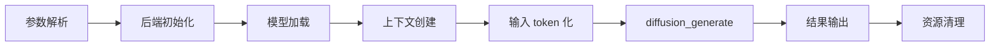
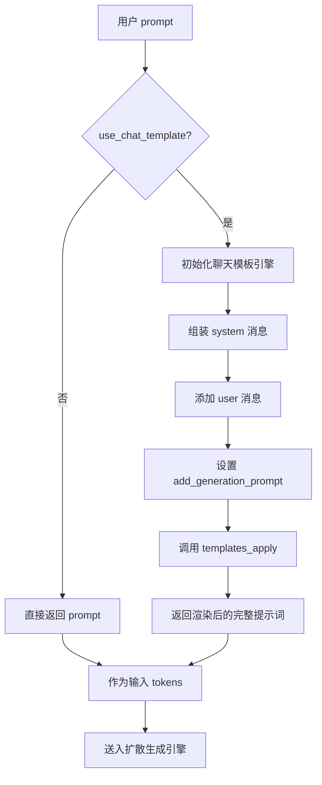
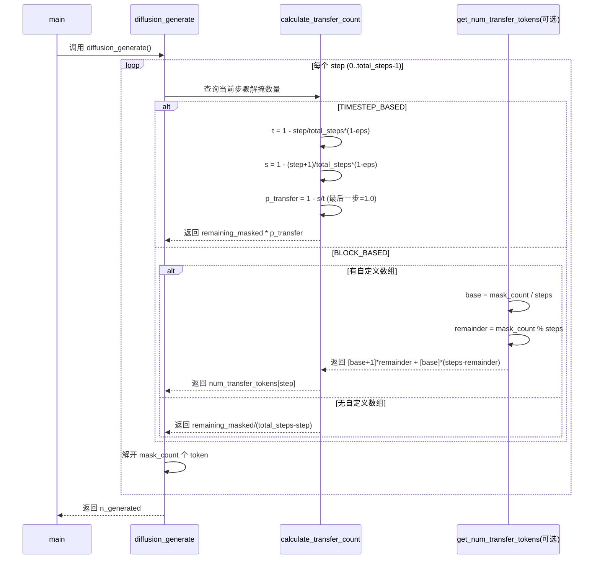
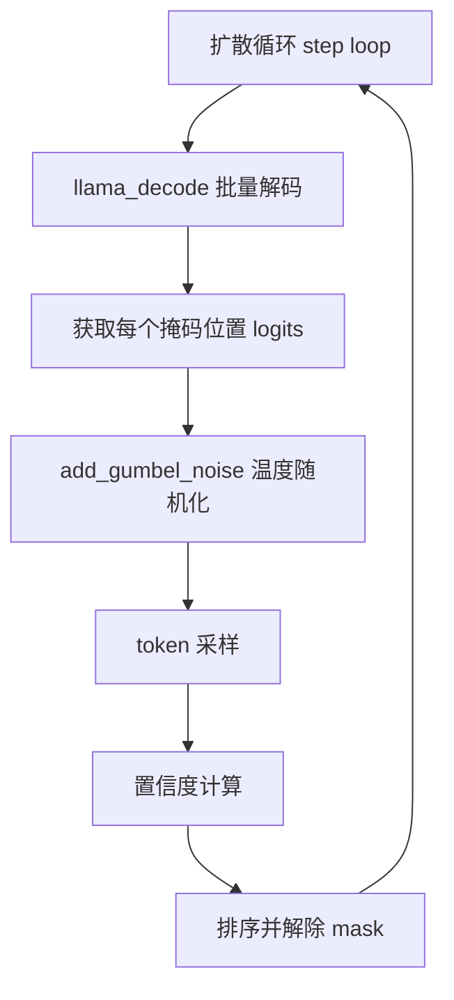
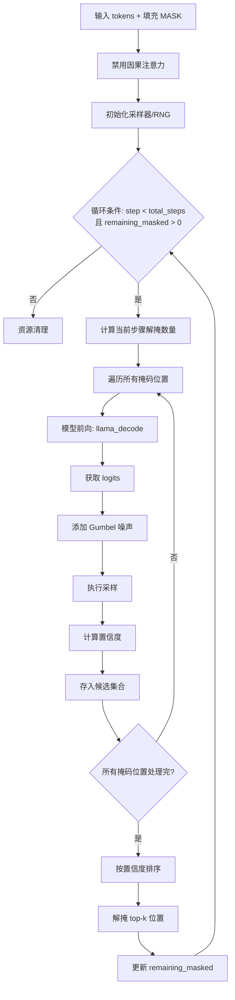
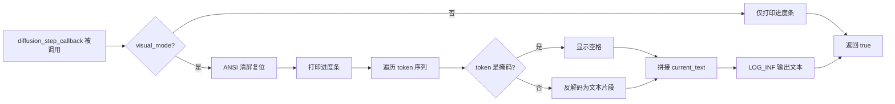
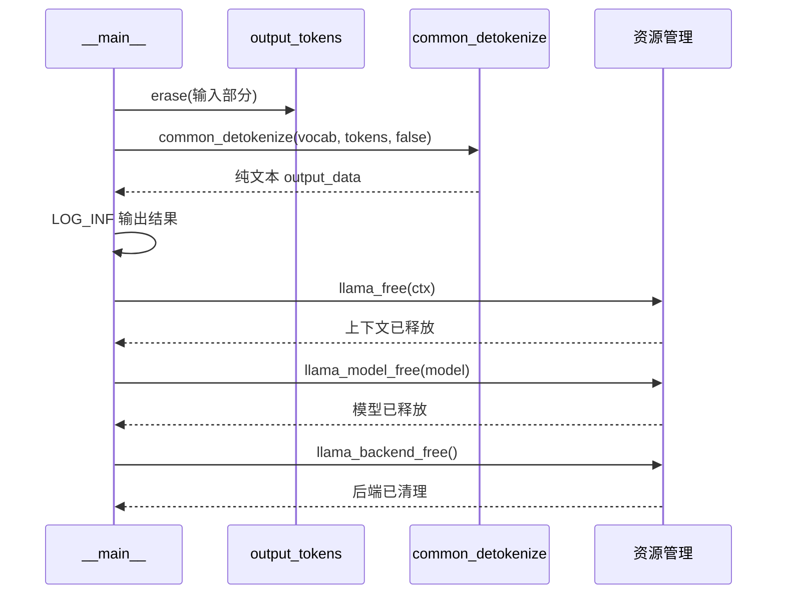

# 第96章 扩散模型推理 —— 考古学家的逆向修复之旅

想象你是一位考古学家，面对的是一只完全打碎的陶罐——碎片散落一地，完全看不出原本的形状。而你的任务，不是按照碎片原有的顺序从左到右拼接，而是依据每一块碎片的完整度和位置信息，从最确定的部分开始，逐步还原整件文物。这就是扩散语言模型的工作方式：它不是像传统 AI 那样一个字一个字地"朗读"文本，而是同时观察所有位置，从一片混沌的掩码中，逐步"浮现"出完整的句子。在本章中，我们将深入 llama.cpp 的 `diffusion-cli` 示例程序，探索这种名为"逆向修复"的文本生成范式。

## 学习目标

- 理解扩散语言模型的核心原理：与自回归模型的本质区别，以及「从掩码到文本」的逆向生成范式
- 掌握 diffusion-cli 示例程序的整体架构：参数解析、模型加载、扩散生成、结果输出的完整流程
- 深入理解置信度计算算法：CONFIDENCE_BASED、ENTROPY_BASED、MARGIN_BASED、RANDOM、ORIGIN 五种策略的实现与适用场景
- 掌握步进调度机制：TIMESTEP_BASED 与 BLOCK_BASED 两种调度策略的数学原理与工程权衡
- 理解 Gumbel 噪声注入技术：温度控制、逆变换采样、对 logits 的平滑处理
- 掌握扩散生成的可视化反馈：进度条渲染、清屏 ANSI 转义序列、token 实时反解码
- 学习输入处理的双路径：纯文本 prompt vs 聊天模板组装（common_chat_templates）
- 理解 CFG（Classifier-Free Guidance）在扩散生成中的作用与配置方法

## 96.1 生活类比

想象扩散语言模型是一位**考古学家修复破碎文物**：**初始文物碎片**就是完全掩码的 token 序列（全是 [MASK]，像打碎的陶片散落一地），**修复过程**则是每个时间步解掩部分 token——注意它不是从左到右拼接，而是依据每块碎片的位置和完整度逐步拼凑。**置信度评分**相当于文物专家的鉴定意见：哪些碎片位置最确定就先修复哪里。这位考古学家拥有五种鉴定方法：CONFIDENCE_BASED 是直接看这块碎片的完整度，ENTROPY_BASED 分析这块区域的不确定性（信息熵），MARGIN_BASED 比较两个最可能选项的差距，RANDOM 则干脆抽签决定，ORIGIN 则回到最初的直觉判断。**调度策略**就是修复计划表：TIMESTEP_BASED 按时间均匀推进，如同考古队的工作进度表；BLOCK_BASED 则根据碎片多少动态调整力量分配。在规划修复任务时，考古队还需要把总量不等的碎片均匀分配到各工作时段，余出的碎片优先安排在前面时段处理，这正是**余数前向分配**的原则。**Gumbel 噪声**像是给专家加入一点"不确定性直觉"，避免过度武断，让修复过程更具探索性。而**可视化反馈**则是修复过程的实时直播，观众能亲眼看到文物逐渐成形。就像考古学家需要先规划修复顺序、评估每块碎片的确定性、再逐步拼合，扩散模型也需要精心调度每步解掩的 token 数量与位置，在双向上下文的加持下，从混沌中逐步雕刻出清晰的文本。

## 96.2 源码地图

```
examples/diffusion/diffusion-cli.cpp
├── 核心算法模块（49-200行）
│   ├── calculate_confidence()        # 置信度计算：基于概率/熵/边际/随机
│   ├── calculate_transfer_count()   # 步进调度：计算每步解掩token数量
│   ├── get_num_transfer_tokens()    # 均匀分配：余数前向分配策略
│   ├── add_gumbel_noise()           # Gumbel噪声注入：温度采样变换
│   └── diffusion_step_callback()    # 进度可视化：ANSI控制+token反解码
├── 扩散引擎核心（203-465行）
│   └── diffusion_generate()         # 主编排函数：循环解掩、采样、置信度排序
│       ├── 初始化阶段               # 填充掩码、禁用因果注意力
│       ├── 循环主体                 # 时间步/分块调度、批量解码
│       ├── 置信度评分               # 选择top-K位置解掩
│       └── 资源清理                 # 释放batch和采样器
├── 输入处理模块（468-496行）
│   └── format_input_text()          # 格式化输入：纯文本vs聊天模板
│       ├── 纯文本路径               # 直接返回原始prompt
│       └── 聊天模板路径             # 组装system/user消息、应用Jinja模板
└── 程序入口（499-638行）
    └── __main__                     # 主函数：完整生命周期管理
        ├── 参数解析                  # common_params_parse()
        ├── 后端初始化               # llama_backend_init()
        ├── 模型加载                 # llama_model_load_*
        ├── 上下文创建               # llama_context配置
        ├── 扩散执行                 # diffusion_generate()
        ├── 结果输出                 # common_detokenize()
        └── 资源清理                 # llama_free()/llama_model_free()
```

## 96.3 扩散生成总闸 —— 考古队的救援总指挥部

### 96.3.1 `__main__`：程序入口与完整生命周期

让我们先看看整个程序的入口函数。这里的关键在于理解扩散式生成与传统自回归的差异——程序从"全掩码"状态开始，而不是从用户输入的第一个 token 开始。

源码路径：`examples/diffusion/diffusion-cli.cpp` - `__main__`（499-638行）

```cpp
int main(int argc, char ** argv) {
    // ① 设置区域设置，确保数值格式不因本地化而改变
    std::setlocale(LC_NUMERIC, "C");
    // ② 初始化 GGML 计时器
    ggml_time_init();
    // ③ 创建通用参数对象
    common_params params;
    // ④ 初始化 common 库
    common_init();
    // ⑤ 解析命令行参数（指定为 DIFFUSION 示例模式）
    if (!common_params_parse(argc, argv, params, LLAMA_EXAMPLE_DIFFUSION)) {
        return 1;
    }
    // ⑥ 初始化所有后端（CPU/GPU），相当于搭建修复工作台
    llama_backend_init();
    // ⑦ 获取默认模型参数
    llama_model_params model_params = llama_model_default_params();
    // ⑧ （省略部分代码）根据命令行参数配置并加载模型
    // ⑨ （省略部分代码）创建 llama 上下文并设置线程参数
    // ⑩ （省略部分代码）格式化提示词并进行 token 化
    // ⑪ （省略部分代码）配置扩散算法、调度方式、采样参数和回调
    // ⑫ 调用扩散生成主函数——正式启动修复工作
    diffusion_generate(ctx, input_tokens.data(), output_tokens.data(), n_input, diff_params, n_generated);
    // ⑬ 判断生成是否成功
    if (n_generated > 0) {
        // ⑭ 去除输入部分，只保留生成内容
        output_tokens.erase(output_tokens.begin(), output_tokens.begin() + n_input);
        // ⑮ 将 token 序列反解码为文本（第三参数 false 表示不使用特殊 token 格式）
        std::string output_data = common_detokenize(vocab, output_tokens, false);
        LOG_INF("\n%s\n", output_data.c_str());
    } else {
        LOG_INF("Error: diffusion generation failed\n");
    }
    // ⑯ 释放上下文、模型和后端资源
    llama_free(ctx);
    llama_model_free(model);
    llama_backend_free();
    return 0;
}
```

这段代码展示了扩散生成程序的完整骨架：参数解析 → 后端初始化 → 模型加载 → 扩散执行 → 结果输出 → 资源清理。注意到与自回归示例的主要差异——在执行阶段调用的是 `diffusion_generate()` 而不是传统的 `llama_decode()` 循环。这就如同考古队搭建好临时指挥部后，直接启动核心修复流程，而不是一章一页地按顺序翻阅史料。

让我们把这段代码的精简骨架与源码展开对齐——`diffusion_generate()`、`format_input_text()`、`diffusion_params` 配置等部分的具体实现，将在后续小节逐一展开详解；点拨 ⑧ 至 ⑪ 的实际逻辑可参考源码 551~612 行区间，内容涉及 `llama_model_load_from_file`、`llama_new_context_with_model` 与 `common_tokenize` 的调用细节，此处从略。



### 96.3.2 `diffusion_params`：扩散参数装配

在跳转主循环之前，我们需要理解扩散参数结构。它定义了扩散生成的所有超参数，如同考古队制定的详细的修复计划书。让我们逐一解读每个字段的含义与作用。

源码路径：`examples/diffusion/diffusion-cli.cpp` - `diffusion_params` 结构体及枚举定义（约25-48行）

```cpp
// 扩散算法枚举（相当于鉴定专家的五种判断方法）
enum diffusion_algorithm {
    CONFIDENCE_BASED, // 基于采样token的置信度：直接评估选中token的概率
    ENTROPY_BASED,    // 基于分布熵：衡量整个概率分布的不确定性
    MARGIN_BASED,     // 基于top-1和top-2概率差：比较最有把握的两个候选
    RANDOM,           // 纯随机：完全不依赖模型输出，适合探索
    ORIGIN            // 原始（同CONFIDENCE_BASED）：保存历史语义，为扩展预留空间
};

// 调度策略枚举（相当于修复计划的两种安排方式）
enum transfer_schedule {
    TIMESTEP_BASED, // 基于时间步：按扩散时间参数t（从1线性递减至eps）计算转移比例
    BLOCK_BASED     // 基于分块：均匀分配或查表使用自定义分配数组
};

// 扩散参数结构体（完整的修复计划书）
struct diffusion_params {
    diffusion_algorithm algorithm = CONFIDENCE_BASED; // 置信度算法：默认使用选中token概率
    transfer_schedule schedule = TIMESTEP_BASED;      // 调度策略：默认使用时间步调度
    int32_t total_steps = 50;                          // 总步数：扩散循环的总迭代次数
    int32_t mask_token_id = -1;                        // [MASK] token ID：mask_token_id初始为-1，主函数中会通过llama_vocab_mask()获取实际值
    int32_t max_length = 256;                          // 最大生成长度：包括输入token在内的总序列长度上限
    float temperature = 1.0f;                          // 采样温度：控制Gumbel噪声强度（0表示贪心）
    float eps = 0.1f;                                  // 步长调节系数：时间t的下限，防止t=0导致除零
    uint32_t seed = 42;                                // 随机种子：保证实验可复现
    bool visual_mode = false;                          // 可视化模式：实时清屏显示当前已生成文本
    bool cfg = false;                                  // CFG是否启用：Classifier-Free Guidance开关
    float cfg_scale = 1.0f;                            // CFG强度：控制条件/无条件logits的插值权重
};
```

这段代码定义了扩散生成的核心配置结构。`algorithm` 和 `schedule` 分别对应置信度评估与步进调度两个核心策略；`mask_token_id` 是扩散模型特有的标记，代表待生成的位置；`total_steps` 与 `eps` 共同决定了时间步进调的粒度与下限；`temperature` 则直接控制了采样随机性。这些字段将在后续的置信度计算、调度与采样流程中被反复读取，是将扩散算法策略以配置形式参数化的关键入口。

## 96.4 提示词处理 —— 考古队的任务简报

### 96.4.1 `format_input_text()`：双路径输入格式化

很多现代 LLM 采用聊天模板格式（system/user/assistant），扩散模型如果基于这些模型改装，需要遵循相同的模板才能理解输入意图。这就是 `format_input_text()` 函数的职责，它就像是考古队长先把任务要求整理成标准简报，再交给修复团队。

源码路径：`examples/diffusion/diffusion-cli.cpp` - `format_input_text()`（468-496行）

```cpp
static std::string format_input_text(const std::string & prompt,
                                     const std::string & system_prompt,
                                     bool use_chat_template,
                                     llama_model * model) {
    // ① 不使用聊天模板：直接返回原始 prompt
    if (!use_chat_template) {
        return prompt;
    }
    // ② 初始化聊天模板引擎（Jinja 转换）
    auto chat_templates = common_chat_templates_init(model, "");
    // ③ 创建输入消息集合
    common_chat_templates_inputs inputs;
    // ④ 如果有系统提示词，添加为 system 角色消息（好比简报中的背景说明）
    common_chat_msg system_msg;
    if (!system_prompt.empty()) {
        system_msg.role = "system";
        system_msg.content = system_prompt;
        inputs.messages.push_back(system_msg);
    }
    // ⑤ 将用户 prompt 添加为 user 角色消息（简报中的具体指令）
    common_chat_msg user_msg;
    user_msg.role = "user";
    user_msg.content = prompt;
    inputs.messages.push_back(user_msg);
    // ⑥ 标记需要添加生成引导标签（相当于简报末尾加一句"请开始修复"）
    inputs.add_generation_prompt = true;
    // ⑦ 应用模板渲染，返回格式化后的完整提示词
    auto result = common_chat_templates_apply(chat_templates.get(), inputs);
    return result.prompt;
}
```

这段代码实现了输入处理的双路径设计：纯文本模式直接通过，聊天模板模式则组装 system/user 消息并通过 Jinja 模板引擎渲染。`add_generation_prompt = true` 确保了末尾添加生成引导标签，让模型知道接下来应该生成什么角色的内容——就像考古队长在简报结尾明确指示"请据此开始修复文物"。

### 96.4.2 `common_chat_templates_inputs`：聊天模板输入容器

在深入主循环之前，让我们先理解两个关键数据结构。它们并非定义在 `diffusion-cli.cpp` 文件内，而是来自 llama.cpp 的核心公共库 `common/` 目录，相关声明可在 `common/chat.hpp` 头文件中找到：

源码路径：`common/chat.hpp` - `common_chat_msg` 与 `common_chat_templates_inputs`（约50-70行）

```cpp
// 单条聊天消息
struct common_chat_msg {
    std::string role;    // 角色： "system"（系统设定） / "user"（用户输入） / "assistant"（模型回答）
    std::string content; // 消息内容：该角色对应的文本内容
};

// 模板输入集合
struct common_chat_templates_inputs {
    std::vector<common_chat_msg> messages;  // 消息列表：按顺序存储多轮对话的历史消息
    std::vector<std::string> tools;         // 工具定义（可选）：用于 function calling 场景
    bool add_generation_prompt = false;     // 是否添加生成引导：为 true 时模板末尾会附加助手角色的起始标记
};
```

`common_chat_msg` 结构体定义了单条消息中角色与内容两个核心字段，`role` 字符串决定了该消息在模板渲染中的定位——系统消息设定背景、用户消息提出需求、助手消息是期望的输出方向；`content` 则承载具体的文本内容。在此基础上，`common_chat_templates_inputs` 作为整个渲染流程的输入容器，将多轮对话的消息列表、可选的工具定义以及是否追加生成引导这三类信息统一封装，通过 `format_input_text()` 中的 `common_chat_templates_apply()` 函数转换成模型可消费的连续文本序列，使得扩散模型能够像理解普通文本一样理解结构化对话。

以下是聊天模板格式化的完整流程示意图：



## 96.5 置信度计算算法 —— 考古专家们的评审交锋

### 96.5.1 `calculate_confidence()`：五种算法各显神通

在扩散生成的每一步，我们需要决定哪些掩码位置应该被解出。这个决定依赖于"置信度"——该位置模型有多确定？`calculate_confidence()` 提供了五种不同的评估角度，如同五位考古专家各持己见，用不同的标准评判哪块碎片最易于修复。

源码路径：`examples/diffusion/diffusion-cli.cpp` - `calculate_confidence()`（49-87行）

```cpp
static float calculate_confidence(const llama_token_data_array & cur_p,
                                  diffusion_algorithm            algorithm,
                                  std::mt19937 &                 rng) {
    // ① 根据算法选择不同路径
    switch (algorithm) {
        // ② 直接返回被选中 token 的概率
        case CONFIDENCE_BASED:
            return cur_p.data[cur_p.selected].p;
        // ③ 基于概率分布的熵（取负），熵越低置信度越高
        case ENTROPY_BASED:
            {
                float entropy = 0.0f;
                // ④ 防止 log(0) 导致 NaN
                const float epsilon = 1e-10f;
                for (size_t i = 0; i < cur_p.size; i++) {
                    float prob = cur_p.data[i].p;
                    entropy += prob * logf(prob + epsilon);
                }
                return -entropy;
            }
        // ⑤ 最高概率与次高概率的差值
        case MARGIN_BASED:
            return (cur_p.size > 1) ? cur_p.data[0].p - cur_p.data[1].p : cur_p.data[0].p;
        // ⑥ 纯随机数（评审团干脆抽签决定）
        case RANDOM:
            {
                std::uniform_real_distribution<float> uniform(0.0f, 1.0f);
                return uniform(rng);
            }
        // ⑦ 回到采样 token 的概率（与 CONFIDENCE_BASED 相同）
        case ORIGIN:
            return cur_p.data[cur_p.selected].p;
        default:
            return 0.0f;
    }
}
```

这段代码实现了五种置信度算法。其中 `ENTROPY_BASED` 和 `MARGIN_BASED` 尤为关键：前者从信息论角度度量整个分布的不确定性，后者则直接比较最高概率与次高概率的差距，相当于专家们评估"最有把握的方案与次有把握的方案相差多大"；而 `RANDOM` 则是完全随机的抽签，适合探索性场景；`ORIGIN` 保留独立枚举主要是为了语义区分——它代表"回归模型最初的直觉判断"，为未来扩展预留了空间。注意 `MARGIN_BASED` 中加入了 `cur_p.size > 1` 的防御性检查——如果词表只有一个 token，差值没有意义。

五种算法的完整架构关系如下图所示：

```mermaid
graph TD
    A[calculate_confidence] --> B{algorithm 选择}
    B -->|CONFIDENCE_BASED| C[返回选中 token 概率]
    B -->|ENTROPY_BASED| D[遍历全部分布求和]
    D --> D1[计算 -Σp·log(p+ε)]
    B -->|MARGIN_BASED| E[计算 top1 - top2]
    B -->|RANDOM| F[均匀分布采样]
    B -->|ORIGIN| G[返回选中 token 概率]
    C --> H[返回 float 置信度]
    D1 --> H
    E --> H
    F --> H
    G --> H
```

### 96.5.2 `calculate_confidence()` 五种算法的数学特性对比

为了更直观地理解五种置信度算法的差异，下表列出了核心特征，帮助读者快速对照：

| 算法 | 数学表达 | 优点 | 缺点 | 适用场景 |
|------|----------|------|------|----------|
| `CONFIDENCE_BASED` | `P(selected)` | 直观、计算快 | 无法反映整体分布 | 模型输出较确定时 |
| `ENTROPY_BASED` | `-Σ P(i)·log P(i)` | 全局视角 | 计算量大 | 需要评估整体不确定性 |
| `MARGIN_BASED` | `P(top1) - P(top2)` | 区分度高 | 忽略长尾 | 存在明显竞争候选时 |
| `RANDOM` | `U(0,1)` | 简单 | 无信息量 | 探索性生成 |
| `ORIGIN` | `P(selected)` | 保留历史语义 | 与 CONFIDENCE 重复 | 兼容旧版本 |

## 96.6 步进调度策略 —— 修复节奏的总设计师

### 96.6.1 `calculate_transfer_count()`：调度核心

扩散生成不是一次性解开所有掩码，而是分步进行。每步应该解开多少 token？这取决于调度策略。`calculate_transfer_count()` 实现了两种调度哲学，如同考古队决定每天修复多少块碎片一样。

源码路径：`examples/diffusion/diffusion-cli.cpp` - `calculate_transfer_count()`（90-118行）

```cpp
static int32_t calculate_transfer_count(int32_t step,
                                        int32_t total_steps,
                                        int32_t remaining_masked,
                                        transfer_schedule schedule,
                                        float eps,
                                        const std::vector<int32_t> & num_transfer_tokens = {}) {
    // ① 根据调度策略选择分支
    switch (schedule) {
        // ② 时间步调度：基于扩散时间参数 t 计算
        case TIMESTEP_BASED:
            {
                // ③ 当前时间 t：从 1 线性递减到 eps（eps 是时间下限，防止t为0导致除零）
                float t = 1.0f - (float) step / total_steps * (1.0f - eps);
                // ④ 下一时间 s：比 t 更接近 eps
                float s = 1.0f - (float) (step + 1) / total_steps * (1.0f - eps);
                // ⑤ 转移比例：1 - s/t（除最后一步外），最后一步强制全部解出
                float p_transfer = (step < total_steps - 1) ? (1.0f - s / t) : 1.0f;
                // ⑥ 乘以剩余掩码数量，得到当前步应解掩的token数
                return (int32_t) (remaining_masked * p_transfer);
            }
        // ⑦ 分块调度：均匀分配或使用自定义数组
        case BLOCK_BASED:
            // ⑧ 如果提供了自定义分配数组，直接查表（工程定制化）
            if (!num_transfer_tokens.empty() && step < (int32_t) num_transfer_tokens.size()) {
                return num_transfer_tokens[step];
            }
            // ⑨ 否则均匀分配剩余量
            return remaining_masked / (total_steps - step);
        default:
            return remaining_masked / (total_steps - step);
    }
}
```

这段代码实现了两种调度策略。`TIMESTEP_BASED` 通过指数衰减的方式计算转移比例——早期步骤解开较多 token，后期逐渐减少；`BLOCK_BASED` 则简单均匀分配，或查表使用 `num_transfer_tokens` 数组。特别注意 `eps` 参数的作用：它定义了时间 t 的下限，确保了每一步都有一个非零的"修复进度"，并且防止了除零错误——就像考古队即使在最艰难的阶段也要保持最低限度的推进速度。

### 96.6.2 `calculate_transfer_count()` 调度策略的数学对比与调度时序

两种调度策略各有适用场景，下表从多个维度进行了对比：

| 特性 | `TIMESTEP_BASED` | `BLOCK_BASED` |
|------|------------------|----------------|
| 数学基础 | 连续时间衰减 | 离散均匀分配 |
| 每步解掩数量 | 先多后少 | 基本均匀 |
| 最后一步处理 | 强制解出全部残留 | 同样均匀 |
| 优点 | 平滑、模拟扩散过程 | 简单、可预测 |
| 缺点 | 后期步骤可能过少 | 可能忽快忽慢 |
| 适用场景 | 高质量生成 | 需要稳定节奏 |

以下是调度时序图：



## 96.7 均匀分配技巧 —— 碎片工作量的精明分配

### 96.7.1 `get_num_transfer_tokens()`：余数前向分配

当使用 `BLOCK_BASED` 调度时，如果 `mask_count = 10, steps = 3`，简单的整数除法会导致 10/3 = 3 余 1，怎样分配这个余数？就像考古队有 10 块碎片要分配给 3 个工作时段，不能把最后一块碎片单独留到最后一个时段——`get_num_transfer_tokens()` 给出了优雅的解决方案：把余出的碎片优先安排给前面时段。

源码路径：`examples/diffusion/diffusion-cli.cpp` - `get_num_transfer_tokens()`（189-200行）

```cpp
static std::vector<int32_t> get_num_transfer_tokens(int32_t mask_count, int32_t steps) {
    // ① 初始化转移数组（相当于为每个工作时段准备一个盒子）
    std::vector<int32_t> num_transfer_tokens(steps);
    // ② 计算整数商（每个时段的基准工作量）
    int32_t base = mask_count / steps;
    // ③ 计算余数（无法均分的碎片数量）
    int32_t remainder = mask_count % steps;
    // ④ 循环分配：余数个步骤多分配 1 个（前几个时段多承担一块碎片）
    for (int32_t i = 0; i < steps; i++) {
        num_transfer_tokens[i] = base + (i < remainder ? 1 : 0);
    }
    // ⑤ 返回分配结果
    return num_transfer_tokens;
}
```

`get_num_transfer_tokens()` 函数的核心价值在于将总掩码数量尽可能均匀地分配到各个扩散步骤，同时通过余数前向分配策略确保最早期的步骤承担稍多的解掩任务。它先通过整数除法计算出每个步骤的基准工作量 `base`，再利用取模运算得到无法整除的余数 `remainder`，最后在循环中为前 `remainder` 个步骤各增加 1 个 token 的解掩量。这种设计既保证了分配总和的精确性（`base * steps + remainder` 恰好等于 `mask_count`），又使各步骤之间的解掩数量差异不超过 1，实现了方差最小化，契合扩散过程"初期快速推进、后期逐步完善"的特性。

### 96.7.2 `get_num_transfer_tokens()` 分配策略示例

为了更直观地展示余数前向分配的效果，下表列举了几种典型场景的分配结果，读者可以快速验证算法的行为模式：

| mask_count | steps | base | remainder | 分配结果 |
|------------|-------|------|-----------|----------|
| 10 | 3 | 3 | 1 | [4, 3, 3] |
| 10 | 4 | 2 | 2 | [3, 3, 2, 2] |
| 100 | 7 | 14 | 2 | [15, 15, 14, 14, 14, 14, 14] |
| 50 | 10 | 5 | 0 | [5, 5, 5, 5, 5, 5, 5, 5, 5, 5] |

## 96.8 Gumbel 噪声与温度采样 —— 概率世界的随机化

### 96.8.1 `add_gumbel_noise()`：温度控制的随机化

在从 logits 中采样 token 之前，扩散模型通常需要添加 Gumbel 噪声来平滑概率分布。`add_gumbel_noise()` 实现了基于温度的 Gumbel 噪声注入——就像在考古专家的鉴定过程中注入一定程度的"直觉灵感"，让修复过程不至于过于死板。

源码路径：`examples/diffusion/diffusion-cli.cpp` - `add_gumbel_noise()`（173-186行）

```cpp
static void add_gumbel_noise(float * logits, int32_t n_vocab, float temperature, std::mt19937 & rng) {
    // ① 温度为零：不添加噪声（贪心模式）
    if (temperature == 0.0f) {
        return;
    }
    // ② 创建均匀分布随机数生成器
    std::uniform_real_distribution<double> uniform(0.0, 1.0);
    // ③ 遍历词表中的每个 token
    for (int32_t i = 0; i < n_vocab; i++) {
        // ④ 从均匀分布采样
        double noise = uniform(rng);
        // ⑤ 防止 log(0) 导致无穷大
        noise = std::max(noise, 1e-20);
        // ⑥ 逆变换采样：转化为 Gumbel 分布样本
        double gumbel_noise = std::pow(-std::log(noise), temperature);
        // ⑦ 用 Gumbel 噪声重新归一化 logits
        logits[i] = std::exp(logits[i]) / gumbel_noise;
    }
}
```

这段代码展示了 Gumbel-Softmax 的核心变换。关键在于 `-log(noise)`——这是从均匀分布生成指数分布的标准逆变换采样形式，再通过温度参数 `temperature` 进行幂次缩放控制噪声强度。温度越高，`gumbel_noise` 越小，`exp(logits)/gumbel_noise` 越大，分布越平坦；温度越低，噪声影响越小，分布越尖锐。当 `temperature == 0.0f` 时直接返回，意味着完全采用贪心策略（取最大概率的 token），这种设计取舍在 95.12 节中会深入讨论。

在扩散引擎整体流程中，`add_gumbel_noise` 位于采样步骤的前置阶段，其架构定位如下：



### 96.8.2 `add_gumbel_noise()` 的温度效应

温度参数直接决定了噪声的强度，进而影响采样的随机性程度。下表展示了不同温度下的行为差异，帮助读者理解温度调节的实际效果：

| 温度 | `gumbel_noise` 范围 | 分布形态 | 采样行为 |
|------|---------------------|----------|----------|
| 0.0 | 不添加 | 原始分布 | 贪心（取最大概率） |
| 0.5 | 中等 | 略平滑 | 温和探索 |
| 1.0 | 较大 | 明显平滑 | 标准采样 |
| >1.0 | 很大 | 接近均匀 | 高度随机 |

## 96.9 扩散执行引擎 —— 修复工作的大本营

### 96.9.1 `diffusion_generate()`：主编排函数

这是整个扩散生成的"大脑"，负责编排各算法与步骤。以下展示的是该函数的节选/概括版骨架，对应源码 203-465 行的核心结构，我们在此基础上进行关键逻辑的标注分析。

源码路径：`examples/diffusion/diffusion-cli.cpp` - `diffusion_generate()`（203-465行，节选/概括版）

```cpp
static void diffusion_generate(llama_context * ctx,
                               const llama_token * input_tokens,
                               llama_token * output_tokens,
                               int32_t n_input,
                               const diffusion_params & params,
                               int32_t & n_generated) {
    // ① 初始化生成长度
    n_generated = 0;
    // ② 参数合法性校验（防止空指针或越界）
    if (!ctx || !input_tokens || !output_tokens || n_input <= 0 || params.max_length <= n_input) {
        return;
    }
    // ③ 获取模型对象和词表
    const llama_model * model = llama_get_model(ctx);
    // ④ 复制输入 tokens 到输出缓冲区
    std::copy(input_tokens, input_tokens + n_input, output_tokens);
    // ⑤ 用 mask_token_id 填充剩余位置（相当于在碎片尚未修复处标记"待定"）
    std::fill(output_tokens + n_input, output_tokens + params.max_length, params.mask_token_id);
    // ⑥ 初始化 RNG
    std::mt19937 rng(params.seed);
    // ⑦ 禁用因果注意力（每位修复专家都能看到所有碎片的位置）
    llama_set_causal_attn(ctx, false);
    // ⑧ 获取词表大小
    int32_t n_vocab = llama_vocab_n_tokens(llama_model_get_vocab(model));
    // ⑨ 初始化采样器、批处理对象和可选 CFG 缓冲区（对应源码约220-280行）
    // ⑩ 按时间步或分块方式循环执行扩散生成（对应源码约283-440行，核心逻辑见95.9.2）
    // ⑪ 对掩码位置计算 logits、采样 token 和置信度（对应源码约310-390行，涉及 add_gumbel_noise 与采样器回调）
    // ⑫ 根据置信度选择需要在当前步骤解除掩码的位置（对应源码约390-430行，排序后选取 top-k）
    // ⑬ 释放 llama batch 与 sampler 资源并返回生成长度（对应源码约440-465行）
}
```

需要说明的是，由于源码在 203-465 行区间包含了完整的采样器配置、批次管理、循环控制等大量实现细节，篇幅较长，为便于读者聚焦核心逻辑，此处以节选/概括版骨架展示关键流程。完整源码在循环内部还涉及 `llama_batch` 的 token 填充与位置设置、`llama_sampler` 的创建与配置、CFG 双路径 logits 插值，以及每步结束后的垃圾回收等细节，建议读者结合源码文件深入学习。关键的是，上述代码展示了扩散生成的完整生命周期骨架。最关键的步骤是 `llama_set_causal_attn(ctx, false)`——禁用因果注意力，这意味着每个位置都能看到所有其他位置的上下文（不仅仅是它之前的 token），这是扩散模型与自回归模型的根本区别。

### 96.9.2 循环主体：逐步解掩与置信度排序

`diffusion_generate()` 的核心循环负责驱动整个去掩码过程。以下是循环主体的关键逻辑（对应源码203-465行，为便于理解，以下是对该区间循环逻辑的概要重构表述，并非源码原文）：

```cpp
// 扩散循环主体（概要重构，对应源码循环部分）
// step 从 0 到 total_steps-1
while (step < total_steps && remaining_masked > 0) {
    // ① 根据调度策略计算本步应解掩的 token 数量
    int32_t n_transfer = calculate_transfer_count(
        step, total_steps, remaining_masked, params.schedule, params.eps, num_transfer_tokens);

    // ② 对当前批次中每个掩码位置执行模型前向传播
    for (int i = 0; i < n_tokens; i++) {
        if (output_tokens[i] == mask_token_id) {
            // ③ 获取该位置的 logits（对应源码中的 llama_get_logits_ith）
            float * logits = 获取第 i 个位置的 logits;
            // ④ 添加 Gumbel 噪声软化分布
            add_gumbel_noise(logits, n_vocab, params.temperature, rng);
            // ⑤ 执行采样得到候选 token（对应源码中的 llama_sampler_sample）
            llama_token sampled = 采样函数(logits);
            // ⑥ 构建 token 概率数组（对应源码中的 llama_token_data_array）
            llama_token_data_array cur_p = { 填充概率分布 };
            // ⑦ 按选定的算法计算置信度
            float conf = calculate_confidence(cur_p, params.algorithm, rng);
            // ⑧ 将(置信度, 位置, token)存入候选集合
            candidates.push_back({conf, i, sampled});
        }
    }
    // ⑨ 按置信度降序排序（最具确定性的位置优先释放）
    sort(candidates.rbegin(), candidates.rend());
    // ⑩ 选前 n_transfer 个位置解除掩码
    for (int j = 0; j < n_transfer && j < candidates.size(); j++) {
        output_tokens[candidates[j].pos] = candidates[j].token;
    }
    // ⑪ 更新剩余掩码计数
    remaining_masked -= n_transfer;
}
```

该循环是 `diffusion_generate()` 的核心驱动力，它将“从混沌到有序”的逆向生成过程分解为多个可管理的迭代步骤。每个迭代步骤都遵循“先确定解掩数量，再对各掩码位置进行解码与采样，最终按置信度排序并解除确定性最高的 top-k 个掩码”的固定模式，从而在保持全局双向上下文的同时，逐步将掩码序列恢复为连贯的文本。这里的推演严格利用了前面章节的核心原语：`calculate_transfer_count`（95.6）决定“解多少”，`add_gumbel_noise`（95.8）负责“如何扰动”，`calculate_confidence`（95.5）确定“优先解哪里”——三个函数在循环中被有机串联，共同构成了扩散生成的核心引擎。

### 96.9.3 流程图

以下是扩散生成主流程的完整架构分层图：



## 96.10 进度可视化 —— 让黑暗过程看得见

### 96.10.1 `diffusion_step_callback()`：可交互的进度反馈

扩散生成通常需要多步迭代，用户需要知道当前进度。`diffusion_step_callback()` 提供了两种可视化模式，如同考古现场的大屏幕直播修复进度。

源码路径：`examples/diffusion/diffusion-cli.cpp` - `diffusion_step_callback()`（121-170行）

```cpp
static bool diffusion_step_callback(int32_t step,
                                    int32_t total_steps,
                                    const llama_token * tokens,
                                    int32_t n_tokens,
                                    void * user_data) {
    // ① 解包用户数据（包含可视化配置和历史信息）
    callback_data * data = static_cast<callback_data *>(user_data);
    // ② 定义进度条渲染 lambda（内部函数）
    auto print_progress_bar = [](int32_t step, int32_t total_steps) {
        // ③ 计算百分比
        int progress_percent = (step * 100) / total_steps;
        // ④ 计算 50 字符宽度的进度条填充
        int progress_bars = (step * 50) / total_steps;
        LOG_INF("\rdiffusion step: %d/%d [%s%s] %d%%", step, total_steps,
                std::string(progress_bars, '=').c_str(),
                std::string(50 - progress_bars, ' ').c_str(),
                progress_percent);
    };
    // ⑤ 可视化模式：清屏并实时显示当前文本
    if (data->diff_params->visual_mode) {
        // ⑥ ANSI 清屏（\033[2J）+ 光标回原位（\033[H）
        LOG_INF("\033[2J\033[H");
        // ⑦ 打印进度条
        print_progress_bar(step, total_steps);
        // ⑧ 构建当前已生成文本字符串
        std::string current_text = " ";
        // ⑨ 遍历所有输入和生成位置
        for (int32_t i = data->n_input; i < n_tokens; i++) {
            std::string token_str;
            // ⑩ 如果当前 token 不是掩码（已被解出）
            if (tokens[i] != llama_vocab_mask(data->vocab)) {
                // ⑪ 将 token 反解码为文本片段，false 表示不使用特殊 token 格式（如添加空格前缀等）
                char piece[256];
                int n_chars = llama_token_to_piece(data->vocab, tokens[i], piece, sizeof(piece), 0, false);
                if (n_chars > 0) {
                    piece[n_chars] = '\0';
                    token_str = piece;
                }
            // ⑫ 掩码位置用空格占位（尚未修复的区域）
            } else {
                token_str = " ";
            }
            // ⑬ 拼接当前文本
            current_text += token_str;
        }
        // ⑭ 输出当前进度和文本
        LOG_INF("%s\n", current_text.c_str());
    // ⑮ 非可视化模式：仅打印进度条
    } else {
        print_progress_bar(step, total_steps);
    }
    return true;
}
```

该回调函数在扩散生成的每个时间步被触发，其核心设计目标是提供直观且低干扰的进度反馈。函数首先解包用户数据结构，然后根据可视化模式分支处理：在非可视化模式下仅渲染一个简洁的进度条；在可视化模式下，则通过 ANSI 转义序列清屏复位，重新绘制进度条，并逐 token 反解码当前所有非掩码位置，将已生成的文本实时展示在终端上。这一机制不仅让用户能动态感知生成进度，更是开发者观察扩散生成过程中掩码逐步退化的窗口，为调试调度算法与置信度策略提供了直观依据。注意到 `llama_token_to_piece` 的最后一个参数为 `false`，表示不启用特殊 token 格式化（如添加 BPE 前缀空格），这样输出的文本片段会更加干净自然。



## 96.11 收尾与输出 —— 修复成果的展览布设

### 96.11.1 `__main__()` 输出处理与资源释放

`__main__` 函数的最后部分负责将生成的 token 序列转换为可读文本并释放资源：

源码路径：`examples/diffusion/diffusion-cli.cpp` - `__main__`（499-638行）

```cpp
// ① 检查生成是否成功
if (n_generated > 0) {
    // ② 去除输入部分，只保留生成内容
    output_tokens.erase(output_tokens.begin(), output_tokens.begin() + n_input);
    // ③ 将 token ID 序列转回纯文本
    std::string output_data = common_detokenize(vocab, output_tokens, false);
    // ④ 输出最终结果
    LOG_INF("\n%s\n", output_data.c_str());
} else {
    LOG_INF("Error: diffusion generation failed\n");
}
// ⑤ 释放上下文、模型、后端资源
llama_free(ctx);
llama_model_free(model);
llama_backend_free();
```

这段代码的要点在于 `common_detokenize(vocab, output_tokens, false)`——第三参数 `false` 表示不使用特殊 token 格式，确保输出是干净的纯文本。资源释放顺序遵循后进先出原则（LIFO）：首先释放最晚创建的上下文对象，然后释放模型，最后清理后端——这类似于拆除建筑时先拆内部装修再拆主体结构，确保依赖关系的正确性。

从整体流程来看，收尾阶段完成了从"技术产物（token 序列）"到"人类可读文本"的最终转化，同时通过严谨的资源释放保证了程序的健壮性与可重复运行性，为扩散生成的完整生命周期画上了句号。



## 96.12 设计中的取舍

### 96.12.1 为什么 diffusion-cli 不使用 `llama_decode()` 直接处理整个批次？

在自回归模型中，`llama_decode()` 一次只处理一个 token，因为每个位置只依赖前面位置的信息。但扩散模型需要同时观察所有位置，因此不能简单复用自回归的解码流程。`diffusion_generate()` 为此构建了一个专门的循环：它在每个时间步中，对当前所有掩码位置执行一次批次解码，然后根据置信度决定哪些位置被"唤醒"。这种设计牺牲了逐 token 解码的简单性，但换来了扩散生成的核心能力——并行评估所有位置的双向上下文。

### 96.12.2 为什么 TIMESTEP_BASED 最后一步强制 `p_transfer = 1.0`？

这是防止残留掩码的关键设计。在扩散过程中，如果最后一步仍按比例计算，可能会留下若干个掩码位置没有被解开，导致生成的文本不完整。强制 `p_transfer = 1.0` 确保所有剩余掩码在最后一步被全部解出。这一设计本质上是用最终步骤的"非平滑跳跃"换取生成的完整性保证——如果不强制，最后一步的转移比例会小于 1，导致部分 token 永远无法被解开，生成过程将以不完整的掩码序列终止。因此，强制解掩是一种保证算法可终止且输出完整性的必要工程决策，它牺牲的是"渐进平滑性"中最后一步的自然过渡，但这种牺牲换来了生成结果的结构完整性。

### 96.12.3 为什么 `ORIGIN` 算法与 `CONFIDENCE_BASED` 实现相同？

从代码逻辑上看，`ORIGIN` 确实与 `CONFIDENCE_BASED` 返回相同的值。保留独立枚举的主要原因是语义区分——`ORIGIN` 代表"回归到模型最初的概率估计"，而 `CONFIDENCE_BASED` 可能在未来版本中引入不同实现（如结合温度缩放）。这种设计为扩展保留了空间，同时保持了向后兼容。

## 96.13 动手练习

本节提供四个动手练习项目，它们分别聚焦于置信度算法的理解与扩展、调度策略的自适应优化、可视化调试工具的构建以及超参数空间的系统探索。每个练习均包含具体的实现指引与思考方向，建议读者按顺序完成以建立完整的实践认知。

1. **对比五种置信度算法的数学特性。** 阅读 `examples/diffusion/diffusion-cli.cpp` 第49-87行的 `calculate_confidence()` 函数实现，完成以下任务：

   - 手工计算：给定概率分布 `[0.5, 0.3, 0.15, 0.05]`，分别用五种算法计算置信度得分。
   - 分析边界情况：当所有 token 概率相等时（均匀分布），`ENTROPY_BASED` 会返回什么值？当词表大小 = 1 时，`MARGIN_BASED` 的逻辑分支会如何处理？为什么需要防御性编程？`RANDOM` 模式下，置信度与模型输出是否完全解耦？这对生成质量有何影响？
   - 修改代码：添加一个新的置信度算法 `TOP_K_ENTROPY`，只计算前 K 个候选的熵值，并实现一个命令行参数 `--confidence-algorithm` 允许用户选择算法。
   - 深度思考：为什么 `ORIGIN` 与 `CONFIDENCE_BASED` 的实现相同但保留为独立枚举？是否存在历史版本差异？

   **进阶挑战**：查阅论文《Large Language Diffusion Models with Confidence-Based Decoding》（假设存在），对比理论与实现的差异。

2. **实现自适应步长调度算法。** 研究 `calculate_transfer_count()`（第90-118行）与 `get_num_transfer_tokens()`（第189-200行）的协同关系，完成以下任务：

   - 当前问题：`BLOCK_BASED` 模式是静态均分，如果某些掩码位置的置信度极高，本可以提前解出，但算法仍会按固定节奏推进。
   - 设计一个 `ADAPTIVE_BASED` 新调度策略，核心思想：根据每个掩码位置的置信度动态调整解掩顺序。实现要求包括：在 `diffusion_generate()` 内部维护一个优先级队列（置信度降序排列）；每步从队列头部取 top-K 位置解掩，而非按顺序处理；动态更新剩余位置的置信度（因为部分解掩后，上下文改变，原置信度可能失效）。代码实现可使用 `std::priority_queue<std::pair<float, int32_t>>` 存储（置信度，token索引），每步解掩后重新计算剩余位置的置信度（可选优化：只更新相邻位置）。
   - 性能评估：对比三种调度模式在同一 prompt 上的生成质量（BLEU/ROUGE 分数）；对比三种模式的耗时（测量 `diffusion_generate()` 的执行时间）；绘制置信度-步数关系曲线，观察 `ADAPTIVE` 是否能在前期更快收敛。
   - 扩展思考：如果模型支持置信度预测的「置信头」（confidence head），能否将其作为额外的评分信号？

3. **构建可视化调试工具。** 分析 `diffusion_step_callback()`（第121-170行）的可视化实现机制，开发一个增强版调试工具 `diffusion-visualizer`，功能需求如下：

   - 数据记录模块：在 `diffusion_step_callback()` 中添加钩子函数，将每步的 token 序列、置信度数组写入 JSON Lines 文件，格式示例：`{"step": 5, "total_steps": 50, "tokens": [...], "confidences": [...], "elapsed_ms": 120}`。
   - 可视化界面（可选 Python/HTML）：编写独立的可视化脚本，读取 JSONL 文件，生成动画 GIF 或交互式 HTML；用热力图表示置信度分布（x 轴：token 位置，y 轴：步骤步数，颜色深浅：置信度高低）；支持回放，可以逐步查看任意时刻的中间状态。
   - 对比模式：支持同时加载多次运行结果（不同温度/调度算法），并排显示差异；高亮显示分歧点——哪些位置在不同配置下解出了不同 token？
   - 统计分析：计算平均每步解掩 token 数的实际分布（与理论预期对比）；统计各置信度算法的选择偏好（哪个位置最常被选中？）。
   - 实现提示：修改 `diffusion_step_callback()` 时，确保回调数据可通过 `user_data` 传递自定义结构体；Python 侧可使用 `matplotlib.animation` 或 `manim` 生成动画；注意 ANSI 转义序列在非交互终端可能需要禁用（添加 `--no-color` 参数）。

4. **探索扩散模型的超参数空间。** 系统实验 `diffusion_params` 中各参数对生成质量的影响，阅读 `diffusion_generate()`（第203-465行）与 `__main__`（第499-638行）的参数配置逻辑，完成以下实验：

   - 网格搜索（Grid Search）：选取 4 个关键超参数——`temperature`（温度）、`num_steps`（总步数）、`algorithm`（置信度算法）、`schedule`（调度策略）。设计 4x3x3x2 的实验组合（温度：0.5/0.8/1.0/1.2，步数：10/20/50，算法：置信度/熵/边际，调度：时间步/分块），对同一 prompt 运行所有组合并保存结果。
   - 质量评估指标：自动评估使用 perplexity（反向困惑度）衡量流畅度；人工评估抽样 10% 结果，人工打分（1-5 分：连贯性、相关性、创造性）。
   - 效率分析：记录每步耗时，计算吞吐量（tokens/second），绘制质量-速度权衡曲线（Pareto frontier）。
   - 发现报告：总结哪些参数组合在特定任务（创意写作 vs 代码生成）上表现最优；是否存在「甜点区」（sweet spot）——某个参数范围既能保证质量又有较快速度？提出自动参数推荐算法：根据输入 prompt 的特征（长度、类型）预测最优参数。
   - 工程实现：编写 Python 包装脚本，批量执行 diffusion-cli 进程；使用 SQLite 或 Pandas DataFrame 存储实验结果；用 matplotlib/seaborn 生成出版级图表。
   - 深度思考：为什么温度参数在扩散模型中的作用可能与自回归模型不同？（提示：双向上下文与多候选并行评估）

## 96.14 本章小结

这一章中我们深入探索了 llama.cpp 中扩散语言模型的推理实现，理解了一种与自回归截然不同的文本生成范式。首先我们从生活类比出发，理解了扩散模型就像考古学家修复破碎文物——从全掩码状态开始，依据置信度逐步还原完整文本。其次我们剖析了 `diffusion-cli` 示例的完整架构：从参数解析、模型加载、输入格式化（纯文本与聊天模板双路径）、到五种置信度计算算法（CONFIDENCE、ENTROPY、MARGIN、RANDOM、ORIGIN），再到两种步进调度策略（TIMESTEP_BASED 与 BLOCK_BASED）。接着我们理解了 Gumbel 噪声注入的温度控制机制，以及均匀分配的余数前向分配技巧。然后我们深入了扩散执行引擎 `diffusion_generate()` 的完整流程——禁用因果注意力、批量解码、置信度排序、逐步解除掩码，并学习了如何通过 ANSI 转义序列实现可视化的进度反馈。最后我们分析了程序的收尾与资源释放，并在「设计中的取舍」中探讨了为什么扩散模型不能直接复用自回归解码流程，以及最后一步强制解掩的设计考量。

现将本章涉及的核心概念汇总如下表：

| 概念 | 解释 |
|------|------|
| `diffusion_params` | 扩散参数结构体：算法、步数、掩码token、调度、温度等超参数集合 |
| `calculate_confidence()` | 置信度评估器：五种算法（置信度/熵/边际/随机/原始）计算token确定程度 |
| `calculate_transfer_count()` | 调度核心：根据时间步或分块策略计算当前步骤应解掩的token数量 |
| `get_num_transfer_tokens()` | 均匀分配算法：余数前向分配，保证总和精确且方差最小 |
| `add_gumbel_noise()` | Gumbel噪声注入：通过温度控制的随机化，平滑概率分布 |
| `diffusion_step_callback()` | 进度可视化：ANSI清屏+进度条+实时token反解码显示 |
| `format_input_text()` | 输入格式化：支持纯文本与聊天模板（system+user+assistant）双模式 |
| `diffusion_generate()` | 扩散引擎主函数：完整执行从全掩码到全文本的逆向生成流程 |
| `common_chat_templates` | 聊天模板引擎：兼容Jinja模板，格式化多轮对话历史 |
| `llama_set_causal_attn(ctx, false)` | 禁用因果注意力：扩散模型需要双向上下文理解 |
| `llama_token_data_array` | 采样结果容器：存储token概率分布与选中索引 |
| `entropy` | 信息熵：概率分布的不确定性度量，熵越低置信度越高 |
| `margin` | 边际差值：最高概率与次高概率的差距，越大越确定 |
| `TIMESTEP_BASED` | 时间步调度：基于t参数计算转移比例，平滑递进 |
| `BLOCK_BASED` | 分块调度：均分剩余掩码，支持自定义分配数组 |
| `mask_token_id` | 掩码标识：[MASK] token在词表中的ID，代表待生成位置 |
| `CFG（Classifier-Free Guidance）` | 分类器无关引导：通过双路径采样提升生成质量 |

在下一章中，我们将转换视角，探索 llama.cpp 在**多模态推理**方向上的应用——你将看到如何将视觉编码器与语言模型无缝结合，让文本生成模型能够"看图说话"。具体而言，我们会深入 `llava-cli` 示例，剖析图像 Embedding 的提取、投影层的桥接作用，以及多模态上下文如何在自回归解码中被高效地组织与使用。届时你会发现，扩散模型中的双向上下文与多模态模型的跨模态认知，在工程实现上竟有着异曲同工之妙。

