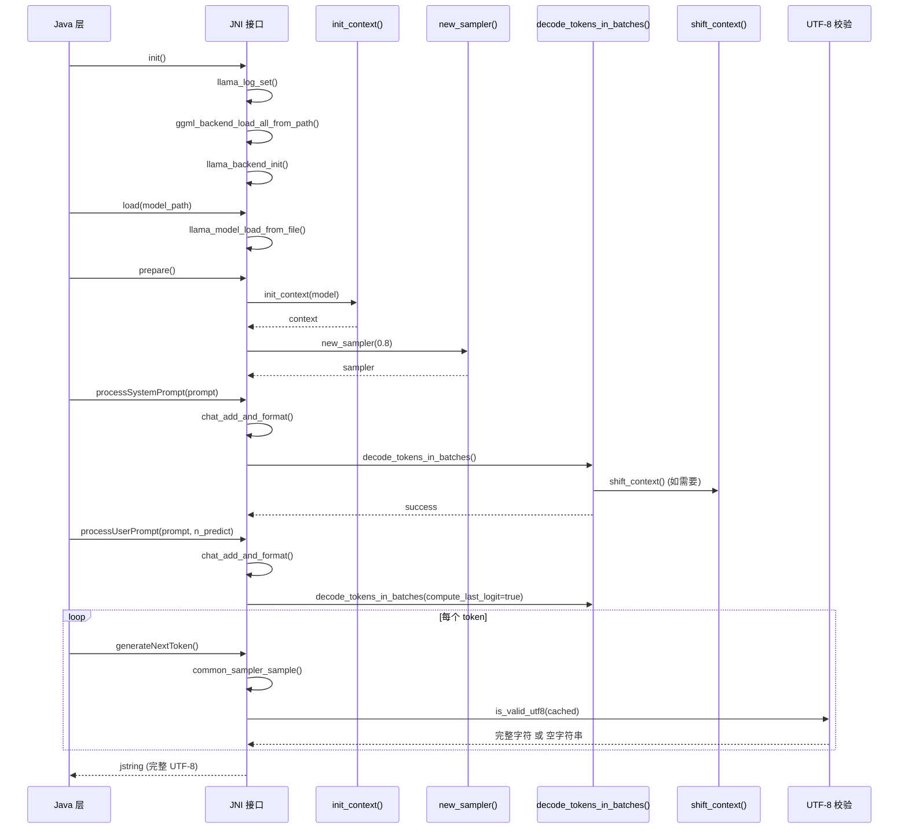
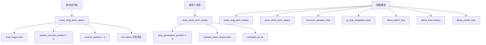
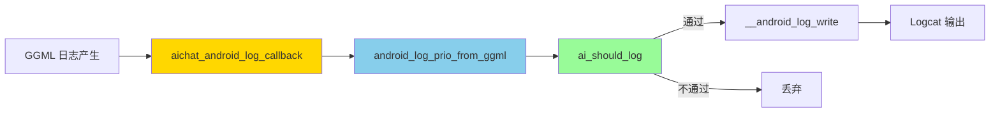
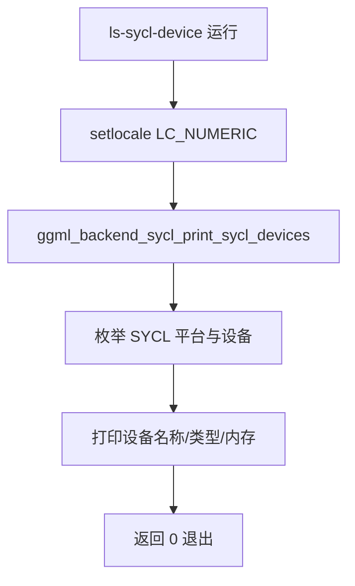

# 第97章 移动端推理的跨国翻译官：Android JNI 集成与日志系统解析

## 学习目标

- 理解 JNI 在 llama.cpp Android 集成中的桥梁作用与生命周期管理
- 掌握 llama.cpp 后端动态加载机制与多线程上下文初始化策略
- 理解上下文滑动窗口（Context Shifting）的实现原理与无限对话机制
- 掌握逐 Token 生成流程中的 UTF-8 有效性校验与缓存机制
- 了解跨平台日志系统的设计：GGML 日志到 Android Logcat 的映射
- 熟悉 SYCL 设备查询工具的作用与异构计算环境验证方法

## 97.1 生活类比：推理引擎的翻译官与记忆整理术

想象 llama.cpp 的 Android 集成是一位常驻在客户（Java/Kotlin 层）和引擎室（C++ 核心）之间的跨国翻译官。这位翻译官的首要职责是把客户的每次指令准确无误地传达给引擎，再把引擎的每个响应翻译回客户能听懂的语言。为了高效完成这项任务，翻译官在工作前需要先报到注册（JNI 的 init 函数），携带全套工具（动态加载后端库），并建立向客户汇报的固定渠道（日志回调）。开工时，他有一套精心设计的翻译流程：客户想用中文说“你好”（用户提示词），翻译官先查阅公司的术语手册（聊天模板），把这句话包装成引擎熟悉的正式格式（聊天模板格式化），再交给引擎处理。

当对话越来越长，翻译官的记忆笔记（KV 缓存）快要写满时，他会拿出一本旧笔记本（滑动窗口），把中间那些不太重要的记录扔掉——只保留最初的“开场白”（系统提示词）和最近的“对话内容”，这样就能无限期地继续服务。这套记忆整理术让翻译官不会因为笔记写满而无能为力，但也意味着被他撕掉的早期对话内容将彻底遗忘。

每次翻译输出时，翻译官还有一位质检员（UTF-8 校验）负责把关，确保交付给客户的每一个文字都是完整无缺的——绝不允许把半个汉字交出去。在幕后，翻译官的后端设备选择（后端动态加载）由引擎室的后端发现机制在初始化阶段自动完成：引擎室会扫描所有可用的“方言工具包”（不同计算后端如 CPU、GPU、NPU 的库文件），并自动选用最合适的工具。

这套精密的协作机制如同翻译官的一天：他需要管理大量资料、控制翻译节奏、并确保每次输出都准确无误，llama.cpp 的 Android 集成同样需要精细的状态管理和跨语言协作。

而在本章后续的 JNI 生命周期中，我们将看到这位翻译官如何在 init/load/prepare/generate/unload 的各个阶段严格履职；在会话状态管理中，它又如何像整理档案一样分门别类地清理短期与长期记忆；最终，我们将剖析这位翻译官手中的两件特殊工具——日志信使（连接 GGML 引擎与 Android Logcat）和 SYCL 侦察兵（用于验证异构计算环境）。

## 97.2 源码地图

```
examples/llama.android/lib/src/main/cpp/ai_chat.cpp （JNI 桥梁与推理引擎生命周期，行号8-454）
├── 全局变量与常量（行号1-40）
│   ├── g_model：模型指针（全局唯一）
│   ├── g_context：上下文指针（全局唯一）
│   ├── g_sampler：采样器指针（全局唯一）
│   ├── g_batch：批量推理缓冲区
│   ├── g_chat_templates：聊天模板
│   ├── chat_msgs：对话历史消息列表
│   ├── current_position：当前位置计数器
│   ├── system_prompt_position：系统提示词位置标记
│   ├── stop_generation_position：停止生成位置标记
│   ├── cached_token_chars：UTF-8 缓存字符串
│   ├── assistant_ss：助手回复字符串流
│   └── DEFAULT_CONTEXT_SIZE / OVERFLOW_HEADROOM / BATCH_SIZE 等常量
├── 辅助工具函数（行号8-394）
│   ├── join()（行号8-16）：字符串拼接模板
│   ├── init_context()（行号142-157）：初始化上下文
│   ├── new_sampler()（行号159-182）：创建采样器
│   ├── get_backend()（行号184-200）：获取非 CPU 后端名称
│   ├── reset_long_term_states()（行号260-267）：重置长期状态
│   ├── shift_context()（行号269-277）：上下文滑动窗口
│   ├── chat_add_and_format()（行号279-287）：聊天格式化
│   ├── reset_short_term_states()（行号297-301）：重置短期状态
│   ├── decode_tokens_in_batches()（行号303-332）：分批解码
│   └── is_valid_utf8()（行号365-394）：UTF-8 有效性校验
└── JNI 接口函数家族（行号60-454）
    ├── Java_..._init()（行号60-74）：后端初始化与日志桥接
    ├── Java_..._load()（行号76-87）：模型加载
    ├── Java_..._prepare()（行号184-191）：上下文准备
    ├── Java_..._systemInfo()（行号202-205）：系统信息查询
    ├── Java_..._benchModel()（行号207-254）：性能基准测试
    ├── Java_..._processSystemPrompt()（行号334-363）：系统提示词处理
    ├── Java_..._processUserPrompt()（行号365-402）：用户提示词处理
    ├── Java_..._generateNextToken()（行号404-438）：逐 Token 生成
    ├── Java_..._unload()（行号440-449）：资源释放
    └── Java_..._shutdown()（行号451-454）：后端关闭

examples/llama.android/lib/src/main/cpp/logging.h （Android 日志系统封装，行号10-55）
├── 日志宏配置（行号10-37）
│   ├── LOG_TAG：日志标签
│   └── LOG_MIN_LEVEL：最低日志级别
├── 五级日志宏（行号22-34）
│   ├── LOGv：VERBOSE 级别（编译期可裁剪）
│   ├── LOGd：DEBUG 级别（编译期可裁剪）
│   ├── LOGi：INFO 级别
│   ├── LOGw：WARN 级别
│   └── LOGe：ERROR 级别
└── 日志函数（行号18-55）
    ├── ai_should_log()（行号18-20）：日志级别检查
    ├── android_log_prio_from_ggml()（行号39-47）：级别映射
    └── aichat_android_log_callback()（行号49-55）：日志回调

examples/sycl/ls-sycl-device.cpp （SYCL 设备查询工具，行号11-15）
└── main()（行号11-15）：设备查询入口
    ├── std::setlocale(LC_NUMERIC, "C")：设置数字格式
    └── ggml_backend_sycl_print_sycl_devices()：打印设备信息
```

## 97.3 Android JNI 桥梁与推理引擎生命周期

**为什么需要 JNI 封装层？** Android 应用基于 Java/Kotlin 开发，而 llama.cpp 是纯 C++ 库，两者之间需要一座跨语言的桥梁——这就是 JNI（Java Native Interface）的角色。通过 JNI 封装，模型加载、推理、采样等复杂逻辑被隐藏在原生层，对上层 Java 代码暴露简洁的接口。同时，全局状态（g_model、g_context、g_sampler 等）由 C++ 层统一管理，确保线程安全与资源正确释放。**全局状态的高效管理**是这套系统的核心设计之一：模型中加载的指针与推理运行时的上下文等关键资源都以全局变量形式保存，避免在每个 JNI 调用中反复传递复杂的上下文对象，从而降低跨语言边界的开销。**线程安全问题**同样值得关注：由于 JNI 层以单线程推理为假设，全局 state 不需要加锁保护，这在移动端通常够用；但如果未来引入多会话并发，则需重新评估这一设计。

**后端动态加载机制的设计哲学**是这套系统优雅的地方：`ggml_backend_load_all_from_path()` 从指定目录加载所有可用的后端变体（如 ARM NEON、x86 AVX 等），让运行时能够动态选择最优计算路径。`llama_backend_init()` 完成后端初始化，而日志回调 `aichat_android_log_callback` 把 ggml 内部日志重定向到 Android Logcat，让开发者能够像调试普通 Android 应用一样调试推理引擎。

**上下文初始化与多线程优化**是性能的关键一环。`init_context()` 会根据设备 CPU 核心数自动计算最优线程数，并保留余量避免系统卡顿；同时检查模型训练时的上下文长度，防止用户设置超出模型能力导致错误。批量推理（n_batch / n_ubatch）的设置同样重要，它能显著提升吞吐效率。

**系统提示词与用户提示词的处理流程**遵循一条清晰的链路：通过 `common_chat_format_single()` 应用 Jinja 聊天模板，确保消息格式符合模型训练时的要求；分词后检查长度，防止超出上下文窗口（CONTEXT_SIZE - OVERFLOW_HEADROOM）；最后调用 `decode_tokens_in_batches()` 分批解码，每批不超过 BATCH_SIZE（512）。

### 97.3.1 `Java_com_arm_aichat_internal_InferenceEngineImpl_init()`：后端初始化与日志桥接

源码路径：`examples/llama.android/lib/src/main/cpp/ai_chat.cpp` 行号 60-74

```cpp
// ① JNI 入口点：接收 Java 层传入的 nativeLibDir 字符串
JNIEXPORT void JNICALL
Java_com_arm_aichat_internal_InferenceEngineImpl_init(JNIEnv *env, jobject /*unused*/, jstring nativeLibDir) {
    // ② 将 ggml 日志回调设置为 Android 日志函数
    llama_log_set(aichat_android_log_callback, nullptr);

    // ③ 从 JNI 字符串转换为 C 字符串，获取后端库目录路径
    const auto *path_to_backend = env->GetStringUTFChars(nativeLibDir, 0);
    // ④ 记录日志：正在从指定路径加载后端
    LOGi("Loading backends from %s", path_to_backend);
    // ⑤ 动态加载该目录下所有可用的 GGML 后端变体
    ggml_backend_load_all_from_path(path_to_backend);
    // ⑥ 释放 JNI 字符串资源，防止内存泄漏
    env->ReleaseStringUTFChars(nativeLibDir, path_to_backend);

    // ⑦ 初始化所有已加载的后端
    llama_backend_init();
    // ⑧ 记录日志：后端初始化完成，日志处理器已设置
    LOGi("Backend initiated; Log handler set.");
}
```

这段代码实现了推理引擎的**入口初始化**：设置日志回调 → 动态加载后端 → 初始化系统。值得注意的是 `ggml_backend_load_all_from_path()` 的灵活性——它让开发者可以在不同设备上放置不同的后端变体（CPU, GPU, NPU 等），由 llama.cpp 在运行时自动发现和加载，这与在 PC 上通过环境变量选择后端的方式形成了鲜明对比。作为“翻译官”，这位 JNI 入口函数就是他的“上岗报到”——先递上名片（日志回调），再带上全套工具（后端库），然后正式开启一天的工作（后端初始化）。

### 97.3.2 `Java_com_arm_aichat_internal_InferenceEngineImpl_load()`：模型加载

源码路径：`examples/llama.android/lib/src/main/cpp/ai_chat.cpp` 行号 76-87

```cpp
// ① JNI 入口点：接收 Java 层传入的模型文件路径
JNIEXPORT jint JNICALL
Java_com_arm_aichat_internal_InferenceEngineImpl_load(JNIEnv *env, jobject, jstring jmodel_path) {
    // ② 使用默认参数创建模型配置
    llama_model_params model_params = llama_model_default_params();

    // ③ 将 JNI 字符串转为 C 字符串，获取模型路径
    const auto *model_path = env->GetStringUTFChars(jmodel_path, 0);
    // ④ 记录调试日志：正在从指定路径加载模型
    LOGd("%s: Loading model from: \n%s\n", __func__, model_path);

    // ⑤ 从文件加载模型（关键步骤）
    auto *model = llama_model_load_from_file(model_path, model_params);
    // ⑥ 释放 JNI 字符串资源
    env->ReleaseStringUTFChars(jmodel_path, model_path);
    // ⑦ 加载失败返回 1，成功则保存到全局变量并返回 0
    if (!model) {
        return 1;
    }
    g_model = model;
    return 0;
}
```

这里使用了较新的 `llama_model_load_from_file()` API（替代了旧的 `llama_load_model_from_file()`），两者功能等价但 API 签名略有不同。模型加载成功后，指针被存入全局变量 `g_model`，供后续所有 JNI 函数使用——这种全局变量模式在嵌入式/移动端设计中很常见，因为它避免在每个 JNI 调用中传递复杂的上下文对象。需要说明的是，该 API 返回的模型指针赋值给全局变量这一过程是线程安全的，因为 JNI 层的调用约定隐含了单线程推理的前提。

### 97.3.3 `Java_com_arm_aichat_internal_InferenceEngineImpl_prepare()`：上下文准备

源码路径：`examples/llama.android/lib/src/main/cpp/ai_chat.cpp` 行号 184-191

```cpp
// ① JNI 入口点：准备上下文与采样器
JNIEXPORT jint JNICALL
Java_com_arm_aichat_internal_InferenceEngineImpl_prepare(JNIEnv * /*env*/, jobject /*unused*/) {
    // ② 使用默认上下文大小初始化上下文
    auto *context = init_context(g_model);
    // ③ 上下文初始化失败则返回 1
    if (!context) { return 1; }
    // ④ 将上下文指针保存到全局变量
    g_context = context;
    
    // ⑤ 初始化批量推理缓冲区（容量为 BATCH_SIZE）
    g_batch = llama_batch_init(BATCH_SIZE, 0, 1);
    
    // ⑥ 从模型加载聊天模板（指定空字符串表示自动检测）
    g_chat_templates = common_chat_templates_init(g_model, "");
    
    // ⑦ 以默认温度创建采样器
    g_sampler = new_sampler(DEFAULT_SAMPLER_TEMP);
    return 0;
}
```

`llama_batch_init(BATCH_SIZE, 0, 1)` 分配了能容纳 `BATCH_SIZE` 个 token 的批处理缓冲区，其中第二个参数 0 表示不使用 embeddings，第三个参数 1 表示每个序列最多保留 1 个 logits 槽位。`g_chat_templates` 保存了从模型元数据中自动检测的模板，它将用于后续所有消息的格式化。`g_sampler` 则封装了采样参数（温度、Top-K 等），控制生成文本的多样性。`prepare()` 是推理前的**总装车间**：它一次性完成了上下文的创建、批处理缓冲区的分配、聊天模板的初始化以及采样器的创建。这里值得关注的是 `common_chat_templates_init()` 的第二个参数——传入空字符串意味着让 llama.cpp 从模型元数据中自动检测合适的 Jinja 模板，这避免了用户在 Android 端手动指定模板的繁琐。对“翻译官”而言，prepare 就像是出发前检查他的公文包：确认笔记本（上下文）已经展开、草稿纸（batch）已经备好、术语手册（模板）已装入，就等着接待客户了。

### 97.3.4 `init_context()`：多线程与上下文参数配置

源码路径：`examples/llama.android/lib/src/main/cpp/ai_chat.cpp` 行号 142-157

```cpp
// ① 初始化上下文，默认上下文大小为 DEFAULT_CONTEXT_SIZE
static llama_context *init_context(llama_model *model, const int n_ctx = DEFAULT_CONTEXT_SIZE) {
    // ② 模型有效性检查：若模型指针为空则记录错误并返回空指针
    if (!model) {
        LOGe("%s: model cannot be null", __func__);
        return nullptr;
    }

    // ③ 多线程配置：根据 CPU 核心数计算最优线程数
    // ④ 从在线核心数中减去余量，并限制在 [N_THREADS_MIN, N_THREADS_MAX] 区间
    const int n_threads = std::max(N_THREADS_MIN, std::min(N_THREADS_MAX,
                                                     (int) sysconf(_SC_NPROCESSORS_ONLN) -
                                                     N_THREADS_HEADROOM));
    // ⑤ 记录日志：正在使用的线程数
    LOGi("%s: Using %d threads", __func__, n_threads);

    // ⑥ 上下文参数设置：获取默认参数结构体
    llama_context_params ctx_params = llama_context_default_params();
    // ⑦ 获取模型训练时的上下文长度
    const int trained_context_size = llama_model_n_ctx_train(model);
    // ⑧ 警告：用户设置的上下文超出模型训练范围
    if (n_ctx > trained_context_size) {
        LOGw("%s: Model was trained with only %d context size! Enforcing %d context size...",
             __func__, trained_context_size, n_ctx);
    }
    // ⑨ 设置上下文大小
    ctx_params.n_ctx = n_ctx;
    // ⑩ 设置批处理大小
    ctx_params.n_batch = BATCH_SIZE;
    // ⑪ 设置微批处理大小
    ctx_params.n_ubatch = BATCH_SIZE;
    // ⑫ 设置常规解码线程数
    ctx_params.n_threads = n_threads;
    // ⑬ 设置批量解码线程数
    ctx_params.n_threads_batch = n_threads;
    // ⑭ 使用全局模型创建上下文
    auto *context = llama_init_from_model(g_model, ctx_params);
    // ⑮ 创建失败时记录错误并返回 nullptr
    if (context == nullptr) {
        LOGe("%s: llama_new_context_with_model() returned null)", __func__);
    }
    return context;
}
```

这段代码的核心设计是**自适应线程数**：`sysconf(_SC_NPROCESSORS_ONLN)` 获取在线 CPU 核心数，减去 `N_THREADS_HEADROOM` 作为余量（避免占满所有核心导致系统卡顿），再限制在 `[N_THREADS_MIN, N_THREADS_MAX]` 区间内。这种“留有余量”的策略在移动端尤为重要——你的手机后台还有其他应用在运行。此外，`llama_model_n_ctx_train()` 的检查保证了用户请求的上下文不会超出模型训练时的能力上限。

### 97.3.5 `new_sampler()`：创建采样器

源码路径：`examples/llama.android/lib/src/main/cpp/ai_chat.cpp` 行号 159-182

```cpp
// ① 基于温度参数创建采样器实例
static common_sampler *new_sampler(float temp) {
    // ② 创建默认采样参数结构体
    common_params_sampling sparams;
    // ③ 设置温度参数（控制生成多样性）
    sparams.temp = temp;
    // ④ 初始化采样器
    return common_sampler_init(g_model, sparams);
}
```

`new_sampler()` 的设计极其简洁，它将采样参数的配置集中封装，调用方只需传入温度值即可获得完整的采样器。温度参数控制生成文本的随机性：温度越低，输出越确定性；温度越高，输出越多样化。该函数在 `prepare()` 阶段被调用一次，之后整个对话周期内复用同一个采样器实例。

### 97.3.6 `get_backend()`：获取后端名称

源码路径：`examples/llama.android/lib/src/main/cpp/ai_chat.cpp` 行号 184-200

```cpp
// ① 获取非 CPU 后端名称列表
static std::string get_backend() {
    // ② 创建字符串向量存储后端名称
    std::vector<std::string> backends;
    // ③ 遍历所有注册的后端
    for (size_t i = 0; i < ggml_backend_reg_count(); i++) {
        // ④ 获取第 i 个后端的注册信息
        auto *reg = ggml_backend_reg_get(i);
        // ⑤ 获取后端名称
        std::string name = ggml_backend_reg_name(reg);
        // ⑥ 排除 CPU，收集其他后端
        if (name != "CPU") {
            backends.push_back(ggml_backend_reg_name(reg));
        }
    }
    // ⑦ 没有非 CPU 后端时返回 "CPU"
    return backends.empty() ? "CPU" : join(backends, ",");
}
```

`get_backend()` 遍历 GGML 后端注册表，汇总除 CPU 外的所有后端名称——这个信息对基准测试的报表非常有价值，让用户知道当前使用的是 GPU 还是纯 CPU 推理。它巧妙地复用了 `join()` 工具函数将名称列表拼接为逗号分隔的字符串。

### 97.3.7 `Java_com_arm_aichat_internal_InferenceEngineImpl_processSystemPrompt()`：系统提示词处理

源码路径：`examples/llama.android/lib/src/main/cpp/ai_chat.cpp` 行号 334-363

```cpp
// ① JNI 入口点：接收系统提示词字符串
JNIEXPORT jint JNICALL
Java_com_arm_aichat_internal_InferenceEngineImpl_processSystemPrompt(
        JNIEnv *env,
        jobject /*unused*/,
        jstring jsystem_prompt
) {
    // ② 重置长期和短期状态（新对话开始）
    reset_long_term_states();
    reset_short_term_states();

    // ③ 从 JNI 获取系统提示词
    const auto *system_prompt = env->GetStringUTFChars(jsystem_prompt, nullptr);
    // ④ 记录调试日志：收到的系统提示词内容
    LOGd("%s: System prompt received: \n%s", __func__, system_prompt);
    // ⑤ 将 C 字符串转换为 C++ 字符串
    std::string formatted_system_prompt(system_prompt);

    // ⑥ 如果有聊天模板，格式化系统提示词并加入历史
    const bool has_chat_template = common_chat_templates_was_explicit(g_chat_templates.get());
    if (has_chat_template) {
        formatted_system_prompt = chat_add_and_format(ROLE_SYSTEM, system_prompt);
    }
    // ⑦ 释放 JNI 字符串资源
    env->ReleaseStringUTFChars(jsystem_prompt, system_prompt);

    // ⑧ 分词：根据是否有模板决定是否添加特殊 token
    const auto system_tokens = common_tokenize(g_context, formatted_system_prompt,
                                               has_chat_template, has_chat_template);
    // ⑨ 逐 token 打印日志（仅 VERBOSE 级别）
    for (auto id: system_tokens) {
        LOGv("token: `%s`\t -> `%d`", common_token_to_piece(g_context, id).c_str(), id);
    }

    // ⑩ 检查系统提示词是否超出上下文容量
    const int max_batch_size = DEFAULT_CONTEXT_SIZE - OVERFLOW_HEADROOM;
    // ⑪ 如果超出则记录错误并返回 1
    if ((int) system_tokens.size() > max_batch_size) {
        LOGe("%s: System prompt too long for context! %d tokens, max: %d",
             __func__, (int) system_tokens.size(), max_batch_size);
        return 1;
    }

    // ⑫ 分批解码系统提示词
    if (decode_tokens_in_batches(g_context, g_batch, system_tokens, current_position)) {
        // ⑬ 解码失败则记录错误并返回 2
        LOGe("%s: llama_decode() failed!", __func__);
        return 2;
    }

    // ⑭ 更新位置追踪
    system_prompt_position = current_position = (int) system_tokens.size();
    return 0;
}
```

这段代码展示了系统提示词的完整处理链路：**重置状态 → 格式化 → 分词 → 长度检查 → 分批解码 → 更新位置**。`has_chat_template` 的布尔值同时控制 `common_tokenize()` 的 `add_special` 和 `parse_special` 两个参数——这是为了确保模板的 BOS/EOS token 被正确处理（BOS 表示序列开始，EOS 表示序列结束）。当 `has_chat_template` 为 true 时，分词器会添加模型训练时使用的特殊标记，从而保证生成的文本格式与训练数据一致。

### 97.3.8 `decode_tokens_in_batches()`：分批解码与滑动窗口触发

源码路径：`examples/llama.android/lib/src/main/cpp/ai_chat.cpp` 行号 303-332

```cpp
// ① 分批解码函数：处理可能超过上下文容量的 Token 序列
static int decode_tokens_in_batches(
        llama_context *context,
        llama_batch &batch,
        const llama_tokens &tokens,
        const llama_pos start_pos,
        const bool compute_last_logit = false) {
    // ② 记录解码任务信息
    LOGd("%s: Decode %d tokens starting at position %d", __func__, (int) tokens.size(), start_pos);
    
    // ③ 按 BATCH_SIZE 分批处理
    for (int i = 0; i < (int) tokens.size(); i += BATCH_SIZE) {
        // ④ 计算当前批次大小（最后一批可能不足 BATCH_SIZE）
        const int cur_batch_size = std::min((int) tokens.size() - i, BATCH_SIZE);
        // ⑤ 清空批次缓冲区
        common_batch_clear(batch);
        // ⑥ 记录 VERBOSE 日志：正在准备的批次大小与起始位置
        LOGv("%s: Preparing a batch size of %d starting at: %d", __func__, cur_batch_size, i);

        // ⑦ 关键判断：当前批次无法容纳进上下文时触发滑动窗口
        if (start_pos + i + cur_batch_size >= DEFAULT_CONTEXT_SIZE - OVERFLOW_HEADROOM) {
            // ⑧ 记录警告日志并执行滑动窗口
            LOGw("%s: Current batch won't fit into context! Shifting...", __func__);
            shift_context();
        }

        // ⑨ 为每个 token 指定位置并加入批次
        for (int j = 0; j < cur_batch_size; j++) {
            // ⑩ 获取当前 token ID
            const llama_token token_id = tokens[i + j];
            // ⑪ 计算当前 token 在序列中的绝对位置
            const llama_pos position = start_pos + i + j;
            // ⑫ 决定是否需要为当前 token 计算 logits（仅最后一个需要）
            const bool want_logit = compute_last_logit && (i + j == tokens.size() - 1);
            // ⑬ 将 token 加入批次，序列 ID 固定为 0
            common_batch_add(batch, token_id, position, {0}, want_logit);
        }

        // ⑭ 执行解码
        const int decode_result = llama_decode(context, batch);
        // ⑮ 解码失败则记录错误并返回 1
        if (decode_result) {
            LOGe("%s: llama_decode failed w/ %d", __func__, decode_result);
            return 1;
        }
    }
    return 0;
}
```

`decode_tokens_in_batches()` 是**批量推理的大脑**。它的两个关键设计：其一，通过 `std::min()` 确保最后一批不超过 BATCH_SIZE；其二，`want_logit` 标志只在最后一个 token 上计算 logits——这避免了为不需要的 token 浪费计算资源。`compute_last_logit` 参数尤其重要：处理用户提示词时，模型需要基于最新 token 预测下一个回复，因此需要 logits；而处理系统提示词时，则不需要。此外，当检测到当前批次将超出上下文容量时，它会主动触发 `shift_context()` 来释放空间。

### 97.3.9 `shift_context()`：上下文滑动窗口

源码路径：`examples/llama.android/lib/src/main/cpp/ai_chat.cpp` 行号 269-277

```cpp
// ① 实现上下文滑动：丢弃系统提示词之后的中间部分
static void shift_context() {
    // ② 计算要丢弃的 token 数量（当前与系统提示词间距的一半）
    const int n_discard = (current_position - system_prompt_position) / 2;
    // ③ 记录信息日志：正在丢弃的 token 数量
    LOGi("%s: Discarding %d tokens", __func__, n_discard);
    
    // ④ 从 KV 缓存中删除丢弃的 token 区间
    llama_memory_seq_rm(llama_get_memory(g_context), 0, system_prompt_position, system_prompt_position + n_discard);
    
    // ⑤ 将剩余的 token 向前移动 -n_discard 个位置
    llama_memory_seq_add(llama_get_memory(g_context), 0, system_prompt_position + n_discard, current_position, -n_discard);
    
    // ⑥ 更新当前位置
    current_position -= n_discard;
    // ⑦ 记录信息日志：滑动完成后的当前位置
    LOGi("%s: Context shifting done! Current position: %d", __func__, current_position);
}
```

这个函数是**无限对话**的关键：当上下文接近上限时，丢弃中间部分的 token，保留系统提示词和最近的内容。`n_discard` 取当前与系统提示词间距的一半，意味着每次滑动保留系统提示词 + 最近一半的对话内容。这就像翻译官的“旧笔记本”策略——对话太长时，他果断舍弃中间那些不太重要的记录，只留下开场白（系统提示词）和最近的交流内容，确保能无限期地继续服务。但这种有损压缩也有代价：早期对话被完全遗忘，当系统提示词和最近对话的 token 数本身超过上下文窗口时，滑动窗口也无能为力。此外，频繁的滑动会带来性能开销，每次滑动都涉及 KV 缓存的删除与移动。

### 97.3.10 `Java_com_arm_aichat_internal_InferenceEngineImpl_generateNextToken()`：逐 Token 生成与 UTF-8 校验

源码路径：`examples/llama.android/lib/src/main/cpp/ai_chat.cpp` 行号 404-438

```cpp
// ① JNI 入口点：生成下一个 token 并返回为 Java 字符串
JNIEXPORT jstring JNICALL
Java_com_arm_aichat_internal_InferenceEngineImpl_generateNextToken(
        JNIEnv *env,
        jobject /*unused*/
) {
    // ② 若上下文即将满，则触发滑动窗口
    if (current_position >= DEFAULT_CONTEXT_SIZE - OVERFLOW_HEADROOM) {
        // ③ 记录警告日志并执行滑动窗口
        LOGw("%s: Context full! Shifting...", __func__);
        shift_context();
    }

    // ④ 达到停止位置则返回 nullptr
    if (current_position >= stop_generation_position) {
        // ⑤ 记录警告日志：达停止位置
        LOGw("%s: STOP: hitting stop position: %d", __func__, stop_generation_position);
        return nullptr;
    }

    // ⑥ 采样下一个 token
    const auto new_token_id = common_sampler_sample(g_sampler, g_context, -1);
    // ⑦ 接受采样结果，更新采样器状态
    common_sampler_accept(g_sampler, new_token_id, true);

    // ⑧ 构建包含新 token 的 batch 并解码
    common_batch_clear(g_batch);
    // ⑨ 将新 token 加入批次，位置为 current_position
    common_batch_add(g_batch, new_token_id, current_position, {0}, true);
    // ⑩ 执行解码
    if (llama_decode(g_context, g_batch) != 0) {
        // ⑪ 解码失败则记录错误并返回空指针
        LOGe("%s: llama_decode() failed for generated token", __func__);
        return nullptr;
    }

    // ⑫ 更新位置
    current_position++;

    // ⑬ 检测 EOG（End of Generation）token
    if (llama_vocab_is_eog(llama_model_get_vocab(g_model), new_token_id)) {
        // ⑭ 记录调试日志：检测到 EOG，停止生成
        LOGd("id: %d,\tIS EOG!\nSTOP.", new_token_id);
        // ⑮ 保存助手回复到聊天历史（assistant_ss 包含本轮全部生成文本）
        chat_add_and_format(ROLE_ASSISTANT, assistant_ss.str());
        return nullptr;
    }

    // ⑯ 将 token 转换为文本片段并缓存
    auto new_token_chars = common_token_to_piece(g_context, new_token_id);
    // ⑰ 将新片段追加到缓存字符串
    cached_token_chars += new_token_chars;

    // ⑱ UTF-8 校验：完整字符才返回，否则缓存等待下一 token
    jstring result = nullptr;
    if (is_valid_utf8(cached_token_chars.c_str())) {
        // ⑲ 校验通过：将缓存字符串转换为 Java 字符串
        result = env->NewStringUTF(cached_token_chars.c_str());
        // ⑳ 记录 VERBOSE 日志：缓存的与新增的 token 文本
        LOGv("id: %d,\tcached: `%s`,\tnew: `%s`", new_token_id, cached_token_chars.c_str(), new_token_chars.c_str());

        // ㉑ 将完整字符追加到助手回复流
        assistant_ss << cached_token_chars;
        // ㉒ 清空缓存
        cached_token_chars.clear();
    } else {
        // ㉓ 不完整 UTF-8，缓存并返回空字符串
        LOGv("id: %d,\tappend to cache", new_token_id);
        result = env->NewStringUTF("");
    }
    return result;
}
```

这段代码实现了**逐 token 生成的核心循环**，其中包含两个关键设计。**缓存机制**的精妙之处在于 `cached_token_chars` 的设计——由于 BPE 分词器可能将一个 UTF-8 字符（如汉字）拆分成多个 token，每个 token 只包含该字符的部分字节，代码先将其累积到缓存字符串中。当 `is_valid_utf8()` 确认整个字符完整时，才将其返回给 Java 层并同步追加到 `assistant_ss` 字符串流；若字符尚不完整，则返回空字符串，等待后续 token 的字节片段。**EOG 检测**则是生成循环的终止条件：当采样得到的 token 是 EOG（End of Generation）标记时，代码立即调用 `chat_add_and_format(ROLE_ASSISTANT, assistant_ss.str())` 将已累积的完整对话内容保存到聊天历史中，并返回 `nullptr` 通知 Java 层停止循环。此时 `assistant_ss` 已包含该轮生成的全部**完整**文本（所有非 EOG 且通过 UTF-8 校验的字符），因此保存操作是安全的。这一设计既保证了多字节字符的完整性（绝不给用户返回半个汉字），又通过缓存减少了 JNI 边界的字符串转换开销，是移动端推理体验流畅性的重要保障。

### 97.3.11 `is_valid_utf8()`：UTF-8 完整性校验

源码路径：`examples/llama.android/lib/src/main/cpp/ai_chat.cpp` 行号 365-394

```cpp
// ① UTF-8 校验函数：确保字节序列构成合法的 Unicode 字符
static bool is_valid_utf8(const char *string) {
    // ② 空指针视为有效（无字节可检查）
    if (!string) { return true; }

    // ③ 将字符串指针转换为无符号字节指针以便位操作
    const auto *bytes = (const unsigned char *) string;
    // ④ 用于存储当前字符的字节数
    int num;

    // ⑤ 循环直到字符串结束
    while (*bytes != 0x00) {
        // ⑥ 通过最高位模式判断字符长度
        if ((*bytes & 0x80) == 0x00) {
            // ⑦ 0xxxxxxx：单字节字符（U+0000 到 U+007F，ASCII）
            num = 1;
        } else if ((*bytes & 0xE0) == 0xC0) {
            // ⑧ 110xxxxx：双字节字符（U+0080 到 U+07FF）
            num = 2;
        } else if ((*bytes & 0xF0) == 0xE0) {
            // ⑨ 1110xxxx：三字节字符（U+0800 到 U+FFFF，含汉字）
            num = 3;
        } else if ((*bytes & 0xF8) == 0xF0) {
            // ⑩ 11110xxx：四字节字符（U+10000 到 U+10FFFF，含 Emoji）
            num = 4;
        } else {
            // ⑪ 非法前缀
            return false;
        }

        // ⑫ 移动到第一个后续字节
        bytes += 1;
        // ⑬ 检查后续字节：必须是 10xxxxxx 格式
        for (int i = 1; i < num; ++i) {
            // ⑭ 检查当前字节是否为有效的后续字节
            if ((*bytes & 0xC0) != 0x80) {
                return false;
            }
            // ⑮ 移动到下一个字节
            bytes += 1;
        }
    }
    return true;
}
```

`is_valid_utf8()` 是**字符完整性的守门员**。它通过检查字节序列的最高位模式来确定字符长度：`0xxxxxxx` 是单字节、`110xxxxx` 是双字节、`1110xxxx` 是三字节（汉字所在范围）、`11110xxx` 是四字节。然后逐一验证后续字节是否以 `10` 开头，确保没有截断的字符。对于单字节的 ASCII 字符（0x00-0x7F），该函数直接将其视为 1 字节字符并通过校验——这些字符本身不需要多字节编码，因此永远不会被拆分。与 `generateNextToken()` 中的 `cached_token_chars` 配合，这个函数保证了每个返回给 Java 层的字符串都是完整的 UTF-8 序列——即使底层分词器把字符拆成了多个 token。

### 97.3.12 `Java_com_arm_aichat_internal_InferenceEngineImpl_systemInfo()`：系统信息查询

源码路径：`examples/llama.android/lib/src/main/cpp/ai_chat.cpp` 行号 202-205

```cpp
// ① 返回系统信息字符串
JNIEXPORT jstring JNICALL
Java_com_arm_aichat_internal_InferenceEngineImpl_systemInfo(JNIEnv *env, jobject /*unused*/) {
    // ② 调用 llama_print_system_info() 获取系统信息
    return env->NewStringUTF(llama_print_system_info());
}
```

`systemInfo()` 是一个极简的查询函数，它直接调用 `llama_print_system_info()` 返回的字符串。该函数返回的信息通常包括 CPU 特性（如是否支持 AVX/NEON）、内存大小等，因此是排查性能和兼容性问题的第一站。

### 97.3.13 `Java_com_arm_aichat_internal_InferenceEngineImpl_benchModel()`：性能基准测试

源码路径：`examples/llama.android/lib/src/main/cpp/ai_chat.cpp` 行号 207-254

```cpp
// ① JNI 入口点：benchmark 模型性能，返回 Markdown 格式结果
JNIEXPORT jstring JNICALL
Java_com_arm_aichat_internal_InferenceEngineImpl_benchModel(JNIEnv *env, jobject /*unused*/, jint pp, jint tg,
                                                      jint pl, jint nr) {
    // ② 用指定 prompt 长度创建上下文
    auto *context = init_context(g_model, pp);
    // ③ 若上下文创建失败则返回错误信息
    if (!context) {
        const auto *const err_msg = "Fail to init_context! Bench aborted.";
        LOGe(err_msg);
        return env->NewStringUTF(err_msg);
    }

    // ④ 初始化统计变量
    auto pp_avg = 0.0, tg_avg = 0.0, pp_std = 0.0, tg_std = 0.0;

    // ⑤ 运行 nr 轮 benchmark
    for (int nri = 0; nri < nr; nri++) {
        // ⑥ 阶段一：Prompt Processing（pp 个 token 并行解码）
        common_batch_clear(g_batch);
        // ⑦ 构建包含 pp 个虚拟 token 的批次
        for (int i = 0; i < pp; i++) {
            common_batch_add(g_batch, 0, i, {0}, false);
        }
        // ⑧ 仅最后一个 token 需要 logits
        g_batch.logits[g_batch.n_tokens - 1] = true;
        // ⑨ 清空 KV 缓存
        llama_memory_clear(llama_get_memory(context), false);

        // ⑩ 计时 PP 阶段开始
        const auto t_pp_start = ggml_time_us();
        // ⑪ 执行解码
        llama_decode(context, g_batch);
        // ⑫ 计时 PP 阶段结束
        const auto t_pp_end = ggml_time_us();

        // ⑬ 阶段二：Text Generation（tg 次迭代 × pl 个并行序列）
        llama_memory_clear(llama_get_memory(context), false);
        // ⑭ 计时 TG 阶段开始
        const auto t_tg_start = ggml_time_us();
        // ⑮ 循环 tg 次迭代
        for (int i = 0; i < tg; i++) {
            // ⑯ 清空批次
            common_batch_clear(g_batch);
            // ⑰ 为每个并行序列添加 token
            for (int j = 0; j < pl; j++) {
                common_batch_add(g_batch, 0, i, {j}, true);
            }
            // ⑱ 执行解码
            llama_decode(context, g_batch);
        }
        // ⑲ 计时 TG 阶段结束
        const auto t_tg_end = ggml_time_us();

        // ⑳ 计算速度并累加统计
        const auto speed_pp = double(pp) / (double(t_pp_end - t_pp_start) / 1000000.0);
        const auto speed_tg = double(pl * tg) / (double(t_tg_end - t_tg_start) / 1000000.0);
        // ㉑ 累加平均值
        pp_avg += speed_pp;
        tg_avg += speed_tg;
        // ㉒ 累加标准差
        pp_std += speed_pp * speed_pp;
        tg_std += speed_tg * speed_tg;
    }

    // ㉓ 释放临时上下文
    llama_free(context);

    // ㉔ 计算平均值
    pp_avg /= double(nr);
    tg_avg /= double(nr);
    // ㉕ 计算标准差（多轮时）
    if (nr > 1) {
        pp_std = sqrt(pp_std / double(nr - 1) - pp_avg * pp_avg * double(nr) / double(nr - 1));
        tg_std = sqrt(tg_std / double(nr - 1) - tg_avg * tg_avg * double(nr) / double(nr - 1));
    } else {
        // ㉖ 单轮时标准差为 0
        pp_std = 0;
        tg_std = 0;
    }

    // ㉗ 生成 Markdown 格式的结果表格
    char model_desc[128];
    // ㉘ 获取模型描述字符串
    llama_model_desc(g_model, model_desc, sizeof(model_desc));
    // ㉙ 计算模型大小（GB）
    const auto model_size = double(llama_model_size(g_model)) / 1024.0 / 1024.0 / 1024.0;
    // ㉚ 计算模型参数量（B）
    const auto model_n_params = double(llama_model_n_params(g_model)) / 1e9;
    // ㉛ 获取当前后端名称
    const auto backend = get_backend();

    // ㉜ 构建结果字符串流
    std::stringstream result;
    // ㉝ 设置输出精度
    result << std::setprecision(3);
    // ㉞ 输出表格头
    result << "| model | size | params | backend | test | t/s |\n";
    result << "| --- | --- | --- | --- | --- | --- |\n";
    // ㉟ 输出 PP 行
    result << "| " << model_desc << " | " << model_size << "GiB | " << model_n_params << "B | "
           << backend << " | pp " << pp << " | " << pp_avg << " ± " << pp_std << " |\n";
    // ㊱ 输出 TG 行
    result << "| " << model_desc << " | " << model_size << "GiB | " << model_n_params << "B | "
           << backend << " | tg " << tg << " | " << tg_avg << " ± " << tg_std << " |\n";
    // ㊲ 将结果转换为 Java 字符串返回
    return env->NewStringUTF(result.str().c_str());
}
```

这段代码实现了**移动端性能评估的黄金标准**。它分别测量 **Prompt Processing**（一次并行处理 pp 个 token 的速度）和 **Text Generation**（逐 token 生成的速度，每次生成 pl 个并行序列），最终返回一个 Markdown 格式的表格。值得注意的是每轮 benchmark 开始前都会调用 `llama_memory_clear()` 清空 KV 缓存，以确保每轮测量都在干净的状态下进行，不会受上一轮残留状态的影响。标准差计算则提供了速度波动范围的量化指标——标准差越小，说明模型运行越稳定；标准差越大，则说明性能波动明显，可能受到系统负载等因素干扰。因此，标准差是评估推理引擎性能可靠性的重要度量。

### 97.3.14 `Java_com_arm_aichat_internal_InferenceEngineImpl_shutdown()`：后端关闭

源码路径：`examples/llama.android/lib/src/main/cpp/ai_chat.cpp` 行号 451-454

```cpp
// ① JNI 关闭入口：释放后端资源
JNIEXPORT void JNICALL
Java_com_arm_aichat_internal_InferenceEngineImpl_shutdown(JNIEnv *, jobject /*unused*/) {
    // ② 释放所有后端资源
    llama_backend_free();
}
```

`shutdown()` 是生命周期的收尾——在 `unload()` 释放所有模型相关资源之后调用，彻底关闭后端系统。它通常与应用进程的销毁流程绑定，确保没有遗留的 native 资源。这一顺序至关重要：`unload()` 必须先于 `shutdown()` 调用，否则会出现“先拆引擎再拆引擎室”的资源释放顺序错误。多次加载/卸载场景下，每次卸载后都需要调用 `shutdown()` 来完全释放后端资源，否则累积的内存占用会导致移动设备内存不足。

### 97.3.15 `generateNextToken()` 循环流程图：从采样到返回

下列序列图展示了从 `init()` 到 `generateNextToken()` 的完整调用链。



上图展示了从 `init()` 到 `generateNextToken()` 的完整调用链。可以看到，整个推理流程由 JNI 层作为总调度者——它负责将 Java 层的调用转换为 C++ 层的具体操作，并在生成循环中反复调用采样、解码与 UTF-8 校验，直到遇到 EOG token 或达到停止位置才结束。UTF-8 校验环节在每次生成后都会被执行，确保返回给 Java 层的字符串始终是完整且有效的 Unicode 序列。

## 97.4 会话状态管理与资源清理

**状态分层设计：短期 vs 长期**是这套系统的核心设计理念。`reset_short_term_states()` 只重置生成相关的临时状态（停止位置、UTF-8 缓存、助手回复流），而 `reset_long_term_states()` 则清除对话历史和位置追踪。这种分层允许精确控制重置粒度——例如，新用户消息到来时只需要重置短期状态，而重新开始对话时才需要清除长期状态。**聊天历史的动态格式化**保证了模型始终看到符合训练格式的对话。`chat_add_and_format()` 使用 Jinja 模板引擎将新消息追加到 `chat_msgs`，并返回格式化后的字符串用于 tokenize。区分用户消息（`ROLE_USER`）与助手消息（`ROLE_ASSISTANT`）的角色标记，是模板正确渲染的关键。**资源释放的完整性保障**遵循“逆序释放”原则：先释放高层资源（采样器、模板），再释放底层（batch、context、model）。这确保了没有悬空引用和内存泄漏。整个状态管理体系就像翻译官的档案柜：短期状态是桌面上的便签，随时可以撕掉重写；长期状态是归档的文件柜，只在会话结束时才彻底清理；资源释放则是下班前的检查清单，确保每件工具都归位、每个抽屉都锁好——三个场景构成了完整的记忆管理循环。

### 97.4.1 `reset_short_term_states()`：重置生成状态

源码路径：`examples/llama.android/lib/src/main/cpp/ai_chat.cpp` 行号 297-301

```cpp
// ① 重置短期状态：新用户消息到来时调用
static void reset_short_term_states() {
    // ② 停止位置归零
    stop_generation_position = 0;
    // ③ 清空 UTF-8 缓存（丢弃未完成的字符片段）
    cached_token_chars.clear();
    // ④ 清空助手回复流（stringstream 重置）
    assistant_ss.str("");
}
```

这段代码展示了**短期状态管理**的精髓——仅重置与当前生成任务相关的变量，不影响对话历史。`stop_generation_position = 0` 清除上次生成时设置的停止位置，确保本次生成不受上次限制；`cached_token_chars.clear()` 清空可能残留的 UTF-8 片段，否则新消息的输出会与旧缓存拼接产生错误；`assistant_ss.str("")` 重置字符串流，为记录新的助手回复做准备。这三个变量的协同重置确保了每次用户消息到来时，生成引擎都处于干净的状态。

### 97.4.2 `reset_long_term_states()`：重置对话状态

源码路径：`examples/llama.android/lib/src/main/cpp/ai_chat.cpp` 行号 260-267

```cpp
// ① 重置长期状态：新对话开始时调用
static void reset_long_term_states(const bool clear_kv_cache = true) {
    // ② 清空聊天消息历史
    chat_msgs.clear();
    // ③ 系统提示词位置归零
    system_prompt_position = 0;
    // ④ 当前位置归零
    current_position = 0;

    // ⑤ 可选：清空 KV 缓存（默认清空）
    if (clear_kv_cache)
        llama_memory_clear(llama_get_memory(g_context), false);
}
```

`reset_long_term_states()` 是重置粒度的“大扫除”：`chat_msgs.clear()` 清除所有历史消息，`system_prompt_position = 0` 与 `current_position = 0` 将位置追踪归零。`clear_kv_cache` 参数提供了灵活性：在需要保持 KV 缓存的场景（如系统提示词重新处理）中可以跳过清空。`llama_memory_clear()` 的第二个参数 `false` 表示不重置 slot 索引——这个细节对于理解 llama.cpp 内部状态管理很有帮助。

### 97.4.3 `chat_add_and_format()`：聊天消息动态格式化

源码路径：`examples/llama.android/lib/src/main/cpp/ai_chat.cpp` 行号 279-287

```cpp
// ① 格式化新消息并加入对话历史
static std::string chat_add_and_format(const std::string &role, const std::string &content) {
    // ② 创建新的聊天消息对象
    common_chat_msg new_msg;
    // ③ 设置消息角色（user/assistant/system）
    new_msg.role = role;
    // ④ 设置消息内容
    new_msg.content = content;
    
    // ⑤ 使用 Jinja 聊天模板格式化单条消息
    auto formatted = common_chat_format_single(
            g_chat_templates.get(), chat_msgs, new_msg, role == ROLE_USER, /* use_jinja */ false);
    
    // ⑥ 将消息追加到历史记录
    chat_msgs.push_back(new_msg);
    // ⑦ 记录信息日志：格式化的消息内容
    LOGi("%s: Formatted and added %s message: \n%s\n", __func__, role.c_str(), formatted.c_str());
    return formatted;
}
```

这个函数是聊天格式化的核心。`common_chat_format_single()` 接收五个参数：模板指针、当前消息历史、新消息、是否为用户消息、是否使用 Jinja。它根据历史上下文生成符合模板的格式化字符串，确保模型能正确理解角色切换。`role == ROLE_USER` 的布尔值被传递给模板引擎，使其在不同角色消息之间插入正确的分隔符。格式化完成后，新消息被追加到 `chat_msgs` 历史记录中，为后续消息的格式化提供上下文。

### 97.4.4 `Java_com_arm_aichat_internal_InferenceEngineImpl_unload()`：资源释放

源码路径：`examples/llama.android/lib/src/main/cpp/ai_chat.cpp` 行号 440-449

```cpp
// ① JNI 卸载入口：释放所有资源
JNIEXPORT void JNICALL
Java_com_arm_aichat_internal_InferenceEngineImpl_unload(JNIEnv * /*unused*/, jobject /*unused*/) {
    // ② 重置所有状态
    reset_long_term_states();
    reset_short_term_states();

    // ③ 按依赖顺序释放对象：采样器 → 聊天模板 → batch → context → model
    common_sampler_free(g_sampler);
    g_chat_templates.reset();
    llama_batch_free(g_batch);
    llama_free(g_context);
    llama_model_free(g_model);
}
```

这段代码阐释了**资源释放的完整顺序**——从最“高层”的对象（采样器）开始，逐步释放依赖它的对象（模板、batch），最后释放模型。这种逆序释放确保在释放底层对象时，没有上层对象仍在引用它。需要注意的是，`unload()` 应在 `shutdown()` 之前调用——先释放所有模型相关资源，再关闭后端系统，构成从模型到后端的完整释放链。

### 97.4.5 `join()`：通用字符串拼接工具

源码路径：`examples/llama.android/lib/src/main/cpp/ai_chat.cpp` 行号 8-16

```cpp
// ① 通用字符串拼接模板函数
template<class T>
static std::string join(const std::vector<T> &values, const std::string &delim) {
    std::ostringstream str;
    // ② 遍历所有值，用分隔符连接
    for (size_t i = 0; i < values.size(); i++) {
        str << values[i];
        if (i < values.size() - 1) { str << delim; }
    }
    return str.str();
}
```

`join()` 是一个模板函数，支持任何有 `operator<<` 的类型。`get_backend()` 中用于拼接后端名称，是辅助工具中的典范。

### 97.4.6 状态管理与资源清理流程图

下面这张流程图展示了三种典型场景下的状态管理路径。



上图呈现了三种典型场景下的状态管理路径：新对话开始时的长期状态重置、新用户消息到达时的短期状态清理、以及模型卸载时的完整资源释放。可以看出，短期与长期状态的重置时机是正交的——长期重置总是伴随短期重置（如 `processSystemPrompt()` 中的调用），但短期重置可以独立发生（如 `processUserPrompt()` 中的调用），这种分层设计让系统在不同粒度上都具备可预测的行为。

## 97.5 Android 日志系统封装

**为什么需要统一的日志封装？** llama.cpp 使用 ggml 日志系统，而 Android 应用使用 Logcat，两者语言不通。`logging.h` 就是这座桥梁。设想这位翻译官需要一位“信使”来传递引擎室的消息——ggml 产生各种级别的内部日志（错误、警告、信息、调试），但这些日志格式是 C 风格的，Android 开发者无法直接在 Logcat 中阅读。日志封装的作用就是把这枚“信使”派遣出去：它先将 ggml 的日志消息翻译成 Android 的日志格式，再根据设定的级别决定是否投递，最终写入 Logcat。这个信使在 `init()` 函数中通过 `llama_log_set(aichat_android_log_callback, nullptr)` 完成注册，此后 ggml 内部的每个日志消息都会经过 `aichat_android_log_callback` → `android_log_prio_from_ggml` → `ai_should_log` → `__android_log_write` 的完整链路，最终输出到 Logcat。

**日志级别映射机制**的核心是 `android_log_prio_from_ggml()`，它把 ggml 的四个级别（ERROR/WARN/INFO/DEBUG）转换为 Android 的对应优先级。需要注意，编译期的级别裁剪由宏（`LOG_MIN_LEVEL`）完成，而运行时的过滤则交给 `ai_should_log()`，两者协同工作——宏负责在编译阶段消灭低级别的日志调用，函数负责在运行时根据系统设置进行二次过滤，共同避免不必要的字符串格式化开销。

### 97.5.1 日志宏定义与级别配置

源码路径：`examples/llama.android/lib/src/main/cpp/logging.h` 行号 10-37

```cpp
// ① 日志标签：默认 "ai-chat"
#ifndef LOG_TAG
#define LOG_TAG "ai-chat"
#endif

// ② 最低日志级别：Debug 构建为 VERBOSE，Release 构建为 INFO
#ifndef LOG_MIN_LEVEL
#if defined(NDEBUG)
#define LOG_MIN_LEVEL ANDROID_LOG_INFO
#else
#define LOG_MIN_LEVEL ANDROID_LOG_VERBOSE
#endif
#endif

// ③ 五级日志宏：VERBOSE 与 DEBUG 根据编译期级别裁剪
#if LOG_MIN_LEVEL <= ANDROID_LOG_VERBOSE
#define LOGv(...) do { if (ai_should_log(ANDROID_LOG_VERBOSE)) __android_log_print(ANDROID_LOG_VERBOSE, LOG_TAG, __VA_ARGS__); } while (0)
#else
#define LOGv(...) ((void)0)
#endif

#if LOG_MIN_LEVEL <= ANDROID_LOG_DEBUG
#define LOGd(...) do { if (ai_should_log(ANDROID_LOG_DEBUG)) __android_log_print(ANDROID_LOG_DEBUG, LOG_TAG, __VA_ARGS__); } while (0)
#else
#define LOGd(...) ((void)0)
#endif

// ④ INFO/WARN/ERROR 始终保留
#define LOGi(...)   do { if (ai_should_log(ANDROID_LOG_INFO )) __android_log_print(ANDROID_LOG_INFO , LOG_TAG, __VA_ARGS__); } while (0)
#define LOGw(...)   do { if (ai_should_log(ANDROID_LOG_WARN )) __android_log_print(ANDROID_LOG_WARN , LOG_TAG, __VA_ARGS__); } while (0)
#define LOGe(...)   do { if (ai_should_log(ANDROID_LOG_ERROR)) __android_log_print(ANDROID_LOG_ERROR, LOG_TAG, __VA_ARGS__); } while (0)
```

这段代码最巧妙的设计是**编译期裁剪**：当 `LOG_MIN_LEVEL` 为 INFO 时，LOGv 和 LOGd 的调用在预处理阶段就被替换为 `((void)0)`，完全消除了运行时开销。而 LOGi/LOGw/LOGe 虽然也检查 `ai_should_log()`，但它们在“快路径”（即日志级别低于当前过滤级别、无需输出时）也几乎零开销——因为 `ai_should_log()` 调用 `__android_log_is_loggable()` 是一个轻量级检查，内部有缓存机制，不会造成显著的性能损失。

### 97.5.2 `ai_should_log()`：运行时日志级别检查

源码路径：`examples/llama.android/lib/src/main/cpp/logging.h` 行号 18-20

```cpp
// ① 判断是否应记录指定优先级的日志
static inline int ai_should_log(int prio) {
    // ② 调用 Android 系统函数，结合编译期级别进行过滤
    return __android_log_is_loggable(prio, LOG_TAG, LOG_MIN_LEVEL);
}
```

`__android_log_is_loggable()` 是 Android NDK 提供的高效检查函数，它在内部缓存了每个 TAG 的日志级别，因此重复调用开销极低。该函数由 Android 系统进程维护缓存，无需应用层干预即可高效工作。这个函数的设计精髓在于：它同时考虑了**编译期**（LOG_MIN_LEVEL）和**运行期**（系统 logcat 设置）的日志级别。

### 97.5.3 `android_log_prio_from_ggml()`：日志级别映射

源码路径：`examples/llama.android/lib/src/main/cpp/logging.h` 行号 39-47

```cpp
// ① 将 GGML 日志级别转换为 Android 日志优先级
static inline int android_log_prio_from_ggml(enum ggml_log_level level) {
    // ② 通过 switch 语句建立一一映射
    switch (level) {
        case GGML_LOG_LEVEL_ERROR: return ANDROID_LOG_ERROR;
        case GGML_LOG_LEVEL_WARN:  return ANDROID_LOG_WARN;
        case GGML_LOG_LEVEL_INFO:  return ANDROID_LOG_INFO;
        case GGML_LOG_LEVEL_DEBUG: return ANDROID_LOG_DEBUG;
        default:                   return ANDROID_LOG_DEFAULT;
    }
}
```

这个映射函数是跨语言日志的翻译官——GGML 和 Android 虽然都有四级日志，但枚举值不同，需要通过显式映射才能正确对应。`ANDROID_LOG_DEFAULT` 作为 fallback，用于处理 GGML 可能引入的新日志级别。这就像翻译官不仅翻译语言，还要确保术语表（日志级别）在两侧系统中含义一致，让客户和引擎室之间永远不会因级别误解而错过关键信息。

### 97.5.4 `aichat_android_log_callback()`：日志回调

源码路径：`examples/llama.android/lib/src/main/cpp/logging.h` 行号 49-55

```cpp
// ① GGML 日志回调：把 ggml 日志写入 Android Logcat
static inline void aichat_android_log_callback(enum ggml_log_level level,
                                              const char* text,
                                              void* /*user*/) {
    // ② 转换日志级别
    const int prio = android_log_prio_from_ggml(level);
    // ③ 级别过滤：不满足最低级别则返回
    if (!ai_should_log(prio)) return;
    // ④ 写入 Android 日志系统
    __android_log_write(prio, LOG_TAG, text);
}
```

这个回调函数被传递给 `llama_log_set()`，从而接管 ggml 的全部日志输出。`__android_log_write()` 是高效的原生写入函数，相比 `__android_log_print()` 避免了格式化开销——因为 ggml 已经完成了格式化。

### 97.5.5 日志系统架构图

下面这张架构图展示了从 GGML 日志产生到最终输出到 Logcat 的完整数据流。



上图展示了日志数据从 GGML 引擎到 Android Logcat 的流转路径。可见 `aichat_android_log_callback` 是这一链路的核心中转站，它负责把 GGML 的日志级别翻译成 Android 的优先级，并通过 `ai_should_log()` 执行双重过滤——只有通过过滤的日志消息才会被写入 Logcat（源码路径：`examples/llama.android/lib/src/main/cpp/logging.h` 行号 49-55）。整个流程确保了日志的及时性与高效性，不会因为日志系统本身而拖慢推理引擎的性能。

## 97.6 SYCL 设备查询工具

**为什么需要独立的设备查询工具？** SYCL 后端依赖 Intel oneAPI 运行时与 GPU 驱动，配置复杂。在运行完整推理之前，先确认 SYCL 设备是否被正确识别，能避免调试时混淆问题来源——是设备配置问题还是推理逻辑问题。

该工具与 llama.cpp 主程序的集成方式为：它调用的 `ggml_backend_sycl_print_sycl_devices()` 来自 ggml 的 SYCL 插件，该插件在运行时被 `ggml_backend_load_all_from_path()` 动态加载。因此，这个工具可以视为 SYCL 后端配置的“侦察兵”——先运行它验证设备可见，再运行主程序，让主程序在加载后端时自动选择正确的设备。

**工具实现的极简设计**只有 15 行代码，却完成了关键的环境验证功能。`std::setlocale(LC_NUMERIC, "C")` 确保输出使用标准数字格式（避免某些 locale 使用逗号作为小数点），`ggml_backend_sycl_print_sycl_devices()` 打印所有可用 SYCL 设备。

**典型使用场景**是开发者在 Intel GPU 或集成显卡上部署 llama.cpp 前，先运行 `ls-sycl-device` 确认 SYCL 后端可用。工具输出包含设备名称、驱动版本、设备类型（GPU/CPU）、可用内存等信息，辅助开发者判断当前硬件是否满足推理需求。

### 97.6.1 `main()`：SYCL 设备查询入口

源码路径：`examples/sycl/ls-sycl-device.cpp` 行号 11-15

```cpp
// ① 程序入口：打印所有可用 SYCL 设备
int main() {
    // ② 设置数字格式为 C 标准（使用点作为小数点）
    std::setlocale(LC_NUMERIC, "C");
    // ③ 调用 ggml 函数打印 SYCL 设备信息
    ggml_backend_sycl_print_sycl_devices();
    return 0;
}
```

这段代码是**极简工具设计的典范**：不解析参数、不处理错误，所有的复杂逻辑都被封装在 `ggml_backend_sycl_print_sycl_devices()` 库函数中。这种“薄壳”设计的维护成本极低，工具的更新只需跟随 ggml 库的版本更新即可完成。



上图展示了 `ls-sycl-device` 的执行流程：设置 locale 后，直接调用库函数枚举并打印所有可见的 SYCL 设备。这个流程之所以如此简短，是因为所有细节（设备发现、属性读取、格式化输出）都被封装在 ggml 的 SYCL 后端中，工具本身只负责触发和退出。

## 97.7 设计中的取舍

**为什么选择 JNI 而不是 Kotlin/Native 或 Flutter？**

选择 JNI 的核心原因是它是 Android 与 C++ 通信的标准方式，也是 Google 官方推荐的 NDK 开发路径。Kotlin/Native 的 C 互操作需要额外的配置和性能开销，且其生态相对不成熟；Flutter 则要求整个应用使用 Flutter 框架，限制了上层 UI 架构的自由度。相比之下，JNI 的最大优势是它不限制应用的上层架构——你可以用任何 UI 框架（Jetpack Compose、View 系统、Flutter 等），只需要通过 JNI 调用底层推理引擎。这种设计的代价是 JNI 层的编写相对繁琐（需要处理 Java 字符串转换、全局引用管理等），但换来的是最高的性能和最广的兼容性。

**为什么不在 `generateNextToken()` 中直接返回原始 token 文本？**

直接在每次 `common_token_to_piece()` 后返回是更简单的实现，但这会带来两个问题。一是 BPE 分词器可能将一个 UTF-8 字符拆成多个 token，返回的部分字节会让 UI 层显示乱码。二是每次返回会增加 JNI 边界的开销。`cached_token_chars` + `is_valid_utf8()` 方案虽然增加了约 20 行代码，但保证了返回的是完整字符，同时通过缓存减少 JNI 调用次数。这个设计的代价是额外的内存（缓存字符串）和延迟（可能需要多个 token 才能形成一个字符），但用户体验的提升——完整的中文、日文、韩文字符——是值得的。

**为什么日志系统同时使用宏和函数？**

宏提供了编译期裁剪能力（`#if LOG_MIN_LEVEL <= ANDROID_LOG_VERBOSE`），但不适合作为回调和函数指针的载体；`ai_should_log()` 和 `aichat_android_log_callback()` 作为真正的函数，可以被 `llama_log_set()` 接收。这种“宏封装 + 函数实现”的双层设计——宏调用函数——既享受了宏的编译期优化，又保留了函数的灵活性。如果只用宏，就无法注册回调；如果只用函数，则编译期无法裁剪低级别日志。此外，函数实现还具备更好的类型安全和可调试性——开发者可以在断点处检查 `prio` 参数的值。

**为什么 `shift_context()` 要丢弃一半而不是固定数量？**

固定数量（如固定丢弃 512 token）可能导致频繁触发滑动（对话短时）或一次丢失过多（对话长时）。`shift_context()` 丢弃当前与系统提示词间距的一半，是一种自适应的“比例式”策略：当对话很长时，每次丢弃的 token 也更多，释放出更大的空间；当对话较短时，丢弃较少，保持上下文完整性。相比之下，固定数量方案虽然实现更简单，但在对话长度变化剧烈的场景下表现不稳定——固定值过小则频繁触发滑动，固定值过大则单次丢失过多关键上下文。这种比例式滑动在 Gemma2 的 ISWA（Interleaved Sliding Window Attention）和 Llama3.2 的 SWA（Sliding Window Attention）中也有类似的设计理念——保留系统提示词和最近上下文，丢弃中间区域。

## 97.8 动手练习

- 阅读 `ai_chat.cpp` 第 269-277 行的 `shift_context()` 函数，回答以下问题：
  1. 为什么只丢弃 `system_prompt_position` 之后的内容，而不是从开头丢弃？
  2. `llama_memory_seq_rm()` 和 `llama_memory_seq_add()` 分别承担什么角色？
  3. 如果 `current_position` 为 4000，`system_prompt_position` 为 500，会丢弃多少 Token？
  4. 这种滑动窗口机制与 Transformer 的 Sliding Window Attention（SWA）有何异同？
  5. 思考：为什么系统提示词需要保留？如果丢弃会有什么后果？

- 阅读 `ai_chat.cpp` 第 404-438 行的 `generateNextToken()` 函数和第 365-394 行的 `is_valid_utf8()` 函数，回答问题：
  1. 为什么需要 `cached_token_chars` 缓存？直接用 `common_token_to_piece()` 返回不行吗？
  2. `is_valid_utf8()` 如何判断一个字节序列是 1/2/3/4 字节字符？（提示：观察前几位二进制模式）
  3. 如果一个汉字（3 字节 UTF-8）被分成 3 个 Token 生成，这个流程是如何处理的？
  4. 为什么选择返回空字符串而不是等待完整字符？这对用户体验有何影响？
  5. 绘制流程图：从 `common_sampler_sample()` 到最终返回 `jstring` 的完整路径

- 分析 `logging.h` 中的日志系统设计，完成以下任务：
  1. 解释 `LOG_MIN_LEVEL` 在 Debug/Release 构建中的默认行为差异
  2. 为什么使用宏而不是函数来控制日志级别？（提示：考虑编译期优化）
  3. `ai_should_log()` + `__android_log_is_loggable()` 的组合有什么优势？仅使用 `if (level >= LOG_MIN_LEVEL)` 有何不足？
  4. 设计一个改进方案：支持运行时动态调整日志级别，但不重新编译代码（提示：考虑使用全局变量或 SharedPreferences）
  5. 如果要在日志中添加线程 ID，你会修改哪些部分？

- 对比本章的 Android JNI 实现（`ai_chat.cpp`）与第 68 章的 `llama-cli` 桌面实现（`tools/cli/cli.cpp`），回答：
  1. 线程数配置策略有何不同？为什么移动端要保留 `N_THREADS_HEADROOM`？
  2. 批处理大小（BATCH_SIZE）的选择考虑了什么因素？移动端与桌面端应该一致吗？
  3. Android 版本的 `benchModel()` 与 `llama-bench` 的输出格式有何异同？各自适合什么场景？
  4. 如果让你为 iOS 开发类似的 JNI 封装，你会复用哪些设计？需要改变什么？
  5. 阅读 `init_context()` 中的 `llama_model_n_ctx_train()` 调用，思考：如果用户强制设置超大上下文会发生什么？

- 当前的 `ls-sycl-device.cpp` 只有 4 行核心代码，功能较为简单。设计一个增强版本：
  1. 添加命令行参数支持：`--verbose` 显示详细信息，`--json` 输出 JSON 格式
  2. 除了打印设备名称，还应输出：设备内存、计算单元数、驱动版本、是否支持 FP16 等
  3. 如何检测 SYCL 设备是否支持当前模型的量化格式（如 Q4_0、Q8_0）？
  4. 设计返回值约定：检测到可用设备返回 0，无设备返回 1，检测到但配置错误返回 2
  5. 思考：为什么需要在运行 `llama-cli` 之前先运行设备查询工具？这个工具应该在 CI/CD 流程中扮演什么角色？

- 参考 `ai_chat.cpp` 中的 `chat_add_and_format()` 和 `reset_long_term_states()`，实现一个独立的聊天历史管理器：
  1. 支持最多保存 N 轮对话（用户+助手为一轮），超出后自动丢弃最早的对话
  2. 提供 `get_formatted_history()` 方法，返回应用了聊天模板的完整提示词
  3. 计算当前历史的总 Token 数，并在接近上下文上限时发出警告
  4. 思考：如何与 `shift_context()` 配合，在滑动窗口时同步更新聊天历史？
  5. 如果用户要求「清除历史但保留系统提示词」，你的实现应该如何处理？

## 97.9 本章小结

这一章中我们深入学习了 llama.cpp 在 Android 平台上的 JNI 集成实现与 SYCL 设备查询工具。首先我们理解了 JNI 桥梁在 Java 与 C++ 之间的通信角色，以及 `init()` / `load()` / `prepare()` / `unload()` / `shutdown()` 构成的完整生命周期；其次，我们剖析了上下文初始化与多线程优化的策略，特别是 `N_THREADS_HEADROOM` 的预留设计；接着，我们详细拆解了 `shift_context()` 滑动窗口机制，理解了它如何通过丢弃中间 token 实现无限对话；然后，我们跟踪了逐 Token 生成流程，看到了 `cached_token_chars` 与 `is_valid_utf8()` 如何确保 UTF-8 字符的完整性；再然后，我们分析了 `logging.h` 日志系统的宏与函数双层设计，理解了编译期裁剪与运行期过滤的组合优化；最后，我们探索了极简的 SYCL 设备查询工具 `ls-sycl-device.cpp`，认识到它作为异构环境验证工具的价值。以下表格归纳了本章的核心概念与作用：

| 概念 | 解释 |
|------|------|
| JNI 桥梁 | Java 与 C++ 之间的翻译层，管理 llama.cpp 生命周期 |
| `ggml_backend_load_all_from_path()` | 动态加载所有可用后端，支持运行时选择最优计算路径 |
| `init_context()` | 初始化推理上下文，自动计算最优线程数，校验模型训练上下文长度 |
| `shift_context()` | 上下文滑动窗口：丢弃中间部分，保留系统提示词，实现无限对话 |
| `decode_tokens_in_batches()` | 分批解码 Token，每批不超过 BATCH_SIZE（512），接近上限时触发滑动 |
| `is_valid_utf8()` | 校验 UTF-8 完整性，确保多字节字符（如汉字）完整后才返回 Java |
| `cached_token_chars` | 缓存不完整的 UTF-8 字节，直到形成完整字符再输出 |
| `chat_add_and_format()` | 使用 Jinja 模板格式化聊天消息，确保符合模型训练时的格式 |
| `common_sampler_sample()` | 采样下一个 Token，支持温度、Top-K/P 等多种采样策略 |
| `llama_memory_seq_rm/add()` | KV 缓存的删除与移动操作，支撑上下文滑动的内存管理 |
| `aichat_android_log_callback()` | 日志回调函数，将 GGML 日志重定向到 Android Logcat |
| `android_log_prio_from_ggml()` | 日志级别映射函数，将 GGML 日志级别转换为 Android 日志优先级 |
| `ai_should_log()` | 运行时日志级别检查，结合编译期与运行期双重过滤 |
| `LOG_MIN_LEVEL` | 编译期日志级别控制，Release 版本自动裁剪低级别日志 |
| `ggml_backend_sycl_print_sycl_devices()` | 打印所有可用 SYCL 设备，用于验证 Intel GPU 环境配置 |
| `benchModel()` | 性能基准测试，分别测试 Prompt Processing 和 Text Generation 速度 |
| EOG Token | End of Generation 标记，检测到后自动停止生成并保存助手回复 |
| `reset_short_term_states()` | 重置生成相关状态：停止位置、UTF-8 缓存、助手回复流 |
| `reset_long_term_states()` | 重置对话相关状态：聊天历史、位置追踪、KV 缓存（可选） |
| `new_sampler()` | 基于温度参数创建采样器实例，控制生成多样性 |

下一章中，我们将继续深入学习 llama.cpp 的微调训练与性能基准工具。本章你看到了 Android 端如何通过 `benchModel()` 测量 PP/TG 速度，而在第 97 章中，我们将剖析 `examples/training/finetune.cpp` 的完整训练循环，理解如何通过微调调整模型权重，并研究 `pocs/vdot` 和 `q8dot` 如何量化验证 GGML 点积运算的性能与正确性。

