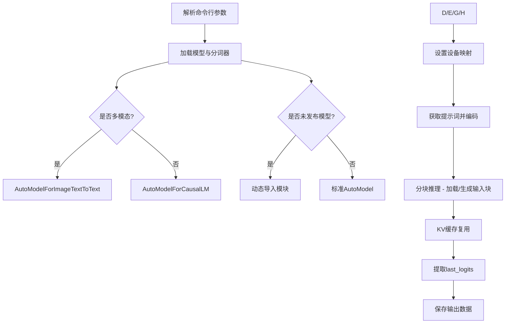
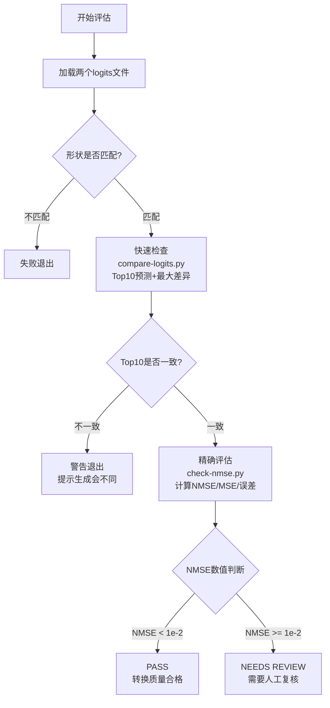
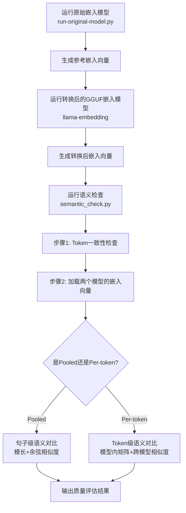
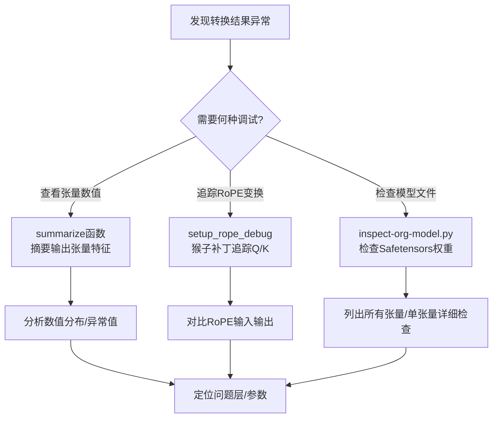
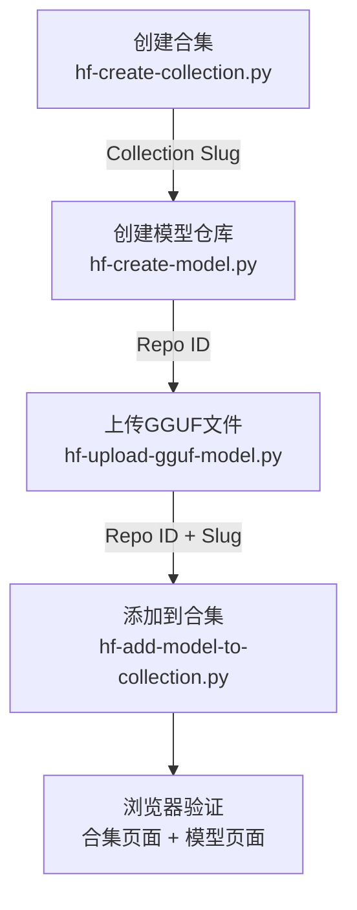

# 第98章 模型转换验证工具链 —— 转换质量的“质检流水线”

## 学习目标

- 理解模型转换验证的核心逻辑：参考输出生成、数值对比与语义检查
- 掌握因果模型（CausalLM）的 logits 提取与分块推理技术
- 掌握嵌入模型（Embedding）的 hidden states 提取与多维度语义验证方法
- 熟练使用 NMSE（归一化均方误差）和余弦相似度评估转换精度
- 掌握 Safetensors 格式模型的深度检查与张量级调试技术
- 了解 Hugging Face Hub 的自动化模型发布流程（创建仓库、合集、上传）
- 能够使用工具链诊断转换问题：从 token 一致性到张量级调试

## 98.1 生活类比

想象模型转换是**将一本外文书籍翻译成中文**：原始模型（PyTorch）是原版外文原著，转换后的模型（GGUF）是中文译本。Logits 对比就像对比两本书的“目录索引”是否一致，检查章节对应关系是否完整；NMSE 检查则如同请专业校对员逐段对比翻译的准确度，量化每一个词语的数值精度；语义检查（Cosine Similarity）确保两本书的“核心思想”保持一致，即使措辞不同，传递的意义也应相同；Token 对比则像检查两本书的“字母表”是否完全对应，确保字符编码基础一致；而 Safetensors 检查则类似于检查原书的印刷质量——纸张、油墨和排版的物理细节是否完好无损。

整个工具链就像**出版社的质检流水线**，每一道工序各司其职：`run-org-model.py` 是原版印刷机，负责生成官方标准答案；`compare-logits.py` 是快速校对员，先粗略检查页码是否对应；`check-nmse.py` 是精密测量仪，量化翻译误差的精确数值；`semantic_check.py` 是内容审核员，确保翻译后的意思没跑偏；`inspect-org-model.py` 是纸张质量检测仪，检查原始模型的物理特性；最后 HF 工具集扮演发行物流的角色，把验收合格的书送到书店上架。

## 98.2 源码地图

在深入每个脚本的细节之前，我们先鸟瞰整个工具链的全貌。下面的源码地图展示了所有脚本的组织结构，可以帮助我们快速定位每个模块在流水线中的位置。它以树状图形式，清晰地展示了 `causal`、`embedding` 和 `utils` 三个主要目录下的所有工具及其核心函数。

```
examples/model-conversion/scripts/
├── causal/                          # 因果语言模型验证
│   ├── run-org-model.py
│   │   ├── parse_arguments()        # 解析模型路径、设备、提示词等参数
│   │   ├── load_model_and_tokenizer() # 加载模型（支持多模态/未发布模型）
│   │   ├── enable_torch_debugging() # 注册前向钩子调试内部计算
│   │   ├── get_prompt()             # 获取测试提示词（文件/环境变量/默认）
│   │   ├── main()                   # 主流程：分块推理、提取last_logits并保存
│   │   └── __main__                 # 脚本入口
│   ├── run-casual-gen-embeddings-org.py
│   │   └── __main__                 # 提取last_hidden_states作为token嵌入并保存
│   └── compare-logits.py
│       ├── quick_logits_check()     # 快速对比：形状检查、Top10对比、最大差异
│       ├── main()                   # 主流程：环境变量读取、token检查、logits对比
│       └── __main__                 # 脚本入口
├── embedding/                       # 嵌入模型验证
│   └── run-original-model.py
│       ├── parse_arguments()        # 解析模型路径、设备、SentenceTransformer模式
│       ├── load_model_and_tokenizer() # 支持SentenceTransformer与AutoModel双模式
│       ├── get_prompt()             # 获取提示词
│       ├── main()                   # 生成嵌入并保存（二进制+文本格式）
│       └── __main__                 # 脚本入口
└── utils/                           # 通用工具集
    ├── check-nmse.py
    │   ├── calculate_nmse()         # 计算归一化均方误差（MSE/方差）
    │   ├── load_logits()            # 多格式加载（npy/bin/txt）
    │   ├── interpret_nmse()         # 分级解读（Perfect到Poor）
    │   ├── main()                   # 完整NMSE评估流程与PASS/FAIL判定
    │   └── __main__                 # 脚本入口
    ├── semantic_check.py
    │   ├── cosine_similarity()      # 余弦相似度计算（支持批量）
    │   ├── load_embeddings_from_file() # 加载嵌入向量并自动判断形状
    │   ├── test_single_prompt_similarity() # 多维度对比（模长/跨模型/矩阵差异）
    │   ├── read_prompt_from_file()  # 从文件读取提示词并处理异常
    │   ├── main()                   # 主流程：token验证、嵌入加载、语义评估
    │   └── __main__                 # 脚本入口
    ├── common.py
    │   ├── get_model_name_from_env_path() # 环境变量模型名解析
    │   ├── summarize()              # 张量调试输出（模拟ggml_debug格式）
    │   ├── debug_hook()             # PyTorch前向钩子工厂
    │   ├── setup_rope_debug()       # RoPE函数猴子补丁调试
    │   ├── save_output_data()       # 统一保存输出（bin/txt/tokens/prompt）
    │   ├── compare_tokens()         # Token级一致性对比
    │   ├── show_version_warning()   # transformers版本兼容性检查
    │   ├── get_model_transformers_version() # 从config.json读取模型要求版本
    │   └── exit_with_warning()      # 版本警告与错误退出
    ├── inspect-org-model.py
    │   ├── get_weight_map()         # 读取safetensors索引
    │   ├── get_all_tensor_names()   # 获取所有张量名称
    │   ├── find_tensor_file()       # 根据张量名查找所在文件
    │   ├── read_safetensors_header() # 读取safetensors头部元数据
    │   ├── get_tensor_size_bytes()  # 计算张量大小
    │   ├── format_size()            # 格式化字节大小显示
    │   ├── get_all_tensor_metadata() # 获取所有张量元数据
    │   ├── normalize_tensor_name()  # 张量名称归一化（层号替换）
    │   ├── list_all_tensors()       # 列出所有张量（支持归一化显示）
    │   ├── print_tensor_info()      # 单张量详细信息检查
    │   ├── main()                   # 主程序入口与参数解析
    │   └── __main__                 # 脚本入口
    ├── compare_tokens.py
    │   ├── parse_arguments()        # 命令行参数解析
    │   └── main()                   # 命令行入口：对比两个模型的token文件
    ├── hf-create-collection.py
    │   ├── create_collection()      # 创建HF合集（支持标题/描述/私有设置）
    │   ├── main()                   # 命令行参数解析与执行
    │   └── __main__                 # 脚本入口
    ├── hf-create-model.py
    │   └── __main__                 # 创建模型仓库并上传README
    ├── hf-add-model-to-collection.py
    │   ├── add_model_to_collection() # 添加模型到合集（验证身份与存在性）
    │   ├── main()                   # 命令行入口
    │   └── __main__                 # 脚本入口
    └── hf-upload-gguf-model.py
        ├── upload_gguf_file()       # 上传GGUF文件到HF仓库
        └── __main__                 # 命令行入口
```

## 98.3 因果模型参考输出生成 —— 原始模型的“标准答案”制造机

在生活类比中，我们提到了出版社质检流水线的概念。本节的主角 `run-org-model.py` 正是这套流水线中的“原版印刷机”，它负责生产用于后续所有质检环节的“黄金标准”——即原始模型的参考 logits。

在深入代码之前，先通过下面的流程简图了解模型加载与推理的核心路径：



**为什么需要参考输出？** 模型转换如同“翻译”，你需要原始模型的输出作为“标准答案”来验证翻译质量。logits 是模型对下一个 token 的“预测分数”，嵌入向量是文本的“数值指纹”。通过对比转换前后的这些输出，你可以量化转换的准确度。`run-org-model.py` 解决了生成参考 logits 的核心问题，具体来说：它支持多模态模型自动检测（`AutoModelForImageTextToText` vs `AutoModelForCausalLM`），通过分块处理长输入（batch_size=512）避免显存溢出，支持未发布模型动态导入（`UNRELEASED_MODEL_NAME` 环境变量），提取最后一个 token 的 logits 并保存为二进制文件，还支持调试模式追踪模型内部计算。

### 98.3.1 `load_model_and_tokenizer()`：加载模型与词元分析器

源码路径：`examples/model-conversion/scripts/causal/run-org-model.py` - `load_model_and_tokenizer()`（24-86行）

```python
def load_model_and_tokenizer(model_path, device="auto"):
    # 函数定义，接收模型路径和设备参数（默认auto）
    # 使用AutoTokenizer加载分词器，trust_remote_code允许加载自定义代码
    print("Loading model and tokenizer using AutoTokenizer:", model_path)
    tokenizer = AutoTokenizer.from_pretrained(model_path, trust_remote_code=True)
    # 加载模型配置，用于后续判断模型类型
    config = AutoConfig.from_pretrained(model_path, trust_remote_code=True)
    multimodal = False  # 初始化多模态标志为False
    full_config = config  # 保存完整配置供多模态模型使用

    # 根据设备参数设置device_map，决定模型加载到哪个设备
    if device == "cpu":
        device_map = {"": "cpu"}  # 强制使用CPU
        print("Forcing CPU usage")
    elif device == "auto":
        device_map = "auto"  # 让transformers自动选择设备
    else:
        device_map = {"": device}  # 用户指定设备

    # 打印模型类型信息
    print("Model type:       ", config.model_type)
    # 多模态模型通常在text_config中包含文本配置
    if "vocab_size" not in config and "text_config" in config:
        config = config.text_config  # 切换为文本配置
        multimodal = True  # 标记为多模态模型

    def print_if_exists(label, obj, attr, default="N/A"):
        # 安全打印属性，不存在时显示N/A
        val = getattr(obj, attr) if hasattr(obj, attr) else default
        print(f"{label}", val)

    # 打印模型关键超参数
    print_if_exists("Vocab size:       ", config, "vocab_size")
    print_if_exists("Hidden size:      ", config, "hidden_size")
    print_if_exists("Number of layers: ", config, "num_hidden_layers")
    print_if_exists("BOS token id:     ", config, "bos_token_id")
    print_if_exists("EOS token id:     ", config, "eos_token_id")

    # 尝试加载未发布模型（通过UNRELEASED_MODEL_NAME环境变量指定）
    unreleased_model_name = os.getenv("UNRELEASED_MODEL_NAME")
    if unreleased_model_name:
        model_name_lower = unreleased_model_name.lower()  # 将模型名转为小写
        # 动态构造模块路径，例如transformers.models.llama.modular_llama
        unreleased_module_path = (
            f"transformers.models.{model_name_lower}.modular_{model_name_lower}"
        )
        class_name = f"{unreleased_model_name}ForCausalLM"  # 构造类名
        print(f"Importing unreleased model module: {unreleased_module_path}")

        try:
            # 尝试导入未发布模型的专用类
            model_class = getattr(importlib.import_module(unreleased_module_path), class_name)
            model = model_class.from_pretrained(
                    model_path,  # 模型路径
                    device_map=device_map,  # 设备映射
                    offload_folder="offload",  # 卸载文件夹
                    trust_remote_code=True,  # 信任远程代码
                    config=config  # 模型配置
            )
        except (ImportError, AttributeError) as e:
            # 导入失败则报错退出
            print(f"Failed to import or load model: {e}")
            exit(1)
    else:
        # 根据是否多模态选择不同的AutoClass
        if multimodal:
            # 多模态模型使用AutoModelForImageTextToText
            model = AutoModelForImageTextToText.from_pretrained(
                    model_path,  # 模型路径
                    device_map=device_map,  # 设备映射
                    offload_folder="offload",  # 卸载文件夹
                    trust_remote_code=True,  # 信任远程代码
                    config=full_config  # 使用完整配置
            )
        else:
            # 标准因果模型使用AutoModelForCausalLM
            model = AutoModelForCausalLM.from_pretrained(
                    model_path,  # 模型路径
                    device_map=device_map,  # 设备映射
                    offload_folder="offload",  # 卸载文件夹
                    trust_remote_code=True,  # 信任远程代码
                    config=config  # 模型配置
            )

    print(f"Model class: {model.__class__.__name__}")  # 打印模型类名

    return model, tokenizer, config  # 返回模型、分词器和配置
```

这段代码是模型加载的核心流程。它首先加载分词器（tokenizer）和配置（config），然后根据设备参数设置 `device_map` 决定模型运行在 CPU、GPU 还是自动选择。对于多模态模型，它检测 `text_config` 并切换配置，同时记录 `multimodal` 标志以便后续选择正确的加载类。对于未发布的新模型，它通过 `UNRELEASED_MODEL_NAME` 环境变量动态构造模块路径，尝试从 transformers 源码导入专用模型类。最后根据模型类型分别使用 `AutoModelForImageTextToText`（多模态）或 `AutoModelForCausalLM`（标准因果模型）完成加载。

### 98.3.2 `parse_arguments()`：命令行参数入口

源码路径：`examples/model-conversion/scripts/causal/run-org-model.py` - `parse_arguments()`（16-22行）

```python
def parse_arguments():
    # 创建参数解析器，描述脚本用途
    parser = argparse.ArgumentParser(description="Process model with specified path")
    # --model-path：指定模型路径，位置参数-m
    parser.add_argument("--model-path", "-m", help="Path to the model")
    # --prompt-file：可选的提示词文件路径，不强制要求
    parser.add_argument("--prompt-file", "-f", help="Optional prompt file", required=False)
    # --verbose：开启详细调试输出（注册前向钩子），开关类型
    parser.add_argument("--verbose", "-v", action="store_true", help="Enable verbose debug output")
    # --device：指定设备（cpu/cuda/mps/auto），默认为auto
    parser.add_argument("--device", "-d", help="Device to use (cpu, cuda, mps, auto)", default="auto")
    # 解析并返回参数对象
    return parser.parse_args()
```

这段代码定义了脚本的命令行接口。通过 `argparse` 库，它注册了四个关键参数：模型路径（`--model-path`）、可选的提示词文件（`--prompt-file`）、调试开关（`--verbose`）和设备选择（`--device`）。其中设备参数默认为 `"auto"`，让 transformers 自动选择最优硬件。`--verbose` 时脚本会为每个叶子模块注册前向钩子，输出所有中间张量的摘要信息，用于深度调试模型内部计算。

### 98.3.3 `enable_torch_debugging()` 与 `get_prompt()`：调试与提示词获取

源码路径：`examples/model-conversion/scripts/causal/run-org-model.py` - `enable_torch_debugging()`（88-90行）与 `get_prompt()`（92-98行）

```python
def enable_torch_debugging(model):
    # 遍历模型的所有命名模块
    for name, module in model.named_modules():
        # 仅对叶子模块（没有子模块的模块）注册前向钩子
        if len(list(module.children())) == 0:  # only leaf modules
            # 为叶子模块注册debug_hook，name用于标识模块路径
            module.register_forward_hook(debug_hook(name))

def get_prompt(args):
    # 如果指定了提示词文件，读取文件内容作为提示词
    if args.prompt_file:
        with open(args.prompt_file, encoding='utf-8') as f:
            return f.read()
    # 否则检查环境变量MODEL_TESTING_PROMPT
    elif os.getenv("MODEL_TESTING_PROMPT"):
        return os.getenv("MODEL_TESTING_PROMPT")
    # 最后使用默认提示词
    else:
        return "Hello, my name is"
```

`enable_torch_debugging` 是调试模式的核心工具。它遍历模型中所有叶子模块（如 `Linear`、`LayerNorm` 等），为每个模块注册前向钩子。当模型前向传播时，钩子会记录每个模块的输入输出张量摘要，让你可以精确追踪数据流经每一层的数值变化。`get_prompt` 则实现了提示词的三级获取策略：命令行文件 > 环境变量 > 默认值，保证了测试的可重复性。

### 98.3.4 `main()`：分块推理与 logits 提取

源码路径：`examples/model-conversion/scripts/causal/run-org-model.py` - `main()`（100-147行）

```python
def main():
    # 解析命令行参数，获取模型路径等配置
    args = parse_arguments()
    # 优先从环境变量MODEL_PATH获取模型路径，否则用命令行参数
    model_path = os.environ.get("MODEL_PATH", args.model_path)
    if model_path is None:
        # 如果两个途径都没有提供模型路径，打印错误并退出
        print("Error: Model path must be specified either via --model-path argument or MODEL_PATH environment variable")
        sys.exit(1)

    # 加载模型、分词器和配置
    model, tokenizer, config = load_model_and_tokenizer(model_path, args.device)

    # 如果开启verbose模式，注册前向钩子进行调试
    if args.verbose:
        enable_torch_debugging(model)

    # 从模型路径提取模型名称（如/path/to/llama -> llama）
    model_name = os.path.basename(model_path)

    # 获取模型参数所在的设备（CPU/CUDA/MPS）
    device = next(model.parameters()).device
    # 获取测试提示词
    prompt = get_prompt(args)
    # 将提示词编码为token ID并移动到模型设备
    input_ids = tokenizer(prompt, return_tensors="pt").input_ids.to(device)
    # 保存原始token ID列表供后续对比
    token_ids = input_ids[0].cpu().tolist()

    # 打印输入信息便于调试
    print(f"Input tokens: {input_ids}")
    print(f"Input text: {repr(prompt)}")
    print(f"Tokenized: {tokenizer.convert_ids_to_tokens(input_ids[0])}")

    # 设置分块大小，防止长输入导致显存溢出
    batch_size = 512

    with torch.no_grad():  # 推理模式，不计算梯度
        past = None  # 初始化KV缓存
        outputs = None
        # 分块迭代处理输入序列
        for i in range(0, input_ids.size(1), batch_size):
            print(f"Processing chunk with tokens {i} to {i + batch_size}")
            # 提取当前块（从i到i+batch_size的token切片）
            chunk = input_ids[:, i:i + batch_size]
            # 传入past_key_values实现KV缓存复用，避免重复计算历史token的键值对
            outputs = model(chunk.to(model.device), past_key_values=past, use_cache=True)
            # 更新KV缓存为当前块的输出
            past = outputs.past_key_values

        logits = outputs.logits # type: ignore

        # 提取最后一个token的logits（即next token prediction）
        # logits形状为[batch_size, seq_len, vocab_size]
        # [0]取batch中第一个样本，[-1]取最后一个token位置，[:]取全部vocab维度
        last_logits = logits[0, -1, :].float().cpu().numpy()

        # 打印logits形状和样例值
        print(f"Logits shape: {logits.shape}")
        print(f"Last token logits shape: {last_logits.shape}")
        print(f"Vocab size: {len(last_logits)}")

        # 打印首尾logits便于快速检查
        print(f"First 10 logits: {last_logits[:10]}")
        print(f"Last 10 logits: {last_logits[-10:]}")

        # 展示Top 5预测结果
        # argsort返回从小到大排序的索引，[-5:]取最大的5个，[::-1]反转得到降序
        top_indices = np.argsort(last_logits)[-5:][::-1]
        print("Top 5 predictions:")
        for idx in top_indices:
            # 将token ID解码为可读文本
            token = tokenizer.decode([idx])
            print(f"  Token {idx} ({repr(token)}): {last_logits[idx]:.6f}")

        # 保存输出数据（logits、tokens、prompt）到data目录
        save_output_data(last_logits, token_ids, prompt, model_name)

if __name__ == "__main__":
    # 当脚本被直接执行时，调用main函数启动整个流程
    main()
```

这段代码是参考 logits 生成的主流程。它首先解析参数并加载模型，然后通过 `tokenizer` 将提示词转为 token ID，接着以 512 为批次大小分块推理整个序列。关键技巧在于使用 `past_key_values` 实现 KV 缓存复用，这避免了重复计算历史 token 的键值对（复杂度从 O(n²) 降为 O(n)）。最后提取最后一个 token 的 logits（这正是 next token prediction 的概率分布），打印 Top 5 预测供人工检查，并通过 `save_output_data` 将 logits、token IDs 和 prompt 保存到 `data/` 目录供后续对比使用。

### 98.3.5 `__main__`：嵌入向量的批量提取器

源码路径：`examples/model-conversion/scripts/causal/run-casual-gen-embeddings-org.py` - `__main__`（1-101行）

```python
#!/usr/bin/env python3
# 指定解释器为python3

import argparse
# 导入命令行参数解析库
import os
# 导入操作系统接口库
import importlib
# 导入动态模块导入库
import torch
# 导入PyTorch深度学习框架
import numpy as np
# 导入NumPy数值计算库

from transformers import AutoTokenizer, AutoConfig, AutoModelForCausalLM
# 从transformers导入自动加载分词器、配置和因果模型
from pathlib import Path
# 导入Path类用于处理文件路径

# 读取未发布模型名称的环境变量
unreleased_model_name = os.getenv('UNRELEASED_MODEL_NAME')

# 解析命令行参数，支持--model-path指定模型
parser = argparse.ArgumentParser(description='Process model with specified path')
parser.add_argument('--model-path', '-m', help='Path to the model')
args = parser.parse_args()

# 优先使用环境变量MODEL_PATH，其次用命令行参数
model_path = os.environ.get('MODEL_PATH', args.model_path)
if model_path is None:
    # 如果模型路径未指定，报错退出
    parser.error("Model path must be specified either via --model-path argument or MODEL_PATH environment variable")

# 加载模型配置以获取超参数
config = AutoConfig.from_pretrained(model_path)

# 打印模型关键配置信息
print("Model type:       ", config.model_type)
print("Vocab size:       ", config.vocab_size)
print("Hidden size:      ", config.hidden_size)
print("Number of layers: ", config.num_hidden_layers)
print("BOS token id:     ", config.bos_token_id)
print("EOS token id:     ", config.eos_token_id)

# 加载分词器
print("Loading model and tokenizer using AutoTokenizer:", model_path)
tokenizer = AutoTokenizer.from_pretrained(model_path)

# 尝试加载未发布模型
if unreleased_model_name:
    model_name_lower = unreleased_model_name.lower()  # 转为小写
    unreleased_module_path = f"transformers.models.{model_name_lower}.modular_{model_name_lower}"  # 构造模块路径
    class_name = f"{unreleased_model_name}ForCausalLM"  # 构造类名
    print(f"Importing unreleased model module: {unreleased_module_path}")

    try:
        # 尝试导入未发布模型的专用类，失败则回退到标准AutoModel
        model_class = getattr(importlib.import_module(unreleased_module_path), class_name)
        model = model_class.from_pretrained(model_path)
    except (ImportError, AttributeError) as e:
        print(f"Failed to import or load model: {e}")
        print("Falling back to AutoModelForCausalLM")
        model = AutoModelForCausalLM.from_pretrained(model_path)
else:
    # 使用标准AutoModelForCausalLM加载模型
    model = AutoModelForCausalLM.from_pretrained(model_path)
print(f"Model class: {type(model)}")

# 提取模型名称（去除目录路径）
model_name = os.path.basename(model_path)
print(f"Model name: {model_name}")

# 使用默认提示词进行测试
prompt = "Hello world today"
input_ids = tokenizer(prompt, return_tensors="pt").input_ids
print(f"Input tokens: {input_ids}")
print(f"Input text: {repr(prompt)}")
print(f"Tokenized: {tokenizer.convert_ids_to_tokens(input_ids[0])}")

with torch.no_grad():
    # 前向传播，并请求输出hidden_states
    # output_hidden_states=True会让模型返回所有层的隐藏状态
    outputs = model(input_ids, output_hidden_states=True)

    # 提取最后一层的隐藏状态
    # outputs.hidden_states是元组，包含(num_layers+1)个张量（含嵌入层输出）
    # 索引-1获取最后一层，形状为[batch_size, seq_len, hidden_size]
    last_hidden_states = outputs.hidden_states[-1]

    # 移除batch维度（取第一个样本），转为numpy数组
    token_embeddings = last_hidden_states[0].float().cpu().numpy()

    print(f"Hidden states shape: {last_hidden_states.shape}")
    print(f"Token embeddings shape: {token_embeddings.shape}")
    print(f"Hidden dimension: {token_embeddings.shape[-1]}")
    print(f"Number of tokens: {token_embeddings.shape[0]}")

    # 创建data目录并保存嵌入向量
    data_dir = Path("data")
    data_dir.mkdir(exist_ok=True)
    bin_filename = data_dir / f"pytorch-{model_name}-embeddings.bin"
    txt_filename = data_dir / f"pytorch-{model_name}-embeddings.txt"

    # 以二进制格式保存（float32），供程序读取
    print(token_embeddings)
    token_embeddings.astype(np.float32).tofile(bin_filename)

    # 保存为文本格式便于人工检查，每行格式为"token_index dim_index value"
    with open(txt_filename, "w") as f:
        for i, embedding in enumerate(token_embeddings):
            for j, val in enumerate(embedding):
                f.write(f"{i} {j} {val:.6f}\n")

    # 按token打印嵌入摘要（前3个值和后3个值）
    print("\nToken embeddings:")
    tokens = tokenizer.convert_ids_to_tokens(input_ids[0])
    for i, embedding in enumerate(token_embeddings):
        # 如果嵌入维度大于10，只显示前3个和后3个值
        if len(embedding) > 10:
            first_vals = " ".join(f"{val:8.6f}" for val in embedding[:3])
            last_vals = " ".join(f"{val:8.6f}" for val in embedding[-3:])
            print(f"embedding {i}: {first_vals}  ... {last_vals}")
        else:
            # 如果嵌入维度较小（≤10），显示全部值
            vals = " ".join(f"{val:8.6f}" for val in embedding)
            print(f"embedding {i}: {vals}")

    # 打印token参考信息
    print(f"\nToken reference:")
    for i, token in enumerate(tokens):
        print(f"  Token {i}: {repr(token)}")

    print(f"Saved bin logits to: {bin_filename}")
    print(f"Saved txt logist to: {txt_filename}")
```

这段代码的核心在于提取模型的 `last_hidden_states`，即最后一层 Transformer 块输出的隐藏状态。与 logits 对比不同，这里关注的是**每个 token 的嵌入向量**，而非下一个 token 的预测分布。通过 `output_hidden_states=True` 让模型返回所有层的隐藏状态，然后取最后一层作为 token 嵌入。输出的数据同时保存为二进制（供程序读取）和文本（供人工检查）两种格式。

这段代码实现了：**从原始 PyTorch 因果模型提取逐 token 的嵌入向量**。它支持未发布模型的动态导入，将每个 token 的嵌入向量保存为二进制和文本文件，并打印前3个值和后3个值的摘要便于快速检查，为后续语义一致性验证提供参考基准。

## 98.4 Logits 对比与质量评估 —— 模型转换的“精度测量仪”

在生成参考 logits 之后，我们需要一种机制来量化转换质量。`compare-logits.py` 提供了快速检查功能，在计算 NMSE 之前先进行“轻量级” sanity check——验证形状匹配、计算最大绝对差异、对比 PyTorch 和 llama.cpp 的 Top 10 预测结果。而 `check-nmse.py` 则提供精确的数值评估，通过归一化均方误差（NMSE）这个指标，消除数据规模影响，给出分级解读。

下面的流程图清晰地展示了从快速检查到精确评估的完整质量评估流程：



### 98.4.1 `quick_logits_check()`：轻量级快速对比

源码路径：`examples/model-conversion/scripts/causal/compare-logits.py` - `quick_logits_check()`（20-46行）

```python
def quick_logits_check(pytorch_file, llamacpp_file):
    # 函数定义，接收PyTorch和llama.cpp的logits文件路径
    """Lightweight sanity check before NMSE"""

    try:
        # 以float32格式从二进制文件读取PyTorch logits
        # np.fromfile直接从原始字节流解析为float32数组
        pytorch_logits = np.fromfile(pytorch_file, dtype=np.float32)
        # 以float32格式从二进制文件读取llama.cpp logits
        llamacpp_logits = np.fromfile(llamacpp_file, dtype=np.float32)
    except Exception as e:
        # 如果文件读取失败，打印错误并返回False
        print(f"❌ NOK: Failed to load files - {e}")
        return False

    # 检查两个logits数组的形状是否完全匹配
    # 如果形状不匹配，说明模型输出维度不同，比较无意义
    if pytorch_logits.shape != llamacpp_logits.shape:
        print(f"❌ NOK: Shape mismatch - PyTorch: {pytorch_logits.shape}, llama.cpp: {llamacpp_logits.shape}")
        return False

    # 计算逐元素差值（对应位置相减）
    diff = pytorch_logits - llamacpp_logits
    # 取绝对值得到绝对差异
    abs_diff = np.abs(diff)
    # 获取最大绝对差异作为数值精度的粗粒度指标
    # np.max扫描整个数组找到最大值
    max_diff = np.max(abs_diff)

    # 分别获取两个模型的Top 10预测索引
    # np.argsort返回从小到大排序的索引
    # [-10:]取最大的10个索引，[::-1]反转得到降序排列
    pytorch_top10 = np.argsort(pytorch_logits)[-10:][::-1]
    llamacpp_top10 = np.argsort(llamacpp_logits)[-10:][::-1]
    # 打印Top 10的logits值（用计算出的索引从原数组取值）
    print(f"Top 10 PyTorch logits: {pytorch_logits[pytorch_top10]}")
    print(f"Top 10 llama.cpp logits: {llamacpp_logits[llamacpp_top10]}")
    # 打印最大绝对差异（浮点格式保留4位小数）
    print(f"Max absolute difference: {max_diff:.4f}")

    return True
```

这段代码实现了 logits 的快速 sanity check。它首先从二进制文件加载两个模型的 logits（`np.fromfile` 直接从文件读取原始字节流并解析为 float32 数组），然后检查形状是否匹配（形状不匹配直接失败）。接着计算两个 logits 数组的差值，通过 `np.max(np.abs(diff))` 获取最大绝对差异作为数值精度的粗粒度指标。最关键的是它输出了两个模型各自 Top 10 预测的 logits 值（通过 `np.argsort` 排序获取最大值的索引，再用来索引原数组）——如果两个模型的 Top 10 预测有显著差异，即使 NMSE 数值不大，实际生成行为也会相差很大。这个快速检查是后续 NMSE 计算的前置步骤，可以在几秒内发现问题。

### 98.4.2 `main()` 与 `__main__`：快速检查的完整流程

源码路径：`examples/model-conversion/scripts/causal/compare-logits.py` - `main()`（49-86行）与 `__main__`（88-89行）

```python
def main():
    # 从环境变量MODEL_PATH获取原始模型路径
    model_path = os.environ.get('MODEL_PATH')
    # 从模型路径提取模型名称（去除.gguf后缀和目录路径）
    model_name = get_model_name_from_env_path('MODEL_PATH')
    # 设置数据目录为data
    data_dir = Path("data")
    # 构造PyTorch logits文件路径
    pytorch_file = data_dir / f"pytorch-{model_name}.bin"

    # 从环境变量CONVERTED_MODEL获取转换后的模型名称
    llamacpp_model_name = get_model_name_from_env_path('CONVERTED_MODEL')
    print(f"Using converted model: {llamacpp_model_name}")
    # 构造llama.cpp logits文件路径
    llamacpp_file = data_dir / f"llamacpp-{llamacpp_model_name}.bin"

    # 检查PyTorch logits文件是否存在，不存在则提示先运行生成脚本
    if not pytorch_file.exists():
        print(f"Error: PyTorch logits file not found: {pytorch_file}")
        print("Please run scripts/run-org-model.sh first to generate this file.")
        sys.exit(1)

    # 检查llama.cpp logits文件是否存在，不存在则提示先运行生成脚本
    if not llamacpp_file.exists():
        print(f"Error: llama.cpp logits file not found: {llamacpp_file}")
        print("Please run scripts/run-converted-model.sh first to generate this file.")
        sys.exit(1)

    print("Checked all required files were found. Proceeding...\n")

    # 验证token一致性：这是logits对比的前置条件
    # 如果token不一致，logits对比的基础就不存在
    print("🔍 Token Comparison Check")
    print("=" * 40)
    if not compare_tokens(f"pytorch-{model_name}", f"llamacpp-{llamacpp_model_name}"):
        exit_with_warning("\n❌ Token mismatch detected", model_path)
    print()

    print("🔍 GGML Model Validation for model ", model_name)
    print("=" * 40)
    print(f"PyTorch logits  : {pytorch_file}")
    print(f"llama.cpp logits: {llamacpp_file}")
    print()

    # 调用核心快速检查函数
    success = quick_logits_check(pytorch_file, llamacpp_file)

    # 根据检查结果决定退出码，便于在shell脚本中自动判断
    # 退出码0表示成功可继续，1表示失败需回溯
    if success:
        print("✅ OK: Lightweight model check successful!")
        print("       Ok to proceed with NMSE check...")
        sys.exit(0)  # 成功退出码0
    else:
        exit_with_warning(f"❌ NOK: Top 10 predictions don't match - generation will differ", model_path)

if __name__ == "__main__":
    # 当脚本被直接执行时，调用main函数启动整个流程
    main()
```

这段代码是快速检查的主流程。它首先从环境变量获取模型路径和名称，构造两个 logits 文件的路径，并检查文件是否存在。接着先执行 token 一致性检查（这是 logits 对比的前置条件），然后调用 `quick_logits_check` 进行 logits 对比。根据检查结果设置不同的退出码（成功为 0，失败调用 `exit_with_warning` 退出码为 1），方便在 shell 脚本中作为子命令调用时自动判断结果。

### 98.4.3 `calculate_nmse()` 与 `interpret_nmse()`：数值精度测量仪

源码路径：`examples/model-conversion/scripts/utils/check-nmse.py` - `calculate_nmse()`（13-21行）与 `interpret_nmse()`（42-54行）

```python
# 以下一对函数构成了NMSE评估的核心：前者计算数值，后者解读结果。

def calculate_nmse(reference, test):
    # 函数定义，接收参考logits和测试logits
    # 计算均方误差（MSE），即逐元素差值的平方的平均值
    # reference是PyTorch参考logits，test是llama.cpp测试logits
    mse = np.mean((test - reference) ** 2)
    # 计算参考数据的方差，作为归一化分母
    ref_var = np.var(reference)
    # 如果参考方差为0（数据为常数），则无法归一化
    # 此时MSE>0表示完全不匹配（NMSE=inf），MSE=0表示完全匹配（NMSE=0）
    if ref_var == 0:
        nmse = float('inf') if mse > 0 else 0.0
        return mse, mse, ref_var

    # 归一化均方误差：MSE / 参考方差
    # 这样消除了数据规模的影响，使得不同模型的NMSE可以直接对比
    nmse = mse / ref_var

    # 返回NMSE、MSE和参考方差三个指标
    return nmse, mse, ref_var


def interpret_nmse(nmse):
    # 函数定义，接收NMSE值
    """Provide interpretation of NMSE value"""
    # 逐级判断NMSE值并返回对应的解读字符串和表情符号
    if nmse == 0:
        return "Perfect match", "🎉"  # 完美匹配
    elif nmse < 1e-6:
        return "Essentially identical", "✅"  # 基本一致
    elif nmse < 1e-4:
        return "Excellent match", "✅"  # 极佳匹配
    elif nmse < 1e-3:
        return "Very good match", "👍"  # 非常好
    elif nmse < 1e-2:
        return "Good match", "👍"  # 良好
    elif nmse < 0.1:
        return "Acceptable match", "⚠️"  # 可接受
    elif nmse < 1.0:
        return "Poor match", "❌"  # 较差
    else:
        return "Very poor match (worse than noise)", "❌"  # 比随机噪声还差
```

**为什么选择 NMSE 而不是直接使用 MSE？** 这是本节设计中的一个关键取舍。MSE（均方误差）的值受数据规模影响很大——如果 logits 本身数值较大，MSE 也可能较大，无法直接判断是否“可接受”。NMSE 通过除以参考方差进行归一化，消除了数据规模的影响，使得不同模型的评估结果可以直接横向对比。例如，NMSE < 1e-4 对于任何模型都是 Excellent，而 MSE 则没有统一的判断标准。

**为什么 NMSE 用参考方差而不是测试方差做归一化？** 因为参考方差代表数据的固有“信号强度”，用 MSE 除以这个信号强度，得到的 NMSE 表示误差相对于信号的比例。如果用测试方差做归一化，那么转换后的模型方差变化会扭曲 NMSE 的含义，使得对比失去基准。

通过 `interpret_nmse` 的分级解读，你可以快速判断转换质量：Perfect（🎉）、Excellent（✅）、Good（👍）、Acceptable（⚠️）、Poor（❌），从 Perfect 到 Very poor 共分 8 个等级，每个等级都有明确的数值区间和对应的视觉标识，使得质量评估一目了然。

### 98.4.4 `load_logits()`：支持多格式的加载器

源码路径：`examples/model-conversion/scripts/utils/check-nmse.py` - `load_logits()`（23-40行）

```python
def load_logits(file_path):
    # 首先检查文件是否存在，不存在则抛出异常
    if not os.path.exists(file_path):
        raise FileNotFoundError(f"File not found: {file_path}")

    # 根据文件扩展名选择加载方式
    if file_path.suffix == '.npy':
        # .npy文件使用numpy原生格式加载
        return np.load(file_path)
    elif file_path.suffix == '.bin':
        # .bin文件是原始float32二进制格式，直接读取
        return np.fromfile(file_path, dtype=np.float32)
    else:
        # 其他格式尝试作为文本文件加载
        try:
            # 如果文本带索引格式 "0: value"，提取冒号后的数值
            data = []
            with open(file_path, 'r') as f:
                for line in f:
                    if ':' in line:
                        # 格式为 "index: value"，用split(':')[1]取冒号后的部分
                        value = float(line.split(':')[1].strip())
                    else:
                        # 纯数值格式，直接转换为float
                        value = float(line.strip())
                    data.append(value)
            # 将列表转换为numpy数组
            return np.array(data, dtype=np.float32)
        except:
            # 最后尝试使用np.loadtxt处理简单文本格式
            return np.loadtxt(file_path, dtype=np.float32)
```

这段代码实现了对多种文件格式的兼容加载。它根据文件后缀自动选择加载策略：`.npy` 使用 NumPy 原生格式，`.bin` 直接读取原始二进制字节流，其他格式尝试解析为文本（支持带索引和不带索引两种格式）。这种多格式支持让工具链可以灵活对接不同的模型输出保存格式，无论是标准二进制还是人类可读的文本文件都能统一处理。

### 98.4.5 `main()`：完整评估流程与结果输出

源码路径：`examples/model-conversion/scripts/utils/check-nmse.py` - `main()`（56-160行）

```python
def main():
    # 解析命令行参数，-m必须指定模型路径
    parser = argparse.ArgumentParser(description='Validate model logits')
    parser.add_argument('-m', '--model-path', required=True,  help='Path to the model directory')
    args = parser.parse_args()

    # 从环境变量获取模型名称，构造数据文件路径
    model_name = get_model_name_from_env_path('MODEL_PATH')
    data_dir = Path("data")

    # 构造PyTorch参考logits文件路径
    pytorch_file = data_dir / f"pytorch-{model_name}.bin"

    # 获取转换后模型名称并构造其logits文件路径
    llamacpp_model_name = get_model_name_from_env_path('CONVERTED_MODEL')
    llamacpp_file = data_dir / f"llamacpp-{llamacpp_model_name}.bin"

    print(f"Model name: {model_name}")
    print(f"PyTorch logits file: {pytorch_file}")
    print(f"llama.cpp logits file: {llamacpp_file}")

    # 设置参考文件（PyTorch）和测试文件（llama.cpp）
    reference_file = pytorch_file
    test_file = llamacpp_file

    print("📊 NMSE Check for Model Comparison")
    print("=" * 50)
    print(f"Reference (ground truth): {reference_file}")
    print(f"Test (to evaluate):       {test_file}")
    print()

    try:
        print("Loading reference logits...")
        reference = load_logits(reference_file)  # 加载参考logits
        print(f"  Shape: {reference.shape}, Type: {reference.dtype}")

        print("Loading test logits...")
        test = load_logits(test_file)  # 加载测试logits
        print(f"  Shape: {test.shape}, Type: {test.dtype}")

        # 检查形状是否匹配，不匹配则直接退出
        if reference.shape != test.shape:
            print(f"\n❌ Error: Shape mismatch!")
            print(f"  Reference: {reference.shape}")
            print(f"  Test: {test.shape}")
            sys.exit(1)

        print(f"\n✅ Shapes match: {reference.shape}")

        # 计算NMSE、MSE和参考方差
        nmse, mse, ref_var = calculate_nmse(reference, test)

        # 额外计算最大绝对误差和平均绝对误差
        max_abs_error = np.max(np.abs(test - reference))
        mean_abs_error = np.mean(np.abs(test - reference))

        # 输出所有计算结果
        print(f"\n📈 METRICS")
        print("=" * 30)
        print(f"MSE (Mean Squared Error):     {mse:.6e}")
        print(f"Reference Variance:           {ref_var:.6e}")
        print(f"NMSE:                         {nmse:.6e}")
        print(f"Max Absolute Error:           {max_abs_error:.6f}")
        print(f"Mean Absolute Error:          {mean_abs_error:.6f}")

        # 将NMSE转换为dB单位（信号处理中常用的对数表示）
        if nmse > 0:
            nmse_db = 10 * np.log10(nmse)
            print(f"NMSE (dB):                    {nmse_db:.2f} dB")

        # 根据NMSE值给出分级解读
        interpretation, emoji = interpret_nmse(nmse)
        print(f"\n🎯 INTERPRETATION")
        print("=" * 30)
        print(f"{emoji} {interpretation}")

        # 提供详细的分级指导，帮助用户理解结果含义并采取行动
        print(f"\n📋 GUIDANCE")
        print("=" * 30)
        if nmse < 1e-3:
            print("✅ EXCELLENT: Your GGML conversion is working very well!")
            print("   The differences are negligible for practical use.")
        elif nmse < 1e-2:
            print("👍 GOOD: Your GGML conversion is working well.")
            print("   Small differences are likely due to precision/quantization.")
        elif nmse < 0.1:
            print("⚠️  ACCEPTABLE: Conversion is working but with some differences.")
            print("   Check if you're using quantization (Q4, Q8, etc.)")
            print("   Test generation quality to see if it's acceptable.")
        else:
            print("❌ PROBLEMATIC: Large differences detected.")
            print("   Check your conversion process for potential issues.")
            print("   Verify you're using the same model weights.")

        # 打印NMSE基准值供参考
        print(f"\n📚 NMSE BENCHMARKS")
        print("=" * 30)
        print("< 1e-6:  Essentially identical")
        print("< 1e-4:  Excellent (typical for good conversions)")
        print("< 1e-3:  Very good")
        print("< 1e-2:  Good (acceptable for most use cases)")
        print("< 0.1:   Acceptable (may need verification)")
        print("> 1.0:   Poor (worse than random)")

        # 根据NMSE设置退出码，PASS为0，NEEDS REVIEW为1
        # 这允许脚本在CI/CD流水线中自动判断转换质量
        if nmse < 1e-2:
            print(f"\n✅ RESULT: PASS (NMSE = {nmse:.2e})")
            sys.exit(0)
        else:
            print(f"\n❌ RESULT: NEEDS REVIEW (NMSE = {nmse:.2e})")
            sys.exit(1)

    except Exception as e:
        print(f"❌ Error: {e}")
        sys.exit(1)

# 脚本入口点
if __name__ == "__main__":
    main()
```

这段代码是 NMSE 评估的主流程。它首先从环境变量获取模型路径，构造参考文件（PyTorch）和测试文件（llama.cpp）的路径，然后加载两个 logits 文件。加载后检查形状是否匹配，如果不匹配则直接失败。接下来计算 NMSE、MSE、最大绝对误差和平均绝对误差等多个指标，并输出参考方差和 dB 单位值。最后根据 NMSE 值给出分级解读和详细指导，并设置退出码（PASS 为 0，NEEDS REVIEW 为 1），方便在 shell 脚本中自动判断。

## 98.5 嵌入模型参考与语义检查 —— 语义一致性的“向量罗盘”

嵌入模型的验证与因果模型有所不同——它关注的是**语义一致性**而非预测概率分布。`run-original-model.py` 负责提取原始模型的嵌入向量（支持两种模式：SentenceTransformer 含 Pooling/Dense 层与原生 AutoModel），而 `semantic_check.py` 则通过余弦相似度、向量模长对比和相似度矩阵差异等多个维度评估转换质量。

下面的流程图展示了从嵌入生成到语义验证的完整过程：



### 98.5.1 `run-original-model.py`：嵌入模型参考输出生成

源码路径：`examples/model-conversion/scripts/embedding/run-original-model.py` - `parse_arguments()`（26-53行）

```python
def parse_arguments():
    # 创建参数解析器，描述脚本用途
    parser = argparse.ArgumentParser(description='Run original embedding model')
    # --model-path：指定模型路径，支持-m短参数
    parser.add_argument(
        '--model-path',
        '-m',
        help='Path to the model'
    )
    # --prompts-file：指定包含提示词的文件（每行一个）
    parser.add_argument(
        '--prompts-file',
        '-p',
        help='Path to file containing prompts (one per line)'
    )
    # --use-sentence-transformers：开关选项，启用SentenceTransformer模式
    # 该模式会应用所有编号层（01_Pooling, 02_Dense, 03_Dense, 04_Normalize）
    parser.add_argument(
        '--use-sentence-transformers',
        action='store_true',
        help=('Use SentenceTransformer to apply all numbered layers '
              '(01_Pooling, 02_Dense, 03_Dense, 04_Normalize)')
    )
    # --device：指定运行设备，默认为auto自动选择
    parser.add_argument(
        '--device',
        '-d',
        help='Device to use (cpu, cuda, mps, auto)',
        default='auto'
    )
    return parser.parse_args()  # 返回解析结果
```

这段代码定义了嵌入模型脚本的命令行接口。它提供四个参数：模型路径、提示词文件路径、SentenceTransformer 模式开关和设备选择。特别重要的是 `--use-sentence-transformers` 开关——它决定了后续模型加载和推理的方式：启用时应用完整的分层流水线（含 Pooling、Dense 和 Normalize），不启用时仅使用基础模型输出。

### 98.5.2 `load_model_and_tokenizer()`：双模式加载器

源码路径：`examples/model-conversion/scripts/embedding/run-original-model.py` - `load_model_and_tokenizer()`（55-135行）

```python
def load_model_and_tokenizer(model_path, use_sentence_transformers=False, device="auto"):
    # 根据设备参数设置device_map，决定模型加载位置
    if device == "cpu":
        device_map = {"": "cpu"}  # 强制使用CPU
        print("Forcing CPU usage")
    elif device == "auto":
        # 在Mac上，auto device_map可能引发问题
        # 因此手动检测最佳设备
        if torch.cuda.is_available():
            device_map = {"": "cuda"}  # 优先使用CUDA
            print("Using CUDA")
        elif torch.backends.mps.is_available():
            device_map = {"": "mps"}  # 其次使用Apple Metal
            print("Using MPS (Apple Metal)")
        else:
            device_map = {"": "cpu"}  # 最后使用CPU
            print("Using CPU")
    else:
        device_map = {"": device}  # 用户指定的设备

    if use_sentence_transformers:
        # SentenceTransformer模式：从库中导入并加载
        # 该模式会自动应用所有编号层（01_Pooling, 02_Dense等）
        from sentence_transformers import SentenceTransformer
        print("Using SentenceTransformer to apply all numbered layers")
        model = SentenceTransformer(model_path)
        # 从底层模型获取tokenizer和config
        tokenizer = model.tokenizer
        config = model[0].auto_model.config
    else:
        # 标准AutoModel模式
        tokenizer = AutoTokenizer.from_pretrained(model_path)
        config = AutoConfig.from_pretrained(model_path, trust_remote_code=True)

        # 此代码块当前仅打印滑动窗口大小，并未实际修改其值。
        # 意图是提醒开发者可在此处手动覆盖config中的滑动窗口大小，
        # 以便验证原始模型中的滑动窗口注意力掩码与转换后的GGUF模型是否一致。
        if hasattr(config, 'sliding_window'):
            original_sliding_window = config.sliding_window
            print(f"Modified sliding window: {original_sliding_window} -> {config.sliding_window}")

        # 检查是否指定了未发布模型
        unreleased_model_name = os.getenv('UNRELEASED_MODEL_NAME')
        print(f"Using unreleased model: {unreleased_model_name}")
        if unreleased_model_name:
            # 动态导入未发布模型的专用类
            model_name_lower = unreleased_model_name.lower()
            unreleased_module_path = f"transformers.models.{model_name_lower}.modular_{model_name_lower}"
            class_name = f"{unreleased_model_name}Model"
            print(f"Importing unreleased model module: {unreleased_module_path}")

            try:
                # 尝试加载专用类，失败则退出
                model_class = getattr(importlib.import_module(unreleased_module_path), class_name)
                model = model_class.from_pretrained(
                    model_path,
                    device_map=device_map,
                    offload_folder="offload",
                    trust_remote_code=True,
                    config=config
                )
            except (ImportError, AttributeError) as e:
                print(f"Failed to import or load model: {e}")
                sys.exit(1)
        else:
            # 标准AutoModel加载
            model = AutoModel.from_pretrained(
                model_path,
                device_map=device_map,
                offload_folder="offload",
                trust_remote_code=True,
                config=config
            )
        print(f"Model class: {type(model)}")
        print(f"Model file: {type(model).__module__}")

        # 验证模型是否使用正确的sliding window
        if hasattr(model.config, 'sliding_window'):
            print(f"Model's sliding_window: {model.config.sliding_window}")
        else:
            print("Model config does not have sliding_window attribute")

    return model, tokenizer, config  # 返回模型、分词器和配置
```

这段代码实现了双模式的模型加载。SentenceTransformer 模式会加载完整的分层处理流水线，包括 Pooling（池化）、Dense（全连接）和 Normalize（归一化）层；AutoModel 模式则仅加载基础编码器。设备映射在 `"auto"` 模式下进行了特殊处理：优先 CUDA，其次 Apple MPS，最后 CPU。代码中包含一段关于 `sliding_window` 的打印逻辑——它提示开发者可在此处手动覆盖滑动窗口大小以进行测试，但当前实现仅打印原始值，并未修改配置。对于未发布模型，它支持动态导入专用类。关键设计是 `sliding_window` 的检查——这确保了滑动窗口注意力掩码的正确性。

### 98.5.3 `get_prompt()` 与 `main()`：提示词管理与嵌入生成

源码路径：`examples/model-conversion/scripts/embedding/run-original-model.py` - `get_prompt()`（137-147行）与 `main()`（149-252行）

```python
def get_prompt(args):
    # 如果指定了提示词文件
    if args.prompts_file:
        try:
            # 尝试读取文件内容并去除首尾空白
            with open(args.prompts_file, 'r', encoding='utf-8') as f:
                return f.read().strip()
        except FileNotFoundError:
            print(f"Error: Prompts file '{args.prompts_file}' not found")
            sys.exit(1)
        except Exception as e:
            print(f"Error reading prompts file: {e}")
            sys.exit(1)
    else:
        # 默认提示词
        return "Hello world today"

def main():
    # 解析命令行参数
    args = parse_arguments()

    # 优先使用环境变量EMBEDDING_MODEL_PATH，其次用命令行参数
    model_path = os.environ.get('EMBEDDING_MODEL_PATH', args.model_path)
    if model_path is None:
        print("Error: Model path must be specified either via --model-path argument "
              "or EMBEDDING_MODEL_PATH environment variable")
        sys.exit(1)

    # 判断是否使用SentenceTransformer
    # 优先命令行参数，其次环境变量
    use_st = (
        args.use_sentence_transformers or os.environ.get('USE_SENTENCE_TRANSFORMERS', '').lower() in ('1', 'true', 'yes')
    )

    # 加载模型、分词器和配置
    model, tokenizer, config = load_model_and_tokenizer(model_path, use_st, args.device)

    # 获取模型所在设备
    if not use_st:
        device = next(model.parameters()).device
    else:
        # SentenceTransformer需要从底层模型获取设备
        device = next(model[0].auto_model.parameters()).device

    model_name = os.path.basename(model_path)  # 提取模型名称

    prompt_text = get_prompt(args)  # 获取提示词
    texts = [prompt_text]  # 构造文本列表

    with torch.no_grad():  # 推理模式
        if use_st:
            # SentenceTransformer模式：使用encode方法生成嵌入
            embeddings = model.encode(texts, convert_to_numpy=True)
            all_embeddings = embeddings  # Shape: [batch_size, hidden_size]

            # 编码文本并打印token信息
            encoded = tokenizer(
                texts,
                padding=True,
                truncation=True,
                return_tensors="pt"
            )
            tokens = encoded['input_ids'][0]
            token_ids = tokens.cpu().tolist()
            token_strings = tokenizer.convert_ids_to_tokens(tokens)
            for i, (token_id, token_str) in enumerate(zip(tokens, token_strings)):
                print(f"{token_id:6d} -> '{token_str}'")

            print(f"Embeddings shape (after all SentenceTransformer layers): {all_embeddings.shape}")
            print(f"Embedding dimension: {all_embeddings.shape[1] if len(all_embeddings.shape) > 1 else all_embeddings.shape[0]}")
        else:
            # 标准模式：使用基础模型输出
            encoded = tokenizer(
                texts,
                padding=True,
                truncation=True,
                return_tensors="pt"
            )

            tokens = encoded['input_ids'][0]
            token_ids = tokens.cpu().tolist()
            token_strings = tokenizer.convert_ids_to_tokens(tokens)
            for i, (token_id, token_str) in enumerate(zip(tokens, token_strings)):
                print(f"{token_id:6d} -> '{token_str}'")

            # 将输入移动到模型所在设备
            encoded = {k: v.to(device) for k, v in encoded.items()}
            outputs = model(**encoded)
            hidden_states = outputs.last_hidden_state  # Shape: [batch_size, seq_len, hidden_size]

            # 去batch维度，取第一个样本
            all_embeddings = hidden_states[0].float().cpu().numpy()  # Shape: [seq_len, hidden_size]

            print(f"Hidden states shape: {hidden_states.shape}")
            print(f"All embeddings shape: {all_embeddings.shape}")
            print(f"Embedding dimension: {all_embeddings.shape[1]}")

        # 处理不同形状的嵌入向量
        if len(all_embeddings.shape) == 1:
            # 单向量模式：池化嵌入
            n_embd = all_embeddings.shape[0]
            n_embd_count = 1
            all_embeddings = all_embeddings.reshape(1, -1)
        else:
            # 多向量模式：逐token嵌入
            n_embd = all_embeddings.shape[1]
            n_embd_count = all_embeddings.shape[0]

        print()

        # 按嵌入向量打印摘要（前3个和后3个值）
        for j in range(n_embd_count):
            embedding = all_embeddings[j]
            print(f"embedding {j}: ", end="")

            # 打印前3个值
            for i in range(min(3, n_embd)):
                print(f"{embedding[i]:9.6f} ", end="")

            print(" ... ", end="")

            # 打印后3个值
            for i in range(n_embd - 3, n_embd):
                print(f"{embedding[i]:9.6f} ", end="")

            print()  # New line

        print()

        # 展平嵌入向量并统计总数
        flattened_embeddings = all_embeddings.flatten()
        print(f"Total values: {len(flattened_embeddings)} ({n_embd_count} embeddings × {n_embd} dimensions)")
        print("")

        # 保存输出数据（嵌入向量、tokens、prompt）
        save_output_data(flattened_embeddings, token_ids, prompt_text, model_name, type_suffix="-embeddings")

if __name__ == "__main__":
    # 脚本入口点，调用main函数
    main()
```

这段代码是嵌入模型参考输出生成的主流程。在 SentenceTransformer 模式下，它调用 `model.encode()` 生成句子级嵌入（含完整的 Pooling/Dense/Normalize 流水线）；在标准模式下，它通过 `model(**encoded)` 获取 `last_hidden_state` 作为逐 token 嵌入。两种模式都会打印 token 信息和嵌入向量摘要，最终通过 `save_output_data` 统一保存为二进制和文本格式。

### 98.5.4 `cosine_similarity()`：批量余弦相似度计算

源码路径：`examples/model-conversion/scripts/utils/semantic_check.py` - `cosine_similarity()`（14-37行）

```python
def cosine_similarity(a, b=None):
    # 函数定义，接收向量a和可选的向量b
    """
    计算两个向量集合之间的余弦相似度。
    如果b为None，则计算a自身的相似度矩阵。
    返回形状为[a.shape[0], b.shape[0]]的相似度矩阵。
    """
    a = np.asarray(a)  # 将输入转换为numpy数组
    if b is None:
        b = a  # 未指定b时，计算a自身
    else:
        b = np.asarray(b)  # 转换b为numpy数组

    # 将1D输入升维为2D（方便统一处理）
    # 1D形状如(768,) -> 2D形状如(1, 768)
    if a.ndim == 1:
        a = a.reshape(1, -1)
    if b.ndim == 1:
        b = b.reshape(1, -1)

    # 计算每个向量的L2范数（模长），keepdims保留维度用于广播
    a_norms = np.linalg.norm(a, axis=1, keepdims=True)
    b_norms = np.linalg.norm(b, axis=1, keepdims=True)

    # 防止除零错误：将零范数替换为极小值1e-8
    a_norms = np.where(a_norms == 0, 1e-8, a_norms)
    b_norms = np.where(b_norms == 0, 1e-8, b_norms)

    # 将向量归一化为单位向量（方向向量）
    a_normalized = a / a_norms
    b_normalized = b / b_norms

    # 计算余弦相似度：归一化向量的点积
    # 结果形状：[a.shape[0], b.shape[0]]，每行是a中向量与b中所有向量的相似度
    return np.dot(a_normalized, b_normalized.T)
```

`cosine_similarity` 实现了余弦相似度的批量计算。它首先将输入升维为2D，然后通过 `np.linalg.norm` 计算每行向量的 L2 范数（即向量模长），将零范数替换为极小值防止除法错误。接着将向量归一化为单位向量，最后通过 `np.dot` 点积计算所有向量对之间的相似度，返回形状为 `[a.shape[0], b.shape[0]]` 的相似度矩阵。

### 98.5.5 `load_embeddings_from_file()`：多格式嵌入加载

源码路径：`examples/model-conversion/scripts/utils/emantic_check.py` - `load_embeddings_from_file()`（39-44行）

```python
def load_embeddings_from_file(filename, n_tokens, n_embd):
    # 函数定义，接收文件名、token数量和嵌入维度
    # 从二进制文件加载float32格式的嵌入向量
    embeddings = np.fromfile(filename, dtype=np.float32)
    # 根据数据长度自动判断是池化（单个）嵌入还是逐token嵌入
    # 如果长度等于n_embd（嵌入维度），说明是单个池化向量
    if len(embeddings) == n_embd:
        return embeddings.reshape(1, n_embd)  # 形状[1, n_embd]
    else:
        # 否则是n_tokens个token的嵌入向量
        return embeddings.reshape(n_tokens, n_embd)  # 形状[n_tokens, n_embd]
```

`load_embeddings_from_file` 根据数据长度自动判断嵌入类型——如果长度恰好等于 `n_embd`，说明是单个池化向量；否则是 `n_tokens` 个逐 token 向量。这种设计让同一工具能够同时支持两种输出格式。

### 98.5.6 `read_prompt_from_file()`：提示词文件读取器

源码路径：`examples/model-conversion/scripts/utils/semantic_check.py` - `read_prompt_from_file()`（144-150行）

```python
def read_prompt_from_file(file_path):
    # 函数定义，接收文件路径
    try:
        # 尝试以UTF-8编码读取文件内容，去除首尾空白字符
        with open(file_path, 'r', encoding='utf-8') as f:
            return f.read().strip()
    except FileNotFoundError:
        # 文件不存在时报告错误并退出
        print(f"Error: Prompts file '{file_path}' not found")
        exit(1)
    except Exception as e:
        # 其他异常（如权限问题、编码错误）也报告并退出
        print(f"Error reading prompts file: {e}")
        exit(1)
```

这段代码实现了提示词文件的安全读取。它使用 UTF-8 编码读取文件（保证中文等非 ASCII 字符正确处理），去除首尾空白字符。对文件不存在和其他异常进行了区分处理，并统一通过 `exit(1)` 退出程序，确保在 shell 脚本调用时能够捕获失败。

### 98.5.7 `test_single_prompt_similarity()`：多维度语义对比

源码路径：`examples/model-conversion/scripts/utils/semantic_check.py` - `test_single_prompt_similarity()`（46-142行）

```python
def test_single_prompt_similarity(python_emb, cpp_emb, tokens, prompt):
    # 函数定义，接收PyTorch嵌入、llama.cpp嵌入、tokens和prompt
    # 设置numpy打印选项：不显示科学计数法，保留6位小数
    np.set_printoptions(suppress=True, precision=6)
    print("pytorch embeddings:");  # 打印提示信息
    print(python_emb)  # 打印PyTorch完整嵌入向量
    print("llama.cpp embeddings:");  # 打印提示信息
    print(cpp_emb)  # 打印llama.cpp完整嵌入向量
    print(f"\n=== Prompt: '{prompt}' ===")  # 打印当前测试的prompt
    print(f"Tokens: {tokens}")  # 打印token列表
    print(f"Embeddings shape: Python {python_emb.shape}, llama.cpp {cpp_emb.shape}")  # 打印嵌入形状

    n_tokens = len(tokens)  # token数量
    is_pooled = python_emb.shape[0] == 1  # 判断是否为池化嵌入（单向量）

    if is_pooled:
        # 池化模式：句子级嵌入比较
        print(f"\n[Pooled Embeddings Mode - comparing single sentence embeddings]")

        # 1. 原始向量模长比较
        # 模长反映向量的"数值尺度"，如果转换引入了缩放因子会在这里体现
        # np.linalg.norm计算欧几里得范数（向量从原点出发的直线距离）
        print(f"\n1. Raw Embedding Magnitude Comparison:")
        py_mag = np.linalg.norm(python_emb[0])  # 计算PyTorch向量欧几里得范数
        cpp_mag = np.linalg.norm(cpp_emb[0])    # 计算llama.cpp向量欧几里得范数
        ratio = py_mag / cpp_mag if cpp_mag > 0 else float('inf')  # 计算比值
        print(f"   Pooled embedding: Python={py_mag:.3f}, llama.cpp={cpp_mag:.3f}, ratio={ratio:.3f}")

        # 2. 跨模型池化嵌入余弦相似度
        # 检查句子级语义方向是否一致
        print(f"\n2. Cross-Model Pooled Embedding Similarity:")
        sim = cosine_similarity([python_emb[0]], [cpp_emb[0]])[0][0]  # 计算两个句子的相似度
        print(f"   Cosine similarity: {sim:.6f}")

        # 返回池化模式的结果字典
        # 池化模式只有单一向量，无逐token比较，所以矩阵差异设为0
        return {
            'cross_model_similarities': [sim],  # 跨模型相似度列表
            'similarity_matrix_diff': np.array([[0.0]]),  # 相似度矩阵差异为空
            'max_diff': 0.0,  # 最大差异为0
            'mean_diff': 0.0,  # 平均差异为0
            'rms_diff': 0.0    # RMS差异为0
        }
    else:
        # 逐token模式：每个token的嵌入向量比较
        print(f"\n[Per-token Embeddings Mode - comparing each token embedding]")

        # 1. 对比每个token嵌入向量的模长
        # 这检查向量是否在相同"球面"上（数值尺度一致性）
        # np.linalg.norm计算向量的欧几里得范数，即从原点出发的直线距离
        print(f"\n1. Raw Embedding Magnitude Comparison:")
        for i in range(n_tokens):
            py_mag = np.linalg.norm(python_emb[i])  # 计算PyTorch嵌入的欧几里得范数（与原点距离）
            cpp_mag = np.linalg.norm(cpp_emb[i])    # 计算llama.cpp嵌入的欧几里得范数
            ratio = py_mag / cpp_mag if cpp_mag > 0 else float('inf')  # 计算比值
            print(f"   Token {i} ({tokens[i]}): Python={py_mag:.3f}, llama.cpp={cpp_mag:.3f}, ratio={ratio:.3f}")

        # 2. 模型内token间余弦相似度
        # 这检查每个模型内部token之间的关系结构是否一致
        # 通过嵌套循环遍历所有token对，调用cosine_similarity计算相似度
        print(f"\n2. Within-Model Token Similarities:")
        print("   Python model:")
        for i in range(n_tokens):
            for j in range(i+1, n_tokens):
                # 计算模型中token i和token j的余弦相似度
                # 将单个向量包装为列表以适配cosine_similarity的2D输入要求
                sim = cosine_similarity([python_emb[i]], [python_emb[j]])[0][0]
                print(f"     {tokens[i]} ↔ {tokens[j]}: {sim:.4f}")

        print("   llama.cpp model:")
        for i in range(n_tokens):
            for j in range(i+1, n_tokens):
                # 计算llama.cpp模型中token i和token j的余弦相似度
                sim = cosine_similarity([cpp_emb[i]], [cpp_emb[j]])[0][0]
                print(f"     {tokens[i]} ↔ {tokens[j]}: {sim:.4f}")

        # 3. 跨模型同位置token的余弦相似度
        # 检查相同位置的token在两个模型中方向是否一致
        print(f"\n3. Cross-Model Same-Token Similarities:")
        for i in range(n_tokens):
            # 计算token i在两个模型中的嵌入向量相似度
            sim = cosine_similarity([python_emb[i]], [cpp_emb[i]])[0][0]
            print(f"   Token {i} ({tokens[i]}): {sim:.4f}")

        # 4. 相似度矩阵差异比较
        # 这是检查两个模型的token间关系结构是否一致的核心指标
        # 通过cosine_similarity直接计算整个嵌入矩阵的相似度矩阵
        print(f"\n4. Similarity Matrix Differences:")
        py_sim_matrix = cosine_similarity(python_emb)  # PyTorch模型内相似度矩阵
        cpp_sim_matrix = cosine_similarity(cpp_emb)    # llama.cpp模型内相似度矩阵
        diff_matrix = np.abs(py_sim_matrix - cpp_sim_matrix)  # 计算矩阵逐元素差异

        print(f"   Max difference: {np.max(diff_matrix):.4f}")   # 最大差异
        print(f"   Mean difference: {np.mean(diff_matrix):.4f}")  # 平均差异
        print(f"   RMS difference: {np.sqrt(np.mean(diff_matrix**2)):.4f}")  # 均方根差异

        # 返回逐token模式的结果字典
        return {
            'cross_model_similarities': [cosine_similarity([python_emb[i]], [cpp_emb[i]])[0][0] for i in range(n_tokens)],  # 每个token的跨模型相似度
            'similarity_matrix_diff': diff_matrix,  # 相似度矩阵差异
            'max_diff': np.max(diff_matrix),  # 最大差异
            'mean_diff': np.mean(diff_matrix),  # 平均差异
            'rms_diff': np.sqrt(np.mean(diff_matrix**2))  # RMS差异
        }
```

这段代码实现了嵌入向量的多维度对比。它首先检测是否池化模式（单向量），然后分别进行：**模长对比**检查向量从原点出发的距离（数值尺度），通过 `np.linalg.norm` 计算欧几里得范数，如果模长比例接近1说明数值尺度一致，比例偏差过大说明可能存在缩放问题；**模型内相似度矩阵**检查每个模型内部 token 之间的关系结构，通过嵌套循环对每个 token 对调用 `cosine_similarity`，如果转换正确，两个模型的 token 间相似关系应该保持一致；**跨模型相似度**检查同名 token 在两个模型中的方向一致性；以及最终的**相似度矩阵差异**综合指标——通过 `cosine_similarity(python_emb)` 直接计算整个嵌入矩阵的相似度矩阵，然后逐元素相减得到差异矩阵，再计算 `max_diff`、`mean_diff` 和 `rms_diff` 三个统计量。**为什么同时使用模长对比和余弦相似度、而非只用一个指标？** 模长对比和余弦相似度分别衡量向量空间中的两个维度：模长反映了“数值尺度”（离原点多远），余弦相似度反映了“方向一致性”（朝哪个方向）。如果只对比余弦相似度，那么模长差异（例如转换过程中引入的缩放因子）不会被发现；如果只对比模长，那么方向偏差（例如某些维度被翻转）也不会被捕获。两者结合才能全面评估嵌入空间的保真度。

### 98.5.8 `main()`：语义验证完整流程

源码路径：`examples/model-conversion/scripts/utils/semantic_check.py` - `main()`（152-256行）

```python
def main():
    # 解析命令行参数
    parser = argparse.ArgumentParser(description='Test semantic similarity between Python and llama.cpp embeddings')
    parser.add_argument('--model-path', '-m', required=True, help='Path to the original Python model')
    parser.add_argument('--python-embeddings', '-pe', help='Path to pytorch embeddings "logits" binary file')
    parser.add_argument('--cpp-embeddings', '-ce', help='Path to llama.cpp embeddings "logits" binary file')
    parser.add_argument('--causal', '-c', default=False, help='if the model is causal (default: false)', action='store_true')
    parser.add_argument('--prompt', '-p', default='Hello world today', help='Test prompt')
    parser.add_argument('--prompts-file', '-pf', help='Path to file containing prompts')

    args = parser.parse_args()  # 解析参数

    # 获取提示词：优先文件，其次命令行
    if args.prompts_file:
        prompt = read_prompt_from_file(args.prompts_file)  # 从文件读取
    else:
        prompt = args.prompt  # 使用命令行参数

    python_emb_path = Path(args.python_embeddings)  # PyTorch嵌入文件路径
    cpp_emb_path = Path(args.cpp_embeddings)        # llama.cpp嵌入文件路径

    # 从文件名提取模型名称（去除-embeddings后缀）
    python_model_name = python_emb_path.stem.replace("-embeddings", "")
    cpp_model_name = cpp_emb_path.stem.replace("-embeddings", "")

    print("Semantic Similarity Test Between Python and llama.cpp Embedding Models")
    print("=" * 70)

    # 首先验证token一致性（嵌入对比的前置条件）
    # 如果token不一致，嵌入向量的位置对应关系就毫无意义
    print("\n🔍 Token Comparison Check")
    print("=" * 70)
    data_dir = python_emb_path.parent
    if not compare_tokens(python_model_name, cpp_model_name, type_suffix="-embeddings", output_dir=str(data_dir)):
        exit_with_warning("\n❌ Token mismatch detected", args.model_path)
    print()

    # 单提示词的详细比较
    print(f"\nTesting with prompt: '{prompt}'")

    # 加载原始模型以获取配置信息和分词器
    print("Loading model and tokenizer using AutoTokenizer:", args.model_path)
    tokenizer = AutoTokenizer.from_pretrained(args.model_path)
    config = AutoConfig.from_pretrained(args.model_path, trust_remote_code=True)

    # 支持未发布模型的加载
    if unreleased_model_name:
        model_name_lower = unreleased_model_name.lower()
        unreleased_module_path = f"transformers.models.{model_name_lower}.modular_{model_name_lower}"
        if args.causal:
            class_name = f"{unreleased_model_name}ForCausalLM"
        else:
            class_name = f"{unreleased_model_name}Model"
        print(f"Model class: {class_name}")
        print(f"Importing unreleased model module: {unreleased_module_path}")

        try:
            model_class = getattr(importlib.import_module(unreleased_module_path), class_name)
            model = model_class.from_pretrained(args.model_path)
        except (ImportError, AttributeError) as e:
            print(f"Failed to import or load model: {e}")
            exit(1)
    else:
        # 根据模型类型选择AutoClass
        if args.causal:
            model = AutoModelForCausalLM.from_pretrained(args.model_path, trust_remote_code=True)
        else:
            model = AutoModel.from_pretrained(args.model_path, trust_remote_code=True)

    # 编码提示词，获取token数量和hidden size
    encoded = tokenizer(prompt, return_tensors="pt")
    tokens = tokenizer.convert_ids_to_tokens(encoded['input_ids'][0])
    n_tokens = len(tokens)
    print(f"n_tokens: {n_tokens}");
    print(f"hidden_size: {model.config.hidden_size}")

    # 从二进制文件加载嵌入向量
    llamacpp_embeddings = load_embeddings_from_file(args.cpp_embeddings, n_tokens, model.config.hidden_size)
    python_embeddings = load_embeddings_from_file(args.python_embeddings, n_tokens, model.config.hidden_size)

    # 执行详细比较
    results = test_single_prompt_similarity(python_embeddings, llamacpp_embeddings, tokens, prompt)

    # 输出汇总结果
    print(f"\n=== SUMMARY ===")
    avg_cross_sim = np.mean(results['cross_model_similarities'])  # 平均跨模型相似度
    print(f"Average cross-model similarity: {avg_cross_sim:.4f}")
    print(f"Similarity matrix RMS difference: {results['rms_diff']:.4f}")

    # 质量分级评估
    if avg_cross_sim > 0.95:
        print("✅ EXCELLENT: Models are highly similar")
    elif avg_cross_sim > 0.90:
        print("✅ VERY GOOD: Models are very similar")
    elif avg_cross_sim > 0.80:
        print("⚠️  GOOD: Models are reasonably similar")
    elif avg_cross_sim > 0.70:
        print("⚠️  FAIR: Models have some differences")
    else:
        exit_with_warning("❌ POOR: Models are significantly different", args.model_path)

if __name__ == "__main__":
    # 脚本入口点，调用main函数
    main()
```

这段代码是语义验证的主流程。它首先检查 token 一致性（嵌入对比的前置条件），然后加载原始模型获取配置信息，从二进制文件加载两个模型的嵌入向量，最后执行详细比较并输出汇总。质量分级基于平均跨模型余弦相似度：大于 0.95 为 Excellent，大于 0.90 为 Very Good，大于 0.80 为 Good，大于 0.70 为 Fair，否则为 Poor 并触发警告退出。

## 98.6 转换工具通用组件 —— 调试与验证的“瑞士军刀”

`common.py` 是整个模型转换验证工具链的核心基础设施，提供了环境变量管理、张量调试输出、RoPE 调试补丁、数据保存与对比、版本检查等功能。`inspect-org-model.py` 则专注于 Safetensors 模型的深度检查，帮助你定位转换中的潜在问题。

下面的流程图展示了通用调试工具在问题排查中的工作流程：



### 98.6.1 `get_model_name_from_env_path()` 与 `save_output_data()`：工具链的“基础设施”

源码路径：`examples/model-conversion/scripts/utils/common.py` - `get_model_name_from_env_path()`（10-25行）与 `save_output_data()`（127-166行）

```python
def get_model_name_from_env_path(env_path_name):
    # 函数定义，接收环境变量名称
    # 从环境变量获取模型路径
    model_path = os.getenv(env_path_name)
    if not model_path:
        print(f"Error: {env_path_name} environment variable not set")
        sys.exit(1)  # 环境变量未设置则退出

    # 验证模型文件存在
    if not os.path.exists(model_path):
        print(f"Error: Model file not found: {model_path}")
        sys.exit(1)  # 文件不存在则退出

    # 提取文件名（去除目录路径）
    name = os.path.basename(os.path.normpath(model_path))
    # 如果文件名以.gguf结尾，去除该后缀
    if name.endswith(".gguf"):
        name = name[:-5]

    return name  # 返回处理后的模型名称

def save_output_data(data, tokens, prompt, model_name, type_suffix="", output_dir="data"):
    # 函数定义，接收数据、tokens、prompt、模型名称等参数
    # 创建输出目录
    data_dir = Path(output_dir)
    data_dir.mkdir(exist_ok=True)
    # 构造基础文件路径（如 "data/pytorch-model-name"）
    base_path = data_dir / f"pytorch-{model_name}{type_suffix}"

    # 将数据转换为扁平numpy数组
    data = data.cpu().numpy() if isinstance(data, torch.Tensor) else np.asarray(data)
    data = data.flatten() if data.ndim > 1 else data

    # 保存logits/embedding的二进制格式（float32）
    data.astype(np.float32).tofile(f"{base_path}.bin")
    print(f"Data saved to {base_path}.bin")

    # 保存为文本格式（带索引，便于人工检查）
    with open(f"{base_path}.txt", "w") as f:
        f.writelines(f"{i}: {value:.6f}\n" for i, value in enumerate(data))
    print(f"Data saved to {base_path}.txt")

    # 转换并保存token
    tokens = tokens.cpu().numpy() if isinstance(tokens, torch.Tensor) else np.asarray(tokens)
    tokens = tokens.flatten() if tokens.ndim > 1 else tokens

    # 保存token的二进制格式（int32）
    tokens.astype(np.int32).tofile(f"{base_path}-tokens.bin")
    print(f"Tokens saved to {base_path}-tokens.bin")

    # 保存提示词和token信息（文本格式）
    with open(f"{base_path}-prompt.txt", "w") as f:
        f.write(f"prompt: {prompt}\n")
        f.write(f"n_tokens: {len(tokens)}\n")
        f.write(f"token ids: {', '.join(str(int(tid)) for tid in tokens)}\n")
    print(f"Prompt saved to {base_path}-prompt.txt")
```

`get_model_name_from_env_path` 是工具链的“命名服务”。它统一从环境变量提取模型路径，验证文件存在性，并剥离 `.gguf` 后缀返回规范化的模型名称。`save_output_data` 则是工具链的“档案管理员”，它以统一格式保存四类数据：logits/嵌入的二进制和文本格式、token 的二进制格式、以及带提示词和 token 描述的元信息文件。这种标准化命名和保存方式让不同脚本之间可以无缝衔接。

### 98.6.2 `debug_hook()` 与前向钩子机制

源码路径：`examples/model-conversion/scripts/utils/common.py` - `debug_hook()`（78-87行）

```python
def debug_hook(name):
    # 函数定义，接收模块名称
    # 返回钩子函数，用于torch模块的前向传播拦截
    def fn(_m, input, output):
        # 前向传播时调用此函数
        # _m是模块实例，input是输入，output是输出
        # 统一处理输入：尝试提取张量并调用summarize输出摘要
        if isinstance(input, torch.Tensor):
            # 输入为单个张量
            summarize(input, name + "_in")
        elif isinstance(input, (tuple, list)) and len(input) > 0 and isinstance(input[0], torch.Tensor):
            # 输入为元组/列表且第一个元素是张量
            summarize(input[0], name + "_in")
        # 统一处理输出：尝试提取张量并调用summarize输出摘要
        if isinstance(output, torch.Tensor):
            # 输出为单个张量
            summarize(output, name + "_out")
        elif isinstance(output, (tuple, list)) and len(output) > 0 and isinstance(output[0], torch.Tensor):
            # 输出为元组/列表且第一个元素是张量
            summarize(output[0], name + "_out")

    return fn  # 返回钩子函数
```

这段代码是调试钩子的工厂函数。它返回一个闭包函数，当注册到 PyTorch 模块上时，会在该模块的前向传播被触发时自动执行。钩子函数统一处理输入和输出：如果是单个张量直接摘要；如果是元组或列表则取第一个张量。通过这种方式，你可以在不修改模型代码的情况下，追踪每个模块的输入输出特征。

### 98.6.3 `summarize()`：张量调试输出

源码路径：`examples/model-conversion/scripts/utils/common.py` - `summarize()`（28-75行）

```python
def summarize(tensor: torch.Tensor, name: str, max_seq: int = 3, max_vals: int = 3):
    # 函数定义，接收张量、名称及显示控制参数
    # 分离张量、转换类型并移回CPU（避免在GPU上操作）
    t = tensor.detach().to(torch.float32).cpu()

    # 判断张量维度，支持2D/3D/4D的分支处理
    if t.ndim == 3:
        # 3D张量 [batch, seq, hidden]，取中间维度作为序列长度
        _, s, _ = t.shape
    elif t.ndim == 2:
        # 2D张量 [batch, hidden] 或 [seq, hidden]
        # 这里按[seq, hidden]处理，将batch视为1
        _, s = 1, t.shape[0]
        # 升维为3D便于统一处理
        t = t.unsqueeze(0)
    elif t.ndim == 4:
        # 4D张量 [batch, seq, heads, dim]，取seq维度
        _, s, _, _ = t.shape
    else:
        # 不支持的维度直接跳过
        print(f"Skipping tensor due to unsupported dimensions: {t.ndim}")
        return

    ten_shape = t.shape  # 获取张量形状

    # 打印张量形状（模拟ggml_debug格式）
    print(f"ggml_debug: {name} = (f32)  ... = {{{ten_shape}}}")
    print("                                     [")
    print("                                      [")

    # 确定需要显示的首序列和尾序列索引
    # 例如max_seq=3时，显示序列0,1,2和s-3,s-2,s-1
    first_indices = list(range(min(s, max_seq)))
    last_indices = list(range(max(0, s - max_seq), s))

    # 检查首尾序列是否有重叠
    has_overlap = bool(set(first_indices) & set(last_indices)) or (max_seq * 2 == s)

    # 组合索引，无重叠时添加省略号分隔
    if has_overlap:
        # 有重叠时直接合并去重
        indices = sorted(list(set(first_indices + last_indices)))
        separator_index = None
    else:
        # 无重叠时首尾之间插入省略号
        indices = first_indices + last_indices
        separator_index = len(first_indices)

    for i, si in enumerate(indices):
        # 在首尾序列之间添加省略号
        if separator_index is not None and i == separator_index:
            print("                                       ...")

        # 提取对应序列切片
        vec = t[0, si]
        if vec.ndim == 2:  # 4D情况：展平heads和dim_per_head
            flat = vec.flatten().tolist()
        else:  # 2D或3D情况
            flat = vec.tolist()

        # 显示首尾值
        first = flat[:max_vals]
        last = flat[-max_vals:] if len(flat) >= max_vals else flat
        first_str = ", ".join(f"{v:12.4f}" for v in first)
        last_str = ", ".join(f"{v:12.4f}" for v in last)

        print(f"                                       [{first_str}, ..., {last_str}]")

    print("                                      ],")
    print("                                     ]")
    print(f"                                     sum = {t.sum().item():.6f}\n")
```

这段代码是张量调试的核心工具。它模仿 llama.cpp 的 `ggml_debug` 输出格式，以一种紧凑但信息丰富的方式显示张量内容。**二维分支处理逻辑**：3D 张量取 `[batch, seq, hidden]` 中的 `seq` 作为序列长度；2D 张量按 `[seq, hidden]` 处理并升维为 3D（补 `batch=1`）；4D 张量取 `seq` 维度，显示时展平 `heads` 和 `dim_per_head`；对于不支持的维度直接跳过。只显示前3个序列和后3个序列的头尾值，中间用省略号省略。同时打印张量的形状、每个显示序列的首尾数值，以及整个张量的总和。这种“摘要”式输出非常适合在调试时快速了解一个张量的数值分布和规模，而无需打印全部数十万个数值。

### 98.6.4 `setup_rope_debug()`：RoPE 调试补丁

源码路径：`examples/model-conversion/scripts/utils/common.py` - `setup_rope_debug()`（90-124行）

```python
def setup_rope_debug(model_module_path: str, function_name: str = "apply_rotary_pos_emb"):
    # 函数定义，接收模型模块路径和函数名（默认为apply_rotary_pos_emb）
    import importlib

    # 导入模块并获取原始RoPE函数
    # 例如：transformers.models.llama.modeling_llama.apply_rotary_pos_emb
    module = importlib.import_module(model_module_path)
    orig_rope = getattr(module, function_name)

    # 设置torch打印选项，允许打印完整张量（不截断）
    # threshold=float('inf')表示不限制打印的元素数量
    torch.set_printoptions(threshold=float('inf'))
    # 打印精度为6位小数，不使用科学计数法
    torch.set_printoptions(precision=6, sci_mode=False)

    def debug_rope(q, k, cos, sin, position_ids=None, unsqueeze_dim=1):
        # 包装函数，接收RoPE的标准参数
        # 在调用原始函数之前记录Q和K的输入
        summarize(q, "RoPE.q_in")  # 记录查询向量的输入
        summarize(k, "RoPE.k_in")  # 记录键向量的输入

        # 调用原始函数：position_ids和unsqueeze_dim是RoPE的标准参数
        q_out, k_out = orig_rope(q, k, cos, sin, position_ids, unsqueeze_dim)

        # 在调用之后记录Q和K的输出
        summarize(q_out, "RoPE.q_out")  # 记录查询向量的输出
        summarize(k_out, "RoPE.k_out")  # 记录键向量的输出

        return q_out, k_out  # 返回原始函数的结果

    # 使用补丁函数替换原始函数（猴子补丁）
    setattr(module, function_name, debug_rope)
    print(f"RoPE debug patching applied to {model_module_path}.{function_name}")
```

这段代码实现了对旋转位置编码（RoPE）函数的猴子补丁调试。它通过 `importlib` 导入指定模块中的 `apply_rotary_pos_emb` 函数，设置 torch 的打印选项（完整打印不截断、6位小数），然后用包装函数替换原始函数。包装函数在调用原始函数之前和之后分别记录 Q 和 K 张量的摘要，这样你就可以看到 RoPE 变换前后的数值变化。**为什么需要这种调试方式？** 因为 RoPE 的正确性直接影响模型的位置编码能力，问题可能出在 theta 值、旋转维度等细节上。通过对比输入输出，你可以迅速确认旋转是否按预期工作。这个功能对于排查位置编码相关问题（如 theta 值错误）非常有帮助。

### 98.6.5 `compare_tokens()`：Token 级一致性对比

源码路径：`examples/model-conversion/scripts/utils/common.py` - `compare_tokens()`（169-210行）

```python
def compare_tokens(original, converted, type_suffix="", output_dir="data"):
    # 函数定义，接收原始/转换模型名称、后缀和输出目录
    # 设置数据目录
    data_dir = Path(output_dir)

    # 构造两个模型的token文件路径
    tokens1_file = data_dir / f"{original}{type_suffix}-tokens.bin"
    tokens2_file = data_dir / f"{converted}{type_suffix}-tokens.bin"

    # 检查原始模型token文件是否存在
    if not tokens1_file.exists():
        print(f"Error: Token file not found: {tokens1_file}")
        return False

    # 检查转换模型token文件是否存在
    if not tokens2_file.exists():
        print(f"Error: Token file not found: {tokens2_file}")
        return False

    # 以int32格式加载两个token文件
    tokens1 = np.fromfile(tokens1_file, dtype=np.int32)
    tokens2 = np.fromfile(tokens2_file, dtype=np.int32)

    print(f"\nComparing tokens between:")
    print(f"  Original : {original} ({len(tokens1)} tokens)")
    print(f"  Converted: {converted} ({len(tokens2)} tokens)")

    # 检查token数量是否一致
    if len(tokens1) != len(tokens2):
        print(f"\n❌ Token count mismatch: {len(tokens1)} vs {len(tokens2)}")
        return False

    # 使用numpy的array_equal进行逐元素比较
    if np.array_equal(tokens1, tokens2):
        print(f"\n✅ All {len(tokens1)} tokens match!")
        return True

    # 如果不匹配，找出所有不同的位置
    mismatches = np.where(tokens1 != tokens2)[0]
    print(f"\n❌ Found {len(mismatches)} mismatched tokens:")

    # 最多显示前10个不匹配的位置
    num_to_show = min(len(mismatches), 10)
    for idx in mismatches[:num_to_show]:
        print(f"  Position {idx}: {tokens1[idx]} vs {tokens2[idx]}")

    # 如果还有更多不匹配，提示省略
    if len(mismatches) > num_to_show:
        print(f"  ... and {len(mismatches) - num_to_show} more mismatches")

    return False
```

这段代码实现了 token 级的一致性检查。**为什么 token 检查是 logits/嵌入对比的前置条件？** 因为如果分词结果不同（token 序列不一致），那么 logits 或嵌入向量的位置对应关系就毫无意义——第 i 个位置的 logits 可能对应不同的 token 内容。通过 `np.array_equal` 进行完全一致检查，如果存在差异则定位到具体位置并显示前 10 个不匹配样例。

### 98.6.6 `show_version_warning()` 与 `exit_with_warning()`：版本兼容性检查

源码路径：`examples/model-conversion/scripts/utils/common.py` - `show_version_warning()`（212-221行）、`get_model_transformers_version()`（223-239行）与 `exit_with_warning()`（241-258行）

```python
def show_version_warning(current_version, model_version):
    # 函数定义，接收当前版本和模型要求版本
    # 如果模型未指定版本要求，则不需要警告
    if not model_version:
        return False

    try:
        from packaging.version import parse, InvalidVersion
        try:
            # 使用packaging库进行版本号语义化比较
            return parse(current_version) < parse(model_version)
        except InvalidVersion:
            # 版本号格式非法时，退化为字符串比较
            return current_version != model_version
    except ImportError:
        # 导入packaging失败时退化为字符串比较
        return current_version != model_version

def get_model_transformers_version(model_path):
    # 函数定义，接收模型路径
    # 模型路径为空时直接返回None
    if not model_path:
        return None

    # 构造config.json的路径
    config_path = Path(model_path) / "config.json"
    if not config_path.is_file():
        return None

    try:
        # 读取并解析config.json
        with open(config_path, "r", encoding="utf-8") as f:
            config = json.load(f)
        # 提取transformers_version字段
        return config.get("transformers_version")
    except (IOError, json.JSONDecodeError) as e:
        # 读取或解析失败时输出警告
        print(f"Warning: Could not read or parse {config_path}: {e}", file=sys.stderr)
        return None

def exit_with_warning(message, model_path):
    # 函数定义，接收错误信息和模型路径
    print(message)  # 打印错误信息

    # 检查版本兼容性并给出建议
    if model_path and transformers is not None:
        model_transformers_version = get_model_transformers_version(model_path)
        transformers_version       = transformers.__version__
        if show_version_warning(transformers_version, model_transformers_version):
            warning_message = f"""
                =====================================================================
                Verification failure might be due to a transformers version mismatch:

                Current transformers version: {transformers_version}
                Model's required version    : {model_transformers_version}

                Consider installing the version specified by the model's config:
                pip install transformers=={model_transformers_version}
                =====================================================================
            """
            print(textwrap.dedent(warning_message))  # 打印去除缩进的警告信息
    sys.exit(1)  # 退出程序
```

这三个函数构成了版本兼容性检查机制。`get_model_transformers_version` 从模型的 `config.json` 中读取构建时使用的 transformers 版本。`show_version_warning` 通过 `packaging.version` 进行语义化版本比较，判断当前版本是否低于模型要求。`exit_with_warning` 在脚本失败退出时检查版本差异，如果发现不匹配则输出明确的升级建议。

### 98.6.7 `inspect-org-model.py` 核心函数：Safetensors 模型检查

源码路径：`examples/model-conversion/scripts/utils/inspect-org-model.py` - `get_weight_map()`（28-37行）、`get_all_tensor_names()`（39-54行）与 `list_all_tensors()`（123-155行）

```python
# 首先引入常量定义
MODEL_SAFETENSORS_INDEX = "model.safetensors.index.json"
MODEL_SAFETENSORS_FILE = "model.safetensors"

def get_weight_map(model_path: Path) -> Optional[dict[str, str]]:
    # 函数定义，接收模型路径，返回可选字典
    # 构造索引文件路径
    index_file = model_path / MODEL_SAFETENSORS_INDEX

    # 如果索引文件存在，读取权重映射
    if index_file.exists():
        with open(index_file, 'r') as f:
            index = json.load(f)  # 解析JSON
            # 返回"张量名 -> 文件名"的映射
            return index.get("weight_map", {})

    return None  # 索引文件不存在时返回None

def get_all_tensor_names(model_path: Path) -> list[str]:
    # 函数定义，接收模型路径，返回张量名称列表
    # 获取权重映射（多文件模型）
    weight_map = get_weight_map(model_path)

    if weight_map is not None:
        # 多文件模型：直接使用权重映射的所有键
        return list(weight_map.keys())

    # 单文件模型：从model.safetensors中读取
    single_file = model_path / MODEL_SAFETENSORS_FILE
    if single_file.exists():
        try:
            # 使用safetensors库安全打开并获取所有键
            # safe_open返回一个只读的文件句柄，framework="pt"表示PyTorch格式
            with safe_open(single_file, framework="pt", device="cpu") as f:
                return list(f.keys())
        except Exception as e:
            print(f"Error reading {single_file}: {e}")
            sys.exit(1)

    # 没有找到任何safetensors文件
    print(f"Error: No safetensors files found in {model_path}")
    sys.exit(1)

def list_all_tensors(
    model_path: Path,
    short: bool = False,
    show_sizes: bool = False,
):
    # 函数定义，接收模型路径和显示选项
    # 获取所有张量名称
    tensor_names = get_all_tensor_names(model_path)

    # 如果显示大小，加载所有张量的元数据
    metadata: Optional[dict[str, dict]] = None
    if show_sizes:
        metadata = get_all_tensor_metadata(model_path)

    total_bytes = 0  # 初始化总字节数

    if short:
        # 简洁模式：层号替换为#，去重显示
        # 将具体层号抽象为模式，例如"model.layers.0.self_attn.q_proj.weight" -> "model.layers.#.self_attn.q_proj.weight"
        seen: dict[str, str] = {}  # 存储不同模式的第一个实例
        for tensor_name in sorted(tensor_names):
            normalized = normalize_tensor_name(tensor_name)  # 将层号替换为#
            if normalized not in seen:
                # 只保留每个模式的第一个实例
                seen[normalized] = tensor_name
        display_pairs = list(sorted(seen.items()))  # 按模式排序
        name_width = max((len(n) for n, _ in display_pairs), default=0)  # 计算名称最大宽度
        for normalized, first_name in display_pairs:
            if metadata and first_name in metadata:
                # 显示模式、dtype、shape和大小
                m = metadata[first_name]
                size = get_tensor_size_bytes(m)  # 计算张量大小
                total_bytes += size
                print(f"{normalized:{name_width}}  {m.get('dtype', '?'):6s}  {str(m.get('shape', '')):30s}  {format_size(size)}")
            else:
                print(normalized)
    else:
        # 完整模式：显示所有张量的实际层号
        name_width = max((len(n) for n in tensor_names), default=0)  # 计算名称最大宽度
        for tensor_name in sorted(tensor_names):
            if metadata and tensor_name in metadata:
                # 显示具体张量名、dtype、shape和大小
                m = metadata[tensor_name]
                size = get_tensor_size_bytes(m)  # 计算张量大小
                total_bytes += size
                print(f"{tensor_name:{name_width}}  {m.get('dtype', '?'):6s}  {str(m.get('shape', '')):30s}  {format_size(size)}")
            else:
                print(tensor_name)

    if show_sizes:
        print(f"\nTotal: {format_size(total_bytes)}")
```

这段代码实现了张量列表功能，支持两种显示模式。**两种模式的差异**：**简洁模式**（`--list-all-short`）通过 `normalize_tensor_name` 将具体层号替换为 `#` 模式（如 `model.layers.0.self_attn.q_proj.weight` → `model.layers.#.self_attn.q_proj.weight`），然后去重显示不同张量类型的模式——这样你可以快速了解模型的架构设计（哪些层存在哪些类型的张量）；**完整模式**（`--list-all`）显示所有张量的实际名称和层号——这种模式适合精确定位特定层的张量。当 `show_sizes` 开启时，还会显示每个张量的 dtype、shape 和大小，并计算模型总大小，这对于了解模型结构和内存占用非常有用。

### 98.6.8 `print_tensor_info()` 与 `main()`：单张量详细检查

源码路径：`examples/model-conversion/scripts/utils/inspect-org-model.py` - `print_tensor_info()`（157-191行）与 `main()`（193-228行）

```python
def print_tensor_info(model_path: Path, tensor_name: str, num_values: Optional[int] = None):
    # 函数定义，接收模型路径、张量名称和可选数值数量
    # 根据张量名称查找所在文件
    tensor_file = find_tensor_file(model_path, tensor_name)

    # 找不到张量时报告错误
    if tensor_file is None:
        print(f"Error: Could not find tensor '{tensor_name}' in model index")
        print(f"Model path: {model_path}")
        sys.exit(1)

    file_path = model_path / tensor_file  # 构造文件完整路径

    try:
        # 读取safetensors头部元数据
        header = read_safetensors_header(file_path)
        tensor_meta = header.get(tensor_name, {})  # 获取张量元数据
        dtype_str = tensor_meta.get("dtype")  # 获取数据类型

        # 使用safe_open安全读取张量数据
        # framework="pt"表示返回PyTorch格式张量，device="cpu"强制在CPU上操作
        with safe_open(file_path, framework="pt", device="cpu") as f:
            if tensor_name in f.keys():
                tensor_slice = f.get_slice(tensor_name)  # 获取张量切片
                shape = tensor_slice.get_shape()  # 获取形状
                print(f"Tensor: {tensor_name}")
                print(f"File:   {tensor_file}")
                print(f"Shape:  {shape}")
                if dtype_str:
                    print(f"Dtype:  {dtype_str}")
                if tensor_meta:
                    print(f"Size:   {format_size(get_tensor_size_bytes(tensor_meta))}")
                if num_values is not None:
                    # 如果指定了n参数，显示前N个数值
                    tensor = f.get_tensor(tensor_name)
                    if not dtype_str:
                        print(f"Dtype:  {tensor.dtype}")
                    flat = tensor.flatten()  # 展平张量
                    n = min(num_values, flat.numel())
                    print(f"Values: {flat[:n].tolist()}")
            else:
                print(f"Error: Tensor '{tensor_name}' not found in {tensor_file}")
                sys.exit(1)

    except FileNotFoundError:
        print(f"Error: The file '{file_path}' was not found.")
        sys.exit(1)
    except Exception as e:
        print(f"An error occurred: {e}")
        sys.exit(1)

def main():
    # 创建命令行参数解析器
    parser = argparse.ArgumentParser(
        description="Print tensor information from a safetensors model"
    )
    # tensor_name：可选的张量名称位置参数
    parser.add_argument(
        "tensor_name",
        nargs="?",
        help="Name of the tensor to inspect"
    )
    # -m/--model-path：模型目录路径
    parser.add_argument(
        "-m", "--model-path",
        type=Path,
        help="Path to the model directory (default: MODEL_PATH environment variable)"
    )
    # -l/--list-all-short：简洁列表模式
    parser.add_argument(
        "-l", "--list-all-short",
        action="store_true",
        help="List unique tensor patterns (layer numbers replaced with #)"
    )
    # -la/--list-all：完整列表模式
    parser.add_argument(
        "-la", "--list-all",
        action="store_true",
        help="List all tensor names with actual layer numbers"
    )
    # -n/--num-values：显示前N个数值
    parser.add_argument(
        "-n", "--num-values",
        nargs="?",
        const=10,  # 未指定数值时默认为10
        default=None,
        type=int,
        metavar="N",
        help="Print the first N values of the tensor flattened (default: 10 if flag is given without a number)"
    )
    # -s/--sizes：显示dtype、shape和大小
    parser.add_argument(
        "-s", "--sizes",
        action="store_true",
        help="Show dtype, shape, and size for each tensor when listing"
    )

    args = parser.parse_args()  # 解析参数

    # 确定模型路径：命令行参数优先，其次环境变量
    model_path = args.model_path
    if model_path is None:
        model_path_str = os.environ.get("MODEL_PATH")
        if model_path_str is None:
            print("Error: --model-path not provided and MODEL_PATH environment variable not set")
            sys.exit(1)
        model_path = Path(model_path_str)

    # 验证模型路径存在且为目录
    if not model_path.exists():
        print(f"Error: Model path does not exist: {model_path}")
        sys.exit(1)

    if not model_path.is_dir():
        print(f"Error: Model path is not a directory: {model_path}")
        sys.exit(1)

    # 根据参数决定列出所有张量还是打印单个张量信息
    if args.list_all_short or args.list_all:
        list_all_tensors(model_path, short=args.list_all_short, show_sizes=args.sizes)
    else:
        if args.tensor_name is None:
            print("Error: tensor_name is required when not using --list-all-short or --list-all")
            sys.exit(1)
        print_tensor_info(model_path, args.tensor_name, args.num_values)

if __name__ == "__main__":
    # 脚本入口点，调用main函数
    main()
```

`print_tensor_info` 实现了单个张量的深度检查。它通过 `find_tensor_file` 定位张量所在文件，然后使用 `safe_open` 安全读取张量（`framework="pt"` 返回 PyTorch 格式张量，`device="cpu"` 强制在 CPU 上操作），显示形状、数据类型、大小，并可选择显示前 `num_values` 个展平数值。`main` 函数则统一处理命令行参数：支持三种操作模式（完整列表、简洁列表、单张量检查）和多个参数（模型路径、数值数量、大小显示），并验证模型路径的合法性。

### 98.6.9 `compare_tokens.py`：命令行 token 对比工具

源码路径：`examples/model-conversion/scripts/utils/compare_tokens.py` - `parse_arguments()`（9-39行）与 `main()`（41-62行）

```python
def parse_arguments():
    # 创建参数解析器，带示例帮助信息
    parser = argparse.ArgumentParser(
        description='Compare tokens between two models',
        formatter_class=argparse.RawDescriptionHelpFormatter,
        epilog="""
Examples:
  %(prog)s pytorch-gemma-3-270m-it llamacpp-gemma-3-270m-it-bf16
        """,
    )
    # original：原始模型名称（位置参数）
    parser.add_argument(
        'original',
        help='Original model name'
    )
    # converted：转换后的模型名称（位置参数）
    parser.add_argument(
        'converted',
        help='Converted model name'
    )
    # -s/--suffix：类型后缀，例如"-embeddings"，默认为空
    parser.add_argument(
        '-s', '--suffix',
        default='',
        help='Type suffix (e.g., "-embeddings")'
    )
    # -d/--data-dir：token文件所在目录，默认data
    parser.add_argument(
        '-d', '--data-dir',
        default='data',
        help='Directory containing token files (default: data)'
    )
    # -v/--verbose：打印两个模型的提示词
    parser.add_argument(
        '-v', '--verbose',
        action='store_true',
        help='Print prompts from both models'
    )
    return parser.parse_args()  # 返回解析结果

def main():
    # 解析命令行参数
    args = parse_arguments()

    # verbose模式：打印两个模型的提示词，便于人工确认
    if args.verbose:
        from pathlib import Path
        data_dir = Path(args.data_dir)

        # 构造两个模型的prompt文件路径
        prompt1_file = data_dir / f"{args.original}{args.suffix}-prompt.txt"
        prompt2_file = data_dir / f"{args.converted}{args.suffix}-prompt.txt"

        # 如果文件存在，使用read_text()读取内容并去除首尾空白后打印
        if prompt1_file.exists():
            print(f"\nOriginal model prompt ({args.original}):")
            print(f"  {prompt1_file.read_text().strip()}")

        if prompt2_file.exists():
            print(f"\nConverted model prompt ({args.converted}):")
            print(f"  {prompt2_file.read_text().strip()}")

        print()

    # 调用common模块中的compare_tokens函数执行对比
    result = compare_tokens(
        args.original,
        args.converted,
        type_suffix=args.suffix,
        output_dir=args.data_dir
    )

    # 启用shell脚本使用：退出码0表示成功，1表示失败
    sys.exit(0 if result else 1)

if __name__ == "__main__":
    # 脚本入口点，调用main函数
    main()
```

这个脚本是 `common.compare_tokens` 的命令行封装。它通过位置参数接收原始模型和转换后模型的名称，可选的后缀和目录参数。在 `verbose` 模式下，它会读取并打印两个模型的 prompt 文件内容，帮助用户确认测试条件一致。最终通过 `sys.exit(0 if result else 1)` 将布尔结果转换为 shell 可识别的退出码，实现自动化脚本中的流程控制。

## 98.7 Hugging Face 集成工具集 —— 模型发布的“自动化流水线”

完成转换和验证后，下一步是将模型发布到 Hugging Face Hub。这一节介绍四个工具脚本，它们组成了完整的发布流水线：创建合集（Collection）→ 创建模型仓库 → 上传 GGUF 文件 → 添加到合集。

### 98.7.1 发布流水线总览

以下流程图展示了完整的发布流水线：从创建合集到添加模型的四个步骤依次执行，最终在浏览器中验证结果：



### 98.7.2 `hf-create-collection.py`：创建 HF 合集

源码路径：`examples/model-conversion/scripts/utils/hf-create-collection.py` - `create_collection()`（9-56行）、`main()`（58-91行）与 `__main__`（93-94行）

```python
def create_collection(title, description, private=False, namespace=None, return_slug=False):
    # 函数定义，接收标题、描述、私有设置、命名空间和slug返回选项
    """
    Create a new collection on Hugging Face

    Args:
        title: Collection title
        description: Collection description
        private: Whether the collection should be private (default: False)
        namespace: Optional namespace (defaults to your username)

    Returns:
        Collection object if successful, None if failed
    """

    # 检查HF_TOKEN环境变量（身份验证凭证）
    # 支持HF_TOKEN和HUGGINGFACE_HUB_TOKEN两种变量名
    token = os.getenv("HF_TOKEN") or os.getenv("HUGGINGFACE_HUB_TOKEN")
    if not token:
        print("❌ No HF_TOKEN or HUGGINGFACE_HUB_TOKEN found in environment variables")
        print("Please set your Hugging Face token as an environment variable")
        return None

    # 初始化Hugging Face API客户端
    api = HfApi()

    try:
        # 验证用户身份（通过API token识别用户）
        # whoami()返回当前用户的信息，确认token有效
        user_info = api.whoami()
        if not return_slug:
            print(f"✅ Authenticated as: {user_info['name']}")

        # 调用API创建合集
        if not return_slug:
            print(f"📚 Creating collection: '{title}'...")
        collection = api.create_collection(
            title=title,          # 合集标题
            description=description,  # 合集描述
            private=private,      # 是否私有
            namespace=namespace   # 命名空间（默认为用户名）
        )

        # 输出创建结果
        if not return_slug:
            print(f"✅ Collection created successfully!")
            print(f"📋 Collection slug: {collection.slug}")
            print(f"🔗 Collection URL: https://huggingface.co/collections/{collection.slug}")

        return collection  # 返回collection对象

    except Exception as e:
        print(f"❌ Error creating collection: {e}")
        return None

def main():
    # 初始化API客户端
    api = HfApi()

    # 定义命令行参数
    parser = argparse.ArgumentParser(description='Create a Huggingface Collection')
    parser.add_argument('--name', '-n', help='The name/title of the Collection', required=True)
    parser.add_argument('--description', '-d', help='The description for the Collection', required=True)
    parser.add_argument('--namespace', '-ns', help='The namespace to add the Collection to', required=True)
    parser.add_argument('--private', '-p', help='Create a private Collection', action='store_true')  # Fixed
    parser.add_argument('--return-slug', '-s', help='Only output the collection slug', action='store_true')  # Fixed

    args = parser.parse_args()  # 解析参数

    name = args.name  # 获取标题
    description = args.description  # 获取描述
    private = args.private  # 获取私有设置
    namespace = args.namespace  # 获取命名空间
    return_slug = args.return_slug  # 获取slug返回选项

    # 打印创建信息（除非使用slug模式）
    if not return_slug:
        print("🚀 Creating Hugging Face Collection")
        print(f"Title: {name}")
        print(f"Description: {description}")
        print(f"Namespace: {namespace}")
        print(f"Private: {private}")

    # 调用创建函数
    collection = create_collection(
        title=name,
        description=description,
        private=private,
        namespace=namespace,
        return_slug=return_slug
    )

    # 根据结果输出或退出
    if collection:
        if return_slug:
            # slug模式：只输出slug用于脚本链式调用
            print(collection.slug)
        else:
            print("\n🎉 Collection created successfully!")
            print(f"Use this slug to add models: {collection.slug}")
    else:
        print("\n❌ Failed to create collection")
        sys.exit(1)

if __name__ == "__main__":
    # 脚本入口点，调用main函数
    main()
```

这段代码是创建 Hugging Face 合集的核心逻辑。它首先检查环境中是否存在 `HF_TOKEN` 或 `HUGGINGFACE_HUB_TOKEN` 环境变量用于身份验证，然后初始化 API 客户端，并通过 `api.whoami()` 验证用户身份（`whoami` 会调用 Hugging Face API 确认 token 对应的用户名）。接着调用 `api.create_collection()` 创建合集，其中包含标题、描述、私有设置和命名空间等参数。**`--return-slug` 参数在脚本链式调用中起到什么作用？** 它使脚本只输出 collection slug（合集标识符），便于在 shell 脚本中捕获该值并传递给下游脚本，实现了脚本间的数据传递与自动化流水线。

### 98.7.3 `hf-create-model.py`：创建模型仓库与模型卡片

源码路径：`examples/model-conversion/scripts/utils/hf-create-model.py` - 脚本主体（1-90行）

```python
api = HfApi()  # 初始化API客户端

def load_template_and_substitute(template_path, **kwargs):
    # 函数定义，接收模板路径和可变参数字典
    # 读取模板文件并根据名称替换占位符
    try:
        with open(template_path, 'r', encoding='utf-8') as f:
            template_content = f.read()  # 读取模板内容
        # 使用Python的format方法替换{model_name}等占位符
        return template_content.format(**kwargs)
    except FileNotFoundError:
        print(f"Template file '{template_path}' not found!")
        return None
    except KeyError as e:
        print(f"Missing template variable: {e}")
        return None

# 创建命令行参数解析器
parser = argparse.ArgumentParser(description='Create a new Hugging Face model repository')
parser.add_argument('--model-name', '-m', help='Name for the model', required=True)
parser.add_argument('--namespace', '-ns', help='Namespace to add the model to', required=True)
parser.add_argument('--org-base-model', '-b', help='Original Base model name', default="")
parser.add_argument('--no-card', action='store_true', help='Skip creating model card')
parser.add_argument('--private', '-p', action='store_true', help='Create private model')
parser.add_argument('--embedding', '-e', action='store_true', help='Use embedding model card template')
parser.add_argument('--dry-run', '-d', action='store_true', help='Print repository info and template without creating repository')

args = parser.parse_args()  # 解析参数

# 构造仓库ID（命名空间/模型名称-GGUF）
repo_id = f"{args.namespace}/{args.model_name}-GGUF"
print("Repository ID: ", repo_id)

# 创建模型仓库（dry-run模式不执行实际创建）
repo_url = None
if not args.dry_run:
    # 调用API创建仓库
    repo_url = api.create_repo(
        repo_id=repo_id,      # 仓库ID
        repo_type="model",    # 仓库类型为模型
        private=args.private, # 是否私有
        exist_ok=False        # 已存在时不忽略
    )

# 生成并上传模型卡片（README.md）
if not args.no_card:
    # 根据模型类型选择模板（因果模型或嵌入模型）
    if args.embedding:
        template_path = "scripts/embedding/modelcard.template"
    else:
        template_path = "scripts/causal/modelcard.template"
    print("Template path: ", template_path)

    # 加载模板并填充变量
    model_card_content = load_template_and_substitute(
        template_path,
        model_name=args.model_name,
        namespace=args.namespace,
        base_model=args.org_base_model,
    )

    # dry-run模式：只预览模型卡片内容，不执行上传
    if args.dry_run:
        print("\nTemplate Content:\n")
        print(model_card_content)
    else:
        # 正常模式：上传README.md到仓库
        if model_card_content:
            api.upload_file(
                path_or_fileobj=model_card_content.encode('utf-8'),  # 模型卡片内容
                path_in_repo="README.md",                            # 上传为README.md
                repo_id=repo_id                                      # 目标仓库
            )
            print("Model card created successfully.")
        else:
            print("Failed to create model card.")

if not args.dry_run and repo_url:
    print(f"Repository created: {repo_url}")
```

这段代码是模型仓库创建与模型卡片生成的核心流程。它首先构造仓库 ID（`namespace/model_name-GGUF`），然后通过 `api.create_repo()` 创建仓库。接着根据模型类型（因果模型或嵌入模型）选择不同的模板文件，加载模板并用模型名称、命名空间和基础模型信息填充占位符，最终通过 `api.upload_file()` 将生成的 README.md 上传到仓库作为模型卡片。**为什么建议先使用 `--dry-run` 模式检查模型卡片？** 因为 dry-run 模式可以预览生成的模型卡片内容和仓库信息，确保模板填充正确、命名规范，避免创建出错误的仓库或上传不完整的模型卡片。

### 98.7.4 `hf-upload-gguf-model.py`：上传 GGUF 文件

源码路径：`examples/model-conversion/scripts/utils/hf-upload-gguf-model.py` - `upload_gguf_file()`（1-51行）与 `__main__`（53-63行）

```python
def upload_gguf_file(local_file_path, repo_id, filename_in_repo=None):
    # 函数定义，接收本地文件路径、仓库ID和仓库内文件名
    """
    Upload a GGUF file to a Hugging Face model repository

    Args:
        local_file_path: Path to your local GGUF file
        repo_id: Your repository ID (e.g., "username/model-name")
        filename_in_repo: Optional custom name for the file in the repo
    """

    # 验证本地文件存在
    if not os.path.exists(local_file_path):
        print(f"❌ File not found: {local_file_path}")
        return False

    # 未指定文件名时使用本地文件名（默认行为）
    if filename_in_repo is None:
        filename_in_repo = os.path.basename(local_file_path)

    # 防御性编程：二次检查文件名非空
    if filename_in_repo is None or filename_in_repo == "":
        filename_in_repo = os.path.basename(local_file_path)

    print(f"📤 Uploading {local_file_path} to {repo_id}/{filename_in_repo}")

    # 初始化API客户端
    api = HfApi()

    try:
        # 执行文件上传，自动生成commit message
        api.upload_file(
            path_or_fileobj=local_file_path,  # 本地文件路径
            path_in_repo=filename_in_repo,    # 仓库内文件路径
            repo_id=repo_id,                  # 目标仓库ID
            repo_type="model",                # 仓库类型为模型
            commit_message=f"Upload {filename_in_repo}"  # 提交信息
        )

        print("✅ Upload successful!")
        print(f"🔗 File available at: https://huggingface.co/{repo_id}/blob/main/{filename_in_repo}")
        return True

    except Exception as e:
        print(f"❌ Upload failed: {e}")
        return False


# 全局入口代码块
# 初始化API客户端（用于身份验证和API调用）
api = HfApi()

# 创建命令行参数解析器
parser = argparse.ArgumentParser(description='Upload a GGUF model to a Huggingface model repository')
# --gguf-model-path：指定要上传的本地GGUF文件路径（必选）
parser.add_argument('--gguf-model-path', '-m', help='The GGUF model file to upload', required=True)
# --repo-id：指定目标Hugging Face仓库ID（必选）
parser.add_argument('--repo-id', '-r', help='The repository to upload to', required=True)
# --name：可选的仓库内文件名（可选，不指定则使用本地文件名）
parser.add_argument('--name', '-o', help='The name in the model repository', required=False)
args = parser.parse_args()

# 调用核心上传函数执行实际上传操作
upload_gguf_file(args.gguf_model_path, args.repo_id, args.name)
```

这段代码是 GGUF 文件上传的核心逻辑。它首先验证本地文件是否存在，然后构造仓库内的文件名（默认使用本地文件名），通过 `api.upload_file()` 将文件上传到指定的 Hugging Face 模型仓库，并自动生成 commit message（“Upload {filename}”）。上传成功后打印文件的可访问 URL 便于用户在浏览器中验证。

### 98.7.5 `hf-add-model-to-collection.py`：添加模型到合集

源码路径：`examples/model-conversion/scripts/utils/hf-add-model-to-collection.py` - `add_model_to_collection()`（26-76行）、`main()`（84-103行）与 `__main__`（105-106行）

```python
def add_model_to_collection(collection_slug, model_id, note=""):
    # 函数定义，接收合集slug、模型ID和可选备注
    """
    Add a model to an existing collection

    Args:
        collection_slug: The slug of the collection (e.g., "username/collection-name-12345")
        model_id: The model repository ID (e.g., "username/model-name")
        note: Optional note about the model

    Returns:
        True if successful, False if failed
    """

    # 初始化API客户端
    api = HfApi()

    try:
        # 验证用户身份（通过API token识别用户）
        # whoami()返回当前用户的信息，确认token有效
        user_info = api.whoami()
        print(f"✅ Authenticated as: {user_info['name']}")

        # 验证模型是否存在（防止添加不存在的模型）
        # 通过model_info查询模型信息，确认其可见性
        print(f"🔍 Checking if model exists: {model_id}")
        try:
            # 查询模型信息，验证其存在性和可见性
            model_info = api.model_info(model_id)
        except Exception as e:
            print(f"❌ Model not found or not accessible: {model_id}")
            print(f"Error: {e}")
            return False

        # 将模型添加到指定合集
        print(f"📚 Adding model to collection...")
        api.add_collection_item(
            collection_slug=collection_slug,  # 目标合集slug
            item_id=model_id,                 # 模型仓库ID
            item_type="model",                # 项目类型为模型
            note=note                         # 可选备注
        )

        print(f"✅ Model added to collection successfully!")
        print(f"🔗 Collection URL: https://huggingface.co/collections/{collection_slug}")

        return True

    except Exception as e:
        print(f"❌ Error adding model to collection: {e}")
        return False

def main():
    # 初始化API客户端
    api = HfApi()

    # 定义命令行参数
    parser = argparse.ArgumentParser(description='Add model to a Huggingface Collection')
    parser.add_argument('--collection', '-c', help='The collection slug username/collection-hash', required=True)
    parser.add_argument('--model', '-m', help='The model to add to the Collection', required=True)
    parser.add_argument('--note', '-n', help='An optional note/description', required=False)
    args = parser.parse_args()

    collection = args.collection  # 合集slug
    model = args.model            # 模型ID
    note = args.note              # 备注

    # 调用核心添加函数
    success = add_model_to_collection(
        collection_slug=collection,
        model_id=model,
        note=note
    )

    # 根据结果输出并设置退出码
    if success:
        print("\n🎉 Model added successfully!")
    else:
        print("\n❌ Failed to add model to collection")
        sys.exit(1)

if __name__ == "__main__":
    # 脚本入口点，调用main函数
    main()
```

这段代码是将模型添加到合集的逻辑。它首先通过 `api.whoami()` 验证用户身份，然后通过 `api.model_info()` 确认模型存在（防止添加不存在的模型），最后调用 `api.add_collection_item()` 将模型添加到指定合集。这样你就可以将多个 GGUF 模型组织在一个合集下，方便管理和展示。

## 98.8 设计中的取舍

这一节我们来探讨本工具链中几个关键设计决策背后的思考。

**问：为什么 logits 对比使用 Top 10 预测和最大绝对差异，而不是直接计算所有数值的差异？**

答：Logits 对比的目标是快速发现问题，而不是精确量化。Top 10 预测反映的是模型“最可能输出什么”，如果两个模型的 Top 10 预测一致，说明生成行为大概率一致。最大绝对差异则给出了数值误差的上界，防止某个 token 的极端误差被平均指标掩盖。精确的数值评估留给后续的 NMSE 计算。这种分层策略让快速检查在几秒内完成，而精确评估在发现问题后深入分析。

**问：为什么嵌入验证同时使用模长对比和余弦相似度，而非只用一个指标？**

答：模长对比和余弦相似度分别衡量向量空间中的两个维度：模长反映了“数值尺度”（离原点多远），余弦相似度反映了“方向一致性”（朝哪个方向）。如果只对比余弦相似度，那么模长差异（例如转换过程中引入的缩放因子）不会被发现；如果只对比模长，那么方向偏差（例如某些维度被翻转）也不会被捕获。两者结合才能全面评估嵌入空间的保真度。

**问：为什么使用 NMSE 而不是 MSE 作为主要评估指标？**

答：MSE（均方误差）的值受数据规模影响很大——如果 logits 本身数值较大，MSE 也可能较大，无法直接判断是否“可接受”。NMSE 通过除以参考方差进行归一化，消除了数据规模的影响，使得不同模型的评估结果可以直接横向对比。例如，NMSE < 1e-4 对于任何模型都是 Excellent，而 MSE 则没有统一的判断标准。这是归一化指标在跨模型比较中的核心优势。

**问：为什么不用 L2 距离而用余弦相似度评估语义一致性？**

答：L2 距离衡量的是向量在欧几里得空间中的绝对距离，它同时受模长和方向的影响。但对于嵌入向量，我们通常更关心“语义方向”的一致性——两个向量在方向上一致但模长不同，我们仍认为它们语义相近（如词频的影响）。余弦相似度通过归一化消除了模长的影响，纯粹衡量方向一致性，因此更适合语义相似度的评估。L2 距离更适合衡量数值的绝对误差（如权重矩阵的转换精度），而余弦相似度更适合衡量语义的保真度。

## 98.9 动手练习

- 手动执行一次完整的转换验证流程
  - 假设你已将 `TinyLlama/TinyLlama-1.1B-Chat-v1.0` 转换为 GGUF 格式，请按以下步骤操作：
    1. 设置环境变量 `MODEL_PATH` 指向原始模型路径，`CONVERTED_MODEL` 指向GGUF文件路径
    2. 运行 `run-org-model.py` 生成参考 logits，观察输出的 Top 5 预测结果
    3. 运行 `run-converted-model`（假设使用 llama-cli）生成测试 logits
    4. 依次运行 `compare-logits.py` 和 `check-nmse.py`，记录输出的 NMSE 值及其分级
    5. 如果 NMSE > 0.1，使用 `inspect-org-model.py` 检查特定层的张量数值，找出潜在精度损失层
  - 思考问题：
    - 为什么需要先进行 Token 对比再进行 Logits 对比？
    - 如果 Top 10 预测完全不同但 NMSE 很小，可能是什么原因？

- 嵌入模型语义验证实践
  - 使用 `BAAI/bge-small-en-v1.5` 模型进行嵌入转换验证：
    1. 运行 `run-original-model.py` 生成参考嵌入（分别使用 `--use-sentence-transformers` 和不使用两种模式）
    2. 使用 llama.cpp 的 `llama-embedding` 生成对比嵌入
    3. 运行 `semantic_check.py`，分别测试 Pooled 模式和 Per-token 模式
    4. 修改 `semantic_check.py` 中的阈值，观察不同相似度分数对应的评级变化
  - 思考问题：
    - Pooled 模式和 Per-token 模式在验证侧重点上有何不同？
    - 如果跨模型相似度（Cross-model similarity）很高，但模型内相似度矩阵差异很大，说明什么问题？

- Hugging Face 自动化发布流水线搭建
  - 假设你已完成 `Qwen2-0.5B` 的转换和验证，现在需要发布到 Hugging Face：
    1. 使用 `hf-create-collection.py` 创建一个名为 "My-GGUF-Models" 的合集（记录返回的 slug）
    2. 使用 `hf-create-model.py` 创建模型仓库（使用 dry-run 模式先预览模型卡片内容）
    3. 使用 `hf-upload-gguf-model.py` 上传你的 GGUF 文件到刚创建的仓库
    4. 使用 `hf-add-model-to-collection.py` 将模型添加到第1步创建的合集中
    5. 在浏览器中验证合集页面和模型仓库页面
  - 思考问题：
    - `--return-slug` 参数在脚本链式调用中起到什么作用？
    - 为什么建议先使用 `--dry-run` 模式检查模型卡片？

- 调试与问题排查实战
  - 模拟一个转换失败的场景并排查：
    1. 故意修改转换脚本中的某个权重矩阵（如将 RoPE 的 theta 值从 10000 改为 5000）
    2. 运行 `run-org-model.py` 和转换后的模型，使用 `compare_tokens.py` 确认 token 一致
    3. 运行 `check-nmse.py`，观察 NMSE 值是否显著升高
    4. 使用 `common.py` 中的 `setup_rope_debug` 追踪 RoPE 层的输入输出变化
    5. 使用 `inspect-org-model.py` 对比原始模型和转换模型中对应层的统计信息（均值、方差、形状）
    6. 使用 `common.py` 中的 `show_version_warning` 检查版本兼容性
  - 思考问题：
    - 如果 Token 不匹配，通常是什么原因导致的？
    - `summarize()` 函数中显示的张量首尾值对调试有什么帮助？

- 扩展 NMSE 评估脚本
  - 基于 `check-nmse.py` 进行二次开发：
    1. 修改 `calculate_nmse()` 函数，使其支持计算 PSNR（峰值信噪比）
    2. 添加对新文件格式 `.safetensors` 的支持（提示：使用 safetensors 库加载）
    3. 添加对多组 logits 文件的批量评估模式（接受目录路径而非单个文件）
    4. 将评估结果输出为 JSON 格式，便于后续自动化分析
  - 思考问题：
    - 为什么 NMSE 使用参考方差而不是测试方差做归一化？
    - 在评估量化模型（如 Q4_K_M）时，NMSE 阈值应该如何调整？

- Safetensors模型深度检查实践
  - 使用 `inspect-org-model.py` 对一个多文件 safetensors 模型进行深度检查：
    1. 使用 `--list-all` 参数列出所有张量名称，观察命名模式
    2. 使用 `--list-all-short` 参数查看归一化后的张量模式（层号替换为#）
    3. 选择一个特定张量（如 `model.layers.0.self_attn.q_proj.weight`），使用 `-n 20` 查看前20个数值
    4. 使用 `-s` 参数显示每个张量的 dtype、shape 和大小，计算模型总参数量
    5. 对比不同层的相同类型张量（如第0层和第10层的 q_proj），观察数值分布是否相似
  - 思考问题：
    - `normalize_tensor_name()` 函数在什么时候有用？
    - 如果发现某个张量的数值全为0或NaN，可能是什么原因？

## 98.10 本章小结

这一章中我们深入学习了模型转换验证工具链的完整体系。首先我们了解了 `run-org-model.py` 和 `run-casual-gen-embeddings-org.py` 如何生成参考 logits 和嵌入向量，作为转换验证的“黄金标准”。其次，我们掌握了 `compare-logits.py` 的快速检查流程和 `check-nmse.py` 的精确数值评估方法，理解了 NMSE 这一归一化指标的设计原理和分级解读方式。接着，我们学习了 `semantic_check.py` 的多维度语义验证技术，包括模长对比、余弦相似度和相似度矩阵差异分析。然后，我们探讨了 `common.py` 和 `inspect-org-model.py` 提供的通用调试工具，特别是张量摘要输出、RoPE 调试补丁和 Safetensors 深度检查能力。最后，我们完整梳理了 Hugging Face 自动化发布流水线，包括创建合集、创建模型仓库、上传文件、添加到合集四个步骤。

本章我们一起学习了以下概念：

| 概念 | 解释 |
|------|------|
| Logits参考生成 (run-org-model.py) | 使用原始PyTorch模型生成下一个token的预测分数，作为转换验证的“黄金标准” |
| 分块推理 (Chunking) | 将长输入按batch_size=512分块处理，避免显存溢出，支持长文本测试 |
| NMSE (归一化均方误差) | MSE除以参考方差，消除数据规模影响的分级评估指标（Perfect/Excellent/Good/Poor） |
| Token一致性检查 | 对比原始与转换模型的token IDs，是分词正确性的前置验证条件 |
| 余弦相似度 (Cosine Similarity) | 衡量嵌入向量方向一致性的指标，范围[-1,1]，>0.95视为Excellent |
| Pooled vs Per-token对比 | 支持句子级嵌入（单向量）和逐token嵌入两种模式的语义验证 |
| Safetensors检查 (inspect-org-model.py) | 解析模型权重文件结构，支持多文件索引、张量大小计算与数值抽样 |
| RoPE调试 (setup_rope_debug) | 通过猴子补丁追踪旋转位置编码的Q/K变换，辅助位置编码问题排查 |
| 版本兼容性检查 (show_version_warning) | 对比当前transformers版本与模型要求版本，预防版本不匹配导致的转换失败 |
| 模型卡片模板 (Model Card) | 基于模板自动生成README，区分因果模型与嵌入模型的不同格式 |
| HF自动化发布流水线 | 从创建合集(Collection)、创建仓库(Repo)到上传文件(Upload)的一站式发布工具链 |

下一章中，我们将学习 llama.cpp 测试体系的最终篇章——服务器、基准与运维脚本，这些工具将确保你的 llama.cpp 服务在生产环境中稳定运行。

