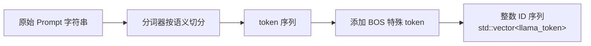
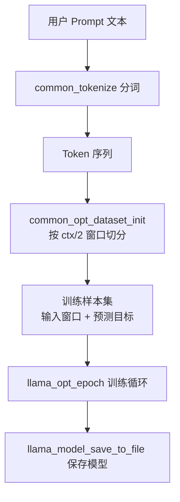
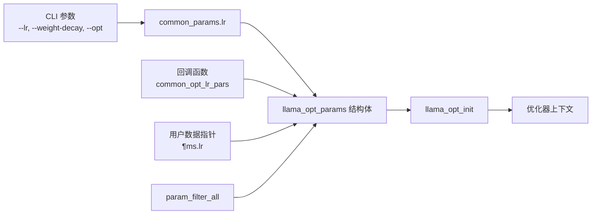
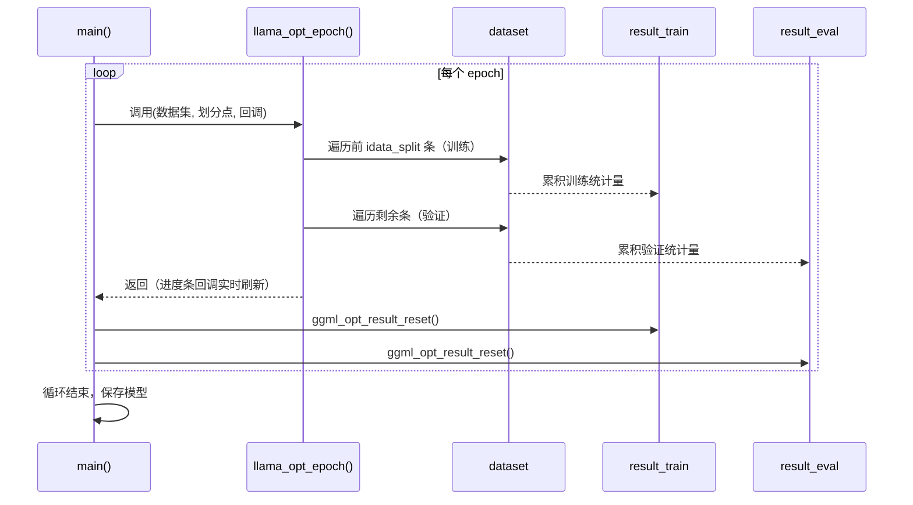
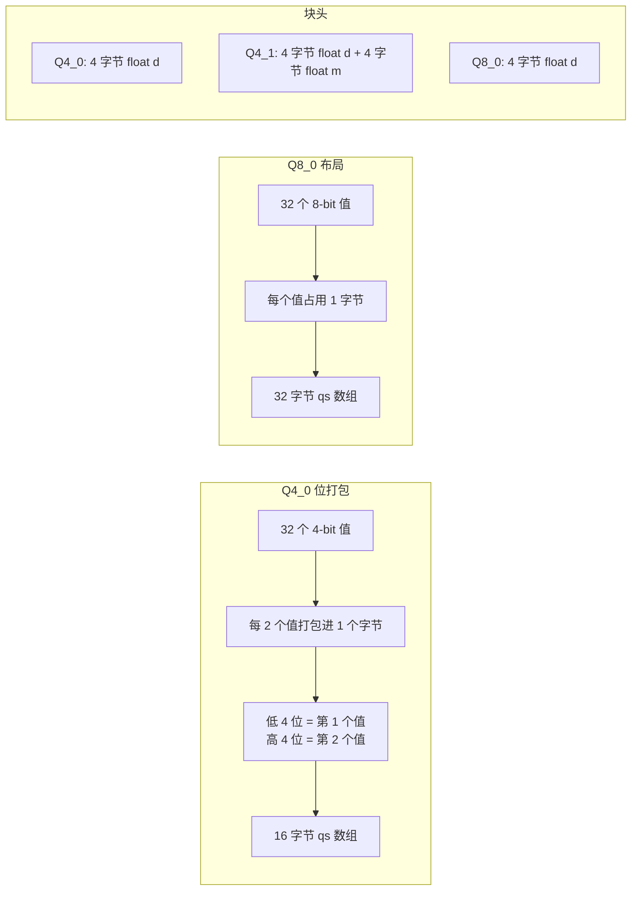
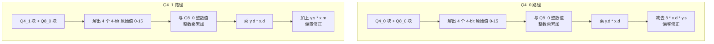
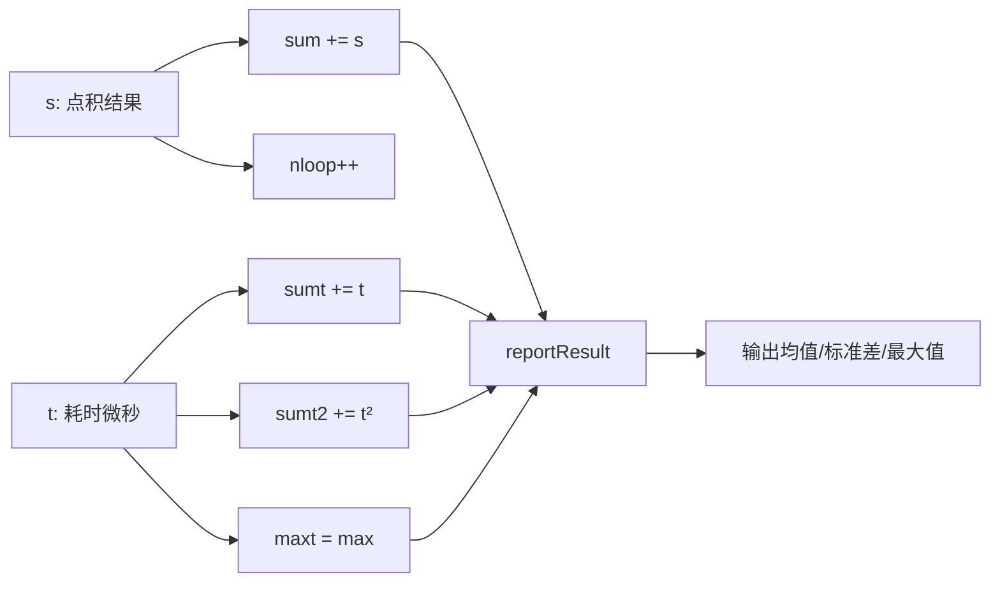
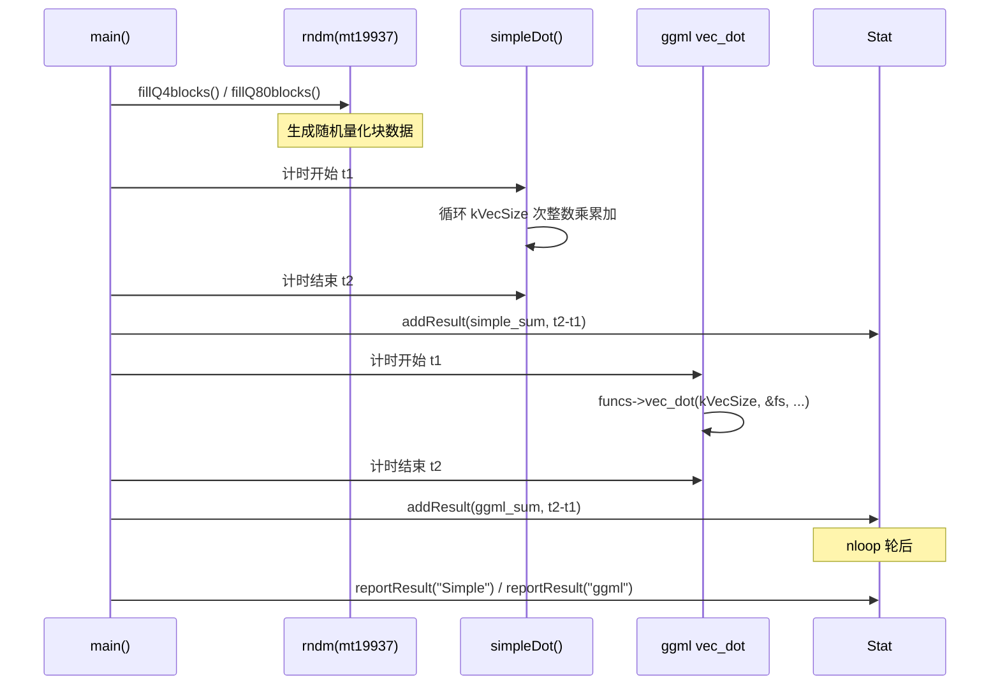
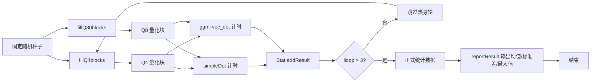

# 第99章 微调与量化基准 —— 训练微调与性能竞技的"双人舞"

## 学习目标

- 理解 llama.cpp 微调示例（finetune）的完整工作流：从参数解析到模型保存
- 掌握训练态与推理态的核心差异：为什么强制禁用 mmap、为何使用 F32 KV Cache
- 解析 `llama_opt_params` 的参数装配机制与 epoch 训练循环的数据流
- 深入理解 Q4_0/Q4_1/Q8_0 量化块的内存布局与位打包策略
- 掌握 Box-Muller 高斯采样原理及随机数据生成工具的实现
- 理解标量查找表、Q8_0 参考量化与 ggml vec_dot 的性能差异根源
- 掌握性能基准测试的统计方法：均值、标准差、Box-Muller 高斯采样

## 99.1 生活类比

想象 llama.cpp 的微调与量化测试是两个专业工作室：微调示例（finetune）就像一家健身房私教工作室。在这个工作室里，教练（优化器）制定训练计划（学习率、权重衰减、epochs），学员（模型权重）在一次次训练中被"举铁"塑形。训练时必须把器械（权重）搬到可自由调整的实心地面（可写内存）上，不能使用只能观看的玻璃展示柜（只读 mmap），因为只有可写的环境才能让教练调整器械的配重（反向传播更新权重）。同时，使用标准重量片而非电子计数器（GGML_TYPE_F32）确保每次调整的精度，避免电子计数器（FP16）的舍入误差。每一次完整的训练周期（llama_opt_epoch）就像完成一轮"训练-评估-记录"的完整打卡。

而量化点积 POC（概念验证）则像一场百米赛道计时赛。不同规格的压缩跑鞋（block_q4_0、block_q8_0）代表 4 位与 8 位存储的压缩方案。赛前自动填充装备（fillQ4blocks/fillQ80blocks）负责随机初始化量化块。使用标准赛道条件（Box-Muller 高斯采样）模拟真实数据分布，确保比赛结果有代表性。`drawFromGaussianPdf` 和 `fillRandomGaussianFloats` 就像高精度随机发令枪——生成符合统计规律的测试数据。`quantize_row_q8_0_reference` 是手工计时员（参考实现），用于验证电子计时器（SIMD 优化）的准确性。`simpleDot()` 是人工手动计时（标量查找表实现），而 ggml vec_dot 则是高速摄像机加激光计时器（SIMD 优化实现）。这组对比实验的核心哲学是：前者验证"模型可以学会新技能"，后者验证"计算引擎跑得够快且足够准"。

## 99.2 源码地图

本章涉及的源码分布在三个文件中。它们的角色分工如下：`examples/training/finetune.cpp` 是微调全流程的主程序，负责解析 CLI 参数、构建数据集、执行训练并保存模型；`pocs/vdot/vdot.cpp` 是量化点积的性能基准测试程序，侧重于对比标量点积实现（`dot`、`dot3`、`dot41`）与 GGML 库实现的数值一致性与速度差异；`pocs/vdot/q8dot.cpp` 则专注于 Q4×Q8 整数点积方案的性能对比，通过 `simpleDot` 与 GGML 的 `vec_dot` 函数进行直接竞争。三者的递进关系是：微调程序让模型学会新技能，两个 POC 验证计算引擎的性能与正确性。

```
examples/training/finetune.cpp
└── main() (16-86行)
    ├── 参数解析与强制配置
    │   ├── common_params_parse()           # CLI 参数提取
    │   ├── params.use_mmap = false         # 禁用只读内存映射（训练需可写）
    │   └── cache_type_k/v = GGML_TYPE_F32  # 强制 F32 KV Cache（OUT_PROD 反向兼容）
    ├── 后端初始化
    │   ├── llama_backend_init()            # 初始化 GGML 后端
    │   └── common_init_from_params()       # 加载模型与上下文
    ├── 数据集构建
    │   ├── common_tokenize()               # Prompt → Token 序列
    │   └── common_opt_dataset_init()       # 构建训练数据集（ ctx/2 为窗口）
    ├── 优化器配置
    │   ├── llama_opt_params 结构体装配     # 注入 lr0/wd/optimizer_type
    │   └── llama_opt_init()                # 注册优化器上下文
    ├── 训练循环
    │   ├── llama_opt_epoch()               # 单轮训练/验证（带进度条回调）
    │   └── ggml_opt_result_reset()         # 重置统计结果
    └── 模型持久化
        └── llama_model_save_to_file()      # 保存微调后权重

pocs/vdot/vdot.cpp
├── 全局定义 (__main__) (1-48行)
│   ├── block_q4_0                          # 4-bit 量化块：d + 16字节qs(32个4-bit值)
│   ├── block_q4_1                          # 4-bit 带偏置：d + m + 16字节qs
│   └── block_q8_0                          # 8-bit 量化块：d + 32字节qs
├── 随机数据生成
│   ├── drawFromGaussianPdf() (49-61行)     # Box-Muller 高斯采样（缓存优化）
│   └── fillRandomGaussianFloats() (62-64行) # 填充随机浮点向量
├── 标量点积实现族
│   ├── dot() (89-114行)                    # Q4_0 + FP32：16项查找表 + 位掩码提取
│   ├── dot3() (115-187行)                  # 优化版：256项pair查找表（字节→两个浮点）
│   ├── dot41() (188-211行)                 # Q4_1 + FP32：额外处理 m（最小值偏移）
│   ├── quantize_row_q8_0_reference() (212-229行) # 浮点→Q8_0 参考量化
│   ├── dot_q4_q8() (230-244行)             # Q4_0 × Q8_0：纯整数运算，最后乘 scale
│   └── main() (245-298行)                  # 综合对比：标量 vs GGML 向量化实现
└── main() (245-298行)                      # 双路径对比：scalar vs ggml vec_dot

pocs/vdot/q8dot.cpp
├── 全局定义 (__main__) (1-38行)
│   ├── block_q4_0 / block_q4_1 / block_q8_0  # 量化块结构定义
│   └── static_assert 布局校验
├── 填充工具
│   ├── fillQ4blocks() (40-50行)            # 随机填充 Q4_0/Q4_1 块（模板函数）
│   └── fillQ80blocks() (52-63行)           # 随机填充 Q8_0 块并预计算 s（和）
├── Q4×Q8 点积核心
│   └── simpleDot() 重载 (65-93行)
│       ├── Q4_0 × Q8_0 版本                # 解 nibble → 整数乘累加 → 乘 scale
│       └── Q4_1 × Q8_0 版本                # 额外处理 m（最小值）× y.s（和）
├── Stat 统计类 (97-137行)
│   ├── addResult() (122-125行)             # 累加结果/时间/时间平方/最大值
│   └── reportResult() (126-137行)          # 计算并打印均值与标准差
└── main() (140-181行)                      # 对比 simpleDot vs ggml vec_dot 性能
```

## 99.3 模型微调示例 —— 用梯度下降调教模型权重的"健身房私教"

在微调工作室中，`main()` 函数充当了中央指挥台的角色。它从解析用户指令（CLI 参数）开始，经过一系列强制安全配置，最终驱动完整的训练流水线。下面我们从入口函数开始，沿着调用链逐步深入。

### 99.3.1 `main()`：微调全流程的"中央指挥台"

源码路径：`examples/training/finetune.cpp` - `main()`（16-86行）

```cpp
int main(int argc, char ** argv) {
    std::setlocale(LC_NUMERIC, "C");              // 统一数字格式，避免 locale 干扰
    common_params params;                          // 通用参数结构体
    params.escape = false;                         // 关闭转义，保留原始 prompt
    common_init();                                 // 初始化公共组件（日志等）
    if (!common_params_parse(argc, argv, params, LLAMA_EXAMPLE_FINETUNE)) {
        return 1;                                  // 解析 CLI 参数，失败则退出
    }
    if (params.use_mmap) {                         // 若用户开启了 mmap
        LOG_INF("...force disabling memory mapping...");
        params.use_mmap = false;                   // 强制关闭只读内存映射
    }
    if (params.cache_type_k != GGML_TYPE_F32) {    // 检查 K 缓存类型
        LOG_INF("...lack of f16 support for OUT_PROD...");
        params.cache_type_k = GGML_TYPE_F32;       // 强制改为 F32
    }
    if (params.cache_type_v != GGML_TYPE_F32) {    // 检查 V 缓存类型
        LOG_INF("...lack of f16 support for OUT_PROD...");
        params.cache_type_v = GGML_TYPE_F32;       // 强制改为 F32
    }
    llama_backend_init();                          // 初始化 GGML 后端
    llama_numa_init(params.numa);                  // 初始化 NUMA 内存布局
    auto llama_init = common_init_from_params(params); // 加载模型与上下文
    auto * model = llama_init->model();            // 取出模型指针
    auto * ctx   = llama_init->context();          // 取出上下文指针
    if (model == NULL) {
        LOG_ERR("...unable to load model...");
        return 1;                                  // 模型加载失败检查
    }
    std::vector<llama_token> tokens =
        common_tokenize(ctx, params.prompt, true); // Prompt → Token 序列
    ggml_opt_dataset_t dataset =
        common_opt_dataset_init(ctx, tokens, llama_n_ctx(ctx) / 2); // 构建数据集
    struct lr_opt & lr = params.lr;                // 引用学习率配置
    LOG_INF("...optimizer/learning-rate info..."); // 打印优化器配置摘要
    struct llama_opt_params lopt_params{           // 装配优化器参数
        /*param_filter    =*/llama_opt_param_filter_all,
        /*get_opt_pars    =*/common_opt_lr_pars,
        /*get_opt_pars_ud =*/&params.lr,
        /*optimizer_type  =*/params.optimizer,
    };
    llama_opt_init(ctx, model, lopt_params);       // 注册优化器上下文
    const int64_t idata_split =
        ggml_opt_dataset_ndata(dataset) * (1.0f - params.val_split); // 划分训练/验证集
    ggml_opt_result_t result_train = ggml_opt_result_init(); // 初始化训练结果
    ggml_opt_result_t result_eval  = ggml_opt_result_init(); // 初始化评估结果
    for (lr.epoch = 0; lr.epoch < lr.epochs; ++lr.epoch) {
        llama_opt_epoch(ctx, dataset, result_train, result_eval, idata_split,
                        ggml_opt_epoch_callback_progress_bar,
                        ggml_opt_epoch_callback_progress_bar); // 执行一轮训练
        fprintf(stderr, "\n");                     // 换行分隔
        ggml_opt_result_reset(result_train);       // 重置训练统计
        ggml_opt_result_reset(result_eval);        // 重置评估统计
    }
    ggml_opt_result_free(result_train);            // 释放训练结果
    ggml_opt_result_free(result_eval);             // 释放评估结果
    llama_model_save_to_file(model, params.out_file.c_str()); // 保存微调模型
    llama_backend_free();                          // 释放后端资源
    return 0;                                      // 正常退出
}
```

这段代码定义了微调示例的完整主流程。从参数解析（步骤①-⑤）开始，经过训练态的强制配置（步骤⑥-⑪）、后端初始化（步骤⑫-⑭）、数据集构建（步骤⑱-⑲）、优化器注册（步骤㉒-㉓），到 epoch 训练循环（步骤㉗-㉚），最终以模型持久化（步骤㉝）收官。整个流程紧凑而清晰，展现了 llama.cpp 极简工程哲学——不在通用框架下堆砌抽象，直接拉起全套流程。就像健身房私教的完整工作流：登记学员信息（参数解析）、确认器械落在可调教的实心地面（禁用 mmap）、备好高精度标准重量片（F32 KV Cache）、设计训练计划（构建数据集与优化器）、执行一轮打卡（epoch 训练循环）、记录成绩（统计结果）、最终输出新学员档案（保存模型）。

**为什么强制关闭 mmap？**

这是训练态与推理态最核心的差异之一。推理使用 mmap 建立只读视图，实现零拷贝加载权重，极大减少内存占用；但训练需要修改权重，只读指针根本无法回写。这里的 `params.use_mmap = false` 就是一句"安全宣言"：既然要训练，就必须让权重驻留在可写内存中。

**为什么把 KV Cache 强制改成 F32？**

代码注释道出了关键原因：`OUT_PROD` 反向路径缺少 FP16 支持。在训练中，梯度外积和反向传播对数值精度极其敏感，F32 提供了确定性更高的计算路径。这也提示我们：训练示例本质是"能用且稳定"的基准实现，并不追求在所有类型上兼容。

**如何理解 `val_split`？**

`idata_split = ndata * (1.0f - params.val_split)` 中，`params.val_split` 是一个 0 到 1 之间的浮点数，表示验证集所占的比例。例如 `val_split = 0.2` 时，训练集占 80%，验证集占 20%。`idata_split` 正是数据集中训练集与验证集的分界索引——前 `idata_split` 条数据用于训练，其余用于验证。这个设计让用户在一条命令中同时获得训练反馈与泛化能力评估。

### 99.3.2 `common_tokenize()`：Prompt 到 Token 的"文本切片机"

源码路径：`examples/training/finetune.cpp` - `main()` 中调用（41行）

```cpp
// 调用点：将用户 prompt 文本转换为 token ID 序列
// 第三个参数 true 表示添加特殊 token（如 BOS，句子开头标记）
std::vector<llama_token> tokens = common_tokenize(ctx, params.prompt, true);
```

这段代码是微调流程的第二步：将用户输入的 prompt 字符串转换为模型可处理的 token ID 序列。`common_tokenize` 是 llama.cpp 的公共辅助函数，其工作过程可以分解为：首先接收上下文指针（`ctx`）与原始文本字符串（`params.prompt`），然后根据模型的分词器将文本切分为最小语义单元（token），最后将每个 token 映射为一个唯一的整数 ID 并存入 `std::vector<llama_token>` 返回。第三个参数 `true` 表示添加特殊 token（如 BOS——句子开头标记），确保模型在正确的起始状态开始生成。

**为什么 tokenize 是微调的第一步？**

模型无法直接理解原始文本，必须将文本切分为词元（token）并映射到整数 ID。这一步就像把原材料（文本）切成标准尺寸的食材块（token），后续所有训练流程（数据集构建、前向传播、损失计算）都建立在 token 序列之上。没有 tokenize，就没有训练。

tokenize 的流程可以用下面的流程图精确刻画：



上图展示了 `common_tokenize` 的完整数据流：原始文本首先被分词器切分为语义单元，然后补上特殊的起始标记，最终输出为可被模型直接消费的整数 ID 序列。这一步骤是后续所有训练流程的数据基础。

### 99.3.3 `common_opt_dataset_init()`：训练数据集的"组装车间"

源码路径：`examples/training/finetune.cpp` - `main()` 中调用（42行）

```cpp
// 调用点：将长 token 序列切分为固定长度的训练样本
// 第三个参数 llama_n_ctx(ctx) / 2 指定每个样本的上下文窗口长度（上下文长度的一半）
ggml_opt_dataset_t dataset = common_opt_dataset_init(ctx, tokens, llama_n_ctx(ctx) / 2);
```

这段代码构建了训练数据集。`common_opt_dataset_init` 接收上下文指针、token 序列和窗口大小（`ctx/2`）三个参数，其核心工作是将长 token 序列切分为多个固定长度的训练样本。每个样本由"输入窗口"与"预测目标"两部分组成——这正是语言模型训练的基本范式：给定前文，预测下一个 token。

**为什么窗口是 `ctx/2`？**

上下文长度的一半是一种工程折衷。训练样本需要同时容纳输入和标签：如果窗口设得过大，单次前向/反向传播的内存消耗与计算量会超线性增长；如果过小，模型难以学到长距离依赖。`ctx/2` 确保每次训练迭代能看到足够的历史信息，同时内存压力可控。这个选择体现了"用结果导向的简单策略代替复杂调参"的务实哲学。

数据集构建的完整流式管道如下：



这张图展示了微调数据集从原始文本到最终模型的完整流转过程。每个环节都有明确的输入输出契约，这正是 llama.cpp 训练管线的简洁之处。这也对应健身房私教工作室的数据流：学员档案（原始文本）先被整理成标准训练日志（token 序列），再被切成一个个可执行的训练小节（训练样本集），每个小节包含动作（输入窗口）和预期目标（预测目标），教练按小节逐一训练，最终生成新的学员能力档案（保存模型）。

### 99.3.4 `llama_opt_params`：优化器参数的装配车间

源码路径：`examples/training/finetune.cpp` - `main()` 中（53-60行）

```cpp
    struct llama_opt_params lopt_params{
        /*param_filter    =*/llama_opt_param_filter_all,  // 过滤全部参数可训练
        /*get_opt_pars    =*/common_opt_lr_pars,          // 回调：动态获取学习率
        /*get_opt_pars_ud =*/&params.lr,                  // 回调用户数据：学习率配置
        /*optimizer_type  =*/params.optimizer,            // 优化器类型（Adam/SGD等）
    };
    llama_opt_init(ctx, model, lopt_params);              // 注册优化器上下文
```

这段代码展示了 `llama_opt_params` 的"参数装配"机制。步骤①-④展示了如何将通用 CLI 参数（学习率、优化器类型）与优化器内部回调（`param_filter`、`get_opt_pars`）解耦——调用方只需提供数据和回调函数，优化器内部自有调度。步骤⑤调用 `llama_opt_init` 注册优化器上下文，将参数配置真正"激活"。

**装配机制的解耦哲学**

`get_opt_pars` 是一个函数指针，优化器在每个训练步骤都会调用它来获取当前的学习率、权重衰减等参数。`get_opt_pars_ud` 是用户数据指针，指向 `params.lr`（学习率配置结构体），回调函数可通过该指针访问实时状态（如当前 epoch、period 等）。这种"回调 + 用户数据"的设计避免了在优化器内部硬编码任何配置，使得同一套优化器代码可复用于不同的调度策略——这正是"装配车间"的意义：零件（配置）由外部供应，车间（优化器）只管组装与生产。

`llama_opt_params` 的装配依赖关系可以用下图精确展示：



这张图展示了从 CLI 参数到优化器上下文的完整依赖链：用户输入的学习率、权重衰减等参数被封装进 `common_params.lr`，与回调函数指针、用户数据指针、参数过滤器一起装配成 `llama_opt_params` 结构体，最终通过 `llama_opt_init` 注册为实际的优化器上下文。这个架构的核心在于"配置与执行分离"——配置全部由外部注入，优化器本身不依赖任何具体配置。

### 99.3.5 `llama_opt_epoch()`：训练循环的心脏

源码路径：`examples/training/finetune.cpp` - `main()` 中（63-70行）

```cpp
    for (lr.epoch = 0; lr.epoch < lr.epochs; ++lr.epoch) {
        llama_opt_epoch(ctx, dataset, result_train, result_eval, idata_split,
                        ggml_opt_epoch_callback_progress_bar,
                        ggml_opt_epoch_callback_progress_bar); // 执行一轮训练
        fprintf(stderr, "\n");                                // 换行分隔
        ggml_opt_result_reset(result_train);                  // 重置训练统计
        ggml_opt_result_reset(result_eval);                   // 重置评估统计
    }
```

这段代码驱动了多轮训练循环。`llama_opt_epoch` 是训练循环的核心引擎：它接收上下文、数据集、两个结果容器（`result_train` 与 `result_eval`）、训练/验证划分点（`idata_split`）以及两个进度条回调。函数内部会遍历数据集的前 `idata_split` 条做训练、剩余做验证，并实时更新 `result_train` 和 `result_eval`。每轮结束后，`ggml_opt_result_reset` 将统计量清零，为下一轮累积"当日成绩"。

**epoch 循环的本质是什么？**

这就像健身房一轮训练打卡：做组、记录成绩、恢复状态、进入下一轮。每次 `llama_opt_epoch` 同时返回训练和评估结果，用进度条回调给用户实时反馈。但要注意，训练损失和验证损失的统计是独立累积的——`result_train` 和 `result_eval` 分属两个统计通道，互不干扰。步骤③-④在每轮结束后重置统计量，确保下一轮从零开始累积，这样每个 epoch 的损失值都是独立的"当日成绩"，可清晰对比收敛趋势。

关键的调用关系可以用下面的时序图展示。它清晰地揭示了每个 epoch 内部"训练→评估→重置"的循环节奏，这与健身房教练每轮"带学员完成一组训练→记录成绩→重置器械→进入下一组"的流程如出一辙：



这张时序图清晰展示了 `llama_opt_epoch` 与结果重置的协作关系：每轮训练/验证后，`result_train` 与 `result_eval` 被重置，为下一轮的"当日成绩"清空统计缓存。这种"训练-记录-清零-再训练"的结构，正是健身房教练"一轮打卡一记录"的标准节奏。

### 99.3.6 训练态与推理态对比：资源访问模式的硬隔离

下表对比了训练态与推理态在关键资源维度上的差异，帮助我们理解同一套代码在不同模式下如何做出截然不同的资源选择：

| 资源维度 | 训练态（finetune） | 推理态（llama-cli） |
|---------|-------------------|-------------------|
| 内存映射 | `use_mmap = false`：权重驻留可写内存 | `use_mmap = true`：零拷贝只读加载 |
| KV Cache 类型 | 强制 F32（OUT_PROD 反向兼容） | 可用 FP16/BF16 提升吞吐 |
| 权重权限 | 可读写（梯度更新） | 只读（前向计算） |
| 数据结构 | 需要优化器上下文（梯度/动量缓冲区） | 仅需推理上下文 |
| 输出目标 | 更新后的权重文件 | 生成的 Token 序列 |

上表揭示了训练与推理在资源访问模式上的根本差异：推理追求零拷贝、低内存、高吞吐；训练追求可写、高精度、稳定收敛。二者在 `use_mmap`、KV Cache 类型和权重权限上的选择，正是这些哲学的直接映射。

为了更直观地展示两种模式的流程差异，下图以流程图形式对比了两者的生命周期：


上图清晰展示了两种模式的关键差异：训练强调可写、高精度与迭代更新，推理强调零拷贝、低内存与单次前向。这正是"双面人生"的直观呈现。

现在，让我们将目光从微调工作室转向另一侧的量化计时赛场。

## 99.4 量化点积性能基准 —— 量化计算的"百米计时赛"

现在让我们转向量化点积的性能基准测试。这一组 POC 程序的目标非常纯粹：在受控条件下，比较不同量化方案的性能与数值一致性。`vdot.cpp` 侧重于标量实现与 GGML 库实现的整体对比（含 Q4_0/Q4_1 与浮点向量的点积），`q8dot.cpp` 则专注于 Q4×Q8 整数点积方案的性能竞争。

### 99.4.1 `block_q4_0`/`block_q4_1`/`block_q8_0`：三种量化块的内存布局与校验

源码路径：`pocs/vdot/vdot.cpp` - `__main__`（1-48行）

```cpp
constexpr int kVecSize = 1 << 18;                       // 向量大小：262144 个元素
#define QK4_0 32                                        // Q4_0 块大小：32 个值
typedef struct {
    float   d;                                          // scale（缩放因子）
    uint8_t qs[QK4_0 / 2];                              // 16字节：32个 4-bit 值打包
} block_q4_0;                                           // Q4_0 量化块结构
static_assert(sizeof(block_q4_0) == sizeof(float) + QK4_0 / 2,
              "wrong q4_0 block size/padding");         // 布局校验：4 + 16 = 20 字节
#define QK4_1 32
typedef struct {
    float   d;                                          // scale（缩放因子）
    float   m;                                          // min（最小值偏移）
    uint8_t qs[QK4_1 / 2];                              // 16字节：32个 4-bit 值
} block_q4_1;                                           // Q4_1 量化块结构
static_assert(sizeof(block_q4_1) == sizeof(float) * 2 + QK4_1 / 2,
              "wrong q4_1 block size/padding");         // 布局校验：8 + 16 = 24 字节
#define QK8_0 32
typedef struct {
    float   d;                                          // scale（缩放因子）
    int8_t  qs[QK8_0];                                  // 32个 8-bit 有符号整数
} block_q8_0;                                           // Q8_0 量化块结构
static_assert(sizeof(block_q8_0) == sizeof(float) + QK8_0,
              "wrong q8_0 block size/padding");         // 布局校验：4 + 32 = 36 字节
```

这段代码定义了三种量化块的核心数据结构。步骤②-⑤ 定义 Q4_0：一个 float scale（d）加 16 字节打包的 32 个 4-bit 值；步骤⑦-⑩ 定义 Q4_1：多出一个 float 最小值（m），支持带偏置的量化；步骤⑫-⑭ 定义 Q8_0：32 个 8-bit 有符号整数加一个 float scale。关键的三处 `static_assert`（步骤⑥⑪⑮）在编译期校验内存布局，确保 POC 层面的结构与 GGML 内部定义二进制兼容——这是量化优化的基本心智：先弄清内存布局，再谈 SIMD 加速。

为了满足 Q4_0 与 Q4_1 块大小的一致性要求，`q8dot.cpp` 的 `__main__` 区域补充了两条额外的校验。源码路径：`pocs/vdot/q8dot.cpp` - `__main__`（1-38行）：

```cpp
static_assert(QK4_1 == QK8_0, "QK4_1 and QK8_0 must be the same");   // Q4_1 与 Q8_0 块大小一致
static_assert(QK4_0 == QK8_0, "QK4_0 and QK8_0 must be the same");   // Q4_0 与 Q8_0 块大小一致
```

这两条 `static_assert` 确保了本文件中不同量化块拥有相同的块大小（均为 32 个值），这是后续 `simpleDot` 能直接按块索引对应相乘的基础。没有这一约束，循环边界和块对齐就会出错。这就像百米赛道计时赛前的装备检查：所有参赛跑鞋必须符合统一规格，否则成绩无法比较。

下表整理了三种量化块的字节大小、内部布局与数值范围，方便快速对照：

| 量化类型 | 块大小（字节） | 布局 | 数值范围 |
|---------|--------------|------|---------|
| Q4_0 | 20 | d(4B) + qs(16B) | -8 到 7（4-bit 有符号） |
| Q4_1 | 24 | d(4B) + m(4B) + qs(16B) | 0 到 15（4-bit 无符号 + 偏置） |
| Q8_0 | 36 | d(4B) + qs(32B) | -128 到 127（8-bit 有符号） |

可以看到，三种类型的块大小分别为 20、24、36 字节，各自的 `static_assert` 确保了结构体没有因编译器的内存对齐而引入隐藏填充字节。位打包的细节（如何将 32 个 4-bit 值塞入 16 字节）可以用下面的 mermaid 图直观展示：



上图揭示了位打包的核心理念：Q4_0 将两个 4-bit 值压缩到一个字节中，以牺牲表示精度为代价大幅减少内存占用；Q8_0 则直接使用 8-bit 整数，在精度与内存之间取得平衡。所有块共享 `d`（缩放因子）字段，用于将量化后的整数映射回真实浮点值域。

### 99.4.2 `drawFromGaussianPdf()`：Box-Muller 高斯采样的"精密发令枪"

源码路径：`pocs/vdot/vdot.cpp` - `drawFromGaussianPdf()`（49-61行）

```cpp
static float drawFromGaussianPdf(std::mt19937& rndm) {
    constexpr double kScale = 1./(1. + std::mt19937::max());  // 均匀分布缩放因子
    constexpr double kTwoPiTimesScale = 6.28318530717958647692*kScale; // 2π×缩放
    static float lastX;                                        // 缓存第二个高斯值
    static bool haveX = false;                                 // 缓存标志
    if (haveX) {                                               // 若已有缓存值
        haveX = false;                                         // 清除标志
        return lastX;                                          // 直接返回缓存值
    }
    auto r = sqrt(-2*log(1 - kScale*rndm()));                  // Box-Muller：半径
    auto phi = kTwoPiTimesScale * rndm();                      // Box-Muller：角度
    lastX = r*sin(phi);                                        // 缓存 sin 分量
    haveX = true;                                              // 标记已缓存
    return r*cos(phi);                                         // 返回 cos 分量
}
```

这段代码实现了经典的 Box-Muller 变换。步骤①② 预计算缩放因子，将 `mt19937` 的 32 位无符号整数均匀映射到 [0,1) 区间。核心在步骤⑧-⑨：利用极坐标变换，从一对均匀分布随机数生成一对独立的高斯分布随机数。步骤③-⑦ 和 ⑩-⑪ 是关键的缓存优化——每次 Box-Muller 变换实际产生两个高斯值（sin 和 cos 分量），这里缓存第二个值，下次调用直接返回，将计算量减半。由于 `lastX` 与 `haveX` 是函数内的静态变量，它们的值在多次调用之间保持，从而实现跨调用的缓存效果。

**为什么用高斯分布而非均匀分布？**

真实模型的权重和激活值通常近似高斯分布（中心聚集、两侧衰减）。使用均匀分布会导致量化测试数据过于"均匀"，偏离真实场景，测试结果失真。高斯分布保证了性能测试的代表性。

从这个意义上说，`drawFromGaussianPdf` 就像赛场上的精密发令枪——它不是简单按下按钮（产生均匀随机数），而是经过 Box-Muller 变换的精确校准，确保每一位"运动员"（测试样本）都处于符合真实比赛条件（高斯分布）的起跑线上。缓存优化则相当于发令枪的"双响机制"：扣一次扳机（一次变换）能发出两声枪响（两个高斯值），第二声被储存待用，使得整个赛前准备流程（数据生成）效率翻倍。由两个独立均匀分布衍生两个独立正态分布，这是 Box-Muller 变换的数学基础。

`drawFromGaussianPdf` 的执行流程可以用下面的流程图精确刻画：

```mermaid
flowchart TD
    A[调用 drawFromGaussianPdf] --> B{haveX 为真?}
    B -->|是| C[直接返回缓存的 lastX<br/>并清除 haveX 标志]
    B -->|否| D[生成均匀随机数 u1, u2<br/>u = kScale * rndm]
    D --> E[r = sqrt(-2*ln(1-u1))<br/>phi = 2π* u2]
    E --> F[lastX = r*sin(phi)<br/>haveX = true]
    F --> G[返回 r*cos(phi)]
    C --> H[结束]
    G --> H
```

上图展示了 Box-Muller 变换的完整逻辑分支：一半的调用直接命中缓存（步骤 B→C），另一半则执行变换并缓存结果（步骤 B 之后），从而将数据生成的计算量减半。这正是"精密发令枪双响机制"的算法落地。

### 99.4.3 `fillRandomGaussianFloats()`：批量高斯数据填充器

源码路径：`pocs/vdot/vdot.cpp` - `fillRandomGaussianFloats()`（62-64行）

```cpp
static void fillRandomGaussianFloats(std::vector<float>& values, std::mt19937& rndm, float mean = 0) {
    for (auto& v : values) v = mean + drawFromGaussianPdf(rndm);   // 逐个填充高斯值
}
```

这段代码将高斯采样器封装为批量装填工具：遍历目标向量，为每个元素调用 `drawFromGaussianPdf` 生成一个服从高斯分布的随机数（可附加均值偏移）。`for (auto& v : values)` 这种基于范围的 for 循环简洁地完成了"逐元素填充"的任务，配合均值参数 `mean`（默认为 0），可以方便地生成任意均值的高斯测试数据——默认生成均值为 0 的高斯分布，用于模拟权重分布。这样生成的测试数据在统计特性上逼近真实权重/激活值的分布，为性能测试奠定了"公平赛道"的基础，相当于赛事组织者预先铺设好符合国际标准的跑道——每位运动员（量化方案）都在同一条分布均匀的赛道上竞技。

### 99.4.4 `fillQ4blocks()`：Q4 量化块的批量装填器

源码路径：`pocs/vdot/q8dot.cpp` - `fillQ4blocks()`（40-50行）

```cpp
template <typename T>
static void fillQ4blocks(std::vector<T>& blocks, std::mt19937& rndm) {
    for (auto& b : blocks) {                                   // 遍历所有块
        b.d = 1;                                               // 固定缩放因子
        for (int i=0; i<QK4_1/2; ++i) {                        // 遍历块内字节（QK4_1/2=16）
            uint8_t v1 = rndm() >> 28;                         // 高4位随机数（0-15）
            uint8_t v2 = rndm() >> 28;                         // 高4位随机数（0-15）
            b.qs[i] = v1 | (v2 << 4);                          // 打包两个4-bit值
        }
    }
}
```

这段代码是模板函数，通过 `typename T` 自动适配 `block_q4_0` 或 `block_q4_1`——因为两者都有 `d` 字段和 `qs` 数组，访问方式完全一致。步骤① 遍历所有块，步骤② 将缩放因子设为 1（简化后续运算）。这里的 `rndm() >> 28` 取出随机数的高 4 位，生成 0-15 的均匀随机值，与 4 位二进制表示范围完全对应。步骤⑥ 将两个 4-bit 值打包进一个字节。

**为什么将 `b.d` 设为 1？**

在性能测试场景中，数值绝对值不重要，只关注计算路径开销，故将 scale 固定为 1 以隔离量化因素的影响，让基准测试纯粹反映量化与点积运算本身的效率。当调用 `fillQ4blocks(x41, rndm)` 时，编译器通过实参 `x41`（类型为 `std::vector<block_q4_1>`）自动推导出模板参数 `T = block_q4_1`。

### 99.4.5 `fillQ80blocks()`：Q8_0 量化块的批量装填器

源码路径：`pocs/vdot/q8dot.cpp` - `fillQ80blocks()`（52-63行）

```cpp
static void fillQ80blocks(std::vector<block_q8_0>& blocks, std::mt19937& rndm) {
    for (auto& b : blocks) {                                   // 遍历所有块
        b.d = 1;                                               // 固定缩放因子
        int sum = 0;                                           // 初始化块内和
        for (int i=0; i<QK8_0; ++i) {                          // 遍历块内每个元素
            b.qs[i] = (rndm() >> 24) - 128;                    // 高8位随机数映射到 -128~127
            sum += b.qs[i];                                    // 累加块内和
        }
        b.s = b.d * sum;                                       // 预计算带缩放的和
    }
}
```

这段代码实现了 Q8_0 块的随机填充。与 `fillQ4blocks` 类似，它将缩放因子固定为 1，然后为每个元素生成 -128 到 127 的有符号随机整数。关键的不同在于它额外维护了 `b.s` 字段（块内所有量化值的和乘以缩放因子），在填充的同时完成求和与预计算。

**为什么预计算 `b.s`？**

这要回到 `simpleDot` 的偏置修正逻辑。回顾 Q4_0 的点积公式：由于 4-bit 值被存储为 0-15 而非 -8 到 7，每个值都系统性偏移了 +8。点积时，偏移量的总贡献等于 `8 × (所有 x 值的个数) × (y 的平均值)`，即对所有 `y.qs` 求和再乘以 8。如果每次点积都现场遍历 `y.qs` 求和，将增加一次完整的数据遍历；而 `fillQ80blocks` 在填充时就预先算好 `b.s`，点积时直接取用，相当于把"偏置修正"的准备成本提前支付，换取了每次点积运算的更低开销。值得一提的是，此处 `b.d = 1`，因此 `b.s` 实际上等于块内整数值之和 `sum`。`y.s` 将在后续 `simpleDot` 的偏置修正中被直接使用。

### 99.4.6 `quantize_row_q8_0_reference()`：Q8_0 参考量化的"手工计时员"

源码路径：`pocs/vdot/vdot.cpp` - `quantize_row_q8_0_reference()`（212-229行）

```cpp
static void quantize_row_q8_0_reference(const float *x, block_q8_0 *y, int k) {
    assert(k % QK8_0 == 0);                                    // 断言：长度是块的整数倍
    const int nb = k / QK8_0;                                  // 计算块数量
    for (int i = 0; i < nb; i++) {                             // 遍历每个块
        float amax = 0.0f;                                     // 初始化绝对最大值
        for (int l = 0; l < QK8_0; l++) {                      // 遍历块内每个元素
            const float v = x[i*QK8_0 + l];                    // 取出浮点值
            amax = std::max(amax, fabsf(v));                   // 更新绝对最大值
        }
        const float d = amax / ((1 << 7) - 1);                 // scale = amax/127
        const float id = d ? 1.0f/d : 0.0f;                    // 预计算 1/d（防除零）
        y[i].d = d;                                            // 存储缩放因子
        for (int l = 0; l < QK8_0; ++l) {                      // 遍历块内每个元素
            const float v = x[i*QK8_0 + l]*id;                 // 除以缩放因子
            y[i].qs[l] = roundf(v);                            // 四舍五入到整数
        }
    }
}
```

这段代码实现了浮点到 Q8_0 的参考量化，其整体流程分为两个阶段：先对每个块进行一次遍历，找到块内浮点值的最大绝对值 `amax`；然后据此计算缩放因子 `d = amax / 127`，并利用 `id = 1/d` 将每个值映射到 8-bit 整数范围后四舍五入。步骤④-⑦ 是第一阶段（找绝对最大值），步骤⑧-⑨ 计算缩放因子，步骤⑪-⑬ 是第二阶段（逐元素量化）。作为"参考实现"，它的作用在于：一、验证 GGML 库函数 `from_float` 的正确性；二、作为性能对比的"手工计时"基准。

**这行代码的精妙之处**

`d = amax / 127` 保证量化后的整数范围恰好覆盖 [-127, 127]，充分利用 8-bit 的表示空间。127 是有符号 8 位正数的上限（`2^7 - 1`），之所以不用 128，是为了避免正数溢出，确保量化后的值始终落在有效范围内。

整个量化流程可以用下面的流程图概括：

```mermaid
flowchart TD
    A[浮点向量 x] --> B[按块遍历 nb]
    B --> C[块内遍历找绝对最大值 amax]
    C --> D[d = amax / 127]
    D --> E[预计算 id = 1/d]
    E --> F[块内遍历：v = x[i]*id]
    F --> G[roundf 四舍五入]
    G --> H[写入 qs 数组]
    H --> I{还有块?}
    I -->|是| B
    I -->|否| J[完成 Q8_0 量化]
```

这张流程图展示了 `quantize_row_q8_0_reference` 的算法结构：外层按块循环，内层两遍扫描（第一遍找最大值，第二遍量化），最终将浮点向量转换为 Q8_0 量化块。这就是"手工计时员"的严谨流程——先校准量程（找 amax），再逐项读数（roundf），确保每项成绩都准确无误。

### 99.4.7 `dot()`：标量查找表点积的"16项查表导航"

源码路径：`pocs/vdot/vdot.cpp` - `dot()`（89-114行）

```cpp
inline double dot(int n, const block_q4_0* x, const float* y) {
    const static float kValues[16] = {                          // 16项查找表
        -8.f, -7.f, -6.f, -5.f, -4.f, -3.f, -2.f, -1.f,
         0.f,  1.f,  2.f,  3.f,  4.f,  5.f,  6.f,  7.f};        // 4-bit 值映射
    constexpr uint32_t kMask1 = 0x0f0f0f0f;                     // 提取低4位的掩码
    uint32_t u1, u2;                                            // 存储解包后的值
    auto q1 = (const uint8_t*)&u1;                              // 按字节视图访问
    auto q2 = (const uint8_t*)&u2;                              // 按字节视图访问
    double sum = 0;                                             // 累加器
    for (int i=0; i<n; ++i) {                                   // 遍历每个块
        float d = x->d;                                         // 块缩放因子
        auto u = (const uint32_t*)x->qs;                        // 将打包数据视为 uint32
        float s = 0;                                            // 块内累加器
        for (int k=0; k<4; ++k) {                               // 遍历4个uint32（共16字节）
            u1 = u[k] & kMask1;                                 // 提取低4位
            u2 = (u[k] >> 4) & kMask1;                          // 提取高4位
            s += y[0]*kValues[q1[0]] + y[1]*kValues[q2[0]] +    // 查表累加（8个元素）
                 y[2]*kValues[q1[1]] + y[3]*kValues[q2[1]] +    // 每个字节对应两个浮点
                 y[4]*kValues[q1[2]] + y[5]*kValues[q2[2]] +    // 低4位与高4位
                 y[6]*kValues[q1[3]] + y[7]*kValues[q2[3]];     // 分别查表
            y += 8;                                             // 移动浮点指针
        }
        sum += s*d;                                             // 块结果×scale累加
        ++x;                                                    // 下一个块
    }
    return sum;                                                 // 返回总和
}
```

这段代码实现了 Q4_0 与浮点向量点积的标量版本。整个过程可以概括为：对每个 Q4_0 量化块，首先通过位掩码和移位将打包的 4-bit 值逐个解包，然后利用 16 项查找表将 4-bit 原始值（0-15）映射到对应的有符号浮点值（-8 到 7），最后与浮点向量元素相乘并累加。步骤③④ 的位操作是解包的关键：每个字节包含两个 4-bit 值，低 4 位和高 4 位分别对应两个浮点。由于 `kValues` 定义为 `static` 局部变量，该表在程序生命周期内只初始化一次。

**使用查找表的内存开销是多少？**

查找表仅需 16 × 4 字节 = 64 字节，完全可以放入 CPU 的 L1 缓存（通常 32KB 以上）。这意味着表的访问几乎总是缓存命中，不产生内存延迟。

从"百米计时赛"的视角看，`dot()` 相当于手动脉冲计时器——它需要两步操作（掩码 + 移位）才完成一次"读秒"，然后查询一次映射表（kValues）得到对应的浮点值。每一次查询都像是裁判手动计时读秒，虽然准确但步骤较多。每个 uint32 处理两个字节，共 4 次循环完成 16 字节的处理。

### 99.4.8 `dot3()`：256项查找表的"极速查表导航"

源码路径：`pocs/vdot/vdot.cpp` - `dot3()`（115-187行）

```cpp
inline double dot3(int n, const block_q4_0* x, const float* y) {
    const static std::pair<float,float> kValues[256] = {        // 256项查找表
        {-8.f, -8.f}, {-7.f, -8.f}, {-6.f, -8.f}, {-5.f, -8.f}, // 每个字节直接映射到一对浮点
        { 0.f, -8.f}, { 1.f, -8.f}, { 2.f, -8.f}, { 3.f, -8.f}, // 无需位掩码/移位
        // ... （共256项，覆盖所有字节值0-255）
    };
    double sum = 0;                                             // 累加器
    for (int i=0; i<n; ++i) {                                   // 遍历每个块
        float d = x->d;                                         // 块缩放因子
        auto q = x->qs;                                         // 指向打包数据
        float s = 0;                                            // 块内累加器
        for (int k=0; k<4; ++k) {                               // 遍历4个字节（共16字节）
            s += y[0]*kValues[q[0]].first + y[1]*kValues[q[0]].second +  // 查表累加
                 y[2]*kValues[q[1]].first + y[3]*kValues[q[1]].second +  // 每字节一次查表
                 y[4]*kValues[q[2]].first + y[5]*kValues[q[2]].second +  // 同时获得两个浮点
                 y[6]*kValues[q[3]].first + y[7]*kValues[q[3]].second;   // 低4位/高4位
            y += 8;                                             // 移动浮点指针
            q += 4;                                             // 移动字节指针
        }
        sum += s*d;                                             // 块结果×scale累加
        ++x;                                                    // 下一个块
    }
    return sum;                                                 // 返回总和
}
```

这段代码的整体流程与 `dot()` 相同——遍历每个 Q4_0 块，对打包的 4-bit 值进行解包并与浮点向量相乘累加。核心优化在于：将查找表从 16 项扩展到 256 项，每个字节值（0-255）直接映射到**一对**浮点值。这样就不需要位掩码和移位操作了，直接从表中取出两个浮点值参与计算。由于 `static` 关键字的使用，庞大的 256 项查找表同样只初始化一次。

**为什么 256 项查找表可能更快？**

核心是减少了分支和位操作：`dot()` 需要掩码、移位、按字节索引三次操作才拿到两个 4-bit 值；`dot3()` 仅需按字节索引一次就同时拿到两个浮点值。虽然查找表大了 16 倍（256 × 8 字节 = 2KB），但对 CPU 缓存来说仍能完全容纳（L1 缓存通常 32KB 以上），且删除分支语句（移位与掩码）后，指令流水线可以更加顺畅，进一步提升了执行效率。这体现了"空间换时间"的经典优化策略——用更多内存换取更少的计算步骤。

切换回计时赛的视角：如果 `dot()` 是手动脉冲计时器，每次读秒需要"掩码+移位+查表"三步；那么 `dot3()` 就相当于电子计时器——裁判只需按下一个按钮（索引字节值），仪表盘（查找表）立即显示两个精确成绩（一对浮点值），全程没有多余操作。这正是"双响机制"思想在查表阶段的延伸：一次索引，同时获得两个数据。下面的对比图直观地展示了从"两次读位+两次查表"到"一次查表获得双值"的优化路径：

```mermaid
flowchart LR
    subgraph dot[dot() 传统两步查表]
        A1[字节] --> B1[掩码提取低4位<br/>移位提取高4位]
        B1 --> C1[分别索引 16 项表<br/>两次查表]
        C1 --> D1[获得两个浮点值]
    end

    subgraph dot3[dot3() 一步多维查表]
        A2[字节] --> B2[直接索引 256 项表<br/>一次查表]
        B2 --> C2[同时取出 pair<br/>first 和 second]
        C2 --> D2[获得两个浮点值]
    end
```

上图展示了 `dot()` 与 `dot3()` 从字节到浮点值的映射路径差异：前者需要两步位操作加两次查表，后者一步查表直接获得两个浮点值。这就是 `dot3()` 性能潜力的来源——用 2KB 查找表空间换取每一步计算中的操作数减少。

### 99.4.9 `dot41()`：Q4_1 点积的"偏置修正器"

源码路径：`pocs/vdot/vdot.cpp` - `dot41()`（188-211行）

```cpp
inline double dot41(int n, const block_q4_1* x, const float* y) {
    const static float kValues[16] = {0.f, 1.f, ..., 15.f};      // Q4_1 查找表（0-15）
    constexpr uint32_t kMask1 = 0x0f0f0f0f;                     // 提取低4位的掩码
    uint32_t u1, u2;                                            // 存储解包后的值
    auto q1 = (const uint8_t*)&u1;                              // 按字节视图访问
    auto q2 = (const uint8_t*)&u2;                              // 按字节视图访问
    double sum = 0;                                             // 累加器
    for (int i=0; i<n; ++i) {                                   // 遍历每个块
        auto u = (const uint32_t*)x->qs;                        // 将打包数据视为 uint32
        float s = 0, s1 = 0;                                    // 双累加器：主项+偏置项
        for (int k=0; k<4; ++k) {                               // 遍历4个uint32
            u1 = u[k] & kMask1;                                 // 提取低4位
            u2 = (u[k] >> 4) & kMask1;                          // 提取高4位
            s += y[0]*kValues[q1[0]] + y[1]*kValues[q2[0]] +    // 主项累加
                 y[2]*kValues[q1[1]] + y[3]*kValues[q2[1]] +    // 查表（8个元素）
                 y[4]*kValues[q1[2]] + y[5]*kValues[q2[2]] +    // 每个字节对应两个浮点
                 y[6]*kValues[q1[3]] + y[7]*kValues[q2[3]];     // 低4位与高4位
            s1 += y[0] + y[1] + y[2] + y[3] + y[4] + y[5] + y[6] + y[7]; // 偏置项累加
            y += 8;                                             // 移动浮点指针
        }
        sum += s*x->d + s1*x->m;                                // 合并：主项×scale + 偏置项×min
        ++x;                                                    // 下一个块
    }
    return sum;                                                 // 返回总和
}
```

这段代码是 Q4_1 量化向量的专用点积实现。其整体流程与 `dot()` 类似，但有两个关键差异：第一，Q4_1 的 4-bit 值是无符号的（0-15），因此查找表使用 0 到 15 的直接映射；第二，Q4_1 每个块额外携带最小值 `m`，因此函数使用双累加器——`s` 累积量化值与浮点向量的乘积（主项），`s1` 单独累积浮点向量元素的和（偏置项）。最后步骤⑲ 将主项乘以 `d`、偏置项乘以 `m` 后合并，得到完整的点积结果。

**为什么偏置项是 `s1*m` 而不是其他组合？**

由于 Q4_1 的量化公式为 `真实值 ≈ m + d * q`（其中 q 为 0-15 的无符号整数），展开点积后得到 `Σ(m*y_i) + d*Σ(q_i*y_i)`。第一项正是 `m × (所有 y 的和)`，即 `m * s1`，第二项即主项 `d * s`。两个累加器分别追踪这两项，最后合并，体现了"双累加器"模式同样遵循"一次处理双份数据"的思想。

这就像百米赛道上多了一位"偏置修正员"——他不仅记录跑鞋（量化值）的贡献，还要考虑起跑线偏移（最小值 m）带来的系统误差，确保最终成绩（点积结果）真实反映跑鞋的性能（量化方案的表征能力）。主累加器与偏置累加器并行推进，互不干扰，共同支撑最终的精确计时。

### 99.4.10 `simpleDot()`：Q4 × Q8 整数点积的"极简实现"

源码路径：`pocs/vdot/q8dot.cpp` - `simpleDot()`（65-78行）

```cpp
static float simpleDot(const block_q4_0& x, const block_q8_0& y) {
    int s1 = 0;                                                   // 整数累加器
    for (int i=0; i<QK4_1/2; i+=2) {                              // 步长2：两个字节/迭代
        int v1 = x.qs[i+0] & 0xf;                                 // 解出第1个 4-bit（0-15）
        int v2 = x.qs[i+0] >> 4;                                  // 解出第2个 4-bit（0-15）
        int v3 = x.qs[i+1] & 0xf;                                 // 解出第3个 4-bit（0-15）
        int v4 = x.qs[i+1] >> 4;                                  // 解出第4个 4-bit（0-15）
        int j = 2*i;                                              // Q8_0 索引偏移
        s1 += v1*y.qs[j] + v2*y.qs[j+1] +                         // 整数乘累加
              v3*y.qs[j+2] + v4*y.qs[j+3];                        // 四个 4-bit × 8-bit
    }
    return y.d * x.d * s1 - 8 * x.d * y.s;                        // 浮点缩放 + 偏置修正
}
```

这段代码实现了 Q4_0 与 Q8_0 的纯整数点积。其整体流程为：从 Q4_0 块中每个字节解出两个 4-bit 原始值（0-15），与 Q8_0 块中对应的 8-bit 整数值相乘，全部在整数域内累加。循环步长为 2，每个迭代处理两个字节（4 个 4-bit 值）。最后统一乘上两个缩放因子并减去偏置修正项。

**关于最后一行 `- 8 * x.d * y.s` 的深入解释：**

Q4_0 的 4-bit 值实际范围是 -8 到 7，但步骤③-⑥解出的原始值是 0-15，每个值都系统地偏移了 8（即真实值 = 原始值 - 8）。由于点积是线性运算，偏移量可以被单独计算并从结果中减去：对所有 `x` 元素求和再乘以 8，就得到总偏移量。在 Q4_0 × Q8_0 的点积中，总偏移量应等于 `8 × (所有 x 元素个数) × (平均 y 值)`。由于 Q8_0 块已预计算 `y.s`（块内所有元素的和，见 `fillQ80blocks`），`8 * y.s` 恰好就是该块内所有偏移量的乘法因子。再乘以 `x.d`（Q4_0 块的缩放因子），就得到需要从结果中减去的偏移总贡献。这里的 `y.s` 正是上一节 `fillQ80blocks` 中预计算的 `b.s`。

接下来看 Q4_1 版本的重载实现。源码路径：`pocs/vdot/q8dot.cpp` - `simpleDot()`（80-93行）

```cpp
static float simpleDot(const block_q4_1& x, const block_q8_0& y) {
    int s1 = 0;                                                   // 整数累加器
    for (int i=0; i<QK4_1/2; i+=2) {                              // 步长2：两个字节/迭代
        int v1 = x.qs[i+0] & 0xf;                                 // 解出第1个 4-bit（0-15）
        int v2 = x.qs[i+0] >> 4;                                  // 解出第2个 4-bit（0-15）
        int v3 = x.qs[i+1] & 0xf;                                 // 解出第3个 4-bit（0-15）
        int v4 = x.qs[i+1] >> 4;                                  // 解出第4个 4-bit（0-15）
        int j = 2*i;                                              // Q8_0 索引偏移
        s1 += v1*y.qs[j] + v2*y.qs[j+1] +                         // 整数乘累加
              v3*y.qs[j+2] + v4*y.qs[j+3];                        // 四个 4-bit × 8-bit
        //s2 += y.qs[j] + y.qs[j+1] + y.qs[j+2] + y.qs[j+3];      // 注释掉的偏置项
    }
    return y.d * x.d * s1 + y.s * x.m;                            // 浮点缩放 + 偏置修正
    //return y.d * (x.d * s1 + x.m * s2);                         // 替代实现
}
```

Q4_1 版本的 `simpleDot` 与 Q4_0 版本的唯一差异在最后一行（步骤⑪）：由于 Q4_1 的 4-bit 值是无符号的（0-15），不需要像 Q4_0 那样减去偏移量；但 Q4_1 每个块携带最小值 `m`，因此需要在缩放后加上 `y.s * x.m`。这里的 `y.s` 同样是 `fillQ80blocks` 中预计算的 `b.s`（块内所有值的和）。被注释掉的步骤⑩和⑫展示了另一种等效实现：单独累加 `y` 的和（`s2`），最后展开括号得到相同的数学结果。这提供了两种偏置修正策略的直观对比：预计算 `y.s` 省去中间遍历，但增加内存；内联累加 `s2` 则内存紧凑，但增加运算量。两种版本的流程可以用下面的 mermaid 图统一展示：



上图清晰地展示了两种版本的核心差异：Q4_0 需要减去 8 倍偏移修正，而 Q4_1 需要加上最小值偏置修正。两条路径的整数部分完全一致，差异仅在最后的浮点修正公式。

### 99.4.11 `dot_q4_q8()`：混合精度点积的"参考实现"

源码路径：`pocs/vdot/vdot.cpp` - `dot_q4_q8()`（230-244行）

```cpp
static void dot_q4_q8(const int n, float* s, const void* vx, const void* vy) {
    const int nb = n / QK8_0;                                 // 计算块数量
    const block_q4_0* x = (const block_q4_0*)vx;             // 类型转换：Q4_0 指针
    const block_q8_0* y = (const block_q8_0*)vy;             // 类型转换：Q8_0 指针
    float sumf = 0;                                          // 浮点累加器
    for (int i = 0; i < nb; i++) {                           // 遍历每个块
        const float d0 = x[i].d;                             // Q4_0 块缩放因子
        const float d1 = y[i].d;                             // Q8_0 块缩放因子
        const uint8_t * p0 = x[i].qs;                        // Q4_0 打包数据指针
        const  int8_t * p1 = y[i].qs;                        // Q8_0 整数数据指针
        int sumi = 0;                                        // 整数累加器
        for (int j = 0; j < QK8_0/2; j++) {                  // 遍历16次（每次处理2个Q8值）
            const uint8_t v0 = p0[j];                        // 取出1个字节（含2个4-bit值）
            const int i0 = (int8_t) (v0 & 0xf) - 8;          // 低4位：映射到-8到7
            const int i1 = (int8_t) (v0 >> 4)  - 8;          // 高4位：映射到-8到7
            const int i2 = p1[2*j + 0];                      // Q8_0 第一个值
            const int i3 = p1[2*j + 1];                      // Q8_0 第二个值
            sumi += i0*i2 + i1*i3;                           // 整数乘累加
        }
        sumf += d0*d1*sumi;                                  // 浮点缩放
    }
    *s = sumf;                                               // 输出结果
}
```

这段代码实现了 Q4_0 与 Q8_0 的纯整数点积。其整体流程为：对每个 Q4_0/Q8_0 块对，先将 Q4_0 的 4-bit 值通过位操作解出，并利用 `(int8_t)(v0 & 0xf) - 8` 直接映射到 -8 到 7 的有符号范围，然后与 Q8_0 的 8-bit 值相乘累加。这里 `(int8_t)` 类型转换是必要的：当 4 位值小于 8 时，`(v0 & 0xf)` 的结果（如 7）会因 `(int8_t)` 强制转换而被解释为带符号的正数 7，而那些大于等于 8 的值（如 15）则被解释为负数 -1，从而确保正确地映射到 -8 到 7 的有符号范围。循环每次处理一个 Q4 字节与两个 Q8 值，最终将所有整数乘积求和后乘以两个缩放因子。

**偏置修正的两种哲学：**

- `simpleDot` 在 `fillQ80blocks` 阶段预计算 `y.s`，将偏置校正推迟到最后一步浮点运算——好处是每次点积减少一次数据遍历，坏处是增加了额外内存（每个块多一个 float，共 4 字节）。
- `dot_q4_q8` 则把 4-bit 值直接映射到 -8 到 7 的有符号范围（`(int8_t)(v0 & 0xf) - 8`），偏置校正内联在整数运算中——好处是内存紧凑，坏处是每次点积都要做减法，且需要对 Q8_0 数据进行参考量化预处理。

### 99.4.12 `main()`（vdot.cpp）：综合基准测试的"多赛道裁判"

源码路径：`pocs/vdot/vdot.cpp` - `main()`（245-298行）

```cpp
int main(int argc, char** argv) {
    int nloop = argc > 1 ? atoi(argv[1]) : 10;          // 循环次数（默认10）
    bool scalar = argc > 2 ? atoi(argv[2]) : false;     // 是否使用标量实现（默认false）
    bool useQ4_1 = argc > 3 ? atoi(argv[3]) : false;    // 是否使用Q4_1（默认false）
    if (scalar && useQ4_1) {                            // Q4_1不支持标量组合
        printf("It is not possible to use Q4_1 quantization and scalar implementations\n");
        return 1;
    }
    std::mt19937 rndm(1234);                            // 固定随机种子
    std::vector<float> x1(kVecSize), y1(kVecSize);      // 浮点向量
    int n4 = useQ4_1 ? kVecSize / QK4_1 : kVecSize / QK4_0; n4 = 64*((n4 + 63)/64); // 块数（对齐到64）
    int n8 = kVecSize / QK8_0; n8 = 64*((n8 + 63)/64);  // Q8_0 块数
    const auto * funcs_cpu = ggml_get_type_traits_cpu(useQ4_1 ? GGML_TYPE_Q4_1 : GGML_TYPE_Q4_0); // GGML函数表
    std::vector<block_q4_0> q40;                        // Q4_0 块容器
    std::vector<block_q4_1> q41;                        // Q4_1 块容器
    if (useQ4_1) q41.resize(n4);                        // 按类型分配
    else q40.resize(n4);
    std::vector<block_q8_0> q8(n8);                     // Q8_0 块容器
    double sumt = 0, sumt2 = 0, maxt = 0;               // 标量实现时间统计
    double sumqt = 0, sumqt2 = 0, maxqt = 0;            // 向量化实现时间统计
    double sum = 0, sumq = 0, exactSum = 0;             // 点积结果统计
    for (int iloop=0; iloop<nloop; ++iloop) {
        fillRandomGaussianFloats(x1, rndm);             // 填充 x 向量
        fillRandomGaussianFloats(y1, rndm);             // 填充 y 向量
        for (int k=0; k<kVecSize; ++k) exactSum += x1[k]*y1[k]; // 精确点积
        if (useQ4_1) funcs_cpu->from_float(x1.data(), q41.data(), kVecSize); // 量化 Q4_1
        else funcs_cpu->from_float(x1.data(), q40.data(), kVecSize);         // 量化 Q4_0
        auto t1 = std::chrono::high_resolution_clock::now();  // 开始计时
        if (useQ4_1) sum += dot41(kVecSize / QK4_1, q41.data(), y1.data()); // 标量 Q4_1
        else sum += dot(kVecSize / QK4_0, q40.data(), y1.data());           // 标量 Q4_0
        auto t2 = std::chrono::high_resolution_clock::now();  // 结束计时
        auto t = 1e-3*std::chrono::duration_cast<std::chrono::nanoseconds>(t2-t1).count(); // 转微秒
        sumt += t; sumt2 += t*t; maxt = std::max(maxt, t);    // 加入统计
        t1 = std::chrono::high_resolution_clock::now();       // 开始计时（第二阶段）
        float result;                                         // 存储结果
        if (scalar) {                                         // 标量 Q8 参考路径
            quantize_row_q8_0_reference(y1.data(), q8.data(), kVecSize);
            dot_q4_q8(kVecSize, &result, q40.data(), q8.data());
        } else {                                              // 向量化路径
            const auto * vdot = ggml_get_type_traits_cpu(funcs_cpu->vec_dot_type); // 获取 vec_dot 函数表
            vdot->from_float(y1.data(), q8.data(), kVecSize); // 量化 y 为 Q8_0
            if (useQ4_1) funcs_cpu->vec_dot(kVecSize, &result, 0, q41.data(), 0, q8.data(), 0, 1);
            else funcs_cpu->vec_dot(kVecSize, &result, 0, q40.data(), 0, q8.data(), 0, 1);
        }
        sumq += result;                                       // 累积量化结果
        t2 = std::chrono::high_resolution_clock::now();       // 结束计时
        t = 1e-3*std::chrono::duration_cast<std::chrono::nanoseconds>(t2-t1).count();
        sumqt += t; sumqt2 += t*t; maxqt = std::max(maxqt, t); // 加入统计
    }
    sum /= nloop; sumq /= nloop; exactSum /= nloop;           // 计算均值
    printf("Exact result: <dot> = %g\n",exactSum);            // 输出精确结果
    printf("<dot> = %g, %g\n",sum,sumq);                      // 标量与量化结果
    sumt /= nloop; sumt2 /= nloop; sumt2 -= sumt*sumt;        // 计算时间均值与方差
    if (sumt2 > 0) sumt2 = sqrt(sumt2);                       // 标准差
    printf("time = %g +/- %g us. maxt = %g us\n",sumt,sumt2,maxt); // 输出标量时间
    sumqt /= nloop; sumqt2 /= nloop; sumqt2 -= sumqt*sumqt;
    if (sumqt2 > 0) sumqt2 = sqrt(sumqt2);
    printf("timeq = %g +/- %g us. maxt = %g us\n",sumqt,sumqt2,maxqt); // 输出量化时间
    return 0;
}
```

这段代码是 `vdot.cpp` 的完整基准测试入口。其整体流程可以概括为：通过命令行参数配置测试模式（循环次数、是否标量、是否 Q4_1），使用固定随机种子（1234，确保测试可复现）生成高斯分布的测试数据，然后分层测量三类点积的性能：精确浮点点积（作为参照）、标量量化点积（`dot`/`dot41`）、GGML 向量化点积（`vec_dot`）。每轮循环交替计时，最终输出均值、标准差与最大值三个统计量，全面刻画各实现的性能与精度。

### 99.4.13 `Stat`：统计类

源码路径：`pocs/vdot/q8dot.cpp` - `Stat::addResult()`（122-125行）与 `Stat::reportResult()`（126-137行）

```cpp
void addResult(double s, double t) {                       // 添加一次测试结果
    sum += s;                                              // 累加点积结果
    sumt += t; sumt2 += t*t; maxt = std::max(maxt, t);     // 累加时间、时间平方、更新最大时间
    ++nloop;                                               // 循环计数
}
void reportResult(const char* title) const {               // 报告统计结果
    if (nloop < 1) {                                       // 无数据检查
        printf("%s(%s): no result\n",__func__,title);      // 输出无结果提示
        return;                                            // 提前返回
    }
    printf("============ %s\n",title);                     // 标题分隔线
    printf("<dot> = %g\n",sum/nloop);                      // 输出点积均值
    auto t = sumt/nloop, dt = sumt2/nloop - t*t;           // 计算均值与方差
    if (dt > 0) dt = sqrt(dt);                             // 标准差=方差开根
    printf("<time> = %g +/- %g us. Max. time = %g us.\n",  // 输出时间统计
           t,dt,maxt);                                     // 均值±标准差/最大值
}
```

这两段代码实现了性能基准的完整度量闭环。`addResult` 负责一次测试结果的收集：累加点积结果（`s`）、耗时（`t`）、耗时平方（`t*t`），并追踪最大耗时（`maxt`），其中 `s` 是点积结果，`t` 是耗时（微秒）。`reportResult` 则在测试结束后输出统计报告：首先计算点积均值 `sum/nloop`，然后通过方差公式 `E[t²] - E[t]²` 计算耗时的标准差，最后将均值、标准差与最大值一并打印。这两个方法配合 `sum`、`sumt`、`sumt2`、`maxt`、`nloop` 五个成员变量，构成了完整的统计框架。`maxt` 专门用于评估尾部延迟——即最差情况下的性能表现。

**为什么记录 `sumt2`（时间平方）？**

只用 `sumt` 和 `nloop` 只能算出均值，无法衡量波动。记录时间平方后，方差 = `sumt2/nloop - (sumt/nloop)²`，标准差 = 方差的平方根。这样一次遍历就同时获得均值、标准差和最大值三个统计量，无需存储所有时间样本。这就像比赛成绩册只记录了每位选手每轮成绩的总和与平方和，却依然能计算出平均分、波动范围与最差成绩——省去了保存每轮明细的存储开销。标准差用于评估性能稳定性——标准差越小，说明每次运行的时间波动越小，性能越可预测。

`Stat` 类的数据流可以用下图刻画：



上图展示了 `Stat` 类的完整数据流：点积结果与耗时分别被累加到对应的统计变量中，最终由 `reportResult` 汇总输出。由于无需保存所有时间样本，仅维持必要的汇总统计量，这使得 `Stat` 类在长时间基准测试中也能保持极低的内存占用。

### 99.4.14 `main()`（q8dot.cpp）：双路径性能对比与统计输出

源码路径：`pocs/vdot/q8dot.cpp` - `main()`（140-181行）

```cpp
int main(int argc, char** argv) {                            // 程序入口
    int nloop = argc > 1 ? atoi(argv[1]) : 10;               // 循环次数（默认10）
    int type  = argc > 2 ? atoi(argv[2]) : 1;                // 量化类型（默认Q4_1）
    std::mt19937 rndm(1234);                                 // 固定随机种子
    std::vector<block_q4_1> x41;                             // Q4_1 块向量
    std::vector<block_q4_0> x40;                             // Q4_0 块向量
    std::vector<block_q8_0> y(kVecSize);                     // Q8_0 块向量
    if (type == 0) x40.resize(kVecSize);                     // 按类型分配
    else {
        x41.resize(kVecSize);                                // Q4_1 分支
        for (auto& b : x41) b.m = 1;                         // 初始化 min 值
    }
    auto ggml_type = type == 0 ? GGML_TYPE_Q4_0 : GGML_TYPE_Q4_1; // 选择 ggml 类型
    const auto * funcs = ggml_get_type_traits_cpu(ggml_type);      // 获取 GGML 函数指针
    Stat simple, ggml;                                       // 两个统计器
    for (int iloop=0; iloop<nloop; ++iloop) {                // 循环 nloop 次
        if (type == 0) fillQ4blocks(x40, rndm);              // 填充 Q4_0 块
        else fillQ4blocks(x41, rndm);                        // 填充 Q4_1 块
        fillQ80blocks(y, rndm);                              // 填充 Q8_0 块
        auto t1 = std::chrono::high_resolution_clock::now(); // 开始计时
        double s = 0;                                        // simpleDot 结果
        if (type == 0) for (int i=0; i<kVecSize; ++i) s += simpleDot(x40[i], y[i]);      // 自实现
        else for (int i=0; i<kVecSize; ++i) s += simpleDot(x41[i], y[i]);                // 自实现
        auto t2 = std::chrono::high_resolution_clock::now(); // 结束计时
        auto t = 1e-3*std::chrono::duration_cast<std::chrono::nanoseconds>(t2-t1).count(); // 转微秒
        if (iloop > 3) simple.addResult(s, t);               // 前4轮用于热身
        t1 = std::chrono::high_resolution_clock::now();      // 开始计时（ggml）
        float fs;                                            // ggml 结果
        if (type == 0) funcs->vec_dot(kVecSize * QK4_1, &fs, 0, x40.data(), 0, y.data(), 0, 1); // 调用 ggml
        else funcs->vec_dot(kVecSize * QK4_1, &fs, 0, x41.data(), 0, y.data(), 0, 1);           // 调用 ggml
        t2 = std::chrono::high_resolution_clock::now();      // 结束计时
        t = 1e-3*std::chrono::duration_cast<std::chrono::nanoseconds>(t2-t1).count();          // 转微秒
        if (iloop > 3) ggml.addResult(fs, t);                // 前4轮用于热身
    }
    simple.reportResult("Simple");                           // 输出 simpleDot 统计
    ggml.reportResult("ggml");                               // 输出 ggml 统计
    return 0;                                                // 正常退出
}
```

这段代码是 `q8dot.cpp` 的基准测试入口。其整体目标是：在完全相同的量化数据上，对自实现的 `simpleDot` 与 GGML 库的 `vec_dot` 函数进行等量计时，并通过 `Stat` 类输出各自的均值、标准差与最大值。主流程的核心是双路径对比：每轮循环先填充 Q4 块和 Q8 块（生成随机量化数据），然后分别计时 `simpleDot`（自实现）与 `ggml vec_dot`（库实现），最后将结果加入对应的 `Stat` 统计器。`funcs->vec_dot` 的第一个参数 `kVecSize * QK4_1` 是总元素数（每个块包含 32 个元素），最后一个参数 `1` 表示使用单线程基准。注意 `if (iloop > 3)` 这个条件——前 4 轮用于"热身"，让 CPU 缓存和分支预测器进入稳定状态，避免冷启动（缓存未命中、指令预取）影响统计准确性，从第 5 轮开始统计。固定随机种子 `1234` 确保测试结果可复现。

### 99.4.15 性能对比的时序图 —— "手工作坊 vs 工业流水线"



上图清晰展示了性能对比的双路径结构：同一条赛道（相同的量化数据，由固定随机种子生成），两种跑法（simpleDot vs ggml vec_dot），各自计时、累计、最终汇总。这正是"手工作坊 vs 工业流水线"的直观体现——simpleDot 是手写的朴素的标量实现，vec_dot 是 SIMD 优化的工业级内核。

### 99.4.16 性能基准测试的完整数据流



上图展示了性能基准的完整数据流：从固定随机种子生成量化块，经过两种实现分别计时并统计，通过热身后正式记录，最终输出三要素（均值、标准差、最大值）统计报告。与前面的时序图互补，这幅图强调了"热身-计时-输出"的阶段划分和循环控制逻辑。这里的"热身"步骤（`iloop > 3`）是性能基准测试的常见实践，目的是让 CPU 缓存、分支预测器等硬件机制在正式测量前进入稳态，从而获得更具代表性的性能数据。

## 99.5 设计中的取舍

这些量化点积的优化方案各有侧重。**为什么微调示例不追求在 FP16 KV Cache 上训练？** 这是一个典型的"功能正确性优先于性能"的取舍。FP16 能减少内存占用、加速推理，但对于训练来说，`OUT_PROD` 的反向传播路径缺少 FP16 支持（见源码注释 `"...lack of f16 support for OUT_PROD..."`，位于 `finetune.cpp` 的 25-26 行）——如果强制使用，可能产生梯度不匹配甚至 NaN。选择 F32 是主动降低训练速度换取数值稳定性。具体来说，若使用 FP16 KV Cache，`OUT_PROD` 的梯度计算可能出现下溢（underflow）或精度损失（见 `finetune.cpp` 的 26-30 行），导致训练曲线震荡甚至发散。这个示例定位是"可用且稳定的基准"，不是"极致性能的训练引擎"。

**为什么 POC 使用 `static_assert` 强制校验内存布局？** 量化优化的第一步是内存布局了然于胸。`static_assert` 把布局校验提前到编译期——如果未来 GGML 的布局定义变了，这里会编译失败而不是运行时报出诡异的性能差异。这是一种"契约式编程"：与其靠运行时调试，不如在编译期就把保证做死。破坏这个契约的代价是编译错误，而不是神秘的性能问题。例如，若未来 GGML 在 `block_q4_0` 中加入一个 `float m` 字段，`sizeof(block_q4_0)` 将从 20 变为 24，`vdot.cpp` 第 10 行的 `static_assert` 会立即报错，提醒开发者同步调整 POC 实现。

**为什么 `simpleDot` 和 `dot_q4_q8` 采用不同的偏置处理方式？** 这反映了两种优化哲学的取舍。`simpleDot` 在 `fillQ80blocks` 阶段预计算 `y.s`（块内和），把偏置校正推迟到最后一步浮点运算——好处是每次点积减少一次数据遍历，坏处是增加了额外内存（每个块多一个 float 4 字节开销）。`dot_q4_q8` 则把偏置校正内联到整数运算中（`(int8_t)(v0 & 0xf) - 8`），不需要额外存储——好处是内存紧凑，坏处是每次点积都要做减法。当数据批量固定时（如 POC 场景），预计算更优；当内存受限时（如移动端部署），内联更合适。实际测试中，`simpleDot` 的预计算策略可减少部分点积时间（取决于块数量与缓存行为），但每个块增加 4 字节内存开销。

## 99.6 动手练习

- **微调流程逆向工程**
  - 阅读 `examples/training/finetune.cpp` 的 `main()` 函数（16-86行），回答以下问题：为什么代码中强制将 `params.use_mmap` 设为 `false`？如果保留 `mmap` 会发生什么？
  - `cache_type_k` 和 `cache_type_v` 被强制设为 `GGML_TYPE_F32` 的具体原因是什么？这与推理时的行为有何不同？
  - `common_opt_dataset_init(ctx, tokens, llama_n_ctx(ctx) / 2)` 中，为什么使用上下文长度的一半作为数据集窗口？
  - 绘制 `llama_opt_epoch()` 的调用时序图，说明 `result_train` 和 `result_eval` 在循环中如何被重置和累积。

- **量化块布局与随机数据生成**
  - 分析 `pocs/vdot/vdot.cpp` 和 `q8dot.cpp` 中的基础设施代码：对比两个文件中 `__main__` 区域（1-48行 和 1-38行）定义的 `block_q4_0`、`block_q4_1`、`block_q8_0`：它们的 `static_assert` 分别验证了什么内存布局约束？
  - `fillQ4blocks` 是模板函数，它如何同时支持 Q4_0 和 Q4_1？
  - `uint8_t v1 = rndm() >> 28` 这行代码生成的随机数范围是多少，为什么这样设计？
  - `fillQ80blocks` 中为什么要在填充时计算 `b.s = b.d * sum`？这个预计算在后续 `simpleDot` 中如何节省时间？
  - `drawFromGaussianPdf` 使用 Box-Muller 变换，静态变量 `lastX` 和 `haveX` 在这里起到什么作用？

- **点积实现与量化参考分析**
  - 阅读 `quantize_row_q8_0_reference`（212-229行），写出从浮点数组到 Q8_0 块的完整量化公式，并解释 `d = amax / 127` 中 127 的由来。
  - 对比 `dot()` 与 `dot3()`（89-187行）：256 项查找表相比 16 项查找表为什么可能更快？从 CPU 缓存和分支预测角度分析。
  - 在 `simpleDot(const block_q4_1& x, const block_q8_0& y)` 中，返回式 `y.d * x.d * s1 + y.s * x.m` 的数学含义是什么？`y.s` 代表什么？
  - `dot_q4_q8`（230-244行）与 `simpleDot` 都计算 Q4×Q8，前者使用 `quantize_row_q8_0_reference` 预处理后者使用 `fillQ80blocks`，这两种数据准备方式对性能测试有何影响？

- **性能统计与训练推理对比**
  - 综合分析 `Stat` 类与 `finetune.cpp`：`Stat::addResult` 中为什么要记录 `sumt2`（时间平方和）？只用 `sumt` 和 `nloop` 能否计算标准差？
  - 如果要在 `vdot.cpp` 或 `q8dot.cpp` 的 `main()` 中增加「中位数」统计，需要如何修改 `Stat` 类？
  - 列举至少三个「训练特有」而「推理不需要」的资源限制或配置（提示：从 mmap、精度、内存布局角度思考）。
  - 如果要在 `finetune.cpp` 中启用混合精度训练（部分层 FP16），需要修改哪些关键代码行？会有什么风险？

## 99.7 本章小结

这一章中我们深入理解了微调示例与量化点积基准测试这两大"训练与性能"主题。首先通过 `finetune.cpp main()` 完整学习了微调工作流：从参数解析到强制配置（禁用 mmap、F32 KV Cache）、从数据集构建到优化器装配、从 epoch 训练循环到模型持久化，每一步都有明确的工程意图。其次，我们剖析了量化点积 POC 的完整工具链：量化块布局（Q4_0/Q4_1/Q8_0）通过 `static_assert` 确保二进制兼容，Box-Muller 高斯采样确保测试数据的真实性，标量查找表（16 项 vs 256 项）展示了"空间换时间"的优化策略，参考量化与 SIMD 优化实现了"手工作坊 vs 工业流水线"的闭环验证。最后，`Stat` 统计类的均值/标准差/最大值三要素为性能基准提供了科学的度量方法。

本章涉及的以下关键概念总结如下：

| 概念 | 解释 |
|------|------|
| `finetune.cpp main()` | 微调全流程管家：参数解析→禁用mmap→F32缓存→epoch训练→模型落盘 |
| `use_mmap = false` | 训练态必须可写，推理态只读零拷贝，资源访问模式的硬隔离 |
| `GGML_TYPE_F32 KV Cache` | OUT_PROD 反向传播缺乏 FP16 支持，训练时强制使用 32 位浮点缓存 |
| `common_tokenize()` | Prompt 到 Token 序列的转换工具，是数据集构建的前置步骤 |
| `common_opt_dataset_init()` | 训练数据集组装车间，将长序列切分为输入+目标的样本对 |
| `llama_opt_params` | 优化器参数装配结构体，解耦配置与调度回调 |
| `llama_opt_epoch()` | 训练循环的心脏，每个 epoch 执行一次训练+验证 |
| `block_q4_0` 布局 | 32 个 4-bit 值打包进 16 字节 + 1 个 float scale（d），0-15 映射到 -8 到 7 |
| `block_q4_1` 布局 | 比 Q4_0 多一个 float 最小值（m），支持带偏置的量化映射 |
| `block_q8_0` 布局 | 32 个 8-bit 整数 + 1 个 float scale，量化精度与性能的平衡点 |
| `drawFromGaussianPdf` | Box-Muller 变换生成高斯随机数，缓存第二个值优化性能 |
| `fillRandomGaussianFloats` | 高斯分布填充工具，为量化测试提供符合真实分布的输入数据 |
| `fillQ4blocks/fillQ80blocks` | 量化块随机填充工具，Q8_0 版本预计算块内和（s）以加速后续点积 |
| `quantize_row_q8_0_reference` | Q8_0 参考量化实现：找最大绝对值→计算 scale→四舍五入到 8 位整数 |
| `dot() / dot3()` | 标量查找表实现：16 项基础版 vs 256 项 pair 优化版，展示「空间换时间」策略 |
| `dot41()` | Q4_1 专用点积，额外累加 y 的和与 x.m 的乘积项，处理非对称量化 |
| `simpleDot()` | Q4×Q8 直接整数乘累加，验证混合精度点积的可行性 |
| `dot_q4_q8()` | 混合精度点积的参考实现：4-bit 差值直接映射到有符号范围 |
| `Stat::reportResult()` | 性能基准三要素：均值、标准差（稳定性）、最大值（尾部延迟） |
| `ggml_get_type_traits_cpu()->vec_dot` | GGML 后端的优化点积入口，与 POC 实现形成「手工作坊 vs 工业流水线」的对比 |

到这里，我们关于 llama.cpp 微调和量化基准的探索就告一段落。感谢你读到这里——在下一章中，我们将进入 llama.cpp 的测试体系总览，鸟瞰项目中测试与辅助脚本的全貌：从 C++ 测试程序、Python 工具脚本到 Jinja 模板测试框架，理解它们如何协同保障推理引擎的正确性、性能和跨平台兼容性，为整个旅程画上圆满的句号。

