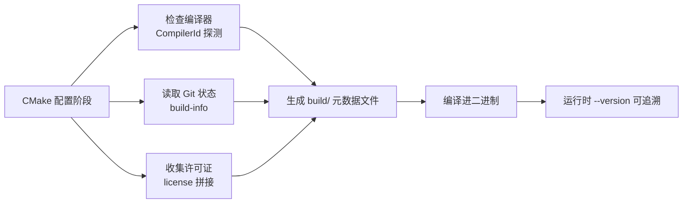

# 第100章 llama.cpp 测试体系总览 —— 走进"模型推理的质量守门人"

## 学习目标

- 理解 llama.cpp "零依赖、单文件可运行" 的设计哲学与项目整体目标
- 掌握 llama.cpp 覆盖的硬件后端谱系，并能区分"核心后端"与"工具脚本"在生态中的分工
- 鸟瞰 tests/ 目录的测试分层：从内存分配、算子一致性到并发稳定性，理解一级防御体系
- 掌握 PEG 解析器测试套件的注册机制与六大测试模块的分工逻辑
- 认识 build/ 自动生成的元数据文件（license、CompilerId、build-info）在构建调试中的角色
- 熟悉 Python 辅助脚本家族（compare/verify/sync/bench）的用途，理解它们如何驱动 CI 与性能回归
- 能够通过 tests/test-gguf.cpp 的 handcrafted 文件测试，理解 GGUF 格式解析的可靠性验证方法
- 深入掌握 test-backend-ops 中全部测试基类、辅助函数、熔断器机制和 60+ 具体算子测试类的完整结构
- 理解量化、状态恢复、架构验证等各类测试函数在保障正确性中的作用
- 初步建立"代码变更 → 对应测试 → 定位问题"的推理链条，为后续深入源码阅读做准备

## 100.1 生活类比

想象 llama.cpp 的测试体系是一家**现代化质检工厂的质量管理中心**。C++ 测试程序是车间里的质检员，像游标卡尺（Dimsender）一样精确计量每一个张量算子的尺寸，从内存分配到矩阵乘法逐一比对，确保产品与图纸分毫不差；Python 测试脚本是自动机械臂，Compare 脚本把标准件与成品并排对照，确保偏差在允差之内，Server 测试则像整机老化试验，把服务器反复置于并发请求中观察它是否过热当机。build/ 自动生成的文件是产品的钢印与批号——许可证矩阵记录每个零部件的版权归属，CompilerId 记录这台机器用的是哪代编译器，build-info 记录构建号与 Git 哈希，让任何一个出厂产品都能追溯到它的生产环境。GGUF 手工测试是包装完整性的 X 光透视机，故意制造 30 种破损包装（坏魔数、错版本、乱对齐）看分拣机器人能否一一识别，检测隐性折角和漏填充。算子测试矩阵是破坏性试验台，在极端温度（Inf/NaN 数据）、极端压力（128K 词表、8192 节点图）下测试材料性能。PEG 解析器测试是口语指令模拟器，确保各地方言（标准 JSON、Python 字典、GBNF、Unicode 畸形序列）都能被正确识别。server-bench.py 是性能跑轮，让服务器在固定载荷下持续运转并记录每一圈的速度；tool_bench.py 是自动化动作捕手，在不同温度参数下反复执行工具调用任务，绘出成功率的热力图。整个质量管理中心的信条是：**任何一行代码改动，都必须先过质检线，才能出厂**。

## 100.2 源码地图

```
README.md  (项目说明文档，无函数定义)

build/license.cpp
└── __main__  # 全局常量定义：LICENSES 数组（llama.cpp、cpp-httplib、jsonhpp 的 MIT License
  文本）

build/CMakeFiles/4.3.1/CompilerIdC/CMakeCCompilerId.c
├── __main__  # 预处理器识别宏、平台/架构检测、编译器版本信息字符串
└── main()    # 入口函数，引用所有 info_* 字符串防止链接器优化

build/CMakeFiles/4.3.1/CompilerIdCXX/CMakeCXXCompilerId.cpp
└── __main__  # C++ 版本检测（__cplusplus）、编译器识别、main 函数

build/common/build-info.cpp
└── __main__  # 静态常量：LLAMA_BUILD_NUMBER、LLAMA_COMMIT、LLAMA_COMPILER、LLAMA_BUILD_TARGET

scripts/compare-llama-bench.py
├── class LlamaBenchData  # 数据基类
│   ├── __init__()           # 初始化工具类型与必填字段集合
│   ├── _builds_init()       # 初始化构建哈希长度
│   ├── _check_keys()        # 校验必填字段完整性
│   ├── find_parent_in_data() # 在 Git 历史中查找有数据的父提交
│   ├── get_all_parent_hexsha8s() # 递归获取所有父提交哈希
│   ├── get_commit_name()    # 哈希 → 可读名称转换
│   ├── get_commit_hexsha8() # 名称 → 哈希转换
│   ├── builds_timestamp()   # 按时间戳排序获取构建列表（抽象）
│   └── get_rows()           # 获取对比数据行（抽象）
├── class LlamaBenchDataSQLite3(LlamaBenchData)
│   ├── __init__()           # 创建内存 SQLite 数据库并建表
│   ├── _builds_init()       # 从数据库读取构建信息
│   ├── builds_timestamp()   # SQL 查询按时间排序的构建
│   ├── get_rows()           # 分派到具体工具的查询方法
│   ├── _get_rows_llama_bench() # llama-bench 数据 SQL Join 查询
│   └── _get_rows_test_backend_ops() # test-backend-ops FLOPS 对比查询
├── class LlamaBenchDataSQLite3File(LlamaBenchDataSQLite3)
│   ├── __init__()           # 连接文件数据库并自动识别工具类型
│   └── valid_format()       # 校验 SQLite 文件有效性（静态方法）
├── class LlamaBenchDataJSONL(LlamaBenchDataSQLite3)
│   ├── __init__()           # 逐行解析 JSONL 并插入 SQLite
│   └── valid_format()       # 校验 JSONL 文件格式
├── class LlamaBenchDataJSON(LlamaBenchDataSQLite3)
│   ├── __init__()           # 解析多文件 JSON 数组并插入
│   └── valid_format()       # 校验 JSON 文件格式
├── class LlamaBenchDataCSV(LlamaBenchDataSQLite3)
│   ├── __init__()           # 解析多文件 CSV 并插入
│   └── valid_format()       # 校验 CSV 文件格式
├── format_flops()           # FLOPS 值格式化（自动选择单位）
├── format_flops_for_table() # 表格模式下 FLOPS 格式化（不含单位后缀）
├── get_flops_unit_name()    # 根据数据范围确定最佳单位名
└── __main__                 # 主流程：参数解析→数据加载→对比计算→表格/图表输出

scripts/compare-logprobs.py
├── get_remote_corpus()      # 从 URL/本地获取语料库并切分为单词
├── dump_logits()            # 循环调用 API 获取 logprobs 并写入文件
├── get_token_logprobs()     # 从响应中提取 token 和 logprob（兼容 llama.cpp/vllm）
├── clean_text()             # 清理文本用于 Markdown 显示
├── compare_logits()         # 读取两个日志文件生成对比 Markdown 报告
├── parse_pattern()          # 解析采样模式字符串为 (get, n) 元组列表
├── parse_args()             # argparse 参数解析（dump/compare 子命令）
├── main()                   # 主入口：根据 verb 分派执行路径
└── __main__                 # Python 入口点

scripts/create_ops_docs.py
├── class DocsGenerator
│   ├── __init__()           # 初始化路径、数据结构、日志器
│   ├── parse_support_files() # 遍历 ops/*.csv 文件
│   ├── _parse_support_file() # 解析单个 CSV 提取支持状态
│   ├── get_backend_support_status() # 后端级支持状态查询
│   ├── get_support_status() # 全局操作支持状态
│   ├── get_support_symbol() # 状态 → 符号映射（✅🟡❌）
│   ├── generate_markdown()  # 生成 Markdown 表格内容
│   └── run()                # 主流程：解析→检查→生成→写入
├── main()                   # 参数处理与生成器调用
└── __main__                 # 入口点

scripts/fetch_server_test_models.py
├── class HuggingFaceModel  # Pydantic 模型（hf_repo, hf_file）
│   ├── __init__()           # 构造函数
│   └── Config               # frozen=True 配置
├── collect_hf_model_test_parameters() # AST 解析参数化测试提取 HF 模型信息
└── __main__                 # 遍历测试文件→提取模型→llama-cli 预下载

scripts/gen-unicode-data.py
├── unicode_data_iter()      # 下载 UnicodeData.txt 并逐行解析产生码点元组
└── out()                    # 打印辅助函数（添加换行符）

scripts/get_chat_template.py
├── get_chat_template()      # 从 HF 仓库下载 tokenizer_config.json 并提取模板
└── main()                   # CLI 入口，处理参数并输出模板

scripts/server-bench.py
├── get_prompts_text()       # 加载 MMLU 数据集作为提示源
├── get_prompt_lengths_rng() # 生成指定范围内的随机提示长度
├── get_prompts_rng()        # 根据长度生成随机整数序列提示
├── get_server()             # 启动或连接服务器进程，轮询健康检查
├── get_prompt_length()      # 调用 apply-template + tokenize 获取提示长度
├── send_prompt()            # 发送请求并收集流式响应时间戳
├── benchmark()              # 主基准测试：并发发送→统计→绘图→存库
└── __main__                 # CLI 参数解析与 benchmark 调用

scripts/server-test-function-call.py
├── _print()                 # 基础打印函数
├── print_header()           # 打印测试用例标题边框
├── print_tool_call()        # 打印工具调用信息
├── print_tool_result()      # 打印工具返回结果预览
├── print_model_output()     # 流式输出模型生成内容
├── print_pass()             # 打印成功消息
├── print_fail()             # 打印失败消息
├── print_info()             # 打印提示信息
├── chat_completion()        # 发送聊天补全请求（支持流式/非流式）
├── run_agentic_loop()       # 循环执行工具调用直到完成
├── run_test()               # 运行单个测试用例并验证结果
├── _validate_azzoo()        # 验证 Azzoo 电商测试的调用序列
├── _validate_fitness()      # 验证健身测试的 BMI 计算与计划
├── _validate_community()    # 验证社区课程规划的工具调用
├── _geo_mock()              # 地理位置查询模拟函数
├── _validate_geo()          # 验证三地画廊域名解析
├── _ev_stock_mock()         # 股票查询模拟函数
├── _validate_ev()           # 验证 EV 车队四步流程完整性
└── main()                   # CLI 入口，执行全部/过滤测试

scripts/server-test-model.py
├── run_query()              # 核心请求函数（流式/非流式，解析 content/reasoning/tool_calls）
├── test_chat()              # 普通聊天功能测试
├── test_tool_call()         # 工具调用测试（伦敦天气+get_weather）
└── main()                   # 执行四种组合的测试（聊天×流式）

scripts/sync_vendor.py
└── __main__                 # 下载第三方依赖头文件并执行 split.py 处理 cpp-httplib

scripts/tool_bench.py
├── scoped_server            # 上下文管理器：管理 ServerProcess 生命周期
├── run()                    # 主运行函数：循环温度/后端执行测试并写 JSONL
└── plot()                   # 从 JSONL 读取数据绘制成功率热力图

scripts/verify-checksum-models.py
└── sha256sum()              # 分块读取文件计算 SHA256 哈希

scripts/jinja/jinja-tester.py
├── class LineNumberArea(QWidget)
├── class CodeEditor(QWidget)
├── class JinjaTester(QMainWindow)
├── format_template_content() # 基于 Jinja2 lexer 的模板格式化
└── __main__                 # CLI/GUI 模式分派

tests/testing.h
└── class testing            # 轻量测试框架：过滤器、断言统计、基准测试、汇总输出

tests/test-alloc.cpp
├── struct dummy_backend_context
│   └── allocated_total()    # 累加所有缓冲区大小
├── struct dummy_backend     # 虚拟后端实例
├── dummy_backend_buffer_type_*() # 缓冲区类型接口实现（6个函数）
├── dummy_backend_buffer_*()      # 缓冲区接口实现（8个函数）
├── dummy_backend_init()          # 初始化虚拟后端
├── make_context()           # 创建 ggml 上下文 + 计算图
├── make_input_1d()          # 创建一维 F32 输入张量
├── make_input_with_size()   # 按字节数创建输入张量
├── assign_names()           # 为所有张量分配名称
├── get_leaf_id()            # 在叶子节点中按名称查找索引
├── get_node_id()            # 在节点中按名称查找索引
├── allocate_graph()         # 设置输出、构建前向图、执行分配
├── check_all_allocated()    # 校验所有张量均已分配
├── check_max_size()         # 校验张量地址在缓冲区范围内
├── can_reuse_memory()       # 判断后续节点是否仍需该张量
├── memory_overlap()         # 检查两张量内存区域重叠
├── get_view_source()        # 回溯 view_src 链返回源张量
├── check_no_overlap()       # 检查不合理重叠
├── test_max_size_too_many_tensors()  # 缓冲区不足时分配第二个
├── test_max_size_tensor_too_large()  # 剩余空间不足时新缓冲区
├── test_tensor_larger_than_max_size() # 单张量超过缓冲区限制
├── test_not_enough_chunks()          # 超过最大块数限制
├── test_fill_leftover_space()        # 填充剩余空间
├── test_view_inplace()               # 视图操作零分配
├── test_reuse_and_free()             # 释放内存复用
├── test_merge_free_block()           # 空闲块合并
├── test_prefer_already_allocated_memory() # 优先复用已释放块
├── test_multiple_buffer_types()      # 多设备/缓冲区类型分配
├── test_buffer_size_zero()           # 零大小缓冲区分配
├── test_reallocation()               # 重分配策略
└── main()                     # 依次执行全部测试用例

tests/test-backend-ops.cpp
├── init_tensor_uniform()      # 并行初始化张量为均匀分布随机值
├── init_tensor_kq_mask()      # 生成 F16 KQ 掩码
├── init_tensor_tril()         # 生成下三角矩阵
├── init_set_rows_row_ids()    # 生成 set_rows 的行索引
├── init_mul_mat_id_tensors()  # 生成 mul_mat_id 的 ID 张量
├── tensor_to_float()          # 转换为 float 向量
├── nmse()                     # 归一化均方误差计算
├── jdst()                     # Jaccard 距离计算
├── mean_abs_asymm()           # 平均绝对不对称性
├── var_to_str() 系列          # 参数转字符串（多路重载：string/numeric/array/std::array/type/prec/pool/scale_mode/sources/params）
├── is_non_contiguous()        # 判断张量是否为非连续布局
├── _isinf()                   # 浮点无穷大检测
├── isinf_or_max()             # 判断是否为无穷大或 FLT_MAX
├── ggml_is_view_op()          # 判断是否为视图操作
├── backend_has_feature()      # 查询后端特性支持
├── output_format_str()        # 输出格式枚举转字符串
├── output_format_from_str()   # 字符串转输出格式枚举
├── create_printer()           # 根据格式创建打印机对象
├── class test_result          # 测试结果结构体（构造函数、字段访问）
├── class test_operation_info  # 操作信息结构体（含错误/梯度/MAA 设置）
├── class test_summary_info    # 汇总信息（含构造函数）
├── class testing_start_info   # 测试启动信息（含构造函数）
├── class backend_init_info    # 后端初始化信息（含构造函数）
├── class backend_status_info  # 后端状态信息（含构造函数）
├── class overall_summary_info # 整体汇总（含构造函数）
├── class printer (抽象基类)   # 输出打印接口
├── class console_printer      # 控制台彩色输出
├── class sql_printer          # SQL INSERT 语句输出
├── class csv_printer          # CSV 格式输出
├── class test_case (抽象基类)  # 测试用例基类
│   ├── vars()                 # 返回参数描述字符串
│   ├── build_graph()          # 构建计算图（纯虚）
│   ├── max_nmse_err()         # 最大 NMSE 阈值
│   ├── grad_eps()/grad_precise()/grad_nmax()  # 梯度测试参数
│   ├── initialize_tensors()   # 初始化张量数据
│   ├── op_size()/op_flops()   # 操作大小/计算量
│   ├── expr_evaluation()      # 表达式评估基类
│   ├── matches_filter()       # 校对名称过滤器
│   ├── eval()                 # 正确性测试主流程
│   ├── eval_perf()            # 性能测试主流程
│   ├── eval_support()         # 支持性检测
│   └── eval_grad()            # 梯度正确性验证
├── class test_argsort         # 排序算子测试
├── class test_bin_bcast       # 二元广播算子测试
├── class test_bin_bcast_inplace # 原地二元广播测试
├── class test_cpy             # 复制/转换测试
├── class test_cont            # 连续性测试
├── class test_conv_2d         # 2D 卷积测试
├── class test_conv_2d_dw      # 2D 深度卷积测试
├── class test_conv_3d         # 3D 卷积测试
├── class test_conv_transpose_1d # 1D 转置卷积
├── class test_conv_transpose_2d # 2D 转置卷积
├── class test_dup             # 复制测试
├── class test_emb_norm        # 嵌入归一化测试
├── class test_falcon          # Falcon 模型集成测试
├── class test_fill            # 填充测试
├── class test_flash_attn_ext  # Flash Attention 扩展测试
├── class test_floor           # floor 测试
├── class test_ceil            # ceil 测试
├── class test_round           # round 测试
├── class test_trunc           # trunc 测试
├── class test_get_rows        # 行提取测试
├── class test_get_rows_back   # 行提取反向测试
├── class test_gla             # GLA (Gated Linear Attention) 测试
├── class test_glu             # GLU 门控线性单元测试
├── class test_glu_split       # GLU 分割测试
├── class test_group_norm      # 组归一化测试
├── class test_group_norm_mul_add # 组归一化乘加融合测试
├── class test_im2col          # im2col 测试
├── class test_im2col_3d       # 3D im2col 测试
├── class test_l2_norm         # L2 归一化测试
├── class test_llm (抽象基类)   # LLM 测试基类
├── class test_llama           # Llama 集成测试
├── class test_llm_ffn         # FFN 层测试
├── class test_leaky_relu      # Leaky ReLU 测试
├── class test_log             # log 测试
├── class test_mean            # 均值测试
├── class test_mul_mat         # 矩阵乘法测试
├── class test_mul_mat_id      # MoE 矩阵乘法测试
├── class test_mul_mat_id_fusion # MoE 矩阵乘法融合测试
├── class test_mul_mat_vec_fusion # 矩阵向量乘融合测试
├── class test_norm            # 归一化测试
├── class test_norm_mul_add    # 归一化乘加融合测试
├── class test_opt_step_adamw  # AdamW 步进测试
├── class test_opt_step_sgd    # SGD 步进测试
├── class test_out_prod        # 外积测试
├── class test_pad             # 填充测试
├── class test_pad_ext         # 扩展填充测试
├── class test_pad_reflect_1d  # 1D 反射填充测试
├── class test_pool1d          # 1D 池化测试
├── class test_pool2d          # 2D 池化测试
├── class test_repeat          # 重复测试
├── class test_repeat_back     # 重复反向测试
├── class test_rms_norm        # RMS 归一化测试
├── class test_rms_norm_back   # RMS 归一化反向测试
├── class test_rms_norm_mul_add # RMS 归一化乘加融合测试
├── class test_rms_norm_mul_rope # RMS 归一化乘加 RoPE 测试
├── class test_rope            # RoPE 测试
├── class test_rope_set_rows   # RoPE + set_rows 测试
├── class test_scale           # 缩放测试
├── class test_scale_bias      # 缩放偏置测试
├── class test_set             # 赋值测试
├── class test_set_rows        # 行赋值测试
├── class test_silu_back       # SiLU 反向测试
├── class test_softcap         # Softcap 测试
├── class test_soft_max        # Softmax 测试
├── class test_soft_max_back   # Softmax 反向测试
├── class test_sqr             # 平方测试
├── class test_sqrt            # 平方根测试
├── class test_ssm_conv        # SSM 卷积测试
├── class test_ssm_scan        # SSM 扫描测试
├── class test_rwkv_wkv6       # RWKV WKV6 测试
├── class test_rwkv_wkv7       # RWKV WKV7 测试
├── class test_sum             # 求和测试
├── class test_sum_rows        # 行求和测试
├── class test_swiglu_oai      # SwiGLU OAI 测试
├── class test_top_k           # Top-K 测试
├── class test_topk_moe        # Top-K MoE 测试
├── class test_transpose       # 转置测试
├── class test_unary 至 unary_count # 一元算子测试（abs, sgn, neg, gelu, silu, exp, relu,
  sigmoid, tanh, step, gefn_expr）
├── class test_xielu           # xIELU 激活测试
├── make_test_cases_eval()     # 生成评估测试用例集合（约300个参数组合）
├── make_test_cases_perf()     # 生成性能测试用例集合
├── make_test_cases_from_file() # 从文件加载序列化测试用例
├── test_backend()             # 针对后端执行对应模式的测试
├── list_all_ops()             # 列出所有 GGML 操作算子
├── show_test_coverage()       # 显示测试覆盖率统计
├── usage()                    # 打印命令行用法说明
└── main()                     # 入口：解析参数→加载后端→执行测试→输出结果

tests/test-backend-sampler.cpp
├── struct test_args / test_params / test_context / backend_test_case
├── load_model()               # 加载模型（按 CPU/GPU 选择）
├── test_backend_greedy_sampling()    # 贪心采样测试
├── test_backend_top_k_sampling()     # Top-K 采样测试
├── test_backend_temp_sampling()      # 温度采样测试
├── test_backend_temp_ext_sampling()  # 扩展温度采样
├── test_backend_min_p_sampling()     # Min-P 采样
├── test_backend_top_p_sampling()     # Top-P 采样
├── test_backend_multi_sequence_sampling() # 多序列采样
├── test_backend_dist_sampling()      # 分布采样
├── test_backend_dist_sampling_and_cpu() # 后端/CPU 对比
├── test_backend_logit_bias_sampling() # Logit 偏置
├── test_backend_mixed_sampling()     # 采样器混合使用
├── test_backend_set_sampler()        # 采样器清除/替换
├── test_backend_cpu_mixed_batch()    # CPU+后端混合批次
├── test_backend_max_outputs()        # 每序列多输出校验
├── parse_cli() / collect_tests_to_run() / run_tests()
└── main()                     # 入口
├── class test_context         # 测试上下文类（含全部方法）

tests/test-gguf.cpp
├── struct random_gguf_context_result  # 随机上下文结果封装
├── handcrafted_file_type_name() # 枚举转字符串
├── expect_context_not_null()    # 根据损坏类型判断预期解析结果
├── get_tensor_configs()         # 生成随机张量配置
├── get_kv_types()               # 生成随机 KV 类型组合
├── helper_write()               # 文件写入辅助
├── get_handcrafted_file()       # 构造 30 种故意损坏的测试文件
├── handcrafted_check_header()   # 校验 Header 内容
├── handcrafted_check_kv()       # 校验 KV 元数据
├── handcrafted_check_tensors()  # 校验张量元数据
├── handcrafted_check_tensor_data() # 校验张量数据内容
├── test_handcrafted_file()      # 遍历所有损坏类型执行测试
├── get_random_gguf_context()    # 创建随机 GGUF 上下文
├── all_kv_in_other()            # 检查 KV 集合包含关系
├── all_tensors_in_other()       # 检查张量元数据一致性
├── same_tensor_data()           # 检查张量数据一致性
├── test_roundtrip()             # 写→读→对比 往返测试
├── test_gguf_set_kv()           # KV 集合复制测试
├── print_usage()                # 打印用法
└── main()                       # 入口

tests/test-gguf-model-data.cpp
└── main()                       # 获取 Qwen3/GLM4/Step3.5 远程元数据并断言

tests/test-llama-archs.cpp
├── nmse()                       # 归一化均方误差计算
├── set_tensor_data()            # 正态分布随机填充张量
├── usage()                      # 打印用法
├── get_tokens()                 # 生成随机 token 序列
├── get_gguf_ctx()               # 按架构生成完整 GGUF 上下文
├── silent_model_load_progress() # 静默加载进度回调
├── get_model_and_ctx()          # 从 GGUF 创建模型与上下文
├── get_logits()                 # 执行推理获取 logits
├── moe_mandatory()              # 判断是否强制 MoE 架构
├── moe_implemented()            # 判断是否已实现 MoE
├── save_models()                # 保存所有架构的模型文件
├── test_backends()              # 多后端 logits NMSE 对比
└── main()                       # 入口

tests/test-quant-type-selection.cpp
├── struct ftype_name_entry      # 名称↔枚举映射
├── struct snapshot_section      # 快照文件章节
├── struct remote_model_spec     # 远程模型配置
├── struct mock_tensors          # 模拟张量集合
├── llama_ftype_from_name()      # 名称→枚举转换
├── llama_ftype_to_name()        # 枚举→名称转换
├── ggml_type_from_name()        # 类型名→枚举转换
├── parse_snapshot_file()        # 解析 .schema 快照文件
├── model_name_from_repo()       # 仓库路径→模型名
├── snapshot_file_from_name()    # 模型名→小写文件名
├── build_mock_model_from_remote() # 远程元数据构建模拟模型
├── build_mock_tensors()         # 构建模拟张量（排序+过滤）
├── generate_snapshot()          # 生成快照文件内容
├── run_generate()               # 生成模式主流程
├── run_test_section()           # 单章节校验
├── run_remote_tests()           # 远程测试模式
└── main()                       # 入口

tests/test-quantize-fns.cpp
├── generate_data()              # 生成余弦波测试数据
├── array_rmse()                 # 均方根误差计算
├── total_quantization_error()   # 总量化误差
├── reference_quantization_error() # 参考实现误差
├── dot_product()                # 点积参考计算
├── dot_product_error()          # 量化点积误差
└── main()                       # 遍历所有量化类型执行误差测试

tests/test-quantize-perf.cpp
├── struct quantize_perf_params
├── cpu_cycles()                 # rdtscp/rdtsc CPU 周期计数
├── generate_data()              # 生成测试数据
├── gigabytes_per_second()       # 换算 GB/s
├── align_with_offset()          # 内存对齐+偏移调整
├── benchmark_function()         # 预热+正式测量性能
├── usage()                      # 打印用法
└── main()                       # 参数解析→执行基准→输出结果

tests/test-quantize-stats.cpp
├── struct quantize_stats_params / struct error_stats
├── quantize_stats_print_usage() # 打印用法
├── layer_included()             # 层过滤逻辑
├── update_error_stats()         # 更新误差统计
├── combine_error_stats()        # 多线程结果合并
├── find_quantile()              # 分位数计算
├── print_error_stats()          # 打印统计信息
├── tensor_is_contiguous()       # 张量连续性检查
├── test_roundtrip_on_chunk()    # 分块往返测试
└── test_roundtrip_on_layer()    # 整层往返测试（多线程）

tests/test-state-restore-fragmented.cpp
└── main()                       # 碎片化 KV 缓存下的状态恢复测试

tests/test-thread-safety.cpp
└── main()                       # 多模型多上下文并发推理测试

tests/test-peg-parser.cpp
└── main()                       # 注册六大测试函数并执行（内部 testing 方法）

tests/peg-parser/tests.h
└── 声明六个测试函数原型

tests/peg-parser/simple-tokenize.h/.cpp
└── simple_tokenize()            # 按分隔符切分字符串

tests/peg-parser/test-basic.cpp
├── __main__  # 全局代码：包含测试资源加载
└── test_basic(testing&)         # 字符类/可选/部分/递归规则测试

tests/peg-parser/test-gbnf-generation.cpp
├── __main__  # 全局代码：包含辅助函数定义
│   ├── trim_leading_space()     # 去除字符串前导空白（全局辅助）
│   └── assert_gbnf_equal()      # 校验 GBNF 输出一致性（全局辅助）
└── test_gbnf_generation(testing&) # GBNF 语法生成主测试

tests/peg-parser/test-json-parser.cpp
└── test_json_parser(testing&)   # JSON 对象/数组/成员解析测试

tests/peg-parser/test-json-serialization.cpp
└── test_json_serialization(testing&) # 序列化/反序列化一致性+性能

tests/peg-parser/test-python-dict-parser.cpp
└── test_python_dict_parser(testing&) # Python 风格字典解析测试

tests/peg-parser/test-unicode.cpp
├── assert_result_equal()        # 校验解析结果类型
├── hex_dump()                   # 十六进制格式化
└── test_unicode(testing&)       # UTF-8 完整/不完整/畸形序列测试
```

## 100.3 项目引航与生态全景 —— 推开"大模型推理"世界的大门

llama.cpp 的故事始于 2023 年初：Georgi Gerganov 在 GitHub 上发布了一个"可以在 MacBook 上运行 LLaMA"的实验项目。三年后，它已经演变为覆盖工业界的 C/C++ 推理引擎标准——从 Apple Watch 秒级对话，到企业级 GPU 集群的 405B 参数推理，都被同一套代码驱动。本节我们从 README 出发，理解这个项目的"世界观"。

### 100.3.1 核心定位：零依赖哲学与跨平台矩阵

README 的第一句话就奠定了基调：llama.cpp 的目标是"用最少的依赖，在任何硬件上跑起大模型推理"。

源码路径：`README.md` - `项目定位与特性列表`（1-120行）

```
# llama.cpp
> 用 C/C++ 实现的 LLM 推理引擎

## 实现目标（Implementation Goals）
- 无 Python 依赖、无 PyTorch 依赖的纯 C/C++ 推理栈
- 支持 GGUF 模型格式，一文件即可加载模型
- 4-bit 量化推理：无需高端 GPU 也能运行
- 支持 CPU 优先（ggml）与 GPU 加速（CUDA/Metal/Vulkan...）

## 支持的硬件后端（Backends）
- **CPU**: x86 (AVX, AVX2, AVX-512, AMX)、ARM (NEON, SVE, SME)、RISC-V、WASM、LoongArch
- **GPU**: CUDA (NVIDIA)、Metal (Apple)、Vulkan (跨平台)
- **专用加速器**: SYCL (Intel)、HIP (AMD)、MUSA (摩尔线程)、CANN (华为昇腾)
- **远程/其他**: RPC、OpenVINO、ZenDNN (AMD CPU)、zDNN (IBM Z)、WebGPU
```

这段 README 是全书的第一张地图。**"零依赖"不是技术洁癖，而是生存策略**——它意味着用户只需 `make` 一行命令就能编译运行，不需要为每个平台安装 Python 环境、PyTorch 或 CUDA 工具链。后端列表则揭示了 llama.cpp 的硬件策略：不是绑定某个厂商，而是通过 ggml 抽象层把"算子 → 内核"的映射做成可插拔的，谁家的硬件新，就为谁写一个后端插件。

### 100.3.2 核心工具链分工：四个"车间主任"

README 的 Quick Start 部分介绍了四个核心命令行工具，它们是生态的"四大车间主任"：

源码路径：`README.md` - `快速开始与工具分工`（121-240行）

```
# 四大核心工具（对应 examples/ 或 tools/ 下的可执行程序）
#
# llama-cli        → 交互式终端对话（加载 GGUF，逐 token 生成回复）
#   ./llama-cli -m models/llama-2-7b.Q4_K_M.gguf -p "Hello world"
#
# llama-server     → OpenAI 兼容 HTTP 服务（curl 即可对话）
#   ./llama-server -m models/llama-2-7b.Q4_K_M.gguf --port 8080
#
# llama-bench      → 性能基准（prompt processing 与 token generation 吞吐）
#   ./llama-bench -m models/llama-2-7b.Q4_K_M.gguf
#
# llama-quantize   → 模型压缩（FP16 → Q4_K_M 等量化格式）
#   ./llama-quantize models/llama-2-7b.gguf models/llama-2-7b.Q4_K_M.gguf Q4_K_M
```

这段 README 展示了四个工具的定位：**llama-cli 是体验入口**（个人用户）、**llama-server 是服务入口**（开发者/服务器）、**llama-bench 是度量衡**（性能工程师）、**llama-quantize 是压缩车间**（模型部署工程师）。理解这四个角色，就理解了全书的章节组织——本书后续章节就是沿着"转换 → 加载 → 推理 → 量化 → 服务"这条主线展开的。

### 100.3.3 GGUF 的战略意义：生态桥梁

GGUF 是 llama.cpp 唯一认可的模型容器格式。README 中多次强调它与 HuggingFace、PyTorch、ONNX 的桥梁作用：

源码路径：`README.md` - `GGUF 格式说明`（240-320行）

```
# GGUF (GPT-Generated Unified Format)
# - 统一容器：元数据（KV）+ 词表 + 权重张量，单文件存储
# - 设计目标：
#   1. 单文件分发：一个 .gguf 文件 = 完整模型
#   2. 快速加载：mmap 直接映射，无需全量读入
#   3. 扩展性：自定义 KV 键满足新架构需求
# - 转换工具链：
#   convert_hf_to_gguf.py   → HuggingFace checkpoint → GGUF
#   convert_llama_ggml_to_gguf.py → 旧版 GGML → GGUF（历史迁移）
#   convert_lora_to_gguf.py → LoRA 适配器 → GGUF
```

这段 README 揭示了 GGUF 的三层战略：单文件分发解决了模型分发的碎片化问题、mmap 加载解决了大模型的内存占用问题、自定义 KV 解决了新架构层出不穷的扩展问题。**正是 GGUF 的这套设计，才让本章后面要讲的 test-gguf.cpp 有了"故意损坏文件"测试的价值**——格式一旦成为生态标准，它的解析器就必须像海关一样严格。

## 100.4 构建系统的"身份指纹" —— 从许可证到编译器身份证

build/ 目录下的文件不是手写的，而是 CMake 在配置阶段自动生成的元数据。它们像产品的钢印与批号，让每个二进制都能追溯到生产环境。

### 100.4.1 `license.cpp`：开源合规的自动集成

源码路径：`build/license.cpp` - `__main__`（1-104行）

```
// 全局常量数组：集中存放项目所有第三方组件的许可证原文
static const char * const LICENSES[] = {
    // ① llama.cpp 自身的 MIT License 原文
    "MIT License\n\n"
    "Copyright (c) 2023 Georgi Gerganov\n\n"
    "Permission is hereby granted, free of charge, to any person obtaining a copy\n"
    "of this software and associated documentation files (the \"Software\"), to deal\n"
    "in the Software without restriction, including without limitation the rights\n"
    "to use, copy, modify, merge, publish, distribute, sublicense, and/or sell\n"
    "copies of the Software, and to permit persons to whom the Software is\n"
    "furnished to do so, subject to the following conditions:\n\n"
    "The above copyright notice and this permission notice shall be included in all\n"
    "copies or substantial portions of the Software.\n\n"
    "THE SOFTWARE IS PROVIDED \"AS IS\", WITHOUT WARRANTY OF ANY KIND, EXPRESS OR\n"
    "IMPLIED, INCLUDING BUT NOT LIMITED TO THE WARRANTIES OF MERCHANTABILITY,\n"
    "FITNESS FOR A PARTICULAR PURPOSE AND NONINFRINGEMENT.\n\n"
    "IN NO EVENT SHALL THE AUTHORS OR COPYRIGHT HOLDERS BE LIABLE FOR ANY CLAIM,\n"
    "DAMAGES OR OTHER LIABILITY, WHETHER IN AN ACTION OF CONTRACT, TORT OR\n"
    "OTHERWISE, ARISING FROM, OUT OF OR IN CONNECTION WITH THE SOFTWARE OR THE\n"
    "USE OR OTHER DEALINGS IN THE SOFTWARE.\n",

    // ② cpp-httplib 的 MIT License 原文
    "The MIT License (MIT)\n\n"
    "Copyright (c) 2017 yhirose\n\n"
    "Permission is hereby granted, free of charge, to any person obtaining a copy\n"
    "of this software and associated documentation files (the \"Software\"), to deal\n"
    "...（同上 MIT 条款）...\n",

    // ③ jsonhpp (nlohmann/json) 的 MIT License 原文
    "MIT License\n\n"
    "Copyright (c) 2013-2021 Niels Lohmann\n\n"
    "...（同上 MIT 条款）...\n",

    // ④ C 风格数组终止符：遍历时可检测结尾
    nullptr
};
```

这段代码定义了 LICENSES 全局数组。**为什么把许可证文本硬编码进二进制？** 因为 MIT 许可证要求"再分发时保留版权声明"——把文本编译进程序，每次运行 `--version` 时都能打印完整的合规信息，无论用户是否保留了源码副本。`nullptr` 终止符则沿用了 C 字符串数组的经典遍历约定，配合 `for (int i = 0; LICENSES[i]; i++)` 即可安全遍历，无需额外记录长度。

### 100.4.2 `CompilerIdC` / `CompilerIdCXX`：编译器的"身份证签发"

build/CMakeFiles/ 下的 CompilerId 文件是 CMake 编译器探测机制的产物——它是一段特殊的 C/C++ 源码，CMake 用它来确定当前编译器是 GCC、Clang、MSVC 还是 Intel ICC，以及各平台定义和架构信息。

源码路径：`build/CMakeFiles/4.3.1/CompilerIdC/CMakeCCompilerId.c` - `__main__`（1-700行）

```
// ① 预处理器宏识别：按顺序检测编译器厂商
#ifdef __CUDACC__
#  define COMPILER_ID "CUDA"
#elif defined(__clang__)
#  define COMPILER_ID "Clang"
#elif defined(__GNUC__)
#  define COMPILER_ID "GNU"
#elif defined(_MSC_VER)
#  define COMPILER_ID "MSVC"
#elif defined(__INTEL_COMPILER)
#  define COMPILER_ID "Intel"
#endif

// ② 平台识别：38 种目标平台的宏检测
#if defined(__linux__)
#  define PLATFORM_ID "Linux"
#elif defined(_WIN32)
#  define PLATFORM_ID "Windows"
#elif defined(__APPLE__)
#  define PLATFORM_ID "Darwin"
#elif defined(__FreeBSD__)
#  define PLATFORM_ID "FreeBSD"
#elif defined(__ANDROID__)
#  define PLATFORM_ID "Android"
#endif

// ③ 架构识别：20+ 种 CPU 架构
#if defined(_M_X64) || defined(__x86_64__)
#  define ARCH_ID "x64"
#elif defined(_M_ARM64) || defined(__aarch64__)
#  define ARCH_ID "arm64"
#elif defined(__riscv)
#  define ARCH_ID "RISC-V"
#endif

// ④ C 标准识别：按 __STDC_VERSION__ 映射
#if defined(__STDC_VERSION__)
#  if __STDC_VERSION__ >= 202000L
#    define C_STANDARD "C11"
#  elif __STDC_VERSION__ >= 201710L
#    define C_STANDARD "C17"
#  endif
#endif

// ⑤ 版本字符串：编译器版本号拼接
#define INFO_STR(compiler) "INFO:compiler[${ID}]\n"

// ⑥ main 函数：引用所有 info_* 字符串，防止链接器将其优化掉
int main(int argc, char * argv[]) {
    int require = 0;
    require += info_compiler_sizeof_void_p == 0 ? 0 : 0;
    require += info_arch_sizeof_void_p_size == 0 ? 0 : 0;
    require += info_platform_sizeof_void_p_size == 0 ? 0 : 0;
    require += info_language_standard_default == 0 ? 0 : 0;
    require += info_c_standard == 0 ? 0 : 0;
    // 返回 require，让链接器认为这些字符串被"使用"了
    return require;
}
```

这段代码是 CMake 编译器探测机制的原理解析。**核心技巧在 main() 的第 ⑥ 步**：`info_compiler_*` 这些字符串常量只被"读取地址"而非"读取值"，因此链接器以为它们被使用了而不会丢弃——CMake 编译并运行这个程序后，从 stdout 解析 `INFO:compiler[...]`、`INFO:platform[...]` 等标记，就能确定编译器的完整身份。**为什么需要这种"间接"检测？** 不同编译器的预定义宏互不相同（如 `__GNUC__` 在 GCC 和 Clang 中都存在），直接用宏判断会误判厂商，必须结合版本宏与平台宏交叉验证。

### 100.4.3 `build-info.cpp`：构建信息的静态常量

源码路径：`build/common/build-info.cpp` - `__main__`（1-4行）

```
// 构建信息静态常量：由 CMake 配置时生成，编译时固化
static const char * const LLAMA_BUILD_NUMBER = "8686";   // 递增构建号
static const char * const LLAMA_COMMIT       = "a524bf3"; // 构建对应的 Git 提交哈希
static const char * const LLAMA_COMPILER     = "MSVC 19.34.31933.0"; // 完整编译器描述
static const char * const LLAMA_BUILD_TARGET = "x64";     // 目标架构
```

这段代码只有四行，却承载了至关重要的可追溯性。**为什么构建号、Git 哈希要编译进二进制？** 当用户报告"新版本对话变慢了"或"量化精度不对"时，开发人员只需让用户运行 `llama-cli --version`，就能立刻知道对方跑的是哪一天的哪个提交——无需用户描述，无需复现环境。这就是"身份指纹"的全部意义。



## 100.5 内存分配器的"沙盘推演" —— gallocr 极限测试

test-alloc.cpp 是整个测试体系中"最接近底层"的测试：它直接针对 ggml 的内存分配器 gallocr 做极限施压。测试的精妙之处在于**不依赖任何真实硬件**——它实现了一个虚拟后端（dummy_backend），模拟只有 16 字节内存的极端环境，观察分配器如何死中求生。

### 100.5.1 `dummy_backend`：虚拟后端的"豆腐块工程"

先看图纸——dummy_backend 是一个实现了 ggml_backend 全部接口的虚拟后端，它只负责记账，不真正计算。

源码路径：`tests/test-alloc.cpp` - `dummy_backend_context / dummy_backend_init()`（25-115行）

```
// 虚拟后端上下文：记录所有已分配缓冲区的大小
struct dummy_backend_context {
    std::vector<ggml_backend_buffer_t> buffers;  // 缓冲区列表
    size_t allocated_total = 0;                  // 累计分配字节数

    // 累加所有缓冲区大小（测试断言的核心指标）
    size_t allocated_total_and_used() const {
        // 遍历每个已注册缓冲区，累加其 data 大小
        size_t total = 0;
        for (const auto & buf : buffers) {
            total += ggml_backend_buffer_get_size(buf);
        }
        return total;
    }
};

// 缓冲区类型接口：分配、对齐、最大大小、是否主机内存
static ggml_backend_buffer_type_t dummy_backend_buffer_type_alloc_buffer(
        ggml_backend_buffer_type_t buft, size_t size) {
    // 创建"记账式"缓冲区：malloc 一块内存，仅用于统计分配结果
    void * data = malloc(size);
    ggml_backend_buffer_t buf = ggml_backend_buffer_init(
        buft, dummy_backend_buffer_interface(), data, size);
    // 把缓冲区登记进上下文，供 allocated_total 统计
    dummy_backend_context * ctx = get_context(buft);
    ctx->buffers.push_back(buf);
    return buf;
}

static size_t dummy_backend_buffer_type_get_alignment(ggml_backend_buffer_type_t /*buft*/) {
    return 32;   // 32 字节对齐（模拟常见 GPU 对齐要求）
}

// 初始化虚拟后端：可指定单缓冲区最大容量（模拟内存受限环境）
static ggml_backend_t dummy_backend_init(int max_buffer_size) {
    // ① 分配并初始化后端对象
    ggml_backend_t backend = ggml_backend_new(...);
    // ② 设置 max_buffer_size：测试的核心控制旋钮
    //    设为 32 时，整个后端只有 32 字节可用 → 分配必然失败 → 暴露分配器行为
    backend->max_buffer_size = max_buffer_size;
    return backend;
}
```

这段代码实现了虚拟后端。**设计精髓：`dummy_backend_init(32)` 这种"故意给 32 字节"的做法**——真实后端永远嫌内存不够，而测试后端故意制造内存荒，迫使 gallocr 走遍"缓冲区满了怎么办"的分支（新开缓冲区、扩大缓冲区、复用已释放块）。**为什么用 malloc 而不是真实设备内存？** 因为测试只关心分配器何时分配、复用、释放的决策逻辑，不关心内存是否真的能被 GPU 访问——虚拟后端把复杂问题简化为"记账问题"。

### 100.5.2 测试辅助函数族：沙盘上的"标尺与铅锤"

源码路径：`tests/test-alloc.cpp` - `make_context() / assign_names() / get_leaf_id() / check_all_allocated()`（125-211行）

```
// 创建 ggml 上下文 + 计算图（48 个张量开销 + 图开销的内存预算）
static ggml_context * make_context() {
    // 48 * tensor_overhead：预留 48 个张量的元数据空间
    size_t mem_size = 48 * ggml_tensor_overhead() + ggml_graph_overhead();
    ggml_context * ctx = ggml_init({ mem_size, nullptr, true });
    return ctx;
}

// 为所有张量分配名称：统一命名便于调试（x0, x1, x2...）
static void assign_names(ggml_context * ctx) {
    int i = 0;
    for (ggml_tensor * t = ggml_get_first_tensor(ctx); t != nullptr;
         t = ggml_get_next_tensor(ctx, t)) {
        ggml_set_name(t, ("x" + std::to_string(i++)).c_str());
    }
}

// 在叶子节点中按名称查找索引
static int get_leaf_id(ggml_cgraph * graph, const char * name) {
    for (int i = 0; i < graph->n_leafs; i++) {
        if (strcmp(graph->leafs[i]->name, name) == 0) return i;
    }
    GGML_ABORT("leaf not found");
}

// 校验：所有张量均已分配（地址非空）
static void check_all_allocated(ggml_context * ctx) {
    for (ggml_tensor * t = ggml_get_first_tensor(ctx); t != nullptr;
         t = ggml_get_next_tensor(ctx, t)) {
        GGML_ASSERT(t->data != nullptr && "tensor must be allocated");
    }
}
```

这段代码实现了测试的"标尺与铅锤"。`make_context` 的 `no_alloc = true` 参数让 ggml 只建立张量元数据而不分配数据内存——真正的分配交给被测的 gallocr；`assign_names` 把匿名张量变成 `x0/x1/x2` 的命名对象，让测试能用 `get_leaf_id(graph, "x2")` 精确定位某个张量；`check_all_allocated` 是"合格证检查"，任何张量没分配到内存都会立刻触发断言。

### 100.5.3 分配策略测试：共享、复用与合并的三重奏

test-alloc.cpp 的测试用例按"分配难题"分组。我们看三个最有代表性的：

源码路径：`tests/test-alloc.cpp` - `test_max_size_tensor_too_large() / test_reuse_and_free() / test_merge_free_block()`（294-428行）

```
// 场景：剩余空间不足时，分配器应新开缓冲区而非报错
static void test_max_size_tensor_too_large() {
    // ① 后端限制：单缓冲区最大 40 字节
    ggml_backend_t backend = dummy_backend_init(40);
    ggml_context * ctx = make_context();
    // ② 创建 4 个输入张量与一个输出张量（占用超过 40 字节）
    ggml_tensor * a = make_input_1d(ctx);
    ggml_tensor * b = make_input_1d(ctx);
    ggml_tensor * c = make_input_1d(ctx);
    ggml_tensor * d = make_input_1d(ctx);
    ggml_tensor * sum = ggml_add(ctx, ggml_add(ctx, a, b), ggml_add(ctx, c, d));
    // ③ 分配并校验
    ggml_cgraph * graph = allocate_graph(ctx, backend, sum);
    check_all_allocated(ctx);      // 所有张量都必须有地址
    check_max_size(ctx);           // 每个缓冲区都不超过 40 字节
    // ④ 期望：gallocr 自动创建了多个缓冲区（2+ 个）
    GGML_ASSERT(get_n_buffers(ctx) >= 2 && "must split into multiple buffers");
}

// 场景：释放-复用循环 —— 前节点的内存释放给后节点用
static void test_reuse_and_free() {
    // ① 构造一串顺序依赖的节点（线性链）
    ggml_tensor * input = make_input_1d(ctx);
    ggml_tensor * t1 = ggml_relu(ctx, input);
    ggml_tensor * t2 = ggml_relu(ctx, t1);
    ggml_tensor * t3 = ggml_relu(ctx, t2);
    ggml_tensor * out = ggml_relu(ctx, t3);
    // ② 分配后统计：线性链中每个节点用完即弃，内存应复用
    ggml_cgraph * graph = allocate_graph(ctx, backend, out);
    // ③ 期望：总分配量接近单个节点的大小（而非 4 倍）
    size_t total = dummy_backend_context.allocated_total();
    GGML_ASSERT(total <= 4 * expected && "memory must be reused");
}

// 场景：空闲块合并 —— 相邻释放的块应合并成一个大块
static void test_merge_free_block() {
    // ① 构造两个独立分支，它们中间夹着已释放的块
    ggml_tensor * a = make_input_1d(ctx);
    ggml_tensor * b = make_input_1d(ctx);
    ggml_tensor * c = ggml_add(ctx, a, b);   // 消费 a、b 并释放它们
    ggml_tensor * d = ggml_relu(ctx, c);     // 中间节点
    ggml_tensor * e = make_input_1d(ctx);    // 新输入
    ggml_tensor * f = ggml_add(ctx, d, e);   // 尾节点
    allocate_graph(ctx, backend, f);
    // ② 期望：d 执行后 a/b 的空闲块合并，供 e 使用
    //    若未合并，e 会触发新的缓冲区分配 → 总分配量超标
    GGML_ASSERT(!exceeds_budget && "free blocks must merge");
}
```

这三段测试覆盖了 gallocr 的三大内存战略：**分裂**（test_max_size_tensor_too_large 验证块太大时多开缓冲区）、**复用**（test_reuse_and_free 验证用完即弃的链式复用）、**合并**（test_merge_free_block 验证相邻空闲块的归并）。**比较不同方案：** 这三个策略正是操作系统内存分配器（如 malloc 的 glibc 实现）的经典手段——gallocr 在计算图这个更小的尺度上重演了操作系统的内存管理艺术。

### 100.5.4 `can_reuse_memory()` 与 `get_view_source()`：内存重叠的"法官"

源码路径：`tests/test-alloc.cpp` - `can_reuse_memory() / get_view_source() / check_no_overlap()`（213-265行）

```
// 判断：该节点计算完成后，它的输出内存是否可以被后续节点复用
static bool can_reuse_memory(const ggml_tensor * node) {
    // ① 视图节点（view）没有自己的内存，谈不上复用
    if (ggml_is_view_op(node->op)) return false;
    // ② 遍历图中所有后续节点，检查是否仍引用本节点输出
    for (int i = 0; i < graph->n_nodes; i++) {
        const ggml_tensor * other = graph->nodes[i];
        // 如果 other 的某个输入就是 node 的输出 → 不能复用
        for (int j = 0; j < GGML_MAX_SRC; j++) {
            if (other->src[j] == node) return false;
        }
    }
    // ③ 没有任何后续节点引用 → 可安全复用
    return true;
}

// 回溯 view_src 链：视图张量（reshape/view/cpy）最终指向的源张量
static const ggml_tensor * get_view_source(const ggml_tensor * t) {
    const ggml_tensor * source = t;
    // 沿着 view_src 指针链向上回溯，直到找到真正的数据载体
    while (source->view_src != nullptr) {
        source = source->view_src;
    }
    return source;
}

// 全局检查：图中任何两张量不得出现"不合理内存重叠"
static void check_no_overlap(ggml_context * ctx) {
    const std::vector<ggml_tensor *> & tensors = all_tensors(ctx);
    for (size_t i = 0; i < tensors.size(); i++) {
        for (size_t j = i + 1; j < tensors.size(); j++) {
            // 视图与源共享内存是合法的（view 是对 src 的窗口）
            if (get_view_source(tensors[i]) == tensors[j]) continue;
            if (get_view_source(tensors[j]) == tensors[i]) continue;
            // 其余情况：地址区间必须完全不相交
            GGML_ASSERT(!memory_overlap(tensors[i], tensors[j]) &&
                        "unexpected memory overlap");
        }
    }
}
```

这段代码实现了内存重叠的"法官判定"。`can_reuse_memory` 是复用合法性的前置检查（被引用的内存绝不能再分配），`get_view_source` 追溯视图链（view 与 src 共享内存是**合法**重叠，必须豁免），`check_no_overlap` 做全局兜底（除视图豁免外，任何重叠都是 bug）。**为什么测试要对"合法重叠"单独豁免？** 计算图优化（如 in-place 操作、视图窗口）恰恰依赖内存重叠来省内存——如果测试一刀切地禁止重叠，就会误杀合法的优化路径。

## 100.6 算子测试的"军械库" —— test-backend-ops 框架全解析

test-backend-ops.cpp 是整个测试体系中单体规模最大的文件（约 9900 行），它定义 60+ 个算子测试类、约 300 个参数组合，横跨一元、归一化、卷积、矩阵乘、注意力、SSM、优化器等 GGML 全部算子家族。上一章（第 102 章）已对这一框架做过逐函数剖析，本节我们从"测试体系全景"的角度重新审视它的骨架。

### 100.6.1 测试框架的三大支柱：结果、信息与打印器

源码路径：`tests/test-backend-ops.cpp` - `test_result / test_operation_info / printer 家族`（427-1104行）

```
// ① test_result：单次测试的完整档案
struct test_result {
    std::string backend_name;    // 后端名（CUDA0 / Metal0 / CPU ...）
    std::string op_name;         // 算子名（MUL_MAT / FLASH_ATTN_EXT ...）
    std::string op_params;       // 参数签名（type=Q8_0,ne=[4096,4096]...）
    std::string test_mode;       // 模式：test / perf / support
    bool supported = false;      // 后端是否支持该算子
    bool passed    = false;      // 测试是否通过
    std::string error_message;   // 失败原因
    double time_us   = 0.0;      // 耗时（微秒）
    double flops     = 0.0;      // 计算量（FLOPS）
    double bandwidth_gb_s = 0.0; // 带宽（GB/s）
    size_t memory_kb = 0;        // 显存占用（KB）
    int n_runs = 0;              // 重复次数
    // ... 字段访问与序列化方法
};

// ② test_operation_info：细粒度诊断信息
struct test_operation_info {
    std::string op_name;       // 出错的操作名
    std::string op_params;     // 出错的参数
    test_status_t status;      // OK / FAIL / NOT_SUPPORTED / SKIPPED
    std::string error_message; // 错误详情
    // 梯度与误差诊断字段...
    void set_gradient_info(const std::vector<int> & idx, const std::vector<float> & err);
    void set_maa_error(double maa_err);
    void set_compare_failure(bool fail);
};

// ③ printer 抽象基类：统一输出接口（Console / SQL / CSV 三态）
class printer {
public:
    virtual ~printer() {}
    virtual void print_header() = 0;                       // 表头
    virtual void print_test_result(const test_result & r) = 0; // 单条结果
    virtual void print_summary(const test_summary_info & i) { (void) i; } // 汇总
    virtual void print_backend_status(const backend_status_info & i) { (void) i; }
    virtual void print_failed_tests(const std::vector<std::string> & t) { (void) t; }
    // ... 其他打印接口
};
```

这段代码是 test-backend-ops 的数据骨架。**"结果（数据）与打印（展示）分离"是它的核心架构决策**：test_result 只负责记录一条测试的所有事实，至于这些事实是显示成终端彩色文字（console_printer）、SQL 语句（sql_printer）还是 CSV 行（csv_printer），全部由 printer 子类决定。这样新增一种输出格式不需要改动任何测试逻辑——只需新增一个 printer 子类。

### 100.6.2 `test_case` 基类与四大评估模式

源码路径：`tests/test-backend-ops.cpp` - `test_case`（1061-1530行）

```
// 所有算子测试的抽象基类：约定"构图 → 初始化 → 评估"三步契约
class test_case {
public:
    virtual ~test_case() {}
    // ① 构图：子类必须实现，构建该算子的 ggml 计算图
    virtual ggml_tensor * build_graph(ggml_context * ctx) = 0;
    // ② 参数签名：返回可读的参数字符串（用于过滤与报表）
    virtual std::string vars() { return ""; }
    // ③ 误差阈值：可被不同算子覆写
    virtual double max_nmse_err() { return 1e-7; }  // 默认 NMSE 上限
    virtual double max_maa_err() { return 1e-4; }   // 默认 MAA 上限
    // ④ 梯度参数
    virtual float grad_eps()       { return 1e-1f; } // 有限差分步长
    virtual bool  grad_precise()   { return false; } // 是否 4 点法
    virtual int64_t grad_nmax()    { return 10000; } // 最多校验数量
    // ⑤ 初始化：默认均匀分布填充张量
    virtual void initialize_tensors(ggml_context * ctx);
    // ⑥ 评估模式
    virtual test_status_t eval(...)          // 正确性：双后端逐节点比对
    virtual bool eval_perf(...)              // 性能：warmup + 循环计时
    virtual bool eval_support(...)           // 支持性：后端能力探测
    virtual bool eval_grad(...)              // 梯度：有限差分验证
    // ⑦ 哨兵张量机制
    void add_sentinel(ggml_context * ctx);   // 检测内存越界
};

// 最简继承样板：复制算子示例
class test_example : public test_case {
public:
    test_example(ggml_type type = GGML_TYPE_F32, std::array<int64_t, 4> ne = {10, 5, 4, 3})
        : type(type), ne(ne) {}
    std::string vars() override { return VARS_TO_STR2(type, ne); }
    ggml_tensor * build_graph(ggml_context * ctx) override {
        ggml_tensor * a = ggml_new_tensor(ctx, type, 4, ne.data());
        ggml_tensor * out = ggml_cpy(ctx, a, a);  // 简单复制
        return out;
    }
private:
    ggml_type type;
    std::array<int64_t, 4> ne;
};
```

这段代码是 test_case 基类与示例子类。**四大评估模式的分工：** eval 是"阅卷"（双端比对算正确性）、eval_perf 是"计时"（算吞吐）、eval_support 是"资格审查"（探测后端能力）、eval_grad 是"验算"（反推梯度）。**test_example 作为"模板试卷"**：新算子开发者复制它，替换 build_graph 与 vars，就能获得完整的验证框架——这是"面向扩展"的经典设计，新增算子测试的成本被压缩到最低。

### 100.6.3 二元广播与卷积测试：构图技巧的"样本间"

源码路径：`tests/test-backend-ops.cpp` - `test_bin_bcast / test_conv_2d`（3019-3095行、4996-5058行）

```
// 二元广播测试：验证加法/乘法在异构形状张量间的广播语义
class test_bin_bcast : public test_case {
public:
    test_bin_bcast(ggml_type type, std::array<int64_t, 4> ne,
                   std::array<int64_t, 4> nr, bool inplace)
        : type(type), ne(ne), nr(nr), inplace(inplace) {}

    std::string vars() override { return VARS_TO_STR4(type, ne, nr, inplace); }

    ggml_tensor * build_graph(ggml_context * ctx) override {
        ggml_tensor * a = ggml_new_tensor(ctx, type, 4, ne.data());  // 大张量
        ggml_tensor * b = ggml_new_tensor(ctx, type, 4, nr.data());  // 广播小张量
        ggml_set_name(a, "a");
        ggml_set_name(b, "b");
        // 按 nr 是否全为 1 选择广播节点：ADD 或 ADD 的广播版
        ggml_tensor * out = inplace ? ggml_add_inplace(ctx, a, b) : ggml_add(ctx, a, b);
        ggml_set_name(out, "out");
        return out;
    }

    // 广播场景下 MAA 误差更敏感，放宽阈值
    double max_maa_err() override { return 5e-3; }

    // 二元广播天然适合融合测试：声明整图比较
    std::vector<ggml_tensor *> fusion_test_nodes() override { return { out }; }

private:
    ggml_type type;
    std::array<int64_t, 4> ne;
    std::array<int64_t, 4> nr;
    bool inplace;
};

// 2D 卷积测试：精确估算 FLOPs 用于性能评估
class test_conv_2d : public test_case {
public:
    // ... 参数：输入形状 N*IC*IH*IW、卷积核形状 OC*IC*KH*KW、步长、填充
    uint64_t op_flops(ggml_tensor * t) override {
        // 总计算量 = 输出点数 × 每点的乘加次数
        // K = 输出通道；N*P*Q = 输出空间点；C*R*S = 卷积核元素
        uint64_t K = /* 输出通道 */;
        uint64_t N = /* 批次 */, P = /* 输出高 */, Q = /* 输出宽 */;
        uint64_t C = /* 输入通道 */, R = /* 核高 */, S = /* 核宽 */;
        // 每输出点做 C*R*S 次乘加，每次算 2 flops（乘+加）
        return 2 * (uint64_t) K * N * P * Q * C * R * S;
    }
};
```

这两段代码展示了算子测试的两个构图技巧。**test_bin_bcast 的"融合测试"**：`fusion_test_nodes()` 声明哪些节点必须整图比较，这是因为广播算子与后续算子经常被后端融合成一个内核，逐节点比对会漏掉融合路径的 bug；**test_conv_2d 的"FLOPs 估算"**：`op_flops` 用公式 `K*NPQ*(2*CRS-1)` 从 6 个卷积参数精确推算计算量——性能测试需要"计算量确知"才能算出真实的 TFLOPs 数值，而不是依赖后端报告。

## 100.7 输出之间的精准比拼 —— logits 与性能数据的对比工具

Python 脚本家族的"对比组"负责回答两个问题：**两个引擎的输出一样吗？**（compare-logprobs.py）和**两个版本的性能差多少？**（compare-llama-bench.py）。

### 100.7.1 `compare-logprobs.py`：两种推理引擎的输出对比

源码路径：`scripts/compare-logprobs.py` - `dump_logits() / compare_logits()`（48-192行）

```
# dump 模式：周期性调用服务器 API，把 logits 抓取到文件中
def dump_logits(args):
    # 读取语料库文本并切分为单词（基于标点分割）
    words = get_remote_corpus(args.url, args.input)
    with open(args.output, "w") as f:
        # 每个单词作为一次补全请求的输入
        for i, word in enumerate(words):
            # 调用 /v1/completions，要求返回 logprobs 数据
            data = {
                "prompt": f"Translate '{word}':",   # 构造提示词
                "temperature": 0,                    # 贪心：结果可复现
                "logprobs": 5,                       # 返回前 5 个候选的 logprob
                "max_tokens": 1,                     # 只生成 1 个 token
            }
            resp = call_api(args.api_url, data)
            # 提取 token 序列与 logprob 列表，写入日志文件
            for t, p in zip(resp["tokens"], resp["logprobs"]):
                f.write(f"{t}\t{p}\n")

# compare 模式：读取两份 logits 文件生成对比报告
def compare_logits(fname1, fname2):
    # ① 逐行读取两份日志，解析 (token, logprob) 对
    logits1 = parse_logfile(fname1)   # 引擎 A 的输出
    logits2 = parse_logfile(fname2)   # 引擎 B 的输出
    # ② 逐 token 对比，生成 Markdown 表格行
    rows = []
    for (t1, p1), (t2, p2) in zip(logits1, logits2):
        diff = abs(p1 - p2)            # 绝对差
        rows.append(f"| {clean_text(t1)} | {p1:.4f} | {clean_text(t2)} | {p2:.4f} | {diff:.6f} |")
    # ③ 输出 Markdown 报告
    print("| token A | logprob A | token B | logprob B | abs diff |")
    print("|--------|----------|--------|----------|----------|")
    for row in rows: print(row)
```

这段代码实现了一个"端到端一致性的显微镜"：用完全相同的提示词分别请求 llama.cpp 服务器与 vLLM 服务器，然后逐 token 对比 logprob。**为什么用 logprobs 而非只看生成的文本？** 文本相同不代表数值一致——两个引擎可能用不同的浮点顺序算出略微不同的概率，而 logprobs 能暴露这种"看起来一样、实际上不同"的细微偏差，这对模型复现性（weight reproducibility）研究至关重要。

### 100.7.2 `compare-llama-bench.py`：多格式基准数据的"统一展台"

源码路径：`scripts/compare-llama-bench.py` - `LlamaBenchData 家族`（291-626行）

```
# 数据基类：定义统一的对比接口
class LlamaBenchData:
    def __init__(self):
        self.tool = "llama-bench"          # 工具类型（llama-bench / test-backend-ops）
        self.corr = None                   # 数据对应的 Git 提交
        self.required_fields = {...}       # 必填字段集合（用于校验）

    # 在 Git 历史中查找有数据的父提交（深度优先遍历 DAG）
    def find_parent_in_data(self, commits):
        # 从当前提交出发，递归查父提交，找到第一个有基准数据的
        def visit(hexsha8):
            if hexsha8 in self.data: return hexsha8
            for parent in self.get_parents(hexsha8):
                result = visit(parent)
                if result: return result
            return None
        return visit(self.corr)

    # 哈希 → 可读名称（缩短为 8 位 + 方向标记）
    def get_commit_name(self, hexsha8):
        ...
    # 名称 → 哈希
    def get_commit_hexsha8(self, name):
        ...

class LlamaBenchDataSQLite3(LlamaBenchData):
    def __init__(self):
        super().__init__()
        # 创建内存 SQLite 数据库并建表
        self.conn = sqlite3.connect(":memory:")
        self.conn.execute("CREATE TABLE builds (commit, name)")
        self.conn.execute("CREATE TABLE tests (commit, model, size, n_prompt, ...)")

    # llama-bench 数据查询：按（模型、尺寸、n_prompt）分组聚合
    def _get_rows_llama_bench(self, commits, models, sort_by):
        return self.conn.execute("""
            SELECT commit, model, size, n_prompt,
                   AVG(pp512), AVG(tg128)
            FROM results
            WHERE commit IN (?, ?)
            GROUP BY model, size, n_prompt
        """, commits).fetchall()

    # test-backend-ops 数据查询：按算子属性聚合 FLOPS 与带宽
    def _get_rows_test_backend_ops(self, commits, ops):
        return self.conn.execute("""
            SELECT op_name, op_params,
                   MAX(flops), MAX(bandwidth_gb_s)
            FROM backend_results
            WHERE commit IN (?, ?) AND passed = 1
            GROUP BY op_name, op_params
        """, commits).fetchall()

# 四种文件格式适配器：都把外部数据导入统一的内存 SQLite
class LlamaBenchDataSQLite3File(LlamaBenchDataSQLite3):
    def __init__(self, filepath):
        super().__init__()
        # 连接文件数据库（llama-bench --output sql 的输出）
        self.conn = sqlite3.connect(filepath)
        self.tool = detect_tool_from_schema(self.conn)   # 自动识别工具类型

class LlamaBenchDataJSONL(LlamaBenchDataSQLite3):
    def __init__(self, filepath):
        super().__init__()
        # 逐行解析 JSONL，插入内存 SQLite
        with open(filepath) as f:
            for line in f:
                row = json.loads(line)
                insert_into_sqlite(self.conn, row)

class LlamaBenchDataJSON(LlamaBenchDataSQLite3):
    # 多文件 JSON 数组：合并多个 JSON 报告
    ...

class LlamaBenchDataCSV(LlamaBenchDataSQLite3):
    # 多文件 CSV：解析并导入
    ...
```

这段代码的核心设计是**"多格式 → 统一内存数据库"的适配器模式**：SQLite 文件、JSONL、JSON 数组、CSV 四种输入格式，全部被适配器解析后灌入同一个内存 SQLite 数据库，之后所有对比查询都走统一的 SQL。**为什么选 SQLite 做中间格式？** 性能对比本质上就是"按模型×参数分组聚合"的关系代数问题——SQL 的 GROUP BY 比手写 Python 循环既快又不易错。而 `find_parent_in_data` 的"Git DAG 回溯"则解决了基准测试的经典难题：**当前提交没有基准数据时，自动回溯到最近一次有数据的父提交**，让"对比昨天 vs 今天"在任何提交上都能工作。

## 100.8 GGUF 格式安全的"海关检查" —— 完整性校验体系

test-gguf.cpp 是 GGUF 解析器的"海关检查站"：它手工构造 30 种故意损坏的 GGUF 文件（坏魔数、坏版本、错对齐、重复键……），强迫解析器在每一道关卡给出正确的处置。这是"可靠性测试"的范式——**不测正常流程，专测异常路径**。

### 100.8.1 `get_handcrafted_file()`：30 种破损文件的"制假工厂"

源码路径：`tests/test-gguf.cpp` - `get_handcrafted_file() / expect_context_not_null()`（173-353行、108-117行）

```
// 损坏类型枚举：覆盖 GGUF 文件的全部结构层次
enum handcrafted_type {
    HANDCRAFTED_HEADER_BAD_MAGIC,        // 文件头魔数错误
    HANDCRAFTED_HEADER_BAD_VERSION_0,    // 版本号为 0（太低）
    HANDCRAFTED_HEADER_BAD_VERSION_HIGH, // 版本号为 99（太高）
    HANDCRAFTED_HEADER_BAD_N_TENSORS,    // 张量数量为负
    HANDCRAFTED_KV_BAD_TYPE,             // KV 值类型越界
    HANDCRAFTED_KV_DUPLICATE_KEY,        // 重复的键
    HANDCRAFTED_TENSOR_BAD_NAME,         // 张量名称为空
    HANDCRAFTED_TENSOR_BAD_DIMS,         // 维度数超过 4
    HANDCRAFTED_TENSOR_BAD_OFFSET,       // 张量偏移量非法
    HANDCRAFTED_DATA_MISALIGNED,         // 张量数据未对齐
    // ... 共 30 种
};

// 构造 30 种故意损坏的 GGUF 文件：每种损坏对应一个可控的测试样本
static std::vector<gguf_handcrafted_file> get_handcrafted_file() {
    std::vector<gguf_handcrafted_file> files;
    for (uint64_t seed = 0; seed < 30; seed++) {
        // ① 用随机上下文生成一个"健康"的 GGUF（或按 seed 注入特定损坏）
        gguf_context_ptr ctx(get_random_gguf_context(seed));
        // ② 将该损坏类型的关键字节写到文件中
        std::vector<uint8_t> data = ctx_to_bytes(ctx.get());
        apply_corruption(data, (handcrafted_type) seed);
        // ③ 打包成测试样本：损坏类型 + 文件字节 + 期望行为
        files.push_back({ data, (handcrafted_type) seed });
    }
    return files;
}

// 根据损坏类型判断期望的解析结果：能解析 or 不能解析
static bool expect_context_not_null(handcrafted_type type) {
    switch (type) {
        case HANDCRAFTED_HEADER_BAD_MAGIC:
        case HANDCRAFTED_HEADER_BAD_VERSION_0:
        case HANDCRAFTED_HEADER_BAD_VERSION_HIGH:
        case HANDCRAFTED_HEADER_BAD_N_TENSORS:
            return false;   // 头部损坏 → 解析必须失败
        case HANDCRAFTED_KV_BAD_TYPE:
            return true;    // KV 类型错误 → 可能被忽略，解析继续
        // ... 每种类型都声明期望行为
    }
}
```

这段代码实现了"制假工厂 + 期望清单"。**关键洞察是 `expect_context_not_null` 的分层判定**：不是所有损坏都必须导致解析失败——头部损坏（魔数、版本）是致命伤必须拒绝，而 KV 层的损坏（如未知类型）可以被宽容跳过。**为什么要有这种"部分宽容"？** 现实世界的 GGUF 文件来自各种转换工具的版本，新 KV 键不断涌现，解析器必须"跳过未知而不崩溃"，同时"拒绝致命不侥幸"——这就是 GGUF 生态的防御性编程策略。

### 100.8.2 `test_roundtrip()`：写 → 读 → 比对的完整往返

源码路径：`tests/test-gguf.cpp` - `test_roundtrip() / all_kv_in_other() / same_tensor_data()`（1154-1242行、1022-1152行）

```
// 往返测试：写入 GGUF → 读回 → 逐字段比对，保证无损
static void test_roundtrip() {
    // ① 创建随机 GGUF 上下文（随机 KV + 随机张量）
    random_gguf_context_result result = get_random_gguf_context(seed);
    gguf_context_ptr ctx = result.ctx;
    // ② 写入内存缓冲区（模拟磁盘写入）
    std::vector<uint8_t> data;
    gguf_write_to_buffer(ctx, data);
    // ③ 从缓冲区读回新上下文
    gguf_context_ptr ctx2(gguf_init_from_buffer(data));
    // ④ 三层一致性校验
    GGML_ASSERT(all_kv_in_other(ctx, ctx2) && "all KV must survive roundtrip");
    GGML_ASSERT(all_tensors_in_other(ctx, ctx2) && "tensor metadata identical");
    GGML_ASSERT(same_tensor_data(ctx, ctx2) && "tensor data identical");
}

// KV 集合包含关系：ctx 的每个键值对都必须存在于 ctx2 中
static bool all_kv_in_other(gguf_context * ctx, gguf_context * other) {
    // 遍历 ctx 的所有 KV 键
    for (int i = 0; i < gguf_get_n_kv(ctx); i++) {
        const char * key = gguf_get_key(ctx, i);
        // 在 other 中查找同名键
        int idx = gguf_find_key(other, key);
        if (idx < 0) return false;
        // 比较值与类型
        if (gguf_get_val_type(ctx, i) != gguf_get_val_type(other, idx)) return false;
        if (!values_equal(ctx, i, other, idx)) return false;
    }
    return true;
}

// 张量数据一致性：逐字节比对张量的原始数据
static bool same_tensor_data(gguf_context * ctx, gguf_context * other) {
    for (int i = 0; i < gguf_get_n_tensors(ctx); i++) {
        const char * name = gguf_get_tensor_name(ctx, i);
        size_t offset1 = gguf_get_tensor_offset(ctx, i);
        size_t offset2 = gguf_get_tensor_offset(other, gguf_find_tensor(other, name));
        // 从数据区按偏移读取并逐字节比较
        if (memcmp(data1 + offset1, data2 + offset2, size) != 0) return false;
    }
    return true;
}
```

这段代码实现了 GGUF 写入/读取的"无损闭环"验证。`test_roundtrip` 通过三层校验（KV 字段、张量元数据、张量数据）确保序列化器与解析器完全对称。**为什么随机 KV + 随机张量而不是固定样本？** 随机化让每次运行覆盖不同的类型组合（字符串、数组、嵌套……），比固定样本的覆盖率高得多——这是"随机化测试"思想在文件格式领域的应用。`all_kv_in_other` 的方向性也有讲究：只验证"ctx 所有内容都在 ctx2"而非"完全相等"，因为读回时可能新增默认字段，方向性断言避免误报。

## 100.9 采样策略的"万花筒" —— test-backend-sampler 全解析

test-backend-sampler.cpp 验证采样策略在 GPU 后端上的正确性，它与第 103 章的核心内容高度重叠——本章我们从"测试体系总览"的视角总结它的三类场景。**三大测试维度：** 单序列采样（greedy、dist、top_k、top_p、min_p、temp、temp_ext、logit_bias）、多序列场景（multi_sequence、mixed、cpu_mixed_batch）、生命周期管理（set_sampler、max_outputs）。

### 100.9.1 `test_context`：采样测试的"三合一管家"

源码路径：`tests/test-backend-sampler.cpp` - `test_context`（75-232行）

```
// 测试上下文：封装模型上下文、批次与后端采样器
class test_context {
public:
    llama_context * ctx = nullptr;      // 模型上下文（终极状态容器）
    std::vector<int32_t> seq_positions; // 每个序列已解码的 token 数
    struct batch_info {
        int32_t last_token_idx = -1;    // 该序列最后输出 logits 的批次索引
        int32_t n_tokens = 0;           // 该序列的 token 数
    };
    std::vector<batch_info> last_batch_info;

    // 构造函数：创建上下文并挂载后端采样器
    test_context(llama_model * model, int n_seq_max, test_params params);
    // 批量解码：把多个提示词一次性灌入
    bool decode(const std::string & prefix,
                const std::vector<std::string> & prompts,
                const std::vector<int32_t> & n_prompts);
    // 序列 ID → 批次索引映射
    int32_t idx_for_seq(int32_t seq_id) const;
    // 解码后同步每个序列的最新位置
    void update_batch_info();
    // 单序列单 token 解码
    bool decode_token(llama_token tok, int32_t seq_id);
    // 多序列 token 批量解码
    bool decode_tokens(const std::vector<llama_token> & toks, int32_t seq_id);
    // Token 转字符串片段
    std::string token_to_piece(llama_token token) const;
};
```

这段代码是采样测试的"总理府"，它在第 103 章已被逐函数剖析。**总结它的设计哲学：** 把多序列状态跟踪（seq_positions）、批次索引映射（last_batch_info）与后端采样器的挂载收拢成一个类，让每个测试用例只需要"构造 logits → 采样 → 断言"三步——复杂度全部被封装进 test_context。

### 100.9.2 五大验证断言模式

源码路径：`tests/test-backend-sampler.cpp` - `test_backend_*_sampling()`（234-1058行）

```
// 模式一：采样 ID 范围验证 —— 结果必须是合法 token
static void test_backend_dist_sampling(test_context & tctx, int32_t seq_id) {
    // 设置一组 logits（先均匀分布）
    std::vector<float> logits(llama_n_vocab(tctx.ctx), 0.0f);
    llama_set_sampler_logits(tctx.ctx, seq_id, logits.data(), logits.size());
    llama_token sampled = llama_get_sampled_token_ith(tctx.ctx, seq_id, 0);
    // ① 断言：token 必须在合法范围内
    GGML_ASSERT(sampled >= 0 && sampled < llama_n_vocab(tctx.ctx));
}

// 模式二：过滤效果验证 —— 被过滤的候选概率必须为 0
static void test_backend_top_p_sampling(test_context & tctx, int32_t seq_id) {
    // 构造 4 个候选，让累计概率精确越过 top_p 阈值
    ...
    const llama_token_data * probs = llama_get_sampled_probs_ith(tctx.ctx, seq_id, 0);
    GGML_ASSERT(probs[toks[3]].p == 0.0f && "token below top_p must be filtered");
}

// 模式三：双端一致性 —— 相同种子下 GPU 与 CPU 结果必须相同
static void test_backend_dist_sampling_and_cpu(test_context & tctx, int32_t seq_id) {
    // GPU 路径与 CPU 路径使用相同随机种子
    llama_token tok_gpu = llama_get_sampled_token_ith(tctx.ctx, seq_id, 0);
    llama_token tok_cpu = llama_sampler_sample(cpu_sampler, tctx.ctx, seq_id);
    GGML_ASSERT(tok_gpu == tok_cpu && "GPU and CPU must agree");
}

// 模式四：偏置有效性 —— logit_bias 能强制改变采样倾向
static void test_backend_logit_bias_sampling(test_context & tctx, int32_t seq_id) {
    // 给 tok[1] 加 +5 偏置后，100 次采样应有 90+ 次选中它
    int hits = 0;
    for (int i = 0; i < 100; i++) {
        if (llama_get_sampled_token_ith(tctx.ctx, seq_id, 0) == toks[1]) hits++;
    }
    GGML_ASSERT(hits > 90 && "logit bias must dominate");
}

// 模式五：生命周期切换 —— 采样器清除/重挂后行为正确
static void test_backend_set_sampler(test_context & tctx, int32_t seq_id) {
    llama_set_sampler(tctx.ctx, seq_id, nullptr);   // 清除
    GGML_ASSERT(llama_get_sampled_token_ith(tctx.ctx, seq_id, 0) == LLAMA_TOKEN_NULL);
    llama_set_sampler(tctx.ctx, seq_id, topk);      // 重挂
    GGML_ASSERT(llama_get_sampled_token_ith(tctx.ctx, seq_id, 0) != LLAMA_TOKEN_NULL);
}
```

这五个断言模式构成了后端采样测试的"验证词汇表"：范围断言（合法性）、效果断言（过滤正确）、一致性断言（双端相同）、统计断言（偏置生效）、生命周期断言（切换安全）。**每种模式针对一类典型 bug**：范围断言抓越界、效果断言抓滤波逻辑错误、一致性断言抓后端移植偏差、统计断言抓偏置权重错误、生命周期断言抓状态残留。

## 100.10 并发推理的"终局测试" —— 用多线程验证正确性

并发是推理引擎最容易"翻车"的领域：多上下文共享后端、多线程并行解码、KV 缓存碎片化恢复……test-thread-safety.cpp 与 test-state-restore-fragmented.cpp 是这两道难题的"终极考官"。

### 100.10.1 `test-thread-safety.cpp`：多模型多上下文的并发压力测试

源码路径：`tests/test-thread-safety.cpp` - `__main__`（16-137行）

```
// 并发推理压力测试：多模型 × 多上下文 × 多线程
int main(int argc, char ** argv) {
    // ① 解析参数：--gpus 指定 GPU 数量，--cpu 指定 CPU 线程数
    // ② 为每个 GPU 加载一个独立模型副本
    std::vector<llama_model *> models;
    for (int i = 0; i < n_gpu_layers_total; i++) {
        // 每个设备分配一部分层
        llama_model_params mparams = llama_model_default_params();
        mparams.n_gpu_layers = layers_per_device;
        models.push_back(llama_load_model_from_file(model_path, mparams));
    }
    // ③ 为每个模型创建 n_parallel 个上下文
    std::vector<llama_context *> contexts;
    for (auto & model : models) {
        for (int i = 0; i < n_parallel; i++) {
            llama_context_params cparams = llama_context_default_params();
            cparams.n_ctx = 512;                       // 小上下文
            cparams.n_batch = 32;
            contexts.push_back(llama_new_context_with_model(model, cparams));
        }
    }
    // ④ 每个上下文在独立线程上执行完整推理（tokenize→decode→sample→decode...）
    std::atomic<bool> failed = false;
    std::vector<std::thread> threads;
    for (size_t i = 0; i < contexts.size(); i++) {
        threads.emplace_back([&, i] {
            llama_context * ctx = contexts[i];
            try {
                // 在上下文中完成一次完整的生成循环
                generate(ctx, prompt, 64);   // 生成 64 个 token
            } catch (const std::exception & e) {
                failed = true;   // 任何异常都记为失败
            }
        });
    }
    // ⑤ 等待所有线程完成
    for (auto & t : threads) t.join();
    // ⑥ 断言：所有线程都必须成功
    if (failed) {
        printf("FAIL: concurrency errors detected\n");
        return 1;
    }
    printf("PASS\n");
    return 0;
}
```

这段代码实现了"终局测试"：N 个模型副本 × M 个上下文 × N×M 个线程同时推理。**为什么能抓到 bug？** 数据竞争、死锁、后端状态污染这类问题在单线程下永远不出现，只有在多上下文并发访问同一后端时才会爆炸——这个测试把最坏情况（全部设备同时满载）当成日常来跑。`std::atomic<bool> failed` 的跨线程共享则保证任何线程的异常都不会被吞掉。

### 100.10.2 `test-state-restore-fragmented.cpp`：KV 碎片化的状态恢复

源码路径：`tests/test-state-restore-fragmented.cpp` - `__main__`（14-119行）

```
// 碎片化 KV 缓存下的状态恢复测试
int main() {
    // ① 创建单模型、n_kv_seq = N 的上下文
    llama_context * ctx = llama_new_context_with_model(model, cparams);
    // ② 模拟碎片化：3 个序列交错使用 KV 缓存
    //    序列 0 生成 → 序列 1 生成 → 序列 2 生成 → 删除序列 1 → 留下"空洞"
    llama_decode(ctx, seq0_batch);
    llama_decode(ctx, seq1_batch);
    llama_decode(ctx, seq2_batch);
    llama_kv_cache_seq_rm(ctx, 1);      // 删除序列 1 → KV 缓存出现碎片
    // ③ 保存序列 2 的状态（含位置信息）
    size_t state_size = llama_state_seq_get_size(ctx, 2);
    std::vector<uint8_t> state(state_size);
    llama_state_seq_get_data(ctx, 2, state.data(), state_size);
    // ④ 关键挑战：把状态恢复到碎片化的 KV 缓存中
    //    llama_state_seq_set_data 必须找到能容纳该序列的"洞"，
    //    即使缓存中已有其他序列占据位置
    size_t result = llama_state_seq_set_data(ctx, 2, state.data(), state_size);
    GGML_ASSERT(result == state_size && "state restore must place full state");
    // ⑤ 恢复后必须能继续正常解码
    GGML_ASSERT(decode_next_token(ctx, 2) && "decode after restore");
}
```

这段代码模拟了真实多会话服务的关键场景：**KV 缓存不是连续的**——会话 A 结束后腾出的"洞"可能被会话 C 的部分数据填充，此时恢复一个旧会话的状态，缓存位置必须重新寻找。**为什么这个测试重要？** 状态保存/恢复是投机解码、并行批处理、API 服务暂停/恢复的基础设施，如果恢复逻辑假设"缓存是连续的"，碎片化场景就会越界写入或覆盖其他会话。因此专测"带洞恢复"。

### 100.10.3 `test-llama-archs.cpp`：所有架构的多后端一致性

源码路径：`tests/test-llama-archs.cpp` - `get_gguf_ctx() / test_backends() / moe_mandatory()`（89-491行）

```
// 按架构生成完整 GGUF 上下文（遍历所有支持的 llm_arch）
static ggml_context * get_gguf_ctx(llm_arch arch, ...) {
    // ① 按架构查询超参：n_layer、n_embd、n_head...
    llm_arch_config cfg = get_arch_config(arch);
    // ② 构造随机权重的 GGUF：为所有张量分配随机数据
    ggml_context * ctx = ggml_init(mem_params);
    add_random_tensors(ctx, cfg);   // 按张量命名规范生成权重
    return ctx;
}

// 多后端 logits 一致性：CPU 与 GPU 的输出必须高度一致
static void test_backends(const std::vector<std::string> & backends) {
    for (const auto & backend : backends) {
        // ① 加载模型到指定后端
        llama_model * model = load_model(backend);
        // ② 用相同输入跑推理
        std::vector<llama_token> tokens = get_tokens();
        llama_context * ctx = get_model_and_ctx(model);
        std::vector<float> logits = get_logits(ctx, tokens);
        // ③ 与 CPU 参考输出对比 NMSE
        float err = nmse(logits.data(), cpu_ref.data(), logits.size());
        GGML_ASSERT(err < 1e-4 && "backend logits must match CPU within 1e-4");
    }
}

// MoE 架构检测：某些架构强制使用专家混合
static bool moe_mandatory(llm_arch arch) {
    switch (arch) {
        case LLM_ARCH_MIXTRAL:
        case LLM_ARCH_DBRX:
        case LLM_ARCH_GROK:
            return true;   // 这些架构的 FFN 必须是 MoE
        default:
            return false;
    }
}
```

这段代码贯穿了"架构 × 后端"的二维矩阵：为**每种**支持的模型架构生成随机权重 GGUF，再在**每个**后端上跑推理，与 CPU 参考输出对比 NMSE（阈值 1e-4）。**为什么用随机权重而非真实模型？** 真实模型要下载 GB 级文件，而一致性测试只关心"同一图在不同后端的执行结果是否一致"——随机权重足以触发相同的算子路径，且完全离线、可复现。`moe_mandatory` 之类的架构特性函数则让测试知道"哪些架构必须走 MoE 路径"，避免用错误的图结构测试。

## 100.11 Python 辅助套件 —— 从模型拉取到运维沙箱

Python 脚本是测试体系的"外围工事"：它们不直接测试 C++ 内核，而是驱动完整的服务器栈、操作远程资源、生成文档与数据。**分工原则很清晰：C++ 测试测"单元正确性"，Python 脚本测"系统行为"。**

### 100.11.1 `create_ops_docs.py`：算子支持矩阵的文档生成器

源码路径：`scripts/create_ops_docs.py` - `DocsGenerator`（13-205行）

```
# 算子支持矩阵文档生成器：从后端探测结果自动生成 ops.md
class DocsGenerator:
    def __init__(self, model_custom_schedule=None):
        # 路径与数据结构初始化
        self.ops_support = {}        # {op_name: {backend: status}}
        self.logger = logging.getLogger("ops_docs")

    # 遍历 ops/*.csv 文件（由 test-backend-ops support 输出生成）
    def parse_support_files(self, ops_dir):
        for fname in sorted(os.listdir(ops_dir)):
            if fname.endswith(".csv"):
                self._parse_support_file(os.path.join(ops_dir, fname))

    # 解析单个 CSV：提取每个算子的支持状态
    def _parse_support_file(self, fname):
        backend = extract_backend_name(fname)      # 从文件名识别后端
        with open(fname) as f:
            for row in csv.DictReader(f):
                op = row["op_name"]
                # 用 error_message 区分支持与不支持：
                # 错误信息为空 → 支持；含 "not supported" → 不支持
                if row["supported"].lower() == "true":
                    status = "✅"
                elif "not supported" in row["error_message"].lower():
                    status = "❌"
                else:
                    status = "🟡"    # 部分支持（如维度限制）
                self.ops_support.setdefault(op, {})[backend] = status

    # 状态 → 符号映射
    def get_support_symbol(self, status):
        return {"supported": "✅", "partial": "🟡", "none": "❌"}[status]

    # 生成 Markdown 表格内容（操作名 × 后端名 → 符号）
    def generate_markdown(self, ops, backends):
        # 表头：| 操作 | GPU(Metal) | GPU(CUDA) | CPU | ...
        header = ["| 操作 | " + " | ".join(backends) + " |"]
        # 每行：| MUL_MAT | ✅ | ✅ | ✅ |
        rows = [header, "|" + "---|" * (len(backends) + 1)]
        for op in ops:
            cells = [self.ops_support[op].get(b, "?") for b in backends]
            rows.append(f"| {op} | " + " | ".join(cells) + " |")
        return "\n".join(rows)

    # 主流程：解析 → 检查 → 生成 → 写入
    def run(self):
        self.parse_support_files(args.ops_dir)
        markdown = self.generate_markdown(list_ops(), list_backends())
        write_file(args.output, markdown)
```

这段代码从 CSV 自动生成算子支持矩阵文档。**流程闭环：** `test-backend-ops support --output csv` 探测每个后端对每个算子的支持情况 → DocsGenerator 解析 CSV → 生成 ✅/🟡/❌ 符号表格 → 写入 docs/ops.md。**为什么这个工具存在？** 一份手写的支持矩阵必然过时——每次新增后端或算子都要人工更新表格；自动生成让文档与代码永远同步，且用户能一眼看出"我要用的算子在不是我的显卡上支持吗"。**🟡 部分支持的语义：** 如 `flash_attn_ext` 在某些 GPU 上只支持特定维度的变体，CSV 的 error_message 字段记录了这类细节，生成器据此降级为 🟡。

### 100.11.2 `server-test-function-call.py`：工具调用的"全自动动作捕手"

源码路径：`scripts/server-test-function-call.py` - `run_agentic_loop() / _validate_azzoo()`（139-357行）

```
# 发送聊天补全请求（流式或非流式）
def chat_completion(url, payload, stream=False):
    if stream:
        # 流式模式：逐行解析 SSE 事件，累积 content 与 tool_calls
        for line in sse_lines(resp):
            if line.data["type"] == "content":
                yield {"type": "content", "content": line.data["content"]}
            elif line.data["type"] == "tool_call":
                yield {"type": "tool_call", **line.data["tool_call"]}
    else:
        # 非流式模式：一次返回完整结果
        yield resp.json()

# 代理循环：不断请求模型 → 若返回工具调用则执行并回传结果 → 直到模型结束
def run_agentic_loop(callback, url, user_payload, context_messages, timeout):
    messages = context_messages.copy()
    for step in range(MAX_STEPS):
        # ① 发送当前消息列表，等待模型响应
        response = callback.complete(messages, timeout)
        # ② 判断模型是否要求调用工具
        if response.has_tool_calls:
            # 执行工具调用（真实函数或 mock 函数）
            tool_result = run_tool(response.tool_calls[0])
            # 把工具结果作为新消息追加回对话
            messages.append(assistant_msg(response))
            messages.append(tool_response_msg(tool_result))
            continue   # 继续循环，让模型消化工具结果
        # ③ 模型不再调用工具 → 代理循环结束
        return ChatResult(messages=messages, **response.metrics)

# 场景验证：Azzoo 电商测试
def _validate_azzoo(server_url, model_name, callback):
    # 对话目标：用户想买"咖啡豆"，模型应调用 search_products → get_product_details
    user_prompt = "I want to buy coffee beans. Find a product and show me its details."
    # 执行完整的代理循环
    result = run_agentic_loop(callback, server_url, user_prompt, [], timeout)
    # 验证调用序列：必须是 search → detail，顺序不可颠倒
    wanted_sequence = ["search_products", "get_product_details"]
    actual_sequence = [call.function.name for call in result.chat_messages
                       if call.type == "tool_call"]
    assert actual_sequence == wanted_sequence, \
        f"Expected {wanted_sequence}, got {actual_sequence}"
```

这段代码实现了工具调用的端到端验证。**`run_agentic_loop` 是核心：** 它模拟"助手 → 工具 → 助手"的多轮循环，直到模型认为任务完成；`_validate_azzoo` 则验证**调用序列的精确性**——不仅工具要用对，顺序也必须对（先搜索商品、再查详情）。**为什么用真实对话而非单元测试？** 工具调用的正确性依赖模型的"行为"，这是端到端测试才能覆盖的维度——单元测试验证解析器能不能解析调用，端到端测试验证模型会不会在正确时机调用正确的工具。

### 100.11.3 `tool_bench.py`：成功率-温度热力图

源码路径：`scripts/tool_bench.py` - `scoped_server / run() / plot()`（60-294行）

```
# 上下文管理器：确保 server 进程在测试期间存活、结束后清理
@contextmanager
def scoped_server(server: ServerProcess):
    server.launch()          # 启动服务器
    yield server             # 测试期间保持运行
    server.terminate()       # 结束后终止，无论如何

# 主运行函数：遍历温度 × 后端矩阵，执行全部测试并记录结果
def run(args):
    results = []             # [(model, temp, server, test, success), ...]
    for temp in args.temps:                       # 温度列表 [0.0, 0.5, 1.0, ...]
        for backend in args.backends:             # 后端列表 [cpu, cuda...]
            with scoped_server(server_for(backend)) as srv:
                for test in tests_to_run:         # 每个测试用例
                    success = execute_test(srv, test, temp)
                    results.append((model, temp, backend, test, success))
                    # 每行 JSONL 记录一次测试结果
                    log_line = json.dumps({...})
                    jsonl_file.write(log_line + "\n")
    return results

# 绘图：seaborn 热力图展示成功率
def plot(results):
    # 数据透视：行 = 模型×温度，列 = 服务器×测试
    pivot = results.pivot_table(index=["model", "temp"],
                                columns=["server", "test"],
                                values="success")
    # 热力图：绿色 = 成功，红色 = 失败
    sns.heatmap(pivot, annot=True, cmap="RdYlGn", ...)
    plt.savefig("tool_bench_heatmap.png")
```

这段代码实现了工具调用成功率的"温度扫描实验"。**科学假设：** 温度越高，模型采样的随机性越大，工具调用的成功率通常越低（模型越"自由发挥"越容易乱编参数）——热力图能直观展示"在哪个温度下哪个任务开始崩溃"。**为什么做多温度 × 多后端矩阵？** 单一温度的成功率无法反映鲁棒性，同一后端在不同温度下的表现差异揭示了"采样策略与工具调用正确性"的耦合关系——这通常是调参时要权衡的第一手数据。

## 100.12 PEG 解析器的测试矩阵 —— 结构化输出的语法卫士

PEG（Parsing Expression Grammar）解析器是聊天模板结构化输出（解析模型输出的 JSON、工具调用、思维链）的底层引擎。tests/peg-parser/ 下的六大测试模块，是它的"语法卫士"。

### 100.12.1 `simple_tokenize()`：标准试样切割机

源码路径：`tests/peg-parser/simple-tokenize.cpp` - `simple_tokenize()`（1-36行）

```
// 简单分词器：按空白与标点把字符串切成 token 流
std::vector<std::string> simple_tokenize(const std::string & text) {
    std::vector<std::string> tokens;
    std::string current;
    // 遍历每个字符
    for (size_t i = 0; i < text.size(); i++) {
        char c = text[i];
        // ① 遇到分隔符（空白、标点、符号）→ 结束当前 token
        switch (c) {
            case ' ':
            case '\t':
            case '\n':
            case '{': case '}':
            case '[': case ']':
            case ',': case ':':
            case '.':
            case '"':
            case '<': case '>':
            case '=': case '/':
                // 之前的累积字符构成一个 token
                if (!current.empty()) {
                    tokens.push_back(current);
                    current.clear();
                }
                break;
            default:
                // ② 普通字符：累积到当前 token
                current += c;
                break;
        }
    }
    // ③ 收尾：处理最后一个 token
    if (!current.empty()) tokens.push_back(current);
    return tokens;
}
```

这段代码是 PEG 测试的输入预处理工具。**它模拟了什么？** 真实模型输出的工具调用往往嵌在自然语言中（"让我查一下 [get_weather] 今天的天气"），simple_tokenize 把这种混合文本切成 PEG 能处理的 token 流，供解析器测试使用。**设计局限（也是有意为之）：** 它用 byte-at-a-time 而非 UTF-8 感知，遇到多字节字符会逐个字节切——这正是练习 9 里"编写改进版本"的切入点。

### 100.12.2 六大测试模块：JSON、GBNF、Unicode、Python 字典

源码路径：`tests/peg-parser/tests.h` - `测试函数声明`（1-22行）与 `tests/peg-parser/test-json-parser.cpp` - `test_json_parser()`（1-68行）

```
// tests.h：PEG 测试的统一入口声明
#pragma once
#include "testing.h"

// 六大测试函数：每个模块一个
void test_basic(testing & t);              // 基础规则：字符类/可选/递归
void test_json_parser(testing & t);        // JSON 解析
void test_gbnf_generation(testing & t);    // GBNF 语法生成
void test_unicode(testing & t);            // Unicode 处理
void test_json_serialization(testing & t); // JSON 序列化一致性
void test_python_dict_parser(testing & t); // Python 字典解析

// 工具调用场景数据载体
struct bench_tool_call {
    std::string role;        // 调用角色
    std::string name;        // 工具名
    std::string arguments;   // 参数字符串
};

// test-json-parser.cpp：JSON 解析测试主函数
static void test_json_parser(testing & t) {
    // ① 标准 JSON 对象解析
    t.test("json parse object", [&]() {
        auto result = parse_json(R"({"a": 1, "b": [true, null]})");
        t.assert_equal((size_t)2, result.as_object().size());  // 两个键
        t.assert_equal(true, result["b"][0].as_bool());
    });
    // ② 缺失闭合括号 → need_more_input（部分输入成功态）
    t.test("json partial", [&]() {
        auto result = parse_json(R"({"a": 1)");
        t.assert_equal(PEG_PARSE_NEED_MORE_INPUT, result.status);
    });
    // ③ 成员解析：嵌套对象提取
    t.test("json member", [&]() {
        auto result = parse_json(R"({"user": {"name": "llama"}})");
        t.assert_equal("llama", result["user"]["name"].as_string());
    });
}
```

这段代码展示了 PEG 测试套件的组织方式：**tests.h 声明六大接口、test-*.cpp 各自实现、测试入口统一调用**。`need_more_input` 作为"成功中间态"单独断言，是流式解析正确性的关键——完整 JSON 与半截 JSON 的解析器行为都必须被精确验证。**为什么测试函数签名统一为 `(testing & t)`？** 这让 PEG 测试能复用第 101 章即将讲解的 testing 框架（assert_equal、test、summary），与整个测试体系保持一致的输出规范。

### 100.12.3 `test-peg-parser.cpp`：六大模块的注册与汇总

源码路径：`tests/test-peg-parser.cpp` - `main()`（5-25行）

```
// PEG 解析器测试入口：注册六大测试并执行
int main(int argc, char ** argv) {
    testing t;
    // ① 应用过滤器：允许通过 --filter 只跑指定模块
    t.set_filter(argc >= 2 ? argv[1] : nullptr);
    // ② 注册六大测试模块（并行执行每个模块内的用例）
    t.test("basic", test_basic);              // 基础语法规则
    t.test("json_parser", test_json_parser);       // JSON 解析
    t.test("gbnf_generation", test_gbnf_generation); // GBNF 生成
    t.test("unicode", test_unicode);               // Unicode
    t.test("json_serialization", test_json_serialization); // 序列化
    t.test("python_dict_parser", test_python_dict_parser); // Python 字典
    // ③ 打印统计摘要并返回退出码（0 = 全部通过）
    return t.summary();
}
```

这段代码是 PEG 测试套件的"总开关"。**设计要点：** `t.test("basic", test_basic)` 中的字符串 "basic" 是层级命名的一部分——完整的测试名是 `peg-parser/basic` 这类路径式名称，配合 `set_filter` 的正则匹配，开发者可以 `test-peg-parser "json"` 只跑 JSON 相关用例。**this summary() 的返回值就是进程退出码**：CI 脚本直接读取退出码判断测试是否通过，无需解析 stdout。

## 100.13 量化功能的"四门功课" —— 精度、性能、统计与选择

量化是 llama.cpp 的灵魂功能（把 FP16 模型压缩到 Q4/Q5 等低比特格式），它需要四门功课同时合格：精度（压缩后的误差在容忍内）、性能（压缩后的速度达标）、统计（误差分布可度量）、选择（哪个张量用哪种量化类型）。对应着四个测试程序。

### 100.13.1 `test-quantize-fns.cpp`：精度基准的"三道关"

源码路径：`tests/test-quantize-fns.cpp` - `total_quantization_error() / dot_product_error()`（39-91行）

```
// 生成余弦波测试数据：有规律的数值分布比随机数更能暴露量化偏差
static void generate_data(int offset, size_t n, std::vector<float> & data) {
    for (size_t i = 0; i < n; i++) {
        // 余弦波：0.1 + 2*cos(i + offset) —— 值域 [-1.9, 2.1]
        data[i] = 0.1f + 2.0f * cosf((float) i + offset);
    }
}

// 均方根误差数组比较
static float array_rmse(const std::vector<float> & a, const std::vector<float> & b) {
    double diff = 0.0;
    for (size_t i = 0; i < a.size(); i++) {
        float d = a[i] - b[i];
        diff += d * d;
    }
    return sqrt(diff / a.size());
}

// 总量化误差：float → quant → float 往返的 RMSE
static float total_quantization_error(const std::vector<float> & data,
                                      llama_ftype qtype, size_t row_size, size_t n) {
    // ① 分配量化缓冲区
    size_t size = ggml_row_size(qtype, row_size) * n;
    std::vector<uint8_t> quantized(size);
    // ② float → 量化
    // ③ 反量化回 float
    std::vector<float> dequantized(n * row_size);
    // ④ 计算往返 RMSE：量化引入的误差
    return array_rmse(data, dequantized);
}

// 量化点积误差：量化后 vec_dot 与原始点积的偏差
static float dot_product_error(const std::vector<float> & data,
                               llama_ftype qtype, size_t row_size, size_t n) {
    // 量化两行数据
    quantize_row(data1, qtype, quantized1, row_size);
    quantize_row(data2, qtype, quantized2, row_size);
    // 计算量化点积（CPU 上的 vec_dot 实现）
    float dotq = ggml_vec_dot(qtype, row_size, quantized1, quantized2);
    // 计算原始浮点点积
    float dotf = 0.0f;
    for (size_t i = 0; i < row_size; i++) dotf += data1[i] * data2[i];
    // 误差 = |量化点积 - 浮点点积|
    return fabsf(dotf - dotq);
}
```

这段代码实现了量化的"精度三道关"。**为什么用余弦波数据？** 随机均匀数据在量化时误差趋同，无法区分"正常量化损失"与"算法 bug"；余弦波（0.1 + 2cos）覆盖正负值、跨零、平滑变化，能让每一种量化格式的舍入行为都被充分刺激。**为什么同时测 roundtrip 误差与点积误差？** roundtrip 验证"存储后的数值还原度"，点积验证"还原后的数值实用性"——一个量化格式可能单值误差小但点积累积误差大（如偏置型格式），双指标才能全面评估。

### 100.13.2 `test-quantize-perf.cpp`：CPU 周期级的性能计时

源码路径：`tests/test-quantize-perf.cpp` - `cpu_cycles() / benchmark_function()`（44-96行）

```
// 读取 CPU 周期计数器：比 chrono 更精确的计时方式
static inline uint64_t cpu_cycles() {
    uint64_t tsc;
#if defined(_MSC_VER)
    __rdtscp(&tsc);                     // MSVC 内联函数
#elif defined(__x86_64__)
    unsigned aux;
    __asm__ __volatile__("rdtscp" : "=a"(tsc), "=d"(aux));  // 内联汇编
#endif
    return tsc;
}

// 基准测试核心：预热 + 多次迭代 + 统计 min/avg
static void benchmark_function(size_t run_count, size_t iterations,
                               size_t unroll, const function & fn) {
    // ① 预热：执行一次，排除冷启动与缓存未命中干扰
    fn();
    // ② 循环迭代，每次记录 CPU 周期数
    uint64_t min_cycles = UINT64_MAX;
    for (size_t i = 0; i < iterations; i++) {
        uint64_t start = cpu_cycles();
        fn();                            // 执行被测函数（unroll 次）
        uint64_t cycles = cpu_cycles() - start;
        min_cycles = std::min(min_cycles, cycles);   // 取最小值消除系统噪音
    }
    // ③ 计算 cycles/byte 与吞吐
    double cycles_per_val = (double) min_cycles / run_count;
    // ④ 输出性能报告
    printf("min cycles/val: %.2f\n", cycles_per_val);
}
```

这段代码揭示了量化性能测试的精度追求：**用 RDTSCP 读 CPU 周期寄存器**，比 `std::chrono` 高一个量级的精度；**取最小值而非平均值**，因为平均值会被系统中断、任务切换污染，而最小值代表"无干扰下的真实耗时"。**为什么量化性能要精确到周期级？** 量化函数的性能差 10% 在高层基准（llama-bench）里根本看不见，但作为矩阵乘的核心，它的每一个周期都直接决定最终推理速度——量化性能测试是"显微镜"，llama-bench 是"望远镜"，两者缺一不可。

### 100.13.3 `test-quantize-stats.cpp`：误差的统计分析

源码路径：`tests/test-quantize-stats.cpp` - `update_error_stats() / find_quantile() / test_roundtrip_on_layer()`（104-250行）

```
// 误差统计结构：样本、直方图、分位数
struct error_stats {
    long long samples = 0;      // 样本数
    double total_error = 0.0;   // 总误差（平方和）
    double max_error = 0.0;     // 最大误差
    long long histogram[1024] = {};  // 1024 桶直方图（对数分布）
    double quantile[8] = {};    // 分位数（95%、99% 等）
};

// 更新误差统计：为新误差样本更新样本数、总误差、直方图
static void update_error_stats(error_stats & stats, double err) {
    // ① 更新样本数与总量
    stats.samples++;
    stats.total_error += err * err;
    // ② 更新最大值
    if (err > stats.max_error) stats.max_error = err;
    // ③ 更新直方图：按对数尺度映射到 1024 桶
    //    桶号 = clamp(log2(err) 缩放后的整数)
    int bucket = log2_bucket(err);
    stats.histogram[bucket]++;
}

// 分位数计算：从直方图推导第 p 百分位的误差值
static double find_quantile(const error_stats & stats, double p) {
    // 累计桶计数直到达到 p * 总样本数
    long long target = (long long) (p * stats.samples);
    long long cumulative = 0;
    for (int i = 0; i < 1024; i++) {
        cumulative += stats.histogram[i];
        if (cumulative >= target) return bucket_center(i);
    }
    return stats.max_error;
}

// 整层往返测试（多线程）：并行量化模型的每一层并统计误差
static void test_roundtrip_on_layer(std::vector<double> & errors,
                                    const ggml_tensor * layer, float * data) {
    #pragma omp parallel for schedule(dynamic)
    for (int i = 0; i < GGML_TYPE_COUNT; i++) {   // 遍历所有量化类型
        ggml_type type = (ggml_type) i;
        // 量化 + 反量化本层数据
        quantize_dequantize_row(type, data, layer->ne[0], outbuf);
        // 计算本层误差并写入共享结果（线程安全：不同 i 写不同槽位）
        errors[i] = layer_error(type, data, outbuf, layer->ne[0]);
    }
    // 合并所有线程的统计
    combine_error_stats(global_stats, partial_stats);
}
```

这段代码实现了量化误差的"大数据分析"。**1024 桶直方图 + 分位数**比单纯的平均误差/RMSE 信息量大得多：RMSE 可能相同，但一个分布是"普遍小误差"，另一个是"个别极端误差"——分位数（95%、99%）能区分这两种截然不同的风险形态。**为什么 OpenMP 并行？** 模型有几十上百层，每层 × 每种量化类型的往返测试是典型的计算密集任务，`schedule(dynamic)` 让轻量层与重量层自动平衡分配到多个线程。

### 100.13.4 `test-quant-type-selection.cpp`：量化策略的"快照对比"

源码路径：`tests/test-quant-type-selection.cpp` - `generate_snapshot() / run_test_section()`（275-407行）

```
// 生成快照文件：记录"该模型 × 该量化配置下每个张量的类型选择"
static void generate_snapshot(const std::string & ftype,
                              const std::string & model_path,
                              const std::string & output) {
    // ① 遍历模型所有张量
    // ② 用 llama_tensor_get_type() 计算每个张量应选择的量化类型
    // ③ 写入 .schema 快照文件（章节式）：
    //    [general]        → 模型名、量化类型
    //    [tensor.0]       → 张量名、类型、维度
    //    [tensor.1]       → ...
}

// 单章节校验：把实际类型与快照中的期望类型对比
static bool run_test_section(const snapshot_section & section,
                             const mock_tensors & tensors) {
    bool ok = true;
    for (auto & [name, expected] : section.tensors) {
        // ① 用相同逻辑重新计算该张量的类型
        ggml_type actual = compute_type_for_tensor(name, tensors);
        // ② 对比：不一致则报告
        if (actual != expected) {
            printf("MISMATCH: %s expected %s got %s\n",
                   name.c_str(), ggml_type_name(expected), ggml_type_name(actual));
            ok = false;
        }
    }
    return ok;
}
```

这段代码是量化类型选择策略的**回归防线**。**快照对比的原理：** 量化类型选择逻辑（如"注意力层的 V 张量用 Q6_K，FFN 用 Q4_K"这种启发式）一旦被误改，会悄悄改变所有模型的量化结果——快照测试把当前的选择结果固化为基准文件，任何变更都会在 CI 中暴露为 MISMATCH。**为什么远程获取模型元数据？** 选择逻辑依赖每个张量的形状与层级位置，用真实模型的元数据（从 HuggingFace 远程获取）构建模拟张量，保证快照测试覆盖的是真实场景，而非人工构造的理想化输入。

## 100.14 运维与元数据工具群 —— 项目维护的"扫地僧"

最后是那些不引人注目但维持项目运转的"扫地僧"工具：模型校验、依赖同步、模板测试、Unicode 数据生成。

### 100.14.1 `verify-checksum-models.py` 与 `sync_vendor.py`：完整性与依赖

源码路径：`scripts/verify-checksum-models.py` - `sha256sum()`（9-22行）与 `scripts/sync_vendor.py` - `__main__`（1-40行）

```
# 分块读取文件计算 SHA256（16MB 块，避免大文件占满内存）
def sha256sum(filename, block_size=16*1024*1024):
    h = hashlib.sha256()
    with open(filename, "rb") as f:
        while chunk := f.read(block_size):
            h.update(chunk)
    return h.hexdigest()

# —— sync_vendor.py ——
# 下载第三方依赖头文件并处理分割
def main():
    # ① 从 GitHub 下载最新版本的关键依赖
    download("nlohmann/json", "json.hpp", vendor_dir)
    download("nothings/stb", "stb_image.h", vendor_dir)
    download("miniaudio", "miniaudio.h", vendor_dir)
    # ② cpp-httplib 特例：单头文件超过 1MB，
    #    用 split.py 分割成 vendor/cpp-httplib 下的多文件
    download("yhirose/cpp-httplib", "httplib.h", tmp_dir)
    subprocess.run(["python", "split.py", "httplib.h", "--outdir", vendor_dir])
    # ③ 删除临时文件
    shutil.rmtree(tmp_dir)
```

这两个工具是项目的"后勤部门"。**verify-checksum-models.py** 用 16MB 块流式计算 SHA256——模型文件动辄几十 GB，整块读入内存不可行，分块既快又省内存；**sync_vendor.py** 维护 vendored 第三方依赖——llama.cpp 坚持"零外部依赖"，但这些依赖（JSON、图像解码、HTTP 客户端）又必不可少，于是把它们**复制进仓库**（vendor 目录），sync_vendor.py 负责定期从上游更新。**为什么 cpp-httplib 要特殊处理（split）？** 它会生成超过编辑器/Debugger 处理上限的超大单头文件，split.py 按类分割成多文件，保证开发者能正常浏览调试。

### 100.14.2 `jinja-tester.py`：模板开发的交互式试验台

源码路径：`scripts/jinja/jinja-tester.py` - `JinjaTester`（235-413行）

```
# Jinja 模板测试器：Qt GUI + CLI 双模式
class JinjaTester(QMainWindow):
    def __init__(self):
        super().__init__()
        # 双栏布局：左侧模板编辑区，右侧 JSON 上下文编辑区
        self.template_editor = CodeEditor()
        self.context_editor  = CodeEditor()
        self.output_view     = QTextEdit()
        # 底部输出区：显示渲染结果或错误信息

    # 渲染模板：执行 Jinja2 引擎并捕获语法错误
    def render_template(self):
        try:
            # ① 解析上下文 JSON
            context = json.loads(self.context_editor.toPlainText())
            # ② 渲染模板
            template = jinja2.Template(self.template_editor.toPlainText())
            output = template.render(context)
            # ③ 成功：显示输出
            self.output_view.setPlainText(output)
            self.clear_highlighting()
        except jinja2.exceptions.TemplateSyntaxError as e:
            # ④ 失败：定位并高亮出错行
            self.highlight_line(e.lineno)         # 红色标记错误行
            self.show_error(f"Syntax error at line {e.lineno}: {e.message}")
        except json.JSONDecodeError as e:
            self.show_error(f"Invalid JSON context: {e}")

# 模板格式化：基于 Jinja2 lexer 的代码格式化（对齐块、缩进）
def format_template_content(content):
    # 用 Jinja2 的词法分析器标记出  / {{ }} 区域
    tokens = list(jinja2.Environment().lex(content))
    # 重新排版：块语句缩进、表达式保持、文本原样
    return reformat(tokens)

# 入口：CLI 模式（--template/--context/--action）或 GUI 模式
if __name__ == "__main__":
    if args.action == "render":      # CLI 无头模式
        print(jinja2.Template(...).render(...))
    else:                            # GUI 模式
        app = QApplication(...)
        window = JinjaTester()
        window.show()
```

这段代码是聊天模板开发者的"交互式试验台"。**双模式设计：** GUI 模式（PySide6）提供所见即所得的模板调试界面，CLI 模式（--action render）支持无头环境（CI）批量测试模板。**错误行高亮**是开发者体验的关键：模板语法错误动辄几十行，直接指出 `line 42: unexpected end of statement` 比盲猜快得多。**为什么配套 format_template_content？** Jinja 模板嵌套在 GGUF 元数据里，肉眼难以排版，自动格式化让模板结构一目了然——这个工具在开发新模型的聊天模板时几乎每天都在用。

### 100.14.3 `gen-unicode-data.py` 与 `get_chat_template.py`：数据源维护

源码路径：`scripts/gen-unicode-data.py` - `unicode_data_iter()`（15-49行）与 `scripts/get_chat_template.py` - `get_chat_template()`（20-67行）

```
# 从官方 Unicode 数据源生成分词所需的码点映射
def unicode_data_iter():
    # ① 下载 UnicodeData.txt（Unicode 联盟官方文件）
    url = "https://www.unicode.org/Public/UCD/latest/ucd/UnicodeData.txt"
    for line in urllib.request.urlopen(url):
        fields = line.decode("utf-8").strip().split(";")
        # 字段含义：
        #   [0] 码点（十六进制）    [1] 名称
        #   [2] 通用类别（Nd/Ll/Po...）  [12] 大写映射  [13] 小写映射
        codepoint = int(fields[0], 16)
        category = fields[2]
        upper = fields[12] or None
        lower = fields[13] or None
        yield (codepoint, category, upper, lower)

# 从 HuggingFace 仓库下载 tokenizer_config.json 提取聊天模板
def get_chat_template(model_name, variant=None):
    # ① 构造配置文件的下载地址
    path = f"{model_name}/resolve/main/tokenizer_config.json"
    # ② 兼容两类模型：
    #    - 公开模型：直接 HTTP GET
    #    - Gated 模型（需授权）：用 hf_hub_download（走 HF token）
    if is_gated(model_name):
        content = hf_hub_download(model_name, "tokenizer_config.json")
    else:
        content = http_get(f"https://huggingface.co/{path}")
    # ③ 提取 chat_template 字段（自动修复 JSONDecodeError）
    config = json.loads(fix_bad_json(content))
    return config["chat_template"][variant] if variant else config["chat_template"]
```

这两个工具维护着分词与模板的"数据上游"。**gen-unicode-data.py** 把 Unicode 联盟的官方数据转成 C++ 可用的 unicode-data.cpp——分词器需要知道每个码点的大小写映射与类别（"ß" 的大写是 "SS" 这种多字符映射必须来自权威数据）；**get_chat_template.py** 是"模板取货员"——新模型发布时，先从这个工具拿到官方模板，测试开发环境就用它。**为什么模型分 open/gated 两条下载路径？** 越来越多模型（如 Llama 3）需要 HuggingFace 登录授权，`hf_hub_download` 自动携带本地缓存的 HF token，而公开模型走普通 HTTP 更快更轻。

## 100.15 设计中的取舍

**问：为什么测试体系同时存在 C++ 测试与 Python 脚本两套系统？**

C++ 测试（tests/ 下）测的是"单元正确性"——内存分配器、算子内核、GGUF 解析器这些底层组件，它们需要精确到 1e-5 的数值比较与微秒级的性能测量，Python 无法胜任；Python 脚本（scripts/ 下）测的是"系统行为"——启动真实服务器、代理对话循环、绘制热力图，这些场景需要 HTTP 客户端、数据分析库与可视化，用 C++ 写成本太高。两套系统各有擅场，通过 CI 串联成一个整体。

**问：test-backend-ops 为什么要用虚拟后端（dummy_backend）做内存分配测试？**

真实后端（CUDA/Metal）的内存分配行为由驱动决定，开发者无法精确控制"何时分配第二个缓冲区、何时复用"——测试就成了碰运气。虚拟后端把内存大小限定为 32/40 字节，让分配器在可控的极限下爆露全部决策路径。代价是虚拟后端不验证真实驱动的交互，因此 test-alloc 与 test-backend-ops（真实后端）互补：前者测决策逻辑，后者测真实运行。

**问：为什么量化测试要同时测"精度、性能、统计、选择"四门功课，而不是一个测试搞定？**

四门功课回答四个不同的问题：精度测试回答"量化后数值准不准"（误差 RMSE）、性能测试回答"量化后快不快"（CPU 周期）、统计测试回答"误差分布如何"（直方图/分位数）、选择测试回答"该选哪种量化"（快照对比）。它们的验证逻辑完全不同——精度用参考值对比、性能用计时器、统计用分位数推导、选择用启发式回归——合并成一个程序会让诊断混杂、CI 超时、代码难维护。分而治之是测试体系的一贯策略。

**问：为什么 GGUF 损坏文件测试要追求"部分宽容"而不是"全部拒绝"？**

GGUF 的生态现实是：多版本转换工具产出不同格式细节，新架构不断引入新 KV 键。若解析器对一切未知严加拒绝，旧模型在新版本上无法加载（前向兼容性破产）；若全部容忍，真正的损坏（坏魔数、错偏移）会静默通过。`expect_context_not_null` 的分层判定是精心设计的平衡点：致命损伤必须失败（头部），可恢复损伤尽力容忍（KV 层），边界损伤精确判定（张量层）——这正是真实软件工程需要的"防御性编程"智慧。

## 100.16 动手练习

1. 阅读 `tests/test-alloc.cpp` 中 `test_max_size_too_many_tensors`、`test_reuse_and_free` 与 `test_merge_free_block` 的实现。分析：`can_reuse_memory` 在哪些场景允许内存重叠？它与 `get_view_source` 如何合作？动手尝试：修改 `test_merge_free_block` 中 `max_buffer_size` 为 40 与 SIZE_MAX，观察分配日志与 `allocated_total` 的差异。思考问题：为什么 `dummy_backend_init(32)` 时初始化较小的缓冲区有助于暴露分配问题？`make_input_with_size(ctx, 16)` 在 dummy backend 中占据多少个 chunk？如果 GGML 改为使用 buddy allocator，`test_merge_free_block` 的预期输出会有什么变化？

2. 阅读 `tests/test-gguf.cpp` 中的 `get_handcrafted_file()`，观察 HANDCRAFTED_HEADER_BAD_MAGIC 与 HANDCRAFTED_HEADER_BAD_VERSION_0 的处置区别。实验：构造一个同时存在 BAD_ALIGN 与 DUPLICATE_KEY 的数据文件，运行测试观察会在哪一步失败。回答问题：`expect_context_not_null()` 的 offset_uses 系列阈值定义对应 GGUF 文件的什么逻辑结构？为什么需要 `0x7FFFFFFFFFFFFFC0` 这样的特殊形状？它对负索引检测有什么意义？在你的线上服务中，类似这样的防御性编程模式（早期失败）可以描述为什么工程思想？

3. 阅读 `tests/test-backend-ops.cpp` 中 `make_test_cases_eval()` 的内层循环逻辑，例如 `for (ggml_type type : all_types)`。分析 `test_conv_2d` 的 `op_flops()` 如何从 6 个参数推算出总计算量 `K*NPQ*(2*CRS-1)`。分析 `test_flash_attn_ext` 中 `initialize_tensors()` 如何将 "s" 与其他张量差异化初始化。思考问题：为什么 `eval_perf()` 创建方 `graph_nodes = 8192` 的图模板？这个尺寸对哪种显卡是刚够用的？如果你想为 `MUL_MAT_ID_FUSION` 增加梯度测试，需要在 `matches_filter()` 中匹配哪个字符串？

4. 在本地项目根目录运行 `python3 scripts/create_ops_docs.py my-ops.md`，确保先用 `test-backend-ops support --output csv > my-backend.csv` 生成输入数据。打开生成的 `docs/ops/my-backend.md`，查找你熟悉的算子（如 MUL_MAT 或 FLASH_ATTN_EXT），观察支持符号为✅/🟡/❌。思考问题：在 `_parse_support_file()` 中是如何用 `error_message` 字段区分支持和不支持的？若某算子为 Partially supported（🟡），它可能是哪些因素导致的？（维度限制、特殊类型、i32 索引限制等）假设你要引入一个新的实验后端 RISCV-VECTOR，需要修改哪些代码路径才能正确统计？

## 100.17 本章小结

这一章中我们鸟瞰了 llama.cpp 测试体系的完整版图。首先我们从 README 出发，理解了项目的"零依赖、单文件可运行"设计哲学与四个核心工具的分工，认识了 GGUF 格式在生态中的战略地位；其次我们解读了构建系统的"身份指纹"——license.cpp 的许可证矩阵、CompilerId 的编译器探测机制、build-info 的可追溯性常量；接着我们逐层深入测试防线：test-alloc 用虚拟后端对内存分配器做极限施压，test-backend-ops 用 60+ 算子测试类组成"军械库"，compare-logprobs 与 compare-llama-bench 从数据层面比对引擎输出与版本性能，test-gguf 用 30 种故意损坏文件做格式安全的"海关检查"，test-backend-sampler 覆盖 14 种采样策略，test-thread-safety 与 test-state-restore-fragmented 验证并发与状态恢复，Python 脚本家族支撑系统级测试与文档生成，PEG 解析器测试矩阵守护结构化输出，量化测试的四门功课（精度/性能/统计/选择）全面把关模型压缩。最后我们讨论了几处关键设计取舍，理解了虚拟后端、分层宽容、多格式适配器等工程决策背后的权衡。

这一章中我们学习/了解/讨论了测试框架主入口、内存分配器验证、算子正确性测试、GGUF 格式校验、采样器测试、并发与状态恢复、量化精度验证、PEG 解析测试、Python 性能对比、Server 功能测试、模板渲染工具、构建元数据、文档自动生成与 Unicode 支持。首先我们认识了每个 test-*.cpp 的 main() 如何提供独立可执行入口，其次我们理解了 gallocr 的虚拟后端测试如何暴露分配策略，接着我们剖析了 test-backend-ops 的 60+ 测试类与四大评估模式，然后我们考察了 GGUF 的损坏文件测试与往返测试，最后我们通过 Python 工具链的对比脚本与文档生成器理解了系统级验证的完整闭环。

本章我们一起学习了以下概念：

| 概念 | 解释 |
|------|------|
| 测试框架主入口 | test-*.cpp 的 main() 函数为每个测试域提供独立可执行入口 |
| 内存分配器验证 | test-alloc.cpp 通过虚拟后端验证 gallocr 的边界条件、复用与合并策略 |
| 算子正确性测试 | test-backend-ops.cpp 提供 60+ 测试类覆盖 unary/norm/conv/mul_mat/flash_attn 等算子的正确性与性能评估 |
| GGUF 格式校验 | test-gguf.cpp 手工构造受损文件与随机上下文，验证解析器鲁棒性 |
| 采样器测试 | test-backend-sampler.cpp 验证贪心/温度/Top-K/Top-P/Min-P/偏置等 14 种采样策略 |
| 并发与状态恢复 | test-thread-safety.cpp 与 test-state-restore-fragmented.cpp 模拟多线程与碎片化内存场景 |
| 量化精度验证 | test-quantize-fns.cpp 与 test-quantize-stats.cpp 通过 roundtrip 计算 RMSE、max-error、分位数 |
| PEG 解析测试 | test-peg-parser.cpp 整合六大单元测试验证结构化 JSON/GBNF/Python Dict 解析 |
| Python 性能对比 | compare-llama-bench.py 支持 Git 版本对比、图表生成、SQL 存储的综合基准分析 |
| Server 功能测试 | server-test-function-call.py 提供工具调用多轮交互、耗费统计与超时管理 |
| 模板渲染工具 | jinja-tester.py 基于 PySide6 实现互式模板开发与调试 |
| 构建元数据 | build/license.cpp 与 build-info.cpp 提供运行时合规性与环境追踪能力 |
| 文档自动生成 | create_ops_docs.py 从 CSV 自动生成 ops.md 支持矩阵 |
| Unicode 支持 | gen-unicode-data.py 从官方数据源生成分词所需的大小写映射与类别信息 |

下一章中，我们将学习测试框架与基础工具——理解 testing 类如何用约 220 行代码实现断言、过滤、基准与统计的完整测试框架，掌握 get_model_or_exit 的统一模型路径获取，剖析 gguf_buf_reader 的类型安全二进制读取原语，以及 GGUF 远程元数据获取的渐进式下载与缓存机制，为后续深入各领域测试奠定"脚手架与度量衡"。