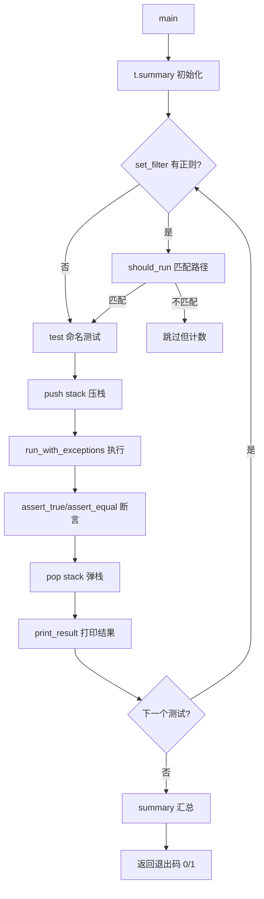
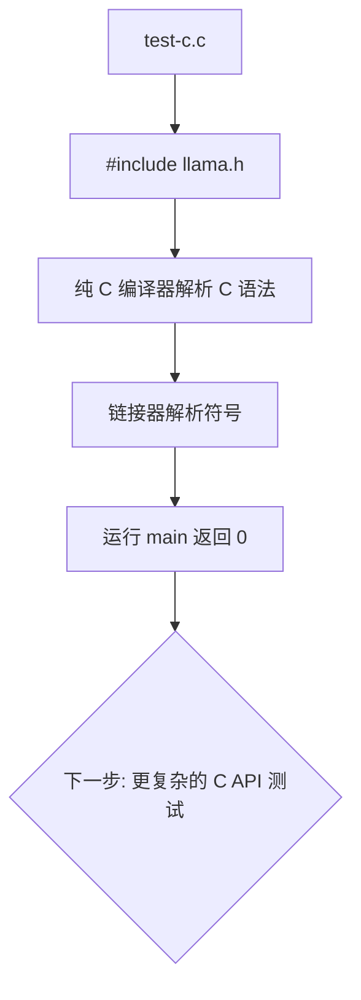

# 第101章 测试框架与基础工具 —— 测试程序的"脚手架与度量衡"

## 学习目标

- 理解轻量级 C++ 测试框架 testing 类的设计与实现原理
- 掌握测试用例的注册、执行、断言统计与结果输出机制
- 理解测试过滤器的正则匹配原理与层级命名策略
- 掌握基准测试（benchmark）的计时与速率计算方法
- 学会使用 get_model_or_exit() 统一获取测试模型路径
- 理解 GGUF 远程模型元数据获取的完整流程
- 掌握渐进式下载与缓存策略在测试场景中的应用
- 理解 gguf_buf_reader 类的二进制读取原语设计
- 掌握 gguf_remote_tensor 与 gguf_remote_model 结构体的数据组织方式
- 了解 PEG 解析器测试的组织方式与公共工具函数
- 理解最简 C 入口测试的作用与意义

## 101.1 生活类比

想象 llama.cpp 的测试基础设施是一个**质量控制实验室**。testing 框架是实验室的**标准操作规程（SOP）手册**——每个测试用例是一个「实验项目」，有编号、有记录；断言是「检测仪器」，用来验证样品是否合格；过滤器是「项目选择器」，让研究员只跑特定类别的实验；基准测试是「性能测量台」，记录每次操作的耗时与吞吐。get_model_or_exit() 是实验室的**样品领取处**——优先从「申请单」（命令行参数）获取样品，没有申请单就查查「默认样品柜」（环境变量），都没有就礼貌告知「无法实验」，但不记为实验失败。GGUF 元数据获取是实验室的**样品预检台**——不需要整箱开箱（完整下载），只看箱外标签（元数据），渐进式下载就像「先扫一眼，不够再仔细看」，缓存机制是「看过的样品拍照存档，下次直接看照片」。gguf_buf_reader 是预检台的**二进制读卡器**——read_val 是「读数值」，read_str 是「读标签」，skip 是「跳过无关项」，has_n_bytes 是「检查读卡器里还有多少数据」。gguf_remote_tensor 与 gguf_remote_model 是样品的**身份卡片**——记录张量名称、维度等「物理特征」，记录模型架构、层数等「身份信息」。PEG 测试工具是语法分析仪的**校准器具**——simple_tokenize 是「标准试样切割机」，把复杂输入切成标准小块，各测试函数是「不同精度的测量项目」。test-c.c 是实验室的**开机自检**——最简单的「电源灯亮了吗？」测试，确保基础设施可用。

## 101.2 源码地图

```
tests/
├── testing.h                              # 轻量级测试框架（约220行）
│   └── struct testing
│       ├── testing()                      # 构造函数，初始化输出流
│       ├── indent()                       # 生成层级缩进字符串
│       ├── full_name()                    # 生成完整测试路径名
│       ├── log()                          # verbose 模式日志输出
│       ├── set_filter()                   # 设置正则过滤器
│       ├── should_run()                   # 判断当前测试是否应运行
│       ├── run_with_exceptions()          # 带异常捕获的函数执行器
│       ├── print_result()                 # 格式化打印测试/基准结果
│       ├── test(name, f)                  # 执行命名测试用例
│       ├── test(f)                        # 执行匿名测试用例
│       ├── bench(name, f, iterations)     # 执行命名基准测试
│       ├── bench(f, iterations)           # 执行匿名基准测试
│       ├── assert_true(cond)              # 断言条件为真（无消息）
│       ├── assert_true(msg, cond)         # 断言条件为真（带消息）
│       ├── assert_equal(expected, actual) # 断言两值相等（无消息）
│       ├── assert_equal(msg, exp, act)    # 断言两值相等（带消息）
│       └── summary()                      # 打印统计摘要并返回退出码

├── get-model.cpp / get-model.h            # 模型路径获取辅助（19+2行）
│   └── get_model_or_exit()                # 从命令行或环境变量获取模型路径

├── gguf-model-data.cpp / .h               # GGUF 远程元数据获取（754+42行）
│   ├── struct gguf_remote_tensor          # 远程张量描述结构
│   │   └── __init__                       # 初始化张量属性（类型/维度）
│   ├── struct gguf_remote_model           # 远程模型元数据结构
│   │   ├── __init__                       # 初始化模型属性（架构/维度/张量列表）
│   │   ├── architecture                   # 模型架构名
│   │   ├── n_embd / n_ff / n_vocab        # 嵌入/FFN/词表维度
│   │   ├── n_layer / n_head / n_head_kv   # 层数/注意力头数
│   │   ├── n_expert                       # MoE 专家数
│   │   ├── n_split / n_split_tensors      # 分片信息
│   │   └── tensors                        # 张量列表
│   ├── class gguf_buf_reader              # GGUF 二进制缓冲区读取器
│   │   ├── gguf_buf_reader()              # 构造函数
│   │   ├── has_n_bytes()                  # 检查剩余字节数
│   │   ├── read_val<T>()                  # 模板化值读取
│   │   ├── read_str()                     # 字符串读取
│   │   └── skip()                         # 跳过指定字节数
│   ├── gguf_val_type_size()               # 获取 GGUF 值类型字节大小
│   ├── gguf_skip_value()                  # 跳过不需要的 KV 值
│   ├── gguf_read_uint32_val()             # 读取 uint32 值（支持数组首元素）
│   ├── gguf_parse_meta()                  # 核心元数据解析函数
│   ├── get_default_cache_dir()            # 获取默认缓存目录
│   ├── sanitize_for_path()                # URL 字符转义为合法文件名
│   ├── read_file() / write_file()         # 文件读写辅助
│   ├── gguf_http_get()                    # HTTP GET 请求封装
│   ├── detect_gguf_filename()             # HF API 探测匹配文件名
│   ├── fetch_and_parse()                  # 渐进式下载并解析
│   ├── get_cache_file_path()              # 生成缓存文件路径
│   ├── fetch_or_cached()                  # 缓存优先的获取策略
│   ├── gguf_fetch_model_meta()            # 对外接口：获取模型元数据（.h声明/.cpp实现）
│   └── gguf_fetch_gguf_ctx()              # 对外接口：获取 GGUF 上下文（.h声明/.cpp实现）

├── peg-parser/                            # PEG 解析器测试目录
│   ├── tests.h                            # 测试函数声明头文件
│   │   ├── test_basic()                   # 基础 PEG 解析测试
│   │   ├── test_json_parser()             # JSON 解析测试
│   │   ├── test_gbnf_generation()         # GBNF 生成测试
│   │   ├── test_unicode()                 # Unicode 处理测试
│   │   ├── test_json_serialization()      # JSON 序列化测试
│   │   └── test_python_dict_parser()      # Python 字典解析测试
│   ├── simple-tokenize.h                  # 分词函数声明
│   └── simple-tokenize.cpp                # 简单分词器实现
│       └── simple_tokenize()              # 按空白与标点切分字符串

└── test-c.c                               # 最简 C 入口测试
    └── main()                             # 空 main，验证 llama.h 可链接
```

## 101.3 轻量级 `testing` 框架 —— 测试程序的"SOP 手册"

在第 100 章的源码地图里我们已经看到 testing.h 的身影——它是几乎所有 test-*.cpp 的公共依赖。这一节我们深入它的实现，理解约 220 行代码如何支撑起断言、过滤、基准、统计的完整测试框架。

**为什么需要自研 testing 框架，而不是直接用 Google Test？** llama.cpp 坚持"零外部依赖"哲学，测试基础设施也不例外。Google Test 提供的 80% 功能（断言、过滤、汇总）用不到 300 行就能实现，而引入它会带来编译时间开销与跨平台构建复杂性——对于一个"一行 make 就能编译"的项目，这个取舍是清晰的。

### 101.3.1 `testing` 结构体：上下文、命名与过滤

先看图纸——testing 结构体维护三个核心状态：输出流（打印）、缩进栈（层级命名）与正则过滤器。

源码路径：`tests/testing.h` - `struct testing`（1-70行）

```
// 轻量级测试框架：单一结构体承载全部功能
struct testing {
    // ① 状态字段
    std::ostream & err;             // 错误/结果输出流
    std::vector<std::string> stack; // 测试路径栈（维护层级命名）
    std::string filter;             // 正则过滤器（空 = 运行全部）
    std::vector<std::string> failures; // 失败信息列表（延迟到 summary 输出）
    std::vector<std::string> failures_suppressed; // 被过滤隐藏的失败
    size_t n_tests = 0;             // 测试用例总数
    size_t n_assertions = 0;        // 断言总数
    size_t n_failures = 0;          // 失败断言数
    size_t n_checked_tests = 0;     // 实际运行并检查的测试数
    size_t n_benchmarks = 0;        // 基准测试个数
    bool verbose = false;           // 详细模式开关（打印每个断言）
    bool throw_exception = false;   // 断言失败时抛异常（供期望失败的测试使用）
    static const std::string ANSI_COLOR_GREEN, ANSI_COLOR_RED,
                             ANSI_COLOR_BLUE, ANSI_COLOR_RESET; // 彩色输出

    // ② 构造函数：连接到标准输出
    testing(std::ostream & err = std::cerr) : err(err) {}

    // ③ 层级缩进：栈深度决定缩进长度
    std::string indent() {
        return std::string(2 * stack.size(), ' ');
    }

    // ④ 完整测试路径：用 "/" 拼接测试栈中的各级名称
    std::string full_name() {
        std::string name;
        for (size_t i = 0; i < stack.size(); i++) {
            if (i > 0) name += "/";
            name += stack[i];
        }
        return name;
    }

    // ⑤ verbose 模式日志：只有开启详细模式才输出
    void log(const std::string & msg) {
        if (verbose) err << indent() << "[log] " << msg << "\n";
    }
};
```

这段代码定义了 testing 结构体的状态骨架。**核心设计是"测试路径栈"**：每个 `t.test("name", fn)` 调用都会把 "name" 压入 stack，嵌套测试（test 里再调 test）自然形成层级路径，如 `test-gguf/basic/all_keys`——这个路径既用于缩进对齐输出，也用于生成 full_name 供过滤器精确匹配。**为什么断言失败信息要延迟到 summary 输出？** 如果断言失败立即打印，失败多时会刷屏淹没有用信息；收集到 failures 向量里，summary 时统一展示，既防止中断测试流，也让失败清单更清晰。

### 101.3.2 `set_filter()` 与 `should_run()`：正则过滤器

源码路径：`tests/testing.h` - `set_filter() / should_run()`（70-100行）

```
// 设置正则过滤器：只有名称匹配过滤器的测试才运行
void set_filter(const char * filter) {
    this->filter = filter ? filter : "";
}

// 判断当前测试是否应运行：matches() 基于正则做部分匹配
bool should_run(const std::string & name, bool nested = false) {
    // ① 无过滤器：全部运行
    if (filter.empty()) return true;
    // ② 构造完整路径名（含父级，nested 标志控制是否包含当前层级）
    std::string full = full_name();
    if (nested) full += "/" + name;
    else        full = name;
    // ③ 用 <regex> 做部分匹配：perm 参数让正则只匹配子串即可
    std::regex re(filter, std::regex_constants::extended);
    return std::regex_search(full, re);
}
```

这段代码实现了过滤机制。**为什么用 regex_search（部分匹配）而非 regex_match（全匹配）？** 部分匹配让用户只需写 `"gguf"` 就能匹配 `test-gguf/basic`、`test-gguf/roundtrip` 等所有含 "gguf" 的测试——过滤器的体验是"按关键词筛子集"，全匹配则要求用户写出完整正则，繁琐易错。**nested 参数的意义：** 父测试自身是否被过滤与它内部嵌套的子测试是否被过滤是两回事——`should_run(name, nested=true)` 允许"父测试必须跑，但内部子测试按需过滤"。

### 101.3.3 `run_with_exceptions()`：异常安全的执行器

源码路径：`tests/testing.h` - `run_with_exceptions()`（100-130行）

```
// 带异常捕获的函数执行器：防止单个测试崩溃影响全局
template <typename Fn>
void run_with_exceptions(Fn && fn) {
    try {
        // ① 正常执行测试函数
        fn();
    } catch (const std::exception & e) {
        // ② 捕获标准异常：记录错误信息
        err << indent() << "FAILURE (std::exception): " << e.what() << "\n";
        n_failures++;
        n_assertions++;
        failures.push_back(full_name() + " (std::exception: " + e.what() + ")");
    } catch (...) {
        // ③ 捕获未知异常（如 Windows SEH / 未导出类型的异常）
        err << indent() << "FAILURE (exception of unknown type)\n";
        n_failures++;
        n_assertions++;
        failures.push_back(full_name() + " (exception of unknown type)");
    }
}
```

这段代码是 testing 框架的"安全网"。**关键设计：两类异常分开处理**——`std::exception` 有 `what()` 可以输出诊断信息，未知异常（如访问违规、断言宏抛出的非标准异常）只能识别"发生了异常"但无法提取细节。**为什么必须捕获未知异常？** 测试代码里一个未捕获的异常会让整个进程异常终止，后续所有测试都无法运行；捕获后测试可以继续，框架也能统计到底有多少测试因异常崩溃。

### 101.3.4 `test()` 与 `bench()`：测试与基准的统一执行

源码路径：`tests/testing.h` - `test() / bench() / print_result()`（130-180行）

```
// 执行命名测试用例：记录运行结果与断言统计
void test(const std::string & name, std::function<void()> fn) {
    // ① 过滤器检查：不匹配则跳过（但仍计入总测试数，便于汇总）
    n_tests++;
    if (!should_run(name)) return;
    // ② 压栈测试名，进入层级上下文
    stack.push_back(name);
    // ③ 记录测试前的失败/断言数（用于计算本测试的净增量）
    size_t before_failures   = n_failures;
    size_t before_assertions = n_assertions;
    size_t before_checked    = n_checked_tests;
    // ④ 执行测试体（异常安全）
    run_with_exceptions(fn);
    // ⑤ 弹栈，恢复父级上下文
    stack.pop_back();
    // ⑥ 打印测试结果：通过/失败 + 该测试内的断言数
    print_result(name, n_failures - before_failures,
                        n_assertions - before_assertions);
}

// 执行基准测试：多轮迭代计时
void bench(const std::string & name, std::function<void()> fn, int iterations = 1000) {
    n_benchmarks++;
    // ① 使用高精度时钟
    auto t_start = std::chrono::high_resolution_clock::now();
    // ② 循环执行 iterations 次
    for (int i = 0; i < iterations; i++) fn();
    auto t_end   = std::chrono::high_resolution_clock::now();
    // ③ 累计总时长并计算平均耗时
    auto duration = std::chrono::duration_cast<std::chrono::duration<double>>(t_end - t_start);
    // ④ 速率计算：每秒执行次数
    double rate = iterations / duration.count();
    // ⑤ 格式化为 ms/iter 或 ns/iter 并打印
    err << indent() << "[bench] " << name << "  "
        << format_time(duration.count() / iterations)
        << "  (" << rate << " ops/s)\n";
}

// 打印测试/基准结果：绿色 PASS / 红色 FAIL
void print_result(const std::string & name, size_t failures, size_t assertions) {
    // 本测试失败数 > 0 → FAIL，否则 PASS
    bool pass = failures == 0;
    if (pass) {
        err << indent() << "[" << ANSI_COLOR_GREEN << "PASS" << ANSI_COLOR_RESET << "] "
            << name << "  (" << assertions << " assertions)\n";
    } else {
        err << indent() << "[" << ANSI_COLOR_RED << "FAIL" << ANSI_COLOR_RESET << "] "
            << name << "  (" << failures << " failures)\n";
    }
}
```

这段代码是 test/bench 的执行核心。**test() 的三个关键细节：**

- **`before_failures` 快照（第 ③ 步）**：测试是嵌套的，内层测试的断言也计入 n_failures。捕获"进入本测试前"的数量，弹栈后做差，就能得到"本次测试单独贡献的失败数"——这是层次化统计的基础。
- **跳过也计 `n_tests++`**：被过滤器跳过的测试仍算"总测试数"，让 summary 能报告"总共 50 个测试，跑了 20 个"——用户能立刻看到过滤器拦下多少。
- **bench 用 `high_resolution_clock` 而非 `steady_clock`**：在这个场景两者精度相当，但 high_resolution_clock 在一些平台上分辨率更高；`duration` 累加（而非只记最后一次）配合 iterations 求平均，能平滑掉单次调度的抖动。

### 101.3.5 断言与汇总：`assert_true()` / `assert_equal()` / `summary()`

源码路径：`tests/testing.h` - 断言与汇总（180-220行）

```
// 通用断言失败处理：记录失败、计数、可抛出异常
void assert_failure(const std::string & msg) {
    n_failures++;              // 失败计数
    n_assertions++;            // 断言计数
    failures.push_back(msg);   // 暂存失败信息（summary 时统一输出）
    // 可选：抛出异常（期望失败的测试用它")
    if (throw_exception) throw std::runtime_error(msg);
}

// 断言条件为真
void assert_true(bool condition) {
    n_assertions++;
    if (!condition) assert_failure("assert_true failed");
}
void assert_true(const std::string & msg, bool condition) {
    n_assertions++;
    if (!condition) assert_failure(msg);
}

// 断言两值相等（模板化：支持任意可比较类型）
template <typename T, typename U>
void assert_equal(const T & expected, const U & actual) {
    n_assertions++;
    if (expected != actual) {
        assert_failure("expected " + to_string(expected) + " but got " + to_string(actual));
    }
}
template <typename T, typename U>
void assert_equal(const std::string & msg, const T & expected, const U & actual) {
    n_assertions++;
    if (!(expected == actual)) {
        assert_failure(msg + " (expected " + to_string(expected) +
                       " but got " + to_string(actual) + ")");
    }
}

// 汇总：打印统计摘要并返回进程退出码
int summary() {
    // ① 计算通过/失败/异常统计
    size_t n_passed = n_tests - n_failures;
    // ② 打印汇总
    err << ANSI_COLOR_BLUE << "==== Summary ====" << ANSI_COLOR_RESET << "\n";
    err << n_passed << " passed, " << n_failures << " failed\n";
    err << n_tests << " tests, " << n_assertions << " assertions\n";
    // ③ 打印积压的失败清单
    for (const auto & f : failures) err << "  FAIL: " << f << "\n";
    // ④ 退出码：0 = 全部通过（含"无测试但也没有失败"），1 = 有失败
    return n_failures == 0 ? 0 : 1;
}
```

这段代码完成了 testing 框架的收尾。**assert_equal 用模板实现**，让期望值与实际值可以是任意可比较类型（int、float、std::string……）——不过要注意浮点相等断言必须显式处理精度（这是设计留给测试作者的责任）。**summary() 的退出码语义**是 CI 集成的地基：`test-gguf` 进程的返回值直接就是 Shell 的 `$?`，一行 `if test-gguf; then ...` 就能把测试纳入 CI。**`throw_exception` 的妙用**：期望失败的测试（测试框架自身）会开这个开关，让断言失败以异常形式抛出，从而验证"run_with_exceptions 确实能捕获异常"——这是对测试框架的自我测试。



## 101.4 测试用例入口辅助 —— 让模型路径"随手可得"

许多测试（如 tokenizer、模型加载）需要一个真实的 GGUF 模型文件才能运行。get-model.cpp 提供一个统一的路径获取函数，解决"每个测试都要写一段参数解析"的重复劳动。

### 101.4.1 `get_model_or_exit()`：从命令行或环境变量获取模型

源码路径：`tests/get-model.cpp` - `get_model_or_exit()`（1-19行）

```
// 从命令行参数或环境变量获取测试模型路径
// 优先级：命令行参数 > LLAMACPP_TEST_MODELFILE 环境变量 > 退出
const char * get_model_or_exit(int argc, char ** argv) {
    // ① 优先使用命令行参数（如 ../models/llama-2-7b.gguf）
    if (argc > 1) {
        return argv[1];
    }
    // ② 无命令行参数时，回退到环境变量
    //    LLAMACPP_TEST_MODELFILE 让 CI 只需设置一次，所有测试共享
    const char * env = getenv("LLAMACPP_TEST_MODELFILE");
    if (env != nullptr) {
        return env;
    }
    // ③ 两者都缺失：输出警告并以"成功"退出，而不是强制失败
    fprintf(stderr, "error: no model file provided\n");
    fprintf(stderr, "use: %s <model-file>\n", argv[0]);
    fprintf(stderr, "or  set: LLAMACPP_TEST_MODELFILE=<model-file>\n");
    exit(EXIT_SUCCESS);   // 注意：成功退出，避免 CI 误判为测试失败
    return nullptr;
}
```

这段代码是测试的"样品领取处"。**三个设计细节值得注意：**

- **优先级明确**：命令行参数 > 环境变量，让本地调试（命令行传参）与 CI 批跑（环境变量）两条路径都顺畅。
- **`exit(EXIT_SUCCESS)` 是故意的**：没有模型时测试根本没跑，如果返回失败码，CI 会把这个"配置缺失"误报为"测试失败"——用成功退出标记"测试被跳过"，语义更准确。
- **环境变量命名 `LLAMACPP_TEST_MODELFILE`**：前缀 `LLAMACPP_` 避免与其他项目的变量冲突，`TEST_MODELFILE` 明确"专供测试的模型文件"。

配置文件 get-model.h 只有两行：

源码路径：`tests/get-model.h` - `get_model_or_exit()` 声明（1-2行）

```
// 头文件声明：只暴露接口签名，实现集中在 get-model.cpp
const char * get_model_or_exit(int argc, char ** argv);
```

这段声明与实现分离的设计让所有测试文件只需 `#include "get-model.h"` 即可引用，而路径获取逻辑只维护一份实现。

## 101.5 GGUF 远程元数据结构与读取器 —— 模型信息的"二进制解码器"

gguf-model-data.cpp/h 是测试基础设施里的"重武器"（约 800 行）：它允许测试程序**不需要下载完整的模型文件**，就能从远程 HuggingFace 仓库获取 GGUF 文件的元数据（架构、维度、张量名）——这对于"测试量化类型选择是否符合模型实际结构"这类场景至关重要。本节先看数据结构与二进制读取器，下一节再看完整的获取流程。

### 101.5.1 `gguf_remote_tensor` 与 `gguf_remote_model`：样品的"身份卡片"

先看图纸——两个结构体描述"远程模型的元数据视图"。

源码路径：`tests/gguf-model-data.h` - `gguf_remote_tensor / gguf_remote_model`（1-26行）

```
// 远程张量描述结构：单个张量的"物理特征"
struct gguf_remote_tensor {
    std::string name;          // 张量名（如 token_embd.weight）
    ggml_type type;            // 数据类型（F16 / Q8_0 / F32 ...）
    int64_t ne[4];             // 四维形状 [n_embd, n_head, 1, 1]
    int32_t n_dims;            // 有效维度数（1-4）

    // 构造函数：初始化默认值
    gguf_remote_tensor() {
        type   = GGML_TYPE_F32;  // 默认 FP32（最安全假设）
        n_dims = 0;
        // 维度数组默认全 1：便于按固定数组访问
        ne[0] = ne[1] = ne[2] = ne[3] = 1;
    }
};

// 远程模型元数据结构：完整模型的"身份信息"
struct gguf_remote_model {
    std::string architecture;  // 模型架构名（llama / qwen2 / gemma ...）
    int32_t n_embd  = 0;       // 嵌入维度
    int32_t n_ff    = 0;       // 前馈网络维度
    int32_t n_vocab = 0;       // 词表大小（从 token_embd.weight 推断）
    int32_t n_layer = 0;       // 层数
    int32_t n_head  = 0;       // 注意力头数
    int32_t n_head_kv = 0;     // KV 头数（GQA 用，默认 = n_head）
    int32_t n_expert = 0;      // MoE 专家数
    int32_t n_split = 0;       // 分片数量
    int32_t n_split_tensors = 0; // 分片中的张量总数（用于合并校验）
    std::vector<gguf_remote_tensor> tensors;  // 全部张量列表

    gguf_remote_model() {
        // 构造函数：默认单分片
        n_split = 1;
    }
};
```

这段代码是远程元数据的"身份卡片"。**`gguf_remote_model` 的字段命名直接对应 GGUF KV 键**（`llama.embedding_length` → n_embd、`llama.block_count` → n_layer），让解析器可以按名精确提取。**`n_vocab` 标注"从 token_embd.weight 推断"**是个有趣细节——GGUF 元数据里词表大小不总是一个可靠字段，而 `token_embd.weight` 张量的第二维恰好等于词表大小，从张量形状推断比信任 KV 更稳。**`ne[4]` 数组默认全 1**：这样固定数组访问永远安全，即使某个张量只有 2 维，`ne[2]`/`ne[3]` 也是合法的 1，不需要做边界判断。

### 101.5.2 `gguf_buf_reader`：类型安全的二进制读取器

源码路径：`tests/gguf-model-data.cpp` - `gguf_buf_reader`（28-65行）

```
// GGUF 二进制缓冲区读取器：封装对字节向量的顺序安全读取
class gguf_buf_reader {
public:
    // 构造函数：把字节向量包装成可顺序读取的流
    gguf_buf_reader(const std::vector<uint8_t> & data)
        : data(data), pos(0) {}

    // 边界检查：剩余字节数是否足够读取 n 字节
    bool has_n_bytes(uint64_t n) const {
        // pos + n 不能超出缓冲区总大小
        return n <= data.size() - pos;   // data.size() >= pos 由不变量保证
    }

    // 模板化值读取：类型安全的任意标量读取
    template <typename T>
    bool read_val(T & out) {
        // ① 前置边界检查：剩余空间必须足以容纳 T
        if (!has_n_bytes(sizeof(T))) {
            return false;               // 空间不足 → 失败返回
        }
        // ② memcpy 拷贝：从当前 pos 拷贝 sizeof(T) 字节
        memcpy(&out, data.data() + pos, sizeof(T));
        // ③ 位置推进
        pos += sizeof(T);
        return true;
    }

    // 字符串读取：先读 uint64 长度，再读对应字节
    bool read_str(std::string & out) {
        // ① 先读长度字段（GGUF 字符串格式：uint64 长度 + 原始字节）
        uint64_t len = 0;
        if (!read_val<uint64_t>(len)) return false;
        // ② 边界检查：长度必须不超过剩余字节
        if (!has_n_bytes(len)) return false;
        // ③ 拷贝字符串内容
        out.assign((const char *) data.data() + pos, len);
        pos += len;
        return true;
    }

    // 跳过指定字节数：忽略不需要的字段
    bool skip(uint64_t n) {
        if (!has_n_bytes(n)) return false;
        pos += n;
        return true;
    }

    size_t tell() const { return pos; }  // 当前读取位置

private:
    const std::vector<uint8_t> & data;  // 数据缓冲引用（不拷贝）
    size_t pos;                         // 当前读取位置
};
```

这段代码是远程元数据解析的"安全读卡器"。**四个设计要点：**

- **每个读取方法都前置 `has_n_bytes()` 校验**（第 50-58 行）：这是防越界的基石——任何一次越界读都可能让解析器读到垃圾数据或崩溃（GB/ 段错误），统一前置校验让"空间不足"成为可预测的布尔失败而非未定义行为。
- **`read_str` 先读长度再读内容**：GGUF 字符串的二进制布局就是"uint64 长度 + 字节流"，如果错误地按固定长度读取（如总是读 64 字节），读到的会是"长度字段的一部分 + 下一字段的开头"，完全错位——先读长度是格式契约的一部分，不是实现细节。
- **`skip` 的存在**：元数据解析时大量字段我们根本不关心（如归一化 epsilon、RoPE 参数），逐个解析浪费代码，`skip` 按类型大小跳过即可。
- **返回 bool 而非抛异常**：字节流解析发生在网络响应的边缘，错误常态（截断、损坏）而非异常，bool 返回值让调用方用 `if (!reader.read_val(x)) handle_error();` 的简单方式处理，比 try/catch 更贴合"流式解析"的语义。

### 101.5.3 GGUF 值类型辅助函数族

源码路径：`tests/gguf-model-data.cpp` - `gguf_val_type_size() / gguf_skip_value() / gguf_read_uint32_val()`（68-215行）

```
// 获取 GGUF 值类型的字节大小（用于跳过的步长计算）
uint64_t gguf_val_type_size(int type) {
    switch (type) {
        case GGUF_TYPE_UINT8:   return 1;
        case GGUF_TYPE_INT8:    return 1;
        case GGUF_TYPE_UINT16:  return 2;
        case GGUF_TYPE_INT16:   return 2;
        case GGUF_TYPE_UINT32:  return 4;
        case GGUF_TYPE_INT32:   return 4;
        case GGUF_TYPE_FLOAT32: return 4;
        case GGUF_TYPE_BOOL:    return 1;
        case GGUF_TYPE_STRING:   // 字符串大小不固定 → 返回 0 表示需特殊处理
        case GGUF_TYPE_ARRAY:
            return 0;
        case GGUF_TYPE_UINT64:  return 8;
        case GGUF_TYPE_INT64:   return 8;
        case GGUF_TYPE_FLOAT64: return 8;
        default:
            return 0;
    }
}

// 跳过任意类型的 KV 值（支持嵌套数组递归）
bool gguf_skip_value(gguf_buf_reader & reader, int type) {
    switch (type) {
        case GGUF_TYPE_STRING: {
            // 字符串：跳过长度字段 + 内容
            uint64_t len = 0;
            return reader.read_val<uint64_t>(len) && reader.skip(len);
        }
        case GGUF_TYPE_ARRAY: {
            // 数组：先读元素类型与长度，再逐个跳过元素
            int elem_type = 0;
            if (!reader.read_val<int32_t>(elem_type)) return false;
            if (!reader.read_val<uint64_t>(len)) return false;
            for (uint64_t i = 0; i < len; i++) {
                if (!gguf_skip_value(reader, elem_type)) return false; // 递归
            }
            return true;
        }
        default: {
            // 标量类型：按大小跳过
            uint64_t size = gguf_val_type_size(type);
            return size > 0 && reader.skip(size);
        }
    }
}

// 读取 uint32 值：标量直接读取，数组取首元素（用于分片计数等字段）
bool gguf_read_uint32_val(gguf_buf_reader & reader, int type, uint32_t & out) {
    if (type == GGUF_TYPE_UINT32) {
        return reader.read_val<uint32_t>(out);     // 标量
    }
    if (type == GGUF_TYPE_ARRAY) {
        // 数组：读元素类型与长度（要求元素是 uint32）
        int elem_type; reader.read_val<int32_t>(elem_type);
        uint64_t len;  reader.read_val<uint64_t>(len);
        if (elem_type == GGUF_TYPE_UINT32 && len >= 1) {
            return reader.read_val<uint32_t>(out);  // 只取首元素
        }
    }
    return false;
}
```

这段代码是"跳过无关字段"的完整工具箱。**核心难点是 ARRAY 的递归**：GGUF 的数组可以嵌套（如兴趣矩阵是 array 的元素又是 array），跳过时必须沿类型递归到叶子。**`gguf_read_uint32_val` 的"数组取首元素"**解决了一个实际痛点：GGUF 里有些字段（如 `general.alignment`）在规范里是标量，但某些转换工具写成单元素数组——读取器兼容两种写法，提高了面对真实文件时的鲁棒性。

## 101.6 GGUF 元数据解析核心 —— 从二进制到结构化信息的"翻译机"

`gguf_parse_meta()` 是整个模块的"翻译中枢"：它读取二进制字节流，产出 `gguf_remote_model` 结构体。理解它你就理解了 GGUF 文件的布局骨架。

### 101.6.1 `gguf_parse_meta()`：文件头、KV 与张量的三段式解析

源码路径：`tests/gguf-model-data.cpp` - `gguf_parse_meta()`（218-348行）

```
// 核心元数据解析：从二进制字节流提取结构化模型信息
bool gguf_parse_meta(const std::vector<uint8_t> & data, gguf_remote_model & model) {
    gguf_buf_reader reader(data);

    // ---------- ① 解析文件头（GGUF magic + 版本 + 数量） ----------
    char magic[4] = {0};
    reader.read_val<uint32_t>(*reinterpret_cast<uint32_t *>(magic));
    if (memcmp(magic, "GGUF", 4) != 0) {
        return false;   // 魔数错误：不是合法 GGUF
    }
    uint32_t version = 0;
    reader.read_val<uint32_t>(version);
    if (version < 2 || version > 3) {
        return false;   // 版本号必须在 2-3 之间
    }
    uint64_t n_tensors = 0, n_kv = 0;
    reader.read_val<uint64_t>(n_tensors);   // 张量数量
    reader.read_val<uint64_t>(n_kv);        // KV 对数量

    // ---------- ② 解析 KV 元数据 ----------
    std::string arch_prefix;               // 架构前缀（如 "llama."）
    for (uint64_t i = 0; i < n_kv; i++) {
        // 每个 KV = 键字符串 + 类型 + 值
        std::string key;
        if (!reader.read_str(key)) return false;    // 读键名
        int type = 0;
        if (!reader.read_val<int32_t>(type)) return false;  // 读类型
        // 按 key 分发处理（用 arch_prefix 拼接字段名）
        if (key == "general.architecture") {
            if (!reader.read_str(model.architecture)) return false;
            // 构造架构前缀：架构名 + "."
            arch_prefix = model.architecture + ".";
        } else if (key == arch_prefix + "embedding_length") {
            uint32_t v; if (gguf_read_uint32_val(reader, type, v)) model.n_embd = v;
            else return false;
        } else if (key == arch_prefix + "feed_forward_length") {
            uint32_t v; if (gguf_read_uint32_val(reader, type, v)) model.n_ff = v;
            else return false;
        } else if (key == arch_prefix + "block_count") {
            uint32_t v; if (gguf_read_uint32_val(reader, type, v)) model.n_layer = v;
            else return false;
        } else if (key == "split.count") {
            uint32_t v; if (gguf_read_uint32_val(reader, type, v)) model.n_split = v;
            else return false;
        } else if (key == "split.tensors.count") {
            uint32_t v; if (gguf_read_uint32_val(reader, type, v)) model.n_split_tensors = v;
            else return false;
        } else {
            // 未知 KV：跳过值（可能是数组、字符串、标量）
            if (!gguf_skip_value(reader, type)) return false;
        }
    }

    // ---------- ③ 解析张量信息列表 ----------
    for (uint64_t i = 0; i < n_tensors; i++) {
        gguf_remote_tensor tensor;
        if (!reader.read_str(tensor.name)) return false;   // 张量名
        if (!reader.read_val<int32_t>(tensor.n_dims)) return false; // 维度数
        // GGUF 规范：维度数必须 >= 1 且 <= 4
        if (tensor.n_dims < 1 || tensor.n_dims > 4) return false;
        // 逐维读取形状
        for (int d = 0; d < tensor.n_dims; d++) {
            if (!reader.read_val<int64_t>(tensor.ne[d])) return false;
        }
        if (!reader.read_val<int32_t>(*reinterpret_cast<int32_t *>(&tensor.type))) return false;
        uint64_t offset = 0;
        if (!reader.read_val<uint64_t>(offset)) return false;   // 数据偏移（忽略）
        // 特殊处理：从 token_embd.weight 推断词表大小
        if (tensor.name == "token_embd.weight") {
            // 该张量的第二维（ne[1]）= 词表大小
            model.n_vocab = (int32_t) tensor.ne[1];
        }
        model.tensors.push_back(tensor);
    }
    return true;
}
```

这段代码完整实现了 GGUF 元数据的三段式解析。**四个关键设计：**

- **`arch_prefix` 的巧妙构造**（第 40-44 行）：GGUF 的 KV 键是"架构名."前缀的（如 `llama.embedding_length`），而架构名来自 `general.architecture`。解析器先读架构名，构造出 `llama.` 前缀，再用它去匹配后续所有字段——这样同一个解析器函数天然适配所有架构，无需为每架构复制一份按键逻辑。
- **未知 KV 键用 `gguf_skip_value` 跳过而非报错**：这是 GGUF 生态的关键兼容策略。新版本模型可能引入新 KV 键（如 `llama.attention.key_length`），老版本解析器必须能"跨过未知字段继续读"，否则任何新键都会让解析崩溃。
- **`n_dims > 4` 直接拒绝**：GGUF 规范张量最多 4 维，超出说明文件损坏或有恶意构造——早期失败（fail-fast）正是防御性编程的核心。
- **`n_vocab` 从张量推断**（第 73-77 行）：再次印证了"从 token_embd.weight 的形状推断词表大小比信任 KV 更稳"的设计智慧。

## 101.7 GGUF 远程获取与缓存机制 —— 模型元数据的"快递员与档案馆"

获得远程元数据意味着要发 HTTP 请求。本节实现"快递员"（HTTP 获取与渐进式下载）与"档案馆"（本地缓存）两大机制，最终提供两个对外接口：`gguf_fetch_model_meta()` 与 `gguf_fetch_gguf_ctx()`。

### 101.7.1 缓存目录与路径处理

源码路径：`tests/gguf-model-data.cpp` - `get_default_cache_dir() / sanitize_for_path() / get_cache_file_path()`（352-422行）

```
// 获取默认缓存目录（遵守 XDG 规范）
std::string get_default_cache_dir() {
    // ① 优先使用环境变量 $XDG_CACHE_HOME/llama.cpp
    const char * xdg = getenv("XDG_CACHE_HOME");
    if (xdg && strlen(xdg) > 0) {
        return std::string(xdg) + "/llama.cpp";
    }
    // ② 回退到 $HOME/.cache/llama.cpp（Linux/macOS 惯例）
    const char * home = getenv("HOME");
    if (home && strlen(home) > 0) {
        return std::string(home) + "/.cache/llama.cpp";
    }
    // ③ 最后回退到当前目录（Windows 等无 HOME 环境）
    return ".";
}

// URL 字符转义：把 URL 中的特殊字符变成合法文件名字符
std::string sanitize_for_path(const std::string & url) {
    std::string result;
    for (char c : url) {
        // URL 中的 /、?、=、: 等在 Windows 上不能作为文件名
        if (c == '/' || c == '\\' || c == '?' || c == '=' ||
            c == ':' || c == '*' || c == '"' || c == '<' || c == '>') {
            result += '_';       // 统一替换为下划线
        } else {
            result += c;
        }
    }
    return result;
}

// 拼接完整缓存文件路径：缓存目录 + 转义后的 URL
std::string get_cache_file_path(const std::string & cache_dir, const std::string & url) {
    return cache_dir + "/" + sanitize_for_path(url);
}
```

这段代码解决了"把网络资源映射到本地文件"的路径问题。**XDG 规范优先**让缓存位置与系统约定一致（用户可配置 `$XDG_CACHE_HOME`），Windows 上的 `HOME` 回退则保证跨平台可用。**`sanitize_for_path` 至关重要**：模型 URL 形如 `https://huggingface.co/Qwen/Qwen2-7B/resolve/main/model-00001-of-00002.gguf`，其中 `/` 和 `.` 若直接用作文件名会在 Windows 上制造非法路径。**注意 `.` 不在转义名单里**——因为它恰好是 URL 与文件名都合法的字符，保留了 gguf 扩展名语义。

### 101.7.2 HTTP GET 封装与文件名探测

源码路径：`tests/gguf-model-data.cpp` - `gguf_http_get() / detect_gguf_filename()`（405-508行）

```
// HTTP GET 请求封装：返回状态码与响应体
int gguf_http_get(const std::string & url, const std::string & range_start,
                  const std::string & range_end, std::string & response) {
    // ① 用 cpp-httplib 发起 GET 请求
    httplib::Client cli(host(url));
    cli.set_follow_location(true);      // 跟随重定向（HF 下载经常重定向）
    cli.enable_server_certificate_verification(false); // 允许自签名（CI 环境）
    // ② 构造 Range 头（用于渐进式下载）
    httplib::Headers headers;
    if (!range_start.empty()) {
        headers.emplace("Range",
            "bytes=" + range_start + "-" + (range_end.empty() ? "" : range_end));
    }
    // ③ 发送请求并读取响应
    auto res = cli.Get(path(url), headers);
    if (res && res->status == 200) {
        response = res->body;           // 完整内容
        return 200;
    }
    if (res && res->status == 206) {    // 206 = Partial Content（Range 成功）
        response = res->body;
        return 206;
    }
    return res ? res->status : -1;      // 非 2xx 状态码
}

// 通过 HF API 探测匹配的 GGUF 文件名
bool detect_gguf_filename(const std::string & repo,
                          const std::string & quant_type,     // 如 "Q8_0"
                          std::string & filename,
                          std::string & split_prefix) {
    // ① 查询 HF 仓库的文件列表 API
    std::string api_url = "https://huggingface.co/api/models/" + repo + "/tree/main";
    std::string body;
    if (gguf_http_get(api_url, "", "", body) != 200) return false;
    // ② 解析 JSON 文件列表
    auto files = json::parse(body);
    for (const auto & f : files) {
        std::string name = f["path"];
        // ③ 按量化类型匹配：文件名包含 Q8_0 / Q4_K_M 等标记
        if (name.find(quant_type) == std::string::npos) continue;
        // ④ 优先选择非分片、非 mmproj 文件
        if (name.find("mmproj") != std::string::npos) continue; // 跳过多模态投影
        filename = name;
        // 分片模型（-00001-of-00002）提取前缀
        size_t pos = name.find("-00001-of-");
        if (pos != std::string::npos) {
            split_prefix = name.substr(0, pos);  // 如 model-00001-of-00002
        }
        return true;
    }
    return false;   // 未找到匹配文件
}
```

这段代码是"快递员"的取货逻辑。**`gguf_http_get` 支持 Range 请求**（第 20-23 行）是关键能力——它让渐进式下载成为可能：第一次只请求前 2MB，解析失败再要更大范围。**`set_follow_location(true)` 处理 HF 的重定向**：HF 的模型文件存储在 CDN（如 `cdn-lfs.huggingface.co`），URL 会 302 重定向，不跟随就会得到空的 3xx 响应。**`detect_gguf_filename` 的三重过滤**（量化类型、排除 mmproj、提取分片前缀）确保了拿到的文件名是"测试真正需要的那个主文件"。

### 101.7.3 `fetch_and_parse()`：渐进式下载策略

源码路径：`tests/gguf-model-data.cpp` - `fetch_and_parse()`（518-568行）

```
// 渐进式下载并解析：先下载少量数据，够用就停，不够就扩大范围
bool fetch_and_parse(const std::string & url, uint64_t total_size_hint,
                     std::vector<uint8_t> & result) {
    // ① 初始 chunk 大小：2MB —— 覆盖绝大多数模型的 KV + 张量元数据
    uint64_t chunk_size = 2 * 1024 * 1024;
    // ② 上限：64MB —— 防止超大模型无限扩大
    const uint64_t max_chunk_size = 64 * 1024 * 1024;
    uint64_t lower = 0;                       // Range 下界
    uint64_t upper = chunk_size - 1;          // Range 上界（闭区间）
    std::string body;
    size_t pos = 0;

    while (true) {
        // ③ 请求 [lower, upper] 范围内的字节
        int status = gguf_http_get(url, std::to_string(lower), std::to_string(upper), body);
        if (status != 206 && status != 200) break;   // 网络失败
        if (body.size() <= pos) break;               // 没有新数据
        // ④ 把新收到的字节追加到结果
        result.insert(result.end(), body.begin(), body.end());
        // ⑤ 尝试解析当前已收集的数据
        gguf_remote_model model;
        if (gguf_parse_meta(result, model)) {
            return true;   // 解析成功：元数据已完整，立即停止下载
        }
        // ⑥ 解析失败（数据不够）：扩大 chunk，指数退避
        pos = result.size();
        chunk_size = std::min(chunk_size * 2, max_chunk_size);  // 2MB→4MB→8MB...
        lower = pos;
        upper = pos + chunk_size - 1;
    }
    return false;
}
```

这段代码实现了渐进式下载的核心策略。**它的效率收益显著：** 大多数 GGUF 的 KV 元数据 + 张量元数据之和不到 2MB，即 80% 的场景**一次请求 2MB 就解析成功**，完全不需要下载整个模型文件（可能 4GB+）——下载量减少了三个数量级。**指数退避（2MB→4MB→8MB…→64MB）** 是对"不知道元数据有多大"的稳健响应：模型越大元数据越大（几百层的张量名很长），从 2MB 倍增能快速逼近真实需求。**上限 64MB** 防止异常模型导致的无线放大。**解析成功即停**（第 25 行 return true）保证了"够用就停"的最小下载原则。

### 101.7.4 `fetch_or_cached()`：缓存优先策略

源码路径：`tests/gguf-model-data.cpp` - `fetch_or_cached()`（575-604行）

```
// 缓存优先的获取策略：先读本地缓存，缓存未命中才发网络请求
bool fetch_or_cached(const std::string & url, std::vector<uint8_t> & result) {
    // ① 构造缓存文件路径
    std::string cache_dir = get_default_cache_dir();
    std::string cache_path = get_cache_file_path(cache_dir, url);
    // ② 尝试读缓存
    if (read_file(cache_path, result)) {
        // 读到缓存：验证它能被正确解析（防止缓存损坏）
        gguf_remote_model model;
        if (gguf_parse_meta(result, model)) {
            printf("gguf-model-data: using cached %s\n", url.c_str());
            return true;    // 缓存命中且有效
        }
        // 缓存损坏：忽略它，走网络
    }
    // ③ 缓存未命中：发起渐进式下载
    if (!fetch_and_parse(url, 0, result)) return false;
    // ④ 下载成功：确保缓存目录存在并写入缓存（下次直接命中）
    mkdirs(cache_dir);
    write_file(cache_path, result);
    return true;
}
```

这段代码实现了"档案馆优先"策略。**它的价值在 CI 场景完全凸显：** 每次 CI 运行都要远程获取十几个模型的元数据，没有缓存就每次都走完整网络流程——CI 慢且易受网络抖动影响。有了缓存，第二次运行直接命中本地文件，又快又稳。**缓存也要验证解析**（第 10-14 行）：缓存文件可能被截断或损坏，`gguf_parse_meta` 的再次校验确保"坏的缓存不会被误用"，损坏则静默回退到网络——这是"信任但验证"的工程实践。

## 101.8 对外接口与分片模型合并 —— 远程模型获取的"总统筹"

前面所有机制最终汇成两个对外接口：`gguf_fetch_model_meta()`（返回结构化元数据）与 `gguf_fetch_gguf_ctx()`（返回完整 GGUF 上下文，可直接用于推理）。它们还处理分片模型的合并。

### 101.8.1 `gguf_fetch_model_meta()`：结构化元数据接口

源码路径：`tests/gguf-model-data.cpp` - `gguf_fetch_model_meta()`（607-674行）

```
// 对外接口①：获取结构化模型元数据（支持分片合并）
bool gguf_fetch_model_meta(const std::string & repo,
                           const std::string & quant_type,
                           gguf_remote_model & model) {
    // ① 先探测仓库中的 GGUF 文件名
    std::string filename;
    std::string split_prefix;
    if (!detect_gguf_filename(repo, quant_type, filename, split_prefix)) {
        return false;   // 找不到匹配文件
    }
    // ② 构造第一个文件的 URL
    std::string url = "https://huggingface.co/" + repo + "/resolve/main/" + filename;
    // ③ 缓存优先获取
    std::vector<uint8_t> data;
    if (!fetch_or_cached(url, data)) return false;
    // ④ 解析主文件的元数据
    if (!gguf_parse_meta(data, model)) return false;
    // ⑤ 分片处理：若 split_prefix 非空，说明是分片模型
    if (!split_prefix.empty()) {
        // 逐分片获取（-00002-of-00002, -00003-of-...）
        for (int i = 2; i <= model.n_split; i++) {
            // 构造分片 N 的文件名：{prefix}-{NNNNN}-of-{MMMMM}.gguf
            std::string shard = format_split_name(split_prefix, i, model.n_split);
            std::string shard_url = "https://huggingface.co/" + repo + "/resolve/main/" + shard;
            std::vector<uint8_t> shard_data;
            if (!fetch_or_cached(shard_url, shard_data)) return false;
            // 解析分片元数据并把张量并入主模型
            gguf_remote_model shard_model;
            if (!gguf_parse_meta(shard_data, shard_model)) return false;
            model.tensors.insert(model.tensors.end(),
                                 shard_model.tensors.begin(),
                                 shard_model.tensors.end());
        }
        // ⑥ 完整性校验：合并后的张量数必须等于 split.tensors.count
        if ((int32_t) model.tensors.size() != model.n_split_tensors) {
            printf("error: expected %d tensors, got %zu\n",
                   model.n_split_tensors, model.tensors.size());
            return false;
        }
    }
    return true;
}
```

这段代码是元数据获取的"总统筹"。**分片模型的处理是全书的精华之一：** 大型模型（如 Llama-3 70B）会拆成 `-00001-of-00008` 等多个文件，每个文件的 KV 元数据相同但张量列表不同。主函数逐个下载所有分片的元数据，合并张量列表，最后用 `split.tensors.count`（分片元数据中的"应总张量数"）校验完整性——**任何分片缺失都会在这里露出马脚**。

### 101.8.2 `gguf_fetch_gguf_ctx()`：可推理的 GGUF 上下文接口

源码路径：`tests/gguf-model-data.cpp` - `gguf_fetch_gguf_ctx()`（677-754行）

```
// 对外接口②：获取完整 GGUF 上下文（可直接用于 llama 加载）
bool gguf_fetch_gguf_ctx(const std::string & repo,
                         const std::string & quant_type,
                         gguf_context_ptr & ctx) {
    // ① 探测文件名（与 meta 接口相同）
    std::string filename;
    std::string split_prefix;
    if (!detect_gguf_filename(repo, quant_type, filename, split_prefix)) return false;
    // ② 构造 URL 并缓存优先下载
    std::string url = "https://huggingface.co/" + repo + "/resolve/main/" + filename;
    std::vector<uint8_t> data;
    if (!fetch_or_cached(url, data)) return false;
    // ③ 从字节创建 GGUF 上下文（gguf_init 解析文件头 + KV + 张量元数据）
    ggml_gguf_init_params params = { true, nullptr };  // no_alloc=false
    ctx = gguf_context_ptr(gguf_init_from_data(data.data(), data.size(), params));
    if (!ctx) return false;
    // ④ 分片合并：把后续分片的张量加入主上下文
    if (!split_prefix.empty()) {
        // base = gguf_get_meta_data(ctx) 得到的是已加载的主文件
        gguf_context * base = ctx.get();
        for (int i = 2; i <= gguf_model_n_split(base); i++) {
            std::string shard = format_split_name(split_prefix, i, gguf_model_n_split(base));
            std::string shard_url = "https://huggingface.co/" + repo + "/resolve/main/" + shard;
            std::vector<uint8_t> shard_data;
            if (!fetch_or_cached(shard_url, shard_data)) return false;
            // 用 gguf_init_from_data 解析分片
            gguf_context_ptr shard_ctx(gguf_init_from_data(shard_data.data(),
                                                           shard_data.size(), { true, nullptr }));
            // 遍历分片张量，逐个用 gguf_add_tensor 加入主上下文
            for (int t = 0; t < gguf_get_n_tensors(shard_ctx.get()); t++) {
                const gguf_tensor_info * info = gguf_get_tensor_info(shard_ctx.get(), t);
                gguf_add_tensor(base, info);      // 关键：把分片张量并入主 context
            }
        }
        // ⑤ 合并完成后，把 split.count 设为 1（表示"已完成合并"）
        gguf_set_val_u32(base, "split.count", 1);
    }
    return true;
}
```

这段代码是"可直接推理"的完整上下文获取。**与 meta 接口的本质区别：** meta 接口只下载元数据（2MB 以内），gguf_ctx 接口需要 `gguf_init_from_data` 真正解析全部张量信息并 `gguf_add_tensor` 合并分片——但注意它**仍然不下载张量数据**（no_alloc=true 只加载元数据），所以也保持轻量。**`gguf_add_tensor` 是分片合并的核心调用**：它把一个 GGUF 上下文中的张量复制到另一个，从而把多个分片的张量"拼"成一个完整模型。**最后把 split.count 设为 1** 是一个巧妙的约定：后续使用者只要检查 `split.count == 1` 就知道"分片已合并完毕"，无需再关心原始分片信息。

## 101.9 PEG 解析器测试基础设施 —— 让语法用例"统一起跑"

tests/peg-parser/ 目录承载 PEG 解析器的全部单元测试（第 100 章 100.12 已概述六大模块）。本节我们聚焦它的**基础设施**：测试函数如何声明、统一怎样注册、以及 simple_tokenize 这个辅助工具的实现。

### 101.9.1 `tests.h`：六联测试的公共声明

源码路径：`tests/peg-parser/tests.h` - `测试函数声明`（1-22行）

```
// PEG 解析器测试：公共头文件，声明六大测试函数与辅助结构
#pragma once
#include "testing.h"          // 复用全局的轻量级测试框架

// 六大测试函数：统一接收 testing& 作为测试上下文
void test_basic(testing & t);              // 基础 PEG 解析测试
void test_json_parser(testing & t);        // JSON 解析测试
void test_gbnf_generation(testing & t);    // GBNF 生成测试
void test_unicode(testing & t);            // Unicode 处理测试
void test_json_serialization(testing & t); // JSON 序列化测试
void test_python_dict_parser(testing & t); // Python 字典解析测试

// 工具调用场景数据载体（承载 JSON 工具调用的输入/期望值）
struct bench_tool_call {
    std::string role;        // 消息角色（assistant/user）
    std::string name;        // 工具名
    std::string arguments;   // 参数字符串（JSON）
};
```

这段头文件是整个 PEG 测试套件的"契约"。**统一接收 `testing &` 参数**是贯穿性设计：六大测试模块都用第 101.3 节的 testing 框架来注册子测试、断言与输出——这让 PEG 测试与 llama.cpp 其他测试共用一套"度量衡"，CI 汇总时格式一致。bench_tool_call 结构则为测试"JSON Schema → 工具调用"场景提供了公共数据载体。

### 101.9.2 `simple_tokenize()`：标准试样切割机

源码路径：`tests/peg-parser/simple-tokenize.cpp` - `simple_tokenize()`（1-36行）

```
// 简单分词器：按空白与标点分隔符把字符串切成 token 流
// 用于把 "Get weather {city: 'SF'}" 切成 ["Get", "weather", "{", "city", ":", "'SF'" ...]
std::vector<std::string> simple_tokenize(const std::string & input) {
    return simple_tokenize(input.c_str());
}

std::vector<std::string> simple_tokenize(const char * input) {
    std::vector<std::string> result;
    std::string current;

    // 遍历每个字符
    for (size_t i = 0; input[i] != '\0'; i++) {
        char c = input[i];
        // ① 分隔符集合：空白 + 结构化标点
        switch (c) {
            // 空白分隔
            case ' ':
            case '\t':
            case '\n':
            case '\r':
            // 结构化标点（JSON/Python 语言的骨架符号）
            case '{': case '}':
            case '[': case ']':
            case ',': case ':':
            case '.':
            case '"':
            case '\'':
            case '<': case '>':
            case '=': case '/':
                // ② 遇到分隔符：已累积的字符完成一个 token
                if (!current.empty()) {
                    result.push_back(current);
                    current.clear();
                }
                break;
            default:
                // ③ 普通字符：累积进当前 token
                current += c;
                break;
        }
    }
    // ④ 收尾：处理最后一个 token
    if (!current.empty()) result.push_back(current);
    return result;
}
```

这段代码是 PEG 测试的"标准试样切割机"。**它把复杂输入切成 PEG 可消费的 token 流**：例如测试"JSON 对象解析"时，先把 `{"a": 1}` 切成 `{ a : 1 }` 五个 token，PEG 解析器再按规则重组。**分隔符集合的刻意选择**反映了 PEG 测试的需求——不仅空白要切，`{ } [ ] , : . " ' < > = /` 这些 JSON/Python 结构符号也要成为独立 token，因为 PEG 测试需要精确控制"哪一个 token 触发哪条规则"。

### 101.9.3 测试入口：注册六大模块

源码路径：`tests/test-peg-parser.cpp` - `main()`（5-25行）

```
// PEG 解析器测试入口：注册六大测试模块
int main(int argc, char ** argv) {
    testing t;
    // ① 支持 --filter 参数
    t.set_filter(argc >= 2 ? argv[1] : nullptr);
    // ② 注册并运行六大测试模块
    t.test("basic",             [&] { test_basic(t); });
    t.test("json_parser",       [&] { test_json_parser(t); });
    t.test("gbnf_generation",   [&] { test_gbnf_generation(t); });
    t.test("unicode",           [&] { test_unicode(t); });
    t.test("json_serialization",[&] { test_json_serialization(t); });
    t.test("python_dict_parser",[&] { test_python_dict_parser(t); });
    // ③ 返回退出码（0 = 全部通过）
    return t.summary();
}
```

这段代码是 PEG 测试套件的"总开关"。**注册方式展示了 testing 框架的嵌套能力**：`t.test("json_parser", ...)` 压入栈顶层，而 `test_json_parser` 内部 `t.test("object", ...)` 会形成 `json_parser/object` 的完整路径——过滤器写 `"json"` 就能精确只跑 JSON 相关测试。这也解释了为什么六大模块要统一接收 `testing&`：它们得在同一个测试生命周期内协作，才能共享统计与过滤。

## 101.10 最简 C 入口 —— 最小化的"链路自检"

最后是一个"几乎什么都没有"的测试——test-c.c，它验证 llama.h 这个 C 接口头文件能被最基础的 C 编译器编译链接。

源码路径：`tests/test-c.c` - `main()`（1-4行）

```
// 最简 C 入口：验证 llama.h 能被纯 C 编译器包含与链接
#include "llama.h"

int main(void) {
    // 空 main：什么都不做
    // 只要能编译、链接、运行到 return 0，就证明：
    //   1. llama.h 的 C 语法合法（能被 C 编译器解析）
    //   2. 链接器能找到所有声明的符号（如 llama_context 相关）
    //   3. 基础运行环境正常
    return 0;
}
```

这段代码是全测试体系的"开机自检"。**为什么需要它？** llama.h 同时被 C 与 C++ 代码包含（llama.cpp 内部用 C++，外部生态很多是纯 C）。如果哪天 header 里误用了 C++ 语法（如 `//` 注释没问题，但 `auto`、模板、引用等），C 编译器立刻报错——test-c.c 就是防止"头文件悄悄变成 C++ only"的哨兵。**它测试的链路是：** 头文件可解析 → C 编译器可编译 → 可链接 → 可运行 → 返回零。任何一环断裂（比如新增的 API 忘了加 C 兼容宏），这个 4 行的测试都会第一个报警。



## 101.11 设计中的取舍

**问：为什么不用 Google Test / Catch2 / doctest，而要自研 220 行的 testing 框架？**

llama.cpp 的"零外部依赖"哲学是决定性因素：引入 Google Test 意味着每个平台都要下载、编译、链接第三方库，破坏"一行 make 就能跑"的简洁性。自研框架覆盖了测试最核心的 80% 需求（断言、过滤、基准、汇总、异常安全），而代价——缺少参数化测试、mock 工具、测试报告生成——对于"验证 C/C++ 算法正确性"这个单一场景并不致命。**trade-off 是：** 开发通用测试框架省了依赖，但自我约束了测试的表达能力；作为补偿，llama.cpp 大量使用"手工构造数据 + 严格数值断言"的直白风格，而非框架花哨的高级特性。

**问：`get_model_or_exit` 为什么在缺少模型时返回"成功"退出而非失败？**

如果一个测试需要模型文件但环境没有配置，直接失败会产生**误报**——CI 里"配置缺失"与"测试真正失败"混为一谈，会让开发者对红色构建麻木。用 `exit(EXIT_SUCCESS)` 把"被跳过"与"失败"区分开：CI 依然通过（因为测试没跑），但 stderr 会打印缺失警告，让开发者意识到"这个测试实际没被覆盖"。**代价是**被跳过的测试可能被无声忽略——所以警告必须打得很显眼（stdout + stderr 双通道）。

**问：渐进式下载的 chunk 从 2MB 起步，为什么不是更小的 64KB 或一次性全部下载？**

分片小（如 64KB）能进一步减少单次传输量，但会增加请求次数与连接开销——大多数模型元数据在 1MB 量级，64KB 起步意味着要发 16+ 次请求才能凑够，TCP 连接与 TLS 握手的开销反而让总耗时更长。**2MB 是"覆盖 80% 模型元数据"的经验值**——一次请求解决问题，省掉了重连与握手。全部一次性下载（Range 不设上限）则无法利用"元数据比模型小三个数量级"的特点——对大模型（GB 级）而言意味着下载整个文件，与"只取元数据"的目标背道而驰。上限 64MB 防止异常情况失控。

**问：为什么 GGUF 元数据解析要"跳过未知 KV"而不是"报错拒绝"？**

GGUF 是**向前兼容性很强**的格式：新版本模型会携带新 KV 键（如 `*.attention.key_length`、`*.moe.expert_count`），这些对只关心"架构与维度"的元数据读取器毫无用处，但它们的字节必须被正确跳过——因为 KV 区之后是张量区，**读取位置错了，后面全错**。快速失败策略只适用于"结构已损坏、继续解析无意义"的场景（如版本号越界），而"遇到新键"是生态常态而非错误，必须宽容跳过。**边界在**：跳过的前提是能正确解析数组/字符串的嵌套结构（gguf_skip_value 的递归），如果跳过逻辑本身有 bug，宽容就变成了灾难——这就是为什么 gguf_buf_reader 必须边界安全。

## 101.12 动手练习

1. 阅读 `tests/testing.h` 第100-128行，理解 `test()` 方法的完整实现。回答以下问题：1. `stack.push_back()` 和 `stack.pop_back()` 的作用是什么？2. 为什么要记录 `before_failures` 和 `before_assertions`？3. `run_with_exceptions()` 捕获了哪两类异常？它们有什么不同的处理方式？4. 如果将 `throw_exception` 设为 `true`，整个测试流程会发生什么变化？

2. 阅读 `tests/testing.h` 第130-164行的 `bench()` 方法实现。思考以下问题：1. 为什么使用 `std::chrono::high_resolution_clock` 而不是其他时钟？2. `duration` 为什么要累加而不是只记录最后一次？3. `rate` 变量是如何计算的？它的物理意义是什么？4. 如果 `iterations` 为 0，会发生什么？代码有没有防护？扩展任务：尝试修改 `bench()` 方法，使其输出每次迭代的耗时分布（如 min/max/p50/p99）。

3. 阅读 `tests/gguf-model-data.cpp` 第28-65行的 `gguf_buf_reader` 类实现。回答以下问题：1. `has_n_bytes()` 在每次读取前都被调用，这是为了避免什么问题？2. `read_val<T>()` 模板方法是如何实现类型安全的读取的？3. `read_str()` 为什么要先读取长度再读取内容？直接读取固定长度字符串会有什么问题？4. 如果 `skip()` 跳过的字节数超出缓冲区剩余量，会发生什么？5. 尝试写一个单元测试，验证 `gguf_buf_reader` 在边界情况下的行为是否正确。

4. 阅读 `tests/gguf-model-data.h` 第1-26行的两个结构体定义。思考以下问题：1. `gguf_remote_tensor` 的 `ne[4]` 数组为什么初始化为 `{1, 1, 1, 1}`？这有什么特殊含义？2. `gguf_remote_model` 中的 `n_vocab` 为什么标注为「inferred from token_embd.weight ne[1]」？3. `n_split` 和 `n_split_tensors` 两个字段有什么区别？它们分别用于什么场景？4. 如果要添加一个新的元数据字段（如 `n_context`），应该在哪个结构体中添加？为什么？5. 这两个结构体的设计体现了什么样的数据封装思想？

5. 阅读 `tests/gguf-model-data.cpp` 第218-348行的 `gguf_parse_meta()` 函数。回答以下问题：1. GGUF 文件头包含哪些字段？各占多少字节？2. `arch_prefix` 是如何构造的？它在后续解析中起什么作用？3. 为什么 `n_vocab` 是从 `token_embd.weight` 张量推断而不是从 KV 读取？4. 如果遇到未知的 KV 键，代码是如何处理的？为什么这样设计？5. 张量信息中为什么要检查 `n_dims > 4`？

6. 假设你要为一个新功能 `my_feature()` 编写测试，该功能接收一个字符串并返回处理后的结果。完成以下任务（不需要编写完整代码，描述设计思路即可）：1. 如何使用 `testing` 类注册一个名为 `"my_feature basic"` 的测试用例？2. 如何在测试中使用 `assert_equal()` 验证函数输出与期望值一致？3. 如果要测试函数的性能，如何使用 `bench()` 方法进行基准测试？4. 如何通过命令行参数只运行名称包含 "my_feature" 的测试？（提示：考虑 `set_filter()`）5. 如果 `my_feature()` 可能抛出异常，框架会如何捕获并报告？

7. 阅读 `tests/gguf-model-data.cpp` 第518-568行的 `fetch_and_parse()` 函数。思考以下问题：1. 为什么初始 chunk 大小是 2MB？这个值的选择依据是什么？2. 为什么要设置 64MB 的上限？如果不设置会有什么问题？3. 当前策略在解析失败时是直接翻倍 chunk，这种「指数退避」有什么优缺点？4. 如果网络环境很差，多次下载失败，代码的容错机制是什么？5. 改进建议：如果要支持断点续传（resume），代码需要做哪些修改？

8. 阅读 `tests/gguf-model-data.cpp` 第607-674行的 `gguf_fetch_model_meta()` 和第677-754行的 `gguf_fetch_gguf_ctx()`。回答以下问题：1. 如何判断一个模型是分片的？关键字段是什么？2. 分片文件的命名约定是什么？如何构造第 N 个分片的文件名？3. `gguf_fetch_model_meta()` 和 `gguf_fetch_gguf_ctx()` 在处理分片时有什么不同？4. `split.tensors.count` 字段的作用是什么？代码如何验证张量数量是否完整？5. 为什么在 `gguf_fetch_gguf_ctx()` 的最后要将 `split.count` 设为 1？

9. 阅读 `tests/peg-parser/simple-tokenize.cpp` 的完整实现。完成以下分析：1. 当前的 `switch-case` 结构处理分隔符后，字符还会被 `current += input[i]` 添加，这是否正确？2. 如果输入字符串以分隔符结尾会发生什么？以分隔符开头呢？3. 当前实现区分大小写吗？如果需要不区分大小写，应该如何修改？4. 思考扩展：如果需要支持将分隔符本身作为 token 保留（如 `{`、`}`），应该如何重构代码？5. 如果输入包含 UTF-8 多字节字符，当前实现是否安全？为什么？

## 101.13 本章小结

这一章中我们掌握了 llama.cpp 测试基础设施的"脚手架与度量衡"。首先我们深入 testing 框架的约 220 行实现——理解了测试路径栈如何形成层级命名、正则过滤器如何用部分匹配筛选子集、run_with_exceptions 如何分类捕获两类异常、test/bench 如何记录断言与耗时、summary 如何把统计折叠成 CI 使用的退出码；其次我们学习了 get_model_or_exit 的统一模型路径获取，理解了命令行参数与环境变量优先级的阶梯设计；然后我们大篇幅剖析了 GGUF 远程元数据获取体系——从 gguf_remote_tensor/gguf_remote_model 身份卡片、gguf_buf_reader 类型安全读取器，到 gguf_parse_meta 的三段式二进制解析，再到渐进式下载的 2MB 指数退避与缓存优先策略，最后是分片模型合并的两个对外接口；接着我们认识了 PEG 解析器测试基础设施（tests.h 六联声明与 simple_tokenize 切割机）；最后我们用 test-c.c 这个 4 行的"开机自检"收尾，理解了它对 C API 兼容性的防线价值。

这一章中我们学习/了解/讨论了 `testing` 结构体、`stack`/`indent()`/`full_name()`、`set_filter()`/`should_run()`、`run_with_exceptions()`、`test()`/`bench()`、`assert_true()`/`assert_equal()`、`print_result()`/`summary()`、`get_model_or_exit()`、`LLAMACPP_TEST_MODELFILE`、`gguf_buf_reader`、`has_n_bytes()`、`read_val<T>()`、`read_str()`、`skip()`、`gguf_remote_tensor`、`gguf_remote_model`、`gguf_parse_meta()`、`detect_gguf_filename()`、`fetch_and_parse()`、`fetch_or_cached()`、`gguf_fetch_model_meta()`、`gguf_fetch_gguf_ctx()`、`simple_tokenize()`、`tests.h` 测试函数族与 `test-c.c`。首先我们理解了 testing 框架如何用路径栈与正则过滤器组织测试层级，其次我们掌握了断言与基准的统计机制，接着我们剖析了 gguf_buf_reader 的类型安全读取原语与 gguf_parse_meta 的二进制翻译流程，然后我们考察了渐进式下载的指数退避与缓存优先的双重策略，最后我们通过分片合并的对外接口与最简 C 入口理解了整个测试基础设施如何为后续各领域测试奠定"脚手架与度量衡"。

本章我们一起学习了以下概念：

| 概念 | 解释 |
|------|------|
| `testing` 结构体 | 轻量级测试框架核心，管理测试生命周期与统计 |
| `stack` / `indent()` / `full_name()` | 层级化测试命名与缩进输出 |
| `set_filter()` / `should_run()` | 基于正则表达式的测试过滤机制 |
| `run_with_exceptions()` | 统一异常捕获，防止单个测试崩溃影响全局 |
| `test()` / `bench()` | 测试用例与基准测试的统一执行入口 |
| `assert_true()` / `assert_equal()` | 断言方法，自动统计通过/失败数 |
| `print_result()` / `summary()` | 格式化输出与最终统计报告 |
| `get_model_or_exit()` | 统一模型路径获取，支持命令行与环境变量 |
| `LLAMACPP_TEST_MODELFILE` | 环境变量，提供默认测试模型路径 |
| `gguf_buf_reader` | GGUF 二进制缓冲区读取器，提供类型安全的读取原语 |
| `gguf_buf_reader::has_n_bytes()` | 边界检查，确保读取安全 |
| `gguf_buf_reader::read_val<T>()` | 模板化值读取，支持任意数据类型 |
| `gguf_buf_reader::read_str()` | 字符串读取（先读长度再读内容） |
| `gguf_buf_reader::skip()` | 跳过指定字节数，用于忽略无关字段 |
| `gguf_remote_tensor` | 远程张量描述结构，包含名称、类型、维度 |
| `gguf_remote_model` | 远程模型元数据结构体，包含所有超参数和张量列表 |
| `gguf_parse_meta()` | 核心元数据解析，提取架构、维度、张量信息 |
| `detect_gguf_filename()` | 通过 HF API 匹配指定量化类型的文件名 |
| `fetch_and_parse()` | 渐进式 Range 下载（2MB→64MB），成功后缓存 |
| `fetch_or_cached()` | 缓存优先策略，避免重复网络请求 |
| `gguf_fetch_model_meta()` | 对外接口：获取结构化模型元数据 |
| `gguf_fetch_gguf_ctx()` | 对外接口：获取完整 GGUF 上下文，支持分片合并 |
| `simple_tokenize()` | 简单分词器，按空白与标点切分字符串 |
| `tests.h` 测试函数族 | PEG 解析器各模块测试的统一入口声明 |
| `test-c.c` | 最简 C 入口，验证 llama.h 可编译可链接 |

下一章中，我们将学习 GGML 后端算子测试——深入 test-backend-ops.cpp 这个 9900 行的"军械库"，理解 test_case 基类的四大评估模式（eval、eval_perf、eval_support、eval_grad）如何验证 GGML 全部算子家族的正确性、性能与梯度，掌握 init_tensor_* 家族的差异化张量填充技巧、nmse/jdst 等误差度量体系，以及 60+ 算子测试类的构图思路——看"张量世界的质检天网"如何用约 300 个参数组合为每个算子布下天罗地网。