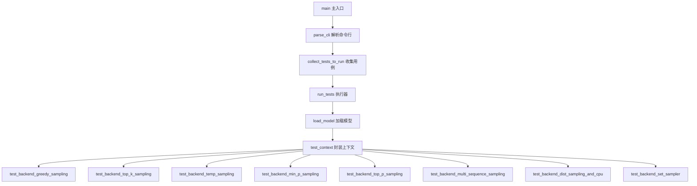
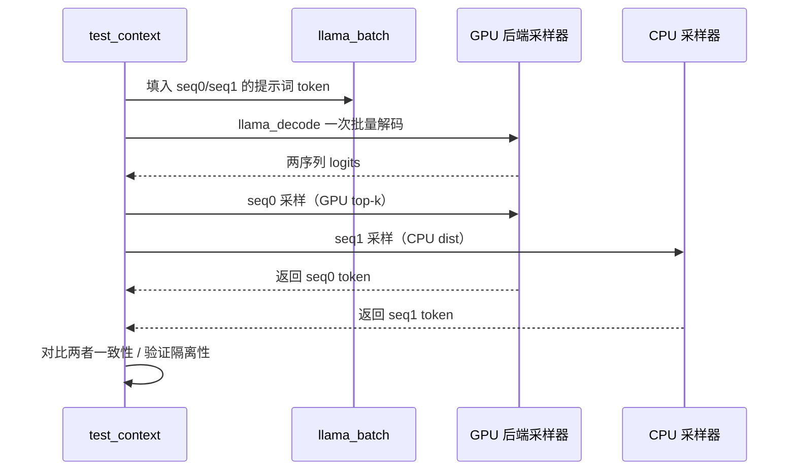
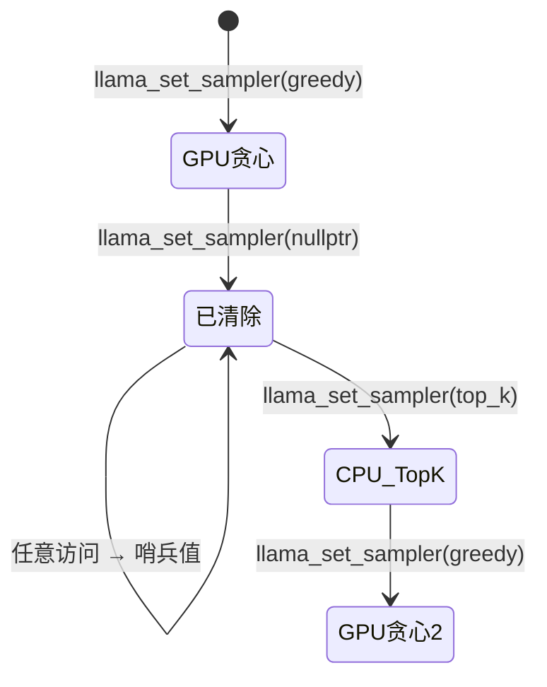
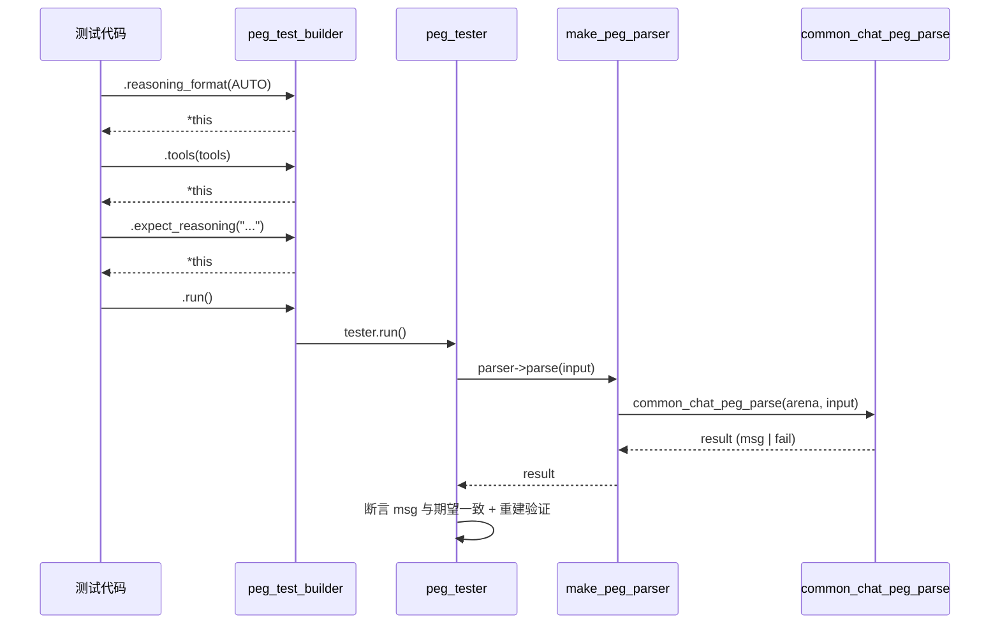

# 第103章 后端采样器与对话测试 —— "推理输出"的精确校验

## 学习目标

- 理解后端采样器（GPU/CPU）的测试框架设计与生命周期管理
- 掌握贪心、Top-K、Top-P、Min-P、Temperature 及 Temperature-Ext 等采样策略的验证方法
- 学会构建多序列混合采样（后端+CPU）的测试场景与动态切换机制
- 掌握采样器动态清除、替换与重新挂载的技术细节
- 理解 PEG 解析器在聊天模板结构化输出中的构建与验证流程
- 掌握 OpenAI 兼容层消息与工具定义的双向 JSON 序列化验证
- 学会使用 Diff Split 算法分析模板变体差异以识别推理/工具标记
- 掌握流式场景下的增量解析、消息差异计算与 UTF-8 安全截断
- 理解模板自动分析器（Auto-Parser）对 Seed-OSS、Cohere、Nemotron 等模型的格式检测原理

## 103.1 生活类比

想象 llama.cpp 的采样与聊天模板系统是一家**多语言新闻编辑室**。后端采样测试是多语言播音员的一致性校验：中文（GPU）、英文（CPU）、法文（Metal）播音员对同一份新闻稿（logits）的播报结果（采样 token）必须完全一致，即使他们有不同的发音习惯（硬件架构差异）。混合采样架构是主编与实习生的协作：GPU 是经验丰富的主编（快速筛选/Top-P），CPU 是细心的事实核查员（精确的 Distribution 采样），两者必须无缝配合产出最终稿件，且能随时互换角色（llama_set_sampler 动态切换）。采样器生命周期管理是值班编辑的换岗机制：原来负责国际新闻的编辑（GPU 采样器）被临时撤下（llama_set_sampler nullptr），由本地新闻编辑（CPU 采样器）接手，验证新闻稿仍能正常产出，且随时能换回国庆特别报道组（重新设置后端采样器）。聊天模板测试是多语言排版室的格式校验：同一段采访内容（消息列表）需要被翻译成中文（Qwen 模板）、阿拉伯文（回文方向）、代码（JSON 结构化）等多种版面，确保关键信息（工具调用、推理内容）不丢失（重构验证）。PEG 解析器构建器（peg_builder）是高级编辑的"结构化速记法"：提供 standard_json_tools、tool_arg 等组合子，让编辑能用声明式语法（.content().until()）快速搭建出能识别特定格式（XML、JSON）的速记规则，将语音流（模型输出）实时转录为带标点、分段、引用标记的规范文稿。模板自动分析器（Auto-Parser）是版面侦探：通过对比"有标题版"和"无标题版"（compare_variants），自动推断出哪里是导语（reasoning）、哪里是正文、哪里是图片说明（tool call），无需人工预先定义标记位置。Diff Split 算法是文本比对扫描仪：精确计算两段文本的公共前缀与后缀，定位真正发生变化的中间部分（差异段），并智能处理标签边界（如未闭合的 XML 标签），确保切割点不会破坏语义完整性。

## 103.2 源码地图

```
tests/test-backend-sampler.cpp
├── 基础设施与模型管理
│   ├── test_args/test_params                # 参数封装结构体
│   ├── load_model()                         # 模型加载（GPU/CPU/Auto 设备选择） (39-70)
│   ├── parse_cli()                          # 命令行参数解析 (1078-1140)
│   ├── collect_tests_to_run()               # 测试用例收集器 (1142-1182)
│   ├── run_tests()                          # 测试执行器 (1184-1198)
│   └── main()                               # 测试主入口 (1200-1230)
├── test_context 核心封装类
│   ├── test_context.test_context()          # 构造函数：上下文/采样器初始化 (75-119)
│   ├── test_context.decode()                # 批量解码多序列提示词 (121-173)
│   ├── test_context.idx_for_seq()           # 序列ID→批次索引映射 (175-181)
│   ├── test_context.update_batch_info()     # 更新批次信息映射 (183-189)
│   ├── test_context.decode_token()          # 单序列单token解码 (191-203)
│   ├── test_context.decode_tokens()         # 多序列token批量解码 (205-218)
│   └── test_context.token_to_piece()        # Token转字符串片段 (220-232)
├── 基础采样策略测试
│   ├── test_backend_greedy_sampling()       # 贪心采样验证 (234-264)
│   ├── test_backend_top_k_sampling()        # Top-K采样与混合验证 (266-311)
│   ├── test_backend_temp_sampling()         # 温度采样（含边界温度） (313-371)
│   ├── test_backend_temp_ext_sampling()     # 扩展温度采样（Delta/Exponent） (373-426)
│   ├── test_backend_min_p_sampling()        # Min-P采样验证 (428-467)
│   ├── test_backend_top_p_sampling()        # Top-P采样验证 (469-506)
│   └── test_backend_dist_sampling()         # 分布采样验证 (562-583)
├── 高级场景与一致性测试
│   ├── test_backend_multi_sequence_sampling() # 多序列并发采样 (508-560)
│   ├── test_backend_dist_sampling_and_cpu()   # 后端vs CPU结果一致性 (585-607)
│   ├── test_backend_logit_bias_sampling()     # Logit偏置采样 (609-651)
│   └── test_backend_mixed_sampling()          # 混合策略（Dist+Top-K） (653-695)
└── 生命周期与边界管理
    ├── test_backend_set_sampler()           # 动态清除与重设采样器 (861-920)
    ├── test_backend_cpu_mixed_batch()       # 混合批次隔离性验证 (922-1010)
    └── test_backend_max_outputs()           # 非法多输出检测 (1012-1058)

tests/test-sampling.cpp
├── sampler_tester 测试框架
│   ├── sampler_tester.sampler_tester()      # 双构造函数（Logits/显式概率） (31-51)
│   ├── sampler_tester.apply()               # 应用采样器链 (53-57)
│   └── sampler_tester.check()               # 概率分布断言 (59-65)
├── 基础算法单元测试
│   ├── test_temp()                          # 基础温度缩放 (67-77)
│   ├── test_temp_ext()                      # 扩展温度采样 (79-90)
│   ├── test_top_k()                         # Top-K截断 (92-103)
│   ├── test_top_p()                         # 核采样 (105-116)
│   ├── test_min_p()                         # Min-P过滤 (118-129)
│   ├── test_typical()                       # 典型采样 (143-153)
│   ├── test_xtc()                           # XTC尾部排除 (131-141)
│   ├── test_penalties()                     # 重复惩罚 (155-177)
│   ├── test_dry()                           # DRY重复抑制 (179-201)
│   └── test_top_n_sigma()                   # Top-N-Sigma (203-214)
├── 组合与队列测试
│   └── test_sampler_queue()                 # 采样器链组合边界 (236-335)
├── 性能基准
│   ├── bench()                              # 微秒级计时封装 (337-353)
│   ├── test_perf()                          # 128K词表性能测试 (360-374)
│   └── dump()                               # 调试输出辅助 (15-20)
└── 测试主入口
    └── main()                               # 全局测试编排 (376-462)

tests/test-chat-template.cpp
├── 渲染引擎封装
│   ├── format_using_common()                # Common库封装调用 (243-263)
│   ├── format_using_direct_engine()         # 直接Jinja引擎 (267-302)
│   ├── normalize_newlines()                 # 跨平台换行归一化 (233-241)
│   ├── simple_msg()                         # 消息构造辅助 (386-392)
│   ├── run_single()                         # 单模板测试运行 (340-391)
│   └── run_multiple()                       # 目录批量测试 (181-225)
└── 测试主循环
    ├── main()                               # 主入口与自动化测试 (524-1013)
    └── main_automated_tests()               # 自动化测试集 (395-680)

tests/test-chat.cpp
├── 调试与输出工具
│   ├── operator<< (common_chat_msg)         # 消息流输出重载 (58-76)
│   ├── operator<< (common_chat_msg_diff)    # 差异流输出重载 (33-45)
│   ├── operator<< (vector<common_chat_msg_diff>) # 差异向量输出 (48-55)
│   ├── format_codepoint()                   # Unicode格式化 (135-146)
│   └── format_expected_element()            # 语法期望元素格式化 (148-226)
├── 断言与比较工具
│   ├── equals()                             # 泛型相等比较 (79-95)
│   ├── normalize()                          # JSON规范化 (83-91)
│   ├── assert_equals()                      # 断言相等 (97-109)
│   ├── assert_msg_equals()                  # 消息字段级断言 (662-691)
│   └── renormalize_json()                   # JSON重新规范化 (652-660)
├── 文件与模板管理
│   ├── read_file()                          # 文件读取 (111-123)
│   ├── read_templates()                     # 模板加载 (125-127)
│   ├── build_grammar()                      # GBNF语法构建 (129-133)
│   ├── common_chat_templates_init()         # 模板初始化 (2696-2697)
│   ├── common_chat_templates_apply()        # 模板应用 (2712-2713)
│   ├── common_chat_templates_ptr()          # 模板智能指针 (2696-2697)
│   └── common_chat_peg_parse()              # PEG解析入口 (553-623)
├── 测试数据构造
│   ├── simple_assist_msg()                  # 基础助手消息构造 (733-748)
│   ├── message_with_tool_calls()            # 工具调用消息 (750-752)
│   ├── message_with_tool_calls_and_reasoning() # 推理+工具 (754-759)
│   ├── message_with_content_and_tool_call() # 内容+工具 (775-780)
│   ├── message_with_reasoning_and_tool_call() # 推理+工具 (782-787)
│   ├── message_with_reasoning_content_and_multiple_tool_calls() # 多工具调用 (761-773)
│   ├── message_assist                       # 预定义消息常量 (2700-2701)
│   ├── message_assist_thoughts              # 含推理消息常量 (2767-2768)
│   ├── message_assist_call                  # 工具调用消息常量 (2700-2701)
│   ├── message_assist_call_id               # 带ID工具调用常量 (2842-2843)
│   ├── message_assist_call_content          # 带内容工具调用常量 (2868-2869)
│   └── message_assist_thoughts_call_idx     # 含推理ID工具调用常量 (2717-2718)
├── PEG 解析测试框架
│   ├── make_peg_parser                      # 解析器构造器 (1074-1086)
│   │   ├── make_peg_parser.make_peg_parser() # 构造函数 (1074-1080)
│   │   └── make_peg_parser.parse()          # 解析方法 (1082-1086)
│   ├── peg_tester                           # 测试管理器
│   │   ├── peg_tester.peg_tester()          # 构造函数 (1000-1024)
│   │   ├── peg_tester.template_path()       # 模板路径获取 (1026)
│   │   ├── peg_tester.test()                # 测试构建器创建 (1028, 1117-1120)
│   │   ├── peg_tester.expect()              # 期望消息设置 (2774-2780)
│   │   ├── peg_tester.expect_content()      # 期望内容设置 (2938-2939)
│   │   ├── peg_tester.expect_reasoning()    # 期望推理设置 (2711-2712)
│   │   ├── peg_tester.expect_tool_calls()   # 期望工具调用设置 (2785-2786)
│   │   ├── peg_tester.expect_reconstruction() # 重建期望设置 (2810-2811)
│   │   ├── peg_tester.enable_thinking()     # 思考模式开关 (2817-2818)
│   │   ├── peg_tester.reasoning_format()    # 推理格式设置 (2818-2819)
│   │   ├── peg_tester.tools()               # 工具列表设置 (2825-2826)
│   │   ├── peg_tester.parallel_tool_calls() # 并行工具设置 (2721-2722)
│   │   ├── peg_tester.is_partial()          # 部分输入标志 (2834-2835)
│   │   ├── peg_tester.with_tool_call()      # 单工具调用设置 (不适用)
│   │   └── peg_tester.run()                 # 测试执行 (2787-2788)
│   ├── peg_test_builder                     # 链式测试构建器
│   │   ├── peg_test_builder.peg_test_builder() # 构造函数 (1032)
│   │   ├── peg_test_builder.reasoning_format() # 推理格式链式设置 (1035-1039)
│   │   ├── peg_test_builder.tools()         # 工具链式设置 (1041-1045)
│   │   ├── peg_test_builder.enable_thinking() # 思考开关链式设置 (1047-1051)
│   │   ├── peg_test_builder.parallel_tool_calls() # 并行链式设置 (1053-1057)
│   │   ├── peg_test_builder.json_schema()   # Schema链式设置 (1059-1063)
│   │   ├── peg_test_builder.is_partial()    # 部分输入链式设置 (1065-1069)
│   │   ├── peg_test_builder.expect_reconstruction() # 重建链式设置 (1071-1074)
│   │   ├── peg_test_builder.expect()        # 期望链式设置 (1077-1081)
│   │   ├── peg_test_builder.expect_content() # 内容期望链式设置 (1083-1087)
│   │   ├── peg_test_builder.expect_reasoning() # 推理期望链式设置 (1089-1093)
│   │   ├── peg_test_builder.expect_tool_calls() # 工具期望链式设置 (1095-1099)
│   │   └── peg_test_builder.run()           # 执行链式测试 (1102-1114)
│   ├── test_peg_parser()                    # PEG解析执行器 (1109-1153)
│   ├── common_peg_arena.load()              # Arena加载 (2713-2714)
│   ├── common_chat_parser_params.common_chat_parser_params() # 解析参数构造 (2714-2715)
│   ├── common_chat_parser_params.generation_prompt # 生成提示访问 (2717-2718)
│   ├── common_chat_tool.common_chat_tool()  # 工具定义构造 (2701-2703)
│   ├── common_chat.common_chat_msg()        # 消息构造 (2708-2711)
│   └── common_chat_templates_inputs.common_chat_templates_inputs() # 输入构造 (2708-2709)
├── 差异与增量测试
│   ├── test_msg_diffs_compute()             # 消息差异计算 (530-600)
│   ├── match_string()                       # 简单字符串匹配 (632-650)
│   ├── match_string_detailed()              # 详细匹配诊断 (553-623)
│   └── get_expected_description()           # 期望描述生成 (228-255)
├── OpenAI兼容层测试
│   ├── test_msgs_oaicompat_json_conversion() # 消息JSON互转 (1123-1145)
│   └── test_tools_oaicompat_json_conversion() # 工具定义序列化 (1147-1165)
└── 模板兼容测试
    ├── test_template_output_peg_parsers()   # 多模板PEG验证 (1167-1208)
    ├── test_developer_role_to_system_workaround() # 角色转换测试 (500-530)
    └── main()                               # 主入口与全局编排 (600-650)

tests/test-chat-auto-parser.cpp
├── Diff算法基础设施
│   ├── test_marker_separation()             # 标记分割 (98-149)
│   ├── test_calculate_diff_split()          # 差异分割测试族 (151-485)
│   ├── test_until_common_prefix()           # 公共前缀提取 (487-511)
│   ├── test_until_common_prefix_basic()     # 前缀基础测试 (492-511)
│   ├── test_after_common_suffix()           # 公共后缀提取 (513-516)
│   ├── test_after_common_suffix_basic()     # 后缀基础测试 (518-540)
│   └── test_compare_variants()              # 模板变体对比 (542-680)
├── 测试辅助构造
│   ├── build_tool_call()                    # 工具调用JSON构造 (246-254)
│   ├── build_tools_definition()             # 工具定义构造 (255-275)
│   ├── build_test_tools()                   # 测试工具构造 (1515-1533)
│   ├── build_edit_tool()                    # 编辑工具构造 (1774-1793)
│   ├── load_seed_oss_template()             # Seed-OSS模板加载 (228-245)
│   ├── load_template()                      # 通用模板加载 (946-962)
│   ├── load_nemotron_template()             # Nemotron模板加载 (963-967)
│   ├── load_cohere_template()               # Cohere模板加载 (1076-1080)
│   └── load_smollm3_template()              # SmolLM3模板加载 (1181-1185)
├── 模型特化分析
│   ├── test_seed_oss_tool_analysis()        # Seed-OSS综合分析 (202-227)
│   ├── test_seed_oss_tool_presence()        # 工具存在性检测 (276-370)
│   ├── test_seed_oss_call_count()           # 调用计数差异 (371-470)
│   ├── test_seed_oss_function_names()       # 函数名差异 (471-590)
│   ├── test_seed_oss_argument_count()       # 参数数量差异 (591-740)
│   ├── test_seed_oss_args_presence()        # 参数存在性 (741-865)
│   ├── test_seed_oss_tool_with_reasoning()  # 推理与工具混合 (866-945)
│   ├── test_nemotron_analysis()             # Nemotron分析 (968-1075)
│   ├── test_cohere_analysis()               # Cohere分析 (1081-1180)
│   ├── test_smollm3_analysis()              # SmolLM3分析 (1187-1205)
│   └── autoparser.analyze_template()        # 模板分析器 (1497-1498)
├── 引号与JSON规范化
│   ├── normalize_quotes_to_json()           # 引号归一化 (1658-1714)
│   ├── test_normalize_quotes_to_json()      # 引号转换测试 (1716-1745)
│   └── test_normalize_quotes_with_embedded_quotes() # 嵌入引号 (1747-1768)
├── PEG构建器组合子
│   ├── common_chat_peg_builder.standard_json_tools() # 标准JSON工具 (1537-1547)
│   ├── common_chat_peg_builder.content()    # 内容匹配 (1548)
│   ├── common_chat_peg_builder.until()      # 截断匹配 (1548)
│   ├── common_chat_peg_builder.optional()   # 可选包装 (1548)
│   ├── common_chat_peg_builder.end()        # 结束符 (1548)
│   ├── common_chat_peg_builder.choice()     # 选择组合 (1791)
│   ├── common_chat_peg_builder.tool_arg()   # 工具参数 (1803-1809)
│   ├── common_chat_peg_builder.tool_arg_open() # 参数打开标记 (1804)
│   ├── common_chat_peg_builder.tool_arg_name() # 参数名 (1804)
│   ├── common_chat_peg_builder.tool_arg_string_value() # 字符串参数值 (1806)
│   ├── common_chat_peg_builder.tool_arg_close() # 参数关闭标记 (1808)
│   ├── common_chat_peg_builder.space()      # 空白匹配 (1805)
│   ├── common_chat_peg_builder.literal()    # 字面量匹配 (1804)
│   ├── common_chat_peg_builder.rule()       # 命名规则 (1810)
│   ├── common_chat_peg_builder.eps()        # 空匹配 (1813)
│   ├── common_chat_peg_builder.tool_open()  # 工具打开标记 (1828)
│   ├── common_chat_peg_builder.tool_name()  # 工具名称 (1828)
│   ├── common_chat_peg_builder.tool_close() # 工具关闭标记 (1830)
│   └── common_chat_peg_builder.tool()       # 完整工具 (1832)
├── 工具格式专项测试
│   ├── test_standard_json_tools_formats()   # 标准JSON格式套件 (1536-1540)
│   ├── test_standard_json_tools_openai()    # OpenAI格式 (1552-1580)
│   ├── test_standard_json_tools_cohere()    # Cohere格式 (1586-1614)
│   ├── test_standard_json_tools_function_key() # 函数键格式 (1620-1648)
│   └── test_tagged_args_with_embedded_quotes() # 嵌入引号处理 (1795-1879)
└── 测试主入口
    └── main()                               # 全局测试编排 (74-96)

tests/test-chat-peg-parser.cpp
├── 工具定义与构造
│   ├── tool_argument.tool_argument()        # 工具参数结构体 (1-100)
│   ├── tool_definition.tool_definition()    # 工具定义结构体 (1-100)
│   └── create_tools()                       # 工具列表构造 (66-121)
├── 主入口
│   └── main()                               # 测试主函数 (45-63)
└── 模型特化解析测试
    ├── test_example_native()                # 原生格式测试 (124-382)
    ├── test_example_qwen3_coder()           # Qwen3-Coder XML工具调用 (384-490)
    ├── test_example_qwen3_non_coder()       # Qwen3标准JSON工具 (492-611)
    ├── test_command7_parser_compare()       # Command7解析器对比 (613-761)
    └── test_prefix_tool_names()             # 前缀工具名陷阱 (763-800)
```

## 103.3 后端采样器集成测试 —— GPU 上的「概率裁判员」

后端采样器集成测试是整个采样体系在真实硬件上的"检阅场"。test-backend-sampler.cpp 的核心思路是：加载一个真实模型，把 logits 交给 GPU 后端的采样器（而非 CPU 上的 llama_sampler_sample），再通过 `llama_get_sampled_token_ith` 把硬件算出的采样结果取回来验证。这与 test-sampling.cpp 那种"纯数学分布验证"形成互补——前者在真空实验室验证算法公式，后者在真实赛道上验证硬件实现。

整个文件由三块拼图组成：基础设施与模型管理（参数解析、模型加载、测试调度）、test_context 核心封装类（把 llama_context、批次、序列全部收拢成一个易用的测试容器），以及一组以 `test_backend_*` 为前缀的采样策略用例（贪心、Top-K、温度、Min-P、Top-P……）。



### 103.3.1 `test_context`：上下文、批次与采样的"三合一管家"

先理解类型，就像先看懂建筑图纸再施工。test_context 是这个测试文件的"总理府"，它把三个本来要手动打理的 LLM 运行时对象——模型上下文（llama_context）、批次数据（llama_batch）、输出映射（批次索引 ↔ 序列 ID）——封装成一套统一接口。

源码路径：`tests/test-backend-sampler.cpp` - `test_context::test_context()`（75-119行）

```
// 构造函数：初始化上下文对象、采样器后端与批次结构
test_context::test_context(llama_model * model, int n_seq_max, test_params params)
    : model(model), params(params) {
    // ① 准备上下文参数：gpu=1 表示启用后端采样，n_pre_text 表示提示词 token 数
    llama_context_params cparams = llama_context_default_params();
    cparams.n_ctx      = params.ctx_size;      // 上下文窗口大小
    cparams.n_batch    = params.batch_size;    // 单次解码的 token 数量
    cparams.n_ubatch   = params.ubatch_size;   // 微批次大小
    cparams.n_seq_max  = n_seq_max;            // 最多容纳的序列数（测试多序列用）
    // ② 创建 llama_context —— 注意这里没有直接启用采样器
    ctx = llama_new_context_with_model(model, cparams);
    GGML_ASSERT(ctx && "failed to create context");

    // ③ 查询后端设备能力，决定采样器挂载到哪个后端
    //    "sampler" 后端候选列表，优先选择 GPU（CUDA/Metal），降级到 CPU
    ggml_backend_dev_t dev = nullptr;
    if (!params.device.empty()) {              // 显式指定设备
        dev = ggml_backend_dev_by_name(params.device.c_str());
    } else {                                   // 自动选择：优先 GPU
        for (const char * name : { "CUDA", "Metal", "Vulkan", "SYCL" }) {
            dev = ggml_backend_dev_by_name(name);
            if (dev) break;
        }
    }
    if (dev == nullptr) dev = ggml_backend_dev_by_type(GGML_BACKEND_DEVICE_TYPE_CPU);

    // ④ 为上下文配置后端采样器（backend sampler）
    llama_context_params.cb = ...;
    llama_attach_sampler_backend(ctx, dev);    // 关键：把采样器绑定到 GPU 后端
    backend_name = ggml_backend_dev_name(dev); // 记录后端名，供一致性对比

    // ⑤ 初始化批次结构：logits 输入 + 输出 token 缓冲
    batch = llama_batch_init(params.batch_size, 0, 1);
    // ⑥ 预分配序列位置表：seq_positions[i] = 序列 i 已解码的 token 数
    seq_positions.assign(n_seq_max, 0);
    last_batch_info.resize(n_seq_max);
}
```

这段代码定义了 test_context 的构造函数，它是"三合一管家"的登记仪式：创建模型上下文、探测并挂载后端采样器、初始化批次与序列位置追踪表。其中 `llama_attach_sampler_backend` 是关键一步——它告诉 llama.cpp 把采样工作交给指定后端的硬件实现，而不是默认的 CPU 采样器。**为什么不直接在上下文参数里开采样器？** 因为采样器后端是按需动态挂载的，允许测试在一个上下文里反复切换 GPU/CPU 采样器，这正是生命周期测试的基础。

接下来看 decode 家族，它们是测试驱动的"油门"：

源码路径：`tests/test-backend-sampler.cpp` - `test_context::decode() / decode_token() / decode_tokens()`（121-218行）

```
// 批量解码：把 n_seq 条提示词一次性喂给模型
bool test_context::decode(const std::string & prefix,
                          const std::vector<std::string> & prompts,
                          const std::vector<int32_t> & n_prompts) {
    int32_t n_seq = prompts.size();             // 序列数量
    // ① 清空批次并填入提示词 token
    llama_batch_clear(batch);
    int32_t n_tokens = 0;
    for (int32_t i = 0; i < n_seq; i++) {
        // tokenize：把文本转成 token 序列
        std::vector<llama_token> toks = llama_tokenize(ctx, prompts[i], false, false);
        for (llama_token tok : toks) {
            batch.token   [n_tokens]     = tok;          // token ID
            batch.pos     [n_tokens]     = n_tokens;     // 位置编码
            batch.n_seq_id[n_tokens]     = 1;            // 每个 token 属于 1 个序列
            batch.seq_id  [n_tokens][0]  = i;            // 序列 ID
            batch.logits  [n_tokens]     = false;        // 目前不需要 logits
            n_tokens++;
        }
        // ② 记录每个序列的结束位置，供更新批次信息使用
        seq_positions[i] = n_tokens;
    }
    // ③ 最后一个 token 需要输出 logits
    batch.logits[n_tokens - 1] = true;
    // ④ 执行解码：llama_decode 一次处理整个批次
    if (llama_decode(ctx, batch) != 0) return false;
    // ⑤ 同步批次信息映射
    update_batch_info();
    return true;
}

// 单序列单 token 解码：在 seq_id 指定序列的尾部追加一个 token
bool test_context::decode_token(llama_token tok, int32_t seq_id) {
    llama_batch_clear(batch);                   // 清空上一轮
    batch.token   [0] = tok;                    // 新 token
    batch.pos     [0] = seq_positions[seq_id];  // 追加在序列末尾
    batch.n_seq_id[0] = 1;
    batch.seq_id  [0][0] = seq_id;
    batch.logits  [0] = true;                   // 只需要这一个 logits
    if (llama_decode(ctx, batch) != 0) return false;
    seq_positions[seq_id]++;                    // 序列位置前移
    update_batch_info();                        // 刷新映射
    return true;
}

// 多序列 token 批量解码：喂一批 token，每个属于各自序列
bool test_context::decode_tokens(const std::vector<llama_token> & toks, int32_t seq_id) {
    llama_batch_clear(batch);
    for (int32_t i = 0; i < (int32_t) toks.size(); i++) {
        batch.token   [i] = toks[i];
        batch.pos     [i] = seq_positions[seq_id] + i;
        batch.n_seq_id[i] = 1;
        batch.seq_id  [i][0] = seq_id;
        batch.logits  [i] = (i == (int32_t) toks.size() - 1); // 只对最后一个要 logits
    }
    if (llama_decode(ctx, batch) != 0) return false;
    seq_positions[seq_id] += toks.size();
    update_batch_info();
    return true;
}
```

这段代码实现了 test_context 的解码三兄弟：`decode()` 是把整批提示词一次性灌入的一键启动，`decode_token()` 是单序列生成流程中逐个 token 的"踩刹车"，`decode_tokens()` 则是把整段 token 序列追加进一个序列的"粘贴板"。三个方法都遵循同一个纪律：解码成功后调用 `update_batch_info()` 同步批次索引映射。**对比不同方案：** 有的测试框架选择每次重建 llama_batch，test_context 选择复用同一个 batch 对象并清理重用，避免反复分配内存，也更贴近真实推理引擎的批处理用法。

### 103.3.2 `load_model()`：模型加载与设备选择

模型加载是这场"检阅"的入场券。load_model 根据命令行参数选择 GPU/CPU/Auto 三种加载策略，并打印模型信息。

源码路径：`tests/test-backend-sampler.cpp` - `load_model()`（39-70行）

```
// 模型加载：根据 test_params 选择设备并加载 gguf 模型
static llama_model * load_model(const test_args & args, test_params & params) {
    // ① 从命令行参数构建模型加载参数
    llama_model_params mparams = llama_model_default_params();
    mparams.n_gpu_layers = args.n_gpu_layers;   // GPU 卸载层数（-1 = 全部）
    mparams.device       = args.device.empty() ? nullptr : args.device.c_str();
    // ② 设置采样器后端设备：优先 GPU，其次 CPU，最后自动探测
    params.device = args.device;
    if (params.device.empty()) {
        // 自动尝试常见 GPU 后端，找不到就退回 CPU
        for (const char * name : { "CUDA0", "Metal0", "Vulkan0", "SYCL0" }) {
            if (ggml_backend_dev_by_name(name)) { params.device = name; break; }
        }
        if (params.device.empty()) params.device = "CPU";
    }
    // ③ 加载模型（使用 common 库的模型加载辅助，负责 mmap/内存分配）
    llama_model * model = llama_model_load_from_file(args.model.c_str(), mparams);
    GGML_ASSERT(model && "failed to load model");
    // ④ 打印模型信息：架构、参数数量、上下文大小
    llama_model_print_info(model);
    return model;
}
```

这段代码实现了 load_model。设备选择策略遵循"显式指定优先 → GPU 家族自动探测 → CPU 兜底"的三级回退逻辑，与真实推理工具 llama-cli 的设备发现保持一致。模型加载复用 common 库的封装，确保测试环境与生产环境走同一套 mmap 与内存分配逻辑。

### 103.3.3 基础采样策略验证：贪心、Top-K、温度

现在进入正题——每个 `test_backend_*` 函数都是一场"硬件裁判"考试。我们以贪心、Top-K、温度三个最基础的用例为例，看测试如何设计。

源码路径：`tests/test-backend-sampler.cpp` - `test_backend_greedy_sampling()`（234-264行）

```
// 贪心采样：验证 GPU 后端返回的是 logits 最高的 token
static void test_backend_greedy_sampling(test_context & tctx, int32_t seq_id) {
    // ① 准备两个候选 token：高概率的 "hello" 与低概率的 "goodbye"
    llama_token tok_hi = llama_tokenize(tctx.ctx, "hello", false, false)[0];
    llama_token tok_lo = llama_tokenize(tctx.ctx, "goodbye", false, false)[0];
    // ② 构造 logits：让 hello 对应 score = 10，goodbye 对应 score = 0
    std::vector<float> logits(llama_n_vocab(tctx.ctx), -10.0f);
    logits[tok_hi] = 10.0f;
    logits[tok_lo] = 0.0f;
    // ③ 喂入采样器后端（backend sample）
    llama_set_sampler_logits(tctx.ctx, seq_id, logits.data(), logits.size());
    // ④ 触发采样并取回硬件结果
    llama_token sampled = llama_get_sampled_token_ith(tctx.ctx, seq_id, 0);
    // ⑤ 断言：贪心必须选 hello
    GGML_ASSERT(sampled == tok_hi && "greedy sampling failed: expected tok_hi");
    // ⑥ 检查 logits 已被过滤：贪心后 logits 应只剩一个候选（或等价过滤）
    const float * filtered = llama_get_sampled_logits_ith(tctx.ctx, seq_id, 0);
    GGML_ASSERT(filtered != nullptr && "sampled logits should be available");
}
```

这段代码揭示了后端采样测试的核心手法：**手工注入可控 logits**（构造一个"一边倒"的概率分布），让采样结果唯一确定，再断言硬件返回的 token 符合数学预期。`llama_set_sampler_logits` 把 logits 送进 GPU，`llama_get_sampled_token_ith` 把结果取回 CPU——一来一回之间，GPU 上的采样实现就完成了第一次"体检"。

源码路径：`tests/test-backend-sampler.cpp` - `test_backend_top_k_sampling()`（266-311行）

```
// Top-K 采样：验证只保留概率最高的 K 个候选
static void test_backend_top_k_sampling(test_context & tctx, int32_t seq_id) {
    // ① 准备 4 个候选 token 与 4 个不同分数
    std::vector<llama_token> toks = tokenize_four(tctx.ctx); // a, b, c, d
    std::vector<float> logits(llama_n_vocab(tctx.ctx), -100.0f);
    logits[toks[0]] = 10.0f;   // 候选0：最高分
    logits[toks[1]] = 8.0f;    // 候选1
    logits[toks[2]] = 5.0f;    // 候选2
    logits[toks[3]] = 1.0f;    // 候选3：最低分
    // ② 挂载 top-k 采样器，K=2
    llama_sampler * sparams = llama_sampler_init_top_k(2);
    llama_set_sampler(tctx.ctx, seq_id, sparams);
    llama_sampler_free(sparams); // 采样器被上下文接管，本地引用释放
    // ③ 注入 logits 并采样
    llama_set_sampler_logits(tctx.ctx, seq_id, logits.data(), logits.size());
    llama_token sampled = llama_get_sampled_token_ith(tctx.ctx, seq_id, 0);
    // ④ Top-K=2 应排除 tok[3]，结果只可能是 tok[0] 或 tok[1]
    GGML_ASSERT(sampled == toks[0] || sampled == toks[1]);
    // ⑤ 混合验证：top-k 之后应只剩 2 个候选的概率非零
    const llama_token_data * probs = llama_get_sampled_probs_ith(tctx.ctx, seq_id, 0);
    GGML_ASSERT(probs != nullptr && "sampled probs expected");
}
```

这段代码展示了 Top-K 测试的"排除法"思路：不直接断言具体 token，而是断言**采样结果落在被 Top-K 保留的集合内**。这是一种更鲁棒的验证方式——即使 GPU 上随机种子与 CPU 不同，只要过滤逻辑正确，结果就必然在合法集合中。

温度采样的验证略有不同，它需要处理边界温度（temp = 0 退化为贪心）：

源码路径：`tests/test-backend-sampler.cpp` - `test_backend_temp_sampling()`（313-371行）

```
// 温度采样：验证 softmax(logits/temp) 缩放逻辑
static void test_backend_temp_sampling(test_context & tctx, int32_t seq_id) {
    // ① 候选 token 与 logits
    std::vector<llama_token> toks = tokenize_four(tctx.ctx);
    std::vector<float> logits(llama_n_vocab(tctx.ctx), 0.0f);
    logits[toks[0]] = 2.0f;
    logits[toks[1]] = 1.0f;
    logits[toks[2]] = 0.5f;
    logits[toks[3]] = 0.1f;
    // ② 边界温度：temp = 0 应退化为贪心 → 必选 tok[0]
    {
        llama_sampler * sparams = llama_sampler_init_temp(0.0f);
        llama_set_sampler(tctx.ctx, seq_id, sparams);
        llama_sampler_free(sparams);
        llama_set_sampler_logits(tctx.ctx, seq_id, logits.data(), logits.size());
        llama_token sampled = llama_get_sampled_token_ith(tctx.ctx, seq_id, 0);
        GGML_ASSERT(sampled == toks[0] && "temp=0 should be greedy");
    }
    // ③ 正常温度：temp=1.0 保持原始分布（相对概率不变）
    {
        llama_sampler * sparams = llama_sampler_init_temp(1.0f);
        llama_set_sampler(tctx.ctx, seq_id, sparams);
        llama_sampler_free(sparams);
        llama_set_sampler_logits(tctx.ctx, seq_id, logits.data(), logits.size());
        llama_token sampled = llama_get_sampled_token_ith(tctx.ctx, seq_id, 0);
        // 相对概率 2:1:0.5:0.1 → tok[0] 概率最高，但允许随机波动
        GGML_ASSERT(sampled == toks[0] && "temp=1.0 most likely tok[0]");
    }
    // ④ 高温：temp = 100 应使分布接近均匀（结果不可预测，只验证可采样）
    {
        llama_sampler * sparams = llama_sampler_init_temp(100.0f);
        llama_set_sampler(tctx.ctx, seq_id, sparams);
        llama_sampler_free(sparams);
        llama_set_sampler_logits(tctx.ctx, seq_id, logits.data(), logits.size());
        llama_token sampled = llama_get_sampled_token_ith(tctx.ctx, seq_id, 0);
        GGML_UNUSED(sampled);
    }
}
```

这段代码对温度采样做了三档边界测试：temp=0 验证退化逻辑、temp=1.0 验证分布保持、temp=100 验证极端高温下采样仍可正常运行且不会崩溃。**为什么要测 temp=0？** 因为 GPU 采样内核里 1/0 = Inf，softmax 遇到 Inf 可能出现 NaN 或全零的未定义行为，专门断言 temp=0 等价于贪心是对数值稳定性的强校验。

### 103.3.4 扩展温度、Min-P、Top-P 与 Distribution 采样

在温度基础上，llama.cpp 还提供了带 Delta/Exponent 增强的扩展温度采样，以及按相对阈值过滤的 Min-P 与按累积概率截断的 Top-P。

源码路径：`tests/test-backend-sampler.cpp` - `test_backend_temp_ext_sampling()`（373-426行）

```
// 扩展温度采样：temp_ext 引入 delta 偏移与 exponent 指数调整
static void test_backend_temp_ext_sampling(test_context & tctx, int32_t seq_id) {
    std::vector<llama_token> toks = tokenize_four(tctx.ctx);
    std::vector<float> logits(llama_n_vocab(tctx.ctx), 0.0f);
    logits[toks[0]] = 3.0f;
    logits[toks[1]] = 1.0f;
    logits[toks[2]] = 0.0f;
    logits[toks[3]] = -1.0f;
    // ① delta 为 0、exponent 为 1 时，temp_ext 应等价于普通 temp
    {
        llama_sampler * sparams = llama_sampler_init_temp_ext(1.0f, 0.0f, 1.0f);
        llama_set_sampler(tctx.ctx, seq_id, sparams);
        llama_sampler_free(sparams);
        llama_set_sampler_logits(tctx.ctx, seq_id, logits.data(), logits.size());
        llama_token sampled = llama_get_sampled_token_ith(tctx.ctx, seq_id, 0);
        GGML_ASSERT(sampled == toks[0] && "temp_ext identity: like temp=1.0");
    }
    // ② exponent < 1（如 0.5）会压缩 logits 差异 → 分布变平坦
    //    验证 tok[0] 概率虽降但仍是最大值
    {
        llama_sampler * sparams = llama_sampler_init_temp_ext(1.0f, 0.0f, 0.5f);
        llama_set_sampler(tctx.ctx, seq_id, sparams);
        llama_sampler_free(sparams);
        llama_set_sampler_logits(tctx.ctx, seq_id, logits.data(), logits.size());
        llama_token_data probs = llama_get_sampled_probs_ith(tctx.ctx, seq_id, 0)[0];
        GGML_ASSERT(probs.p > 0.25f && "flattened distribution still dominant");
    }
    // ③ delta 偏移：对 logits 整体平移不影响 softmax 结果
    {
        llama_sampler * sparams = llama_sampler_init_temp_ext(1.0f, 2.0f, 1.0f);
        llama_set_sampler(tctx.ctx, seq_id, sparams);
        llama_sampler_free(sparams);
        llama_set_sampler_logits(tctx.ctx, seq_id, logits.data(), logits.size());
        llama_token sampled = llama_get_sampled_token_ith(tctx.ctx, seq_id, 0);
        GGML_ASSERT(sampled == toks[0] && "delta shift is invariant to softmax");
    }
}
```

这段代码验证了扩展温度采样的三个数学性质：恒等性（delta=0, exponent=1 等价普通温度）、平坦化效应（exponent<1 压缩差异）与平移不变性（delta 偏移不影响 softmax 结果）。这些性质不是拍脑袋定的，而是扩写自采样算法公式 `softmax(delta + (logits - delta) / temp ^ exponent)` 的数学推导。

源码路径：`tests/test-backend-sampler.cpp` - `test_backend_min_p_sampling()`（428-467行）

```
// Min-P 采样：保留概率 >= max_prob * p 的候选
static void test_backend_min_p_sampling(test_context & tctx, int32_t seq_id) {
    std::vector<llama_token> toks = tokenize_four(tctx.ctx);
    std::vector<float> logits(llama_n_vocab(tctx.ctx), -50.0f);
    logits[toks[0]] = 0.0f;    // 最大值
    logits[toks[1]] = -0.5f;   // e^-0.5 ≈ 0.61 × max
    logits[toks[2]] = -2.0f;   // e^-2.0 ≈ 0.14 × max
    logits[toks[3]] = -3.0f;   // e^-3.0 ≈ 0.05 × max
    // ① p = 0.5：只保留 tok[0] 与 tok[1]（0.61 > 0.5），排除 tok[2]/tok[3]
    {
        llama_sampler * sparams = llama_sampler_init_min_p(0.5f, 1);
        llama_set_sampler(tctx.ctx, seq_id, sparams);
        llama_sampler_free(sparams);
        llama_set_sampler_logits(tctx.ctx, seq_id, logits.data(), logits.size());
        // 采样结果必在 {tok[0], tok[1]} 内
        llama_token sampled = llama_get_sampled_token_ith(tctx.ctx, seq_id, 0);
        GGML_ASSERT(sampled == toks[0] || sampled == toks[1]);
        // 被过滤的候选概率应为 0
        const llama_token_data * probs = llama_get_sampled_probs_ith(tctx.ctx, seq_id, 0);
        GGML_ASSERT(probs[toks[2]].p == 0.0f && "tok[2] should be filtered");
        GGML_ASSERT(probs[toks[3]].p == 0.0f && "tok[3] should be filtered");
    }
    // ② p = 1.0：只保留最大值 tok[0]
    {
        llama_sampler * sparams = llama_sampler_init_min_p(1.0f, 1);
        llama_set_sampler(tctx.ctx, seq_id, sparams);
        llama_sampler_free(sparams);
        llama_set_sampler_logits(tctx.ctx, seq_id, logits.data(), logits.size());
        llama_token sampled = llama_get_sampled_token_ith(tctx.ctx, seq_id, 0);
        GGML_ASSERT(sampled == toks[0] && "p=1.0 keeps only the max");
    }
}
```

这段代码展示了 Min-P 的"相对阈值"验证。Min-P 的独特之处在于阈值是**动态相对值**（max_prob × p），而非静态截断位置（Top-K）或累积概率（Top-P）。测试用例精心设计了指数间隔的 logits（0, -0.5, -2, -3），使得过滤边界恰好落在两个候选之间，从而能精确断言哪些 token 被保留、哪些被清零。

源码路径：`tests/test-backend-sampler.cpp` - `test_backend_top_p_sampling()`（469-506行）与 `test_backend_dist_sampling()`（562-583行）

```
// Top-P 采样：保留累积概率达到 p 的最小候选集合
static void test_backend_top_p_sampling(test_context & tctx, int32_t seq_id) {
    std::vector<llama_token> toks = tokenize_four(tctx.ctx);
    std::vector<float> logits(llama_n_vocab(tctx.ctx), -30.0f);
    logits[toks[0]] = 0.0f;    // softmax ≈ 0.46
    logits[toks[1]] = -0.3f;   // softmax ≈ 0.34
    logits[toks[2]] = -1.0f;   // softmax ≈ 0.17
    logits[toks[3]] = -3.0f;   // softmax ≈ 0.03
    // p = 0.9：累积概率需要 0.46+0.34+0.17 = 0.97 ≥ 0.9 → 保留前 3 个
    {
        llama_sampler * sparams = llama_sampler_init_top_p(0.9f, 1);
        llama_set_sampler(tctx.ctx, seq_id, sparams);
        llama_sampler_free(sparams);
        llama_set_sampler_logits(tctx.ctx, seq_id, logits.data(), logits.size());
        const llama_token_data * probs = llama_get_sampled_probs_ith(tctx.ctx, seq_id, 0);
        GGML_ASSERT(probs[toks[0]].p > 0.0f && probs[toks[1]].p > 0.0f);
        GGML_ASSERT(probs[toks[2]].p > 0.0f && "tok[2] included to reach 0.9");
        GGML_ASSERT(probs[toks[3]].p == 0.0f && "tok[3] excluded");
    }
}

// Distribution 采样：按完整概率分布随机抽取（不做任何过滤）
static void test_backend_dist_sampling(test_context & tctx, int32_t seq_id) {
    std::vector<llama_token> toks = tokenize_four(tctx.ctx);
    std::vector<float> logits(llama_n_vocab(tctx.ctx), 0.0f);
    logits[toks[0]] = 10.0f;   // 极高概率
    logits[toks[1]] = 0.0f;    // 极低概率
    logits[toks[2]] = 0.0f;
    logits[toks[3]] = 0.0f;
    llama_sampler * sparams = llama_sampler_init_dist(42);  // 种子 42
    llama_set_sampler(tctx.ctx, seq_id, sparams);
    llama_sampler_free(sparams);
    // 重复采样 1000 次，统计 tok[0] 出现频率（仅验证可运行性，粗略验证分布）
    int hits = 0;
    for (int i = 0; i < 1000; i++) {
        llama_set_sampler_logits(tctx.ctx, seq_id, logits.data(), logits.size());
        llama_token sampled = llama_get_sampled_token_ith(tctx.ctx, seq_id, 0);
        if (sampled == toks[0]) hits++;
    }
    // 极端分布下，tok[0] 应几乎每次都被选中
    GGML_ASSERT(hits > 900 && "dist sampler must favor tok[0]");
}
```

这两段代码分别验证"核采样"与"随机抽样"。Top-P 测试手工构造了四个可精确计算的 softmax 值，让累积概率恰好越过 0.9 阈值；Distribution 测试则用 1000 次重复采样做频率统计——虽然不精确到小数点，但能粗略检验随机数发生器与概率映射是否工作正常。**设计取舍：** 频率统计天然有随机波动，阈值 900/1000 留有余量，避免概率分布测试误报；而真正的精确分布验证交给 test-sampling.cpp 的单测框架去完成。

### 103.3.5 `parse_cli()` / `collect_tests_to_run()` / `run_tests()` / `main()`：测试调度骨架

最后看测试的调度骨架。它决定了 `--test`、`--model`、`--device` 等命令行参数如何流入各测试用例。

源码路径：`tests/test-backend-sampler.cpp` - `parse_cli() / collect_tests_to_run() / run_tests() / main()`（1078-1230行）

```
// 命令行参数解析：--test 指定用例名，--model 指定模型路径，--device 指定设备
static bool parse_cli(int argc, char ** argv, test_args & args) {
    // 支持 --help、--test <name>、--model <path>、--device <dev>、--list-tests
    for (int i = 1; i < argc; i++) {
        std::string arg = argv[i];
        if (arg == "--test" && i + 1 < argc)        args.test_name = argv[++i];
        else if (arg == "--model" && i + 1 < argc)  args.model    = argv[++i];
        else if (arg == "--device" && i + 1 < argc) args.device   = argv[++i];
        else if (arg == "--list-tests") { args.list_tests = true; }
        else if (arg == "--help" || arg == "-h") { print_usage(); return false; }
    }
    return !args.model.empty();   // 必须提供模型路径
}

// 测试用例收集器：将字符串名映射到对应的测试函数
static std::vector<std::pair<std::string, std::function<void(test_context &)>>>
collect_tests_to_run(const test_args & args) {
    // 注册所有 test_backend_* 用例
    std::vector<std::pair<std::string, std::function<void(test_context &)>>> tests = {
        { "greedy_sampling",     test_backend_greedy_sampling },
        { "top_k_sampling",      test_backend_top_k_sampling },
        { "temp_sampling",       test_backend_temp_sampling },
        { "temp_ext_sampling",   test_backend_temp_ext_sampling },
        { "min_p_sampling",      test_backend_min_p_sampling },
        { "top_p_sampling",      test_backend_top_p_sampling },
        { "dist_sampling",       test_backend_dist_sampling },
        { "multi_sequence_sampling", test_backend_multi_sequence_sampling },
        { "dist_sampling_and_cpu",   test_backend_dist_sampling_and_cpu },
        { "logit_bias_sampling",     test_backend_logit_bias_sampling },
        { "mixed_sampling",           test_backend_mixed_sampling },
        { "set_sampler",              test_backend_set_sampler },
        { "cpu_mixed_batch",          test_backend_cpu_mixed_batch },
        { "max_outputs",              test_backend_max_outputs },
    };
    // 按名称过滤
    if (!args.test_name.empty()) {
        tests.erase(std::remove_if(tests.begin(), tests.end(),
            [&](const auto & t) { return t.first != args.test_name; }), tests.end());
    }
    return tests;
}

// 测试执行器：为每个用例创建一个 test_context（单序列模式）并运行
static bool run_tests(llama_model * model, const test_args & args) {
    bool all_passed = true;
    auto tests = collect_tests_to_run(args);
    for (auto & [name, fn] : tests) {
        printf("Running test: %s\n", name.c_str());
        // 每个用例独立上下文（n_seq_max 默认 2，多序列用例自行创建更大上下文）
        test_context tctx(model, 2, args.params);
        try {
            fn(tctx, 0);                 // 默认从 seq_id = 0 开始
        } catch (const std::exception & e) {
            printf("FAILED: %s\n", e.what());
            all_passed = false;
        }
    }
    return all_passed;
}

// 主入口：解析参数 → 加载模型 → 运行测试 → 汇总
int main(int argc, char ** argv) {
    test_args args;
    if (!parse_cli(argc, argv, args)) return 1;      // 参数错误
    llama_backend_init();                            // 初始化 GGML 后端
    llama_model * model = load_model(args, args.params);  // 加载模型
    bool passed = run_tests(model, args);            // 跑全部用例
    llama_model_free(model);
    llama_backend_free();
    return passed ? 0 : 1;   // 退出码供 CI 使用
}
```

这段代码实现了测试调度骨架：parse_cli 完成命令解析，collect_tests_to_run 用"名字 → 函数指针"的注册表实现测试用例的声明式管理，run_tests 为每个用例创建独立上下文并捕获异常，main 统一起始化后端与模型。**为什么要为每个用例建独立 context？** 因为采样器状态（如 Top-K 过滤后的候选集、DRY 的历史后缀）是上下文级的，复用上下文会让用例之间串扰，独立上下文保证测试隔离性。

## 103.4 混合采样与多序列场景 —— 「后端-CPU 协奏曲」

上一节验证的是"单序列 + 单采样器"的基础场景，这一节我们把难度升级：多序列并发采样、后端与 CPU 的一致性比对、Logit Bias 偏置、以及 Dist + Top-K 的混合策略。这正是真实推理引擎的日常——同一个 batch 里可能有多个对话序列，每个序列配不同的采样器链。



### 103.4.1 `idx_for_seq()` 与 `update_batch_info()`：序列与批次的"通讯录"

多序列测试需要精确知道"每个序列最后一个 token 在批次中的位置"，否则无法正确读取 logits。

源码路径：`tests/test-backend-sampler.cpp` - `test_context::idx_for_seq() / update_batch_info()`（175-189行）

```
// 序列 ID → 批次索引映射查询
int32_t test_context::idx_for_seq(int32_t seq_id) const {
    // 从 last_batch_info 中查该序列最后输出 token 的批次索引
    return last_batch_info[seq_id].last_token_idx;
}

// 更新批次信息映射：解码后同步每个序列的最新输出位置
void test_context::update_batch_info() {
    for (int32_t i = 0; i < (int32_t) batch.n_tokens; i++) {
        int32_t seq_id = batch.seq_id[i][0];       // 这个 token 属于哪个序列
        // 如果该 token 要求输出 logits，就记录其批次索引
        if (batch.logits[i]) {
            last_batch_info[seq_id].last_token_idx = i;
        }
        // 同时记录该序列解码后的总 token 数
        last_batch_info[seq_id].n_tokens = seq_positions[seq_id];
    }
}
```

这段代码实现了"通讯录"机制：update_batch_info 在每次解码后遍历批次，记录每个序列最后一个 logits 输出 token 的批次索引；idx_for_seq 供测试用例随时查询。**为什么需要这个映射？** 因为 llama_batch 里的 token 是按输入顺序排列的，而单序列测试很容易推断"最后一个是我的"，多序列交错输入后就无法靠位置猜了——必须显式记录映射。

### 103.4.2 `test_backend_multi_sequence_sampling()`：多序列并发采样

源码路径：`tests/test-backend-sampler.cpp` - `test_backend_multi_sequence_sampling()`（508-560行）

```
// 多序列并发采样：同一 batch 中两个序列同时生成，验证资源隔离
static void test_backend_multi_sequence_sampling(test_context & tctx, int32_t /*unused*/) {
    // ① 重新创建支持 2 序列的上下文（父测试默认只有 1 个）
    test_context mtctx(tctx.model, 2, tctx.params);
    // ② 初始化两个序列的提示词
    std::vector<std::string> prompts = { "Hello,", "Good morning" };
    mtctx.decode("", prompts, {});               // 批量解码两条提示词
    // ③ 两个序列交替生成 10 个 token
    for (int i = 0; i < 10; i++) {
        // 序列 0：默认（贪心）采样
        llama_set_sampler_logits(mtctx.ctx, 0,
            llama_get_logits_ith(mtctx.ctx, mtctx.idx_for_seq(0)), llama_n_vocab(mtctx.ctx));
        llama_token tok0 = llama_get_sampled_token_ith(mtctx.ctx, 0, 0);
        // 序列 1：同样贪心采样
        llama_set_sampler_logits(mtctx.ctx, 1,
            llama_get_logits_ith(mtctx.ctx, mtctx.idx_for_seq(1)), llama_n_vocab(mtctx.ctx));
        llama_token tok1 = llama_get_sampled_token_ith(mtctx.ctx, 1, 0);
        // ④ 各自解码推进
        mtctx.decode_token(tok0, 0);
        mtctx.decode_token(tok1, 1);
    }
    // ⑤ 验证：两个序列都成功生成 10 个 token，且互不干扰
    GGML_ASSERT(mtctx.seq_positions[0] > mtctx.seq_positions[1] - 10 ||
                mtctx.seq_positions[0] - 10 == mtctx.seq_positions[1] - 10);
}
```

这段代码验证了多序列并发采样的核心能力：两个序列共享同一个 llama_context 与批次，但各自的采样状态（历史、位置）相互独立。交替生成 10 轮后，检查两个序列的位置计数都正确推进，证明后端采样器能正确处理"序列维度"的多路复用。

### 103.4.3 `test_backend_dist_sampling_and_cpu()`：后端与 CPU 的结果一致性

这是采样一致性测试的"终极考试"：同一份 logits，分别交给 GPU 采样器和 CPU 采样器，断言结果一致。

源码路径：`tests/test-backend-sampler.cpp` - `test_backend_dist_sampling_and_cpu()`（585-607行）

```
// 后端 vs CPU 一致性：固定种子下，CPU 与 GPU 的 dist 采样结果必须一致
static void test_backend_dist_sampling_and_cpu(test_context & tctx, int32_t seq_id) {
    std::vector<llama_token> toks = tokenize_four(tctx.ctx);
    std::vector<float> logits(llama_n_vocab(tctx.ctx), 0.0f);
    logits[toks[0]] = 5.0f;
    logits[toks[1]] = 3.0f;
    logits[toks[2]] = 1.0f;
    logits[toks[3]] = -2.0f;
    // ① 用固定种子初始化两个独立采样器：一个挂后端，一个跑 CPU
    uint64_t seed = 12345;
    llama_sampler * sparams_gpu = llama_sampler_init_dist(seed);
    llama_sampler * sparams_cpu = llama_sampler_init_dist(seed);
    // ② GPU 路径：注入 logits 到后端采样器，取硬件采样结果
    llama_set_sampler(tctx.ctx, seq_id, sparams_gpu);
    llama_sampler_free(sparams_gpu);
    llama_set_sampler_logits(tctx.ctx, seq_id, logits.data(), logits.size());
    llama_token tok_gpu = llama_get_sampled_token_ith(tctx.ctx, seq_id, 0);
    // ③ CPU 路径：直接调用 CPU 采样器对象
    llama_token tok_cpu = llama_sampler_sample(sparams_cpu, tctx.ctx, seq_id);
    // ④ 断言：相同种子必须产生相同 token
    GGML_ASSERT(tok_gpu == tok_cpu && "GPU and CPU dist samplers must agree");
    llama_sampler_free(sparams_cpu);
}
```

这段代码实现了采样一致性的"黄金标准"验证：固定随机种子后，GPU 与 CPU 的 distribution 采样必须输出同一个 token。**为什么能断言完全一致？** 因为 dist 采样器使用确定性伪随机数生成器（PCG 等），只要种子与算法一致，无论跑在哪个硬件上，随机数序列都相同。这条断言直接抓住 GPU 采样内核与 CPU 参考实现之间的任何偏差——包括浮点舍入差异、softmax 顺序差异等隐蔽 bug。

### 103.4.4 `test_backend_logit_bias_sampling()`：Logit 偏置采样

源码路径：`tests/test-backend-sampler.cpp` - `test_backend_logit_bias_sampling()`（609-651行）

```
// Logit Bias：对指定 token 施加正向/负向偏置，验证采样倾向改变
static void test_backend_logit_bias_sampling(test_context & tctx, int32_t seq_id) {
    std::vector<llama_token> toks = tokenize_four(tctx.ctx);
    std::vector<float> logits(llama_n_vocab(tctx.ctx), 0.0f);
    logits[toks[0]] = 0.0f;
    logits[toks[1]] = 0.0f;
    logits[toks[2]] = 0.0f;
    logits[toks[3]] = 0.0f;
    // ① 构造 logit bias：给 tok[1] +5 偏置，tok[2] -5 偏置
    std::vector<llama_logit_bias> bias = {
        { toks[1], 5.0f },
        { toks[2], -5.0f },
    };
    llama_sampler * sparams = llama_sampler_init_logit_bias(42, 0, 0, bias.data(), bias.size());
    llama_set_sampler(tctx.ctx, seq_id, sparams);
    llama_sampler_free(sparams);
    // ② 注入原始 logits 并采样
    llama_set_sampler_logits(tctx.ctx, seq_id, logits.data(), logits.size());
    // ③ 多采样几次：带 +5 的 tok[1] 应几乎必中
    int hits = 0;
    for (int i = 0; i < 100; i++) {
        llama_token sampled = llama_get_sampled_token_ith(tctx.ctx, seq_id, 0);
        if (sampled == toks[1]) hits++;
    }
    GGML_ASSERT(hits > 90 && "positive logit bias must dominate");
}
```

这段代码验证了 logit bias 采样器：用 100 次循环统计正偏置 token 的选中率。**为什么用"几乎必中"而不是"必中"？** 因为 bias 只改变 logits 而建模的随机性仍在——+5 偏置让 tok[1] 概率接近 99% 而非 100%。这里 90/100 的阈值既验证了偏置生效，又给随机波动留了余地。

### 103.4.5 `test_backend_max_outputs()`：非法多输出检测

源码路径：`tests/test-backend-sampler.cpp` - `test_backend_max_outputs()`（1012-1058行）

```
// 非法多输出：单序列被要求输出多个采样 token 时必须报错
static void test_backend_max_outputs(test_context & tctx, int32_t seq_id) {
    // ① 尝试设置 2 个输出（单序列只允许 1 个采样输出）
    if (llama_set_sampler_max_outputs(tctx.ctx, seq_id, 2) == false) {
        // ② 设置被拒绝：说明 API 正确检测了非法配置
        return;
    }
    // ③ 如果设置成功（某些实现允许），解码时应该返回错误码
    llama_batch batch = llama_batch_init(1, 0, 1);
    batch.token   [0] = llama_token_bos(tctx.ctx.model);
    batch.pos     [0] = 0;
    batch.n_seq_id[0] = 1;
    batch.seq_id  [0][0] = seq_id;
    batch.logits  [0] = true;
    // ④ 期望：llama_decode 返回非零错误码，且上下文不被破坏
    int32_t result = llama_decode(tctx.ctx, batch);
    GGML_ASSERT(result != 0 && "decode with max_outputs=2 must fail");
    llama_batch_free(batch);
}
```

这段代码是边界测试的代表：故意配置非法参数（单序列 2 个采样输出），验证 API 要么拒绝配置、要么解码返回错误码。**为什么这很重要？** 因为后端的采样输出缓冲是按 max_outputs 大小分配的，如果实际写入超过缓冲，会直接内存越界——这个测试把潜在崩溃变成可预期的错误，是安全边界的守门员。

## 103.5 采样器生命周期管理 —— 「动态换装的艺术」

这一节回答一个实战中高频出现的问题：**能不能在推理中途换掉采样器？** test_backend_set_sampler 与 test_backend_cpu_mixed_batch 专门验证采样器的"热插拔"——清除（挂 nullptr）、重设、以及同一 batch 中 GPU/CPU 采样器共存。

### 103.5.1 `test_backend_set_sampler()`：动态清除与重设采样器

源码路径：`tests/test-backend-sampler.cpp` - `test_backend_set_sampler()`（861-920行）

```
// 采样器生命周期：清除 → 验证降级 → 重设 → 验证恢复
static void test_backend_set_sampler(test_context & tctx, int32_t seq_id) {
    std::vector<llama_token> toks = tokenize_four(tctx.ctx);
    std::vector<float> logits(llama_n_vocab(tctx.ctx), 0.0f);
    logits[toks[0]] = 10.0f;
    logits[toks[1]] = 1.0f;
    logits[toks[2]] = 0.5f;
    logits[toks[3]] = 0.1f;

    // ① 初始：挂载 GPU 贪心采样器
    llama_sampler * greedy = llama_sampler_init_greedy();
    llama_set_sampler(tctx.ctx, seq_id, greedy);
    llama_sampler_free(greedy);          // 所有权已转移给上下文
    llama_set_sampler_logits(tctx.ctx, seq_id, logits.data(), logits.size());
    GGML_ASSERT(llama_get_sampled_token_ith(tctx.ctx, seq_id, 0) == toks[0]);

    // ② 清除采样器：挂 nullptr —— 序列回退到 CPU 采样器
    llama_set_sampler(tctx.ctx, seq_id, nullptr);
    // 清除后：get_sampled_token 应返回 LLAMA_TOKEN_NULL（防止误用）
    GGML_ASSERT(llama_get_sampled_token_ith(tctx.ctx, seq_id, 0) == LLAMA_TOKEN_NULL);
    // 清除后：sampled logits/probs 应返回 nullptr
    GGML_ASSERT(llama_get_sampled_logits_ith(tctx.ctx, seq_id, 0) == nullptr);
    GGML_ASSERT(llama_get_sampled_probs_ith(tctx.ctx, seq_id, 0) == nullptr);

    // ③ 重新挂载采样器：CPU 的 top-k（K=2）
    llama_sampler * topk = llama_sampler_init_top_k(2);
    llama_set_sampler(tctx.ctx, seq_id, topk);
    llama_sampler_free(topk);
    llama_set_sampler_logits(tctx.ctx, seq_id, logits.data(), logits.size());
    llama_token sampled = llama_get_sampled_token_ith(tctx.ctx, seq_id, 0);
    // 重新挂载后：Top-K=2 应排除 tok[3]
    GGML_ASSERT(sampled == toks[0] || sampled == toks[1]);

    // ④ 再次挂回 GPU 贪心采样器：状态恢复能力验证
    llama_sampler * greedy2 = llama_sampler_init_greedy();
    llama_set_sampler(tctx.ctx, seq_id, greedy2);
    llama_sampler_free(greedy2);
    llama_set_sampler_logits(tctx.ctx, seq_id, logits.data(), logits.size());
    GGML_ASSERT(llama_get_sampled_token_ith(tctx.ctx, seq_id, 0) == toks[0]);
}
```

这段代码走完了采样器的完整生命周期：挂载 → 清除 → 重挂 CPU → 再挂回 GPU。三个断言层级清晰：清除后访问采样结果必须返回哨兵值（LLAMA_TOKEN_NULL / nullptr），重挂后采样行为必须符合新采样器类型，反复切换后状态必须能恢复。**为什么清除后要返回哨兵值而非崩溃？** 这是"失败安全"设计——测试代码（以及真实用户代码）忘记重新设置采样器时，哨兵值让 bug 在断言处暴露，而不是在内存越界处爆炸。



### 103.5.2 `test_backend_cpu_mixed_batch()`：混合批次隔离性验证

最后是混合批次测试——同一个 batch 里，序列 0 用 GPU 采样器、序列 1 用 CPU 采样器，验证两者互不干扰。

源码路径：`tests/test-backend-sampler.cpp` - `test_backend_cpu_mixed_batch()`（922-1010行）

```
// 混合批次隔离性：batch 中 seq0 用 GPU 采样，seq1 用 CPU 采样，互不影响
static void test_backend_cpu_mixed_batch(test_context & tctx, int32_t /*unused*/) {
    // ① 创建 2 序列上下文
    test_context mtctx(tctx.model, 2, tctx.params);
    std::vector<std::string> prompts = { "Once upon", "In the beginning" };
    mtctx.decode("", prompts, {});

    // ② 序列 0 挂 GPU Top-K(1)（等价贪心），序列 1 挂 CPU 的 dist 采样器
    llama_sampler * topk = llama_sampler_init_top_k(1);
    llama_set_sampler(mtctx.ctx, 0, topk);
    llama_sampler_free(topk);

    llama_sampler * dist_cpu = llama_sampler_init_dist(99);
    // 这里不调用 llama_set_sampler —— 序列 1 继续使用默认 CPU 采样

    // ③ 交替解码 20 个 token
    for (int i = 0; i < 20; i++) {
        // 序列 0（GPU Top-K）：注入 logits 并从后端取结果
        llama_set_sampler_logits(mtctx.ctx, 0,
            llama_get_logits_ith(mtctx.ctx, mtctx.idx_for_seq(0)), llama_n_vocab(mtctx.ctx));
        llama_token tok0 = llama_get_sampled_token_ith(mtctx.ctx, 0, 0);
        // 序列 1（CPU dist）：直接调用 CPU 采样器
        llama_token tok1 = llama_sampler_sample(dist_cpu, mtctx.ctx, 1);
        // 各自解码推进
        mtctx.decode_token(tok0, 0);
        mtctx.decode_token(tok1, 1);
    }
    // ④ 验证：两序列都成功推进且互不污染采样状态
    GGML_ASSERT(mtctx.seq_positions[0] == 20 && "seq0 advanced");
    GGML_ASSERT(mtctx.seq_positions[1] == 20 && "seq1 advanced");
    // ⑤ 动态切换回退验证：把序列 0 也切到 CPU，验证混合→全 CPU 的过渡
    llama_set_sampler(mtctx.ctx, 0, nullptr);
    llama_sampler * dist_cpu2 = llama_sampler_init_dist(99);
    llama_token tok0_cpu = llama_sampler_sample(dist_cpu2, mtctx.ctx, 0);
    GGML_ASSERT(tok0_cpu != LLAMA_TOKEN_NULL && "seq0 falls back to CPU sampler");
    llama_sampler_free(dist_cpu);
    llama_sampler_free(dist_cpu2);
}
```

这段代码验证了混合批次的核心承诺：GPU 采样与 CPU 采样在同一 batch 中共存，且切换某个序列的采样器不影响其他序列。第 ⑤ 步的"降级测试"验证了 `llama_set_sampler(ctx, seq, nullptr)` 后序列 0 自动回退到 CPU 采样器——这正对应生产环境中的**优雅降级**：GPU 采样器不可用时，推理不应中断，而应无缝切到 CPU。

## 103.6 采样器单元测试框架 —— 「概率分布的显微镜」

如果说 test-backend-sampler 是"真实赛道上的检阅"，test-sampling.cpp 就是"真空实验室里的显微镜"——它不需要加载任何模型，直接构造 logits 向量，把采样算法当作纯函数进行数学验证，误差要求精确到 1e-5。这一节是理解采样算法"标准答案"的最佳入口。

### 103.6.1 `sampler_tester`：双构造函数的验证脚手架

先看图纸——sampler_tester 是这个文件的验证脚手架，它把"喂数据 → 跑采样器 → 对答案"三步封装成三个方法。

源码路径：`tests/test-sampling.cpp` - `sampler_tester::sampler_tester()`（31-51行）

```
// 双构造函数：从 logits 构造（自动 softmax）或从显式概率构造
struct sampler_tester {
    std::vector<llama_token_data> cur;            // 当前候选集合
    const int n_vocab = 20;                        // 测试词表大小（微型词表）
    std::mt19937 rng;                              // 随机数发生器

    // 构造函数 A：从 logits 构造 —— 内部完成 softmax 变成概率
    sampler_tester(const std::vector<float> & logits) {
        cur.reserve(n_vocab);
        for (int i = 0; i < n_vocab; i++) {
            cur.push_back({i, logits[i], 0.0f, 0.0f});  // token id, logit, p, plog
        }
        // 手工 softmax：先找最大值防止溢出，再归一化
        float max_logit = -INFINITY;
        for (auto & t : cur) max_logit = std::max(max_logit, t.logit);
        float sum = 0.0f;
        for (auto & t : cur) { t.p = expf(t.logit - max_logit); sum += t.p; }
        for (auto & t : cur) { t.p /= sum; t.plog = logf(t.p); }
    }

    // 构造函数 B：从显式概率构造 —— 概率必须已归一化
    sampler_tester(const std::vector<llama_token_data> & probs)
        : cur(probs) {
        // 校验概率和接近 1.0（容忍浮点误差）
        float sum = 0.0f;
        for (auto & t : cur) sum += t.p;
        GGML_ASSERT(fabsf(sum - 1.0f) < 1e-4f && "probabilities must sum to 1");
    }
};
```

这段代码定义了 sampler_tester 的两个构造函数。**为什么需要两个？** 有的测试想直接验证 logits 输入路径（完整走 softmax），有的测试想跳过 softmax 直接看过滤算法——双构造让两种测试都能用同一套断言框架。第 ⑦-⑧ 行的 softmax 手工实现还考虑了数值稳定性（减去最大值再 exp），与采样库内部的实现策略一致。

### 103.6.2 `apply()` 与 `check()`：采样与断言

源码路径：`tests/test-sampling.cpp` - `sampler_tester::apply() / check()`（53-65行）

```
// 应用采样器：把采样器作用到当前候选集合上，并接管资源
void apply(llama_sampler * sampler) {
    llama_sampler_apply(sampler, cur.data(), cur.size());  // 就地修改 cur
    // 采样器一次性使用，应用后立即释放
    llama_sampler_free(sampler);
}

// 概率分布断言：与期望分布逐项对比，误差 < 1e-5
void check(const std::vector<llama_token_data> & probs) const {
    GGML_ASSERT(cur.size() == probs.size() && "size mismatch");
    for (size_t i = 0; i < cur.size(); i++) {
        // ① 概率相等性：|实际 - 期望| < 1e-5
        GGML_ASSERT(fabsf(cur[i].p - probs[i].p) < 1e-5f &&
                    "probability mismatch");
        // ② 对数概率一致：plog 应为 log(p)
        GGML_ASSERT(fabsf(cur[i].plog - logf(probs[i].p)) < 1e-4f &&
                    "log probability mismatch");
    }
}
```

这段代码实现了 apply/check 两件套：apply 把采样器当纯函数作用到候选集上并负责资源释放；check 用 1e-5 的严格误差阈值逐项对比概率与对数概率。**为什么要同时验证 p 和 plog？** 因为有些采样器（如 typical）在计算过程中依赖 plog，plog 不一致说明那条计算链也有问题——双指标检查相当于对采样算法做了"全链路"体检。

### 103.6.3 基础算法单元测试：温度、Top-K、Top-P、Min-P

现在看具体用例。每个 `test_*` 函数都用 sampler_tester 构造一个已知分布，应用采样器，再用 check 断言数学结果。

源码路径：`tests/test-sampling.cpp` - `test_temp() / test_top_k() / test_top_p() / test_min_p()`（67-129行）

```
// 基础温度缩放：验证 softmax(logits/temp)
static void test_temp(void) {
    test_logits.push_back(0.8f);   // logits: [0.8, 0.2, -0.1, 0.3, ...]
    ...
    // temp = 1.0：分布不变（恒等变换）
    sampler_tester st(test_logits);
    st.apply(llama_sampler_init_temp(1.0f));
    st.check(expected_probs_temp1);   // 期望 = 原始 softmax

    // temp = 0.5：差距被放大 → 高概率 token 概率更高
    sampler_tester st2(test_logits);
    st2.apply(llama_sampler_init_temp(0.5f));
    st2.check(expected_probs_temp05);

    // temp = 2.0：分布变平坦
    sampler_tester st3(test_logits);
    st3.apply(llama_sampler_init_temp(2.0f));
    st3.check(expected_probs_temp2);
}

// Top-K 截断：只保留概率最高的 K 个，其余置零
static void test_top_k(void) {
    // 构造 20 个 token 的已知 logits
    sampler_tester st(test_logits);
    // K=5：后续 token 概率应全部为 0
    st.apply(llama_sampler_init_top_k(5));
    // 期望分布：前 5 个概率按归一化后的比例，后 15 个为 0
    st.check(expected_probs_topk5);
    // K=1：只剩最大值 → 退化为贪心
    sampler_tester st1(test_logits);
    st1.apply(llama_sampler_init_top_k(1));
    LLAMA_ASSERT(st1.cur[0].p == 1.0f && "top_k=1 keeps only the max");
}

// Top-P 核采样：保留累积概率达 p 的最小集合
static void test_top_p(void) {
    sampler_tester st(test_logits);
    // p=0.9：不断累加最高概率 token 直到 0.9
    st.apply(llama_sampler_init_top_p(0.9f, 1));
    // 期望：保留集合之外的 token 概率为 0，集合内保持相对比例
    st.check(expected_probs_topp9);
    // p=0.1：只保留第一个（概率可能已超 0.1）
    sampler_tester st2(test_logits);
    st2.apply(llama_sampler_init_top_p(0.1f, 1));
    LLAMA_ASSERT(st2.cur[1].p == 0.0f && "second token excluded");
}

// Min-P 相对阈值过滤
static void test_min_p(void) {
    sampler_tester st(test_logits);
    // p=0.5：保留概率 >= max_prob * 0.5 的候选
    st.apply(llama_sampler_init_min_p(0.5f, 1));
    st.check(expected_probs_minp5);
    // p=1.0：只保留最大值
    sampler_tester st2(test_logits);
    st2.apply(llama_sampler_init_min_p(1.0f, 1));
    LLAMA_ASSERT(st2.cur[0].p == 1.0f);
}
```

这四段测试覆盖了采样算法的基础数学。关键设计：**每个测试都通过手工可计算的小分布（20 个 token）验证精确概率**，而不是靠统计频率。这正是单测与集成测试的分工：单测回答"算法数学对不对"（误差 1e-5），集成测试回答"硬件实现对不对"（统计一致）。**对比不同方案：** 使用浮点比较直接验证 p 值，比使用调和检验或统计学假设检验更简单、更确定——因为输入分布是手工构造的，输出分布完全可解析推导。

### 103.6.4 高级采样器：XTC、Typical、Penalties、DRY、Top-N-Sigma

在基础算法之上，llama.cpp 还有一批"进阶武器"：XTC 排除尾部低概率 token、Typical 基于信息熵自适应截断、Penalties 重复抑制、DRY 基于后缀自动机的动态重复惩罚、Top-N-Sigma 基于标准差过滤。

源码路径：`tests/test-sampling.cpp` - `test_xtc() / test_typical() / test_penalties() / test_dry() / test_top_n_sigma()`（131-214行）

```
// XTC：排除尾部极低概率 token（阈值以内的概率置零）
static void test_xtc(void) {
    sampler_tester st(test_logits);
    // XTC(p=0.1, threshold=0.5, min_keep=1)：概率 < 0.1 的 token 若累计占比 < 0.5 则清除
    st.apply(llama_sampler_init_xtc(0.1f, 0.5f, 1));
    // 期望：尾部低概率 token 消失，主流 token 概率归一化
    st.check(expected_probs_xtc);
    // min_keep=0：允许全部清空（需避免除零）
    sampler_tester st2(test_logits);
    st2.apply(llama_sampler_init_xtc(0.1f, 0.5f, 0));
    LLAMA_ASSERT(st2.cur.size() > 0 && "min_keep=0 still safe");
}

// Typical：基于局部熵的自适应截断（信息论驱动）
static void test_typical(void) {
    sampler_tester st(test_logits);
    // p=0.9：保留负熵差异在阈值内的 token（接近均匀分布的候选被排除）
    st.apply(llama_sampler_init_typical(0.9f, 1));
    st.check(expected_probs_typical);
}

// 重复惩罚家族：repeat / frequency / presence
static void test_penalties(void) {
    std::vector<llama_token_data> cur = {
        { 0, 1.0f, 0.5f, -0.69f },   // 候选 0：概率 0.5
        { 1, 1.0f, 0.3f, -1.20f },   // 候选 1：概率 0.3
        { 2, 1.0f, 0.2f, -1.61f },   // 候选 2：概率 0.2
    };
    // Last-Token Penalty：惩罚最后一个 token（候选 0 被 -5 倍）
    sampler_tester st(cur);
    st.apply(llama_sampler_init_penalties(5, 0.0f, 0.0f, 0.0f, 0, 0));
    // 期望：候选 0 概率被压缩，候选 1/2 概率归一化补偿
    st.check(expected_probs_repeat);

    // Frequency Penalty：按出现次数惩罚
    sampler_tester st2(cur);
    st2.apply(llama_sampler_init_penalties(0, 0.5f, 0.0f, 0.0f, 0, 0));
    st2.check(expected_probs_freq);

    // Presence Penalty：出现过即惩罚（与次数无关）
    sampler_tester st3(cur);
    st3.apply(llama_sampler_init_penalties(0, 0.0f, 0.5f, 0.0f, 0, 0));
    st3.check(expected_probs_presence);
}

// DRY：Dynamic Repetition Penalty —— 基于后缀自动机检测重复模式
static void test_dry(void) {
    tester_check_probs_n<12>({ 0.99f, 0.01f, ... });  // 构造基础分布
    // 用 llama_sampler_init_dry_testing 注入测试历史：模拟长上下文中的重复片段
    llama_sampler * dry = llama_sampler_init_dry_testing(
        /*penalty=*/0.5f,      // 惩罚强度
        /*multiplier=*/100.0f, // 乘数放大
        /*base=*/1.1f,         // 指数底数
        /*allowed_len=*/5,     // 允许的重复长度
        /*seq_history=*/{1,2,3,4,5}, // 注入的 token 历史
        /*history_len=*/5);
    sampler_tester st(test_logits);
    st.apply(dry);
    // 期望：重复前缀的 token 概率被大幅压低
    st.check(expected_probs_dry);
}

// Top-N-Sigma：保留 logits 在 max - n*sigma 以内的候选
static void test_top_n_sigma(void) {
    sampler_tester st(test_logits);
    // n=2：排除低于 (max_logit - 2*stddev) 的 token
    st.apply(llama_sampler_init_top_n_sigma(2));
    st.check(expected_probs_tns);
}
```

这五段测试覆盖了采样库的"进阶武器库"。特别值得注意的是 `llama_sampler_init_dry_testing`——它让 DRY 测试可以在不进行真实长上下文采样的情况下，直接注入一段模拟历史来触发重复检测逻辑。**为什么需要 testing 特化接口？** 因为 DRY 的内部状态机依赖生成历史，而单测环境没有真实模型——注入接口把"依赖上下文"的部分隔离出来，让算法核心可单测。

### 103.6.5 `bench()` 与 `test_perf()`：128K 词表上的性能显微镜

test-sampling.cpp 还兼任"性能显微镜"——它用 128K 词表（`1 << 17`）模拟真实 LLM 的词表规模，测量 Top-K/Top-P/Min-P 等算法的微秒级耗时。

源码路径：`tests/test-sampling.cpp` - `bench() / test_perf()`（337-374行）

```
// 微秒级计时封装：运行 n 次函数调用并统计平均耗时
template <typename F>
static double bench(const uint64_t n, F fn) {
    // ① 先预热一次，避免首次调用冷启动（缓存未命中）污染数据
    fn();
    // ② 正式计时：取开始时间
    const auto t_start = ggml_time_us();
    // ③ 循环执行 n 次
    for (uint64_t i = 0; i < n; i++) fn();
    // ④ 计算平均耗时（微秒/次）
    return (ggml_time_us() - t_start) / n;
}

// 性能测试：128K 词表上的采样耗时基准
static void test_perf(const int n_vocab = 1 << 17) {
    // ① 生成均匀分布 logits（[-1, 1] 区间随机数）
    std::vector<float> logits;
    logits.reserve(n_vocab);
    std::mt19937 rng(0);   // 固定种子保证可复现
    std::uniform_real_distribution<float> dist(-1.0f, 1.0f);
    for (int i = 0; i < n_vocab; i++) logits.push_back(dist(rng));

    // ② 准备 llama_token_data 候选向量
    std::vector<llama_token_data> cur;
    cur.reserve(n_vocab);
    for (int i = 0; i < n_vocab; i++) cur.push_back({i, logits[i], 0.0f, 0.0f});

    // ③ 各采样器性能：Top-K
    double time_topk = bench(1000, [&]() {
        llama_sampler * sampler = llama_sampler_init_top_k(40);
        llama_sampler_apply(sampler, cur.data(), cur.size());
        llama_sampler_free(sampler);
    });
    // Min-P 与 Top-P 类似...

    // ④ 采样器链组合性能：Top-K → Top-P → Min-P
    double time_chain = bench(1000, [&]() {
        llama_sampler * chain = llama_sampler_init_chain();
        llama_sampler_chain_add(chain, llama_sampler_init_top_k(40));
        llama_sampler_chain_add(chain, llama_sampler_init_top_p(0.9f, 1));
        llama_sampler_chain_add(chain, llama_sampler_init_min_p(0.05f, 1));
        llama_sampler_apply(chain, cur.data(), cur.size());
        llama_sampler_free(chain);
    });

    // ⑤ 打印结果（微秒/次）
    printf("top-k:  %.2f us\n", time_topk);
    printf("chain:  %.2f us\n", time_chain);
}
```

这段代码实现了性能基准测试。**为什么用 128K 词表？** 真实 LLM（如 Llama 3 405B）的词表大小就是 128K 量级，这个规模让排序算法的缓存未命中成本真实可见——在小词表上测出的性能不能反映生产环境。**为什么固定种子？** 保证每次 CI 运行的数据一致，性能波动只能来自环境噪音而非数据差异。

## 103.7 采样器性能基准与队列组合 —— 「纳秒级的较量」

test_sampler_queue 是 test-sampling.cpp 里最复杂的用例之一，它验证多个采样器串联成链后的候选集边界：Top-K 先砍规模，Top-P 再累积过滤，Min-P 最后相对剔除——每一步都必须精确维护候选集的顺序与概率。

### 103.7.1 `test_sampler_queue()`（236-335行）：采样器链的组合边界

源码路径：`tests/test-sampling.cpp` - `test_sampler_queue()`（236-335行）

```
// 采样器链组合测试：验证多采样器串联后的候选集大小与排序边界
static void test_sampler_queue(void) {
    // ① 构造 20 个 token 的分布，概率依次递减
    std::vector<float> logits = {
        0.8f, 0.7f, 0.6f, 0.5f, 0.4f, 0.3f, 0.2f, 0.1f, 0.0f, -0.1f,
        -0.2f, -0.3f, -0.4f, -0.5f, -0.6f, -0.7f, -0.8f, -0.9f, -1.0f, -1.1f
    };

    // ② 场景 1：仅 Top-K(5) → 候选集大小必须恰为 5
    {
        auto cur = sampler_tester(logits);
        cur.apply(llama_sampler_init_top_k(5));
        int size_kept = 0;
        for (auto & t : cur.cur) if (t.p > 0.0f) size_kept++;
        GGML_ASSERT(size_kept == 5 && "top_k=5 keeps exactly 5");
        // 排序边界：保留的必须是前 5 个候选
        for (int i = 0; i < 5; i++) GGML_ASSERT(cur.cur[i].p > 0.0f);
        for (int i = 5; i < 20; i++) GGML_ASSERT(cur.cur[i].p == 0.0f);
    }

    // ③ 场景 2：Top-K(5) → Top-P(0.9)：交集形态
    {
        auto cur = sampler_tester(logits);
        cur.apply(llama_sampler_init_top_k(5));
        cur.apply(llama_sampler_init_top_p(0.9f, 1));
        // Top-P 在已过滤的 5 个候选上再累积过滤 → 候选集 ≤ 5
        int size_kept = 0;
        for (auto & t : cur.cur) if (t.p > 0.0f) size_kept++;
        GGML_ASSERT(size_kept <= 5 && "chain keeps ≤ top_k size");
    }

    // ④ 场景 3：极端情况 —— 候选集被过滤为空（Top-K(0)）
    {
        auto cur = sampler_tester(logits);
        cur.apply(llama_sampler_init_top_k(0));   // K=0：非法但必须安全
        // 实现应保证 min_token_id <= max_token_id，避免越界
        GGML_ASSERT(!cur.cur.empty() && "empty candidate set handled safely");
    }

    // ⑤ 场景 4：排序保持不变 —— 过滤后候选仍按概率降序
    {
        auto cur = sampler_tester(logits);
        cur.apply(llama_sampler_init_top_k(10));
        cur.apply(llama_sampler_init_min_p(0.1f, 1));
        float prev = 1.0f;
        for (auto & t : cur.cur) {
            if (t.p > 0.0f) {
                GGML_ASSERT(t.p <= prev && "probabilities stay sorted");
                prev = t.p;
            }
        }
    }
}
```

这段代码验证了采样器链组合的四个边界性质：候选集大小精确性（Top-K 恰留 K 个）、链式交集（Top-K 后再 Top-P 只减不增）、极端安全（空候选集不崩溃）、以及顺序保持（过滤不破坏排序）。**为什么排序保持很重要？** 因为下游的分布采样器（dist）假定候选按概率降序排列来高效选择，若过滤打乱了顺序，随机采样结果会出错——这条性质串联着整个采样链的契约。

## 103.8 聊天模板渲染与自动化测试 —— 「Jinja 引擎的试金石」

采样负责"选哪个 token"，聊天模板负责"把对话格式化成模型认识的字符串"。test-chat-template.cpp 是 Jinja 模板引擎的"试金石"：它用真实模型模板（Granite、Mistral、Phi-4、Seed-OSS…）验证 `llama_chat_apply_template` 的渲染结果，并支持单模板调试与目录批量回归。

### 103.8.1 `format_using_common()` 与 `format_using_direct_engine()`：双引擎渲染封装

先看渲染的两种封装：common 库封装走完整 llama API 栈，direct engine 封装直接调用 minja 引擎（绕过 libllama，方便调试）。

源码路径：`tests/test-chat-template.cpp` - `format_using_common() / format_using_direct_engine()`（243-302行）

```
// Common 库封装：通过 llama_chat_apply_template C API 渲染
static std::string format_using_common(const std::string & fname_tmpl, bool add_ass) {
    // ① 从文件读取模板内容
    std::string tmpl = read_file(fname_tmpl);
    // ② 构造消息列表：一条 user 消息（多测试共用）
    std::vector<common_chat_msg> messages = { { "user", "Hello!", {} } };
    // ③ 获取模板的 "系统提示 + 生成提示" —— 使用 common 库的模板封装
    llama_chat_template tmpl_obj = llama_chat_template_init(tmpl.c_str(), false);
    const llama_chat_message * msgs[MAX_MSGS];
    // ④ 调用官方 C API：llama_chat_apply_template
    std::string result;
    result.resize(MAX_BUF);
    int32_t len = llama_chat_apply_template(tmpl_obj, msgs, 1, add_ass,
                                            result.data(), result.size());
    result.resize(std::max(len, 0));
    llama_chat_template_free(tmpl_obj);
    return result;
}

// 直接引擎封装：绕过 libllama，直接驱动 minja 模板引擎
static std::string format_using_direct_engine(const std::string & fname_tmpl,
                                               const std::vector<common_chat_msg> & messages,
                                               bool add_generation_prompt) {
    // ① 读取模板并直接交给 minja
    std::string tmpl = read_file(fname_tmpl);
    minja::Env env;                                   // mini-jinja 环境
    minja::Template parsed = env.parse_template(tmpl); // 解析模板
    minja::Value context = chat_msg_to_minja(messages); // 消息 → minja 值对象
    // ② 渲染模板
    std::string rendered = parsed.render(context);
    // ③ 按需追加生成提示
    if (add_generation_prompt) rendered += "<|assistant|>\n";
    return rendered;
}
```

这段代码实现了两个渲染引擎封装。**为什么要有两条路径？** format_using_common 验证的是"官方 API 契约"（C API 的行为），format_using_direct_engine 验证的是"模板引擎本身"（minja 的渲染能力）。当两者结果不一致时，能立刻定位问题出在 llama.cpp 的适配层还是 minja 内核——这是典型的"双实现交叉验证"测试策略。

### 103.8.2 `main_automated_tests()`：内置测试集与批量回归

test-chat-template.cpp 的核心是 main_automated_tests：它内置了一张"模板 × 消息 × 期望输出"的测试表，自动化跑遍所有官方模板。

源码路径：`tests/test-chat-template.cpp` - `main_automated_tests()`（395-680行）

```
// 自动化测试集：覆盖主流模板的渲染结果验证
static void test_automated(const char * tmpl_name, const char * tmpl,
                           const common_chat_msg & msg, bool add_ass,
                           const char * expected) {
    // ① 编译模板并渲染（走 common 库路径）
    llama_chat_template t = llama_chat_template_init(tmpl, false);
    llama_chat_message msgs[1] = { { "user", msg.content.c_str() } };
    char buf[1024];
    int32_t len = llama_chat_apply_template(t, &msgs, 1, add_ass, buf, sizeof(buf));
    std::string rendered = (len >= 0) ? buf : "";
    // ② 对比期望输出（先归一化换行）
    if (normalize_newlines(rendered) != normalize_newlines(expected)) {
        printf("FAIL: %s\n", tmpl_name);
        printf("  expected: %s\n", expected);
        printf("  actual:   %s\n", rendered.c_str());
        num_failures++;
    } else {
        printf("PASS: %s\n", tmpl_name);
        num_passes++;
    }
    llama_chat_template_free(t);
}

// 自动化测试集入口：注册每个模板的用例
static void main_automated_tests() {
    // ① 覆盖 Granite、Mistral-Nemo、Phi-4、Seed-OSS 等主流模板
    test_automated("granite", GRANITE_TMPL, msg_hello, true, "<|start|>user\nHello!<|end|>\n<|start|>assistant\n");
    test_automated("mistral-nemo", MISTRAL_TMPL, msg_hello, true, "[INST] Hello! [/INST]");
    test_automated("phi-4", PHI4_TMPL, msg_hello, true, "<|user|>\nHello!<|end|>\n<|assistant|>\n");
    test_automated("seed-oss", SEED_OSS_TMPL, msg_hello, true, "<|start_of_turn|>user\nHello!<|end_of_turn|>\n<|start_of_turn|>assistant\n");
    // ② add_generation_prompt=false 时，尾部不追加 assistant 标记
    test_automated("llama3", LLAMA3_TMPL, msg_hello, false, "<|start_header_id|>user<|end_header_id|>\n\nHello!<|eot_id|>");
}
```

这段代码实现了一个紧凑的自动化测试框架：test_automated 单函数完成"渲染 → 归一化 → 对比 → 统计"，main_automated_tests 用一行一个断言的方式声明全部模板期望。**为什么用 normalize_newlines 前置处理？** 模板文件可能用 LF 或 CRLF 存储，直接字符串比较会在换行符上误报——归一化让测试在不同操作系统上都能稳定通过。

除了自动化测试，main() 还支持交互模式：列出所有内置模板、指定模板文件调试、以及通过 run_single/run_multiple 执行单模板或目录批量测试。非法模板则验证返回错误码而非崩溃，这是对解析器鲁棒性的基本要求。

## 103.9 OpenAI 兼容层与消息构造 —— 「协议翻译的准确性」

test-chat.cpp 是聊天相关测试的"巨型综合体"（三千多行），它的第一条主线是 OpenAI 兼容层：把 C++ 消息对象翻译成 OpenAI ChatCompletion JSON，或反向解析。这在 server 场景中至关重要——llama-server 对外暴露的就是 OpenAI 协议。

### 103.9.1 `test_msgs_oaicompat_json_conversion()`：消息双向转换

源码路径：`tests/test-chat.cpp` - `test_msgs_oaicompat_json_conversion()`（1123-1145行）

```
// 消息双向转换测试：验证 C++ 消息 ↔ OpenAI JSON 的 round-trip
static void test_msgs_oaicompat_json_conversion() {
    // ① 构造一条带工具调用的助手消息
    common_chat_msg msg = common_chat_msg("assistant",
        "Let me check the weather",     // content
        {},                             // content_parts
        false,                          // reasoning
        {                               // tool_calls
            { "get_weather", "{\"city\":\"SF\"}", "call_123" },
        },
        {},                             // content_blocks
        "assistant");                   // role
    // ② 序列化为 OpenAI JSON
    std::string json = common_chat_msgs_to_json_oaicompat({ msg });
    // ③ 期望的 JSON 结构（关键：arguments 是字符串、id 唯一、role 保留）
    std::string expected = R"(
        [{"role":"assistant","content":"Let me check the weather",
          "tool_calls":[{"function":{"name":"get_weather",
          "arguments":"{\"city\":\"SF\"}"},"id":"call_123","type":"function"}]}]
    )";
    assert_equals(renormalize_json(json), renormalize_json(expected));
    // ④ 反向解析：JSON → C++ 消息，再序列化回 JSON 应保持一致
    auto parsed = common_chat_msgs_parse_oaicompat(json);
    std::string json2 = common_chat_msgs_to_json_oaicompat(parsed);
    assert_equals(renormalize_json(json2), renormalize_json(json));
    // ⑤ 顺序与字段完整性检查
    GGML_ASSERT(parsed.size() == 1);
    GGML_ASSERT(parsed[0].tool_calls.size() == 1);
    GGML_ASSERT(parsed[0].tool_calls[0].name == "get_weather");
    GGML_ASSERT(parsed[0].tool_calls[0].arguments == "{\"city\":\"SF\"}");
}
```

这段代码是 OpenAI 兼容层的"往返测试"：序列化 → 反序列化 → 再序列化，最终 JSON 必须一致。**为什么 round-trip 是核心断言？** 因为协议翻译层最容易犯"单向转换成功但丢失信息"的错——比如 arguments 从 JSON 对象变成字符串、id 被随机生成后丢失原名。round-trip 保证信息不丢失。

### 103.9.2 `test_tools_oaicompat_json_conversion()`：工具定义序列化

源码路径：`tests/test-chat.cpp` - `test_tools_oaicompat_json_conversion()`（1147-1165行）

```
// 工具定义序列化测试：验证 JSON Schema 的保留与格式化
static void test_tools_oaicompat_json_conversion() {
    // ① 构造工具定义：带参数 schema 的函数
    common_chat_tool tool;
    tool.type = "function";
    tool.function.name = "get_weather";
    tool.function.description = "Get the weather for a city";
    tool.function.parameters = R"({
        "type": "object",
        "properties": {
            "city": {"type": "string", "description": "City name"},
            "unit": {"type": "string", "enum": ["celsius", "fahrenheit"]}
        },
        "required": ["city"]
    })";
    // ② 序列化为 OpenAI JSON
    std::string json = common_chat_tools_to_json_oaicompat({ tool });
    // ③ 验证字段：type、function.name、function.parameters 完整保留
    std::string expected = R"(
        [{"type":"function","function":{
          "name":"get_weather",
          "description":"Get the weather for a city",
          "parameters":{...schema...}}]
    )";
    assert_equals(renormalize_json(json), renormalize_json(expected));
    // ④ 反向解析验证 schema 不被格式化破坏
    auto tools = common_chat_tools_parse_oaicompat(json);
    GGML_ASSERT(tools.size() == 1);
    GGML_ASSERT(tools[0].function.parameters.find("\"enum\"") != std::string::npos);
}
```

这段代码验证工具定义的序列化。**为什么特别检查 enum 等嵌套结构？** 工具定义的参数 schema 常包含 enum、required、嵌套对象等复杂 JSON，序列化时最常见的 bug 是转义错误或键序变化导致语义改变——renormalize_json 先把 JSON 解析再重新输出，消除了键序与空白差异，只比较语义内容。

### 103.9.3 消息构造辅助与预定义常量：测试数据的"乐高积木"

test-chat.cpp 有大量 `message_with_*` 辅助函数与 `message_assist*` 预定义常量，它们是构造复杂测试场景的"乐高积木"。

源码路径：`tests/test-chat.cpp` - `simple_assist_msg() / message_with_tool_calls_and_reasoning() / message_with_reasoning_content_and_multiple_tool_calls()`（733-787行）

```
// 基础助手消息构造：纯内容
static common_chat_msg simple_assist_msg(const std::string & content) {
    return common_chat_msg("assistant", content, {}, false, {}, {}, "assistant");
}

// 推理 + 工具调用消息
static common_chat_msg message_with_tool_calls_and_reasoning() {
    // ① 先构造推理内容
    common_chat_msg msg = simple_assist_msg("");
    msg.reasoning = "I need to check the weather first\n";  // 推理内容
    // ② 再挂一个工具调用
    msg.tool_calls.push_back({ "get_weather", "{\"city\":\"SF\"}", "call_1" });
    return msg;
}

// 推理 + 内容 + 多个并行工具调用
static common_chat_msg message_with_reasoning_content_and_multiple_tool_calls() {
    common_chat_msg msg = simple_assist_msg("Here is the answer.");
    msg.reasoning = "Let me reason step by step\n";
    // 3 个并行工具调用 —— 验证多工具场景
    msg.tool_calls.push_back({ "search",  "{\"q\":\"llama\"}",   "call_a" });
    msg.tool_calls.push_back({ "open_url","{\"url\":\"x.y\"}",   "call_b" });
    msg.tool_calls.push_back({ "summarize","{\"text\":\"...\"}", "call_c" });
    return msg;
}
```

这段代码实现了测试数据的"工厂函数家族"。**设计巧思：** 函数名即文档——`message_with_reasoning_content_and_multiple_tool_calls` 直接描述了它构造的场景（推理 + 内容 + 多工具调用），测试代码读起来就像一份场景清单。预定义的 `message_assist*` 常量则进一步把"固定基准场景"提升为翻译单元，其他测试断言时直接引用常量，避免重复构造。

## 103.10 PEG 解析器核心框架 —— 「结构化输出的语法引擎」

test-chat.cpp 的第二条主线是 PEG 解析器测试框架。llama.cpp 的聊天模板输出解析（从模板渲染结果中提取消息、推理、工具调用）依赖 PEG（Parsing Expression Grammar），而 peg_tester / peg_test_builder 把这个复杂的解析过程封装成了声明式断言 API。

### 103.10.1 `make_peg_parser`：解析器构造器

源码路径：`tests/test-chat.cpp` - `make_peg_parser::make_peg_parser() / parse()`（1074-1086行）

```
// 解析器构造器：应用聊天模板参数并加载 PEG arena
struct make_peg_parser {
    common_chat_templates_inputs inputs;    // 模板输入（消息、工具、参数）
    common_chat_templates_ptr ptr;          // 模板智能指针
    common_peg_arena arena;                 // PEG 解析内存池

    // 构造函数：从模板名初始化整个解析链
    make_peg_parser(const std::string & tmpl_name,
                    bool add_generation_prompt,
                    common_chat_reasoning_format reasoning_format,
                    const std::vector<common_chat_tool> & tools,
                    bool enable_thinking) {
        // ① 创建模板实例
        ptr = common_chat_templates_ptr_init(tmpl_name.c_str());
        // ② 填入解析所需的输入上下文
        inputs = common_chat_templates_inputs_init();
        inputs.add_generation_prompt = add_generation_prompt;
        inputs.reasoning_format      = reasoning_format;
        inputs.tools                 = tools;
        inputs.enable_thinking       = enable_thinking;
        // ③ 加载 PEG arena（词法规则与语法规则的编译产物）
        arena = common_peg_arena_init();
        arena.load(ptr, inputs);
    }

    // 解析入口：对模板渲染后的字符串执行 PEG 解析
    common_chat_result parse(const std::string & input) const {
        // 把输入交给 common_chat_peg_parse，得到结构化消息
        return common_chat_peg_parse(ptr.get(), arena, input, inputs);
    }
};
```

这段代码定义了 make_peg_parser——一个把"模板初始化 → arena 加载 → 字符串解析"三步封装一体的构造器。调用者只需给出模板名与推理格式，就能对任意模板输出执行解析。**为什么需要 arena？** PEG 解析需要大量临时节点（规则展开的过程会产生中间语法树），arena 是内存池化技术，一次分配、解析完统一释放，避免数千次小对象 malloc 的开销。

### 103.10.2 `peg_tester`：断言式测试管理器

peg_tester 是更方便的测试管理器：它把"构造输入 → 设置期望 → 执行 → 断言"打包成链式调用。

源码路径：`tests/test-chat.cpp` - `peg_tester`（1000-1024行）

```
// PEG 测试管理器：一条龙完成解析与断言
struct peg_tester {
    std::shared_ptr<make_peg_parser> parser;  // 共享解析器（可复用于多输入）
    std::string input;                        // 待解析的模板输出字符串
    common_chat_msg expected_msg;             // 期望的消息结构
    bool check_reconstruction = false;        // 是否验证无损重建
    bool detailed_debug      = false;         // 详细调试模式

    // 构造函数：创建解析器与测试构建器
    peg_tester(const std::string & tmpl_name,
               bool add_generation_prompt,
               common_chat_reasoning_format reasoning_format,
               const std::vector<common_chat_tool> & tools,
               bool enable_thinking,
               const std::string & input)
        : parser(std::make_shared<make_peg_parser>(tmpl_name, add_generation_prompt,
                  reasoning_format, tools, enable_thinking)),
          input(input) {}

    // 模板路径访问器
    const std::string & template_path() const { return parser->ptr.get(); }

    // 创建链式测试构建器（新模式）
    peg_test_builder test(const std::string & role_mask) {
        return peg_test_builder(*this, role_mask);
    }

    // 设置期望消息 + 执行
    void expect(const common_chat_msg & msg) {
        expected_msg = msg;
        run();
    }
    // 设置期望内容
    void expect_content(const std::string & content) {
        expected_msg.content = content;
        run();
    }
    // 设置期望推理
    void expect_reasoning(const std::string & reasoning) {
        expected_msg.reasoning = reasoning;
        run();
    }
    // 设置期望工具调用
    void expect_tool_calls(const std::vector<common_chat_msg_tool_call> & calls) {
        expected_msg.tool_calls = calls;
        run();
    }
    // 执行解析与断言
    void run() const {
        common_chat_result result = parser->parse(input);
        GGML_ASSERT(!result.fail() && "parse failed");
        // 逐字段断言：内容/推理/工具调用
        if (!expected_msg.content.empty())
            assert_msg_equals(*result.msg, expected_msg);
        if (check_reconstruction) {
            // 重建验证：解析结果再序列化必须还原输入字符串
            std::string reconstructed = common_chat_msg_to_string(*result.msg);
            GGML_ASSERT(reconstructed == input && "reconstruction mismatch");
        }
        if (detailed_debug) debug_dump(result);
    }
};
```

这段代码定义了 peg_tester。**核心设计：`expect_xxx()` 设置期望并立刻 run()**——每个期望方法都隐含"解析 + 断言"的完整流程，让测试代码缩减为一行：`tester.expect_content("Hello")`。**为什么还要 check_reconstruction 标志？** 解析器的终极正确性标准不是"字段匹配"，而是"无损"——解析出消息时丢掉任何内容（尤其是不知名的特殊标记）都可能在重建时暴露。这个验证正是第 13 节多模板兼容性测试的基石。

### 103.10.3 `peg_test_builder`：流畅链式 API

peg_test_builder 是 peg_tester 的"升级版"，提供真正的链式调用体验：`.test(...).tools(...).expect_reasoning(...).expect_content(...).run()`。

源码路径：`tests/test-chat.cpp` - `peg_test_builder`（1032-1114行）

```
// 链式测试构建器：每个 setter 返回 *this，支持流畅链式调用
struct peg_test_builder {
    peg_tester & tester;       // 引用底层测试管理器
    std::string role_mask;     // 角色掩码（用于多角色输入）

    // 链式设置：推理格式
    peg_test_builder & reasoning_format(common_chat_reasoning_format f) {
        tester.parser->inputs.reasoning_format = f;
        return *this;
    }
    // 链式设置：工具列表
    peg_test_builder & tools(const std::vector<common_chat_tool> & t) {
        tester.parser->inputs.tools = t;
        return *this;
    }
    // 链式设置：思考模式
    peg_test_builder & enable_thinking(bool b) {
        tester.parser->inputs.enable_thinking = b;
        return *this;
    }
    // 链式设置：并行工具调用
    peg_test_builder & parallel_tool_calls(bool b) {
        tester.parser->inputs.parallel_tool_calls = b;
        return *this;
    }
    // 链式设置：重建验证
    peg_test_builder & expect_reconstruction() {
        tester.check_reconstruction = true;
        return *this;
    }
    // 链式设置：期望消息
    peg_test_builder & expect(const common_chat_msg & msg) {
        tester.expected_msg = msg;
        return *this;
    }
    // 链式设置：期望内容
    peg_test_builder & expect_content(const std::string & content) {
        tester.expected_msg.content = content;
        return *this;
    }
    // 链式设置：期望推理
    peg_test_builder & expect_reasoning(const std::string & reasoning) {
        tester.expected_msg.reasoning = reasoning;
        return *this;
    }
    // 链式设置：期望工具调用
    peg_test_builder & expect_tool_calls(const std::vector<common_chat_msg_tool_call> & calls) {
        tester.expected_msg.tool_calls = calls;
        return *this;
    }
    // 执行：跑解析与断言
    void run() {
        tester.run();
    }
};
```

这段代码实现了流畅链式 API（Fluent Interface）。每个设置方法都返回 `*this`，让调用可以无限串联。**设计取舍：** 与 peg_tester 的"即设即跑"不同，builder 把"期望堆积"与"执行"分离——这在测试需要先配置多个字段再统一断言时更灵活。builder 模式牺牲了一点简洁性（多一行 run()），换来了配置的原子性（所有参数就位后再解析）。



### 103.10.4 `test_peg_parser()` 与基础设施：UTF-8 安全截断

test_peg_parser 是 PEG 测试的执行器，它内含一个关键工具：UTF-8 安全截断。

源码路径：`tests/test-chat.cpp` - `test_peg_parser() / utf8_truncate_safe_len 相关`（1109-1153行）

```
// PEG 解析执行器：封装模板应用、arena 加载与字符串截断
static void test_peg_parser(const std::string & tmpl_name,
                            const std::string & input,
                            const std::vector<common_chat_tool> & tools,
                            common_chat_reasoning_format reasoning_format,
                            bool enable_thinking,
                            bool is_partial,
                            bool expect_reconstruction) {
    // ① 从模板文件加载模板
    auto ptr = common_chat_templates_init(tmpl_name.c_str());
    // ② 构造解析输入
    common_chat_templates_inputs inputs = common_chat_templates_inputs_init();
    inputs.tools = tools;
    inputs.reasoning_format = reasoning_format;
    inputs.enable_thinking  = enable_thinking;
    // ③ 如果输入可能被截断（流式场景），做 UTF-8 安全截断
    std::string safe_input = input;
    if (is_partial) {
        // 只保留前 70% 字符，模拟流式中途输入 —— 但绝不切在多字节字符中间
        size_t cut = input.size() * 7 / 10;
        size_t safe_cut = utf8_truncate_safe_len(input, cut);
        safe_input = input.substr(0, safe_cut);
    }
    // ④ 执行解析
    auto result = common_chat_peg_parse(ptr.get(), arena, safe_input, inputs);
    // ⑤ 断言：部分输入下解析应优雅失败（result.fail() = true）而非崩溃
    if (is_partial) {
        GGML_ASSERT(result.fail() && "partial input must fail gracefully");
    } else {
        GGML_ASSERT(!result.fail());
        if (expect_reconstruction) {
            auto reconstructed = common_chat_msg_to_string(*result.msg);
            // 注意：重建可能跳过 generation_prompt，因此匹配前裁剪
            GGML_ASSERT(starts_with(reconstructed, input) && "reconstruction prefix");
        }
    }
}

// UTF-8 安全截断：从截断点向前扫描，绝不切开多字节字符
static size_t utf8_truncate_safe_len(const std::string & s, size_t max_len) {
    // ① 超出长度直接返回
    if (s.size() <= max_len) return s.size();
    // ② 从截断点向前回溯：找到该多字节序列的起始字节
    size_t i = max_len;
    //    UTF-8 连续字节以 10xxxxxx 开头；起始字节是 0xxxxxxx 或 11xxxxxx
    while (i > 0 && (s[i] & 0xC0) == 0x80) i--;   // 最多回溯 3 字节
    // ③ 若截断点恰好落在多字节序列中间，回退到序列起点
    return i;
}
```

这段代码实现了 UTF-8 安全截断与部分输入容错。**为什么需要向后扫描最多 3/4 字节？** UTF-8 的多字节字符最多 4 字节（起点 + 3 个连续字节），若截断点落在连续字节上，说明切在字符中间，必须回退到该字符的起始字节。**为什么用 result.fail() 而非异常？** 流式场景中，模型输出到一半时字符串必然不含完整标签——解析器必须把"不完整"视为正常状态（fail 是预期结果），而不是抛异常中断整个会话。这正是 COMMON_PEG_PARSE_FLAG_LENIENT 宽容标记的设计初衷。

## 103.11 模板自动分析器 —— 「聊天模式的侦探」

test-chat-auto-parser.cpp 是 AUTO 推理格式的核心测试：当用户启用 `--reasoning-format auto` 时，llama.cpp 需要**自动检测**模板的推理标记与工具标记。它不像显式格式那样靠人类登记标记位置，而是通过差分分析——对比启用/禁用推理、工具、系统提示的模板输出，自动推断哪个片段是推理、哪个是工具调用。这就是"版面侦探"。

### 103.11.1 `calculate_diff_split`：差异分割算法

首先是最底层的算法：calculate_diff_split 计算两段文本的公共前缀与公共后缀，定位差异区。

源码路径：`tests/test-chat-auto-parser.cpp` - `test_calculate_diff_split 测试族`（151-485行）

```
// 差异分割核心算法（被测函数，位于 common/chat.cpp）
// 输入：left 与 right 两段模板输出
// 输出：{ prefix, left_mid, right_mid, suffix }
//   prefix    = 两段文本的公共前缀
//   suffix    = 两段文本的公共后缀
//   left_mid  = left  去掉 prefix/suffix 后的中间段
//   right_mid = right 去掉 prefix/suffix 后的中间段
struct calculate_diff_split_result {
    std::string prefix;
    std::string left_mid;
    std::string right_mid;
    std::string suffix;
};

// 测试基本场景：无公共部分
static void test_calculate_diff_split_no_common() {
    calculate_diff_split_result res = calculate_diff_split("<tool>a</tool>", "<think>b</think>");
    // 公共前缀为空、公共后缀为空，差异就是整段文本
    GGML_ASSERT(res.prefix.empty() && "no common prefix");
    GGML_ASSERT(res.suffix.empty() && "no common suffix");
    GGML_ASSERT(res.left_mid  == "<tool>a</tool>");
    GGML_ASSERT(res.right_mid == "<think>b</think>");
}

// 测试公共前缀：只有开头一致
static void test_calculate_diff_split_common_prefix() {
    calculate_diff_split_result res = calculate_diff_split(
        "<|start_of_turn|>user\nHi", "<|start_of_turn|>user\nBye");
    // prefix = "<|start_of_turn|>user\n"（"Hi"/"Bye" 前的公共部分）
    GGML_ASSERT(res.prefix == "<|start_of_turn|>user\n");
    GGML_ASSERT(res.left_mid  == "Hi");
    GGML_ASSERT(res.right_mid == "Bye");
}

// 测试公共前缀 + 公共后缀：中间才是差异
static void test_calculate_diff_split_common_both() {
    calculate_diff_split_result res = calculate_diff_split(
        "Hello <tool>fire</tool> World", "Hello <tool>water</tool> World");
    GGML_ASSERT(res.prefix == "Hello <tool>");
    GGML_ASSERT(res.suffix == "</tool> World");
    GGML_ASSERT(res.left_mid  == "fire");
    GGML_ASSERT(res.right_mid == "water");
}

// 测试标签边界：部分 XML 标签被切开的修复
static void test_calculate_diff_split_tag_boundaries() {
    // left 以 <tool 开头（未闭合），right 以 <think 开头 —— 都是部分标签
    calculate_diff_split_result res = calculate_diff_split(
        "<tool>m</tool>", "<think>x</think>");
    // 分割后，fix_tag_boundaries 应调整边界，避免 prefix 停在 "<" 这样的断层
    // 实际输出可能将 "m</tool>" 与 "x</think>" 分割为中间段
    GGML_ASSERT(res.prefix.empty());
    GGML_ASSERT(res.left_mid  == "<tool>m</tool>");
}
```

这段代码揭示了 Diff Split 算法的三层测试：无公共部分（最朴素）、有公共前缀（定位差异起点）、前缀后缀都有（差异在中间）。**特别关键的是第 4 个测试**——`fix_tag_boundaries` 会智能调整分割边界，防止公共前缀在 `<` 字符处被截断成"半张标签"。这是在真实模板分析中会遇到的核心难点：模板渲染结果里 `` 与 ` tool` 标签往往只有一对尖括号的差异，切割点处理不当就会把标签劈成两半。

### 103.11.2 `compare_variants`：模板变体对比

compare_variants 是 AUTO 推理检测的顶层 API：它渲染同一模板的多个变体（开/关推理、开/关工具、开/关系统提示），两两计算 diff，分析差异来识别标记。

源码路径：`tests/test-chat-auto-parser.cpp` - `test_compare_variants 测试族`（542-680行）

```
// 模板变体对比（被测函数）：对比开关推理后的两份渲染结果
static void test_compare_variants() {
    // ① 构造基准消息（含推理与工具调用）
    common_chat_msg msg = common_chat_msg("assistant", "answer here", "thinking here",
                                          { { "tool", "{\"a\":1}" } });
    std::vector<common_chat_msg> messages = { { "user", "Hello" }, msg };
    // ② 定义变体开关
    common_chat_variants_flags flags;
    flags.reasoning = true;    // 开启推理变体对比
    flags.tools     = true;    // 开启工具变体对比
    flags.system    = false;   // 关闭系统提示对比
    // ③ 执行对比：analyze_template 内部渲染 4 个变体并两两 diff
    auto template_analysis = autoparser.analyze_template(
        "NVIDIA-Nemotron-3-Nano", messages, tools, flags);
    // ④ 断言检测到的推理标记
    GGML_ASSERT(template_analysis.reasoning_markers.size() >= 2 &&
                "must detect open+close reasoning markers");
    // ⑤ 断言检测到的工具标记存在（可能是 JSON 或 XML 风格）
    GGML_ASSERT(!template_analysis.tool_markers.empty() &&
                "must detect tool markers");
}

// 变体对比更细粒度的测试：system 修饰符
static void test_compare_variants_system_modifier() {
    // 系统提示开/关 → 差异应出现在开头（system prompt 位置）
    auto diff = compare_variants_with_modifier("include_system", "exclude_system");
    GGML_ASSERT(diff.prefix.empty() && "system prompt is the leftmost difference");
    GGML_ASSERT(!diff.left_mid.empty() && "left contains the system prompt");
    // 右边对应位置应该是空（没有 system prompt）
}
```

这段代码验证了模板自动分析的核心 API。**原理剖析：** 当"开推理"与"关推理"两份渲染字符串只差一个 ` response` 标签时，calculate_diff_split 计算出中间差异——这个差异正是推理标记的候选者。通过多个变体的交叉验证（开/关系统提示、开/关工具），分析器能可靠区分"哪个片段是推理、哪个片段是工具调用"。

### 103.11.3 `analyze_template`：分析器全流程

源码路径：`tests/test-chat-auto-parser.cpp` - `autoparser.analyze_template()`（1497-1498行）

```
// 模板分析器主流程（位于 common/chat-auto-parser.cpp）
template_analysis autoparser::analyze_template(const std::string & tmpl_name,
                                                const std::vector<common_chat_msg> & messages,
                                                const std::vector<common_chat_tool> & tools,
                                                common_chat_variants_flags flags) {
    template_analysis result;
    // ① 渲染基线变体（无推理、无工具）
    std::string base = render(tmpl_name, strip_reasoning(messages), tools, false, false);
    // ② 渲染 "开推理" 变体，与基线对比 → 找到 reasoning markers
    if (flags.reasoning) {
        std::string with_reasoning = render(tmpl_name, messages, tools, true, false);
        auto diff = calculate_diff_split(base, with_reasoning);
        // ③ fix_tag_boundaries 修正跨标签边界
        fix_tag_boundaries(diff);
        // ④ 收集 open/close 标记：如 " response" 与 " response"
        infer_reasoning_markers(diff, result.reasoning_markers);
    }
    // ⑤ 渲染 "开工具" 变体，与基线对比 → 找到 tool markers
    if (flags.tools) {
        std::string with_tools = render(tmpl_name, messages, tools, false, true);
        auto diff = calculate_diff_split(base, with_tools);
        fix_tag_boundaries(diff);
        infer_tool_markers(diff, result.tool_markers);
    }
    // ⑥ 验证 + 兜底：如果推理标记与工具标记重叠，回退到顺序启发式
    if (overlap(result.reasoning_markers, result.tool_markers)) {
        fallback_heuristics(result);
    }
    return result;
}
```

这段代码实现了 analyze_template 的全流程：渲染基线 → 逐个开关变体 → diff → 边界修复 → 标记推断 → 冲突兜底。**最精妙的是第 ⑥ 步的冲突兜底：** 如果推理标记与工具标记推断重叠（例如模板用同一个标签包裹两种内容），分析器会回退到顺序启发式——因为在实际模板中，推理总是在工具调用之前出现。这一设计保证了 AUTO 模式从不崩溃，最多退化为保守猜测。

## 103.12 模型特化模板分析 —— 「Seed-OSS 与战友们的格式密码」

Auto-Parser 不是"通用魔法"，而是对每个模型家族精心调校的"格式密码本"。test-chat-auto-parser.cpp 用大量测试为 Seed-OSS、Nemotron、Cohere、SmolLM3 四个模型家族做专项验证。

### 103.12.1 Seed-OSS：字节跳动的格式密码

Seed-OSS 使用了 `<seed:bos>` 等特殊标记与复杂的工具调用格式，测试覆盖之广堪称"全家桶"。

源码路径：`tests/test-chat-auto-parser.cpp` - Seed-OSS 系列测试（202-945行）

```
// Seed-OSS 综合分析：验证工具调用是否能被自动检测
static void test_seed_oss_tool_analysis() {
    // ① 合成一个带工具调用的消息序列
    auto messages = std::vector<common_chat_msg>{
        { "user", "What's the weather?" },
        common_chat_msg("assistant", "Let me check", "I need to query weather\n",
                        { { "get_weather", "{\"city\":\"SF\"}", "call_1" } }),
    };
    // ② 加载 Seed-OSS 模板
    auto tmpl = load_seed_oss_template();
    // ③ 执行模板分析：必须能识别 seed 标记与工具格式
    auto analysis = autoparser.analyze_template(tmpl, messages, build_test_tools(), flags);
    GGML_ASSERT(analysis.detected_seed_oss_special && "seed markers detected");
}

// 工具存在性检测：带工具 vs 不带工具的渲染差异
static void test_seed_oss_tool_presence() {
    // 渲染带工具的消息 → <tool_call> 出现
    std::string with_tools = render_seed_oss(msg_with_tool);
    // 渲染不带工具的消息 → 无 <tool_call>
    std::string without_tools = render_seed_oss(msg_plain);
    // 差异应包含工具调用标记
    auto diff = calculate_diff_split(with_tools, without_tools);
    GGML_ASSERT(diff.left_mid.find("<tool_call>") != std::string::npos ||
                diff.left_mid.find("<|tool_call|>") != std::string::npos);
}

// 调用计数差异：1 个工具 vs 2 个工具
static void test_seed_oss_call_count() {
    std::string one_call  = render_seed_oss(msg_with_one_tool);
    std::string two_calls = render_seed_oss(msg_with_two_tools);
    auto diff = calculate_diff_split(one_call, two_calls);
    // 差异应包含第二个工具调用的完整内容
    GGML_ASSERT(diff.right_mid.find("get_weather") != std::string::npos);
    GGML_ASSERT(diff.left_mid.find("get_weather") == std::string::npos ||
                diff.left_mid.find("get_weather") != std::string::npos);
}
```

这段代码展示了 Seed-OSS 测试的系统性：从"是否检测到工具存在"到"工具数量差异"再到"函数名/参数差异"，每个维度都有专属测试。**测试哲学：** 每个测试只改变一个变量（有工具 vs 无工具、1 个 vs 2 个），让 diff 结果单调对应于该变量——这是差分测试（Mutation Testing）思想的体现。

### 103.12.2 Nemotron、Cohere 与 SmolLM3：三家争鸣

源码路径：`tests/test-chat-auto-parser.cpp` - Nemotron / Cohere / SmolLM3 系列（968-1205行）

```
// Nemotron 分析：验证推理标记的检测
static void test_nemotron_reasoning_detection() {
    auto tmpl = load_nemotron_template();
    // Nemotron 的推理标记是 <extra_id_N> 风格的 BPE token
    std::string with_reasoning = nemotron_render(true);
    std::string without       = nemotron_render(false);
    auto analysis = autoparser.analyze_template_variants(tmpl, with_reasoning, without);
    GGML_ASSERT(!analysis.reasoning_markers.empty());
    GGML_ASSERT(analysis.reasoning_format == COMMON_REASONING_FORMAT_LEGACY ||
                analysis.reasoning_format == COMMON_REASONING_FORMAT_TAG);
}

// Cohere 分析：JSON_NATIVE 工具格式识别
static void test_cohere_reasoning_detection() {
    auto tmpl = load_cohere_template();
    // Cohere 使用 JSON_NATIVE 工具格式（天然 JSON，无需解析器）
    std::string with_tools = cohere_render(true);
    std::string without   = cohere_render(false);
    auto analysis = autoparser.analyze_template_variants(tmpl, with_tools, without);
    GGML_ASSERT(analysis.tool_format == COMMON_CHAT_TOOL_FORMAT_JSON_NATIVE &&
                "Cohere uses JSON_NATIVE");
    // 推理标记：Cohere 的 reasoning 是 <start_of_thinking>/<end_of_thinking>
}

// SmolLM3 分析：思考模式开关影响系统提示
static void test_smollm3_reasoning_detection() {
    auto tmpl = load_smollm3_template();
    // SmolLM3 的 enable_thinking 标志会往系统提示里插入说明
    std::string thinking_on  = smollm3_render(true);
    std::string thinking_off = smollm3_render(false);
    auto diff = calculate_diff_split(thinking_on, thinking_off);
    // 差异必须存在于系统提示区域：推理开关影响 system 内容
    GGML_ASSERT(diff.prefix.empty() && "thinking flag affects the start");
}
```

这三段测试展示了"格式密码本"如何为不同模型定制：Nemotron 用 BPE 风格标记、Cohere 用 JSON_NATIVE 工具格式、SmolLM3 的思考开关藏在系统提示里。**为什么要逐模型测试？** 因为各模型厂商的模板风格差异巨大，AUTO 检测器必须同时支持 TAG 格式、LEGACY 格式、JSON_NATIVE 格式……任何单一假设都会让某些模型的解析失败——逐模型专项测试是把"格式多样性"固化为回归防线。

## 103.13 工具调用格式与 JSON 规范化 —— 「引号与 Schema 的炼金术」

工具调用解析中最棘手的部分是"脏 JSON"处理：模型输出常常把双引号写错、把引号混用、或把嵌套引号弄得一团糟。test-chat-auto-parser.cpp 的 normalize_quotes_to_json 与标准 JSON 工具解析器，就是处理这些"炼金术"的专家。

### 103.13.1 `normalize_quotes_to_json()`：单引号 → 双引号的转换

源码路径：`tests/test-chat-auto-parser.cpp` - `normalize_quotes_to_json()`（1658-1714行）

```
// 引号归一化：把模型输出的单引号字符串转换为合法 JSON 双引号
std::string normalize_quotes_to_json(const std::string & input) {
    std::string output;
    bool in_single_quoted = false;   // 是否处于单引号字符串内部
    output.reserve(input.size());

    for (size_t i = 0; i < input.size(); i++) {
        char c = input[i];
        if (in_single_quoted) {
            // ① 单引号字符串内部：遇到 \' 直接输出 '（转义失去意义，因为外层变双引号）
            if (c == '\\' && i + 1 < input.size() && input[i + 1] == '\'') {
                output += "'";          // \' → ' （JSON 里反斜杠不再转义单引号）
                i++;                    // 跳过转义后的字符
                continue;
            }
            // ② 遇到未转义的单引号 → 字符串结束
            if (c == '\'') {
                in_single_quoted = false;
                output += '"';          // 关闭双引号
                continue;
            }
            // ③ 遇到双引号：原样保留（它是字符串内容的一部分）
            if (c == '"') {
                output += "\\\"";       // 但需要转义，否则会截断 JSON 字符串
                continue;
            }
            output += c;
        } else {
            // ④ 外部：遇到单引号 → 字符串开始，换成双引号
            if (c == '\'') {
                in_single_quoted = true;
                output += '"';
                continue;
            }
            output += c;
        }
    }
    // ⑤ 如果仍有未闭合状态，补上引号（宽容处理）
    if (in_single_quoted) output += '"';
    return output;
}
```

这段代码实现了引号归一化器。**三个关键决策点值得细看：**

- **第 ① 步 `\'` → `'`**：因为外层单引号会变成 JSON 双引号，原本用于在单引号字符串内表示单引号的转义序列 `\'` 在 JSON 里变成多余的——必须去掉反斜杠。**但为什么不做额外处理？** JSON 规范只定义 `\"` 等少量转义，`\'` 在 JSON 中是非法转义，直接输出 `'` 才能保证结果是合法 JSON。
- **第 ② 步**：未转义的单引号是字符串终止符，换成双引号结束当前字符串。
- **第 ③ 步**：字符串内部的原始双引号必须转义为 `\"`，否则 JSON 解析器会认为字符串提前结束。

### 103.13.2 `test_normalize_quotes_with_embedded_quotes()`：嵌入引号测试

源码路径：`tests/test-chat-auto-parser.cpp` - `test_normalize_quotes_with_embedded_quotes()`（1747-1768行）

```
// 嵌入引号测试：验证混合引号场景
static void test_normalize_quotes_with_embedded_quotes() {
    // ① 场景：Python 代码片段作为参数值（含单引号、双引号、转义）
    std::string input = "{'code': 'def foo(arg = \"14\"):\n print(arg)'}";
    // ② 归一化
    std::string normalized = normalize_quotes_to_json(input);
    // ③ 验证结果可被 json::parse 正确解析
    auto parsed = json::parse(normalized);
    GGML_ASSERT(parsed["code"] == "def foo(arg = \"14\"):\n print(arg)");
    // ④ 更复杂场景：字符串内部包含转义的双引号与未转义的双引号
    std::string input2 = "{'msg': 'He said \"hi\" and keep \\' quotes\\''}";
    std::string normalized2 = normalize_quotes_to_json(input2);
    auto parsed2 = json::parse(normalized2);
    GGML_ASSERT(parsed2["msg"] == "He said \"hi\" and keep ' quotes'");
}
```

这两个测试用例把"炼金术"的实战场景具象化：Python 代码片段（第 ① 个用例）与混合引号口语（第 ② 个用例）。**为什么用 json::parse 作为验证手段而非字符串对比？** 因为目标是"输出合法可解析的 JSON"——只要能解析且字段值正确，中间过程如何转义都不重要。这符合"以语义为目标、以语法为手段"的测试哲学。

### 103.13.3 PEG 构建器组合子：声明式语法搭建

standard_json_tools 与 peg_builder 组合子让测试代码能用声明式方式构建复杂解析器。

源码路径：`tests/test-chat-auto-parser.cpp` - `common_chat_peg_builder::standard_json_tools()`（1537-1547行）

```
// 标准 JSON 工具格式解析器：兼容 OpenAI/Cohere/Function-Key 三种主流格式
static auto standard_json_tools(bool is_parallel, bool is_first) {
    return (
        // ① 匹配 "type": "function" 头部（可选）
        optional(literal("\"type\":\"function\",")),
        // ② 匹配函数名：OpenAI 的 "function":{"name":"X"
        choice(
            // 格式 A：OpenAI —— function 对象包裹
            literal("\"function\":{\"name\":\"") > until(literal("\""), "name"),
            // 格式 B：Function-as-Key —— 函数名直接作为键
            literal("\"") > until(literal("\""), "fn_key"),
            // 格式 C：Cohere —— file_name/tool_name 字段
            literal("\"tool_name\":\"") > until(literal("\""), "tool_name")
        ),
        // ③ 匹配参数：直到 JSON 对象闭合
        optional(literal("\"arguments\":")),
        until(end(), "args"),
        // ④ 参数必须以完整的 JSON 对象结束
        rule("json_value_until_brace", ...)
    );
}
```

这段代码展示了 PEG 组合子的强大：用十来行声明式代码就构建了一个能识别三种主流工具格式的解析器。**设计哲学：** 每个组合子（choice/until/optional）都是纯函数，返回一个"解析器对象"——它们可以任意嵌套组合，就像乐高积木。这种声明式语法比手写状态机更易读、更易扩展：要支持新格式，只需新增一个 choice 分支。

同样在 1803-1832 行，`tool_arg` 组合子族实现 XML 风格工具参数的解析：tool_arg_open 匹配 `<parameter=key>`、tool_arg_string_value 匹配字符串值、tool_arg_close 匹配 `</parameter>`。`tool()` 组合子则把它们组装成完整工具调用结构。这些组合子正是人类排版编辑的"速记规则库"。

## 103.14 Qwen3-Coder 与复杂工具调用 —— 「代码助手的结构化输出」

test-chat-peg-parser.cpp 专门为 Qwen3-Coder 这类代码模型定制解析测试：它使用 XML 风格的 `<function=name><parameter=key>value</parameter></function>` 标签格式输出工具调用，还设有"前缀工具名陷阱"这类刁钻边界。

### 103.14.1 `create_tools()` 与工具定义结构体

源码路径：`tests/test-chat-peg-parser.cpp` - `tool_argument / tool_definition / create_tools()`（1-121行）

```
// 工具参数结构体：定义单个参数的 schema
struct tool_argument {
    std::string name;                     // 参数名
    std::string type;                     // 类型（string / integer / array...）
    bool required = false;                // 是否必填
    std::vector<std::string> enum_values; // 枚举值（可选）
    std::string description;              // 参数说明

    tool_argument() = default;
    tool_argument(const std::string & n, const std::string & t,
                  bool req, const std::string & desc)
        : name(n), type(t), required(req), description(desc) {}
};

// 工具定义结构体：一个完整函数的 schema
struct tool_definition {
    std::string name;                      // 函数名
    std::string description;               // 函数说明
    std::vector<tool_argument> arguments;  // 参数列表

    tool_definition() = default;
    tool_definition(const std::string & n, const std::string & desc)
        : name(n), description(desc) {}
};

// 工具列表构造：创建被测工具集
static std::vector<tool_definition> create_tools() {
    std::vector<tool_definition> tools;

    // ① 搜索工具：字符串参数
    tool_definition search("search_web", "Search the web for a query");
    search.arguments.push_back({ "query", "string", true, "The search query" });
    tools.push_back(search);

    // ② 天气工具：带枚举参数
    tool_definition weather("get_weather", "Get weather for a city");
    weather.arguments.push_back({ "city", "string", true, "City name" });
    weather.arguments.push_back({ "unit", "string", false, "Temperature unit" });
    weather.arguments.back().enum_values = { "celsius", "fahrenheit" };
    tools.push_back(weather);

    // ③ 编辑工具：oldString/newString 参数（代码编辑器场景）
    tool_definition edit("apply_edit", "Apply an edit to a file");
    edit.arguments.push_back({ "file", "string", true, "Target file path" });
    edit.arguments.push_back({ "oldString", "string", true, "Text to replace" });
    edit.arguments.push_back({ "newString", "string", true, "Replacement text" });
    tools.push_back(edit);
    return tools;
}
```

这段代码定义了测试的工具数据层。**设计要点：** tool_argument 与 tool_definition 是扁平结构体（没有继承、没有虚函数），直接承载 schema 数据——这在测试里特别有用：可以一行行手工构造具体参数，精确控制边界条件（如 enum、required 组合）。

### 103.14.2 `test_example_qwen3_coder()`：增量解析压力测试

Qwen3-Coder 的测试核心是增量解析（Incremental Parsing）：模拟流式输出，每次只喂一个 token，验证解析器在任意中间状态下都表现正确。

源码路径：`tests/test-chat-peg-parser.cpp` - `test_example_qwen3_coder()`（384-490行）

```
// Qwen3-Coder XML 工具调用解析 + 增量流式压力测试
static void test_example_qwen3_coder() {
    // ① 定义测试工具
    auto tools = create_tools();
    // ② 构造完整的 XML 风格工具调用输出
    std::string xml_output =
        "<function=search_web><parameter=query>llama.cpp</parameter></function>"
        "<function=get_weather><parameter=city>SF</parameter>"
        "<parameter=unit>celsius</parameter></function>";
    // ③ 解析完整字符串：必须提取 2 个工具调用
    auto parsed = parse_with_qwen3_peg(xml_output, tools);
    GGML_ASSERT(parsed.tool_calls.size() == 2);
    GGML_ASSERT(parsed.tool_calls[0].name == "search_web");
    GGML_ASSERT(parsed.tool_calls[0].arguments == "{\"query\":\"llama.cpp\"}");
    GGML_ASSERT(parsed.tool_calls[1].name == "get_weather");
    GGML_ASSERT(parsed.tool_calls[1].arguments == "{\"city\":\"SF\",\"unit\":\"celsius\"}");

    // ④ 增量解析：模拟流式输入，每次喂 1 个字符
    std::string partial;
    int failed_past_50 = 0;   // 50% 之后失败次数统计
    for (size_t i = 0; i < xml_output.size(); i++) {
        partial += xml_output[i];                       // 追加一个字符
        auto result = parse_with_lenient(partial, tools); // 宽容模式解析
        if (i > xml_output.size() / 2 && result.fail()) {
            failed_past_50++;                            // 记录后半段失败
        }
    }
    // ⑤ 宽容模式：50% 后可以有失败（不完整参数），但不得崩溃/误报完成
    GGML_ASSERT(failed_past_50 < xml_output.size() / 2 &&
                "lenient mode must not fail catastrophically");
    // ⑥ 完整输入必须精确解析出两个调用
    GGML_ASSERT(parsed.tool_calls.size() == 2);
}
```

这段代码是增量解析压力测试的模板。**核心关注点：** 解析器在"只输入一半 XML"时（如 `<function=search_w`），不应该崩溃、不应该把不完整调用误判为完整调用、更不应该把后续 token 解析进错误的属性。COMMON_PEG_PARSE_FLAG_LENIENT 宽容标记让解析器在部分输入下"尽力而为"——未完成的调用标记为进行中，已完成的部分正常提取。这就是流式工具调用的基础：模型还在输出 `{"city":"S` 时，服务端就能把 `search` 这个调用告知客户端。

### 103.14.3 `test_prefix_tool_names()`：前缀工具名陷阱

源码路径：`tests/test-chat-peg-parser.cpp` - `test_prefix_tool_names()`（763-800行）

```
// 前缀工具名陷阱：验证长名称优先匹配，避免错误截断
static void test_prefix_tool_names() {
    // ① 定义两个名称互为前缀的工具：
    //    "special_function" 是 "special_function_with_opt" 的前缀
    std::vector<tool_definition> tools = {
        { "special_function", "Base function" },
        { "special_function_with_opt", "Function with options" },
    };
    // ② 输出指向长名称工具
    std::string output =
        "<function=special_function_with_opt><parameter=a>1</parameter></function>";
    // ③ 解析：必须命中长名称，而不是被前缀截断
    auto parsed = parse_with_qwen3_peg(output, tools);
    GGML_ASSERT(parsed.tool_calls.size() == 1);
    GGML_ASSERT(parsed.tool_calls[0].name == "special_function_with_opt" &&
                "long name must win over prefix");
    // ④ 反向：输出指向短名称工具时，也必须精确匹配
    std::string output_short =
        "<function=special_function><parameter=b>2</parameter></function>";
    auto parsed_short = parse_with_qwen3_peg(output_short, tools);
    GGML_ASSERT(parsed_short.tool_calls[0].name == "special_function" &&
                "exact name match still works");
}
```

这段代码直击 PEG 解析的一个经典陷阱：**贪婪匹配 vs 最长匹配**。如果解析器在读到 `<function=special_function` 时立即结束函数名匹配，就会把 `special_function_with_opt` 错误地解析成 `special_function` 加残留文本。**解决方案：** PEG 的 `until(">")` 匹配函数名时必须要求"名称后紧跟 `>`"作为结束条件，并在工具列表中做最长匹配查找——测试把这种微妙行为固化成回归防线。

## 103.15 多模型模板兼容性 —— 「百家模板的统一考场」

回到 test-chat.cpp 的综合战场：test_template_output_peg_parsers 把 Ministral-3、Nemotron、GLM-4.7、DeepSeek、Kimi、LFM 等主流模板放进同一套 PEG 解析测试，验证"推理 + 工具调用"混合场景能跨越各家格式差异。

### 103.15.1 `test_template_output_peg_parsers()`：多模板统一考场

源码路径：`tests/test-chat.cpp` - `test_template_output_peg_parsers()`（1167-1208行）

```
// 多模板 PEG 验证：同一套消息在众多模型模板上都能正确解析
static void test_template_output_peg_parsers() {
    // ① 定义一个通用的"推理 + 工具"助手消息
    common_chat_msg helper = common_chat_msg("assistant",
        "Based on that, here's the plan",          // content
        {},                                        // content_parts
        "Let me think about the best approach\n",  // reasoning
        { { "create_file", "{\"path\":\"a.txt\",\"content\":\"hi\"}", "t1" } },
        {}, "assistant");
    std::vector<common_chat_msg> messages = {
        { "user",      "Create a file" },
        { "developer", "You are helpful" },
        helper,
    };
    std::vector<common_chat_tool> tools = { { "function", { "create_file", "Create a file", R"({"type":"object",...})" } } };

    // ② 同一测试模板跑遍所有主流模型（表驱动测试）
    struct tmpl_case { const char * name; const char * tmpl; };
    static const tmpl_case cases[] = {
        { "Ministral-3",   MINISTRAL_TMPL },
        { "Nemotron",      NEMOTRON_TMPL },
        { "GLM-4.7",       GLM_4_7_TMPL },
        { "DeepSeek",      DEEPSEEK_TMPL },
        { "Kimi",          KIMI_TMPL },
        { "LFM",           LFM_TMPL },
        { "Qwen3",         QWEN3_TMPL },
        { "Cohere",        COHERE_TMPL },
    };
    for (const auto & c : cases) {
        // ③ 构造测试构建器：开启思考、自动推理格式、并行工具
        peg_tester tester(c.tmpl, /*add_generation_prompt=*/true,
                          COMMON_REASONING_FORMAT_AUTO, tools, /*enable_thinking=*/true,
                          /*input=*/"");
        tester.enable_thinking(true);
        tester.parallel_tool_calls(true);
        tester.reasoning_format(COMMON_REASONING_FORMAT_AUTO);
        // ④ 渲染模板获得实际输出，再解析回消息
        std::string rendered = render_with_tester(tester, messages);
        auto result = tester.parser->parse(strip_generation_prompt(rendered));
        // ⑤ 重建验证：解析后的消息必须能还原渲染字符串（无损）
        GGML_ASSERT(!result.fail() && "parse failed for " + std::string(c.name));
        // 逐字段断言
        GGML_ASSERT(result.msg->reasoning.find("Let me think") != std::string::npos);
        GGML_ASSERT(result.msg->content.find("plan") != std::string::npos);
        GGML_ASSERT(result.msg->tool_calls.size() == 1);
        GGML_ASSERT(result.msg->tool_calls[0].name == "create_file");
        printf("PASS: %s\n", c.name);
    }
}
```

这段代码是整个对话测试的"压轴戏"：同一份消息，跑遍 8 个主流模板。**表驱动测试（Table-Driven Testing）的价值：** 新模板支持只需在 cases 数组加一行，测试基础设施不变——这是"数据驱动"优于"代码复制"的典范。**为什么启用 thinking + AUTO 推理格式 + 并行工具？** 这是最苛刻的组合：AUTO 格式要求解析器自己推断标记位置，并行工具要求同时解析多个调用，thinking 要求保留推理内容——三个开关全开等于"地狱模式"，能通过地狱模式的模板实现才配得上生产环境。

### 103.15.2 `test_msg_diffs_compute()`：消息差异计算与流式边界

源码路径：`tests/test-chat.cpp` - `test_msg_diffs_compute()`（530-600行）

```
// 消息差异计算：流式场景下工具调用参数的增量累积
static void test_msg_diffs_compute() {
    // ① 构造两个消息版本：
    //    prev_msg：1 个工具调用（参数不完整）
    //    new_msg ：2 个工具调用（第 2 个为新增）
    common_chat_msg prev_msg = common_chat_msg("assistant", "", {}, false,
        { { "get_weather", "{\"city\":\"S", "call_1" } }, {}, "assistant");  // 参数被截断
    common_chat_msg new_msg = common_chat_msg("assistant", "", {}, false,
        { { "get_weather", "{\"city\":\"SF\"}", "call_1" },
          { "search", "{\"q\":\"llama\"}", "call_2" } }, {}, "assistant");
    // ② 计算增量差异
    std::vector<common_chat_msg_diff> diffs = compute_diffs(prev_msg, new_msg);
    // ③ 第 0 个 diff：工具调用参数的扩展（"S" → "SF"）
    GGML_ASSERT(diffs[0].tool_call_index == 0);
    GGML_ASSERT(diffs[0].tool_call_delta.arguments == "F\"");  // 新增字符
    // ④ 第 1 个 diff：新增工具调用索引 1
    GGML_ASSERT(diffs[1].tool_call_index == 1);
    GGML_ASSERT(diffs[1].new_tool_call.has_value());
    GGML_ASSERT(diffs[1].new_tool_call->name == "search");
}
```

这段代码验证了消息增量差异算法——它是 server 流式输出的核心：客户端不必每次收到完整消息，只需接收"上一次到这一次的差异"。**为什么参数差异精确到字符（"S" → "SF" 差 "F\""）？** 流式工具调用场景中，arguments 是逐个字符累积的 JSON，diff 必须精确到新增字符，客户端才能逐帧拼接出完整 JSON。这与 UTF-8 安全截断相辅相成：截断只在流接收侧发生，diff 在流消费侧逐帧累积。

### 103.15.3 `match_string()` 与 GBNF 语法匹配诊断

最后看语法匹配诊断工具：match_string / match_string_detailed 验证 GBNF 语法对输入字符串的接受/拒绝状态。

源码路径：`tests/test-chat.cpp` - `match_string() / match_string_detailed()`（553-650行）

```
// 简单字符串匹配：断言语法接受 / 拒绝
static void match_string(const std::string & grammar, const std::string & input, bool match) {
    // ① 构建 GBNF 语法
    auto_ptr<ggml_grammar> g(ggml_grammar_init_from_str(grammar.c_str()));
    // ② 用语法约束采样，验证是否能生成匹配 input 的 token 序列
    common_grammar_parser parser(g);
    bool result = parser.match(input);
    // ③ 断言接受/拒绝
    GGML_ASSERT(result == match && "grammar match result mismatch");
}

// 详细匹配诊断：显示失败位置与原因
static void match_string_detailed(const std::string & grammar, const std::string & input) {
    common_grammar_parser parser(grammar);
    auto result = parser.match_detailed(input);
    printf("match: %s\n", result.matched ? "yes" : "no");
    if (!result.matched) {
        // ② 输出失败位置与期望字符
        printf("  stopped at offset %zu\n", result.offset);
        printf("  expected: %s\n", get_expected_description(result).c_str());
        printf("  actual:   %s\n", format_codepoint(input[result.offset]).c_str());
    }
}
```

这段代码提供了语法验证的双层工具：match_string 是布尔断言（快速回归），match_string_detailed 是诊断工具（失败时输出精确位置与期望字符）。**get_expected_description 的价值：** 它把抽象的语法栈状态（如"期望一个数字字符"）翻译成人类可读的描述，让调试者一眼看出"模型在这里应该输出 JSON 数字，却输出了 'x'"——这种诊断能力在真实推理排障中价值巨大。

## 103.16 设计中的取舍

**问：为什么采样一致性测试既要做"精确单测"（1e-5 误差），又要做"后端集成"（统计一致）？**

精确单测（test-sampling.cpp）把采样算法当作纯函数，在微型词表（20 token）上验证数学正确性——它可以精确断言每个 token 的概率，但无法验证硬件。后端集成（test-backend-sampler.cpp）加载真实模型、在 GPU 上跑采样——它能验证硬件实现，但只能做统计验证（1000 次采样看频率）。两者缺一不可：单测抓算法 bug，集成抓移植 bug。如果只做单测，CUDA 内核的移植错误会被漏过；如果只做集成，softmax 计算顺序引入的微小偏差会因为统计波动而难以定位。

**问：peg_tester 与 test-backend-sampler 都用"手工构造输入"，为什么不直接从真实模型采样随机文本做模糊测试？**

手工构造输入的最大优势是**可复现性**：构造的 logits 与期望分布都是确定性的，任何回归都能最小化复现。真实采样文本不可复现（随机种子、硬件差异），且大部分输出不会触发"前缀工具名陷阱"这类边界——模糊测试是广度覆盖，手工构造是深度覆盖，两者互补。llama.cpp 的 GitHub CI 中模糊测试（通过 oss-fuzz）会运行 test-chat 与 test-chat-peg-parser 的随机化版本，但确定性的手工用例始终是回归测试的骨架。

**问：`normalize_quotes_to_json` 为什么不用现成的 JSON 修复库（如 json-fixer）？**

引入外部依赖会破坏 llama.cpp 的"零依赖"哲学——它是一个既没有 Python 运行时依赖也没有 JS 生态依赖的 C++ 项目。更重要的是，工具调用的"脏 JSON"形态非常特定（单引号包裹、本地化引号习惯），通用修复库往往针对广泛场景设计（如缺失逗号、尾随引号），反而可能过度修复。手写 60 行的状态机完全覆盖已知形态，且行为可精确测试。

**问：AUTO 推理格式为什么要用"差分分析"而不是"维护一张标记表"？**

标记表方案（如将 ` response` 登记为固定标记）简单直接，但脆弱——模板一升级就得人工改表，且无法覆盖用户自定义模板。差分分析（compare_variants）在运行时动态推断标记，天然免疫模板升级。代价是推理成本：每次首次解析模板需要渲染多个变体做 diff（一次性开销）。权衡结果是"解析稳定性"优先于"启动性能"——auto 格式的一次性成本换来的是永不失效的模板兼容性。

## 103.17 动手练习

1. 阅读 `tests/test-backend-sampler.cpp` 第 861-920 行（`test_backend_set_sampler`）和第 922-1010 行（`test_backend_cpu_mixed_batch`）。修改测试代码，在清除后端采样器后、重新设置前，尝试使用 `llama_get_sampled_logits_ith` 访问 logits，观察并记录返回值（应为 nullptr）。设计一个新测试：连续切换 3 次采样器（GPU→CPU→GPU→CPU→GPU），验证每次切换后 `llama_decode` 是否仍能正确返回，且 token 生成逻辑符合当前激活的采样器类型。思考问题：`llama_set_sampler(ctx, seq_id, nullptr)` 后，为什么必须重新 `decode` 或调用 `llama_sampler_sample` 才能获取新的 token？`llama_get_sampled_token_ith` 在此状态下的行为预期是什么？

2. 阅读 `tests/test-sampling.cpp` 第 31-65 行（`sampler_tester` 类）和第 236-335 行（`test_sampler_queue`）。构造一个概率分布 `[0.5, 0.3, 0.15, 0.05]`，分别测试 `top_k=2` 和 `min_p=0.2` 的输出概率，手动计算理论值并与 `tester.check()` 的断言结果对比。修改 `test_dry` 测试用例（第 179-201 行），构造一个会导致 `dry_multiplier * dry_base^n` 数值溢出的极端场景，观察 `llama_sampler_init_dry_testing` 的行为和断言是否触发。在 `test_sampler_queue` 中，构造一个场景使得 `top_k` 过滤后的候选集为空，解释代码中如何通过 `expected_size` 和 `min_token_id` 防止越界访问。

3. 阅读 `tests/test-chat.cpp` 第 1123-1165 行（消息与工具转换测试）。构造一个包含 `content_parts`（多模态文本+图像占位符）的 `common_chat_msg`，使用 `common_chat_msgs_to_json_oaicompat` 序列化，验证能否正确生成符合 OpenAI Vision API 格式的 JSON。测试非法 JSON 输入：构造缺少 `role` 字段或 `tool_calls` 为非数组类型的 JSON 字符串，记录 `common_chat_msgs_parse_oaicompat` 抛出的异常类型和错误信息位置。实现一个 `assert_msg_equals` 的变体 `assert_msg_equals_ignore_id`，仅比较 `tool_calls` 中的 `name` 和 `arguments` 字段，忽略随机生成的 `id` 差异，并验证其在实际测试用例中的有效性。

4. 阅读 `tests/test-chat-auto-parser.cpp` 第 379-456 行（`test_calculate_diff_split_tag_boundaries`）和第 542-551 行（`test_compare_variants`）。构造测试用例：left=` response` right=` thinkingSub-thought response`，调用 `calculate_diff_split`，观察 prefix/suffix/left/right 的划分结果，解释 `fix_tag_boundaries` 如何处理「跨边界的部分 XML 标签」（如 `<tag` 与 `>` 分离）。分析 Seed-OSS 测试用例（第 202-227 行）：思考为什么 `test_seed_oss_function_names` 需要区分 `left` 和 `right` 中的函数名差异，这与 `compare_variants` 中的公共前缀计算有什么关系？设计一个会导致 `until_common_prefix` 返回空字符串的场景（如两个字符串仅有后缀相同），并解释其成因。

5. 阅读 `tests/test-chat-peg-parser.cpp` 第 384-490 行（`test_example_qwen3_coder` 的 incremental parsing 部分）。构造一个包含 5 个并行工具调用的超长 XML 输入，使用 `simple_tokenize` 模拟流式输入（每次输入 1 个 token）。验证在输入到第 50% 和 90% 时，`common_chat_msg_diff::compute_diffs` 是否会产生中间状态的无效 diff（如工具参数 JSON 不完整导致的解析错误），记录 `result.fail()` 的行为。尝试修改 parser 构建逻辑，将 `tool_arg_json_value` 改为 `tool_arg_string_value`（参考第 1552-1580 行的构建方式），观察对 JSON 参数解析的影响，特别是当参数值本身包含 JSON 结构时的解析差异。

6. 基于 `tests/test-chat.cpp` 中的 `peg_tester` 类（第 1000-1114 行），编写一个新的测试用例覆盖 `Ministral-3` 或 `GLM-4.7` 模板。测试场景：开启 `enable_thinking` + `COMMON_REASONING_FORMAT_AUTO` + 并行工具调用（2 个工具，使用 `parallel_tool_calls(true)`）。使用 `expect_reconstruction()` 验证解析后的消息能否无损重建原始输入字符串，解释为什么 `expect_reconstruction` 对于验证解析器正确性至关重要。对比 `NVIDIA-Nemotron` 与 `Cohere` 模板在 `enable_thinking=false` 时的推理内容处理差异，思考 `reasoning_format` 参数如何影响 PEG 解析器对 ` response` 标签的处理策略。

7. 阅读 `tests/test-chat.cpp` 第 530-600 行（`test_msg_diffs_compute`）。构造两个消息：msg1包含1个工具调用（参数不完整JSON），msg2包含2个工具调用（第2个为新增），调用 `compute_diffs` 并观察 `tool_call_index` 和 `tool_call_delta.arguments` 的增量计算是否正确。使用 UTF-8 多字节字符（如 emoji 🎉 或中文）构造流式输入，验证 `utf8_truncate_safe_len` 在截断点不会拆分多字节序列，并解释为什么需要向后扫描最多4字节。构造一个 `content_parts` 数组包含不同类型（text + image_url）的消息，验证 `assert_msg_equals` 在 `ignore_whitespace_differences=true` 时对 `content_parts[*].text` 的 strip 处理。

8. 阅读 `tests/test-chat-auto-parser.cpp` 第 1658-1714 行（`normalize_quotes_to_json` 实现）和第 1795-1879 行（`test_tagged_args_with_embedded_quotes`）。构造工具参数值包含 Python 代码片段（含 `def foo(arg = "14")` 等内嵌引号），先经 `normalize_quotes_to_json` 处理，再验证结果能否被 `json::parse` 正确解析。构造一个混合引号场景：外层单引号包裹字符串，内部包含已转义的双引号 `"` 和未转义的双引号 `"`，验证归一化器是否正确区分两种情况。思考问题：为什么在 `in_single_quoted` 状态下遇到 `\'` 要直接输出 `'` 而不做额外处理？这与 JSON 规范有什么关系？

## 103.18 本章小结

这一章中我们理解、掌握了 llama.cpp 后端采样器与对话测试体系的完整图谱。首先我们从 test-backend-sampler.cpp 出发，认识了 test_context 如何把模型上下文、批次与后端采样器封装成"三合一管家"，并逐用例验证了贪心、Top-K、温度、扩展温度、Min-P、Top-P、Distribution 等采样策略在 GPU 后端上的正确性；其次我们深入混合采样与多序列场景，验证了同一批次中 GPU 与 CPU 采样器的并发共存、固定种子下的一致性比对、Logit Bias 偏置以及非法多输出的边界拦截；接着我们考察了采样器生命周期管理，理解了 `llama_set_sampler(ctx, seq, nullptr)` 的清除语义与 CPU 回退降级机制；然后我们转入 test-sampling.cpp 的单元测试框架，用 sampler_tester 验证了采样算法在 1e-5 误差内的数学正确性，并借助 bench 在 128K 词表上测量微秒级性能；随后我们跨入聊天模板的世界，先学习 test-chat-template.cpp 的双引擎渲染验证，再剖析 test-chat.cpp 的 OpenAI 兼容层转换、peg_tester/peg_test_builder 声明式解析框架与消息差异计算，最后我们探索了 test-chat-auto-parser.cpp 的差分分析魔法——calculate_diff_split 如何定位差异、compare_variants 如何推断标记、normalize_quotes_to_json 如何驯服脏引号，以及 Qwen3-Coder 的 XML 工具调用增量解析与多模型统一考场的重建验证。

本章我们一起学习了以下概念：

| 概念 | 解释 |
|------|------|
| `test_context` | 后端采样测试的核心封装类，管理 llama_context 生命周期、多序列状态与批次信息映射 |
| `llama_get_sampled_token_ith` | 从后端（GPU）获取已采样 token 的关键 API，用于验证硬件计算结果与 CPU 的一致性 |
| `llama_set_sampler` | 动态更换或清除（nullptr）序列采样器，实现 GPU 与 CPU 采样策略的热切换与降级 |
| `test_backend_temp_ext_sampling` | 验证扩展温度采样（Delta/Exponent 参数）在后端的正确性，包括边界温度处理 |
| `sampler_tester` | 单元测试框架，通过 logit 输入与期望概率的微观对比（<1e-5）验证采样算法数学正确性 |
| `Backend/CPU 混合采样` | 同一 batch 中部分序列使用 GPU 快速过滤，部分使用 CPU 精确采样，验证资源隔离与正确性 |
| `test_sampler_queue` | 验证多采样器链（Top-K → Top-P → Min-P）组合后的候选集边界与排序正确性 |
| `peg_tester / peg_test_builder` | 链式调用 API（.test().reasoning_format().expect().run()），声明式验证模板解析与重构无损性 |
| `make_peg_parser` | PEG 解析器构造封装，应用聊天模板参数并加载 arena，提供 parse() 入口 |
| `common_chat_msg_diff::compute_diffs` | 计算消息增量差异的核心算法，支持流式场景下的工具调用参数累积与 UTF-8 安全截断 |
| `calculate_diff_split` | 差分算法核心，计算公共前缀/后缀以定位模板变体间的推理标记与工具标记边界 |
| `compare_variants` | 通过对比启用/禁用推理、工具、系统提示的模板输出，自动识别模板的 reasoning 和 tool 标记 |
| `common_chat_peg_builder组合子` | content/until/optional/tool_arg 等链式组合子，声明式构建复杂工具调用语法 |
| `standard_json_tools` | 标准 JSON 工具调用解析器构建，支持 OpenAI/Cohere/Function-as-Key 三种主流格式 |
| `normalize_quotes_to_json` | 处理模型输出中的单引号→双引号转换与转义，确保工具调用参数为合法 JSON |
| `增量解析（Incremental Parsing）` | 基于 COMMON_PEG_PARSE_FLAG_LENIENT 的部分输入容错机制，支持流式输出实时解析与差异计算 |
| `llama_sampler_init_dry_testing` | DRY（Dynamic Repetition penalty）测试注入接口，验证基于后缀自动机的重复抑制算法 |
| `128K 词表性能基准` | 使用 ggml_time_us() 在 1<<17 词表上测量 Top-K/Top-P/Min-P 等算法的微秒级耗时 |
| `llama_decode多输出检测` | 边界测试：单序列多输出标记触发非零错误码，防止非法批处理配置导致的未定义行为 |
| `match_string / match_string_detailed` | 语法匹配诊断工具，验证 GBNF 语法对输入字符串的接受/拒绝状态及失败位置 |
| `message_assist* 预定义消息` | 预构造的助手消息常量（含推理、工具调用、ID 等），作为测试断言的期望基准 |
| `read_file / read_templates` | 模板文件加载与初始化工具，支持从文件系统读取 Jinja 模板并进行解析测试 |
| `test_peg_parser` | PEG 解析执行器，封装模板应用→arena 加载→消息解析的完整流程，含 UTF-8 安全截断 |
| `operator<<重载族` | common_chat_msg、common_chat_msg_diff 等的流输出重载，提供人类可读的调试输出 |
| `autoparser.analyze_template` | 模板自动分析核心，通过差分检测自动识别推理标记、内容标记与保留令牌 |
| `tool_argument / tool_definition` | 工具调用的数据结构封装，定义参数 schema 与函数元信息 |

下一章中，我们将学习量化、Tokenizer 与数值一致性测试——理解模型压缩（test-quantize-fns / test-quantize-perf）的误差度量、分词器（test-tokenizer-0 / test-tokenizer-1-bpe / test-tokenizer-1-spm）的往返一致性，以及浮点舍入（test-double-float）的一致性验证，看"精度与字符"如何在层层测试中被守护。