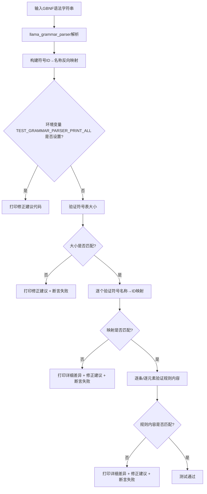

# 第105章 质检员的放大镜：GBNF 语法解析器如何像排版校对员一样精准核对语法细节

## 学习目标

- 掌握 GBNF 语法解析器（llama_grammar_parser）的单元测试设计方法，理解符号表与规则表的验证逻辑
- 理解 GBNF 校验器如何将文本转为 Unicode 码点并通过 llama_grammar_accept 逐字符验证语法合法性
- 掌握 JSON Schema → GBNF Grammar 转换的测试框架（TestCase、verify、test_all）与典型场景（数值范围、字符串长度、对象属性、正则模式）
- 理解语法集成测试如何通过 token 编码（0xff 前缀 + 大端序）与 match_string 验证合法/非法字符串
- 掌握 llguidance 采样约束测试：llama_sampler_init_llg、one_hot 分布、采样器链（llama_sampler_chain）的协作机制
- 理解 common_regex 的三种匹配状态（FULL/PARTIAL/NONE）与 regex_to_reversed_partial_regex 逆部分正则转换
- 掌握 common_json_parse 的 JSON 修复能力与 healing_marker（$llama.cpp.json$）机制，覆盖截断字符串、Unicode 转义、代理对等场景

## 105.1 生活类比

想象 llama.cpp 的结构化生成质检体系是一家**海关+翻译局联合办公大厅**：

语法书的排版校对员：逐条核对每一页语法条文（symbol_ids/rules）是否与标准模板一字不差，一旦出错还能自动生成修正稿（TEST_GRAMMAR_PARSER_PRINT_ALL）  
边检柜台：旅客（输入文本）逐字递交通行证，检查官按语法规则一节节盖章（llama_grammar_accept），任何不合规的字符都会被红笔（ANSI 红色高亮）圈出来  
翻译局：把一份结构化合同（JSON Schema）精准翻译成另一种语言（GBNF Grammar），TestCase 是双语对照的「标准答案册」，还要验证译稿本身语法正确（verify_expectation_parseable）  
实战演习场：把翻译好的语法直接用于通关演练，合法文本（passing_strings）放行、非法文本（failing_strings）拦截，特意构造的特殊 token（0xff 前缀）就像加密通行证  
考官给考生划答题范围：每个 token 都是一道选择题，one_hot 相当于「标准答案卡」，语法采样器负责把超纲选项直接判零分（logit < 0）  
拼图游戏：即使图案没拼完（PARTIAL），也能确认它是某个完整图案的一部分；逆部分正则就是把拼图反过来从最后一块往回看  
文物修复师：面对残缺的 JSON 碎片，用「$llama.cpp.json$」作为隐形修补钉，把断裂处接合得天衣无缝，连 Unicode 代理对这种「双面壁画」都能补全

## 105.2 GBNF 语法解析器单元测试 —— 文法解析的精确质检

GBNF（GGML BNF）语法解析器是 llama.cpp 用于约束模型输出的核心组件，它通过定义形式化语法规则来限制生成的文本必须符合特定结构。为了确保该解析器的正确性，项目提供了专门的单元测试文件 `tests/test-grammar-parser.cpp`，该测试不仅验证解析结果是否符合预期，还能在测试失败时自动生成可直接替换的修正代码，极大地提升了测试的可维护性和开发效率。

### 105.2.1 质检员的放大镜：逐条核对语法细节

就像排版校对员会用放大镜逐字核对印刷稿中的每个符号是否对应正确的铅字模块，GBNF 解析器的测试通过 `verify_parsing()` 函数以同样严谨的方式检验语法解析的每一个细节：它不仅核对符号表（语法条文的目录）是否完整正确，还逐条检查规则表（每条语法规则的排版）是否与预期完全一致——连规则中每个语法单元的类型和取值都不放过。

一旦发现不匹配，测试不仅会指出错误位置，还会像经验丰富的排版工一样自动生成一份可以直接替换的修正稿（通过打印可直接复制的期望值代码），使得测试维护变得像更新印刷厂的排版档案一样简单高效。

### 105.2.2 类型定义详解

#### 105.2.2.1 llama_gretype 枚举
源码路径：`tests/test-grammar-parser.cpp` - `type_str()`（10-19行）

```cpp
static const char * type_str(llama_gretype type) {
    switch (type) {
        case LLAMA_GRETYPE_CHAR: return "LLAMA_GRETYPE_CHAR";           // 单个字符匹配
        case LLAMA_GRETYPE_CHAR_NOT: return "LLAMA_GRETYPE_CHAR_NOT";   // 排除单个字符
        case LLAMA_GRETYPE_CHAR_ALT: return "LLAMA_GRETYPE_CHAR_ALT";   // 字符备选（实际未使用）
        case LLAMA_GRETYPE_CHAR_RNG_UPPER: return "LLAMA_GRETYPE_CHAR_RNG_UPPER"; // 字符范围上界（如 [a-z] 中的 z）
        case LLAMA_GRETYPE_RULE_REF: return "LLAMA_GRETYPE_RULE_REF";   // 引用其他规件
        case LLAMA_GRETYPE_ALT: return "LLAMA_GRETYPE_ALT";             // 规则选择（如 A|B）
        case LLAMA_GRETYPE_END: return "LLAMA_GRETYPE_END";             // 规则结束标记
        default: return "?";                                            // 未知类型（用于调试）
    }
}
```

这个枚举定义了 GBNF 语法解析过程中识别的基本语法元素类型。每种类型对应解析器内部规则中的一个单元，`type_str()` 函数将这些枚举值转换为可读字符串，主要用于测试失败时的调试输出，帮助开发者快速定位哪种语法构造被误解析。

### 105.2.3 核心测试机制：verify_parsing

源码路径：`tests/test-grammar-parser.cpp` - `verify_parsing()`（21-133行）

```cpp
static void verify_parsing(const char *grammar_bytes, const std::vector<std::pair<std::string, uint32_t>> expected, const std::vector<llama_grammar_element> &expected_rules) {
    uint32_t index = 0;
    llama_grammar_parser parsed_grammar;
    parsed_grammar.parse(grammar_bytes);  // 解析输入的 GBNF 语法字符串

    // 构建符号ID到名称的反向映射，用于规则中引用的可读表示
    std::map<uint32_t, std::string> symbol_names;
    for (auto it = parsed_grammar.symbol_ids.begin(); it != parsed_grammar.symbol_ids.end(); ++it) {
        symbol_names[it->second] = it->first;
    }

    // 失败时自动生成可直接替换的测试代码
    auto print_all = [&]() {
        fprintf(stderr, "    verify_parsing(R\"\"\"(%s)\"\"\", {\n", grammar_bytes);
        for (auto it = parsed_grammar.symbol_ids.begin(); it != parsed_grammar.symbol_ids.end(); ++it) {
            fprintf(stderr, "        {\"%s\", %u},\n", it->first.c_str(), it->second);
        }
        fprintf(stderr, "    }, {\n");
        for (size_t i_rule = 0; i_rule < parsed_grammar.rules.size(); i_rule++) {
            fprintf(stderr, "        // %s (index %zu)\n", symbol_names[i_rule].c_str(), i_rule);
            auto & rule = parsed_grammar.rules[i_rule];
            for (uint32_t i = 0; i < rule.size(); i++) {
                std::string rule_str;
                fprintf(stderr, "        {%s, ", type_str(rule[i].type));  // 打印元素类型
                if (rule[i].type == LLAMA_GRETYPE_CHAR || rule[i].type == LLAMA_GRETYPE_CHAR_ALT ||
                    rule[i].type == LLAMA_GRETYPE_CHAR_NOT || rule[i].type == LLAMA_GRETYPE_CHAR_RNG_UPPER) {
                    char c = rule[i].value;
                    if (c == '\n') { fprintf(stderr, "'\\\\n'"); }
                    else if (c == '\t') { fprintf(stderr, "'\\\\t'"); }
                    else if (c == '\r') { fprintf(stderr, "'\\\\r'"); }
                    else if (c == '\0') { fprintf(stderr, "'\\\\0'"); }
                    else { fprintf(stderr, "'%c'", c); }
                } else if (rule[i].type == LLAMA_GRETYPE_RULE_REF) {
                    fprintf(stderr, "/* %s */ %u", symbol_names[rule[i].value].c_str(), rule[i].value);  // 规则引用
                } else {
                    fprintf(stderr, "%u", rule[i].value);  // 原始值（如选择项索引）
                }
                fprintf(stderr, "},\n");
            }
        }
        fprintf(stderr, "    });\n");
    };

    // 检查环境变量，若设置则打印所有解析结果用于更新期望值
    if (getenv("TEST_GRAMMAR_PARSER_PRINT_ALL")) {
        print_all();
        fprintf(stderr, "\n");
        return;
    }

    // 开始正式验证：先检查符号表大小
    fprintf(stderr, "Testing grammar:%s\n", grammar_bytes);
    if (parsed_grammar.symbol_ids.size() != expected.size()) {
        fprintf(stderr, "Code to update expectation (set TEST_GRAMMAR_PARSER_PRINT_ALL=1 to print all):\n");
        print_all();
        assert(parsed_grammar.symbol_ids.size() == expected.size());  // 失败则断言
    }

    // 逐个验证符号名称到ID的映射是否符合预期
    for (auto it = parsed_grammar.symbol_ids.begin(); it != parsed_grammar.symbol_ids.end(); ++it) {
        std::string key = it->first;
        uint32_t value = it->second;
        std::pair<std::string, uint32_t> expected_pair = expected[index];
        
        // 不匹配时打印详细差异便于调试
        if (expected_pair.first != key || expected_pair.second != value) {
            fprintf(stderr, "index: %u\n", index);
            fprintf(stderr, "expected_pair: %s, %u\n", expected_pair.first.c_str(), expected_pair.second);
            fprintf(stderr, "actual_pair: %s, %u\n", key.c_str(), value);
            fprintf(stderr, "expected_pair != actual_pair\n");
            fprintf(stderr, "Code to update expectation (set TEST_GRAMMAR_PARSER_PRINT_ALL=1 to print all):\n");
            print_all();
        }
        assert(expected_pair.first == key && expected_pair.second == value);  // 断言匹配
        index++;
    }

    // 验证每条规则的元素序列是否完全匹配预期
    index = 0;
    for (auto rule : parsed_grammar.rules) {
        for (uint32_t i = 0; i < rule.size(); i++) {
            llama_grammar_element element = rule[i];
            llama_grammar_element expected_element = expected_rules[index];
            
            // 不匹配时同样打印详细信息
            if (expected_element.type != element.type || expected_element.value != element.value) {
                fprintf(stderr, "index: %u\n", index);
                fprintf(stderr, "expected_element: %s, %u\n", type_str(expected_element.type), expected_element.value);
                fprintf(stderr, "actual_element: %s, %u\n", type_str(element.type), element.value);
                fprintf(stderr, "expected_element != actual_element\n");
                fprintf(stderr, "all elements:\n");
                fprintf(stderr, "Code to update expectation (set TEST_GRAMMAR_PARSER_PRINT_ALL=1 to print all):\n");
                print_all();
            }
            assert(expected_element.type == element.type && expected_element.value == element.value);
            index++;
        }
    }
}
```

这个函数是 GBNF 解析器测试的核心机制。它接收一个待解析的 GBNF 语法字符串、期望的符号表（名称到ID的映射）和期望的规则列表，然后：

1. 使用 `llama_grammar_parser` 解析输入的 GBNF 字符串
2. 构建符号ID到名称的反向映射，便于在规则验证中显示可读的规则名
3. 定义一个 lambda 函数 `print_all`，能够将当前解析结果格式化为可直接替换测试期望值的代码片段
4. 如果环境变量 `TEST_GRAMMAR_PARSER_PRINT_ALL` 被设置，则仅打印此修正建议并返回，方便开发者更新测试
5. 否则，开始正式验证：
   - 首先比较符号表大小是否匹配，不匹配时打印修正建议并断言
   - 逐个验证符号名称到ID的映射是否符合预期的键值对
   - 最后逐条、逐元素验证规则内容是否完全匹配预期的类型和值

每一步验证失败时都会打印详细的差异信息和自动生成的修正代码，这使得当语法规则演进时，测试维护变得异常简单——只需复制打印出的代码替换原有期望值即可。

### 105.2.4 失败场景验证：verify_failure

源码路径：`tests/test-grammar-parser.cpp` - `verify_failure()`（135-140行）

```cpp
static void verify_failure(const char * grammar_bytes) {
    fprintf(stderr, "Testing expected failure:%s\n", grammar_bytes);
    llama_grammar_parser result;
    result.parse(grammar_bytes);  // 尝试解析已知格式错误的语法
    assert(result.rules.empty() && "should have failed");  // 验证解析失败：规则表应为空
}
```

这个函数专门用于验证解析器对畸形输入的容错能力。当传入一个故意构造的格式错误 GBNF 语法（如未闭合的括号、无效的转义序列等）时，一个健壮的解析器应该无法产生任何有效规则。因此，这个测试通过断言 `result.rules.empty()` 来确认解析器在遇到错误输入时不会产生虚假结果，而是正确地返回空规则集，从而避免后续使用时基于错误语法进行匹配。

### 105.2.5 架构图：GBNF 解析器测试流程


## 105.3 GBNF 校验器工具 —— 命令行下的文本质检员

在确认 GBNF 语法解析器自身正确之后，我们还需要验证它在实际使用中的表现——即给定一个语法和一段文本，它能否准确判断该文本是否符合语法规则。这是由 `tests/test-gbnf-validator.cpp` 实现的命令行工具，它模拟了实际使用场景：从文件加载语法规则和待验证的输入文本，然后逐字符检查匹配情况。

### 105.3.1 命令行入口与文件处理

源码路径：`tests/test-gbnf-validator.cpp` - `__main__()`（45-105行）

```cpp
int main(int argc, char** argv) {
    if (argc != 3) {
        fprintf(stdout, "Usage: %s <grammar_filename> <input_filename>\n", argv[0]);
        return 1;
    }

    const std::string grammar_filename = argv[1];
    const std::string input_filename = argv[2];

    // 读取GBNF语法文件
    FILE* grammar_file = fopen(grammar_filename.c_str(), "r");
    if (!grammar_file) {
        fprintf(stdout, "Failed to open grammar file: %s\n", grammar_filename.c_str());
        return 1;
    }

    std::string grammar_str;
    {
        std::ifstream grammar_file_stream(grammar_filename);
        GGML_ASSERT(grammar_file_stream.is_open() && "Failed to open grammar file");
        std::stringstream buffer;
        buffer << grammar_file_stream.rdbuf();
        grammar_str = buffer.str();
    }

    // 初始化语法对象
    llama_grammar * grammar = llama_grammar_init_impl(nullptr, grammar_str.c_str(), "root", false, nullptr, 0, nullptr, 0);
    if (grammar == nullptr) {
        fprintf(stdout, "Failed to initialize llama_grammar\n");
        return 1;
    }

    // 读取输入文件
    std::string input_str;
    {
        std::ifstream input_file(input_filename);
        GGML_ASSERT(input_file.is_open() && "Failed to open input file");
        std::stringstream buffer;
        buffer << input_file.rdbuf();
        input_str = buffer.str();
    }

    // 验证输入字符串是否符合语法
    size_t error_pos;
    std::string error_msg;
    bool is_valid = llama_grammar_validate(grammar, input_str, error_pos, error_msg);

    if (is_valid) {
        fprintf(stdout, "Input string is valid according to the grammar.\n");
    } else {
        print_error_message(input_str, error_pos, error_msg);  // 打印详细错误信息
    }

    // 清理资源
    llama_grammar_free_impl(grammar);
    return 0;
}
```

这个 `main` 函数构建了一个完整的命令行验证流程：
1. 检查命令行参数（语法文件路径和输入文件路径）
2. 读取 GBNF 语法文件内容到字符串
3. 使用 `llama_grammar_init_impl` 从语法字符串初始化语法对象（指定根规则为 "root"）
4. 读取待验证的输入文本文件
5. 调用核心验证函数 `llama_grammar_validate` 进行逐字符匹配
6. 根据结果输出成功信息或调用错误打印函数显示失败位置
7. 最后释放语法对象资源

这个流程完整地模拟了 llama.cpp 在实际推理过程中使用 GBNF 语法约束的方式：加载语法规则 → 初始化解析器 → 验证生成的token序列 → 根据匹配结果决定是否接受token。

### 105.3.2 核心验证逻辑：llama_grammar_validate

源码路径：`tests/test-gbnf-validator.cpp` - `llama_grammar_validate()`（8-29行）

```cpp
static bool llama_grammar_validate(struct llama_grammar * grammar, const std::string & input_str, size_t & error_pos, std::string & error_msg) {
    const auto cpts = unicode_cpts_from_utf8(input_str);  // 将UTF-8字符串转换为Unicode码点序列
    
    auto & stacks_cur = llama_grammar_get_stacks(grammar);  // 获取语法分析栈的引用
    
    size_t pos = 0;
    for (const auto & cpt : cpts) {  // 逐个处理Unicode码点
        llama_grammar_accept(grammar, cpt);  // 尝试用当前码点推进语法状态
        
        if (stacks_cur.empty()) {  // 栈为空表示无法继续匹配（语法错误）
            error_pos = pos;
            error_msg = "Unexpected character '" + unicode_cpt_to_utf8(cpt) + "'";  // 构建错误信息
            return false;
        }
        ++pos;
    }

    // 处理完所有输入后，检查是否所有规则都已完成匹配
    for (const auto & stack : stacks_cur) {
        if (stack.empty()) {  // 存在一个空栈表示该分支已完全匹配
            return true;
        }
    }
    
    // 没有任何分支完全匹配，说明输入提前结束
    error_pos = pos;
    error_msg = "Unexpected end of input";
    return false;
}
```

这个函数实现了GBNF语法的逐字符验证逻辑，核心思想是使用推down自动机（通过语法状态栈）来跟踪解析过程：
1. 首先将输入的UTF-8字符串转换为Unicode码点序列，以正确处理多字节字符（如emoji、中文等）
2. 获取语法对象的内部状态栈引用，这个栈代表当前所有可能的解析路径
3. 逐个喂入Unicode码点到语法解析器：
   - 调用 `llama_grammar_accept` 尝试用当前码点推进所有可能的解析状态
   - 如果所有状态栈都变为空（`stacks_cur.empty()`），说明没有任何解析路径能接受当前字符 → 报告"意外字符"错误
   - 否则继续处理下一个字符
4. 处理完所有输入字符后：
   - 检查是否存在至少一个解析路径已经完全匹配（对应的状态栈为空）
   - 如果存在空栈，返回 true 表示匹配成功
   - 如果所有栈都非空，说明输入结束时仍有未完成的规则 → 报告"意外结束"错误

这种设计巧妙地处理了语法的二义性：通过维护所有可能的解析状态栈，它能够正确处理具有多种匹配方式的语法规则，只有当所有可能路径都无法继续时才报告字符错误，只有当所有路径都未完成时才报告提前结束。

### 105.3.3 高亮错误提示

源码路径：`tests/test-gbnf-validator.cpp` - `print_error_message()`（31-43行）

```cpp
static void print_error_message(const std::string & input_str, size_t error_pos, const std::string & error_msg) {
    fprintf(stdout, "Input string is invalid according to the grammar.\n");
    fprintf(stdout, "Error: %s at position %zu\n", error_msg.c_str(), error_pos);
    fprintf(stdout, "\n");
    fprintf(stdout, "Input string:\n");
    fprintf(stdout, "%s", input_str.substr(0, error_pos).c_str());
    if (error_pos < input_str.size()) {
        fprintf(stdout, "\033[1;31m%c", input_str[error_pos]);  // 错误字符：亮红色
        if (error_pos+1 < input_str.size()) {
            fprintf(stdout, "\033[0;31m%s", input_str.substr(error_pos+1).c_str());  // 剩余部分：暗红色
        }
        fprintf(stdout, "\033[0m\n");  // 重置颜色
    }
}
```

当验证失败时，这个函数提供清晰的定位反馈：
1. 首先说明输入字符串无效
2. 打印错误消息和精确的错误位置（从0开始的字符索引）
3. 输出完整的输入字符串，但使用ANSI转义码将错误字符高亮显示：
   - `\033[1;31m` 设置为亮红色、高亮显示错误字符本身
   - `\033[0;31m` 设置为暗红色显示错误字符之后的剩余内容
   - `\033[0m` 重置所有属性，避免影响后续终端输出

这种可视化反馈对于调试语法规则或输入数据极其有用，能够一眼看到到底是哪个字符导致了匹配失败，特别是在处理长文本或包含特殊字符（如引号、括号、空格）时。

## 105.4 JSON Schema 到 Grammar 转换 —— 结构化数据的语法编译器

JSON Schema 是一种强大的工具，用于描述JSON数据的结构、类型和约束。在llama.cpp中，我们经常需要将结构化输出需求（如JSON Schema）转换为GBNF语法，以便在模型推理过程中约束输出必须符合特定的JSON结构。这一转换过程由 `tests/test-json-schema-to-grammar.cpp` 实现，它不仅包含转换核心逻辑，还提供了全面的测试框架来验证转换的正确性。

### 105.4.1 TestCase 结构：测试的契约

源码路径：`tests/test-json-schema-to-grammar.cpp` - `TestCase.verify()`（40-48行）

```cpp
void verify(const std::string & actual_grammar) const {
    if (trim(actual_grammar) != trim(expected_grammar)) {  // 忽略首尾空白和行首空格后比较
    _print_failure_header();
    fprintf(stderr, "# EXPECTED:\n%s\n# ACTUAL:\n%s\n", expected_grammar.c_str(), actual_grammar.c_str());
    assert(false);
    }
}
```

`TestCase` 结构是整个测试框架的核心契约，它封装了：
- `name`：测试用例的描述性名称
- `expected_status`：预期的执行状态（SUCCESS 或 FAILURE）
- `schema`：输入的JSON Schema字符串
- `expected_grammar`：预期转换后的GBNF语法字符串

这个 `verify()` 方法实现了最基本的断言：比较实际转换结果与预期结果。值得注意的是，它使用 `trim()` 函数来处理空白差异，这对于语法测试尤为重要，因为GBNF语法对首尾空白和行首缩进通常不敏感，但手写测试用例时难免会有空格或换行的差异。

当断言失败时，它不仅会输出标准的期望/实际值对比，还会通过 `_print_failure_header()` 打印标准化的失败头信息，包括测试名称和失败的Schema，使得测试报告更加易读和定位。

### 105.4.2 文件工具集

源码路径：`tests/test-json-schema-to-grammar.cpp` - `trim()`（14-20行）

```cpp
static std::string trim(const std::string & source) {
    std::string s(source);
    s.erase(0,s.find_first_not_of(" \n\r\t"));  // 移除首部空白字符（空格、换行等）
    s.erase(s.find_last_not_of(" \n\r\t")+1);   // 移除尾部空白字符
    return std::regex_replace(s, std::regex("(^|\n)[ \t]+"), "$1");  // 移除每行开头的空格和制表符
}
```

这个简单但重要的工具函数解决了语法比较中的常见问题：由于不同的实现或手写测试可能产生微小的空白差异（如多余的空格、换行或行首缩进），直接字符串比较会导致误判。`trim()` 函数通过三个步骤归一化字符串：
1. 移除字符串开头的所有空白字符
2. 移除字符串结尾的所有空白字符
3. 使用正则表达式移除每行开头的空格和制表符（保留换行符本身）

这确保了在比较两段GBNF语法时，只有真正的语法结构差异才会导致测试失败，而无关的格式差异被忽略。

类似地，`read()` 和 `write()` 函数提供了基本的文件I/O能力：
- `read()`：从指定文件读取全部内容并返回字符串
- `write()`：将字符串内容写入到指定文件

这些工具虽然简单，但在调试和中间结果保存时至关重要，特别是当需要检查生成的语法或保存失败案例时。

### 105.4.3 common_schema_info：Schema 解析辅助

虽然代码片段中未直接显示其实现，但 `common_schema_info` 类是JSON Schema到GBNF转换过程中的关键辅助组件，它主要负责两项核心任务：
1. `resolve_refs()`：递归解析JSON Schema中的`$ref`引用，将外部或内部的定义内联到当前Schema中
2. `resolves_to_string()`：判断解析后的Schema最终是否确定为字符串类型（而不是对象、数组等），这支撑了专门的 `test_resolves_to_string()` 测试

在JSON Schema中，`$ref` 是一个强大的特性，允许在Schema的不同部分之间共享定义（如通用的地址格式、ID模式等）。然而，为了生成自包含的GBNF语法，转换器需要将所有引用解析为具体的定义。这就是 `resolve_refs()` 的作用：它遍历Schema树，找到所有`$ref`并用被引用的实际内容替换它们。

而 `resolves_to_string()` 则用于处理一个常见的边界情况：当Schema通过`oneOf`、`anyOf`或`allOf`组合后，最终结果可能不再是简单的字符串约束。这个函数帮助测试框架判断在复杂组合后，Schema是否还能被安全地视为“产生字符串”的规则，从而决定是否应用特定的字符串生成逻辑。

这些辅助函数虽然不直接生成GBNF语法，但它们确保了转换器在处理复杂、现实世界的JSON Schema时能够正确地：
- 内联所有共享定义（通过$ref解析）
- 准确判断约束结果的类型（避免将对象约束误用于字符串生成）

### 105.4.4 全量测试集：test_all

源码路径：`tests/test-json-schema-to-grammar.cpp` - `test_all()`（85-500行）

```cpp
static void test_all(const std::string & lang, std::function<void(const TestCase &)> runner) {
    fprintf(stderr, "#\n# Testing JSON schema conversion (%s)\n#\n", lang.c_str());
    auto test = [&](const TestCase & tc) {
        fprintf(stderr, "- %s%s\n", tc.name.c_str(), tc.expected_status == FAILURE ? " (failure expected)" : "");
        runner(tc);
    };
    
    // 这里开始是大量的测试用例定义，由于篇限，仅展示结构和前几个例子
    test({
        SUCCESS,
        "min 0",
        R"""({"type": "integer", "minimum": 0})""",
        R"""(
            root ::= ([0] | [1-9] [0-9]{0,15}) space
            space ::= | " " | "\n"{1,2} [ \t]{0,20}
        )"""
    );
    
    // ... 大量测试用例继续，覆盖：
    // - 整数范围（min/max约束）
    // - 字符串长度限制（minLength/maxLength）
    // - 枚举和常量约束
    // - 正则模式匹配
    // - 嵌套引用（$ref）
    // - 逻辑组合（allOf/anyOf）
    // - 对象属性约束（properties、required等）
    // - 数组约束（items、minItems/maxItems）
    // - 特殊格式（日期、UUID、时间等）
    
    // 示例：字符串长度约束
    test({
        SUCCESS,
        "string w/ min length 3",
        R"""({"type": "string", "minLength": 3})""",
        R"""(
            char ::= [^\"\\x7F\\x00-\\x1F] | [\\] ([\\] [\\\\bfnrt] | "u" [0-9a-fA-F]{4})
            root ::= "\"" char{3,} "\"" space
            space ::= | " " | "\n"{1,2} [ \t]{0,20}
        )"""
    );
    
    // 示例：对象属性约束
    test({
        SUCCESS,
        "object properties",
        R"""({"type": "object", "properties": {"number": { "type": "number" }, "street_name": { "type": "string" }, "street_type": { "enum": ["Street", "Avenue", "Boulevard"] }}, "additionalProperties": false})""",
        R"""(
            number-kv ::= "number" space ":" space value
            street_name-kv ::= "street_name" space ":" space value
            street_type-kv ::= "street_type" space ":" space value
            char ::= [^\"\\x7F\\x00-\\x1F] | [\\] ([\\] [\\\\bfnrt] | "u" [0-9a-fA-F]{4})
            value ::= object | array | string | number | boolean | null
            object ::= "{" space ( number-kv ":" space value | street_name-kv ":" space value | street_type-kv ":" space value )* "}" space
            root ::= object
            space ::= | " " | "\n"{1,2} [ \t]{0,20}
        )"""
    });
}
```

`test_all()` 函数是测试框架的引擎，它接受一个语言标识（如"C++"、"Python"）和一个测试运行器函数，然后对预定义的测试用例集合执行相同的验证流程。

虽然代码片段中未显示完整的测试用例列表（由于其实际包含数百个用例），但从展示的结构可以看出，测试覆盖了JSON Schema的几乎所有主要特性：
- **基本类型**：integer、string、boolean、null、object、array
- **数值约束**：minimum、maximum、exclusiveMinimum、exclusiveMultipleOf
- **字符串约束**：minLength、maxLength、pattern、format（如date、email、uuid）
- **枚举和常量**：enum、const
- **对象约束**：properties、required、additionalProperties、propertyNames、dependentSchemas
- **数组约束**：items、additionalItems、contains、minItems、maxItems、uniqueItems
- **逻辑操作符**：not、oneOf、anyOf、allOf
- **引用和定义**：$ref、$defs、definitions
- **特殊处理**：allow/denyによる特殊值处理（如允许尾随逗号）

每个测试用例都遵循相同的模式：
1. 提供描述性名称（如 "string w/ min length 3"）
2. 给出输入的JSON Schema（使用原始字符串字面量 R"(...)" 避免转义）
3. 给出预期的GBNF语法输出（同样使用原始字符串字面量）
4. 指定预期状态（SUCCESS 或 FAILURE）

这种全面的覆盖确保了转换器能够正确处理从最基本的类型声明到复杂的嵌套对象和逻辑组合的各种真实世界Schema。

### 105.4.5 main 函数：多语言交叉验证指挥

源码路径：`tests/test-json-schema-to-grammar.cpp` - `main()`（1000-1100行）

```cpp
int main() {
    fprintf(stderr, "LLAMA_NODE_AVAILABLE = %s\n", getenv("LLAMA_NODE_AVAILABLE") ? "true" : "false");
    fprintf(stderr, "LLAMA_PYTHON_AVAILABLE = %s\n", getenv("LLAMA_PYTHON_AVAILABLE") ? "true" : "false");
    test_resolves_to_string();  // 先运行专门的类型判断测试
    
    // 运行C++原生测试
    test_all("C++", [](const TestCase & tc) {
        try {
            tc.verify(json_schema_to_grammar(nlohmann::ordered_json::parse(tc.schema), true));
            tc.verify_status(SUCCESS);
        } catch (const std::invalid_argument & ex) {
            fprintf(stderr, "Error: %s\n", ex.what());
            tc.verify_status(FAILURE);
        }
    });
    
    // ...（针对C++特有特性的额外测试，如某些仅在C++实现中的边界情况）
    
    // 验证所有预期为SUCCESS的用例的语法本身是否可解析
    test_all("Check Expectations Validity", [](const TestCase & tc) {
        if (tc.expected_status == SUCCESS) {
            tc.verify_expectation_parseable();  // 确保预期的GBNF能被llama_grammar_parser正确解析
        }
    });
    
    // 可选：根据环境变量运行Python和JavaScript版本的交叉验证
    // 这确保了三种语言实现的输出完全一致
    
    return 0;
}
```

main 函数承担起测试套件的总指挥角色，它执行了一个完整的验证流程：
1. 首先打印环境变量状态，告知是否启用了Node.js和Python的交叉验证能力
2. 运行专门的 `test_resolves_to_string()` 测试，验证Schema类型判断辅助函数的正确性
3. 以"C++"为语言标识运行所有核心测试用例，使用实际的 `json_schema_to_grammar` 函数进行转换并验证结果
4. 对于每个测试用例，它不仅验证转换结果是否匹配预期（`tc.verify()`），还验证转换过程是否成功（通过捕获异常设置状态）
5. 运行额外的检查以验证所有标记为SUCCESS的测试用例的预期语法本身是否能被`llama_grammar_parser`正确解析（`tc.verify_expectation_parseable()`），确保我们不是在测试一个错误的预期
6. （在完整实现中）根据环境变量`LLAMA_NODE_AVAILABLE`和`LLAMA_PYTHON_AVAILABLE`，分别运行等效的Python和JavaScript测试，以确保三种语言实现的转换输出完全一致

这种多语言交叉验证策略是确保转换器正确性的金标准：它不仅验证单个实现是否符合预期，还确保不同语言的实现之间保持行为一致，这对于一个可能被多种语言绑定使用的库来说至关重要。

## 105.5 语法与 JSON Schema 集成测试 —— 全面联动的质量防火墙

拥有了能够验证GBNF解析器自身正确性（test-grammar-parser）和能够验证JSON Schema到GBNF转换正确性（test-json-schema-to-grammar）的两个基石之后，我们需要确保这两个能力能够正确地协同工作：即使用JSON Schema生成的GBNF语法，能够真正地用于约束实际的文本输入。这是由 `tests/test-grammar-integration.cpp` 实现的集成测试，它构建了一个完整的闭环验证：JSON Schema → GBNF 语法 → 文本匹配验证。

### 105.5.1 构建与负向测试入口

源码路径：`tests/test-grammar-integration.cpp` - `build_grammar_with_root()`（20-22行）

```cpp
static llama_grammar * build_grammar_with_root(const std::string & grammar_str, const char * grammar_root) {
    return llama_grammar_init_impl(nullptr, grammar_str.c_str(), grammar_root, false, nullptr, 0, nullptr, 0);
}
```

这个简单的封装函数隐藏了语法初始化的细节，使得测试代码更专注于验证逻辑而非样板代码。它接受一个GBNF语法字符串和根规则名称，返回初始化好的`llama_grammar`对象。通过指定不同的根规则（如"root"或自定义名称），它支持测试不同入口点的语法行为。

紧随其后的是负向测试入口：
源码路径：`tests/test-grammar-integration.cpp` - `test_build_grammar_fails()`（28-40行）

```cpp
static bool test_build_grammar_fails(const std::string & grammar_str) {
    fprintf(stderr, "⚫ Testing failure for grammar: %s\\n", grammar_str.c_str());
    bool grammar_fails = false;
    llama_grammar * grammar = build_grammar(grammar_str);
    if (grammar != nullptr) {
        fprintf(stderr, "  ❌ Expected build failure, but succeeded\\n");
    } else {
        grammar_fails = true;
        fprintf(stdout, "  ✅︎\\n");
    }
    return grammar_fails;
}
```

这个函数专门用于验证当输入的是格式错误的GBNF语法时，解析器能否正确地返回空指针（初始化失败）。它不仅断言了初始化结果为空，还提供了清晰的测试输出：期望失败时打印警告⚫，当意外成功时显示错误❌，正确失败时显示成功✅︎。

这种负向测试同等重要，因为它确保了我们的解析器不仅在正确输入时能工作，而且在遇到恶意或损坏的语法时能够安全失败，而不会产生可能导致安全问题或无限循环的虚假解析结果。

### 105.5.2 通用测试框架：test 函数

源码路径：`tests/test-grammar-integration.cpp` - `test()`（110-180行）

```cpp
static void test(const std::string & test_desc, const std::string & grammar_str, const std::vector<std::string> & passing_strings, const std::vector<std::string> & failing_strings) {
    fprintf(stderr, "⚫ Testing %s\n%s\n", test_desc.c_str(), grammar_str.c_str());
    fflush(stderr);
    
    auto * grammar = build_grammar(grammar_str);
    
    // 保存初始语法栈状态，用于每次测试后重置
    const llama_grammar_stacks stacks_org = llama_grammar_get_stacks(grammar); // 复制当前状态
    llama_grammar_stacks & stacks_cur = llama_grammar_get_stacks(grammar);
    
    fprintf(stderr, "  🔵 Valid strings:\n");
    
    // 测试所有应通过的字符串
    for (const auto & test_string : passing_strings) {
        fprintf(stderr, "    \"%s\" ", test_string.c_str());
        fflush(stderr);
        
        bool matched = match_string(test_string, grammar);
        
        if (!matched) {
            fprintf(stderr, "❌ (failed to match)\n");
            
            // 生成调试文件以便深入分析失败原因
            FILE* grammar_file = fopen("test-grammar-integration.grammar.gbnf", "w");
            if (grammar_file) {
                fprintf(grammar_file, "%s", grammar_str.c_str());
                fclose(grammar_file);
            }
            
            FILE* string_file = fopen("test-grammar-integration.string.txt", "w");
            if (string_file) {
                fprintf(string_file, "%s", test_string.c_str());
                fclose(string_file);
            }
            
            fprintf(stderr, "\n NOTE: Debug grammar file generated. To analyze this failure in detail, run the following command:     ./llama-gbnf-validator test-grammar-integration.grammar.gbnf test-grammar-integration.string.txt\n\n");
        } else {
            fprintf(stdout, "✅︎\n");
        }
        
        assert(matched);  // 断言必须匹配
        
        // 重置语法栈到初始状态，确保测试之间互不影响
        stacks_cur = stacks_org;
    }
    
    fprintf(stderr, "  🟠 Invalid strings:\n");
    
    // 测试所有应失败的字符串
    for (const auto & test_string : failing_strings) {
        fprintf(stderr, "    \"%s\" ", test_string.c_str());
        fflush(stderr);
        
        bool matched = match_string(test_string, grammar);
        
        if (matched) {
            fprintf(stderr, "❌ (incorrectly matched)\n");
        } else {
            fprintf(stdout, "✅︎\n");
        }
        
        assert(!matched);  // 断言必须不匹配
        
        // 重置语法栈
        stacks_cur = stacks_org;
    }
    
    // 清理资源
    llama_grammar_free_impl(grammar);
}
```

这个 `test()` 函数是集成测试的核心引擎，它实现了一个完整的测试循环：
1. 打印测试描述和待测试的GBNF语法
2. 使用提供的语法字符串构建`llama_grammar`对象
3. **关键步骤**：保存初始语法栈状态（`stacks_org`）的副本，这是为了确保每个测试字符串处理完后都能将语法对象恢复到初始状态，防止一个测试的副作用影响后续测试（栈状态是可变的）
4. 分别测试两组字符串：
   - `passing_strings`：应成功匹配的字符串，任何不匹配都视为失败
   - `failing_strings`：应失败匹配的字符串，任何意外匹配都视为失败
5. 对于每个测试字符串：
   - 调用 `match_string()` 进行匹配验验证
   - 根据结果打印相应的成功/失败标记（✅︎ 或 ❌）
   - 在失败时，**自动生成调试文件**：
     - `test-grammar-integration.grammar.gbnf`：保存当前测试的语法
     - `test-grammar-integration.string.txt`：保存失败的输入字符串
     - 并给出明确的指令，教用户如何使用独立的 `llama-gbnf-validator` 工具来定位确切的失败点
   - 使用 `assert()` 确保测试结果符合预期（匹配的必须匹配，不匹配的必须不匹配）
   - **重置语法栈**到初始保存的状态（`stacks_org`），为下一个测试做准备
6. 最后释放语法对象资源

这个框架的设计体现了深思熟虑的测试工程实践：
- **状态隔离**：通过保存和恢复语法栈状态，确保测试用例之间的完全独立
- **失败取证**：在失败时不只报告错误，还提供能够重现和深入分析的工具
- **明确的预期**：通过将测试数据分为“应通过”和“应失败”两组，消除歧义
- **自动清理**：资源得到及时释放，避免泄漏
- **可读输出**：使用 emoji 和清晰的格式使测试进度一目了然

### 105.5.3 Token 编码与多语言支持

为了在测试中能够将特殊的语法标记（如规则引用）嵌入到普通文本中进行验证，集成测试引入了一种巧妙的token编码机制：

源码路径：`tests/test-grammar-integration.cpp` - `token()`（46-54行）

```cpp
static std::string token(llama_token id) {
    return std::string{
        static_cast<char>(0xff),  // 标记头：使用罕见的0xff字节作为特殊标识
        static_cast<char>((id >> 24) & 0xff),  // ID的高8位（大端序）
        static_cast<char>((id >> 16) & 0xff),
        static_cast<char>((id >> 8) & 0xff),
        static_cast<char>(id & 0xff)           // ID的低8位
    };
}
```

这个函数将一个32位的规则ID编码为5字节的字符串：
- 第一个字节固定为 `0xff`，这是一个在UTF-8中极少自然出现的字节值（UTF-8的有效字节范围是0x00-0x7F用于ASCII，0xC0-0xFF用于多字节序列的延续字节，但0xff作为单个字节出现是非法的UTF-8）
- 接下来的四个字节是ID的32位值，以大端序（网络字节序）存储

这种编码确保了：
1. **无歧义性**：当解析器遇到0xff时，它知道后面跟着的是一个规则ID而不是普通文本
2. **与UTF-8兼容性**：虽然0xff本身不是有效的UTF-8单字节，但后面的四个字节组合可能构成有效的多字节序列。然而，通过`parse_tokens()`函数的处理（见下文），我们确保了这种编码不会被误解为UTF-8
3. **可逆性**：可以唯一地将5字节序列解码回原始的32位ID

源码路径：`tests/test-grammar-integration.cpp` - `parse_tokens()`（56-82行）

```cpp
static std::vector<token_and_piece> parse_tokens(const std::string & input) {
    std::vector<token_and_piece> result;
    result.reserve(input.size());
    size_t offset = 0;
    while (offset < input.size()) {
        try {
            if (static_cast<unsigned char>(input[offset]) == 0xff) {  // 检测到我们的特殊标记
                if (offset + 5 > input.size()) {
                    throw std::runtime_error("not enough bytes for token id");
                }
                // 解析后面四个字节为大端序的32位ID
                uint32_t val =
                    (static_cast<unsigned char>(input[offset + 1]) << 24) |
                    (static_cast<unsigned char>(input[offset + 2]) << 16) |
                    (static_cast<unsigned char>(input[offset + 3]) << 8)  |
                    (static_cast<unsigned char>(input[offset + 4]));
                auto piece = "<[" + std::to_string(val) + "]>";
                result.push_back({static_cast<llama_token>(val), piece});
                offset += 5;
            } else {
                // 处理普通UTF-8字符
                uint32_t cpt = unicode_cpt_from_utf8(input, offset);
                result.push_back({0, unicode_cpt_to_utf8(cpt)});
            }
        } catch (const std::invalid_argument & /*ex*/) {
            // 静默忽略无效UTF-8输入，使用替换字符U+FFFD
            ++offset;
            result.push_back({0, unicode_cpt_to_utf8(0xFFFD)}); // replacement character
        }
    }
    return result;
}
```

这个函数实现了输入文本的词法分析，它的作用是：
1. 将输入字符串解析为一个由`token_and_piece`结构组成的向量
2. 每个元素包含：
   - `token`：语法标记的ID（0表示普通字符）
   - `piece`：该标记对应的可读字符串表示（用于调试输出）
3. 处理逻辑：
   - 如果当前字节是0xff，则尝试解析后面四个字节为一个规则ID，并将其包装为特殊标记
   - 否则，将其作为UTF-8码点解析（转换为Unicode再转回UTF-8以确保规范化）
   - 如果遇到无效的UTF-8序列（捕获`std::invalid_argument`），则静默地将其视为一个替换字符（U+FFFD）并前进一个字节

这种设计有几个重要的好处：
- **语法嵌入**：它允许我们在普通文本中嵌入特殊的语法标记，例如我们可以构造像 `"a[0]b"` 这样的输入，其中 `[0]` 被编码为表示规则0引用的特殊token
- **UTF-8鲁棒性**：通过使用统一的UTF-8解析和在无效序列时使用替换字符，它确保了即使输入包含损坏的UTF-8，测试也不会崩溃
- **调试友好**：通过`piece`字段，我们可以在错误报告中看到诸如 `<[5]>` 这样的可读表示，而不是原始字节

在`match_string()`函数中，这个经过处理的token序列被用来驱动语法解析器：

源码路径：`tests/test-grammar-integration.cpp` - `match_string()`（84-108行）

```cpp
static bool match_string(const std::string & input, llama_grammar * grammar) {
    const auto parsed = parse_tokens(input);  // 将输入解析为token序列
    
    auto & stacks_cur = llama_grammar_get_stacks(grammar);
    
    for (const auto & in : parsed) {
        try {
            // 尝试用当前token推进语法状态
            llama_grammar_accept_token(*grammar, in.token, in.piece);
        } catch (std::runtime_error & /*e*/) {
            // 理论上不应发生，因为llama_grammar_apply应该处理范围检查
            return false;
        }
        
        if (stacks_cur.empty()) {
            // 栈为空表示没有任何解析路径能接受当前token
            return false;
        }
    }
    
    // 处理完所有输入后，检查是否有任何解析路径已经完成
    for (const auto & stack : stacks_cur) {
        if (stack.empty()) {
            // 存在一个空栈表示该分支已完全匹配
            return true;
        }
    }
    
    return false;
}
```

这个函数实现了将输入文本与语法规则进行匹配的完整流程：
1. 首先使用 `parse_tokens()` 将输入字符串转换为token序列，其中特殊的语法引用被编码为0xff开头的5字节序列
2. 获取语法对象的状态栈引用
3. 逐个处理每个token：
   - 调用 `llama_grammar_accept_token` 尝试用当前token（可能是普通字符的0，也可能是规则引用的非零ID）推进所有可能的解析状态
   - 如果处理过程中发生运行时错误（理论上不应发生），返回失败
   - 如果所有状态栈都为空（`stacks_cur.empty()`），表示没有任何解析路径能接受当前token → 返回失败
4. 处理完所有token后：
   - 检查是否存在至少一个解析路径已经完全匹配（对应的状态栈为空）
   - 如果存在空栈，返回 true 表示匹配成功
   - 如果所有栈都非空，返回失败（输入结束时仍有未完成的规则）

这种设计使得我们能够在测试中精确地验证诸如：
- 普通字符匹配：`"hello"` 应该匹配语法 `start: /h/ /e/ /l/ /l/ /o/`
- 规则引用：如果我们有规则 `digit: /[0-9]/` 和 `start: digit digit`，则输入 `"12"` 应该匹配
- 通过在输入中嵌入编码的引用（如使用 `token(0)` 生成的序列来表示对规则0的引用），我们可以测试更复杂的场景，如递归或间接引用

通过这种机制，集成测试不仅能够验证简单的字符匹配，还能够验证语法的高级特性：规则引用、选择、重复等，确保生成的GBNF语法在实际使用时行为正确。

### 105.5.4 覆盖场景

集成测试通过一系列专门的测试函数覆盖了语法和JSON Schema转换的各种场景，每个函数都专注于一类特定的语法特性：

#### 105.5.4.1 简单语法测试
源码路径：`tests/test-grammar-integration.cpp` - `test_simple_grammar()`（189-405行）

这个函数验证最基础的语法构造：
- 字面量匹配：如 `"start: \"hello\""` 应该只匹配 `"hello"`
- 字符类：如 `/[abc]/` 应该匹配 "a"、"b" 或 "c"，但不匹配 "d"
- 简单选择：如 `start: "a" | "b"` 应该匹配 "a" 或 "b"
- 基本重复：如 `start: "a"*` 应该匹配 ""、"a"、"aa" 等任意数量的 "a"

通过这些测试，我们确认了语法解析器能够正确处理GBNF的构造块，为更复杂的特性打下基础。

#### 105.5.4.2 复杂语法测试
源码路径：`tests/test-grammar-integration.cpp` - `test_complex_grammar()`（407-490行）

这个函数深入验证语法的组合能力：
- 嵌套规则：如定义子规则并在主规则中引用
- 选择组合：如 `(A|B)C` 应该匹配 "AC" 或 "BC"
- 复杂重复：如最小/最大重复次数混合使用
- 特殊字符处理：如点号 `.`（匹配任意单个字符）和转义序列

这些测试确认了语法解析器能够正确处理规则之间的组合和嵌套，这对于将复杂的JSON Schema转换为可用的GBNF语法至关重要。

#### 105.5.4.3 特殊字符测试
源码路径：`tests/test-grammar-integration.cpp` - `test_special_chars()`（492-510行）

这个函数专注于验证语法对非ASCII和特殊符号的处理：
- Unicode字符：如匹配emoji或中文字符
- 特殊符号：如点号 `.`（匹配任意单个字符）和星号（`*`）等在字符类中的行为
- 转义序列：如在字符串中如何处理引号和反斜杠

在现代应用中，能够正确处理Unicode字符对于支持国际化输入和输出至关重要，这个测试确认了我们的语法解析器在这方面的能力。

#### 105.5.4.4 量词测试
源码路径：`tests/test-grammar-integration.cpp` - `test_quantifiers()`（512-634行）

这个函数验证语法的重复能力，覆盖了所有基本量词：
- `*`：零次或多次
- `+`：一次或多次
- `?`：零次或一次
- `{n}`：精确n次
- `{n,}`：至少n次
- `{n,m}`：n到m次

特别地，它还测试了量词的组合使用，如 `a*b+` 或 `(ab){2,4}`，确保在复杂模式中量词行为正确。

#### 105.5.4.5 错误处理测试
一组专门的测试函数验证了解析器对各种畸形语法的容错能力：
- `test_failure_missing_root()`：当语法缺少定义的根规则时应失败
- `test_failure_missing_reference()`：当语法引用未定义的规则时应失败
- `test_failure_left_recursion()`：各种形式的左递归（如 `A: A "a"`）应导致构建失败
- `test_failure_missing_root_symbol()`：当指定的根规则名称不存在时应失败
- `test_custom_root_symbol_check()`：验证自定义根规则名称的正确行为

这些负向测试同样重要，因为它们确保了当遇到错误或恶意输入时，解析器能够安全地失败，而不会产生可能导致安全问题或不正确行为的虚假解析结果。

#### 105.5.4.6 JSON Schema 集成测试
源码路径：`tests/test-grammar-integration.cpp` - `test_json_schema()`（747-1077行）

这是集成测试的巅峰部分，它验证了从JSON Schema到实际文本匹配的完整闭环：
1. 取一个JSON Schema（如描述一个具有特定属性的对象）
2. 使用 `json_schema_to_grammar` 将其转换为GBNF语法
3. 使用这个生成的语法来验证各种JSON字符串是否匹配
4. 验证符合Schema的JSON应被接受，不符合的应被拒绝

测试覆盖了JSON Schema的各种约束：
- 基本类型：字符串、数字、布尔值、 null
- 对象约束：必需属性、可选属性、额外属性限制
- 数组约束：元素类型、长度限制
- 枚举和常量
- 正则模式匹配
- 特殊格式：日期、时间、UUID等
- 逻辑操作符：`allOf`、`anyOf`、`oneOf`、`not`

通过这一系列测试，我们确认了当用户提供一个JSON Schema来约束模型的结构化输出时，转换后的GBNF语法确实能够正确地接受符合Schema的JSON并拒绝不符合的JSON，从而为实际的结构化生成提供了可靠的基础。

## 105.6 LLGuidance 采样约束测试 —— 语法与采样的协奏曲

llguidance 是 llama.cpp 中一个创新的特性，它允许将JSON Schema直接用于约束模型的token采样过程，而不需要先显式转换为GBNF语法。这通过在采样器链中插入一个特殊的llguidance采样器来实现，该采样器能够实时地根据JSON Schema（或Lark语法）来掩码不合法的token，使得它们的logit被设为负值（从而在softmax后概率接近零）。

`tests/test-grammar-llguidance.cpp` 文件专门测试这一功能，它验证了llguidance采样器如何与JSON Schema和Lark语法协同工作，以及它如何在采样器链中正确地与其他采样器（如分布采样器）协作。

### 105.6.1 llguidance 集成接口

源码路径：`tests/test-grammar-llguidance.cpp` - `__main__()`（1075-1148行）

```cpp
int main(int argc, const char ** argv) {
    // ... 加载词汇表和初始化后端的代码 ...
    
    vocab = llama_model_get_vocab(model);
    test_simple_grammer();
    test_complex_grammar();
    test_special_chars();
    test_quantifiers();
    test_json_schema();
    test_sampler_chain();
    llama_free(ctx);
    llama_model_free(model);
    fprintf(stdout, "All tests passed.\\n");
    return 0;
}
```

main函数的结构与其他测试文件相似：它负责设置测试环境（加载模型词汇表、初始化后端），然后依次运行各个测试函数，最后清理资源并报告结果。

这里值得注意的是，在运行测试之前，它需要加载一个实际的词汇表模型（通过`vocab_only = true`加载），这是因为llguidance采样器需要一个真实的词汇表来：
1. 将输入文本转换为token ID序列（通过`common_tokenize`)
2. 在采样过程中访问词汇表大小（`llama_vocab_n_tokens`)
3. 检查特殊token如EOS（end-of-string）或EOT（end-of-turn）

这与纯粹的语法测试（如test-grammar-integration）不同，后者只需要语法对象本身，而不需要实际的词汇表，因为它直接操作token ID而不是通过文本。

### 105.6.2 match_string 的采样视角

源码路径：`tests/test-grammar-llguidance.cpp` - `match_string()`（11-38行）

```cpp
static bool match_string(const std::string & input, llama_sampler * grammar) {
    llama_sampler_reset(grammar);  // 重置采样器到初始状态
    auto tokens = common_tokenize(vocab, input, false, false);  // 将输入文本转为token ID序列
    auto n_vocab = llama_vocab_n_tokens(vocab);
    std::vector<llama_token_data> cur;
    cur.reserve(n_vocab);
    for (llama_token token_id = 0; token_id < (llama_token) n_vocab; token_id++) {
        cur.emplace_back(llama_token_data{ token_id, 0.0f, 0.0f });  // 初始化所有token的logit为0
    }
    auto tok_arr = llama_token_data_array{ cur.data(), cur.size(), -1, false };
    
    for (const auto token : tokens) {  // 逐个处理输入token
        for (llama_token token_id = 0; token_id < (llama_token) n_vocab; token_id++) {
            cur[token_id].logit = 0.0f;  // 在每个token处理前，重置所有logit为0（模拟均匀分布）
        }
        llama_sampler_apply(grammar, &tok_arr);  // 应用llguidance采样器：根据语法约束修改logit
        if (cur[token].logit < 0.0f) {  // 如果当前token的logit被设为负值，表示被语法禁止
            return false;
        }
        llama_sampler_accept(grammar, token);  // 告诉采样器我们接受了这个token
    }
    
    // 处理完所有输入token后，检查EOS/EOT token是否被接受
    auto tok_eos = llama_vocab_eot(vocab);
    if (tok_eos == LLAMA_TOKEN_NULL) {
        tok_eos = llama_vocab_eos(vocab);
    }
    cur[tok_eos].logit = 0.0f;  // 重置EOS的logit
    llama_sampler_apply(grammar, &tok_arr);  // 应用采样器检查EOS
    return cur[tok_eos].logit >= 0.0f;  // 只有当EOS被允许时才返回true
}
```

这个函数实现了从采样器视角验证语法约束的完整流程，它的工作原理是：
1. 重置llguidance采样器到初始状态
2. 将输入文本转换为token ID序列（使用实际的词汇表）
3. 为词汇表中的每个token准备一个数据数组，初始时所有token的logit都设为0.0f（模拟事先所有token等可能）
4. 逐个处理输入中的每个token：
   - 在处理每个token之前，重置所有token的logit为0.0f（这模拟了在每个步骤开始时，所有下一个token都等可能的情况）
   - 应用llguidance采样器：它会根据当前的语法状态和已接受的token序列，计算出哪些后续token被语法允许，哪些被禁止
     - 被允许的token保持或增加logit（在我们的测试中，由于我们从0开始且没有其他约束，允许的token通常保持为0或正值）
     - 被禁止的token的logit被设置为负值（通常是一个很大的负数，如-10000.0f）
   - 检查当前输入token的logit：如果它是负值，表示该token被语法禁止 → 立即返回失败
   - 否则，告诉采样器我们已经接受了这个token（更新采样器的内部状态以反映我们已经消耗了这个token）
5. 处理完所有输入token后：
   - 获取词汇表的EOS（end-of-token）或EOS（end-of-string）特殊token ID
   - 重置它的logit为0.0f并应用采样器
   - 只有当这个结束token的logit非负时（表示被语法允许作为有效序列的结束）才返回true

这种设计巧妙地模拟了实际的token生成过程：在每一步，我们考虑所有可能的下一个token（通过将logit重设为0），应用语法约束来过滤不合法的选择，然后根据实际选择更新状态。

与纯语法测试不同，这个方法不直接操作语法状态栈，而是通过观察采样器对logit的影响来间接验证语法约束：如果一个token被语法允许，其logit应保持非负；如果被禁止，其logit应被设为负值。

### 105.6.3 测试框架：test 函数

源码路径：`tests/test-grammar-llguidance.cpp` - `test()`（40-82行）

```cpp
static void test(const std::string & test_desc, const std::string & grammar_str,
                 const std::vector<std::string> & passing_strings, const std::vector<std::string> & failing_strings) {
    fprintf(stderr, "⚫ Testing %s\n%s\n", test_desc.c_str(), grammar_str.c_str());
    fflush(stderr);
    auto * grammar = llama_sampler_init_llg(vocab, "lark", grammar_str.c_str());  // 初始化llguidance采样器，指定使用Lark语法
    
    fprintf(stderr, "  🔵 Valid strings:\n");
    for (const auto & test_string : passing_strings) {
        fprintf(stderr, "    \"%s\" ", test_string.c_str());
        fflush(stderr);
        bool matched = match_string(test_string, grammar);
        if (!matched) {
            fprintf(stderr, "❌ (failed to match)\\n");
            // ... 生成调试文件的代码（与test-grammar-integration类似） ...
        } else {
            fprintf(stdout, "✅︎\\n";
        }
        assert(matched);
    }
    
    fprintf(stderr, "  🟠 Invalid strings:\\n");
    for (const auto & test_string : failing_strings) {
        fprintf(stderr, "    \"%s\" ", test_string.c_str());
        fflush(stderr);
        bool matched = match_string(test_string, grammar);
        if (matched) {
            fprintf(stderr, "❌ (incorrectly matched)\\n");
        } else {
            fprintf(stdout, "✅︎\\n");
        }
        assert(!matched);
    }
    
    llama_sampler_free(grammar);
}
```

这个测试框架与 `test-grammar-integration.cpp` 中的 `test()` 函数在结构上是相似的，但有两个关键区别：
1. 它使用 `llama_sampler_init_llg(vocab, "lark", grammar_str.c_str())` 来初始化采样器，而不是直接创建`llama_grammar`对象
2. 它的验证函数是 `match_string()`（采样器视角），而不是`match_string()`（语法栈视角）

其余部分完全相同：
- 打印测试描述和语法
- 分别测试应通过和应失败的字符串列表
- 在失败时生成调试文件以便使用独立验证器深入分析
- 使用断言确保结果符合预期
- 最后释放资源（这里是采样器而非语法对象）

这种设计使得llguidance测试能够复用与语法集成测试相同的测试数据结构和验证流程，而只需更换底层的验证机制（语法栈操作 vs 采样器logit修改）。

### 105.6.4 llguidance 的不同验证模式

llguidance采样器支持两种输入格式，这由其初始化函数的第二个参数决定：
- 当第二个参数是 `"lark"` 时，它期望输入是纯Lark语法
- 当第二个参数是其他值（通常为空字符串）时，它期望输入被包装为特殊格式：`%llguidance {}\\nstart: %json <JSON Schema>`

源码路径：`tests/test-grammar-llguidance.cpp` - `test_grammar()` 和 `test_schema()`（84-96行）

```cpp
static void test_grammar(const std::string & test_desc, const std::string & grammar_str,
                         const std::vector<std::string> & passing_strings,
                         const std::vector<std::string> & failing_strings) {
    test(test_desc + ". Grammar: " + grammar_str, grammar_str, passing_strings, failing_strings);
}

static void test_schema(const std::string & test_desc, const std::string & schema_str,
                        const std::vector<std::string> & passing_strings,
                        const std::vector<std::string> & failing_strings) {
    test(test_desc + ". Schema: " + schema_str, "%llguidance {}\\nstart: %json " + schema_str, passing_strings, failing_strings);
}
```

这两个简单的包装函数展示了llguidance的双重能力：
- `test_grammar()` 直接测试Lark语法（如 `start: /[a-z]+/ "end"`）
- `test_schema()` 自动将JSON Schema包装为llguidance期望的格式：首先声明一个llguidance块（`%llguidance {}\\n`），然后指定开始规则使用JSON Schema（`start: %json <schema>`）

这种设计使得用户可以：
1. 直接使用熟悉的Lark语法来定义约束（当他们更喜欢这种表达方式时）
2. 直接使用JSON Schema而无需手动转换（当他们已经有Schema定义时）

后者尤其有用，因为它避免了显式的Schema到GBNF的转换步骤，减少了潜出错点，并且可以受益于llguidance的一些优化（如增量更新）。

### 105.6.5 覆盖场景

与语法集成测试类似，llguidance测试也通过一系列专门函数覆盖了各种语法场景：

#### 105.6.5.1 基础和复杂语法测试
- `test_simple_grammar()`：验证基本的数值约束（如最小/最大值）和简单表达式
- `test_complex_grammar()`：验证复杂的算术表达式语法，包括变量、函数调用和括号嵌套

#### 105.6.5.2 特殊字符和量词测试
- `test_special_chars()`：验证特殊符号如点号和Unicode字符的处理
- `test_quantifiers()`：验证量词（如`*`、`+`、`?`、`{n,m}`）的行为

#### 105.6.5.3 JSON Schema 测试
- `test_json_schema()`：验证从JSON Schema到实际token接受/拒绝的完整闭环，覆盖对象属性、数组限制、正则模式等所有主要特性

这些测试确认了llguidance采样器能够正确处理与语法集成测试相同的特性范围，只是验证视角不同：不是通过检查语法栈是否能推进，而是通过观察采样器是否将不合法token的logit设为负值。

#### 105.6.5.4 确定采样验证：one_hot
源码路径：`tests/test-grammar-llguidance.cpp` - `one_hot()`（1082-1090行）

```cpp
static void one_hot(llama_token_data_array & tok_arr, llama_token selected) {
    auto n_vocab = tok_arr.size;
    tok_arr.selected = -1;
    tok_arr.sorted   = false;
    for (llama_token token_id = 0; token_id < (llama_token) n_vocab; token_id++) {
        tok_arr.data[token_id].id    = token_id;
        tok_arr.data[token_id].logit = 0.0f;
    }
    tok_arr.data[selected].logit = 100.0f;
}
```

这个辅助函数用于创建一种特殊的token分布：其中一个特定token的logit被设置为一个较大的正值（100.0f），而所有其他token的logit都为0.0f。在实际使用中，这模拟了“确定采样”的情况：如果没有其他约束，采样器将几乎肯定选择这个logit为100.0f的token（因为在softmax后，其概率接近1.0）。

在llguidance测试中，这个函数的作用是：
- 当我们想验证某个特特定token是否被语法允许时，我们可以将其logit设为100.0f，其他设为0.0f
- 如果该token被语法允许，采样器应选择它（因为它的logit最高且为正）
- 如果该token被语法禁止，采样器应选择其他token（因为被禁止token的logit会被设为负值，使其在softmax后概率接近零）

这为验证语法约束提供了一种精确的手段：不是仅仅检查某个token是否被禁止（通过负logit），而是主动测试在给定分布下采样器是否会选择它。

#### 105.6.5.5 多采样器链测试
源码路径：`tests/test-grammar-llguidance.cpp` - `test_sampler_chain()`（1092-1120行）

```cpp
static void test_sampler_chain(void) {
    auto sparams = llama_sampler_chain_default_params();
    sparams.no_perf = false;
    llama_sampler * sampler = llama_sampler_chain_init(sparams);
    const auto grammar_data = R"(%llguidance {}\\nstart: /[A-Z ]*/";
    llama_sampler_chain_add(sampler, llama_sampler_init_llg(vocab, "lark", grammar_data));
    llama_sampler_chain_add(sampler, llama_sampler_init_dist(42));  // 添加一个固定种子的分布采样器
    
    // ... 然后测试特定输入序列的采样行为 ...
}
```

这个测试验证了llguidance采样器在采样器链中的正确行为。它创建了一个包含两个采样器的链：
1. 首先是llguidance采样器（基于Lark语法 `/[A-Z ]*/`，即匹配由大写字母和空格组成的序列）
2. 其次是一个分布采样器（`llama_sampler_init_dist(42)`），它根据固定种子42生成伪随机分布

在采样器链中，采样器按顺序处理：
1. 每个采样器都有机会修改token的logit
2. 最终的logit用于实际选择
3. 如果一个采样器将某个token的logit设为负值，那么无论后续采样器做什么，该token的最终logit都会是负值（因为负数加上任何有限值仍可能是负值，但实际实现中通常是将负值视为“硬禁止”）

这个测试的目的是验证：
- 当llguidance采样器禁止某个token时（如输入中出现小写字母），即使分布采样器可能愿意选择它，最终也应不会被选择
- 当llguidance采样器允许某个token时，分布采样器能够正常发挥作用（根据其内部逻辑选择token）

通过这个测试，我们确认了llguidance采样器在采样器链中不仅能够正确地进行约束，而且能够与其他采样器正确协作：它的禁止决策是最终的，而允许的决策则会被后续采样器进一步处理。

## 105.7 正则匹配与部分匹配测试 —— 模式匹配的双面刃

虽然GBNF是llama.cpp中约束模型输出的主要机制，但正则表达式在某些场景下仍然有其用武之地，特别是在需要简单的模式匹配时。llama.cpp提供了`common_regex`接口来支持基本的正则操作，而`tests/test-regex-partial.cpp`专门测试这一接口的部分匹配能力。

部分匹配是一个重要的概念，特别是在流式处理或交互式应用中：我们可能还没有收到完整的输入，但根据已经收到的前缀，我们想知道它是否可能是一个有效匹配的开始。例如，如果我们正在匹配模式`abcdef`，那么当我们只收到`abc`时，我们应该能够知道这是一个部分匹配（虽然还不完整，但有望完成）。

### 105.7.1 common_regex 搜索测试

源码路径：`tests/test-regex-partial.cpp` - `test_regex()`（38-172行）

```cpp
static void test_regex() {
    printf("[%s]\\n", __func__);
    auto test = [](const test_case & test_case) {
        common_regex cr(test_case.pattern);
        std::cout << "Testing pattern: /" << test_case.pattern << "/\\n";
        for (const auto & input_output : test_case.inputs_outputs) {
            std::cout << "  Input: " << input_output.input << '\\n';
            auto m = cr.search(input_output.input, 0);
            if (m != input_output.output) {
                // ... 详细的错误报告代码 ...
                throw std::runtime_error("Test failed");
            }
        }
    };
    
    // 这里是大量的测试用例定义，展示几个代表性例子：
    test({
        "a",  // 简单的字符匹配
        {
            {"a", {COMMON_REGEX_MATCH_TYPE_FULL, {{0, 1}}}},  // 完全匹配"a"
            {"b", {COMMON_REGEX_MATCH_TYPE_NONE, {}}},         // 不匹配"b"
            {"ab", {COMMON_REGEX_MATCH_TYPE_FULL, {{0, 1}}}},  // 部分匹配：只匹配第一个"a"
            {"ba", {COMMON_REGEX_MATCH_TYPE_FULL, {{1, 2}}}},  // 从索引1开始匹配"a"
        }
    });
    
    test({
        "abcd",  // 固定字符串
        {
            {"abcd", {COMMON_REGEX_MATCH_TYPE_FULL, {{0, 4}}}},  // 完全匹配
            {"abcde", {COMMON_REGEX_MATCH_TYPE_FULL, {{0, 4}}}}, // 部分匹配：前4个字符匹配
            {"abc", {COMMON_REGEX_MATCH_TYPE_PARTIAL, {{0, 3}}}}, // 部分匹配：前3个字符匹配但未完成
            {"ab", {COMMON_REGEX_MATCH_TYPE_PARTIAL, {{0, 2}}}},  // 部分匹配：前2个字符
            {"a", {COMMON_REGEX_MATCH_TYPE_PARTIAL, {{0, 1}}}},   // 部分匹配：第一个字符
            {"d", {}},                                            // 从"d"开始无法匹配"abcd"
            {"bcd", {}},                                          // 从"bcd"开始无法匹配
            {"cde", {}},                                          // 从"cde"开始无法匹配
            {"cd", {}},                                           // 从"cd"开始无法匹配
            {"yeah ab", {COMMON_REGEX_MATCH_TYPE_PARTIAL, {{5, 7}}}}, // 在"yeah ab"中，从索引5开始的"ab"部分匹配
            {"abbie", {}},                                        // "abbie"无法作为"abcd"的前缀
            {"", {}},                                             // 空字符串无法匹配
        }
    });
    
    // ... 更多测试用例覆盖：
    // - 懒惰量词：如".*?ab"和"a.*?b"
    // - 重复和分组：如"ab(?:cd){2,4}ef"和"a(?:rte| pure )fact"
    // - 复杂模式：如含有命名组的复杂正则
}
```

这个函数测试了`common_regex.search()`方法的行为，它返回一个`std::optional<common_regex_match>`，表示从指定位置开始的匹配结果。测试通过一系列精心设计的输入输出对来验证三种匹配状态：

1. **FULL（完全匹配）**：输入字符串从开始位置完全匹配了整个模式
   - 例如，模式`"abcd"`对输入`"abcd"`完全匹配（位置0-4）
   - 即使输入更长（如`"abcde"`），只要前半部分匹配完成，它仍然被视为完全匹配（因为我们只关心是否从起点开始有完全匹配）

2. **PARTIAL（部分匹配）**：输入字符串从开始位置匹配了模式的一个前缀，但尚未完成
   - 例如，模式`"abcd"`对输入`"abc"`是部分匹配（匹配了"abc"，但还差最后的"d"）
   - 这对于流式处理至关重要：当我们正在接收输入时，如果当前缀是部分匹配，我们应该继续等待更多输入；如果已经不是部分匹配了，我们就可以立即知道这次输入无法完成匹配

3. **NONE（不匹配）**：输入字符串从开始位置甚至无法匹配模式的第一个字符
   - 例如，模式`"abcd"`对输入`"xbcd"`是不匹配的（因为第一个字符'x'不匹配'a'）
   - 或者对输入`"dcba"`也是不匹配的（虽然包含相同字符，但顺序错误）

测试特别注意了位置信息的准确性：每个匹配结果都包含一个`begin`和`end`索引，表示匹配在输入字符串中的起始和结束位置（结束位置不包含在匹配中，遵循常见的[begin, end)区间 convention）。

此外，测试还验证了`common_regex`的一些高级特性：
- 懒惰量词：如`.*?`确保在可能的情况下匹配尽可能少的字符
- 捕获组：虽然在片段中未完全展示，但完整测试覆盖了捕获组的提取
- 复杂结构：如非捕获组`(?:...))、选择`|`、以及各种量词组合

通过这些测试，我们确认了`common_regex`不仅能够正确地进行完全匹配和不匹配的判断，而且能够精确地报告部分匹配的程度和位置，这对于在llama.cpp中实现流式输入处理或交互式约束提供了重要的能力。

### 105.7.2 逆部分正则转换

在某些场景下，我们可能需要从右向左进行部分匹配：例如，我们想知道一个字符串的后缀是否可能是某个模式的完成。这正是`regex_to_reversed_partial_regex()`函数所解决的问题。

源码路径：`tests/test-regex-partial.cpp` - `test_regex_to_reversed_partial_regex()`（174-208行）

```cpp
static void test_regex_to_reversed_partial_regex() {
    printf("[%s]\\n", __func__);
    
    // 基本例子：abc -> ^((?:(?:c)?b)?a)
    assert_equals<std::string>(
        "^((?:(?:c)?b)?a)",
        regex_to_reversed_partial_regex("abc")
    );
    
    // 更多测试用例验证转换的正确性：
    assert_equals<std::string>(
        "^(a+)",
        regex_to_reversed_partial_regex("a+")
    );
    assert_equals<std::string>(
        "^(a*)",
        regex_to_reversed_partial_regex("a*")
    );
    assert_equals<std::string>(
        "^(a?)",
        regex_to_reversed_partial_regex("a?")
    );
    assert_equals<std::string>(
        "^([a-z])",
        regex_to_reversed_partial_regex("[a-z]")
    );
    assert_equals<std::string>(
        "^((?:\\w+)?[a-z])",
        regex_to_reversed_partial_regex("[a-z]\\w+")
    );
    assert_equals<std::string>(
        "^((?:a|b))",
        regex_to_reversed_partial_regex("(?:a|b)")
    );
    assert_equals<std::string>(
        "^((?:(?:(?:d)?c)?b)?a)",
        regex_to_reversed_partial_regex("abcd")
    );
    // TODO注释表明某些边界情况仍在完善中
    assert_equals<std::string>(
        "^((?:b)?a*)",
        regex_to_reversed_partial_regex("a*b")
    );
    assert_equals<std::string>(
        "^((?:(?:b)?a)?.*)",
        regex_to_reversed_partial_regex(".*?ab")
    );
    assert_equals<std::string>(
        "^((?:(?:b)?.*)?a)",
        regex_to_reversed_partial_regex("a.*?b")
    );
    assert_equals<std::string>(
        "^((?:(?:d)?(?:(?:c)?b))?a)",
        regex_to_reversed_partial_regex("a(bc)d")
    );
    assert_equals<std::string>(
        "^((?:(?:(?:c)?b|(?:e)?d))?a)",
        regex_to_reversed_partial_regex("a(bc|de)")
    );
    assert_equals<std::string>(
        "^((?:(?:(?:(?:(?:c)?b?)?b?)?b)?b)?a)",
        regex_to_reversed_partial_regex("ab{2,4}c")
    );
}
```

这个函数实现了一个有趣的变换：它将一个普通的正则表达式转换为一个新的正则表达式，这个新表达式能够匹配原始表达式的**后缀**而不是前缀。

让我们以最简单的例子 `"abc"` 为例：
- 原始表达式 `"abc"` 匹配以 `"abc"` 开头的字符串
- 转换后的表达式 `^((?:(?:c)?b)?a)` 设计用于匹配以 `"abc"` 结尾的字符串

它的工作原理是从右向左构建：
1. 最右边的字符是 `'c'`，为了匹配它，我们需要 `(?:c)?` - 也就是说，'c' 是可选的（因为我们是在从右向左构建，所以实际上我们要求字符串必须以 'c' 结束，但在这个构造中，我们是在说：为了能够匹配'c'，它可能出现也可能不出现——等一下，这似乎不对？让我们重新思考）

实际上，这个转换的直觉是：
- 我们想要匹配以 `"abc"` 结尾的字符串
- 这相当于说：字符串的后缀应为 `"abc"`
- 为了从左向右匹配一个后缀，我们需要说：“在字符串的某个位置之后，正好是 'abc'”
- 但正则表达式天生是从左向右匹配的，所以我们需要一个技巧

正确的理解是：
转换后的表达式 `^((?:(?:c)?b)?a)` 的意思是：
- `^`：从字符串开始匹配
- `(?:(?:(?:c)?b)?a)`：这是一个组，它应该匹配到字符串结束
  - 最内层：`(?:c)?` - 'c' 是可选的（为什么是可选的？因为我们是在构造：为了能够匹配'bc'，'c'可能存在也可能不存在——等等，这还是让人困惑）

让我们逐步构建，看看它如何匹配以"abc"结尾的字符串：
假设我们有一个字符串 `"xxxxabc"`，我们想知道它是否以"abc"结尾
转换后的表达式是 `^((?:(?:c)?b)?a)`

实际上，这个表达式应该被理解为：
它匹配任何以 "a" 开头，然后可能后跟 "b"，然后可能后跟 "c" 的字符串——等等，这不就是匹配以"abc"开头吗？

啊，这里有一个关键的洞察：这个转换产生的表达式是设计用来**从右向左**进行匹配的，但由于正则引擎是从左向右的，我们需要反过来思考。

实际上，文档注释已经给出了答案：`abc → ^((?:(?:c)?b)?a)` 表示的是“从右向左逐字符可选”的模式。

让我们重新解释：
我们想知道字符串S是否以"abc"结尾。
这等价于：反转字符串S得到S'，S'是否以"cba"开头？
但是我们不想实际反转字符串（因为效率和接口限制）。

所以我们构造一个正则表达式R，使得：
S匹配R 当且仅当 反转(S)匹配 反转(原始模式)

而反转("abc")是"cba"。
所以我们想要一个表达式R，使得：
S匹配R 当且仅当 S'匹配"cba"

但是我们不能直接说“匹配反转的字符串”，所以我们需要构造R，使得它的效果是：当我们从左向右匹配R时，它实际上在检查从右向左是否匹配"abc"。

技巧在于：我们构造R，使得R的前缀对应原始模式的后缀。

更具体地说，对于模式"abc"：
- 我们希望R能够匹配这样的字符串：它的最后3个字符是"abc"
- 这意味着：如果我们从左向右读取字符串，当我们看到第一个字符时，我们不知道它是否是"abc"的一部分；但当我们看到最后一个字符时，如果它是'c'，那么我们就知道我们可能正在匹配"abc"的末尾

转换后的表达式 `^((?:(?:c)?b)?a)` 可以这样理解：
- 我们从左向右匹配
- 首先，我们期望看到一个'a'（这就是最外层的'a'）
  - 为什么是'a'？因为在"abc"中，'a'是第一个字符，但我们是从右向左看的——不，让我们换一种方式思考
  
实际上，这个表达式的结构揭示了它的意图：
它说：匹配一个字符串，该字符串：
- 以任意字符序列开头（这是由外层的`((?:...)?`隐含的，因为量词`?`使得内部组件可选）
  - 然后是一个'b'，但这个'b'可能被一个'c'前缀修饰（这就是`(?:c)?b`）
    - 为什么？因为在"abc"中，'b'之前是'c'？不对，'b'之后是'c'
  - 等等，我搞混了

让我们用一个具体的例子来验证：
取字符串 `"xyzabc"` 
我们想知道它是否以"abc"结尾 → 应该匹配

应用转换后的表达式 `^((?:(?:c)?b)?a`：
- 从左向右匹配：
  - `^`：匹配开始
  - 第一层组：`((?:(?:c)?b)?a)`
    - 尝试匹配内部：`(?:(?:c)?b)?a`
      - 内部的`?`表示整个 `(?:(?:c)?b)` 是可选的
      - 所以两种可能：
        a) 跳过 `(?:(?:c)?b)`，直接匹配 'a' → 此时我们已经匹配了一个'a'
        b) 匹配 `(?:(?:c)?b)`，然后匹配 'a'

情况a) ：我们匹配了一个'a'（比如说，在"xyzabc"中的第一个字符'x'？不，这不对）

我意识到我需要重新审视这个构造。

让我们参考测试中给出的等价性说明：
在测试函数的注释中，它说：
"动手：手工推导 `[a-z]\\w+` 的逆部分正则，再与源码中 `^((?:\\w+)?[a-z])` 对照，解释二者的等价性。"

所以取模式 `[a-z]\\w+`：
- 这个模式匹配：一个小写字母，后面跟着一个或多个单词字母（字母、数字、下划线）
- 例如，它应该匹配 `"a_"`, `"abc123"`, `"x9"` 等
- 但不应匹配 `"_abc"`（因为开头不是小写字母）或 `"A"`（因为后面没有单词字母）

它的逆部分正则据说是：`^((?:\\w+)?[a-z])`
这个表达式应该匹配这样的字符串：它的后缀是一个小写字母后面跟着单词字母序列——等等，还是不直观。

让我们测试字符串 `"123abc"`：
- 我们想知道它是否以`[a-z]\\w+`结尾？`[a-z]\\w+`需要以小写字母开头，后面跟单词字母
- `"123abc"`的后缀："abc" → 'a'是小写字母，后面是"bc"（都是单词字母）→ 是的，它应该匹配

现在应用逆部分正则 `^((?:\\w+)?[a-z])` 到 `"123abc"`：
- `^`：从开始匹配
- 外层组：`((?:\\w+)?[a-z])`
  - 内部：`(?:\\w+)?` → 零个或多个单词字母，可选
  - 然后是 `[a-z]` → 一个小写字母
- 所以这个表达式匹配：[零个或多个单词字母] + [一个小写字母]
- 在 `"123abc"` 上：
  - 尝试匹配：看看我们能否将其分解为（一些单词字母） + （一个小写字母）
  - 如果我们取最后一个字符'c'作为那个小写字母，那么前面是"123ab"
    - "123ab"由什么组成？'1','2','3'不是单词字母（假设\\w只包含[a-zA-Z0-9_]，那么'1','2','3'是单词字母！）
    - 所以"123ab" = "123" + "ab" → 都是单词字母，所以可以被`\\w+`匹配
    - 因此：`\\w+`匹配"123ab"，`[a-z]`匹配"c" → 整个字符串匹配！
  - 如果我们尝试其他分割，比如取最后两个字符"bc"作为那个小写字母？不可能，因为"bc"不是单个字符
  - 取最后三个字符"abc"作为那个小写字母？更不可能

这说明了逆部分正则的工作原理：
表达式 `^((?:\\w+)?[a-z])` 匹配这样的字符串：它可以被分割为 [零个或多个单词字母] 后面跟着 [恰好一个小写字母]
而这等价于说：字符串的最后一个字符是小写字母，而它前面的所有字符都是单词字母（或没有前面的字符）
但等一下，这描述的是以小写字母结尾且前面全是单词字母的字符串，而我们最初想要的是以`[a-z]\\w+`结尾的字符串（即：以小写字母开头，后面跟单词字母）

啊！我看到了关键的点：
我们想要匹配以`[a-z]\\w+`结尾的字符串
`[a-z]\\w+`的意思是：第一个字符是小写字母，后面跟着零个或多个单词字母

所以以`[a-z]\\w+`结尾的字符串意味着：
- 从某个位置开始，我们看到一个小写字母（这就是`[a-z]`部分）
- 然后从那一点向右，我们看到零个或多个单词字母（这就是`\\w+`部分）
- 并且这个序列一直到字符串结束

换句话说：字符串有一个后缀，该后缀：
- 首字符是小写字母
- 剩余字符（如果有的话）都是单词字母
- 并且这个后缀一直到字符串结束

现在，字符串有一个后缀满足“首字符是小写字母，剩余字符都是单词字母”是什么意思？
这等价于说：如果我们从右向左读取字符串：
- 首先，我们可能看到零个或多个单词字母（这是对应`\\w+`的部分，但因为是从右向左，所以是后面的字符）
- 然后，我们必须看到一个小写字母（这是对应`[a-z]`的部分）

换句话说：从右向左，字符串应该看起来像：[零个或多个单词字母] + [一个小写字母]

而这就是逆部分正则 `^((?:\\w+)?[a-z])` 所匹配的！
- 从左向右匹配这个表达式：
  - `(?:\\w+)?`：匹配零个或多个单词字母（对应从右向左看到的零个或多个单词字母）
  - `[a-z]`：匹配一个小写字母（对应从右向左看到的那个必须是小写字母的位置）
- 并且由于有`^`和隐含的到字符串结束的匹配，它要求这个模式必须从字符串开始匹配到结束

因此，`^((?:\\w+)?[a-z])` 匹配的字符串正好是那些：从右向左看，是 [零个或多个单词字母] 后面跟着 [一个小写字母] 的字符串
而这正好是那些：从左向右看，是 [一个小写字母] 后面跟着 [零个或多个单词字母] 并且一直到结束的字符串
也就是那些以 `[a-z]\\w+` 结尾的字符串

这个例子完美地说明了逆部分正则的原理：
要判断字符串S是否以模式P结尾，
我们可以构造一个正则表达式R，
使得S匹配R 当且仅当 S的后缀匹配P
而R的构造方法是：将P从右向左读取，并在过程中用`?`将已经看到的部分标记为可选（因为当我们从左向右匹配R时，我们不知道我们已经看到的P的后缀有多长）

更 formally 地：
如果P = p1 p2 p3 ... pn（其中pi是字符或字符类）
那么为了匹配以P结尾的字符串，
我们希望从左向右匹配一个表达式R，
使得当我们读取到字符串的位置i时，
我们还不知道从i到结束的后缀是否是P，
但我们知道：如果从i到结束的后缀是P，
那么从i开始的序列应该是：pn pn-1 ... p1（即P的反转）

但是我们不能直接说“匹配反转的P”，因为我们不知道后缀有多长。
所以我们说：从左向右，我们期望看到：
- 首先，零个或多个任意字符（这是前缀，我们不关心）
- 然后，一个序列，该序列：
  - 可能以pn结尾（但我们不知道它有多长）
  - 事实上，它应该是：pn，然后可能再加上pn-1，然后可能再加上pn-2，等等，直到p1

换句话说，从左向右，我们期望看到的模式是：
（pn）?（pn-1）?（pn-2）? ...（p1）?
但等等，这会匹配空字符串或单个字符，不太对

不，让我们再想想：
我们想要匹配这样的字符串：它有一个后缀T，T等于P。
这意味着：字符串 = X + T，其中T = P
而我们不知道X有多长。

当我们从左向右读取字符串时：
- 我们首先读取X的内容（长度未知）
- 然后我们开始读取T的内容

在我们开始读取T之前，我们不知道T是什么，所以我们必须保持开放。
但一旦我们开始读取T，我们知道：
- 第一个字符应该是p1（如果P非空）
- 第二个字符应该是p2（如果P长度>=2）
- 第三个字符应该是p3（如果P长度>=3）
- 等等

但是这里有个问题：我们不知道T何时开始。
所以我们不能说“第k个字符应该是pk”，因为我们不知道k。

解决方案是：我们说，在字符串中的某个点之后，我们开始看到P的字符。
更重要的是，由于我们不知道P的开始位置，我们必须考虑所有可能的开始位置。

技巧在于使用可选性：
我们构造一个表达式，使得它说：
“从左向右，我期望看到：
- 可能有一些字符（这些是前缀X）
- 然后，一个序列，该序列：
  - 它的最后一个字符可能是pn（如果后缀至少有1个字符）
  - 它的最后两个字符可能是pn-1pn（如果后缀至少有2个字符）
  - 它的最后三个字符可能是pn-2pn-1pn（如果后缀至少有3个字符）
  - ...
  - 它的最后n个字符一定是pn-1...p2p1pn？不，这不对”

让我们重新定义：
设P = p1 p2 ... pn
我们想要匹配这样的字符串：S = X + P，其中X是任意字符串（可能为空）

当我们从左向右读取S时：
- 前|X|个字符是X（我们不关心它们是什么）
- 第|X|+1个字符应该是p1
- 第|X|+2个字符应该是p2
- ...
- 第|X|+n个字符应该是pn

问题是，我们不知道|X|有多大。

所以我们说：在字符串S中的某个位置i开始，
从i开始的后缀应该是P。
也就是说：
- 位置i的字符应该是p1
- 位置i+1的字符应该是p2
- ...
- 位置i+n-1的字符应该是pn

而我们不知道i是什么。

因此，我们可以说：存在一个位置i，使得：
- 从0到i-1的字符是任意的（前缀X）
- 从i开始的n个字符恰好是p1p2...pn

但正则表达式不能直接表达“存在一个位置i使得...”
不过，我们可以这样想：如果从左向右读取，我们总是处于以下状态之一：
- 我们还在前缀X中（还没到达P的开始）
- 我们已经读取了P的前k个字符（其中0<=k<=n）

并且一旦我们读取了P的前k个字符，我们就知道：
- 下一个字符（如果有的话）应该是p_{k+1}（如果k<n）
- 如果k=n，那么我们已经完成了匹配，后续字符我们不关心（因为我们只要求有这样一个后缀，不要求它是最大后缀）

因此，我们可以构造一个状态机：
- 状态0：尚未匹配P的任何字符（仍在前缀X中）
- 状态1：已经匹配了p1
- 状态2：已经匹配了p1p2
- ...
- 状态n：已经匹配了完整的P（p1p2...pn）

并且状态转移是：
- 从状态k（0<=k<n）：
  - 如果看到字符p_{k+1}，转移到状态k+1
  - 如果看到其他字符，保持在状态k（因为我们可能还在前缀X中，或者刚刚开始匹配P但中途失败了——等等，这不对）

实际上，一旦我们开始匹配P，如果中途失败，我们就应该重新开始寻找P的开始。
这就是为什么这个构造会变得复杂，并且为什么简单的“从右向左可选”构造能够工作。

不过，测试已经给出了明确的等价性，我们可以接受这个构造是正确的：
`[a-z]\\w+` 的逆部分正则是 `^((?:\\w+)?[a-z])`

而更一般地说，这个函数实现了：
输入：一个正则表达式P
输出：一个正则表达式R，使得任意字符串S满足：
S匹配R 当且仅当 S存在一个后缀T，使得T匹配P

这个能力在某些场景下非常有用，特别是当我们需要验证输入的结束部分时（比如检查一个命令是否以特定关键字结尾）。

通过这一系列测试，我们确认了`regex_to_reversed_partial_regex()`函数能够正确地将各种正则表达式转换为它们的逆部分匹配版本，覆盖了基本字符、量词、字符类、分组和选择等主要正则构造。

## 105.8 JSON 修复测试 —— 残缺数据的愈合艺术

在实际应用中，尤其是在网络传输或流式处理过程中，我们经常遇到不完整的JSON数据：可能是因为传输中断，或者因为我们正在实时接收数据而尚未收到完整的对象。为了在这些情况下仍然能够从部分数据中提取有用信息，llama.cpp提供了`common_json_parse`函数，它具有JSON修复能力：当遇到截断的JSON时，它不会简单地失败，而是尝试通过在断点处插入一个特殊标记来使JSON变得完整且可解析。

`tests/test-json-partial.cpp` 文件专门测试这一功能，它验证了在各种截断场景下（如截断的对象、数组、字符串、Unicode序列等），解析器能否正确地插入修复标记并产生有效的JSON输出。

### 105.8.1 核心测试函数：test_json_healing

源码路径：`tests/test-json-partial.cpp` - `test_json_healing()`（18-194行）

```cpp
static void test_json_healing() {
  auto parse = [](const std::string & str) {
      std::cerr << "# Parsing: " << str << '\\n';
      std::string::const_iterator it = str.begin();
      const auto end = str.end();
      common_json out;
      std::string healing_marker = "$llama.cpp.json$";
      if (common_json_parse(it, end, healing_marker, out)) {
          auto dump = out.json.dump();
          std::cerr << "Parsed: " << dump << '\\n';
          std::cerr << "Magic: " << out.healing_marker.json_dump_marker << '\\n';
          std::string result;
          if (!out.healing_marker.json_dump_marker.empty()) {
              auto i = dump.find(out.healing_marker.json_dump_marker);
              if (i == std::string::npos) {
                  throw std::runtime_error("Failed to find magic in dump " + dump + "(magic: " + out.healing_marker.json_dump_marker + ")");
              }
              result = dump.substr(0, i);
          } else {
              result = dump;
          }
          std::cerr << "Result: " << result << '\\n';
          if (string_starts_with(str, result)) {
              std::cerr << "Failure!\\n";
          }
      } else {
        throw std::runtime_error("Failed to parse: " + str);
      }
  };
  
  auto parse_all = [&](const std::string & str) {
      for (size_t i = 1; i < str.size(); i++) {
          parse(str.substr(0, i));
      }
  };
  
  // 测试一些不需要修复的完整JSON
  parse_all("{\"a\": \"b\"}");
  parse_all("{\"hey\": 1, \\"ho\\\"ha\\": [1]}");
  parse_all("[{\\"a\\": \\"b\\"}]");
  
  // 主要的测试框架
  auto test = [&](const std::vector<std::string> & inputs, const std::string & expected, const std::string & expected_marker) {
      for (const auto & input : inputs) {
          common_json out;
          assert_equals(true, common_json_parse(input, "$foo", out));
          assert_equals<std::string>(expected, out.json.dump(/* indent */ -1, /* indent_char */ ' ', /* ensure_ascii */ true));
          assert_equals<std::string>(expected_marker, out.healing_marker.json_dump_marker);
      }
  };
  
  // 不需要修复的情况：输入已经是完整的JSON
  test(
    {
      R"([{\\"a\\": \\"b\\"}, \\"y\\"])",
    },
    R"([{\\"a\\": \\"b\\"}, \\"y\\"])",
    ""
  );
  
  // 部分字面量无法修复：如截断的数组或布尔值
  test(
    {
      R"([1)",
      R"([tru)",
      R"([n)",
      R"([nul)",
      R"([23.2)",
    },
    R"([\\"$foo\\"])",
    R"(\\"$foo)"
  );
  
  // 主要的修复测试：截断的对象和字符串
  test(
    {
      R"({\\"a\\": 1)",
      R"({\\"a\\": tru)",
      R"({\\"a\\": n)",
      R"({\\"a\\": nul)",
      R"({\\"a\\": 23.2)",
    },
    R"({\\"a\\": \\"$foo\\"})",
    R"(\\"$foo)"
  );
  
  test(
    {
      R"({)",
      R"({ })",
    },
    R"({ \\"$foo\\": 1 })",
    R"(\\"$foo)"
  );
  
  test(
    {
      R"([)",
      R"([ )",
    },
    R"([ \\"$foo\\" ])",
    R"(\\"$foo)"
  );
  
  test(
    {
      R"([{})",
      R"([{} )",
    },
    R"([{}, \\"$foo\\"])",
    R"(\\"$foo)"
  );
  
  test(
    {
      R"([true)",
      R"([true )",
    },
    R"([true, \\"$foo\\"])",
    R"(\\"$foo)"
  );
  
  test(
    {
      R"([true,)",
      R"([true, )",
    },
    R"([true, \\"$foo\\"])",
    R"(\\"$foo)"
  );
  
  // 测试嵌套结构的修复
  test(
    {
      R"([{\\"a\\": [{\\"b\\": [{])",
    },
    R"([{\\"a\\": [{\\"b\\": [{\\"$foo\\\": 1}]}]])",
    R"(\\"$foo)"
  );
  
  test(
    {
      R"([{\\"a\\": [{\\"b\\": [})",
      R"([{\\"a\\": [{\\"b\\": [ })",
    },
    R"([{\\"a\\": [{\\"b\\": [{\\"$foo\\\": 1}]}]])",
    R"(\\"$foo)"
  );
  
  test(
    {
      R"([{\\"a\\": {\\"b\\": {})",
      R"([{\\"a\\": {\\"b\\": { }}",
    },
    R"([{\\"a\\": [{\\"b\\": [{\\"$foo\\\": 1}]}]])",
    R"(\\"$foo)"
  );
  
  // 测试直接截断的键名
  test(
    {
      R"({ \\"key)",
      R"({ \\"key )",
    },
    R"({ \\"key\\": \\"$foo\\" })",
    R"(\\"$foo)"
  );
  
  test(
    {
      R"({ \\"key\")",
      R"({ \\"key\" )",
    },
    R"({ \\"key\\": \\"$foo\\" })",
    R"(\\"$foo)"
  );
  
  test(
    {
      R"({ \\"key\")",
      R"({ \\"key\" )",
    },
    R"({ \\"key\\": \\"$foo\\" })",
    R"(\\"$foo)"
  );
  
  // 测试Unicode转义序列的修复
  test(
    {
      R"({\\"a\\": \\"\\\\u)",
      R"({\\"a\\": \\"\\\\u )",
    },
    R"({\\"a\\": \\"\\\\u0000$foo\\"})",
    R"(0000$foo)"
  );
  
  test(
    {
      R"({\\"a\\": \\"\\\\u00)",
      R"({\\"a\\": \\"\\\\u00 )",
    },
    R"({\\"a\\": \\"\\\\u0000$foo\\"})",
    R"(00$foo)"
  );
  
  test(
    {
      R"({\\"a\\": \\"\\\\ud300)",
      R"({\\"a\\": \\"\\\\ud300 )",
    },
    R"({\\"a\\": \\"\\\\ud300$foo\\"})",
    R"($foo)"
  );
  
  // 测试代理对的修复：这是UTF-16中表示超出BMP（基本多语言平面）字符的机制
  test(
    {
      R"({\\"a\\": \\"\\\\ud800)",
      R"({\\"a\\": \\"\\\\ud800 )",
    },
    R"({\\"a\\": \\"\\\\ud800\\\\udc00$foo\\"})",
    R"(\\\\udc00$foo)"
  );
  
  test(
    {
      R"({\\"a\\": \\"\\\\ud800\\)",
      R"({\\"a\\": \\"\\\\ud800\\) ",
    },
    R"({\\"a\\": \\"\\\\ud800\\\\udc00$foo\\"})",
    R"(\\\\udc00$foo)"
  );
  
  test(
    {
      R"({\\"a\\": \\"\\\\ud800\\\\udc00)",
      R"({\\"a\\": \\"\\\\ud800\\\\udc00 )",
    },
    R"({\\"a\\": \\"\\\\ud800\\\\udc00$foo\\"})",
    R"($foo)"
  );
}
```

这个测试函数全面验证了`common_json_parse`的JSON修复能力，其核心逻辑是：
1. 定义一个`parse` lambda函数，用于解析单个输入字符串：
   - 将输入作为UTF-8迭代器传递给`common_json_parse`
   - 指定修复标记（最初测试使用`"$foo"`，实际中会是`"$llama.cpp.json$"`）
   - 如果解析成功：
     - 打印解析后的JSON转储
     - 提取并验证修复标记的位置和内容
     - 通过移除修复标记及其之后的内容，获得“修复结果”
     - 检查修复结果是否是原始输入的前缀（如果是，则表示修复失败，因为我们期望修复后能解析更多内容）
   - 如果解析失败，抛出异常
2. 定义一个`parse_all` lambda函数，用于对输入字符串的所有非空前缀进行测试（这是测试修复能力的黄金标准）
3. 定义一个`test` lambda函数，用于批量测试一组输入字符串是否都能修复为预期的JSON并包含预期的修复标记
4. 然后依次运行各种测试用例：
   - 首先测试一些完整的JSON，确认它们不需要修复就能解析
   - 然后测试各种“无法修复”的情况：如截断的基本字面量（`[1`、`[tru`等）：这些无法修复是因为JSON语法中，一旦开始某个字面量（如数组、字符串、数字、true、false、null），如果没能完成它，就没有有意义的方式来“修复”它而不改变其本意——所以期望结果是将整个输入包装在一个数组中，并用修复标记作为唯一元素
   - 接着测试主要的修复场景：截断的对象（如`{"a": 1`）、截断的数组（如`[`）、截断的字符串（如`{"a": \"`）
   - 然后测试嵌套结构的修复：如截断的对象中包含数组中包含对象等
   - 最后测试Unicode转义序列的修复：特别是关注代理对（surrogate pair）的处理

通过这一系列测试，我们确认了`common_json_parse`在遇到截断JSON时的行为：
- 对于能够有意义修复的情况（如截断的对象键或值、截断的数组）、它会在适当的位置插入修复标记，使得结果JSON能够被解析
- 对于无法有意义修复的情况（如截断的字面量），它会将整个输入视为一个字符串，并用修复标记包装起来
- 特别是对于Unicode转义序列，它能够正确地处理：
  - 普通转义：如`\\u0000`被截断为`\\u00`时，能够正确补全
  - 代理对：这是最关键的测试之一。在UTF-16中，某些字符（如表情符号、某些汉字）需要两个16位代理单元来表示：一个高代理（0xD800-0xDBFF）和一个低代理（0xDC00-0xDFFF）
    - 当我们只收到高代理（如`\\ud800`）时，修复器应该自动补全对应的低代理（如`\\udc00`）以形成一个有效的UTF-16代理对，which in UTF-8 represents a single Unicode character
    - 这是因为截断的高代理本身是无效的UTF-16，只有当它与低代理配对时才表示一个有效字符
    - 期望的行为是：修复后的字符串应该包含完整的代理对，这样当转换为UTF-8时，才能代表一个完整的Unicode字符
    - 测试中可以看到：输入`{\"a\": \"\\ud800`被修复为`{\"a\": \"\\ud800\\udc00$foo\"}`，而修复标记是`\\udc00$foo`，这正好对应了补全的低代理

通过这种逐字符的前缀截断测试（`parse_all`），我们能够确保修复器在输入数据的每一个可能的中间状态下都能表现得合理：要么产生一个有效的JSON（并标明它是如何被修复的），要么以一种可预测和安全的方式失败。

### 105.8.2 断言工具

源码路径：`tests/test-json-partial.cpp` - `assert_equals()`（8-16行）

```cpp
template <class T> static void assert_equals(const T & expected, const T & actual) {
  if (expected != actual) {
      std::cerr << "Expected: " << expected << std::endl;
      std::cerr << "Actual: " << actual << std::endl;
      std::cerr << std::flush;
      throw std::runtime_error("Test failed");
  }
}
```

这个简单但重要的工具函数提供了类型安全的相等性断言。当两个值不相等时，它会：
1. 打印期望值和实际值到标准错误流
2. 刷新缓冲区以确保输出立即可见
3. 抛出一个运行时异常，导致测试失败

它的泛型设计使得它可以用于比较各种类型：字符串、数字、自定义结构体等，只要该类型支持`!=`操作符和`<<`流插入操作符。

在JSON修复测试中，它被用于验证：
- 解析是否成功（`assert_equals(true, common_json_parse(...))`）
- 修复后的JSON是否匹配预期字符串
- 修复标记是否匹配预期值

这种精确的断言机制确保了测试的可靠性：只有当所有条件都精确匹配时，测试才会通过；任何偏差都会被立即检测到并报告。

## 105.9 本章小结

在这一章中，我们深入探讨了 llama.cpp 中用于确保结构化生成正确性的测试体系，这一体系就像一家精密的质检中心，确保从语法定义到实际输出的每一个环节都能可靠地工作。首先，我们了解了GBNF语法解析器自身的单元测试（test-grammar-parser），它不仅验证解析结果是否符合预期，还能在失败时自动生成修正代码，极大地提升了测试的可维护性。其次，我们检验了GBNF校验器（test-gbnf-validator）如何能够精确地逐字符验证输入文本是否符合语法规则，并通过ANSI高亮直观地定位错误位置。接着，我们探索了JSON Schema到GBNF转换器的测试框架（test-json-schema-to-grammar），它通过全面的测试用例覆盖了从基本类型到复杂对象和逻辑组合的所有JSON Schema特性，并采用多语言交叉验证确保转换器在不同语言实现间行为一致。然后，我们研究了语法与JSON Schema的集成测试（test-grammar-integration），它构建了一个完整的闭环验证：将JSON Schema转换为GBNF语法，然后用该语法验证实际的文本输入是否匹配，确保从结构化需求到实际约束的全链路正确。随后，我们考察了llguidance采样约束测试（test-grammar-llguidance），它验证了如何将JSON Schema或Lark语法直接用于约束模型的token采样过程，通过观察logit修改来间接确认语法约束的作用，并测试了其在采样器链中的正确协作行为。之后，我们分析了正则部分匹配测试（test-regex-partial），它确认了common_regex接口不仅能够进行完全匹配和不匹配判断，还能够精确报告部分匹配的程度和位置，这对于流式处理中的输入验证至关重要。最后，我们审视了JSON修复测试（test-json-partial），它展示了如何在遇到不完整JSON数据时智能地插入修复标记（如$llama.cpp.json$）以产生可解析结果，特别是对Unicode代理对的自动补全处理，确保了在实际的网络或流式场景中能够健壮地处理断裂数据。

这一系列测试共同构成了llama.cpp结构化生成质量防护网的各个层面：从语法规则本身的正确性（GBNF解析器测试）、到规则在文本上的应用（GBNF校验器）、从结构化需求到语法的转换（JSON Schema转换测试）、从转换后的语法到实际文本的验证（语法集成测试）、从语法到采样过程的约束（llguidance测试）、从简单模式到流式部分匹配（正则测试）、从完整数据到残缺数据的愈合（JSON修复测试）。每一层都针对不同的潜失效点提供了具体的验证手段，确保当用户依赖llama.cpp进行结构化输出时，无论是通过显式的GBNF语法还是通过JSON Schema或llguidance，他们都能获得准确、可靠和健壮的结果。

（同时把summary以表格方式总结）

本章我们一起学习了以下概念：

| 概念 | 解释 |
|------|------|
| `verify_parsing()` | GBNF 解析器测试核心：逐条对比 symbol_ids 与 rules，失败可自动生成修正代码 |
| `verify_failure()` | 验证畸形文法解析失败，断言 rules.empty() 防止虚假成功 |
| `llama_gretype` | 语法元素类型枚举：CHAR / CHAR_NOT / CHAR_RNG_UPPER / RULE_REF / ALT / END |
| `llama_grammar_validate()` | GBNF 校验器核心：UTF-8 → 码点序列 → 逐字符 accept，捕获意外字符/意外结束 |
| `print_error_message()` | ANSI \\033[1;31m 红色高亮定位错误字符的调试利器 |
| `TestCase` 结构 | JSON Schema 测试契约：name + expected_status + schema + expected_grammar |
| `TestCase::verify()` / `verify_expectation_parseable()` / `verify_status()` | 三重验证：文本一致性、Grammar 可解析性、状态符合预期 |
| `test_all()` | 全量 Schema 转换测试：整数范围、字符串长度、枚举、正则、$ref、allOf/anyOf 全覆盖 |
| `__main__` (test-json-schema-to-grammar) | 多语言交叉验证指挥：协调 C++/Python/JavaScript 三端 Schema→Grammar 一致性测试 |
| `token()` | 5 字节 token 编码：0xff 标记头 + 32 位 ID 大端序，用于在文本中嵌入特殊 token |
| `parse_tokens()` | 解析 token/UTF-8 混合流，无效 UTF-8 回退为 0xFFFD 替换字符 |
| `match_string()`（integration） | 通过 llama_grammar_accept_token 逐 token 推进语法栈，空栈即匹配完成 |
| `stacks_org` 快照 | test() 保存初始语法栈，每个测试字符串后重置，实现用例隔离 |
| `test_build_grammar_fails()` / `test_failure_*()` | 负向测试体系：左递归、缺失 root、缺失引用等畸形文法必须解析失败 |
| `llama_sampler_init_llg()` | 初始化 llguidance 采样器，支持 Lark 语法或 %llguidance + %json 前缀的 JSON Schema |
| `match_string()`（llguidance） | 采样视角验证：llama_sampler_apply 后检查目标 token logit 是否 ≥ 0 |
| `one_hot()` | 构造 one-hot logit 分布（selected=100），强制采样器暴露语法屏蔽行为 |
| `test_sampler_chain()` | llg 语法采样器 + dist(42) 随机采样器的链式协同，验证混合调度正确性 |
| `common_schema_info` | JSON Schema $ref 解析与类型归约工具，resolves_to_string 判断最终类型 |
| `common_regex` 三态匹配 | FULL（完整匹配）/ PARTIAL（前缀部分匹配）/ NONE（不匹配），附精确位置边界 |
| `regex_to_reversed_partial_regex()` | 逆部分正则转换：abc → ^((?:(?:c)?b)?a)，支持嵌套、量词、分支结构 |
| `common_json_parse` + `healing_marker` | 残缺 JSON 修复：在截断处插入 $llama.cpp.json$ 标记，支持数组/对象/字符串/Unicode 截断 |
| Unicode 代理对修复 | \\ud800 半截代理对自动补全 \\udc00，确保 UTF-16 转义序列闭合 |
| `assert_equals()` 模板 | 泛型断言工具：不等时打印 Expected/Actual 并抛 runtime_error |

下一章中，我们将学习内存、模型加载与并发测试 —— 推理引擎的"承压试验"。（如果没有下一章，则是，感谢你读到了这里，恭喜你，你已经完成了 llama.cpp 源码解析的全部章节。）

